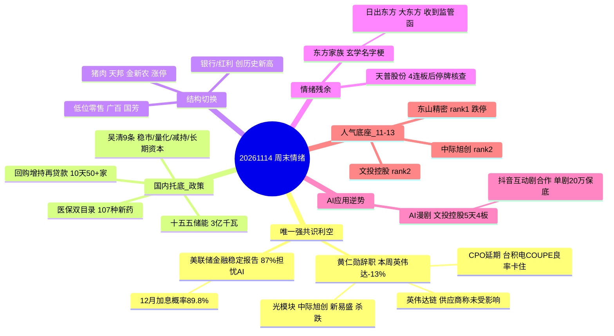

# 2026年11月14日 · **群聊情绪共振**（周末轻量档）

> **数据源新鲜度**: partial · **降级状态**: false · **置信度**: 0.42
> **覆盖窗口**: 11-13 06:02 → 11-14 18:02（36h，跨周五收盘 + 周六全天）· **主源**: 公众号 18 号池 105 篇 + 财联社快讯 2325 条 + 11-13 收盘人气/涨跌停基准
> **⚠️ 周末档口径**: 非交易日，本报告**不含**竞价、涨停家数、炸板率前瞻、情绪周期阶段推进等交易日字段；凡涉及盘中口径一律标 `not_available`，不做类比推算。

## 一句话结论

周末只有一个强共识利空——黄仁勋辞职把「AI 硬件链」的估值锚拔掉；国内政策（吴清表态／回购增持再贷款／储能方案）在托底，但没有一条能形成新主线。群聊 7 群 0 条，这次情绪判断**没有真人话语支撑**，只有公众号叙事与 11-13 收盘榜单。

## 情绪温度

**周末文本读数 42 / 100（不可与盘中 44.6 直接比较）**

| 项 | 数值 | 说明 |
|---|---|---|
| 11-13 盘中 R3 基线 | 44.6 | 已落盘 `data/research/20261113/R3_sentiment.json`，周五收盘口径 |
| 11-13 收盘结构 | 涨停 37 / 跌停 33 / 炸板 21 | 炸板率 36.2%（21/(37+21)，本地 `limit_list_d` 口径） 最高板 4（天普股份），梯队 1 板 30 / 2 板 4 / 3 板 2 / 4 板 1 |
| 指数 | 沪指 3634.35 −0.59% / 深成 10968.79 −2.05% / 创业板 2426.08 −3.32% / 科创综指 1516.41 −2.74% | 11-13 收盘（财联社 11-14 02:17 复盘稿），全周成交 8.31 万亿 |
| 周末新增负面 | −2.5 | 公众号 105 篇里约 15 篇直接讲英伟达治理／CPO 延期／美联储警告，全部风险叙事 |
| 周末新增正面 | +0.5 | 吴清 9 条稳市表态、储能十五五方案、医保双目录、回购增持再贷款加码（50+ 家） |
| **合计** | **42.2** | 扣到整数 42 |

温度结构是「**外冷内托、结构分化**」：跌停 33 家对涨停 37 家（37:33 ≈ 1.1:1）说明这不是普跌末期的恐慌，而是高位赛道被定点爆破、低位红利被资金抱住。银行五家（江苏／南京／青岛／成都／杭州）同日创历史新高，就是这个结构最直白的证据。

## 🗺️ 周末叙事全景图

## 五个在发酵的主题（三问）

### ① 英伟达治理真空 → AI 硬件链（负面，强共识，early→middle）

**大资金意图**：这不是业绩事件，是估值锚被拔掉。机构本周的动作是「降 β 而不是离场」——卖英伟达链（11-13 天孚通信／胜宏科技 −10%、生益科技跌停、中际旭创 −8%），买半导体制造（中芯 Q3 扣非 +107.3% 拿到基本面许可证）。同一批钱在换马甲，不是撤退。

**为什么走强**：反面在走强。周五费城半导体指数收盘跌超 3%（盘中最大 −6.4%，AMD −8.75%），但博通、AMD 前一日还涨超 5%，A 股中芯／华虹逆势上行——「英伟达跌 → 竞争对手涨」是这轮最清晰的一条对冲线。

**逻辑够不够硬**：硬（事件侧），但**已进入衰减段**。硬的部分：董事会已启动猎头、接触 Arm CEO Rene Haas、国会传唤商务部长与英伟达法务、Truist 把评级下调至持有、目标价 346→174（11-13 04:00，财联社）。衰减的部分：CFO 克雷斯临时接任说明治理是过渡态，一旦两周内定人，利空会快速失效；A 股供应商集体表态「合作无变化」，算力卡价格未显著波动（证券时报 11-14 08:08）。**这是一致性看空，一致性看空本身就是拥挤交易的反面**。

### ② 国产算力 / 晶圆代工（正面，硬业绩，middle）

**大资金意图**：机构在「海外叙事崩塌」时需要一个国内的确定性载体，中芯三季报正好提供了：单季营收 31.9 亿美元环比 +6.1%、净利 28.47 亿同比 +87.6%、扣非 +107.3%、毛利率 29.9% 环比 +4.6pct，Q4 指引环比 +4%~6%。华虹宏力同步抛 3–5 亿回购并注销（11-13，公告原文），把「便宜」这件事用现金流说出来。

**为什么走强**：量、价、利三线同向。8 吋当量季度出货首破 300 万片（环比 +5.7%）、平均晶圆单价环比 +1.8%、BCD／专用存储／Controller 等 AI 配套芯片拉货超预期（赵海军 11-13 业绩会）。这是产能利用率上升带动的链式受益，会外溢到设备／材料／封测。

**逻辑够不够硬**：硬，但有一个瑕疵——Q4 毛利率指引 26%~28% 低于 Q3 的 29.9%，说明折旧与产品组合仍有压力。所以这条线是「修复中段」不是「新高突破」，中芯 11-13 收盘 111.72 距 60 日高仍 −18.74%。

### ③ 重组复牌潮（正面，事件驱动，early）

**大资金意图**：两个停牌十天的方案同一天（11-16）复牌——TCL 中环（002129，收购中环领先 65.80%，持股 32.72%→98.52%，发行价 7.59 元）与中国稀土（000831，收购中稀凉山 51%，发行价 39.41 元）。周末把「半导体硅片」和「稀土资源」两个硬资产同时摆上桌，资金要的是复牌当日的定价权，不是长期逻辑。

**为什么走强**：两边都有业绩背书。中环领先 2026 前三季营收 49.0 亿 +15%，Q3 单季 18.6 亿 +23% 并率先实现单季经营性盈利 0.80 亿；中国稀土前三季预告归母 3.63–4.63 亿（+88.96%~140.99%）、扣非 +98.63%~152.94%（东财预告，报告期 2026-09-30）——稀土是本周少数「价格+业绩」同时向上的资源链。

**逻辑够不够硬**：中硬。硬的：国资+大基金三期（国投集新）背书、标的资产是行业第一、复牌时点明确。不硬的：两笔交易都**未完成审计评估、最终作价未定**，且 TCL 中环重组交易对手之一是晶盛机电——而晶盛机电 11-14 刚收到浙江证监局警示函（销售收入内控不规范），这是复牌当天必须盯的一处交叉风险。

### ④ 政策托底三件套（正面，但托底≠进攻，early）

**大资金意图**：吴清 11-14 在首届资本市场学术年会讲 9 条（稳市长效机制、大型科技企业发行制度适配、量化交易与减持规则优化、长期资本／耐心资本），叠加 11-06 国常会「完善资本市场稳市机制」和 11-04 起的回购增持再贷款（近 10 天 50+ 家披露专项贷款承诺函）。这一套组合的受体是**红利与大盘蓝筹**，不是题材小票——所以它兑现成了银行创新高，而不是涨停潮。

**为什么走强**：钱是实的。两融本周终结连续 7 周净卖出、转为融资净买入逾 188 亿（电子 +52 亿、机械 +23 亿、传媒/医药/电力设备各 >10 亿、仅银行 −3.56 亿），说明杠杆资金回来了，但方向偏制造与传媒。

**逻辑够不够硬**：制度层面硬，交易层面软。政策能压低尾部风险，但不能给某一条题材提供涨停理由；把它当「进攻信号」是错读。

### ⑤ 低位防御 + 玄学名字梗（分歧，late，含监管风险）

**大资金意图**：周五的涨停结构里，低位散点（零售/食品/渔业）与「东方」家族占了相当比重——东方海洋 +10.02%、日出东方 +10.03%、大东方 +9.95%、东方新能跌停但仍在人气榜。这是主线真空期的典型代偿：资金不去接力高位赛道，转而做「名字好记、位置低、没人砸」的票。

**为什么走强**：因为没别的地方可去。算力硬件在杀、机器人 −2.42%、CPO −1.78%，唯一逆势是 AI 漫剧与银行，前者容量小、后者不给弹性。

**逻辑够不够硬**：不硬，而且**已经收到监管回应**——上交所 11-13 对大东方、日出东方下发股价波动监管工作函（R4 11-13 E008），惠发食品、新华传媒同日发风险提示。玄学可以参与（用户口径），但「监管函 + 5 连板」的组合意味着这条线的剩余空间由情绪而不是逻辑决定，且随时被核查打断。

### ⑥（补充）AI 漫剧 / 短剧（正面，唯一逆势题材，middle）

抖音集团短剧版权中心开放互动剧与互动影游合作：单剧最高 20 万保底 + 30%~50% 额外分成，多项激励可叠加。周五 AI 漫剧走出独立行情：文投控股 5 天 4 板、金逸影视 4 天 2 板、幸福蓝海 20CM、横店影视／湖北广电／中国电影／儒意涨停。**大资金意图**：在硬件被杀的一周里找一个与海外 AI 叙事无关、纯国内政策+平台补贴驱动的题材做避风港。**为什么走强**：容量小、位置低、有平台真金白银的补贴作催化。**逻辑够不够硬**：题材级硬、产业级不硬——它已经连续走强 5 天，文投控股是人气榜 rank 2、多平台合力榜 rank 2，属于**中后段**而非启动段。

## 一致性预期拆解

**三种高度一致（越一致越要防反身性）**：
1. 「英伟达出事 → AI 硬件短期不能碰」——公众号 15 篇口径几乎完全一致，连「供应商未受影响」的采访都被写成风险提示。
2. 「政策在托底 → 红利/银行是避风港」——银行五家同日新高是这条共识的价格证据。
3. 「算力硬件杀、AI 应用（漫剧/短剧）承接」——周五盘面已经按这个剧本走完一天。

**两种明显分歧（分歧处才是赔率）**：
1. **国产算力能不能承接海外链的估值**：中芯硬业绩 vs 光模块杀估值，同一条 AI 链两种命运。分歧点在于「算力需求是否随英伟达治理事件下修」——目前 A 股供应商口供是「订单没变、卡价没波动」。
2. **CPO 的时间表**：市场默认 2027 放量，FUNDA 报告（经「傅里叶的猫」转述，单一来源）判断台积电 COUPE 的 W2W 键合良率上不去、测试设备供应商未定，大规模交付要到 2027 底甚至 2028。这一条只有一家公众号在讲，**证据等级是 medium 以下**，但它与英伟达事件叠加，是本周光模块被杀的第二根稻草。

## 人气底座（11-13 收盘榜单，11-14 未更新）

**跨平台合力（东财人气 + 同花顺热股双榜在列，avg_rank）**：日出东方 2.0、文投控股 2.0、东方海洋 2.5、华胜天成 4.5、中际旭创 7.5、大东方 8.0、东山精密 8.0、九阳股份 8.0、襄阳轴承 10.5。

**周末持续在榜（11-11/12/13 三日连续，best_rank）**：东山精密 1、日出东方 1、东方海洋 1、中际旭创 2、文投控股 2、大东方 3、新易盛 4、阳光照明 4、襄阳轴承 5、冰山冷热 9、龙江交通 13。
> 注意：东山精密三日霸榜 rank 1 且周五**跌停**（1600 亿市值巨头，CPO 方向）——按红线 4，霸榜第一 + 股价反向 = 出货警报，不能当正向共振。

**跳升（surge，11-13 相对前一日）**：华胜天成 85→3（+82）、天普股份 45→7（+38）、日发精机 49→13（+36）、凯撒文化 56→20（+36）、贵州茅台 68→36（+32）。**首进榜**：中国电影 rank 10、金新农 rank 30、福达股份 rank 40、通化金马 rank 48。

**11-14 榜单状态**：`not_available`（四榜全 0，非交易日未更新）——周末新增发酵无法用人气验证，这是本报告置信度只有 0.42 的主因之一。

## 公众号观点（宏观与情绪，无板块命中的单列）

- **英伟达一役的三层读法**：产业层（供应链未变、卡价未波动）、治理层（董事会寻猎头、国会介入、集体诉讼未结）、叙事层（AI 资本开支的确定性从「个人」转到「流程」）。「远川研究所」11-14《大动脉辞职了怎么办》与「贩财局」的段子化处理，说明这件事已经从财经事件变成社会话题——**社会话题化通常意味着情绪定价接近尾声而非开始**。
- **美联储**：11-13 发布半年度《金融稳定报告》，87% 受访者把 AI 列为显著风险；12 月加息 25bp 概率 89.8%（CME，11-14 05:41）。美银把预测改成 12 月、1 月、3 月连续三次加息至 4.5%~4.75%。这是压制全球高 β 的第二只手。
- **国内**：吴清 9 条 + 人民日报头版（习近平对国企党建作重要指示）+ 中美经贸磋商机制贸易理事会首次会议（11-14）——政策与外交两条线都在释放「稳」的信号，与海外叙事形成对冲。
- **微观情绪**：「金渐成」11-13《此刻心定~》、「股痴流沙河」《无常》、「猫笔刀」《啧啧，全是套路》——大 V 的标题从「判断」退化到「感慨」，是典型的**主线真空期话语特征**。

## 关键证据

- 证据 1：英伟达本周 −13%~−14%、连续第六周下跌（2012 年以来最长），11-13 费半收盘跌超 3%、盘中 −6.4%（财联社 11-14 05:00/05:01 收盘稿）
- 证据 2：A 股供应商口供与股价背离——天孚通信/胜宏科技 −10%、生益科技跌停、中际旭创 −8%（11-13 收评），而多家供应商称「合作没有变化、算力卡价格未显著波动」（证券时报 11-14 08:08）
- 证据 3：结构切换的硬证据——江苏/南京/青岛/成都/杭州银行同日创历史新高；同日跌停 33 家、涨停 37 家、炸板 21 家（本地 `limit_list_d` 11-13 口径）
- 证据 4：政策托底的三条实锤——吴清 9 条（11-14）、十五五储能方案 3 亿千瓦（11-13 两部委）、医保双目录新增 107 种（11-14）
- 证据 5：杠杆资金转向——两融本周终结连续 7 周净卖出、融资净买入逾 188 亿（电子 +52 亿、机械 +23 亿、仅银行 −3.56 亿，证券时报 11-13 16:36）
- 证据 6：人气与价格背离——东山精密三日霸榜第一但 11-13 跌停（`attention_weekend.json` weekend_persistent best_rank 1 + `limit_list_d` 跌停），按红线 4 记出货警报

## 数据源审计

| 源 | 日期 | 状态 | 记录数 | 备注 |
|---|---|:--:|---|---|
| wechat_cli_5groups（7 群匿名） | 2026-11-13→14 | 🟡 | 0 | 7 群 status 全 ok 但 0 条、文件 0 字节。连续第二日断更（11-13 同为 0 条），KOL 层实质缺席 |
| wechat_official_rss（18 号池） | 2026-11-14 | 🟢 | 105 | 11 号有文章 / 7 号空（ymj0418、安静拆主线、盘口逻辑拆解、调研先知、李迅雷、财闻私享、预期差寻找） |
| tushare/news_cls | 2026-11-12→14 | 🟢 | 2325 | 窗口 11-12 21:03 → 11-14 08:57 |
| attention_signals（11-13 基准） | 2026-11-13 | 🟢 | 人气 100 / 飙升 100 / 同花顺热股 99 / 概念 20 | persistent 1978、surge 16、跨平台合力 62 |
| attention_weekend | 2026-11-14 | 🟡 | 25 | 11-14 四榜全 0 → `not_available`（非交易日，不置 degraded）；weekend_persistent 25 只用 11-11~13 |
| limit_list_d（周五收盘基准） | 2026-11-13 | 🟢 | 91（U37/D33/Z21） | 炸板率 36.2% 为本地口径，与 R1 11-12 的 48.61% 不同日不可比 |

## 不确定性 / 反证

1. **群聊 0 条 → 本报告的「一致性预期」是公众号 + 榜单的一致，不是真人话语的一致**。公众号有立场偏向（官媒偏稳、大 V 偏感慨），用它单独判情绪会系统性偏乐观。这是置信度压到 0.42 的核心理由。
2. **周末没有新榜单**，所谓「周末发酵」我只能从文本里判断，无法用热度验证；若周一出现「周末讲得多、竞价没人接」的票，就是文本过热而非资金过热。
3. **一致性看空的陷阱**：英伟达链的利空已经被定价了三天（11-12 起），周一若出现「低开高走 + 光模块翻红」，那不是利空失效，而是空头挤压——两种解释都成立，必须以竞价与开盘 30 分钟资金为准。
4. **CPO 延期的证据只有一家号在讲**（傅里叶的猫转述 FUNDA 报告），我把它定为 medium 以下，不进「强共识」，只在分歧项里记录。
5. **玄学名字梗与监管函同时出现**：日出东方/大东方已收监管工作函，如果周一继续涨停，风险来自核查而非逻辑。这一类不计入任何共振主题的正向分。
6. **霸榜第一的东山精密周五跌停**：人气与价格背离，按红线 4 记为出货警报；它在 CPO 方向，与主题①同源，等于给「AI 硬件杀」加了一条侧面证据。

## 与其他 R/D/E 的关系

- **依赖**: `data/raw/20261114/`（群聊／公众号／财联社）· `data/research/20261113/attention_signals.json` · `data/research/20261114/attention_weekend.json` · `data/raw/20261113/limit_list_20261113.json`（周五收盘基准）
- **被消费**: R4 消息面（叙事交叉）· R2 主线板块（周末题材候选）· D1 盘前决策（情绪温度与仓位环境）· E1 复盘（一致性预期的事后校验）

## Sub-Agent 元数据

- skill: analyze_sentiment_resonance_v1（weekend_light 变体）
- artifact: 本文件（周末档不落 `data/research` JSON，遵守「只写 data/raw 与 chzl_kg」的边界）
- method: 双源（公众号 + 11-13 榜单）文本共振；群聊层缺失，共振上限 L1_only（红线 3：L1_only 不算强共振）
- 生成时刻: 2026-11-14T18:11:00+08:00
