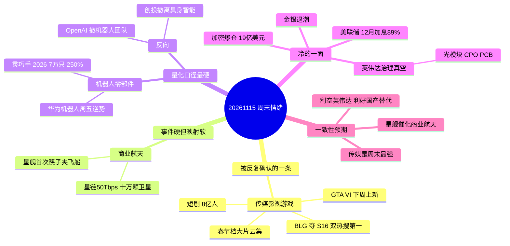

# 2026年11月15日 · **群聊情绪共振**（周末轻量档）

> **数据源新鲜度**: partial · **降级状态**: false · **置信度**: 0.40
> **覆盖窗口**: 11-14 18:02 → 11-15 18:02（24h，周六晚→周日晚）· **主源**: 公众号 18 号池 39 篇 + 周末自然日榜单 + 11-13 收盘人气/涨跌停基准
> **⚠️ 周末档口径**: 非交易日，本报告**不含**竞价、涨停家数前瞻、炸板率前瞻、情绪周期阶段推进等交易日字段；所有盘中口径标 `not_available`，不做类比推算。**不写买卖建议、不给买卖点。**

## 一句话结论

周末只有一个被反复确认的题材——传媒影视游戏电竞（事件流而非一次性消息）；情绪温度 **43/100**，偏冷但结构不坏，因为钱在极窄的缝里抱团而不是在退场。

## 情绪温度

**周末文本读数 43 / 100（不可与盘中 44.6 直接比较）**

| 项 | 数值 | 说明 |
|---|---|---|
| 11-13 盘中 R3 基线 | 44.6 | 已落盘 `data/research/20261113/R3_sentiment.json`，周五收盘口径 |
| 11-13 收盘结构 | 涨停 37 / 跌停 33 / 炸板 21 | 炸板率 **36.2%**（21/(37+21)）；最高板 4（天普股份，11-14 已停牌核查）；梯队 1 板 30 / 2 板 4 / 3 板 2 / 4 板 1（本地 `limit_list_d`） |
| 11-13 广度 | 涨 765 / 跌 4748，涨家占比 **13.7%**，中位 **−2.00%** | `daily_20261113` 5571 只；成交 1.67 万亿 |
| 指数 | 沪指 3634.35 −0.59% / 深成 −2.05% / 创业板 −3.32% / 科创50 −2.30% | `index_daily` 20261113 |
| A1 传媒事件簇 + 周五 8 家传媒涨停 | **+2.0** | 4 条独立催化 + 开盘秒板结构 |
| A2 商业航天硬事件（星舰捕获，4 源） | **+1.0** | 工程里程碑 + 全球传播 |
| A3 灵巧手纪要 + 华为机器人周一路演锚 | **+0.5** | 有量化出货口径（7 万只/+250%） |
| A4 机器人叙事反向（创投撤离/OpenAI 撤团队） | **−1.0** | 资本开支降温，整机侧转弱 |
| A5 英伟达治理真空延续 + 财报 11-18 凌晨 | **−1.5** | 光模块/CPO/PCB 净分 −0.78 |
| A6 美联储 12 月加息定价 89% + 加密崩/金银退潮 | **−1.0** | 全球风险偏好压制 |
| A7 KOL 层连续第三日 0 条 | **−1.0** | 缺真人话语确认 |
| A8 周五广度 13.7% + 跌停 33 | **−0.5** | 结构未修复 |
| **合计** | **43.1 → 43** | 扣到整数 43 |

温度结构是「**外冷内热、极窄抱团**」：13.7% 的上涨家数配 8 家传媒涨停，说明资金不是在扩散，而是在**挑一个最窄的缝往里挤**。这种结构的特点是：**指数怎么走都不影响题材，但题材一旦断，全市场没有第二个承接点**。

## 🗺️ 周末叙事全景图

## 1️⃣ 群聊层：7 群 0 条（连续第三日）

`wechat_cli_5groups.jsonl` 7 个群状态全部 `ok`，但**一条消息都没有**，文件 0 字节。这不是抓取失败，是本周彻底静默（11-13、11-14、11-15 三连）。

后果很具体：
- **没有任何 L1+L2 共振**。按本 skill 枚举，WeFlow 下线后共振上限是 `L1+L2`，而 L2（KOL 文本）这一层现在是空的 → 本档**没有任何主题能达到 `L1+L2`**。
- 按红线 4，`L1_only`（仅热榜）与 `L2_only`（仅 KOL）都**不得进入 `resonance_top_themes`**。所以本档**正式共振主题 = 0 条**，下面列的是「观察主题」，不是「共振主题」。这个区别很重要：共振意味着两个独立层面同时确认，现在只有一面。
- 置信度因此压到 **0.40**（低于 11-14 档的 0.42，因为叠了新闻窗口缺口）。

## 2️⃣ 公众号层：39 篇 / 10 号有文章

18 号池里 8 个号本窗口 0 篇（盘前纪要、股痴流沙河、ymj0418、安静拆主线、盘口逻辑拆解、远川研究所、金渐成、预期差寻找）；有文章的 10 个号里，**财闻私享 11-15 10:20 的「周末 A 股值得关注的资讯」是唯一一份完整的周末题材清单**，它把影视、游戏电竞、机器人、国产替代、医药、商业航天、储能、AI、网络安全、冰雪十条线一次列全——这份清单可以直接当「一致性预期样本」读。

公众号口径的两个特征：
- **官媒（证券时报/上证报）几乎只在报事实**（星舰、调价、医保、央行），不做板块结论；
- **自媒体（财闻私享、调研先知、贩财局、猫笔刀）在做定性与情绪引导**——尤其调研先知 13:24「失去黄仁勋=重大利空」把人事事件拔到「美国情报界推动 + 管制加码」的地缘高度，这是本窗口**情绪浓度最高的一段文字**。

## 3️⃣ 共振结论：0 条达标，五个观察主题（单源）

| # | 观察主题 | 共振等级 | 公众号源 | 热榜侧 | 位置/年龄 | 备注 |
|:--:|---|:--:|:--:|---|:--:|---|
| 1 | 传媒/影视游戏电竞 | `L1_only` | 5 源（财闻私享/证券时报/同花顺/经济日报/财联社） | 短剧游戏概念 #2、文化传媒 #14、人气榜文投/凯撒/中国电影 | 板块 1 日龄（11-13 首爆），**early** | 唯一「事件流」题材，但历史上一日游概率高 |
| 2 | 商业航天 | `L1_only` | 4 源（财联社/证券时报/上证报/财闻私享） | 概念榜 #4（11-14） | 11-10 后休整一周，**middle** | 映射软（无 A 股订单关系） |
| 3 | 人形机器人零部件 | `L1_only` | 2 源（财联社早知道纪要 + 财闻私享） | 人形机器人 #5、机器人概念 #8 | 11-13 R3 记 **late**（已派发） | 纪要给了唯一可验证口径；整机侧反向 |
| 4 | 存储/面板涨价链 | `L1_only` | 4 源（上证报 ×2、同花顺、华尔街见闻） | 存储芯片 #18、光伏 #13 | **middle**（涨价已走数季） | 上游正面、整机负面，须按环节拆 |
| 5 | 创新药/医保 | `L1_only` | 5 源（财联社/同花顺/上证报/各药企公告） | 创新药 #3、飙升榜百利天恒 #1 / 诺诚健华 #3 / 诺思兰德 #13 / 迪哲 #14 | 11-14 已定价（通化金马涨停），**middle** | 唯一在「飙升榜」上有真人气支撑的线 |

**为什么把它们都标 `L1_only`**：L1（热榜/概念榜）有数据，L2（KOL）为 0，L2b（公众号）按 skill 规定「只当观点证据、不计入共振等级」。所以它们只能是观察主题——**这不是我保守，是枚举定义**。

## 4️⃣ 五个观察主题的深度三问 + 观察对象思维链

> 以下「观察对象」一律**不是推荐**，周末档不构成任何买入依据；四段里的「失效条件」是**观察作废条件**，不是止损指令。

### 主题 1 · 传媒影视游戏电竞（唯一被四条独立催化同时命中的方向）

- **大资金意图**：在 13.7% 广度的市场里，资金需要一个「位置低 + 筹码干净 + 事件能连续供给」的容器。传媒三者齐备：多数票 8 日涨幅 10–20%（不是高位赛道）、11-13 是**首次集体爆发**（8 家涨停、其中 5 家开盘 10 分钟内封板）、事件是**时间序列**（GTA VI 下周上新 → S16 夺冠 → 春节档），不是一次性。
- **为什么走强**：周五已经完成第一轮确认，周末催化是在「有筹码的地方再加燃料」。最有说服力的细节是封板时间——横店 09:33、文投 09:30、湖北广电 09:36、金逸 09:32，全部秒板；文投控股更极端：11-12 炸板 8 次，11-13 **0 次开板、封单 2.46 亿**。同一只票两天内从烂板变铁板，说明主导资金换了一批。
- **逻辑够不够硬**：**中等偏硬**。硬的：封板结构 + 催化密度 + 人气榜前三（文投三日第一、凯撒第 6、中国电影第 10）。不硬的：票房与游戏流水兑现要到 2027 春节/上市后，短线只有情绪；且这是老题材，11-12 还在派发（上海电影跌停、芒果超媒 −9.54%）。**真伪分水岭只有一个：周一出不出新首板。**

**观察对象 A：文投控股 600715**（人气榜三日第一，情绪龙头）
- **买入理由（=它为什么值得盯）**：11-13 涨停且 0 开板、封单 2.46 亿、首封 09:30，是当日最干净的一板；东财人气榜 11-12/13/14 连续第一；游戏Ⅱ 直接吃 S16 + GTA VI 双催化；流通 97.3 亿、换手 10.9%，弹性与流动性都在。
- **风险点**：**人气榜连续第一本身就是派发警报的必要条件**（红线 4，不能当正向加分）；8 日累计已 +37.7%，位置不低；同一票两天前还是炸板 8 次的烂板，说明筹码极不稳定。
- **失效条件（结构位）**：周一冲高后 30 分钟内跌破开盘价且封单撤到 5000 万以下 → 按「人气龙头派发」处理，它作为板块温度计的价值归零。
- **可验证假设**：若周一传媒涨停家数 ≥5 且**新首板 ≥2**，板块延续；若只有文投/中国电影连板、新面孔为 0，则「抱团一日游」，板块寿命 ≤2 日。

**观察对象 B：中国电影 600977**（票房主线中军）
- **买入理由**：11-13 涨停（开板 5 次后回封），流通 318.3 亿，是传媒里唯一能承接大资金的中军；直接对应春节档大片云集的票房修复；人气榜 11-13/11-14 均第 10。
- **风险点**：PE(TTM) **2564 倍**（`daily_basic` 20261113）——纯叙事定价，没有业绩；封单仅 2878 万、开板 5 次，筹码不牢。
- **失效条件**：跌破 11-13 收盘 −5%（约 16.2）视为叙事失败。
- **可验证假设**：若周一中国电影弱于影视小票（幸福蓝海/横店/金逸），说明资金偏好低价高弹性，中军只是「讲给机构听的」，实际战场在小票——这决定后续跟哪一层。

### 主题 2 · 商业航天（事件最硬，A 股映射最软）

- **大资金意图**：可复用性 = 航天 economics 的唯一变量。机械臂捕获让发射成本曲线再次下折，这条曲线直接决定国内「卫星互联网组网节奏」的估值模型。资金买的不是 SpaceX，是**国内对标环节的估值锚**。
- **为什么走强**：工程里程碑可见（视频/照片全市场传播）、4 源共振、官方媒体全程跟进、且叠加国内航展临近与太空建造。但要注意 **11-13 涨停池里商业航天 0 家**——这条线已休整至少一周（11-10 R2 给过 84 分、stage=climax，之后进入分歧）。
- **逻辑够不够硬**：**叙事硬、映射软**。SpaceX 与 A 股没有可验证的订单关系，这不是特斯拉产业链那种能对账的关系；且板块刚过 climax（11-10 中国卫星炸板 2 次、信维炸板 1 次）。所以它是「主题脉冲」的候选，不是「主线重启」的候选。

**观察对象：中国卫星 600118**（板块中军温度计，`proxy_dongcai_lead_stock`，非 LLM 精选）
- **买入理由**：11-13 收 55.83（−2.58%），距 5 日线 −3.7%、8 日 −0.6%（横盘消化，未破位）；流通 660.2 亿、换手 3.10%，是唯一能承接大资金的中军；11-10 R2 打分 CV 1.00 的第一龙头。
- **风险点**：PE(TTM) **624.7 倍**；climax 后退潮期，中军典型「涨得慢跌得快」；代理属性——D1 消费时只应入观察池。
- **失效条件**：冲高后收在 5 日线（57.95）下方且成交额萎缩至 10 亿以下 → 脉冲失败。
- **可验证假设**：若周一板块内**低位新面孔首板 ≥2 且中军收阳**，主题重启；若只有中军拉、小票不跟，一日脉冲。

### 主题 3 · 人形机器人零部件（量化口径最硬，但整机在退）

- **大资金意图**：这条线正在**从「整机叙事」切到「零部件放量」**。整机讲 2027 年后的想象，零部件讲 2026 年 7 万只手的真实出货——能被季报验证的才敢拿。
- **为什么走强**：财联社 VIP 纪要给出唯一可验证数字（2025 年 2 万只 → 2026 年 7 万只、+250%，价格分层 5000 元→3 万→4-10 万/只），且点名到具体公司具体产品；盘面上 11-13「华为机器人」已逆势领涨（资金先动、纪要后到）。
- **逻辑够不够硬**：**双向但不矛盾**——零部件硬、整机软。软的三个证据：专家自承「年度 1–2 万只目标已难完成」、OpenAI 撤销独立机器人团队（通用模型可直接用于物理 AI）、财联社 08:22「创投资本撤离具身智能、回流半导体」。所以这条线只能买「有产品有订单」的，不能买「挂概念的」。

**观察对象：兆威机电 003021**（全直驱唯一商业化标的）
- **买入理由**：纪要明确「已推出商业化高自由度全直驱灵巧手，指关节内置微型驱动模组」，三条路线里集成度最高；11-13 收 95.86（−2.69%），距 5 日线 −5.7%、8 日 +3.2%（横盘未破位）；流通 199.6 亿。
- **风险点**：纪要属 VIP 付费内容，传播半径小；11-13 未提前抢筹说明市场认知滞后；PE(TTM) 131 倍，估值已含机器人预期。
- **失效条件**：跌破 11-13 低点且缩量 → 纪要未被定价。
- **可验证假设**：若周一放量收阳（成交额 >10 亿），说明纪要已被卖方/游资消化；若缩量，则等 12 月初 Optimus 进展的二次催化。

### 主题 4 · 存储/面板涨价链（同一条链内部极性分裂）

- **大资金意图**：这是**成本推动型通胀链**，不是需求扩张。资金的真实动作是往上游原厂/材料端挤（存储原厂、玻纤、玻璃基板），而不是往整机端挤——整机是被挤压方。
- **为什么走强**：涨价是「可量化、每周更新」的硬变量。11-13 盘面给了最直接的证据：半导体是全市场唯一逆势承接的成长方向（+23.53 亿、寒武纪/源杰科技主力净流入居前）；业绩侧德明利预告 +32046%~33154%、长鑫科技扭亏净利 1325 亿、江波龙 +1865%~1991%。
- **逻辑够不够硬**：**硬但有边界**。硬：终端调价（大疆 11-18）+ 周度价格 + 业绩预告三重确认。边界：整机被挤压（影石创新「存储涨价使短期盈利承压」、TCL科技「苦日子要熬」），且存储已连涨多季，属周期中后段——同比越炸裂越要警惕见顶（v1.5 协议）。

**观察对象：TCL科技 000100**（面板成本推动的中军）
- **买入理由**：11-13 收 4.56（+2.24%），流通 917.2 亿、换手仅 1.88%（筹码极稳）；赵军把「成本推动而非需求拉动」讲清楚，并给出 2027 折叠机 +36% 的结构增量；同集团 TCL中环 11-14 重组复牌，集团事件密度高。
- **风险点**：面板是转嫁成本不是扩利；存储涨价抑制终端需求（Q3 手机出货 −15.4%），量下滑会反噬面板出货。
- **失效条件**：面板 Q4 报价未落地 ≥5%，或跌破 5 日线（4.55）。
- **可验证假设**：若周一面板（TCL科技/京东方）与存储（德明利）同向且面板更强，说明市场买「涨价链扩散」；若只有存储强，面板只是补涨。

### 主题 5 · 创新药/医保（唯一在飙升榜上有真人气的线）

- **大资金意图**：医保准入是**现金流级利好**（进目录 = 放量确定性），资金买的是「从获批到进保不到一年」的兑现速度，而不是故事。
- **为什么走强**：11-14 双目录落地——基本医保新增 107 种（其中 51 个 1 类创新药）、商保创新药目录 +12 至 28 种，CAR-T 首次进保（原价 129 万/支 → 患者自付 <10 万）；江苏占新进药品 1/3；周末各药企（百济、信达、亚盛、再鼎、诺华、默沙东、礼来）陆续公告。**飙升榜是这条线最硬的证据**：百利天恒 #1、诺诚健华 #3、诺思兰德 #13、迪哲 #14（11-14）。
- **逻辑够不够硬**：**硬，但已定价**。11-14 盘面已反应（通化金马涨停）；飙升榜=关注度突增，通常是「消息当天」的特征，周一属于第二段。真正没定价的是**商保目录 28 种**这条（市场讨论明显少于基本医保）。

**观察对象：百利天恒 688506**（飙升榜第一）
- **买入理由**：11-14 飙升榜 **#1**，是周末医药里关注度跳升最快的一只；自身创新药（宜泽康）纳入 2026 医保目录（公司 11-14 公告）；流通 1032.4 亿、换手仅 0.25%（筹码高度锁定）。
- **风险点**：11-13 收 250.05（−1.06%），距 5 日线 −2.6%、8 日 −3.9%——**榜上热、盘面冷**，说明是「消息关注」而非「资金进场」；换手 0.25% 意味着流动性差，大资金进出困难。
- **失效条件**：周一若放量下跌，说明飙升榜只是资讯驱动，不是资金驱动。
- **可验证假设**：若周一医药出现 ≥3 家首板（含非医保票），说明板块级扩散；若只有百利天恒一只异动，则医药仍是「消息票」而非「板块」。

## 📈 人气与概念榜交叉（参数源，不计入共振）

- **跨日连续在榜 24 只**（11-12→11-14，任一平台连续在榜）：东方海洋（3 日、best 1）、日出东方（3 日、best 1）、文投控股（3 日、best 1）、大东方（3 日、best 3）、好当家（3 日、best 4）、襄阳轴承（3 日、best 5）、中际旭创（3 日、best 6）、阳光照明（3 日、best 7）、东山精密（3 日、best 8）、冰山冷热（3 日、best 9）、华胜天成（2 日、best 2）、北纬科技（2 日、best 3）、蓝色光标（2 日、best 4）、凯撒文化（2 日、best 6）、天普股份（2 日、best 7）、日发精机（2 日、best 7）、吉视传媒（2 日、best 8）、九阳股份（2 日、best 9）、锋龙股份（2 日、best 10）、中国电影（2 日、best 10）、皇台酒业（2 日、best 11）、新华传媒（2 日、best 12）、龙江交通（2 日、best 13）、新易盛（2 日、best 14）。
- **读法**：24 只里传媒/短剧占 6 只（文投控股、凯撒文化、中国电影、新华传媒、吉视传媒、蓝色光标），**这是「人气」层面对传媒主题的独立确认**；「东方系」（东方海洋/日出东方/大东方）占 3 只且都在 3 日连榜——名字玄学集群仍在，但 11-13 已见分化（东方海洋 −6.59%、大东方 −10.03%、日出东方 +5.54%）。
- **11-14 概念榜 top10**：猪肉 #1、短剧游戏 #2、创新药 #3、商业航天 #4、人形机器人 #5、AI 应用 #6、芯片概念 #7、机器人概念 #8、储能 #9、CPO #10。
- **注意榜单的滞后性**：11-14 是周六，四榜用的是**11-13 收盘的存量热度**（平台在非交易日不更新）；11-15 当日四榜全 0 → `not_available`。所以「周末发酵」只能用 11-14 的榜单代表「周五收盘的热度」，不能代表「周六周日新增加的热度」——这部分只能靠公众号。

## 🔁 一致性预期与反向剧本（本档最重要的部分）

周末公众号的共识度异常高，**共识本身就是风险**：

1. **「英伟达利空 = 国产替代利好」**（财闻私享官媒口径 + 调研先知 + 11-13 盘面已先行）
   - 反向剧本：这条逻辑的成立依赖「管制真的加码」。若 11-18 凌晨英伟达财报超预期、或新 CEO 任命落地，海外 AI 链反弹，国产替代的「替代紧迫性」会被瞬间削弱——**同一天可能出现「光模块反弹 + 国产算力回落」的镜像**。
2. **「传媒是周末最强」**（4 条独立催化 + 周五 8 家涨停 + 人气榜前三）
   - 反向剧本：一致预期高开 → 若开盘 30 分钟内没有新首板，就是 consensus 兑现即卖出。传媒最危险的形态是「老龙高开、小票不跟」。
3. **「星舰 = 商业航天催化」**（4 源 + 全球传播）
   - 反向剧本：板块 11-10 已 climax，休整一周期间无涨停承接；「一致预期 + 高位」组合的最优解往往是反抽卖出，不是重新上车。看中军（中国卫星）能否放量收阳，而不是看小票乱涨。
4. **「医保双目录 = 创新药利好」**（107+12、CAR-T 首入保）
   - 反向剧本：11-14 已定价（通化金马涨停）。真正没被充分讨论的是**商保目录 28 种**这条，若市场把焦点全放在基本医保，第二段就没了。

**这四条的共同结构**：事件都真、都已被周五或 11-14 定价一部分，周一都属于「第二段」。第二段的胜负不取决于新闻，取决于**竞价与开盘 30 分钟的量能**——这正是 D1 与竞价环节该管的，不是本档该猜的。

## 数据源审计

| 源 | 日期 | 状态 | 备注 |
|---|---|:--:|---|
| wechat_cli_5groups 群聊（7 群匿名） | 11-14→11-15 | 🔴 | 7 群 ok 但 0 条、0 字节（连续第三日）；KOL 层完全缺席 |
| wechat_official_rss 公众号 | 11-14→11-15 | 🟢 | 39 篇 / 10 号有文章（18 号池） |
| attention_weekend 周末榜单 | 11-12→11-15 | 🟢 | 跨日连榜 24；11-15 四榜全 0 → not_available（非交易日，非故障） |
| attention_signals 人气管道 | 解析日 11-13 | 🟢 | 554KB，人气 100 / 飙升 100 / 热股 99 / persistent 1978 / surge 16 / 合力 62 |
| limit_list_d 周五结构 | 11-13 | 🟢 | 91 行（U37/D33/Z21），炸板率 36.2% |
| index_daily 指数 | 11-13 | 🟢 | 沪指/深成/创业板/科创50 四指数齐全 |
| news_cls 财联社快讯 | 11-14→11-15 09:00 | 🟡 | 654 条，09:00 后 9 小时缺口 |
| weflow 语义共振 | — | ⚫ | 2026-08-19 永久下线，本档不调用不编造 |
| xtick MCP | — | ⚫ | 本档未调用（与 5 分钟异动任务错峰，避免争配额） |

## 不确定性 / 反证（自我批判）

1. **本档没有任何「共振」，只有「单源观察」**。这是元问题：KOL 层连续三天 0 条，我把 5 个主题的强弱判断全部建立在公众号 + 热榜上。公众号是一个**有立场、有选题偏好**的样本（财闻私享一天能列 10 条题材，属于「必列清单式」写作），热榜则是**滞后一天的存量热度**。两者的交集不能等同于「市场共识」。
2. **情绪温度 43 的可比性有限**。基线 44.6 是 11-13 盘中口径（含涨停/炸板/资金五维），我的 43 是文本读数（公众号叙事 + 收盘结构 + 增量调整）。两者不同量纲，不能画趋势线，只能各自看水位。
3. **人气榜「连续第一」可能是陷阱**。文投控股三日第一、华胜天成两日第二——按用户纪律，霸榜是出货警报的必要条件，我在报告里既用它当温度计，又把它标成风险，这个张力必须保留（不能只挑对自己结论有利的一面）。
4. **机器人这条线的判断最可能出错**。纪要的量化口径（7 万只/+250%）很硬，但同一窗口里有 OpenAI 撤团队、创投撤离两条反向证据。如果本体厂（宇树/智元类）2026 出货不及预期，「零部件放量」的锚会比纪要更早失效——纪要的专家自己都承认「1–2 万只目标难完成」。
5. **传媒的「事件流」叙事可能是我的一厢情愿**。真实情况可能只是「周五游资找了一个低价板块做一天」，周末四条催化是**事后归因**。这个可能性必须留给 D1：若周一传媒不出新首板，就该承认本档对它的定性过强。

## 与其他 R/D/E 的关系

- **依赖**：`data/raw/20261115/wechat_official_rss.jsonl`（39 篇）、`wechat_cli_5groups.jsonl`（0 条）、`data/research/20261115/attention_weekend.json` + `attention_signals.json`（人气/概念榜）、`data/raw/20261114/limit_list_20261114.json` + `index_daily_20261114.json`（11-13 收盘结构）、`data/research/20261113/R3_sentiment.json`（44.6 基线）
- **被消费**：R2 主线板块（本档 5 个观察主题）、R4 消息面（事件与主题交叉互证）、D1 盘前预案（温度与一致性预期）、R6 反证（四条一致性预期的反向剧本）、E2 周度进化（KOL 层连续三日断更的度量）

## Sub-Agent 元数据

- skill: analyze_sentiment_resonance_v1@1.0（周末轻量档，不产出 `data/research/20261115/R3_sentiment.json`，按 cron 约束只写 chzl_kg）
- artifact: chzl_kg/投研交易/群聊情绪/20261115.md
- method: llm_v1（双源 + 参数源，WeFlow 下线后最高等级 L1+L2 本档不可达）
- 生成时刻: 2026-11-15T18:34:00+08:00
