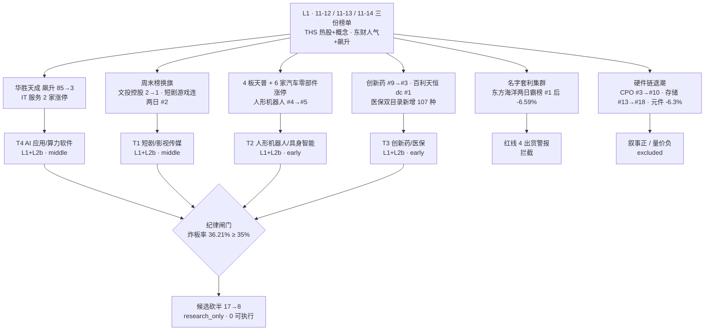

# 2026-11-16 · **群聊情绪共振**

> **数据源新鲜度**: partial（L1 榜单 🟢，群聊 🔴，WeFlow 🔴）
> **降级状态**: true — 共振上限 L1+L2b，真等级 **L1_only**
> **置信度**: 0.50（0.70 × 0.80 × 0.90）

## 一句话结论

**双轮（短剧/传媒 + 机器人）在注意力上站稳、在资金上没跟上**；情绪 29.2（恐惧），炸板率 36.21% 越过 35% 硬红线 → 候选砍半、**零开仓资格**，今日只验证不进攻。

## 情绪读数：基线 28.7 → 29.2

| 维度 | 读数 | 解读 |
|---|---|---|
| 当日 R1 基线 | `28.7` · 恐惧 · 崩溃退潮型 | 阶段 high_chop 第 3 天（连跌 2 天 · repair_window），仓位上限 0.10；**未使用前一日 R1（47.1）** |
| 涨停 / 跌停 / 炸板 | `37 / 33 / 21` | 炸板率 **36.21%** ≥ 35% 硬红线；跌停 33 家 > 涨停 37 家 |
| 天梯结构 | `1 板 30 · 2 板 4 · 3 板 2 · 4 板 1`（最高天普股份） | 首板占比 81.1%，**5 板以上空缺 = 无总龙**，接力链条短 |
| 昨日涨停溢价 | 开盘 `-0.50%`、**收盘中位 -4.27%**（红盘率 37.8%），再涨停 7 只 | 追板即亏，隔日接力不成立 |
| 广度与量能 | 涨 744 / 跌 4415（14.4%）· 中位 `-1.96%` · 成交 16555 亿（-14.31%） | 缩量下跌，亏钱效应扩散 |
| 主力资金 | 单日 `-605.71 亿`（前一日 -525.12），两日 `-1130.83 亿` | 超大单 -320.71 / 大单 -284.99，中小单 +589.54 → **派发结构** |
| ETF / 两融 | 7 只宽基 ETF 全线净赎回（科创50ETF -43.32 亿份）；两融 SSE 5 日仅 +4.27 亿 | 无增量资金，指数缺乏修复弹药 |
| R3 修正 | **+0.5**（8 项） | 共振 +3.0、周末发酵 +2.0、硬事件 +1.5、政策托底 +1.0；对冲名字套利派发 -2.0、诱多烂板 -1.5、资金面 -2.0、外盘逆风 -1.5 |

**五维交叉校验**：`score_5d = 24.5`（涨停强度 30 / 跌停压制 20 / 连板结构 25 / 炸板维 0 / 杠杆外资 40），`r3_vs_5d_gap = 4.7 < 15` → **无背离**。5 维法更低是因为炸板维直接归零、连板断层；R3 双源法把「周末发酵 + 今日硬事件」的期权价值计入 3.5 分。北向自 10-28 停抓，杠杆外资维取中性 40 为估计值，已在数据缺口列明。

## 双源共振全景

## 共振主题 Top4

### 1️⃣ 短剧/影视传媒（AI 影视·院线·游戏）· `middle` · research_only

| 证据层 | 内容 |
|---|---|
| L1 概念 | 短剧游戏 `#10（11-12）→ #2（11-13）→ #2（11-14）`；影视院线行业 `#1`（11-14，+4.37%）；文化传媒概念 #16→#14 |
| L1 个股 | 文投控股 ths 热股 `#2 → #1`（周六榜登顶），dc 人气 `#2 → #1`；北纬科技 dc 人气 #3；中国电影 飙升首进 #10；凯撒文化 `56→20`；吉视传媒 `63→21` |
| L1 板型 | 影视院线 **5 家首板**（封单 0.09 / 0.83 / 0.11 / 0.29 / 0.91 亿）+ 游戏 2 家（**文投控股封单 2.46 亿**、凯撒文化 1.5 亿）+ 北纬科技 **3 板**（封单 1.78 亿） |
| L2b 文本 | 「短剧和机器人 PK，短剧强于机器人」；「周五短剧强修复，继续看好震荡往上」；财联社把 AI 影视列为 C 端 AI 应用规模化核心赛道；BLG 夺冠 + 票房 320 亿 + 短剧精品化获官媒定调 |
| 资金 | R7 影视院线 `+13.87 亿`，当日**唯一板块级净流入**（5 只涨停）；龙虎榜文投控股 `+4.68 亿`『游资主导·机构缺席』 |

- **大资金意图**: 游资单庄锁仓文投控股（净买 4.68 亿、机构席位 0.00 亿），对手盘是影视院线首板集群里的散户——儒意电影龙虎榜是「机构出货·股价仍涨（诱多）」。大资金买的是 IP/分发端（文投、凯撒），卖的是影院资产端（首板封单 0.09–0.91 亿的弱承接票）。

- **为什么走强**: 位置低（文投首板收 3.4 元，上方无 20 日套牢盘）、题材三条腿（AI 漫剧 + 短剧付费 + 票房修复）、注意力双平台确认（周六榜登顶 + 影视院线行业榜第一）。封单 2.46 亿 / 成交 10.45 亿 ≈ 0.24，属中等强度而非硬封。

- **逻辑够不够硬**: 中上。『短剧/AI 影视是 C 端 AI 应用里唯一已跑出收入贡献的场景』有官媒 + 财联社双重定调；但公司自曝 AI 漫剧收入占比约 **2.57%** 并发了交易风险提示公告 → 是情绪 + 资金逻辑，不是业绩逻辑。**只做卡位，不做波段持有。**

**证伪条件**：①今日开盘短剧游戏概念跌出前 10；②文投控股竞价站不稳 3.4 元且封单低于 1 亿；③影视院线 5 只首板集体低开 >3%（首板集群被确认为诱多）。

### 2️⃣ 人形机器人/具身智能（本体·灵巧手·触觉传感器）· `early` · research_only

| 证据层 | 内容 |
|---|---|
| L1 概念 | 人形机器人 `#2 → #4 → #5`（三日递减）；机器人概念 `#6 → #7 → #8`；储能 `#6`（新进） |
| L1 个股 | 天普股份 **4 板**（全场最高，封单仅 **0.23 亿**、换手 1.8% = 弱封）；日发精机 `49→13`；襄阳轴承 ths #4 但收 **-9.98%**（人气滞留 + 价格崩塌） |
| L1 板型 | 汽车零部件 **6 家涨停**（天普 0.23 / 美晨 0.41 / 福达 0.39 / 中马传动 0.53 / 日盈 0.17 / 飞乐 0.41 亿）+ 通用设备 2 家；行业≥8 家涨停 **0 条** → 不构成主线 |
| L2b 文本 | 「机器人连续分歧两天，明天回流概率大；OpenAI 的事情利好本体」；「真正卡住通用大脑的是那双手」→ 灵巧手/触觉稀缺；「关注周一华为云模型与机器人签约」 |
| 事件 | 华为云今日下午首发昇腾原生具身世界模型（具身产品线总裁发布）+ OpenAI 解散独立机器人团队转向通用大模型 → R4 判两事件同向叠加为「可交易带」（零部件净分 1.291、灵巧手 1.071） |
| 资金 | 日发精机龙虎榜 +1.27 亿但『机构出货·股价仍涨（诱多）』；襄阳轴承重挫日净卖 **-2.22 亿**；汽车零部件链无板块级净流入 |

- **大资金意图**: 边打边撤。机构在襄阳轴承重挫日净卖 2.22 亿，日发精机净买却是诱多形态；真正锁仓的只有天普股份 0.23 亿弱封——高度票是散户 + 小游资抬轿，机构不在场。

- **为什么走强**: 事件时间锚在今日下午（华为云发布会 + 签约名单），叠加 OpenAI 路线转向把「解散团队」反转成「大脑通用化利好本体」；4 板高度票还在，说明市场没有彻底放弃这条链——**分歧未死**。

- **逻辑够不够硬**: 中。「通用大模型当大脑」是真实产业路线（英伟达仿真基准接入通用模型成功率 74.8% vs 专用模型 51.0%），但落到 A 股是映射叙事而非订单；且概念榜排名三日递减 + 4 板弱封，**加速段已过、分歧段刚开始**。

**证伪条件**：①今日下午发布会无实际签约或整机厂合作名单；②天普股份 5 板失败且封单消失；③汽车零部件涨停家数低于 3 家且襄阳轴承继续跌停（补跌扩散）。

### 3️⃣ 创新药/医保双目录（CAR-T 首入医保）· `early` · research_only

| 证据层 | 内容 |
|---|---|
| L1 概念 | 创新药 `#8 → #9 → #3`（周末单日 +6 位，本周最强斜率） |
| L1 个股 | 百利天恒 **dc 人气 #1**（周六榜，-1.06%，**未涨停 = 未定价**）；通化金马 `74→48` 涨停（龙虎榜机构 -0.16 亿但收涨 = 诱多） |
| L1 板型 | 化学制药昨日仅 **1 家涨停**（U 名单 37 家中 1 家）→ 无涨停潮，打板模板直接失效 |
| L2b 文本 | 「19 家上市药企密集公告」「近 20 家药企连夜官宣」「百万级 CAR-T 首次进入医保」；医保目录新增 **107 种**药品，其中 **51 个一类创新药** |
| 资金 | 医药链无板块级净流入（资金表前 10 无医药）；百利天恒 5 日主力仅 +0.20 亿 = 注意力先到、资金未到 |

- **大资金意图**: 还没进场。医药链当日板块级净流入为零，百利天恒 5 日主力 +0.20 亿，说明大资金仍在硬件链撤退中，尚未切向医药。通化金马是游资诱多盘，不算大资金。

- **为什么走强**: 事件是硬落地（目录已公布、药企已官宣），不是预期；今日是目录落地后的第一个交易日；注意力已在周末榜验证（百利天恒登顶东财人气）——**事件首日 + 注意力到位**，缺的只是资金。

- **逻辑够不够硬**: **逻辑高、合力低**。进医保 → 放量 → 收入的路径清晰，属真业绩变量；但只有 1 家涨停、无封单、无板块资金 → 只能做个股研究，不能做板块交易。

**证伪条件**：①创新药概念跌出前 10；②百利天恒今日放量滞涨或跌破 250 元；③化学制药无新增涨停且通化金马跌停（诱多确认）。

### 4️⃣ AI 应用/算力软件（硬件向软件高低切）· `middle` · watch_only

| 证据层 | 内容 |
|---|---|
| L1 概念 | AI 应用 `#9 → #8 → #6`；算力租赁 #17→#19；**CPO `#5 → #3 → #10`**（两日掉 7 位）、存储芯片 #13→#18 |
| L1 个股 | 华胜天成 飙升 **85→3**（全场最大斜率）+ ths 热股 #6→#4 + dc 人气 #3→#2，封单 1.66 亿、换手 16.3%；中际旭创 -8.39%、新易盛 -8.76%、沪电 `84→52`（-10.0%） |
| L2b 文本 | 「AI 应用升温！国产大模型抢滩高价值场景」；周三节点已走完国产半导体 / 光伏 / Token 出海 |
| 资金 | IT 服务 `-9.81 亿`、电子 `-235.07 亿`、元件 -104.24 亿 → **资金双杀，不是切换** |

- **大资金意图**: 没有参与。IT 服务净流出 9.81 亿，华胜天成 1.66 亿封单是游资自发行为；对手盘是被切掉的硬件长驻机构票（中际旭创、新易盛、沪电）。

- **为什么走强**: 纯粹的高低切——硬件崩了，资金找软件做一日承接；没有独立催化（英伟达听证会是硬件利好，方向相反）。

- **逻辑够不够硬**: 中低。无业绩/订单叙事，典型 1–2 日寿命切换，**只观察不参与**。

**证伪条件**：①华胜天成不能连板且跌出热股前 10；②IT 服务涨停家数仍 ≤2 家；③光模块/PCB 继续 -5% 以上（共振下跌而非切换）。

## 首推票思维链（2 只研究候选）

> 本节只做研究观察，**不构成执行指令**：RR、止损距离与逐票门禁由 R5 / D1 计算，今日 R7 执行池 0 只、R1 判无主线 → 无开仓资格。

### 600715.SH 文投控股 · 短剧卡位龙头（首板 + 人气榜首 + 封单最硬）

- **买入理由**: 注意力双平台同时登顶（周六榜 ths 热股 #1、dc 人气 #1），龙虎榜净买 4.68 亿且机构 0.00 亿 = 单庄游资锁仓；封单 2.46 亿 / 成交 10.45 亿 属中等硬封；影视院线是全市场唯一板块级净流入方向（+13.87 亿）；价格 3.4 元低位、上方无 20 日套牢盘。逻辑是「短剧/AI 漫剧是 C 端 AI 应用唯一跑出收入的场景」+ BLG 夺冠带来的传媒情绪溢价。
- **风险点**: ①公司自曝 AI 漫剧收入占比仅 2.57% 并发布交易风险提示公告，业绩逻辑不硬；②首板集群（儒意 / 金逸 / 幸福蓝海 / 中国电影 / 横店）封单 0.09–0.91 亿，承接薄，明日集体分歧概率高；③情绪总量 29.2（恐惧）+ 炸板率 36.21%，市场环境不支持二波假设；④机构缺席意味着一旦游资撤退没有承接方。
- **止损条件**（观察阈值，非执行令）: 竞价站不稳 3.4 元（昨收）即视为卡位失败，不再纳入研究跟踪；若开盘封单低于 1 亿（对比昨日 2.46 亿腰斩）→ 降级 watch；跌破 3.40 × 0.92 ≈ 3.13 元视为逻辑证伪（对应 -8% 止损区）。
- **可验证假设**: ①今日开盘影视院线 5 只首板中有 ≥3 只红盘 = 首板集群是真合力（假设成立才允许观察低吸）；②文投控股分时出现二封且封单 >1.5 亿 = 游资加码；③若开盘半小时内板块级涨停潮 ≥3 只（短剧/传媒方向），则主题升级为可交易带候选（仍须 R5 + D1 逐票过门禁）。

### 688506.SH 百利天恒 · 创新药未定价龙头（0 涨停 + 人气榜首）

- **买入理由**: 医保目录新增 107 种 / 51 个一类创新药、百万级 CAR-T 首次进基本医保，公司伦康依隆妥单抗首入医保 = 真收入变量；周末榜东财人气 #1 而**上周五未涨停**（-1.06%，收 250.05 元）= 注意力已到、价格未定价，属事件首日典型形态；创新药概念 `#9 → #3` 为本周最强斜率。
- **风险点**: ①250 元高价股，承接薄、单笔冲击成本大；②板块内仅 1 家涨停、无封单、无板块资金 → 无合力，只能单票；③通化金马是诱多盘，若它跌停会反噬板块情绪；④医药链当日板块级净流入为零，「注意力先到、资金后到」也可能永远不到。
- **止损条件**（观察阈值，非执行令）: 跌破 250.05 × 0.92 ≈ 230 元视为事件定价失败；若今日创新药概念跌出前 10 且化学制药无新增涨停 → 主题整条降级 watch。
- **可验证假设**: ①今日创新药概念维持前 5 → 注意力未散；②百利天恒成交量放大但收盘不破 250 元 = 承接有效；③若出现第二家化学制药涨停 → 板块效应成立，主题从 research_only 升为 watch（仍需 R5 画像）。

## 负向警示 4 条

| 主题 | 判定 | 依据 |
|---|---|---|
| 名字套利集群（东方 / 海洋 / 阳字辈） | **拦截（红线 4）** | 东方海洋 ths 热股连续两日 #1（前一日 +10.02% → 昨日 -6.59%）+ 龙虎榜 -1.45 亿；大东方 -10.03%、阳光照明 -10.05%、新华传媒 -10.02% |
| 存储 / 面板 / 光模块硬件链 | **excluded** | 叙事正面（韩 10 月芯片出口 +259.4%、面板四季度涨价、大疆 18 日起调价）但量价负：存储 #13→#18、CPO #3→#10、半导体 -3.3%、元件 -6.3%、电子 -235.07 亿撤离 |
| 猪肉 / 养殖（L1_only） | **不进共振榜** | 猪肉概念新进即 #1（+2.15%）但 53 篇公众号 0 篇提及；天邦食品涨停属『机构出货·股价仍涨（诱多）』→ 单源不加分 |
| 油气 / 黄金避险（L2b_only） | **不进共振榜** | 油轮触雷、原油暗盘破 87 美元、金价破 3850 美元，但无 L1 人气/榜单与 ETF 资金支撑 |

## 热门榜信号与红线 4 检查

- **排名上冲**：华胜天成 `85→3`（+82）、天普股份 `45→7`、日发精机 `49→13`、凯撒文化 `56→20`、九阳股份 `38→11`、通化金马 `74→48`
- **新进 top20**：概念 —— 猪肉 #1、储能 #6、PCB #10、高股息精选 #14、文化传媒 #16、算力租赁 #17；个股 —— 中国电影飙升 #10、金新农 #30、福达股份 #40、通化金马 #48、岳阳兴长 #59、飞乐音响 #61
- **退潮位次**：CPO `#3→#10`、存储芯片 `#13→#18`、人工智能 `#11→#20`、人形机器人 `#4→#5`、商业航天 `#3→#4→#5`
- **红线 4 出货警报（霸榜 ≥2 日第一）**：**东方海洋**（两日 ths 热股 #1，次日 -6.59%，龙虎榜 -1.45 亿）→ 不作正向共振；日出东方仅一日 dc 人气 #1，未达两日门槛，归名字套利集群 watch
- **人气滞留 vs 价格崩塌（24 只周末在榜票中 8 只为负收益，占比 33%）**：东方海洋 -6.59%、襄阳轴承 -9.98%、阳光照明 -10.05%、大东方 -10.03%、新华传媒 -10.02%、东山精密 -9.95%、中际旭创 -8.39%、新易盛 -8.76% → **情绪高、承接弱**

## 公众号观点（L2b · 不计入共振等级）

| 来源 | 观点 | 方向 |
|---|---|---|
| 财联社早知道（明日主题前瞻） | 华为云首款昇腾原生具身世界模型 + AI 影视 C 端规模化 + APEC 深圳会议 | 机器人 / AI 影视 偏多 |
| 财联社早知道（九点特供周回顾） | 震荡行情找与指数共振的题材；短剧人气公司解读后 6 日最高涨 55.07% | 短剧 偏多 |
| 股痴流沙河 | 「安心做主线双轮短剧和机器人，周五短剧强修复，机器人分歧两天明日回流概率大」 | 双轮 偏多 |
| 盘口逻辑拆解 | 「周一情绪节点最强是短剧，短剧强于机器人；周三节点已是高低切」 | 中性偏多 |
| 预期差寻找 | 「大脑交回通用大模型，整机门槛下降，灵巧手/触觉才是稀缺环节」 | 具身智能 偏多 |
| 财闻私享 | 「周五逆势领涨影视院线、国产替代、华为机器人；关注今日华为云模型与机器人签约、12 月初 Optimus」 | 中性偏多 |
| 上海证券报（TCL 华星） | 面板涨价由成本推动、非需求新周期；玻璃基板四季度涨价不低于 15% | 面板 中性 |
| 证券时报 | 今日英伟达财报大考 + 美联储 + 多项事件密集 | AI 算力 中性 |
| 猫笔刀 | 用宽基 ETF 公开数据反驳「国家队出货」传言；周四周五连跌使情绪极度紧绷 | 宽基 ETF 中性 |
| 证金事 | 监管研究量化与减持制度公平性，散户权益首次被直接挂钩 | 政策 偏多 |

> 宏观与情绪类（非板块）：《财富》曝 OpenAI 解散机器人团队；吴清强调「有效防范市场异常波动」；央行外汇存款准备金率 4%→6% 今起调整；霍尔木兹海峡通航与油轮触雷并存；BLG 夺 S 赛冠军引爆电竞话题。这批叙事共同指向「**政策托底但资金不回**」，是今日情绪只能停在恐惧档的原因。

## 数据源审计

| 源 | 日期 | 状态 | 备注 |
|---|---|:--:|---|
| tushare/ths_hot | 2026-11-16 | 🟢 | 543 / 543 / 511 条（11-12 / 11-13 / 11-14 三份榜单现抓，热股+概念+行业全量） |
| tushare/dc_hot | 2026-11-16 | 🟢 | 796 / 784 / 792 条（东财人气榜与飙升榜分开取用） |
| tushare/limit_list_d | 2026-11-16 | 🟢 | 77 / 91 条（11-12 / 11-13；11-13 涨停 37 / 跌停 33，限高 4 板） |
| attention_pipeline（自信榜管道） | 2026-11-13 | 🟢 | 130 条 · T-1 已收盘落盘（人气 50 / 飙升 30 / THS 热股 50 / 概念 20） |
| attention_weekend | 2026-11-15 | 🟢 | 24 条 weekend_persistent · 11-14 周六有榜、周日四榜为空 |
| wechat_official_rss | 2026-11-16 | 🟢 | 53 篇 · 13 个账号 · 覆盖 11-15 全天 |
| R1_style（当日情绪基线） | 2026-11-16 | 🟡 | degraded · confidence 0.472 · 基线 28.7（资金维缺失，不用前一日） |
| R4_news | 2026-11-16 | 🟢 | 8 条事件 · 机器人两事件同向叠加 |
| R7_capital_flow | 2026-11-16 | 🟢 | 主力两日 -1130.83 亿 · 执行池 0 只 |
| wechat_cli_5groups | 2026-11-16 | 🔴 | 0 条 · 7 群全匿名 · 命令返回 ok 但窗口内无消息，本地库停更于 2026-10-28 |
| weflow-analytics | — | 🔴 | DOWN · 2026-08-19 永久下线，不调用不编造 |

## 纪律闸门

| 项 | 判定 |
|---|---|
| 炸板率硬红线 | `36.21% ≥ 35%` → **候选砍半生效**（17 → 8，全部 research_only） |
| 有主线吗 | **无**。R1 判「无主线（轮动结构，行业次日留存 12.0%、截面解释力 12.74%）」，行业≥8 家涨停 0 条；R7 执行池 0 只 |
| 有开仓资格吗 | **无（open_permission = false）**。五项否决同时成立：无主线 + 炸板率红线 + 真人话语层 0 条（真等级 L1_only）+ 阶段 high_chop 第 3 天且仓位上限 0.10 + R7 执行池 0 |
| 选票分层 | research_only 8 只：文投控股、北纬科技、天普股份、百利天恒、华胜天成、凯撒文化、中马传动、中国电影；watch_only 2 只：日发精机、通化金马（诱多）；blocked：东方海洋、襄阳轴承、旋极信息、儒意电影、美晨科技、阳光照明、大东方、新华传媒、金新农、天邦食品 |
| 今日三件事 | ①看今日下午华为云发布会是否有签约/整机厂名单（机器人链验证）；②开盘首半小时三判据（开盘广度 >0.55、昨涨停红盘率 >60%、板块级涨停潮 ≥3 只）成立才允许在共振线内低吸/半路；③不成立则全体系维持观察，只留日内 T |

## 不确定性 / 反证

1. **L2 层全空是本次最大盲点**：微信库停更 11 天，无法验证「散户是否真的在追短剧/机器人」。今日所有文本证据都来自公众号（单向叙事、系统性偏乐观），这是我把共振等级压到 L1_only、把分数只抬 0.5 而不是抬 3 的根本原因。
2. **反证一（多头)**:若今日 开盘首半小时 三判据全成立（广度 >0.55、昨涨停红盘率 >60%、板块级涨停潮 ≥3 只），则 R1 的「修复窗口第 3 天」会被验证，短剧与机器人都有低吸空间——但按纪律仍需 R5 画像 + D1 逐票门禁，本报告不预先授予资格。
3. **反证二（空头）**：主力连续两日净流出 1130.83 亿 + 7 只宽基 ETF 全线赎回 + 两融 5 日仅 +4.27 亿，说明**没有增量资金**；这种情况下任何「双轮」都只是存量博弈，热度榜上 33% 的在榜票为负收益已经给出证据。若今日炸板率继续抬升到 45% 以上，情绪应直接降档为主跌。
4. **反证三（事件误读）**：OpenAI 解散机器人团队被两条叙事同时解读——「放弃机器人」与「大脑通用化利好本体」。R4 选了后者，但市场也可能选前者；这正是机器人链只有 4 板弱封而没有机构参与的原因。
5. **数据缺口**：北向 10-28 停抓；周日榜为空使周日晚间的注意力增量不可见；注意力榜与市值/行业分类存在偏差（如北纬科技行业归通信服务、概念归手机游戏），地位认定可能含噪。

## 与其他 R/D/E 的关系

- **依赖**：`R1_style.json`（当日基线 28.7 / 恐惧 / 崩溃退潮型 / 仓位上限 0.10）、`R4_news.json`（E001 医保、E002 英伟达听证、E003 华为云发布、E004 OpenAI 路线、E007 BLG 夺冠）、`R7_capital_flow.json`（主力两日 -1130.83 亿、影视院线 +13.87 亿、龙虎榜诱多 12 只）、`attention_signals.json`（T-1）、`attention_weekend.json`（11-14 周六榜）
- **被消费**：R2（主线候选：短剧/传媒、人形机器人、创新药、AI 应用；猪肉仅作 L1_only 观察）、R5（8 只 research_only 逐票画像）、R6（反证输入：名字套利派发 + 诱多 12 只 + 主力连续净流出）、D1（open_permission=false 与砍半后的 8 只观察池）

## Sub-Agent 元数据

- skill: analyze_sentiment_resonance_v1
- artifact: data/research/20261116/R3_sentiment.json
- 生成耗时: 约 18 分钟（含 7 群直连复核 ×1 轮、三份榜单现抓 ×2 轮）
- model: deepseek-v4.1-flash
