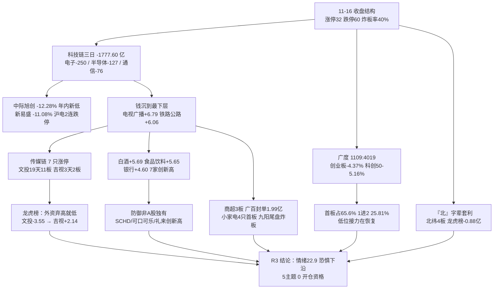

# 2026-11-17 · **群聊情绪共振**

> **数据源新鲜度**: partial（A 股主源 🟢，群聊 🔴，WeFlow 🔴）
> **降级状态**: true — 共振上限 L1+L2b，真等级 **L1_only**
> **置信度**: 0.63（0.80 × 0.85 × 0.92）

## 一句话结论

**科技链三日吸走 1777.6 亿、钱沉到传媒/银行/白酒/商超**；情绪 22.9（恐惧下沿）**但结构不是无差别崩盘**——炸板率取严 40% 越过 35% 红线，候选砍半，**零开仓资格**，唯一合法通道是开盘三判据成立后的低位首板小额试错。

## 情绪读数：基线 21.4 → 22.9

| 维度 | 读数 | 解读 |
|---|---|---|
| 当日 R1 基线 | `21.4` · 恐惧 · 崩溃退潮型 | 仓位上限 **0.10**，阶段 high_chop 第 4 天（连跌 3 天·repair_window） |
| 涨停 / 跌停 / 炸板（limit_list_d） | `32 / 60 / 16` | 跌停为涨停的 **1.87 倍**；炸板率 33.33% |
| 涨停 / 跌停 / 炸板（stk_limit 交易所口径） | `33 / 68 / 22` | 炸板率 **40.00%** → 取严者触发 35% 硬红线 |
| 连板天梯 | 1 板 21 / 2 板 8 / 3 板 2 / 4 板 1 | 首板占 **65.6%**，最高 4 板；4 板以上断层 |
| 晋级率（xTick） | 1进2 `25.81%` · 2进3 `50.0%` · 3进4 `50.0%` · 4进5 `0.0%` | 低位接力在恢复（11-12 仅 7.58%），高位接力已断 |
| 广度与量能 | 涨 1109 / 跌 4019（21.6%）· 中位 `-2.11%` · 成交 14843 亿（-10.34%） | 缩量下跌，跌超 5% 达 986 家 |
| 主力资金 | 单日 `-646.77 亿`（21 日窗口最大）· 三日 `-1777.60 亿` | 超大单 -366.65 + 大单 -280.12 派发，中小单 +635.33 接 |
| 昨日涨停溢价 | 收盘均值 +0.99% / **中位 -1.45%** · 红盘率 47.2% · 再涨停 11 只 | 盘中给过机会，收盘仍亏 → 追板即亏 |
| R3 修正 | **+1.5**（8 项，5 项 0 权重） | 防御承接 +3.0、低位首板集群 +2.0、事件供给 +0.5；人气结构劣质 -1.5、字辈套利 -1.0、文本无极端 -1.0、接力亏钱 -0.5 |

**五维交叉校验**：`score_5d = 21.4`（与 R1 同公式同 dims 自算），`r3_vs_5d_gap = 1.5 < 15` → **无背离**。修正只取五维公式未覆盖的维度（防御承接、首板结构、人气榜质量、字辈套利、文本极端度），避免与 R1 对同一事实重复扣分。

## 双源共振全景

## 详细分析

**一、这是结构性崩塌，不是流动性崩塌。** 三大指数分化到极致：上证 -0.87%、沪深 300 -0.91%，而创业板 -4.37%、科创 50 -5.16%、北证 50 -4.54%。杀跌集中在一条链上——电子 -250.16 亿、半导体 -126.67 亿、通信 -75.63 亿、元件 -65.47 亿、PCB -56.99 亿，中际旭创 -12.28% 创年内新低、新易盛 -11.08%、沪电与生益 2 连跌停。同一时刻 R7 的行业净流入前十 **全部是防御行业**：电视广播 +6.79、铁路公路 +6.06、交通运输 +5.89、白酒 +5.69、食品饮料 +5.65、股份制银行 +4.60、国有大行 +4.42、高速公路 +4.42 亿。钱没有离开市场，只是从最上层（算力硬件）沉到了最下层（现金流 + 内需）。

**二、情绪结构的关键裂缝在「高位接力」而非「低位打板」。** 涨停 32 家里首板 21 家占 65.6%，xTick 1 进 2 从 11-12 的 7.58% 修复到 25.81%，2 进 3、3 进 4 均为 50%，唯独 4 进 5 是 0.0%——说明资金愿意给低位新票定价，但拒绝再给高位老龙抬轿。这与龙虎榜完全对上：文投控股（19 天 11 板、人气第一）净卖 **-3.55 亿**（外资通道主导、开板 8 次、换手 37.82%，AI 漫剧收入占比仅 2.57% 且有 *ST 风险），而吉视传媒 +2.14 亿、慈文传媒 +1.36 亿被外资/机构承接。**同一批钱在板块内弃高就低**——这不是撤退，是换血。

**三、防御端由机构主导、进攻端由游资主导，两条腿同日成立。** 银行 7 家同日创历史新高（工、建、南京、成都、杭州、江苏、青岛），前三季度 42 家上市银行利息净收入 +8.3%（2025 全年 0.0%），5 日净流入 +19.14 亿（此前 5 日是 -14.78 亿，反转确认）；游资则在商超/小家电/短剧打板。这种「双轨」含义很明确：**机构只买不跌，游资只买能板**。它同时解释了为什么指数难看而涨停仍有 32 家——两条腿都不是趋势资金，因此都不构成主线。R1 判「无主线（轮动结构）」与人格数据（行业次日留存 20.0%、解释力 22.88%）互相印证。

**四、文本侧共识极其统一：等节点、不猜底、只做低位。** 82 篇公众号（官媒 67 / 自媒 15）里，四个独立游资复盘指向同一结论——①「不猜底更重视量能，后面注意节奏，短剧明天留意活口，个人偏防守，看看低位的一进二打打首板」；②「短剧和机器人两股资金轮动博弈穿越，玄学整体镶嵌在这两主线里」；③「漫剧/端侧/机器人相对还能好一些，大势上找短线超跌节点做反弹」；④「科技跌银行涨，又回到了十月份的状态，指数强题材强、指数弱题材弱」。官媒收评则给量化背书：「短剧传媒成为盘面为数不多的情绪活口」「7 家银行创历史新高」「小家电是游资主导的情绪博弈，基本面兑现节奏与股价涨幅错位」。海外同向：美股消费龙头、礼来、伯克希尔、SCHD 红利 ETF 全线创历史新高——**防御轮动是全球性的，不是 A 股独家**。唯一可能的反转变量是 FT 报道「黄仁勋考虑重返英伟达」，但时点不可预测，不构成任何计划。

**五、结论。** 22.9 分的恐惧下沿配上「有承接、有换血、有低位板」，比 R1 的 21.4 略好但仍属主跌段；4 只候选 RR 1.23~1.56 全部 <2，按纪律 §4 一律不得进 execution。明日只有一条合法路径：开盘 30 分钟内三判据（广度 ≥0.55 / 昨涨停红盘率 ≥60% / 板块级涨停潮 ≥3 只）成立后，在传媒龙二或消费龙头内做低位首板小额试错，**不碰科技链、不碰字辈套利、不接 4 板以上高标**。

## 共振主题 Top5

### 1️⃣ AI漫剧/短剧传媒（内容 + 广电国资）· `middle` · research_only

| 项目 | 内容 |
|---|---|
| 共振等级 | L1+L2b（KOL 缺位，**真等级 L1_only**，红线 3 下不算强共振） |
| L1 概念 | 短剧游戏 #3（前值 #2，-1.36%）；九观测日 9→5→4→7→3→5→10→2→3（中枢由 5-9 抬到 2-3）；文化传媒 #11（前值 #16）且板块内 7 只涨停 = 当日概念涨停家数前 3 |
| L1 板型 | U 名单 32 只中内容链 7 只（占 21.9%）：游戏 2（凯撒 5 天 4 板 / 文投 19 天 11 板）、电视广播 2（吉视 3 天 2 板 / 华数首板）、影视院线 1（金逸 5 天 3 板），另北巴传媒、共进股份为跨行业传媒通信票 |
| 资金 | 电视广播 **+6.79 亿（全市行业净流入第 1）**；龙虎榜 吉视 +2.14 亿（外资通道）、慈文 +1.36 亿（机构承接）、华数 +1.19 亿（机构 -0.13 亿 → 判诱多）、文投 **-3.55 亿**（外资通道派发） |
| L2b 官媒 | 收评「短剧传媒成为盘面为数不多的情绪活口」；VIP「百度一镜短漫剧 Studio、视频生成 0.2 元/秒」点名文投；前瞻「GTA VI 11-19 发售、预售破 10 亿美元」 |
| 名单 | 600715 文投（拦截）/ 601929 吉视 / 002425 凯撒 / 002905 金逸；剔除 002343 慈文（中位）· 600892 大晟 / 301052 果麦 / 605577 龙版（杂毛，无封单无席位） |

- **大资金意图**: 沪股通专用 3 日 +5.96 亿、国信浙江互联网 3 日 +3.58 亿、瑞银花园石桥 3 日 +2.13 亿在传媒链做多，同一批席位却在文投控股净卖 3.55 亿——**同一批钱在板块内完成高标到龙二的换手**。对手盘是追 19 天 11 板与 *ST 赌徒的打板客。
- **为什么走强**: 位置（吉视 3 天 2 板、绝对价 2.96 元、6 日 +23.8% 未加速）＋催化（百度短漫剧 Studio 把视频生成压到 0.2 元/秒、GTA VI 11-19 发售，两个 5 日内硬时间锚）＋筹码（龙二封单 1.37 亿、开板 0 次、换手仅 14.99%，无松动）。
- **逻辑够不够硬**: 硬在题材层（赚钱效应真实、资金换血、席位承接）与位置层（龙二非高位）；软在基本面（AI 漫剧收入占比 2.57%，纯故事定价），且高标派发后题材通常 2-3 日衰减 → **够打一日，不够打三日，是可观测的接力位而非可闭眼开的仓位**。

### 2️⃣ 商超百货 + 小家电（泛消费内需）· `early` · research_only

| 项目 | 内容 |
|---|---|
| 共振等级 | L1+L2b（真等级 **L1_only**） |
| L1 板型 | U 名单泛消费 **9 只占 28%**，为当日第一大集群：一般零售 3（广百 3/3 板·封单 1.99 亿全市场第 1 / 天虹首板 / 鹏飞绿能）、小家电 2（小熊 / 北鼎 19.94%）、厨卫 1（华帝）、白电 1（长虹美菱）、饮料乳品 1（阳光乳业）、饲料 1（金新农） |
| L1 人气 | 九阳股份 ths #1 / dc #3（+7.10% **尾盘炸板未封**）；广百 dc #10（前值 #29）；小熊 dc #25 新进 |
| 资金 | 白酒 +5.69、食品饮料 +5.65、股份制银行 +4.60、国有大行 +4.42、高速公路 +4.42 亿；家电 10 月出口量 +14.1% / 金额 +20.9%；社零 1-10 月 +1.0%（10 月单月 +0.4%，弱） |
| L2b 官媒 | 游资复盘「商超电器白酒等泛消费都有异动…消费是未来的政策预期」；收评「小家电是游资主导的情绪博弈，基本面兑现节奏与股价涨幅错位」；海外「可口可乐、礼来、伯克希尔、SCHD 创新高」 |

- **大资金意图**: 机构在白酒/食品饮料/银行防守（要「不跌」），游资在商超/小家电打板（要「板」）。两批钱目标不同，决定消费链只能做板、不能做趋势。
- **为什么走强**: 位置（家电链 6 日仅 +6%~+8%，长虹美菱 +6.2 / 小熊 +6.5 / 华帝 +8.1，低位第一板）＋催化（出口 +20.9% + 消费政策预期，社零弱反成加码理由）＋筹码（广百封单 1.99 亿开板 0 次最硬，但九阳炸板说明内部不齐心）。
- **逻辑够不够硬**: 位置与封单硬，叙事软（社零 +0.4% 不支撑基本面，官媒自己点名「游资情绪博弈」）→ 只能支撑一日游，**不是三日主线**。

### 3️⃣ 银行/红利高股息（防御性资金主线）· `middle` · watch

- **L1**: 高股息精选概念 **14→1**（+1.03%，20 条概念榜**唯一正涨幅**）；超级品牌新进 #19（+0.40%）；工行/建行/南京/成都/杭州/江苏/青岛 **7 家创历史新高**，但银行 **0 只涨停**（U 名单 32 只无银行）→ 机构票不进游资视野，属「钱在人不在榜」。
- **资金**: 股份制银行 +4.60、国有大行 +4.42、高速公路 +4.42、铁路公路 +6.06 亿；银行 5 日 +19.14 亿（前值 5 日 -14.78 亿，V 型反转确认）；跷跷板 软件开发 5 日 -45.78 ↔ 银行 +19.14，corr -0.618，当日反转同时成立。
- **大资金意图**: 中长期资金 + 市值管理导向的配置盘在建仓（利息净收入 +8.3% 是硬改善）；对手盘是砍科技换现金的杠杆资金。银行承接的是「不亏钱的确定性」，不是「赚钱的弹性」。
- **为什么走强**: 位置（10 月已抬过一轮，5 日 -14.78→+19.14 再确认）＋催化（利息净收入 +8.3%）＋筹码（无游资参与，无炸板风险也无二板可能）。
- **逻辑够不够硬**: 硬在确定性与体量，软在赔率（日波动 <2%、无涨停基因）。按用户口径「无涨停基因的死水红利不推」，此处但因资金认可（7 家创新高）成为**合法情绪判据**：银行继续创新高 = 科技端仍无溢价。

### 4️⃣ 固态电池 / 电网设备（新方向事件驱动）· `early` · research_only

- **L1**: 电池 3 只涨停（领湃 20CM 封单 0.98 亿 / 紫竹 0.52 亿 / 野马 0.41 亿）、电网设备 1（顺钠首板 0.96 亿 / 6 日仅 +2.2% 真低位）、电力 1（新能 2/2 板·算电协同），合计 5 只占 15.6%。**瑕疵**：储能概念 #14（前值 #6，-2.43%）反向，概念榜无「固态电池」条目。
- **催化**: 十五五新型储能方案点名「本质安全固态电池」（2030 装机 3 亿千瓦）+ 11-20 上海固态电池论坛；国网 4 万亿投资（+40%）、内蒙特高压累计破 1 万亿、变压器出口 +23.7%。
- **资金**: 电网设备与电池 **均未进 R7 净流入前 10**，电力设备 5 日为净流出 → 「有故事没钱」。
- **大资金意图**: 打板资金做 20CM 弹性，机构尚未进场，纯游资单腿无合力。
- **为什么走强**: 位置（顺钠绝对低位）＋催化（本周两个硬时间锚）＋筹码（低位首板无套牢盘，但封单体量均 <1 亿，弱于广百/吉视）。
- **逻辑够不够硬**: 硬在事件密度，软在资金（概念与行业双缺）→ 按「无资金则只观察」的口径，只能 early 试错位，**不作明日主线**。

### 5️⃣ 冰雪产业（季节性消费）· `middle` · **不进**

- **L1**: 冰雪产业 #7（前值 #15，+0.07%）；七观测日 20→3→9→15→15→15→7；龙江交通 7/13 板（+10.00%）、冰山冷热 +6.49%（6 日 +26.4%，**两次未能封板**）。
- **资金**: 铁路公路 +6.06 亿为当日第 3，但冰山冷热龙虎榜 **净卖 -0.90 亿**且读作「机构出货·股价仍涨（诱多）」；龙江无席位数据。
- **大资金意图**: 高位票无资金支持，只剩情绪残温；对手盘明确。
- **为什么走弱**: 位置（龙江 7/13 板高标、冰山两次炸板）＋催化（雪季客流是真但慢变量）＋筹码（无席位背书）。
- **逻辑够不够硬**: 硬在季节真实性，软在位置与筹码 → 按纪律 §3「躲中位」，本主题**观察不进**。

## 首推票思维链

### 601929.SH 吉视传媒 · 传媒链龙二（接力位）

- **买入理由**: ①板块唯一「硬封 + 席位承接」的接力票——封单 1.37 亿、开板 0 次、换手 14.99%，龙虎榜 +2.14 亿（外资通道主导）；②高标文投已被净卖 3.55 亿派发，资金在板块内弃高就低，龙二是唯一合法承接位；③电视广播行业净流入 +6.79 亿为全市第 1，行业级资金给背景。
- **风险点**: ①3 天 2 板已累积 +23.8%，若明日竞价高开 > +5% 则入场成本破坏盈亏比；②高标失守会引发题材断链（文投若低开且 10 点前回不到 +5%，题材当日基本结束）；③AI 漫剧收入占比 2.57%，纯情绪定价，一纸风险提示即可打断。
- **止损条件**: 跌破涨停日承接区（约 -6%，对应 2.84）无条件离场；竞价缺口 < -3% 或封单 < 3000 万则直接不参与。
- **可验证假设**: 24h 内——①短剧游戏概念维持前 10 且板块当日涨停 ≥ 3 只；②吉视竞价红盘且不低开破 -2%；③文投控股不出现跌停。三条中两条不成立即证伪。

### 002187.SZ 广百股份 · 商超百货龙头（3 板）

- **买入理由**: ①封单 1.99 亿为全市场 32 只涨停股第 1，首封即封死、开板 0 次，板型最干净；②一般零售 3 只涨停成形，商超是本轮「低位 + 内需政策预期」的落点；③dc 人气 #10（前值 #29）属新晋而非长驻，无历史套牢盘。
- **风险点**: ①3 板已进入中位（非低位首板），4 板需 3 进 4 的 50% 概率配合；②板块宽度仅 3 只且无中军（天虹首板、鹏飞 0.19 亿），板块效应弱于板型；③无机构/外资席位背书。
- **止损条件**: 跌破 3 板中枢（约 -6%，对应 7.28）离场；若 4 板封单 < 5000 万或开盘直接低开 -4%，不参与。
- **可验证假设**: 24h 内——①一般零售板块当日涨停 ≥ 2 只；②广百封板时间早于 11 点且换手 < 25%；③九阳股份（家电人气核心）不跌停。两条不成立即证伪。

## 研究候选与盈亏比（全部 RR < 2 → watch）

| 代码 | 名称 | 主题 | 位置认定 | 板型 | 入场 | 止损 | 目标 | RR | 结论 |
|---|---|---|---|---|---|---|:--:|---|
| 601929 | 吉视传媒 | 短剧传媒 | 龙二（接力位） | 3 天 2 板·封单 1.37 亿·开板 0 | 3.02 | 2.84 | 3.26 | **1.33** | watch |
| 002187 | 广百股份 | 商超百货 | 龙头（3 板最高） | 3/3 板·封单 1.99 亿·开板 0 | 7.75 | 7.28 | 8.44 | **1.47** | watch |
| 000533 | 顺钠股份 | 电网设备 | 低位首板 | 首板·封单 0.96 亿·6 日 +2.2% | 10.02 | 9.52 | 10.80 | **1.56** | watch |
| 002959 | 小熊电器 | 小家电 | 龙三（首板） | 首板·封单 0.34 亿 | 36.81 | 34.60 | 39.53 | **1.23** | watch |

入场价 = 11-16 收盘 × 高开假设；止损 = 承接区失守（-5%~-6%）；目标 = 次一档涨停幅度。**四只全部 RR < 2，按纪律 §4 一律不得进 execution。**

## 负向警示 6 条

| # | 主题 | 级别 | 核心证据 |
|---|---|---|:--:|
| 1 | CPO/光模块·AI服务器·PCB | 🔴 high | 中际旭创 -12.28%（人气 #2、183 日在榜 max#1、创年内新低、5 日主力 -29.56 亿）、新易盛 -11.08%、东山精密 -10.00%、工业富联 -9.68%、沪电 -10.00%（2 连跌停、机构接刀 +4.57 亿）、胜宏 -11.54%；概念 CPO -6.40% / PCB -5.47% / 芯片 -4.52% |
| 2 | 存储（DRAM/NAND） | 🔴 high | 存储芯片 #13（-5.81%）、长鑫 -4.10%；NAND 现货 10 月下旬以来 -20%、512Gb 晶圆单周 -12%、较上季 -32%；美股存储股 -5%~-7.5% |
| 3 | 高位人气股退潮 | 🔴 high | 大东方/襄阳轴承/青岛食品/百洋股份/澳洋健康/闽发铝业 2 连跌停；日出东方（前一日 dc 人气 #1、+5.54%）今日 -10.00% 掉至 #23；阳光照明 -9.60% |
| 4 | 『北』字辈名字套利 | 🟡 medium | 北纬科技 4 连板（开板 7 次、换手 42.59%、龙虎榜 -0.88 亿）、北投 +10.14%（游资主导·机构缺席）、北巴 +10.12%、北鼎 +10.01%（开板 8 次） |
| 5 | 贵金属/黄金白银 | 🟡 medium | 沪银主力 -6.42%、现货金 3830 美元创 2025 年 10 月以来新低；加息预期升温 → 本轮是流动性收缩而非避险需求 |
| 6 | 商业航天 | 🟡 medium | 概念 #10（前值 #5，-4.12%）；11-09/11-10 曾连续 2 日 #1，此后 3→3→5→10 单向下滑 |

## 热门榜信号与红线 4 检查

- **排名跃升（概念）**: 高股息精选 #14→#1（+1.03%）· 冰雪产业 #15→#7 · 白酒 #19→#15 · 文化传媒 #16→#11 · 新进 数据中心(AIDC) #12 / 粤港澳大湾区 #17 / 超级品牌 #19
- **排名下滑（概念）**: 商业航天 #5→#10 · PCB #10→#18 · 芯片 #11→#20 · 储能 #6→#14 · 光伏/算力租赁/AI视频 掉榜
- **排名跃升（个股）**: 吉视 15→4 · 凯撒 20→5 · 广百 29→10 · 九阳 11→3 · 北纬 16→8 · 飙升榜 共进 87→9、龙江 58→7
- **榜位辩证法（重要）**: 中际旭创 dc #6→#2、东山精密 #8→#6 —— **排名上升但当日 -12.28% / -10.00%**，说明人气上升不等于走强，人气滞留型派发比人气下滑更危险
- **派发警报（5 条）**: ①**文投控股** 人气 #1 + 19 天 11 板 + 龙虎榜净卖 -3.55 亿 + 开板 8 次 + *ST 风险；②**中际旭创** 183 日在榜 max#1、人气 #2 而创年内新低；③**日出东方** 前一日 #1 → 今日跌停，派发已兑现；④**九阳股份** ths #1 而尾盘炸板，人气核心不稳；⑤**北纬科技** 4 连板 + 开板 7 次 + 净卖 -0.88 亿
- **红线 4 连霸检查**: 命中 2 项（文投控股、日出东方），均**不计入正向共振**；商业航天 11-09/11-10 连霸后已滑至 #10，派发周期走完；人形机器人九观测日从未登 #1（2→4→8→2→2→2→2→4→5），不触发霸榜条款

## 公众号观点（L2b · 不计入共振等级）

82 篇 / 15 源（官媒 67：证券时报 33、上海证券报 28、财联社早知道 5、盘前纪要 1；自媒体 15）。

| 主题 | 篇数 | 代表内容 |
|---|:--:|---|
| 科技链崩塌归因 | 5 | 亚太联动（韩 -4% / SK海力士 -8% / 三星 -5% / 台股 -6%）·「没有黄仁勋的英伟达时代」· SemiAnalysis 下调 AI 芯片出货（2028 capex -28%、2030 -40%）· FT「黄仁勋考虑重返 CEO」 |
| 短剧/AI漫剧 | 4 | 四家独立复盘点名「短剧/漫剧是活口」「明天留意活口」「短剧和机器人穿越」 |
| 防御与红利 | 3 | 美股消费/医药/伯克希尔/SCHD 全线创新高；银行低估值高股息三重特征 |
| 泛消费/小家电 | 2 | 商超电器白酒异动、消费政策预期；小家电「游资情绪博弈、基本面兑现错位」 |
| 固态电池/电网 | 2 | 十五五储能方案点名固态电池；内蒙特高压破万亿、国网 4 万亿 |
| 冰雪/游戏 | 2 | 新雪季追雪热潮（产业破万亿）；GTA VI 11-19（三季度国内游戏收入 925 亿） |
| 宏观与情绪 | — | 共识=「不猜底」「等节点」「左侧剐蹭」「3 天改变一个格局」；无系统性崩溃叙事，也无抄底共识 → **文本不极端，说明恐惧尚未见底，但也未到恐慌高潮** |

## 数据源审计

| 源 | 日期 | 状态 | 备注 |
|---|:--:|:--:|---|
| attention_pipeline（东财人气/飙升·同花顺热股/概念） | 2026-11-16 | 🟢 | 230 行（50/30/50/20）· persistent 25 · surge 23 · cross_platform 64 · degraded 0 |
| tushare/limit_list_d 涨跌停逐票 | 2026-11-16 | 🟢 | 108 条（涨停 32 / 跌停 60 / 炸板 16）· 全市场 |
| xtick/market_emotion | 2026-11-16 | 🟢 | zt 33 / dt 63 / zb 16 / mhigh 4 · 1进2 25.81% · 4进5 0.0% |
| R7_capital_flow | 2026-11-17 | 🟢 | 主力 -646.77 亿 · 龙虎榜买卖各 10 · 行业净流入 10 档 · 执行池 0 |
| R4_news | 2026-11-17 | 🟢 | 8 事件 · 极性矩阵 5 板块 · discipline_gate 0 可执行 |
| R1_style（当日基线） | 2026-11-17 | 🟡 | 基线 21.4 恐惧 · 崩溃退潮型 · status=degraded（confidence 0.472），分数可用结构判断折扣 |
| wechat_official_rss（取阅） | 2026-11-17 | 🟢 | 82 篇 / 18 源可达 / 15 源有文（官媒 3 源 67 篇） |
| wechat_cli_5groups（7 群匿名） | 2026-11-17 | 🔴 | **0 条 0 字节**，本地微信库最后一条停在 2026-10-28 → 连续 11 个交易日断更 |
| weflow-analytics MCP | — | 🔴 | 2026-08-19 永久下线，L3 缺位 |
| R2_main_sectors | 2026-11-17 | 🔴 | 当日未产出（与 R3 并行跑）· 主线交叉缺位 |

## 纪律闸门

| 项 | 结果 | 依据 |
|---|---|---|
| 炸板率 | 33.33%（limit_list_d）/ **40.00%（stk_limit）→ 取严 ≥35%** | 硬红线触发，候选砍半 |
| 候选数 | 8 → **4** | T1 传媒 / T2 泛消费 / T3 固态电池电网 保留 research_only；T4 银行红利 降 watch（无涨停基因）；T5 冰雪 / 字辈套利 / 稀土散点 不进 |
| 情绪档 | **恐惧下沿 22.9** | R1 21.4 + 8 项修正净 +1.5；五维 gap 1.5 无背离 |
| 阶段 | high_chop 第 4 天（连跌 3 天·repair_window） | R1 仓位上限 **0.10**，只做低位首板/低位补涨，不接高位老龙 |
| 可交易主线 | **无** | R1 判无主线（留存 20.0% / 解释力 22.88%）；R7 执行池 0；R4 0 可执行 |
| **开仓资格** | **false** | 六项否决：无主线 + 炸板率取严 40% + L2 永久断更（真等级 L1_only）+ 阶段 repair_window + R7 执行池 0 + 4 只候选 RR 全 <2 |

## 不确定性 / 反证

1. **真等级只有 L1**：KOL 已连续 11 个交易日 0 条，所有主题都缺「人味」。82 篇公众号只能证明市场**说了**什么，不能证明市场**正在做**什么——这正是本文件把 L2b 排除在共振等级之外的原因。
2. **防御端也可能一日游**：银行 5 日 +19.14 亿是反转确认，但 10 月已抬过一轮；若明日银行集体低开且净流出 > 5 亿，则「切换」实为「普跌」，情绪要再降一档。
3. **传媒是本轮最容易被自己证伪的方向**：文投 19 天 11 板 + 净卖 3.55 亿 + *ST 风险三者叠加，任何一纸风险提示或监管函都能让整条链当日结束；吉视的 +2.14 亿也可能是「外资通道」的一次性交易而非持续建仓。
4. **锥形风险**：科技链三日 -1777.60 亿已到 21 日窗口极值，一旦隔夜费半止跌或黄仁勋回归传闻坐实，算力链存在报复性反弹——但那属「左侧反弹」，不是本轮情绪判读的错，而是剧本外变量。
5. **反向可能**：若明日涨停回到 60 家以上、炸板率回落至 30% 以下、广度回到 60% 以上（三判据同时成立），则 22.9 的判读偏保守，属「修复启动而非主跌延续」，需在盘中增量里上调。

## 与其他 R/D/E 的关系

- **依赖**: R1_style.json（当日基线 21.4）· R7_capital_flow.json（主力/龙虎榜/行业资金）· R4_news.json（事件极性矩阵）· attention_signals（T-1 双平台四榜）· xtick market_emotion · wechat_official_rss（L2b）
- **被消费**: D1（canghai-plan）取 `sentiment_score` / `resonance_top_themes` / `discipline_gate` / `hotlist_signals.distribution_alert`；E1（canghai-review）复盘情绪判读与派发警报兑现率；R5 按 `distribution_alert` 给文投控股、中际旭创、九阳股份、北纬科技加风险标记；R6 可反证「传媒换血」与「防御承接」两条主叙事

## Sub-Agent 元数据

- skill: analyze_sentiment_resonance_v1
- artifact: `data/research/20261117/R3_sentiment.json`（49 KB）
- 生成耗时: 约 12 分钟（R1 基线落盘后启动）
- model: deepseek-v4.1-flash
- status: complete · degraded=true · confidence 0.63
