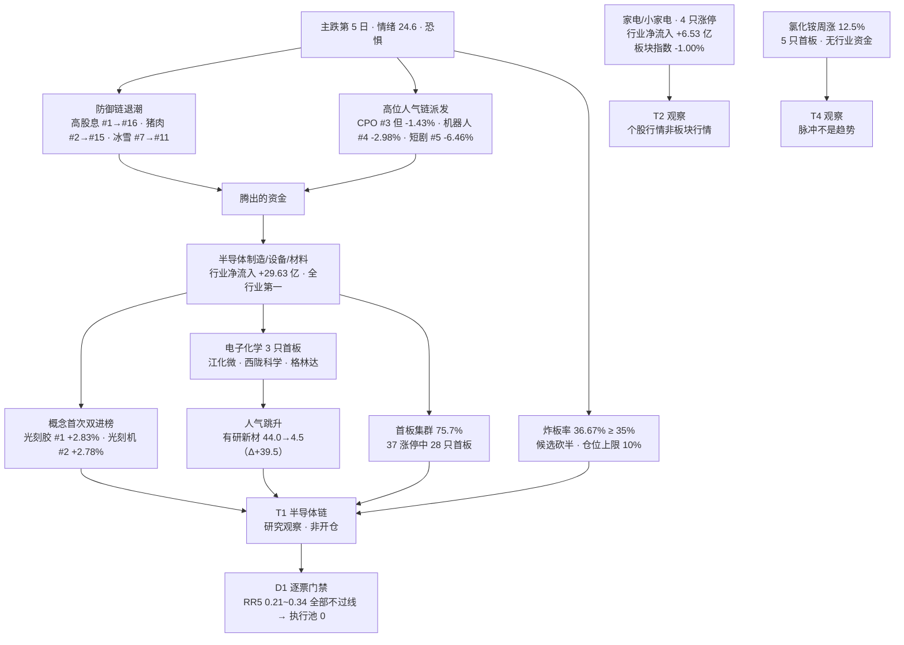

# 2026-11-18 · **群聊情绪共振（L1+L2b 双源）**

> **数据源新鲜度**: partial
> **降级状态**: true（L2 断更 · L3 永久下线 · R1 degraded）
> **置信度**: 0.63
> **情绪读数**: **24.6 / 100（恐惧）· 主跌第 5 日**

## 一句话结论

情绪没有变好（25.1 → 24.6），**结构变了**：资金一天之内从「高股息 / 猪肉 / 冰雪」与「CPO / 机器人 / 短剧」两头撤出，全部压向**半导体制造·设备·材料**这一条链，这是本轮下跌以来第一次出现方向明确的换手；但换手只发生了一天、龙头逐票盈亏比全部不过线，今日只认谱内低位首板，不认「主线反转」。

## 详细分析

### 一、情绪温度：25.1 → 24.6，六项修正净 −0.5

基线取**当日** `R1_style.json`（trade_date=20261118，data_day=20261117 收盘），**不是前一日**：R1 给出 崩溃退潮型 / 恐惧 / 仓位上限 0.10 / 无主线（轮动结构）/ 第 5 天（连跌 4 天 · repair_window）。

六项修正里，正向全部来自「新方向进钱」，负向全部来自「旧方向塌方与封板质量」：

| 编号 | 修正项 | Δ | 硬证据 |
|---|---|:--:|---|
| A1 | 半导体设备/材料/制造链资金回流 | **+4.0** | 半导体 +29.63 亿（全行业第一）、半导体设备 +19.05（5 日 +39.53 / 20 日 +71.46）、半导体材料 +18.83（+2.67%）、集成电路制造 +18.08（+5.82% 涨幅第一） |
| A2 | 家电/小家电涨停潮 + 净流入 | **+1.5** | 家电 4 只涨停；家用电器 +6.53 亿、白色家电 +3.43、空调 +2.61 |
| A3 | 亏钱效应仍扩散 | **−2.5** | 跌停 67 家、涨家占比 23.9%（1326 涨 / 3882 跌）、中位 −1.31%，跌停:涨停 = 2.21:1（前一日 2.06:1 继续恶化） |
| A4 | 算力硬件高位链派发未止 | **−1.5** | 中际旭创 −3.90%、新易盛 −4.08%、东山精密 −5.49%，三巨头 5 日主力合计 −94.0 亿 |
| A5 | 前期防御主线集体退潮 | **−1.0** | 高股息精选 #1 → #16、猪肉 #2 → #15、冰雪产业 #7 → #11 |
| A6 | 核心票封板质量差 + 炸板率压线 | **−1.0** | 有研新材 8 次开板、北投科技 14 次、顺钠股份 12 次；炸板率取严 36.67% ≥ 35% 红线 |

净修正 −0.5 → **24.6**。五维加权法用 R7 的 stk_limit 口径（涨停 38 / 跌停 84 / 炸板 22 / 炸板率 36.67%）单独复算得 **25.3**，两法 gap 0.7，无背离 —— 说明「恐惧 + 主跌」这个判定不是靠单一指标推出来的。

### 二、L1 热榜结构：一天之内完成「防御 → 半导体制造」的换手

这是今天唯一值得记账的事。概念榜 1116 → 1117 的位移不是「强者恒强」，而是**整榜换血**：

| 方向 | 1116 | 1117 | 判读 |
|---|:--:|:--:|---|
| 光刻胶 / 光刻机 | 未进榜 | **#1 (+2.83%) / #2 (+2.78%)** | 首次双进榜，且直接占住前两名 |
| 国家大基金持股 / 中芯国际概念 | 未进榜 | **#9 (+1.41%) / #10 (+1.73%)** | 大基金 + 晶圆代工叙事同步点火 |
| 芯片概念 | #20 (−4.52%) | **#8 (−0.69%)** | 单日跃升 12 名，跌幅收窄 3.83 个百分点 |
| 存储芯片 | #13 (−5.81%) | **#7 (+0.30%)** | 排名回归前 10、涨幅由负转正 |
| 高股息精选 | **#1 (+1.03%)** | #16 (+0.17%) | 防御主线一日游结束 |
| 猪肉 | **#2 (+0.63%)** | #15 (−2.43%) | 防御链跟着退潮 |
| 短剧游戏 | #3 (−1.36%) | #5 (−6.46%) | 排名微升但跌幅扩大 4 倍 = 加速下杀 |

个股层同步给出同一结论：**有研新材人气 44.0 → 4.5（Δ+39.5，全场最大跳升）**，江化微、西陇科学**首次进 top20**，且三只都是电子化学/半导体材料标的。7 只概念新进榜里有 4 只属于半导体，这是「结构性」而不是「情绪性」的证据。

### 三、四条共振主题（含一条判「不进」）

| # | 主题 | 共振 | 阶段 | 态度 |
|:--:|---|:--:|:--:|---|
| 1 | 半导体设备·材料·光刻胶（国产替代） | L1+L2b | early | **进**（研究主跟；逐票门禁归 D1） |
| 2 | 家电·小家电（出口改善） | L1+L2b | early | 观察 |
| 3 | 存储芯片·DRAM（两腿对冲） | L1+L2b | middle | **观察不进** |
| 4 | 化工·氯化铵/纯碱（价格事件） | L1+L2b | early | 观察 |

> 口径声明：L2 真人群聊永久断更，`L1+L2b` 只表示**公众号观点代位佐证**，按红线 3 不计入 L1/L2 层级、不加情绪浓度分。四条主题的真等级都是 `L1_only`，**没有一条构成强共振**。

**T1 半导体链 —— 三问**

- **大资金意图**: 这是本轮第一次「跨行业净流入第一名」落在科技链而不是防御链（半导体 +29.63 亿 vs 前一日电子 −250 亿）。机构买的是「国产替代的确定性」，不是景气度：同日 R4 有美商务部限制远程获取先进半导体的硬事件（正面于国产替代 / 负面于算力进口），叠加英伟达 Q3 超预期却盘后仅涨 1-2%，资金的选择是「买自己能控制的环节」——设备、材料、制造、封测，避开被卡脖子的算力进口链。对手盘是过去三日在高股息/猪肉里避险的钱，以及 CPO 里被套了三天的钱。
- **为什么走强**: 位置=超卖（半导体设备 20 日 +71.46% 但个股多在 20 日高位下方）；催化=工信部设备质量标准 + 先进封装 2026 年收入首超传统封装 + 美限制带来的国产替代强化；筹码=有研新材龙虎榜净买 +2.62 亿、主力单票 +14.89 亿（全场第一）、8 次开板后回封说明筹码在换手而不是锁仓。
- **逻辑够不够硬**: 硬，但只硬了一半。独立源 3 个（L1 概念首次双进榜 / R7 行业资金第一 / R4 事件极性 high 正面）；硬政策有（工信部设备标准）、硬钱有（行业级净流入）、硬时间锚**没有**（这是一日切换，没有「明天必须发生」的事件）。证伪路径很短：若次日半导体材料行业资金由 +18.83 亿转负，或电子化学 3 只首板次日红盘不足 2 只，则为「一日切换」。

**T2 家电 —— 三问**

- **大资金意图**: 买的是「出口改善 + 地天板情绪」，不是家电景气。九阳地天板是纯情绪事件（当日振幅从跌停到涨停），机构逻辑只能落在「出口数据改善」这一条上，而板块指数当日仍是绿的（家用电器概念 −1.00%）—— 说明钱只买了 4 只票，没买板块。
- **为什么走强**: 位置=低位（家电整体在 20 日低位区）；催化=出口数据 + 补贴预期（R4 判 medium，不是 high）；筹码=九阳换手 16.35%、封单 2.23 亿、开板 2 次，长虹美菱与小熊均为 2 连板且换手 5.66%/7.65% —— 筹码不集中。
- **逻辑够不够硬**: 不够。三条独立源只有 L1（热榜 + 涨停 + 行业净流入）与 L2b（财联社解读出口数据）两条，且**板块指数为负**是硬伤：个股行情 ≠ 板块行情，按纪律 §2 不授予主线资格，只保留观察。

**T3 存储 —— 三问**

- **大资金意图**: 想抢「DRAM 全年供给紧缺」的叙事（三星 Q3 存储均价同比 +270%、满产；长鑫业绩会确认紧缺），但 R4 同时挂着 SemiAnalysis 把 2028 年加速器 capex 下修 28% 的负面。两股力量对峙，主力自己也没定论。
- **为什么走强**: 位置=超跌（股价距高 −40~−60%）；催化=供给紧缺属于中期故事，不是即期事件；筹码=长鑫 5 日主力净流出 −56.5 亿，当日仍 −5.61% —— 涨的是人气不是价格。
- **逻辑够不够硬**: 不硬。R4 明写「净值为正但股价距高 −40~−60% → 判分歧，不作可交易带」，且当日存储链**零涨停**。人气回流 + 价格与资金双未确认，按纪律 §5（进出理由必须一致）不进。

**T4 化工氯化铵 —— 三问**

- **大资金意图**: 买价格弹性，不买成长。氯化铵周涨 12.5%、联碱停车产能 490 万吨、全年产量减 200 万吨，是最典型的「可验证涨价」事件，在主跌期属于「不依赖高位股」的低位题材。
- **为什么走强**: 位置=低位首板（双环科技/联合化学/江南化工均为 1/1）；催化=硬价格数据（不是预期）；筹码=封单 0.43 亿量级，小票 + 北交所佳先 +29.95% 说明资金在找弹性而不是找确定性。
- **逻辑够不够硬**: 一半硬。硬价格锚在（周涨 12.5% 可核），但没有行业级资金确认（R7 前 40 只有涂料油墨 +1.16），且 5 只首板里 0 只连板 —— 是脉冲不是趋势。

### 四、谁在派发（负向清单，红线 4 执行）

| 主题 | 级别 | 关键证据 |
|---|:--:|---|
| CPO/光模块·算力硬件 | **high** | 概念 #3 却 −1.43%（连续 4 个观测日为负）；中际旭创 −3.90%（184 日在榜 max#1）、新易盛 −4.08%（152 日）、东山精密 −5.49%；R4 三腿对冲净 −0.343 |
| 人形机器人 | **high** | #2→#2→#4→#5→#4 连续 5 日居前 5，涨幅连续 4 日为负；宇树科技 −11.97%、108 日在榜 |
| 短剧游戏/AI漫剧 | **high** | #2(+0.29%) → #3(−1.36%) → #5(−6.46%)；文投控股 −9.89%（前一日 dc 人气 #1）；红果短剧专项治理 |
| 前期防御链 | medium | 高股息/猪肉/冰雪一日之内三方向全部掉出前 10 |
| 名字套利（阳光/海洋） | medium | 阳光照明 8/14 板、换手 26.68%、市值仅 76 亿；**仅 L1 单源**（公众号 0 篇提及）→ 红线 4 不进共振主题 |

**最强的一条派发证据是文投控股**：11-16 它是东财人气榜第 1（+10.00%），11-17 直接 −9.89% 仍排在人气第 5 —— 人气滞留 + 价格崩塌，这是「霸榜出货」的教科书序列，与红线 4 完全同构。同理，中际旭创/新易盛/宇树三只长驻人气票（在榜 184/152/108 日）今日全部下跌，人气榜前 20 里 3 只算力硬件票无一上涨。

## 情绪传导与今日执行闸门

## 首推票思维链（研究观察，非执行）

**600206 有研新材 · 半导体材料/靶材 · T1 龙头**

- **买入理由**: ①全场第一张「涨停 + 主力净流入 + 龙虎榜净买 + 板块进钱」四项同时确认的票：主力 +14.89 亿（全场单票第一）、龙虎榜 +2.62 亿、板块半导体 +29.63 亿行业第一；②靶材是国产替代里最硬的耗材环节，且当日市场唯一正向结构性方向；③人气 44.0 → 4.5 的全场最大跳升说明散户注意力与资金同向，不是孤立拉升。
- **风险点**: ①**封板质量差**——8 次开板后回封，封单 2.56 亿只占当日成交 47.51 亿的 5.4%，烂板型意味着次日承接不确定；②**盈亏比不过线**——R7 算出 RR5 0.34、止损距 19.22% 超出 −10% 硬区间；③PE(TTM) 117.77、两融 5 日 −8.78%，高估值 + 杠杆退潮的组合在反弹里最脆。
- **止损条件**: 收盘跌破 **35.75 元**（涨停前一日收盘价，自 39.33 起 −9.1%）即判切换证伪，次日无条件出；盘中不设移动止损，只认收盘。
- **可验证假设**（24-72h）: ①次日竞价溢价 ≥ +2% 且半导体材料行业当日资金仍为正 → T1 成立；②次日电子化学 3 只首板（江化微/西陇科学/格林达）红盘 ≥ 2 只 → 是板块行情而非单票；③若次日跌幅 > 5% 且光刻胶/光刻机概念跌出前 10 → 「一日切换」证伪。

**603078 江化微 · 湿电子化学品 · T1 龙二**

- **买入理由**: ①首板 0 开板、封单 0.87 亿、换手仅 4.24%，是当日半导体材料票里**封板质量最好**的一只；②湿电子化学品与光刻胶同属「显影/蚀刻耗材」，是光刻机/光刻胶概念点火后最直接的产业承接；③dc 人气首次进入前 20（#16），关注度处于起步而不是透支。
- **风险点**: ①市值 94.6 亿、无连板身位，属龙二不是龙头，龙头一旦烂板它会先被砸；②半导体材料当日 +2.67% 的板块涨幅里，个股贡献集中，若行业资金次日转负则失去支撑；③R7 未进研究候选池，说明 5 日资金连续性未确认。
- **止损条件**: 收盘跌破 **22.31 元**（涨停前一日收盘，自 24.54 起 −9.1%）。
- **可验证假设**: ①次日涨幅 ≥ +5% 或直接一字 → 龙二确立；②次日若开板且 10:00 前回封失败 → 降级 watch，不再跟踪；③半导体材料行业次日资金为正即维持，转负即移出。

> 说明：以上两只**全部 RR5 < 2、止损距超 −10% 硬区间**（R7 已逐票判「不过线」），按纪律 §4 一律不得进 execution。R3 只授予研究观察资格，执行池由 D1 另行裁定。

## 关键证据

- **证据 1**: 概念榜 7 只新进榜中有 4 只属半导体（光刻胶 #1、光刻机 #2、国家大基金持股 #9、中芯国际概念 #10），光刻胶与光刻机直接占据前两名 —— 来自 `data/research/20261117/attention_signals.json` 对 `data/research/20261116/attention_signals.json` 的双日 diff。
- **证据 2**: 半导体 +29.63 亿为当日全行业净流入第一，半导体设备 5 日 +39.53 / 20 日 +71.46，是唯一 5 日与 20 日双双为正的科技子链 —— 来自 `R7_capital_flow.json` 的 sector_net_inflow。
- **证据 3**: 电子化学 3 只涨停（江化微/西陇科学/格林达）+ 半导体 1 只（有研新材），4 只全部 up_stat 1/1 首板 —— 来自 `limit_20261117.json` 逐票口径，与「全市场 37 涨停中 28 只首板（75.7%）」一致，说明今日是首板试错日而非接力日。
- **证据 4**: 文投控股 11-16 东财人气 #1（+10.00%）→ 11-17 −9.89% 仍居 #5；中际旭创（184 日）、新易盛（152 日）、宇树科技（108 日）三只长驻人气票今日全部下跌 —— 人气滞留 + 价格崩塌的派发序列。
- **证据 5**: 公众号 86 篇里，与本日四条主题同向的观点分布为：半导体 5 篇、家电 2 篇、氯化铵 2 篇、存储 2 篇（分歧），同时「退潮/推倒重来/冰点」类 5 篇 —— 自媒体的口径是「结构切换 + 情绪未修复」，与 24.6 分一致。

## 数据源审计

| 源 | 日期 | 状态 | 备注 |
|---|---|:--:|---|
| tushare/attention_signals（dc 人气 50 · dc 飙升 30 · ths 热股 50 · ths 概念 20） | 2026-11-17 | 🟢 | 150 条 · 双日 diff（含 2026-11-16 基准）|
| tushare/limit_list_d | 2026-11-17 | 🟢 | 124 条 · U 37 / Z 20 / D 67 |
| tushare/stk_limit（经 R7 补录） | 2026-11-17 | 🟡 | 涨停 38 / 跌停 84（含 17 只 ST 补录）/ 炸板 22 · 与 limit_list_d 口径不同，已取严 |
| tushare 行业资金（经 R7） | 2026-11-17 | 🟢 | 40 条行业 · 半导体 +29.63 亿居首 |
| wechat_official_rss（取阅 RSS） | 2026-11-18 | 🟢 | 86 篇 · 13 号（官方 74 / 自媒体 12）|
| wechat_cli_5groups（7 焦点群，匿名） | 2026-11-18 | 🔴 | 0 条 · 文件 0 字节；本地微信库停 2026-10-28，连续 12 个交易日断更 |
| weflow-analytics/MCP | — | 🔴 | 永久下线 · L3 缺位 |
| xtick/MCP | 2026-11-18 | 🟡 | 未取当日增量 · 以 emotion_cycle 的 T-1 收盘口径代替 |
| R1_style | 2026-11-18 | 🟡 | degraded · confidence 0.472 · 情绪基线 25.1（当日档，非前一日）|
| R4_news | 2026-11-18 | 🟢 | 8 条 top events · 极性矩阵 |
| R7_capital_flow | 2026-11-18 | 🟢 | confidence 0.77 · execution_candidates 0 · 两融/ETF T+1 滞后 |
| emotion_cycle | 2026-11-18 | 🟢 | main_down · 溢价 −0.30% · 连板 3 · 炸板率 35.09% |

## 不确定性 / 反证

- **T1 是一日切换，不是趋势**：四条证据全部来自同一交易日。历史上概念榜第 1 名最近 11 个观测日没有一次连续 2 日霸榜（中船系→CPO→光伏→商业航天→CPO→兵装重组→猪肉→高股息→光刻胶），本轮的「换手」很可能同样只有一天。若明日半导体材料行业资金转负，本条主线当天作废。
- **人气榜的前排不代表方向**：九阳股份 dc+ths 双榜第 1 是地天板带来的振幅吸引力，不是产业逻辑；它代表的情绪是「有人愿意在跌停位置接」，这既可以读成底部信号，也可以读成最后一棒的疯狂。我倾向后者，因为同日跌停仍有 67 家。
- **官媒在同时打两场舆论战**：一边是《商务部就美限制远程获取先进半导体答记者问》《国产晶圆代工双雄携手大涨》，一边是《罔顾事实做空光模块龙头，这份"报告"坏得很》《光模块市场被媒体操控了吗？》。当官媒需要下场为某个板块辩护时，说明该板块的定价已经失衡 —— 这对 CPO 是中性偏负，而不是利好。
- **「超预期 + 不涨 + 大佬减持」**：英伟达 Q3 营收 1158 亿超预期、Q4 指引高于预期，盘后仅涨 1-2%，同期索罗斯等 12 家家族办公室减持、段永平大幅卖出。这是算力链情绪见顶的组合证据，与 R4 的 −0.343 净分同向。
- **最大方法论缺口**：L2 真人群聊连续 12 个交易日 0 条，本文所有「观点」证据都来自公众号 NPC 视角，缺少真人博弈层（谁在卡位、谁在弱转强、封单是不是自己人）。因此 `L1+L2b` 一律按 L1_only 使用，四条主题都不允许被下游当作「已确认主线」—— 这是 confidence 只有 0.63 的唯一原因，也是今日最大的判断风险。
- **我自己可能错在哪**：把 A1 记 +4.0 可能偏乐观。行业级净流入第一是事实，但它由 R7 的 eastmoney 行业口径算出，与「个股主力净流入」不是同一口径；若 A1 应记 +2.5 而非 +4.0，情绪会落在 23.1，结论方向不变（仍是恐惧 + 主跌），但 T1 的「切换」强度会被削弱。

## 与其他 R/D/E 的关系

- **依赖**: `R1_style.json`（情绪基线 25.1 / 崩溃退潮型 / 无主线 / 仓位上限 0.10 / 第 5 天 repair_window）、`R4_news.json`（8 条事件极性矩阵）、`R7_capital_flow.json`（行业资金 / 主力 / 龙虎榜 / 逐票门禁）、`attention_signals.json`（2026-11-17 与 2026-11-16 双日）、`limit_20261117.json`、`wechat_official_rss.jsonl`、`emotion_cycle.json`
- **被消费**: `R2`（主线板块候选与「半导体链是否成主线」的证据源，但 R3 已明示不构成「已确认主线」）、`R5`（T1 四只候选的画像输入）、`R6`（负向清单三条 high 是反证素材）、`D1`（情绪温度与五档态度：T1 进研究 / T2·T4 观察 / T3 观察不进 / 名字套利与 CPO·机器人·短剧 拦截）、`E1`（次日回填 `可验证假设` 的四条阈值）
- **不授予**: R3 不授予任何开仓资格。`discipline_gate.open_permission = false`，六项否决同时成立（无主线 / 炸板率取严 36.67% / 共振真等级 L1_only / main_down 第 5 天 / R7 执行池 0 / RR5 全部 < 2）

## Sub-Agent 元数据

- skill: `analyze_sentiment_resonance_v1`
- artifact: `data/research/20261118/R3_sentiment.json`（45.7 KB · research_unit_v1）
- 中间件: `data/research/20261118/_work/` — `r3_l1_stockdiff.json`（双日个股 rank diff）、`r3_concept_series.json`（11 个观测日概念序列）、`r3_rss.json`（86 篇公众号结构化）
- 生成耗时: 约 6 分钟（L1 双日 diff + 涨停结构 + R4/R7 交叉 + 公众号语义归并）
- model: deepseek-v4.1-flash
- 数据源: L1 四榜（T-1 全量）+ L2b 公众号 86 篇 + R4 8 条事件 + R7 行业资金/龙虎榜；L2 群聊 0 条、L3 永久缺位
