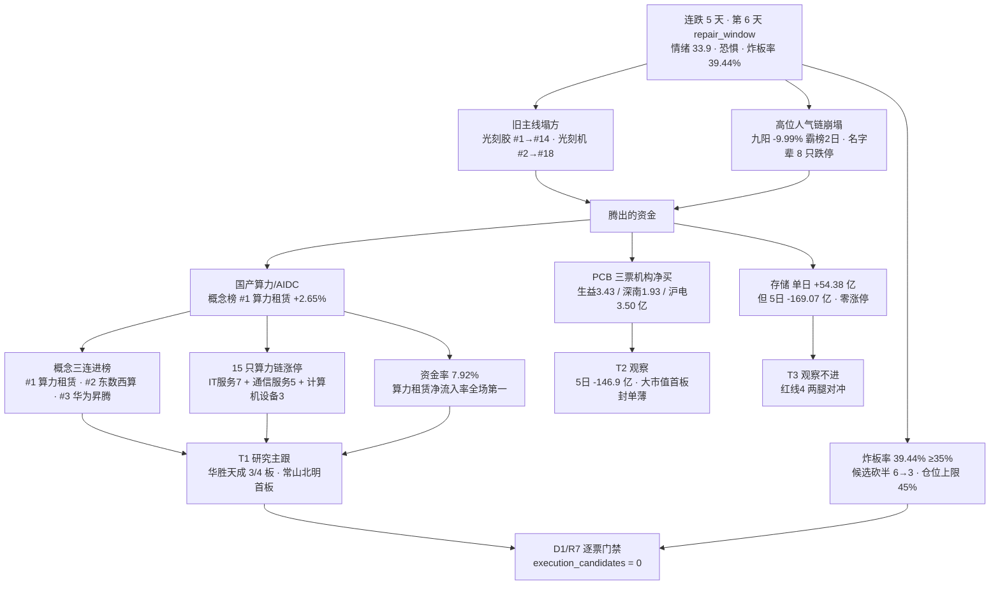

# 2026-11-19 · **群聊情绪共振（L1+L2b 双源）**

> **数据源新鲜度**: partial
> **降级状态**: true（L2 断更 · L3 永久下线 · R1 degraded）
> **置信度**: 0.67
> **情绪读数**: **33.9 / 100（恐惧）· 震荡/主跌 · high_chop 第 6 天（连跌 5 天）**

## 一句话结论

情绪从 32.9 微升到 33.9，**不是转暖，是接棒**：连跌五天后资金第一次把「算力租赁/AIDC/华为昇腾」这条国产算力链顶成概念榜前三、并造出 15 只算力链涨停，而前一日的主线（光刻胶/光刻机）当日跌出前 10、名字辈玄学随九阳跌停正式死亡——这是修复窗口里的**一次方向切换**，只认低位首板与二板承接，不认「主线反转」。

## 详细分析

### 一、情绪温度：32.9 → 33.9，七项修正净 +1.0

基线取**当日** `R1_style.json`（trade_date=20261119，data_day=20261118 收盘），**不是前一日**：R1 给出 震荡分化型 / 恐惧 / 仓位上限 0.45 / 无主线（轮动结构）/ 第 6 天（连跌 5 天 · repair_window）。

七项修正里，正向来自「新方向进钱 + 派发收窄」，负向来自「亏钱效应未解 + 封板质量 + 地量」：

| 编号 | 修正项 | Δ | 硬证据 |
|---|---|:--:|---|
| A1 | 国产算力/AIDC 涨停潮 + 资金率全场第一 | **+4.5** | 概念榜算力租赁 #1(+2.65%)/东数西算 #2/华为昇腾 #3；limit_cpt 华为概念 21 只涨停、AIDC 20、东数西算 19；IT服务 7 + 通信服务 5 + 计算机设备 3 = 15 只算力链涨停；算力租赁净流入率 7.92%（全场最高） |
| A2 | PCB 三票机构净买 + 印制电路板资金第一 | **+2.0** | 生益电子 净买 3.68 亿/机构 3.43 亿、深南电路 3.20/1.93、沪电股份 2.40/3.50；印制电路板 +45.17 亿（+3.13%，科技子行业涨幅第一） |
| A3 | 主力流出收窄 + 超大单本轮首次转正 | **+1.0** | 主力 -85.21 亿（前值 -263.03，摆动 +177.82）；超大单 -96.28 → **+19.31** 亿；小单 +298.50 → +137.31（散户接盘力度减半） |
| A4 | 亏钱效应未解 | **-2.5** | 跌停 39 / 涨停 41；上涨 1318 : 下跌 4133（23.65%）；中位 -1.20%；跌停:涨停 = 1.12:1 |
| A5 | 高位人气股 + 名字辈玄学集体崩塌 | **-2.0** | 九阳股份 -9.99% 且 dc+ths 双榜 #1 连续 2 日；东方海洋 -9.90%、阳光照明 -10.00%（12 次开板）、文投控股 -10.09%、日出东方 -10.04%；39 家跌停中名字辈/玄学占 8 家 |
| A6 | 炸板率取严 39.44% ≥ 35% 硬红线 | **-1.0** | R1（limit_list_d）36.92% vs R7（stk_limit）39.44%，取严；连续 2 日在红线上方（前一日 36.67%） |
| A7 | 成交额 1.37 万亿 = 16 个月地量 | **-1.0** | 13800 亿（缩量 875 亿）；指数四连红而广度 23.65% = 权重拉指数、个股普跌 |

净修正 +1.0 → **33.9**。五维加权法用 R1 同日公式复算得 **32.9**，gap 1.0 分，远小于 15 分背离阈值 —— 说明「恐惧 + 震荡」不是单指标推出来的，是五维同构校验过的。

### 二、L1 热榜结构：一天之内完成「光刻胶 → 算力租赁」的接棒

| 方向 | 1117 | 1118 | 判读 |
|---|:--:|:--:|---|
| 算力租赁 | 未进榜 | **#1 (+2.65%)** | 首次登顶，且是概念榜新王 |
| 东数西算(算力) / 华为昇腾 | 未进榜 | **#2 (+1.28%) / #3 (+1.32%)** | 三条算力概念占住前三，属整链共振 |
| 数据中心(AIDC) / 华为概念 | 未进榜 | **#7 (+0.61%) / #6 (-0.25%)** | 硬件端同步进榜 |
| PCB 概念 | #18 (+0.44%) | **#8** | 单日跃升 10 名，是前 20 内最大斜率 |
| 光刻胶 / 光刻机 | **#1 (+2.83%) / #2 (+2.78%)** | #14 (-0.76%) / #18 (-0.43%) | 前一日主线一日游，掉出前 10 |
| 人形机器人 / 机器人概念 | #4 (-2.98%) / #12 | #9 (-1.27%) / #15 (-1.17%) | 排名未崩但价格连续下跌 = 人气滞留派发 |
| 存储芯片 | #7 (+0.30%) | #11 (+0.73%) | 排名下滑但价格微涨 = 分歧形态 |

个股层同步：华胜天成双榜 #2、常山北明/四川长虹首进 top20、润建股份首进 dc#18、中贝通信首进飙升榜；概念榜 7 只新进榜里 5 只属算力/通信家族。这不是情绪性普涨，是**结构性换手**。

### 三、三条共振主题（含一条判「不进」）

| # | 主题 | 共振 | 阶段 | 态度 |
|:--:|---|:--:|:--:|---|
| 1 | 国产算力·自主可控链（算力租赁/东数西算·AIDC·华为昇腾） | L1+L2b | early | **进**（研究主跟；逐票门禁归 D1） |
| 2 | PCB·覆铜板（算力硬件里唯一「多票+多通道+同向净买」） | L1+L2b | early | 观察（等第二日承接） |
| 3 | 存储芯片·DRAM（单日大回补 vs 5 日深亏） | L1+L2b | middle | **观察不进** |

> 口径声明：L2 真人群聊永久断更，`L1+L2b` 只表示**公众号观点代位佐证**，按红线 3 不计入 L1/L2 层级、不加情绪浓度分。三条主题的真等级都是 `L1_only`，**没有一条构成强共振**，下游不得当「已确认主线」。

**T1 国产算力 —— 三问**

- **大资金意图**: 买的是「自主可控的算力供给」，不是 AI 景气故事。同日 R4 把「英伟达停止向中国出货 H200 + 美商务部远程算力许可新规」判为 国产算力/昇腾链 **high 正面**、AI 算力海外链 medium 负面——钱的选择很明确：买自己能控制的环节（租赁、IDC、昇腾、信创），避开被卡脖子的进口链。对手盘是过去一周躲在半导体材料与防御链里的钱，今天这两头同时在失血（半导体材料 -7.29 亿、银行 -26.33、有色 -39.76）。
- **为什么走强**: 位置=连跌 5 天后的第 6 天修复窗口（指数四连红但广度只有 23.65%，属超跌反抽而非趋势）；催化=概念端首次三连进榜 + 华为算力持续走强的产业新闻（财联社连发午报/收评/明日主题前瞻）；筹码=15 只算力链涨停中 13 只是首板，华胜天成 3/4 板封单 2.84 亿、0 开板，是唯一有身位的票。
- **逻辑够不够硬**: 硬在方向和钱，软在时间。三条独立源同向（L1 概念三连进榜 / limit_cpt 华为概念 21 只涨停 / 概念资金算力租赁率 7.92%），R4 事件极性 high 正面，是本周第一次「消息 + 资金 + 涨停潮」三重同向。但 5 日资金仍是 -260.15 亿（5 日正日仅 1 天），且只发生了一天。证伪路径短：若次日算力租赁概念资金转负、或华胜天成开板后开盘半小时内未回封、或 15 只算力涨停次日红盘不足 5 只，则判「一日接棒」。

**T2 PCB —— 三问**

- **大资金意图**: 买的是算力硬件的「卖铲子确定性」，而且买法是机构式（三票同时出现机构净买 3.43/1.93/3.50 亿），不是游资式。这与 T1 的游资主导（华胜天成机构席位 0）形成两种完全不同的钱：一个买叙事，一个买订单。
- **为什么走强**: 位置=大市值首板（沪电流通 1550 亿、深南 1338 亿），本质是机构在低位回补而不是题材连板；催化=印刷电路板 +3.13% 为当日科技子行业涨幅第一、PCB 概念排名 18→8；筹码=沪电开板 3 次、封单仅 0.63 亿（烂板 + 机构接的例外），深南 0 开板封单 1.85 亿（封板质量更好）。
- **逻辑够不够硬**: 一半硬。席位证据是全场最硬（R7 龙虎榜 94 行逐行复核，PCB 三票机构净买是真金），但 5 日资金仍 -146.9 亿、两只大票首板封单薄、RR5 沪电 1.89 / 深南 2.10 都在门槛线附近 → R7 已给「0 可执行、3 张研究卡全部不给开仓资格」，R3 同步只给观察。

**T3 存储 —— 三问**

- **大资金意图**: 想抢海外映射（日韩芯片股大涨、英伟达 Q3 超预期），但资金自己也犹豫：单日 +54.38 亿回补，5 日仍 -169.07 亿，概念排名 7→11 却在涨。
- **为什么走强**: 位置=超跌（距 60 日高 -38.9% 量级）；催化=海外财报，属中期故事而非即期事件；筹码=0 只存储个股涨停，兆易创新仅 +2.33%（ths#71）、华天 +0.57%、通富 -0.66%——涨的是个别票不是板块。
- **逻辑够不够硬**: 不硬。两腿对冲（资金正 vs 排名负 + 零涨停），按红线 4 不授予正向共振，只作观察项透传给 R5。

### 四、谁在派发（负向清单，红线 4 执行）

| 主题 | 级别 | 关键证据 |
|---|:--:|---|
| 高位人气股 / 名字辈玄学（九阳·海洋·阳光·文投） | **high** | 九阳股份双榜 #1 连续 2 日且 -9.99%；东方海洋 -9.90%（#4）、阳光照明 -10.00%（12 次开板）、文投控股 -10.09%、日出东方 -10.04%、凯撒文化 -9.89%；海洋王/百洋股份/上海九百/百大集团/慈文传媒/横店影视 跌停；39 家跌停中名字辈/玄学占 8 家 |
| 人形机器人 / 机器人概念 | **high** | 人形机器人 #4→#9（-1.27%）、机器人概念 #12→#15（-1.17%）；探路者、欧圣电气等 21 只跌超 5%；上海证券报《机器人板块，大跌》 |
| 光模块·CPO 高位链 | medium | CPO #4 +1.25% 但 中际旭创仅 +0.84%（dc#7/ths#8）、新易盛 -1.12%（ths#20）、东山精密 +0.06%（ths#10）；天孚 +4.60%、工业富联 +5.68% 走强 → 已从「龙头带动」变成「二三线补涨」 |
| 防御 / 低估值风格 | medium | 富时罗素 -94.49 亿、标普 -81.17、融资融券 -69.93、低市盈率 -50.37、破净 -39.33、机构重仓 -37.90；行业 有色 -39.76 / 医药 -33.78 / 银行 -26.33 |

**最强的一条派发证据是九阳股份**：它是当日 dc 人气 #1 + ths 热股 #1，连续两个交易日霸榜，却在第二日 -9.99%（开板 2 次、换手 23.14%），龙虎榜净卖 -2.33 亿 —— 这正是红线 4 的「霸榜第一 = 出货警报」。同日名字辈/玄学 8 只跌停，游资复盘口径是「随九阳跌停，玄学正式告一段落」，该链条已作废，只作情绪温度计。

## 情绪传导与今日执行闸门

## 首推票思维链（研究观察，非执行）

**600410 华胜天成 · 算力/华为昇腾 · T1 龙头**

- **买入理由**: ①本链唯一有身位的票——3/4 板、封单 2.84 亿、0 开板、换手 19.03%，在 15 只算力链涨停里是唯一「连板 + 封死」组合；②龙虎榜净买 2.98 亿（全场第 5），双榜 #2，人气与资金同向；③板块级证据到位：算力租赁概念 #1、华为概念 21 只涨停、概念资金净流入率 7.92% 全场最高，个股不是孤立拉升。
- **风险点**: ①**机构席位 0**（全为游资与散户），纯粹情绪接力票，次日承接一旦断就直落；②股价已 3/4 板，属中位而非低位，违反「只做龙头或低位」的中位风险区；③R7 未把它列入研究卡（不在 RR 计算范围），逐票赔率尚无权威口径，D1 必须自行算。
- **止损条件**: 收盘跌破 **15.29 元**（涨停前一日收盘，自 16.82 起 -9.1%），或次日开板后开盘半小时内未回封，二者任一即判接力失败，次日无条件出。
- **可验证假设**（24-72h）: ①次日竞价溢价 ≥ +3% 且开盘半小时内不炸板 → 算力龙一确立；②15 只算力链首板次日红盘 ≥ 5 只 → 是板块行情而非单票；③若次日算力租赁概念资金转负或跌出前 5 → 「一日接棒」证伪，T1 立即降级观察。

**000158 常山北明 · 算力/信创 · T1 龙二**

- **买入理由**: ①首板 0 开板、封单 1.63 亿、换手仅 4.79%，是当日算力链**封板质量最好**的票；②dc 人气首进 #3（ths#19），关注度处于起步而非透支；③流通 198 亿的中盘属性，比华胜天成的纯游资票更可能有机构参与，次日承接的宽度更好。
- **风险点**: ①首板无身位，龙一一旦烂板它会先被砸；②信创/华为概念当日概念涨幅 **-0.25%**（板块指数为负），个股行情 ≠ 板块行情；③若算力租赁概念次日掉出前 5，它失去排名锚。
- **止损条件**: 收盘跌破 **11.30 元**（涨停前一日收盘，自 12.43 起 -9.1%）。
- **可验证假设**: ①次日涨幅 ≥ +5% 或一字 → 龙二确立；②次日开板且开盘半小时内回封失败 → 降级 watch；③华为概念次日资金转正即维持，转负即移出。

> 说明：以上两只均**无权威 RR 口径**（华胜天成不在 R7 研究卡，常山北明不在 R7 watch_reserve 之外的有效闸门内），按纪律 §4「RR<2 不进 execution」一律不得进执行池。R3 只授予研究观察资格，执行池由 D1 另行裁定。

## 关键证据

- **证据 1**: 概念榜 7 只新进榜里 5 只属算力/通信家族（算力租赁 #1、东数西算 #2、华为昇腾 #3、华为概念 #6、AIDC #7），且算力租赁直接把前一日 #1 的光刻胶顶到 #14 —— 来自 `data/research/20261119/_work/r3_l1_raw.json` 的 20261118 与 20261117 双日 diff，并与 `attention_signals.json`（trade_date=20261118）互验一致。
- **证据 2**: limit_cpt 华为概念 21 只涨停（4天3板）、AIDC 20 只、东数西算 19 只、算力租赁 15 只；IT服务Ⅱ 7 只 + 通信服务 5 只 + 计算机设备 3 只 = 15 只算力链涨停，全市场 41 只涨停中首板 31 只（75.6%）—— 来自 `limit_20261118.json` 逐票口径，说明今日是首板试错日而非接力日。
- **证据 3**: 概念资金 算力概念 +87.01 亿（率 5.04%）、算力租赁 +51.2 亿（率 **7.92%**，全场最高）、AIDC +49.1 亿；同时 印制电路板 +45.17 亿（+3.13%，科技子行业涨幅第一）、元件 +46.38 亿 —— 来自 `R7_capital_flow.json` 的 concept_top_inflow。
- **证据 4**: 龙虎榜 PCB 三票机构净买（生益电子 3.43 / 深南 1.93 / 沪电 3.50 亿），是当日最硬的席位证据；对照 四川长虹（涨停但机构 -0.04 亿）被 R7 判诱多第 4 类、真视通（2/2 板但机构 -0.18 亿）判诱多第 1 类 —— 说明「涨停」本身不等于钱进来。
- **证据 5**: 公众号 91 篇里，与 T1 同向的算力/AIDC 观点 24 篇（含《算力租赁概念全线爆发》《华为算力持续走强》《智算中心、超节点等加速落地》），PCB/CPO 12 篇；反向声音同日存在（《没有人会来救你》《五连冰》《冰冰复冰冰》），观点层是分歧而非一致看多 —— 这正是它只能算 L1_only 的原因。

## 数据源审计

| 源 | 日期 | 状态 | 备注 |
|---|---|:--:|---|
| tushare/attention_signals（dc 人气 50 · dc 飙升 30 · ths 热股 50 · ths 概念 20） | 2026-11-18 | 🟢 | 150 条 · 双日 diff（基准 2026-11-17）|
| tushare/ths_hot + dc_hot 直连复抓 | 2026-11-18 | 🟢 | 459 条 · 与 attention_signals 互验一致（概念 #1 同为算力租赁 +2.65%）|
| tushare/limit_list_d 逐票 | 2026-11-18 | 🟢 | 104 条 · U 41 / Z 24 / D 39 · 首板 31/41 |
| tushare/stk_limit（经 R7 补录） | 2026-11-18 | 🟡 | 涨停 43 / 跌停 48（含 8 只补录）/ 炸板 28 · 炸板率 39.44%，与 limit_list_d 口径不同，已取严 |
| tushare/limit_cpt_list + moneyflow_ind_dc | 2026-11-18 | 🟢 | 涨停最强板块 20 条 + 概念资金 554 条 |
| tushare 行业资金（经 R7） | 2026-11-18 | 🟢 | 40 条行业 · 电子 +99.84 亿居首，印制电路板 +45.17 |
| wechat_official_rss（取阅 RSS） | 2026-11-19 | 🟢 | 91 篇 · 15 号（官方 78 / 自媒体 13）|
| wechat_cli_5groups（7 焦点群，匿名） | 2026-11-19 | 🔴 | 0 条 · 文件 0 字节；本地微信库停 2026-10-28，连续 13 个交易日断更 |
| weflow-analytics/MCP | — | 🔴 | 永久下线 · L3 缺位 |
| xtick/MCP | 2026-11-19 | 🟡 | 未取当日增量 · 以 R1 收盘口径 + R7 stk_limit 代替 |
| R1_style | 2026-11-19 | 🟡 | confidence 0.525 · 情绪基线 32.9（当日档，非前一日）· 仓位上限 0.45 |
| R4_news | 2026-11-19 | 🟢 | 8 条 top events · 国产算力/昇腾链 high 正面 |
| R7_capital_flow | 2026-11-19 | 🟢 | confidence 0.77 · execution_candidates 0 · 两融/ETF T+1 滞后 |

## 不确定性 / 反证

- **T1 是首日接棒，不是趋势**：过去 14 个观测日里概念榜 #1 只有光伏（1105–1106）与商业航天（1109–1110）各自连续 2 日居首，其余全部一日游（中船系→CPO→兵装重组→猪肉→高股息→光刻胶→算力租赁），本轮的算力租赁能否连续 2 日仍待验证。若次日概念资金转负，本条主线当天作废。
- **5 日资金全是负的**：算力概念 -260.15 亿、PCB -274.4 亿、印制电路板 -146.9 亿、存储 -169.07 亿、电子 -454.82 亿。今天是「单日回补」，不是「趋势反转」——R7 原文就写着「1 日回流 ≠ 反转」。任何把今天读成底部的判断都缺乏 5 日证据。
- **人气榜前排不是方向**：九阳股份双榜 #1 是跌停带来的注意力，不是产业逻辑；多平台合力前 5 里 3 只（九阳/中际旭创/有研新材）与算力链无关。真正的算力合力在 6-20 名（北纬科技/四川长虹/常山北明/润建股份），属「人气正在迁移、尚未固化」。
- **成交额地量是双刃**：1.37 万亿是 16 个月地量，既可读成卖压衰竭，也可读成买盘缺席。R1 的三判据（广度 >0.55 / 昨日涨停红盘率 >60% / 板块级涨停潮 ≥3 只）当日只成立最后一条，所以「修复」目前只是一条腿。
- **最大方法论缺口**：L2 真人群聊连续 13 个交易日 0 条，本文所有「观点」证据来自公众号 NPC 视角，缺少真人博弈层（谁在卡位、谁在弱转强、封单是不是自己人）。因此 `L1+L2b` 一律按 L1_only 使用，三条主题都不允许被下游当作「已确认主线」。
- **我自己可能错在哪**：A1 记 +4.5 可能偏乐观。行业级净流入与「个股主力净流入」不是同一口径，若 A1 应记 +2.5，情绪会落在 31.9，结论方向不变（仍是恐惧 + 震荡），但 T1 的「接棒强度」会被削弱；另一处是 15 只按行业（IT服务/通信服务/计算机设备）归类的算力链涨停里，可能含少量非算力业务个股，行业口径本身偏宽，已按三行业名单逐一点名核对。

## 与其他 R/D/E 的关系

- **依赖**: `R1_style.json`（情绪基线 32.9 / 震荡分化型 / 无主线 / 仓位上限 0.45 / 第 6 天 repair_window）、`R4_news.json`（8 条事件极性矩阵，国产算力 high 正面）、`R7_capital_flow.json`（行业/概念资金 / 龙虎榜 / 逐票门禁）、`attention_signals.json`（2026-11-18 与 2026-11-17 双日）、`limit_20261118.json`、`wechat_official_rss.jsonl`、`_work/r3_l1_raw.json`
- **被消费**: `R2`（主线候选与「算力链是否成主线」的证据源，但 R3 已明示不构成「已确认主线」）、`R5`（T1 四只研究候选的画像输入）、`R6`（负向清单四条（两条 high）是反证素材）、`D1`（情绪温度与五档态度：T1 进研究 / T2 观察 / T3 观察不进 / 名字辈·机器人 拦截）、`E1`（次日回填「可验证假设」的四条阈值）
- **不授予**: R3 不授予任何开仓资格。`discipline_gate.open_permission = false`，五条否决同时成立（无主线 / 炸板率取严 39.44% / 共振真等级 L1_only / R7 执行池 0 / 高位人气股仍处派发末端）

## Sub-Agent 元数据

- skill: `analyze_sentiment_resonance_v1`
- artifact: `data/research/20261119/R3_sentiment.json`（research_unit_v1 · 3 主题 + 4 条负向清单）
- 中间件: `data/research/20261119/_work/` — `r3_l1_raw.json`（四榜双日 + 涨停最强板块 + 概念资金 554 条）、`r3_rss.json`（91 篇公众号结构化）、`r3_l1_fetch.py` / `r3_build/build_r3.py`（可复算）
- 生成耗时: 约 28 分钟（L1 双日 diff + 涨停结构 + R4/R7 交叉 + 公众号语义归并）
- model: deepseek-v4.1-flash
- 数据源: L1 四榜（T-1 全量）+ L2b 公众号 91 篇 + R4 8 条事件 + R7 行业资金/龙虎榜；L2 群聊 0 条、L3 永久缺位
