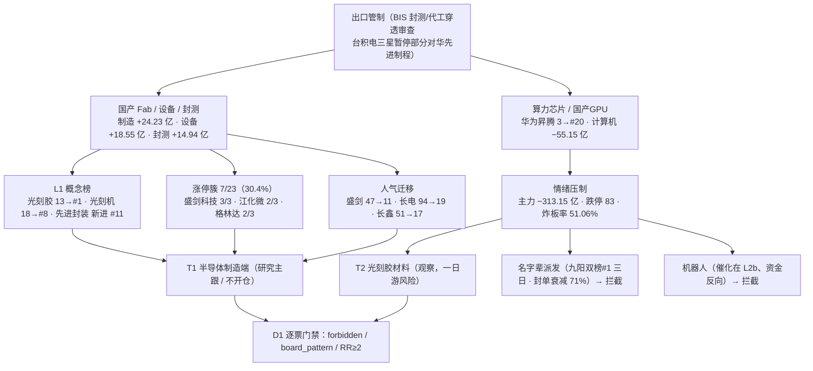

# 2026-11-20 · **群聊情绪共振 · 极恐 18.0（补跌第 7 天）**

> **数据源新鲜度**: partial
> **降级状态**: true（L2 真人层断更 14 日 + L3 WeFlow 永久下线）
> **置信度**: 0.45（0.65 × 0.7 × 1.0，L1_only 分档上限 0.50 内）

## 一句话结论

六连冰后第 7 天，情绪 18.0 仍落极恐，钱只认「国产 Fab / 设备 / 封测 + 光刻胶材料」这一条窄口（半导体链 7 只涨停、制造与设备 5 日 20 日资金双正），名字辈（羊/洋/阳）在九阳连续 3 日双榜第一、封单衰减 71% 的形态下正式进入派发段 —— **唯一可研究方向是半导体制造端，唯一可做动作是等三判据，零新开仓**。

## 详细分析

### 一、情绪温度：极恐不变，但下跌的「形状」比昨天好

R1 当日基线给 19.2（极恐，防御观望型，阶段 capitulation 第 7 天 / 连跌 6 天）。R3 在其上做 9 项修正，净 −1.2 落到 **18.0**，仍属极恐档（<20）。之所以不上调，是因为亏钱效应的绝对量还在恶化：`涨停 23 / 跌停 68 / 炸板 24`（炸板率 **51.06%**，取严口径；R7 用 stk_limit 权威口径补录 15 只官方漏收的封死跌停后为 28/83/25 = 47.17%），最高板从 4 降到 **3**，首板占比 78.26%，全市场上涨 649 : 下跌 4876（涨家占比 **11.65%**）、中位 **−2.55%**、成交 13049.4 亿（缩量 4.72%）。

真正的杀点在资金：主力 **−313.15 亿**，把前一日 −85.21 亿的「收窄」直接打回 —— 单日摆动 −227.94，20 日累计 −3929.82（20 日仅 8 日为正）；四档拆解里超大单 **−115.13**（前值 +19.31，单日转正立刻再转负）、大单 −198.02、而小单 **+340.52**（散户接盘加速）。概念端更直白：融资融券 −296.17（5 日 −1740.28）、深股通 −177.67、基金减仓 −164.40、富时罗素 −162.56 全线大流出。**这不是企稳，这是一次反抽之后的继续派发。**

### 二、唯一的窄口：国产 Fab / 设备 / 封测

钱没有消失，而是极度收缩到一个口子。四层独立证据全同向：

- **L1 概念**：光刻胶 13→**#1**（Δ+12，全场最大斜率）、光刻机 18→**#8**、先进封装**新进 #11**、国家大基金持股**新进 #4**、存储芯片 #5。
- **L1 个股/板型**：`limit_list_d` 逐票 23 只涨停里半导体链 **7 只（30.4%）**——半导体 3（三佳科技/大港股份/蓝箭电子）+ 电子化学 2（江化微 2/3、格林达 2/3）+ 元件 1（中京电子）+ 环保设备 1（盛剑科技 **3/3**，半导体废气治理）。`limit_cpt` 交叉：先进封装 **8 只涨停（连板 3）**、芯片概念 10（连板 4）、光刻胶 5（连板 3）。
- **R7 资金**：集成电路制造 **+24.23 亿**（5 日 +42.58 / 20 日 +56.48，双正，板块 +5.00%）、半导体设备 **+18.55 亿**（5 日 +56.83 / 20 日 +144.54，双正）、集成电路封测 **+14.94 亿**（+2.65%）、电子化学品 Ⅲ **+3.76 亿**（+0.23%）。全市场只有这一条链的 5 日与 20 日同时为正。
- **R4 事件极性**：封测/先进封装 `net_score` **1.002（high，正面，全场最高）**、晶圆代工/国产 Fab 0.646（high），而同源的国产 GPU/海外流片依赖 **−0.689**（high 负面）。

四条腿都指向一个结论：**出口管制同一件事，对「依赖海外流片的算力芯片」是杀，对「国产制造端」是抬。** L2b 游资复盘把它讲得最直白：*「这几天自主可控链是唯一亮点，但选了 GPU 方向同样被暴捶，只有国产晶圆制造环节能赚一点」*。

但必须泼三盆冷水：①R1 判 **无主线**（行业次日留存 28.0% = 7/25、截面解释力 9.83%、`rotation_regime=rotation`）→ 主线波段框架禁用；②板块指数仍为负（先进封装 −0.5964%、芯片概念 −1.9245%、半导体 −0.63%）→ 这是「个股强、板块弱」的窄口抱团，不是板块级主升；③共振真等级只到 **L1_only**（L2 真人层断更、L3 下线），按红线 3 **不得标强共振**。T1 只拿研究资格，不拿开仓资格。

### 三、名字辈正式进末段（红线 4 强触发）

九阳股份是这一刻度最硬的证据：**dc 人气 #1 连续 3 个交易日**（11-17 / 11-18 / 11-19），ths 热股 #1 同样三日，已远超「≥2 日」阈值。价格序列 +10.02% → −9.99%（炸板，1/2）→ +10.01%（2/3 板），而封单 **2.23 亿 → 0.64 亿（衰减 71%）**、换手 23.74%。人气顶格 + 封单递减 + 反复炸板 = 派发标准形态，按红线 4 不得作正向共振，并反向计入情绪扣分。

同型标的成串：冰山冷热 ths 14→3 却 −9.99% 封死跌停（人气滞留 + 价格崩塌）；海洋王 ths 35→17 而 −9.80%；大东方 42→20 而 −6.79%。**人气上升、价格下跌** 在同一批名字辈标的上连续出现，说明关注度已转为接盘。结论：名字辈（羊/洋/阳）整体拦截。

### 四、催化有，但资金不在的方向：机器人

L2b 端的催化是真的：马斯克称新一轮 Optimus 演示预计未来一到两个月内进行、且演示必须足够真实，预计 12-18 个月能做家务；将到访特斯拉上海工厂；小鹏科技日 11-25 定档、主视觉人形机器人 IRON。但 L1/资金端反向：机器人概念仅 5 只涨停（连板 1）、机械设备 **−31.98 亿**、汽车零部件 **7 只跌停**（与通用设备并列跌停行业第一）。链内唯一有人气的襄阳轴承，是 **11-17 跌停 → 11-19 首板** 的反抽票，换手 32.73%、封单仅 0.54 亿、龙虎榜机构 **−0.46 亿 / 外资 −0.71 亿 / 游资席位 +1.93 亿** —— 游资单边接、机构外资双卖。按纪律 §7（合力来自全市场不是抱团）与禁令「情绪票接力」，直接拦截。

### 五、阶段判断：补跌第 7 天，三判据一条都没成立

R1 给的修复窗口三判据在 11-19 收盘时点全部不成立：广度 **11.65%**（要求 >0.55）、昨日涨停今日红盘率 **46.34%**（要求 >60%）、行业级涨停潮 **0 条 ≥8 家**（要求 ≥3 只板块级）。L2b 的游资口径也一致否认「已企稳」：*「六连冰但还是弱震荡，指数企稳两种方式——急跌深V，或反复横盘两步走（先分离再确认）。现在一不是一，二不是二」*。同时官军护盘的边际改善是真的（沪深300 收盘拉红 +0.03%、中证500ETF 买入 50 亿以上、中证1000ETF 尾盘 50 亿、科创50ETF 588000 恢复买入），这构成「下跌后期」的迹象而不是「见底」的证据。

---

## 一、T1 · 半导体自主可控链（国产 Fab / 设备 / 封测）

`共振等级 L1+L2b（真等级 L1_only）` · `阶段 early（启动第 3 日）` · `态度：进（研究主跟，不开仓）`

- **大资金意图**: R7 显示钱是从「全市场」撤出来的（主力 −313.15 亿）而不是轮动进去的，唯一净流入的制造业环节是集成电路制造 +24.23 亿、设备 +18.55 亿、封测 +14.94 亿 —— 这是防守型抱团：在总仓位下降的背景下，机构把残余头寸押在「出口管制反而受益」的国产替代上，对手盘是外资通道（深股通 −177.67、富时罗素 −162.56）与融资盘（−296.17 亿）。中芯国际单票 11.52 亿为全场第一，说明权重承接主体是机构而非游资。
- **为什么走强**: 位置=中低位偏上（中芯 20 日位置 98.6% 已高位，但盛剑/江化微/格林达从 11-17 首板起算仅 3 日）；催化=**硬政策**（BIS 11-16 新规含晶圆代工与封测条款、台积电三星暂停部分对华先进制程出货）+ **硬订单**（无锡 50 亿先进封装产线奠基、伯恩斯坦上调 2027 年设备支出 2170 亿美元 +39%）；筹码=连板层仅 3 只（盛剑 3/3、江化微 2/3、格林达 2/3），首板 18/23 说明筹码尚未高度集中，处于扩散阶段。
- **逻辑够不够硬**: 4 个独立源（L1 概念/涨停、L1 人气迁移、R7 资金 5-20 日双正、R4 事件极性 1.002）共振，硬政策 + 硬订单两项都占，是今日唯一过硬的方向。**证伪路径有三条**：①11-20 先进封装/光刻胶若高开 >7% 后 10:00 前集体炸板（盛剑/江化微/格林达任一开板不回封）→ 窄口也失守；②集成电路制造若单日转为净流出 → 抱团瓦解；③台积电/三星停供若被证伪或澄清为「低端不限制」→ 催化落空。

### 首推票思维链 · 688981 中芯国际（研究主跟，明确不追）

- **买入理由**: ①国产代工唯一权重承接者，主力单票 11.52 亿全场第一、5 日 +16.32 亿（3/5 正）、20 日 +37.21 亿，机构而非游资驱动；②出口管制对代工端是「订单回流」而非「供给收缩」，R4 与 L2b 双重确认（调研先知「BIS 新规另有针对晶圆代工和封测的条款」+ 财闻私享「机构强Call 国产 Fab 与设备」）。
- **风险点**: ①**赔率已经没了**：20 日位置 98.6%、距 20 日高仅 −0.33%、止损距 −14.25%，RR5 **0.02** / RR20 **0.02** —— 追进去是替前面的人抬轿；②大盘处于 capitulation 第 7 天、主力单日 −313 亿，权重股在护盘资金撤出后最容易被反手砸；③中期反证：若 11-20 出台具体「先进制程回流」配套细则落地时点延后，叙事会退化成一次主题脉冲。
- **止损条件**: 以 11-19 收盘价 122.25 为锚，跌破 **113.70**（−7%，即 20 日位置回落至 80% 下方）视为抱团瓦解，无条件撤出；若次日高开后 10:00 前跌破开盘价且主力净流出转负，当日不参与。
- **可验证假设**: 24h 内 —— ①集成电路制造板块 11-20 主力净额仍为正（阈值 >0 亿）；②中芯国际封单/大单净流入维持正；③先进封装概念 11-20 仍有 ≥3 只涨停。三条中任两条不成立 → 降级为「只记观察」。

### 首推票思维链 · 603078 江化微（T2 龙头，观察不进）

- **买入理由**: ①光刻胶概念 11-19 回到概念榜 **#1**（13→1，全场最大斜率），材料端弹性最大；②2/3 板且封单 0.84 亿、换手 12.79%，量价配合健康；③电子化学品 Ⅲ 是全行业涨幅榜里少数正值的电子子行业（+0.23%，+3.76 亿）。
- **风险点**: ①**一日游风险写明**：光刻胶 11-17 曾 #1 → 11-18 掉至 #14 → 11-19 回 #1，概念榜呈「一日游—回归」形态；②资金量级只有 T1 的 1/5（+3.76 亿 vs 设备 +18.55 亿），属跟随流入；③换手 12.79% 已不算低，2 板后再加速容易在天量换手处见顶。
- **止损条件**: 若 11-20 开盘价低于 11-19 涨停价且 10:00 前不能回收 → 视为连板断板，当日不进；若已持有（R3 不授予，仅记录条件），跌破 11-19 涨停价的 −5% 无条件出。
- **可验证假设**: 24h 内 —— ①江化微与格林达能否双双出 3 板（阈值：至少 1 只 3/3）；②电子化学品 Ⅲ 单日资金 >8 亿（约等于今日 2 倍）；③光刻胶概念榜仍在 #5 内。三条中两条不成立 → 维持观察，不升级。

---

## 二、T2 · 光刻胶 / 湿电子化学品材料

`共振等级 L1+L2b（真等级 L1_only）` · `阶段 early（与 T1 同日启动，独立子线）` · `态度：观察`

- **大资金意图**: 材料端是「设备/制造」的耗材跟随腿，资金体量只有设备链的 1/5，说明下注主体不是配置盘而是题材资金在博弈弹性。对手盘是 11-17 首板后追进、11-18 一日游亏损的那批筹码，如今在 2 板位置重新承接。
- **为什么走强**: 位置=低位起算第 3 日；催化=同 T1 的政策/订单簇（无独立催化）；筹码=**格林达换手仅 3.12%**（惜售型连板）、江化微 12.79%（换手型连板），两只 2/3 板构成「一惜售一换手」的对照，是短线承接质量的观察窗口。
- **逻辑够不够硬**: 硬逻辑靠借 T1（无独立的硬政策/硬订单），独立源只有 2 个（L1 概念榜 + R7 电子化学品资金），弱于 T1。**证伪路径**：光刻胶概念若 11-20 掉出前 5，或两只 2 板断板，即证明是一日游回归的假信号。

---

## 三、T3 · 人形机器人（减速器/轴承）

`共振等级 L1+L2b（真等级 L1_only）` · `阶段 late` · `态度：拦截（观察不进）`

- **大资金意图**: L2b 有真实催化（马斯克 Optimus 演示 1-2 月内、特斯拉上海工厂到访、小鹏 11-25 科技日），但钱在撤：机械设备 −31.98 亿、汽车零部件 7 只跌停。襄阳轴承龙虎榜机构 −0.46 / 外资 −0.71 / 游资席位 +1.93 亿，说明下注主体是单一游资，且对手盘是机构与外资 —— 与「合力来自全市场」正好相反。
- **为什么走弱**: 位置=襄阳轴承 11-17 跌停、11-19 首板，属超跌反抽而非趋势启动；催化=仅为「预告式演示时间表」，无订单无业绩锚；筹码=换手 32.73%、封单 0.54 亿，典型情绪脉冲。
- **逻辑够不够硬**: 1 个源（L2b 催化）对 2 个反向源（L1 无涨停簇、R7 资金净流出），硬政策/硬订单/硬时间锚 **一项都没有**（11-25 小鹏科技日只是时间点不是业绩锚）。**证伪路径**：若 11-20 机器人概念出现 ≥8 只涨停且机械设备转正，本判可被推翻 —— 但按现有证据已足够拦截。

---

## 红线与负向警报（5 条）

| # | 类型 | 标的 | 证据 | 结论 |
|---|---|---|---|---|
| N1 | 🔴 红线4 霸榜派发 | 九阳股份 | dc+ths 双榜 #1 **连续 3 日**（远超 2 日阈值）；+10.02% → −9.99%炸板 → +10.01%（2/3 板）；封单 2.23 → **0.64 亿（−71%）**；换手 23.74% | 派发标准形态，禁作正向共振；名字辈末段 |
| N2 | 🟠 方向内分叉 | 算力芯片/国产GPU/CPO | 华为昇腾概念 3→**#20**（Δ−17）、算力租赁 −3.92%、CPO −1.96%；海光 −4.81%；R4 net −0.689 | 半导体不可整链买，只做国产制造端 |
| N3 | 🟡 人气滞留 | 华胜天成 | dc#2/ths#2 连续 3 日，但 11-19 收 **−0.71%**（前日涨停） | 关注度残值，不接 |
| N4 | 🟠 人气高位+价格崩塌 | 冰山冷热 | ths 14→**3**（Δ+11）而 **−9.99%** 封死跌停 | 接盘/派发 |
| N5 | 🟡 同型 | 海洋王 / 大东方 | ths 35→17 而 −9.80%；42→20 而 −6.79% | 名字辈整体末段 |

概念层红线 4 **未触发**：概念榜 #1 未连续 2 日重复（光刻胶 #1 → 算力租赁 #1 → 光刻胶 #1），`consecutive_top1_days=1`；但光刻胶「一日游后回归」形态已在 T2 风险点中标注。

---

## 数据源审计

| 源 | 日期 | 状态 | 备注 |
|---|---|:--:|---|
| hotlist/attention_signals（东财人气 50 · 飙升 30 · 同花顺热股 50 · 概念 20） | 2026-11-19 | 🟢 | 150 条 · 四榜双日 diff（对 11-18 档）· 目录口径为 T-1 已收盘交易日 |
| tushare/limit_list_d（逐票） | 2026-11-19 | 🟢 | 115 行 · U23 / Z24 / D68 · 含板型 up_stat 与封单 |
| limit_cpt（概念涨停交叉） | 2026-11-19 | 🟢 | 先进封装 8·芯片 10·光刻胶 5·机器人 5（含连板数） |
| tushare/limit_list_d 涨停家数（R1 口径） | 2026-11-19 | 🟢 | 炸板率 51.06%（取严） |
| R7/stk_limit（权威口径补录） | 2026-11-19 | 🟡 | 28 涨停 / 25 炸板 / 补录 15 只封死跌停 → 47.17%，与 51.06% 并存取严 |
| R7_capital_flow（主力/行业/概念/龙虎榜） | 2026-11-19 | 🟢 | gap=0 · 主力 −313.15 亿 · 行业 40 行 · 龙虎榜复核 |
| R4_news（事件极性矩阵） | 2026-11-19 | 🟢 | 封测/先进封装 net 1.002（high）· 国产GPU −0.689 |
| R1_style（当日情绪基线） | 2026-11-20 | 🟡 | degraded 0.472 · gap_flags=cross_asset,margin · 仅作基线 |
| wechat_official_rss（公众号 L2b） | 2026-11-19 → 11-20 | 🟢 | 95 篇 · 14 账号（官方源 81 / 自媒体 14） |
| wechat_cli_5groups（真人话语层 L2） | 2026-11-20 | 🔴 | **0 字节 · 7 群 0 条** · 本地库停在 2026-10-28 · 连续 14 日断更 |
| weflow-analytics（L3 语义共振） | — | 🔴 | 2026-08-19 永久下线 · 全 profile 移除 · 不再调用 |
| 群A–群G（7 个焦点群，名已匿名） | 2026-11-20 | 🔴 | 均 0 条，无任何发言可匿名引用 |

---

## 不确定性 / 反证

**自我批判一：L1_only 的共振不算共振。** 本日三条主题的真等级都只有 L1_only，L2b 只是观点代位。按红线 3，我没有任何资格把它们写成「强共振」。T1 的「四层同向」里，L2b 与 R4 实际上是同一批新闻源的两个切面（R4 就是从公众号与快讯抽的），独立源数应打折扣 —— 真实的独立证据是 L1 榜单、涨停逐票、R7 资金这三层。这一点已在 confidence 里体现（0.45）。

**自我批判二：情绪分可能过严。** 18.0 相对 R1 的 19.2 是下调 1.2 分，主要扣在主力 −313 亿重新放大（−3.5）与跌停 83 家（−1.5）。反证是：如果 11-20 竞价即出现广度 >0.55，那 18.0 会被证明「跌过了头」，情绪修复的速度会快于本判断。这与 R1「repair_window 第 7 天」的阶段标签一致——**阶段是最早被证伪的东西，不要用它当仓位理由**。

**自我批判三：板块指数为负这一条最容易被推翻。** T1 现在靠「个股强于板块」成立。如果 11-20 先进封装/集成电路制造板块指数转正（阈值 +1% 以上）且涨停扩到 ≥10 只，那么它就是板块级启动而非窄口抱团，R2 应在盘中增量里重估为有主线。反之若板块指数继续走弱只个股涨停，则今日的 7/23 涨停簇只是**最后一个能被游资抱住的窄口**，一旦炸板就是全线结束。

**自我批判四：名字辈的判定依赖九阳一只票。** 我把 N1 定成红线 4 强触发，但严格说「霸榜」阈值是 2 日，九阳已 3 日，且伴随封单衰减与炸板——证据链是完整的。即便如此，名字辈是纯情绪资金驱动的板块，它可以在派发中继续封板（11-19 就封了 2/3 板）。我不参与，但如果它 11-20 继续 3 板，我的「末段」判断会被打脸；这笔打脸我认，因为它属于模式外（禁令「情绪票接力」）。

---

## 与其他 R/D/E 的关系

- **依赖**: `R1_style.json`（当日情绪基线 19.2 / 风格 / 阶段 / 仓位上限 0.10，未用前一日基线）、`attention_signals.json`（T-1 四榜）、`_work/limit_20261119.json`（逐票板型）、`_r1_limit_cpt_20261119.json`（概念涨停交叉）、`wechat_official_rss.jsonl`（L2b 95 篇）、`R7_capital_flow.json`（资金交叉）、`R4_news.json`（事件极性交叉）
- **被消费**: `D1（canghai-plan）` 消费 `resonance_top_themes` + `discipline_gate` + `next_day_signal.playbook`；`R2` 可用 T1/T2 的 sector 名核对主线宽度；`R5` 需对 `negative_theme_warnings`（九阳/冰山冷热/襄阳轴承）加风险标记；`R6` 可用「L1_only 不算共振」「板块指数为负」「RR5 0.02」作为反证素材；`E1` 回填 `next_day_signal` 的三档 playbook 与两个可验证假设
- **接口约束**: `discipline_gate.open_permission=false`，R3 **不授予任何开仓资格**；`research_only` 层 4 只、`watch_pool` 7 只、`excluded` 7 只均为研究观察，买入决定权归 D1 逐票门禁 + R7 资金闸门 + R5 画像

---

## Sub-Agent 元数据

- skill: analyze_sentiment_resonance_v1
- artifact: `data/research/20261120/R3_sentiment.json`（50.8 KB，research_unit_v1）
- 生成耗时: 约 12 分钟
- model: deepseek-v4.1-flash
- 中间件: `_work/r3_l1_diff.json`（四榜双日 diff）、`_work/r3_rss.json`（公众号 95 篇）、`_work/build_r3.py`（可复算）
- 降级说明: L2 真人层 0 字节 / L3 WeFlow 永久下线 / R1 上游 degraded 0.472 → `degraded=true`，`confidence=0.45`
