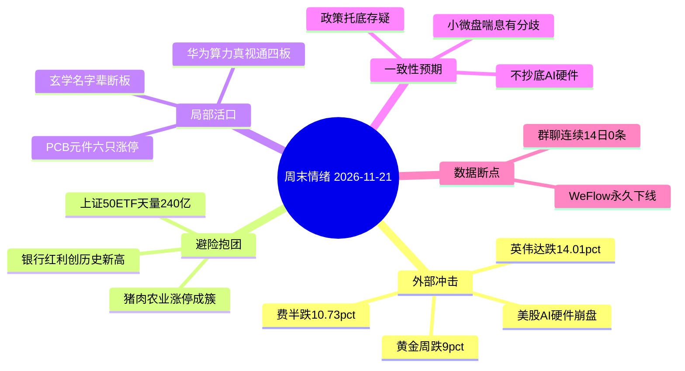

# 2026年11月21日 · **群聊情绪共振**（周末轻量档）

> **数据源新鲜度**: partial · **降级状态**: false · **置信度**: 0.42
> **覆盖窗口**: 11-20 06:01 → 11-21 18:01（36h，周五盘前 → 周六傍晚）· **主源**: 公众号 19 号池 104 篇 + 周末榜单 + 11-20 收盘人气/涨停基准
> **⚠️ 周末档口径**: 非交易日，本报告**不含**竞价、涨停家数前瞻、炸板率前瞻、情绪周期阶段推进等交易日字段；所有盘中口径标 `not_available`，不做类比推算。**不写买卖建议、不给买卖点。**
> **⚠️ 群聊层**: `wechat_cli_5groups.jsonl` 0 字节、7 群 0 条，本地库停在 2026-10-28。本档「KOL 在聊什么」只能由**公众号观点层**代位，不得当作真人话语。

## 一句话结论

周五 5236 只个股下跌、创连续 7 日超 4000 只下跌的历史纪录之后，周六凌晨美股再补一刀（费半 −10.73%、英伟达 −14.01%、SEC 查会计操作），公众号口径**罕见一致：不接 AI 硬件**；分歧只在下游——小微盘能不能喘口气、政策托底算不算数。周末唯一逆势成簇的是 PCB/元件与农业养殖两条线，但前者是"缺料硬逻辑 + 二三线补涨"，后者是"避险抱团"，两者都不是新主升。

## 🗺️ 情绪全景图

## 详细分析

### 一、情绪温度：18/100，周末只叠加利空、不重算分数

- **T-1 收盘基准**（R1/R3，trade_date=2026-11-20）：情绪 **18.0**，桶=极恐（<20），阶段 capitulation 第 7 天 / 连跌 6 天，仓位上限 0.10，主线标签"无主线·轮动"。
- **周末不做交易日打分**：本档没有新交易数据，任何"情绪回暖/见底"分数都是编造。只定性——**外部利空叠加，周一基调继续偏防御**。
- 周末唯一的量化情绪证据是**人气结构**：11-21 四榜全 0（周六未更新，`not_available`）；11-18~11-20 跨日连续在榜 **21 只**，其中 3 日全在榜 10 只（九阳股份、华胜天成、冰山冷热、常山北明、北纬科技、中际旭创、东方海洋、华东重机、有研新材、利通电子）。

### 二、群聊层：0 条，第 14 个交易日（不可用，不编造）

7 个群任务状态全部 `ok`，但落盘文件 **0 字节 / 0 条**，本地微信库最后一条消息停在 2026-10-28。按 house precedent：`kol_summary` 置空、`kol_status = empty`，**不得用旧文本冒充今日情绪**。这意味着：

- 本档没有"游资今天怎么说"的一手信息，只有公众号转述的游资复盘（如「大A先负带后带负，下周一或许给小微盘喘口气」）——属于**观点转述**，不是真人层数据。
- 由于 L2 缺席，共振真等级上限只能到 **L1+L2b**，且 L2b（公众号）按红线 **不计入** L1/L2 等级枚举 → 下面 5 个主题**全部不构成强共振**，下游不得当"已确认主线"。

### 三、公众号观点层：一致看空 AI 硬件，分歧在"底在哪"

窗口内 104 篇（证券时报 44 / 上证报 36 / 财联社早知道 4 / 其余 17 篇来自 10 个号）。剔除官媒资讯稿后，**观点层的 11 篇核心文**可分成三档：

| 口径 | 号（发文时间） | 核心说法 | 对情绪的含义 |
|---|---|---|---|
| 明确看空美股 AI | 贩财局（11-21 07:34）· 调研先知（11-20 22:20 / 11-21 10:41）· 证金事（11-21 07:32、07:53）· 金渐成（11-21 16:09）· 李大霄（11-21 17:47） | 「史无前例的科技大踩踏」；对冲基金十年最激进科技抛售、CTA 净空 190 亿美元且下周无论何种情景都继续卖；「光、芯股腰斩再腰斩进程并未结束」；「输入性风险不得不防」 | 一致预期已形成：**AI 硬件不接** |
| 结构性做多 A 股局部 | 股痴流沙河（11-20 08:37 / 11:38）· 财联社早知道（11-20 16:50 / 19:00） | 「顺指数的 PCB 和国产活口，反弹的机器人、短剧、玄学人气股」；收评点名 PCB 涨停潮、华为算力真视通 4 连板、猪肉逆势 | 局部活口叙事：**PCB/国产/避险** |
| 中性偏产业 | 远川研究所（11-20 22:02）· 傅里叶的猫（11-20 23:09 / 11-21 16:09） | 腾讯游戏与混元 Co-Design；阿里云 2027 增速降至 30-45%；存储要分 HBM/传统 DRAM/企业级 SSD 看；AI 龙头 TTM PE（NVDA 13.5x、美光 8x、博通 39x）已低于 2000 年泡沫破裂后的思科/微软/英特尔 30x 上下 | 中期是**分歧**：估值已低 ≠ 盈利可持续 |

再叠一篇"仓位自白"：猫笔刀（11-20 21:59）称官军单日约 1000 亿护盘、"这股市不是病了是昏迷了"，自己加仓至 24 手 / 仓位 68%，并已把预期从"牛市"下调到"可能局部系统性危机"。**这是典型的深套者自言自语，不是底部信号**——他自己也说"只有这样才能融入 a 股这个大型精神病院"。

**一致性预期的质量判断**：看空 AI 硬件这一条是**已被价格验证过的共识**（周五存储链 −6~7%、算力 −7~9%、光模块 −3.7%），不是"人弃我取"的错杀位；分歧集中在"小微盘/玄学要不要接"与"政策底是否有效"，两边都有明确反例（证金事：四大行拉指数时中小盘正被砸；李大霄：互换便利第三批招标超 30 家机构申报）。

### 四、题材在哪里发酵（周末口径：人气 + 周五板型，不是前瞻）

**发酵中（有跨日在榜或成簇）**

- **PCB/元件（唯一逆势成簇）**：周五 `limit_list_d` 元件行业 **6 只涨停**（超声电子、东晶电子、中京电子 2 板、满坤科技 20cm、骏亚科技、澳弘电子）；概念榜 PCB #14→**#2**（−4.85% 但热度不降）。消息面是全球电子协会 11-18 的缺料警报（供应紧张至 2028 年中）+ 申港证券"2027 年 PCB 载板材料缺口约 20%"。**但周五涨的是二三线小票**，财联社收评自己点破"市值偏小、业绩兑现弹性与头部算力载板差距明显，行情延续性待观察"。
- **避险抱团（红利 + 农业养殖）**：猪肉概念 #10→**#1**；工商银行 +3.30% 重夺 A 股市值冠军，建行/中行/交行/长江电力/中国神华/中国电信创历史新高；上证 50ETF 成交 240 亿刷新天量（前纪录 214.5 亿）；猪价 11-20 均价 9.36 元/公斤，较月初 8.63 元涨约 8%。**这是资金找避风港，不是产业逻辑**，且财联社已提示"红利交易拥挤度抬升，风险偏好修复时有补跌风险"。
- **华为算力活口**：真视通 4/4 板（封单 1.59 亿、9:30:21 封板），华胜天成跨 3 日在榜 #2；华为昇腾"一年一代、算力翻倍"叙事 + CloudRobo WM1.2 开源（11-16）。
- **玄学名字辈进入退潮**：九阳股份连续 3 日双榜 #1 之后周五 **−7.21%** 断板；大东方 7/14 板型、东方海洋 1 板、好当家 4/7 —— 这批票的共同特征是"名字 + 低价 + 高换手"，属情绪末端博弈，不构成题材。

**未定价/待观察**：量子计算（浙大"天目2号"QRAM 全球首次真机实现，11-21 证券时报）；网络安全（CrowdStrike 洽购 Zscaler，市值或 2650 亿美元，11-21 06:31）；恒生科技指数 30→50 只扩容（12-07 生效，中际旭创/胜宏/澜起/长飞/立讯等在列）；冰雪（冰山冷热涨停，但长白山 −9.83%、大连圣亚 −9.99%，同题材内部撕裂）。

### 五、红线与负向警报

- **红线 4（霸榜=派发）**：九阳股份 3 日双榜 #1 + 封单从 2.23 亿衰减到 0.64 亿（−71%）+ 周五 −7.21% → 派发已完成，**不得作正向共振**。
- **人气高位 + 价格下跌**：中际旭创连续 3 日在榜（最好 #4）但周五 −3.72%，`distribution_alert` 保留；文投控股 2 日在榜（#4）周五仅 +0.37%，同属高位滞涨。
- **负向主题 2 条**：①AI 硬件链（光模块/CPO/存储/算力）外部冲击未消化；②红利/银行拥挤度抬升（财联社自述补跌风险）。
- **L2_only 不再存在**：L2 已 14 日 0 条，不存在"仅 KOL 提过"的主题。

## 🎯 主题深度三问（只对前 3 个主题；周末档不给买卖点）

### T1 · AI 硬件链承压（光模块/CPO/存储/算力）

- **大资金意图**：不是"看空产业"，是**先把最拥挤的仓位卸掉再谈逻辑**。摩根士丹利口径多空基金净敞口已降到 42%（2010 年以来第 8 百分位），而卖方一致预期明年盈利增速还有 16% —— 仓位与预期的裂口，只能靠卖股票来弥合。
- **为什么走弱**：周五 A 股已经先跌一轮（江波龙 −6.93%、兆易 −5.91%、海光 −8.75%），周六凌晨美股再补一刀（费半 −10.73%、NVDA −14.01%），等于同一件事在 24 小时内被定价两次。第二刀的信息增量是 **SEC 查会计**，它打的是"收入质量"而不是"需求"，对估值分母的杀伤更持久。
- **逻辑够不够硬**：**方向硬、幅度未定**。硬：海外硬件是 A 股同环节的定价锚，锚掉了 10%，映射不可能为零。不硬：盘后已反弹 +2~3%、甲骨文融资齐备、机架照常交付 → 订单端未证伪。**所以它是"压制开盘价"，不是"杀死产业链"**；真正要观察的是低开后 30 分钟有没有资金接。

### T2 · 避险抱团（银行红利 + 猪肉农业）

- **大资金意图**：找**与 AI 无关的现金流**。工行 +3.30% 重夺市值冠军、上证50ETF 240 亿天量、猪肉逆势成簇，三件事的同一个驱动是"风险预算被砍，只能往低波动挪"。
- **为什么走强**：猪价给了基本面抓手（11-20 均价 9.36 元/公斤，较月初 8.63 涨 8%），红利给了确定性抓手（建行/中行/交行/长电/神华/电信创新高）。在"没有主线"的市场里，资金需要一个"跌不动"的容器。
- **逻辑够不够硬**：**避险逻辑硬，进攻逻辑软**。硬：低波动 + 高股息 + 猪价环比改善，三条都可验证。软：①财联社自己提示"红利交易拥挤度持续抬升，风险偏好修复时有补跌风险"；②养殖端"出栏压力仍大、冻品库存高位、供需宽松未改"，猪价只是环比反弹不是周期反转。**这是防守位，不是主升位。**

### T3 · PCB/元件缺料链

- **大资金意图**：在"无主线 + 极恐"里，找一个**有实物缺口、能被季报验证**的容器做局部抱团。缺料 → 涨价 → 业绩，这是弱势里唯一还能讲"量价"的故事。
- **为什么走强**：全球电子协会 11-18 协会级预警（缺料蔓延至成品板、紧张至 2028 年中）+ 申港测算 2027 年载板材料缺口 20%，是硬供给约束；盘面上元件 6 只涨停、PCB 概念 #14→#2，热度与价格同向。
- **逻辑够不够硬**：**逻辑硬、纯度差**。硬的：缺料不是小作文，是协会 + 券商双口径。差的：周五涨的全是二三线（满坤 20cm、澳弘、骏亚、东晶），头部载板（生益/深南/沪电）没动，材料端（沃特 −4.48%、凌玮 −8.03%、联瑞 −7.68%、宏和 −5.71%、东材 −7.66%、德福 −7.82%）集体下跌 —— **链条内部不共振，说明资金在炒"小票弹性"而不是"产业趋势"**。周一唯一分水岭：头部能不能接力。

## 🎯 共振主题 top5（L1+L2b，全部不构成强共振）

| # | 主题 | 等级 | 强度封顶 | 源证据 | 阶段 | 备注 |
|---|---|---|---|---|---|---|
| 1 | AI 硬件链承压（光模块/CPO/存储/算力） | L1+L2b | **L1_only**（L2b 不计等级） | 概念榜 CPO #3（−5.27）、存储 #9（−6.61）、算力租赁 #7；中际旭创/新易盛/东山精密跨日在榜但下跌；公众号 5 号一致看空 | middle | 负向主题，按红线 4 不计正分 |
| 2 | 避险抱团（银行红利 + 猪肉农业） | L1+L2b | L1_only | 猪肉 #1；工行 +3.30%、上证50ETF 240 亿；金新农 3/6、万向德农、国光股份、东方海洋、好当家涨停 | late | 拥挤度已高，防御属性非进攻 |
| 3 | PCB/元件短缺链 | L1+L2b | L1_only | PCB #2；元件 6 只涨停；全球电子协会 11-18 警报 | middle | 涨的是二三线，头部未动 |
| 4 | 华为算力/国产算力活口 | L1+L2b | L1_only | 真视通 4 板、华胜天成 3 日在榜 #2、常山北明 3 日在榜 | late | 高标 4 板 + 极恐，高度压制风险 |
| 5 | 玄学名字辈 | L1+L2b | L1_only | 九阳 #1 三日→断板；大东方 7/14、东方海洋、好当家 | late | 退潮段，红线 4 已触发 |

> **强度封顶说明**：`resonance_strength_cap = 真等级 L1_only；L2b 仅公众号观点代位、按红线 3 不计入 L1/L2 枚举`。上述 5 个主题**均不构成强共振**，下游（R2/D1）不得当"已确认主线"，只能当"热度参考"。

## 关键证据

- 证据 1：11-20 A 股 5236 只个股下跌，连续 7 个交易日超 4000 只下跌（历史纪录，前纪录 2024-01-29→02-05 的 6 日）；上证最低 3500.88、工行 +3.30% 托指数 — 证金事 2026-11-21 07:32
- 证据 2：纳指 −5.28%（跌 1261 点）、标普 −3.70%（连跌 7 日，2020 年以来最长）、费半 −10.73%、NVDA −14.01%（SEC 查会计操作，路透）；盘后 AI 硬件反弹 +2~3% — 证券时报 2026-11-21 07:52 / 15:21
- 证据 3：11-20 `limit_list_d` 涨停 28 / 跌停 58 / 炸板 7、首板 22（78.6%）、最高 4 板（真视通 4/4、盛剑科技 4/4）；元件行业 6 只涨停 — tushare 2026-11-20 收盘
- 证据 4：概念榜 猪肉 #10→#1、PCB #14→#2、CPO 保持 #3、光刻胶 #1→#5、光刻机 #8→#18、存储 #5→#9、高股息精选新进 #20 — `attention_weekend` 11-19 vs 11-20
- 证据 5：周末连续在榜 21 只，3 日全在榜 10 只 — `attention_weekend.weekend_persistent`（11-18~11-20）
- 证据 6：九阳股份 3 日双榜 #1（11-17/18/19）→ 周五 −7.21% 断板；封单 2.23 亿→0.64 亿 — R3/R1 2026-11-20 + `daily_20261120`
- 证据 7：猪价 11-20 均价 9.36 元/公斤（月初 8.63，+8%）、冻品库存高位、供需宽松未改 — 财联社收评 2026-11-20 16:50
- 证据 8：上证 50ETF 成交 240 亿刷新天量（前 214.5 亿）；建行/中行/交行/长江电力/神华/中国电信创历史新高 — 财联社收评 2026-11-20 16:50
- 证据 9：真视通 4/4 板、封单 1.59 亿、首封 09:30:21；中京电子 2/2 板、封单 2.04 亿 — `limit_list_20261120`
- 证据 10：高盛恐慌指标 9/10、CTA 净空 190 亿美元、过去一月卖 570 亿美元、模型测算下周无论何种情景继续卖 — 财联社 2026-11-21 05:25

## 数据源审计

| 源 | 日期 | 状态 | 备注 |
|---|---|:--:|---|
| wechat_official_rss（19 号池） | 2026-11-21 | 🟢 | 104 篇 / 13 号有文 / core 7-10；6 号本窗口 0 篇（含「预期差寻找」） |
| wechat_cli_5groups（7 群） | 2026-11-21 | 🔴 | 0 字节 / 0 条，本地库停 2026-10-28，第 14 个交易日断更 |
| attention_weekend | 2026-11-21 | 🟢 | 11-18~11-20 有榜；11-21 四榜 0 = 周六 `not_available` |
| attention_signals | 2026-11-21 | 🟢 | 解析交易日 20261120；persistent 1997 / surge 15 / 合力 71 |
| tushare/limit_list_d | 2026-11-20 | 🟢 | 93 条，U28/D58/Z7 |
| tushare/news_cls | 2026-11-21 | 🟡 | 2248 条，止于 11-21 08:59，09:00 后由公众号覆盖 |
| weflow-analytics | — | 🔴 | 2026-08-19 永久下线，不计 severity |

## 不确定性 / 反证

1. **没有群聊 = 没有一手情绪**。本档所有"游资怎么想"都是公众号转述（二次口播），信息折价至少一层，不能当作 L2 证据。
2. **人气榜不等于次日方向**。21 只周末连续在榜里，中际旭创/新易盛/东山精密是**下跌中的人气**（派发型），九阳是**已断板的人气**，真视通是**高位人气**；只有冰山冷热/中京电子属"涨停 + 在榜"的健康形态。
3. **PCB 的"硬度"存疑**。缺料是真事（全球电子协会 + 申港），但周五涨停的是二三线，头部载板（生益/深南/沪电）并未同步走强——历史上这种"缺料 + 小票补涨"组合的持续性通常只有 2-3 日。
4. **避险抱团的反向风险**。红利创新高 + 上证50ETF 天量，是"集中避险"产物；若下周风险偏好因政策或美股盘后反弹修复，红利存在补跌，届时"防御"会变成第二个受伤位。
5. **政策底 ≠ 市场底**。互换便利第三批招标（超 30 家申报）目前只有李大霄转述财联社，未见央行原文口径落在我抓到的源里；本条按"待核实"处理，不给强度。
6. **窗口缺口**。11-21 09:00-18:00 的财联社快讯未落盘，该段只有公众号覆盖；若周末下午有重大政策/事件，本档可能漏检。

## 与其他 R/D/E 的关系

- 依赖：`attention_signals`（11-20 收盘人气）+ `attention_weekend`（11-18~11-20 跨日榜）+ `limit_list_20261120`（板型）+ `wechat_official_rss`（观点层）+ `news_cls`（事实层）
- 被消费：R2 主线判定（主题只能当热度参考，不构成主线确认）/ D1 周一预案（外部冲击权重）/ R6 反证（红利拥挤、PCB 小票持续性）/ E1 复盘（若周一出现"跟跌不跟涨"可回查本档一致性预期）

## Sub-Agent 元数据

- skill: analyze_sentiment_resonance_v1（weekend_light 分支）
- artifact: 本 md（周末档不落 `data/research/` JSON，遵循"只写 chzl_kg"纪律）
- method: 双源（L1 榜单 + L2b 公众号观点），L2 真人层缺失
- 生成时刻: 2026-11-21T18:15:00+08:00
- model: deepseek-v4.1-flash
