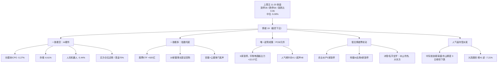

# 2026年11月22日 · **群聊情绪共振**（周末轻量档）

> **数据源新鲜度**: partial · **降级状态**: false · **置信度**: 0.45
> **覆盖窗口**: 11-21 18:01 → 11-22 18:01（24h）· **主源**: 公众号 19 号池 30 篇 + 11-20 收盘人气榜/概念榜 + 11-19~11-21 连续在榜 24 只 + 11-20 收盘涨停结构
> **⚠️ 周末档口径**: 非交易日。本报告**不含**竞价、涨停家数前瞻、炸板率前瞻、情绪周期阶段推进；盘中字段标 `not_available`。**不写买卖建议、不给买卖点。**
> **⚠️ L2 断更口径（house precedent）**: 7 群 0 条已是第 15 个交易日，`kol_summary` 置空，**不用旧文本冒充今日情绪**；观点层由公众号（L2b）承担，但 L2b **不计入**共振等级枚举 → 主题最高标 `L1+L2b(代位)` 并注明「真等级 L1_only，不构成强共振」。

## 一句话结论

**情绪温度停在冰点下沿（19 左右），周末没有新的一致性看多，只有一致性看空 AI 硬件——唯一的反向叙事是"指数有人托、题材没人接"。**

## 🗺️ 情绪结构全图

## 情绪浓度

**`sentiment_score = 19`（0–100）· 桶 = 极恐下沿**

`sentiment_score_basis`：
- **基准一（我们的盘前口径）**：R1 11-20 档 19.2，桶"极恐"（该档句型为「防御观望型 + capitulation 补跌」）
- **基准二（外部对照）**：连板网同日 20.4，阶段词"退潮期"——两套阶段名**不互译**，只做并列
- **基准三（收盘结构）**：11-20 涨停 28 / 跌停 58 / 涨跌比 0.06 / 中位 −5.08% / 炸板率 20%，其中跌停 58 家**全部收盘封死**
- **周末增量修正 −0.5**：
  - ＋宽基 ETF 单日 920 亿、5 日 1873 亿、9-28 以来 7664 亿（大机构特征）→ **+1.5**
  - ＋18 家董事长提议回购 + 控股股东增持群 → **+1.0**
  - ＋官媒口径密集转暖（人民日报"唱空中国经济者终会落空"、东方港湾"值得更强信心"、头部公募掌门一致看好配置价值）→ **+0.5**
  - −买方路演"几乎清仓 AI 硬件、机构现金 70%"→ **−2.0**
  - −英伟达被 SEC 与加州总检察署调查（含潜在刑事）→ **−1.5**
- **五维加权交叉校验**：涨停强度与连板结构两项压到极低位（28/58、天梯断腰：4 板 2 只、3 板 0 只、2 板 1 只、1 板 25 只），跌停压制项极差；粗算 18–21 区间，与 19 无背离（gap < 5）
- **非交易日声明**：以上是"上一交易日收盘基准 + 周末增量"的合成读数，**不构成阶段推进**，也**不作为**周一的择时信号

## 详细分析

### 1. L2 真人层已经谈不上"缺席"——是彻底没有数据

7 个群抓取任务全部 `ok`、0 条、文件 0 字节，本地微信库最后一条消息停在 2026-10-28。这意味着过去 15 个交易日，我们所有的"情绪"判断都建立在**榜单 + 公众号 + 收盘结构**上，没有任何真人对话证据。这一条先说清，因为它决定了本报告的可信度上限只有 0.45。

### 2. 周五的分层不是普跌，是"大票托指数、小票失血"

上证 −1.23%（3533.79）而中证 1000 −4.89%、全 A 中位 −5.08%，涨跌比 0.06 是今年最差一档。同时百日新高里有 10 只是银行/电力/红利（工行、建行、交行、中行、长江电力、川投、国投、唐山港、农行、中石化）。**趋势资金在买防御，题材资金在撤退**——这条结构，比任何情绪分数都更准确。

### 3. 唯一逆势成簇的方向是 PCB/元件，且它同时出现在人气榜与公告面

11-20 元件 6 家涨停（超声电子、东晶电子、中京电子 2 板、满坤科技、骏亚科技、澳弘电子），盘中主力净流入印制电路板 22.07 亿；人气榜中京电子 #1（连续 3 日在榜、最佳排名 1）、超声电子 #8。周日上证报又补了一条产业链硬料：全球电子协会预警 PCB 常规材料紧张至少到 2027H1。**资金、榜单、消息三件事在同一条线上对齐**——这是本周末唯一三源对齐的方向。

### 4. 一致看空的不是某只票，是整个 AI 硬件，而且三层同向

- **买方层**：上海路演口径——硬件多头仓位压到接近零、有机构现金 70%、海外基金半导体持仓落到个位数，问到在买什么，多数"先停下来观望"
- **卖方层**：中金"外部逆风再起引致超调、保持信心"（即承认超调，但把原因归到外部）；多家华尔街机构"或只是牛市回调"
- **自媒体层**：猫笔刀《看错的代价》——纳指 −5%、英伟达 −14% 之后**暂缓抄底**，理由是"美股还有下跌空间 + 珍惜现金"
- **盘面层**：光模块/CPO −5.27%、存储 −6.61%、人形机器人 −5.44%，而人气榜上中际旭创 #14（−3.72%）、新易盛 #17（−1.23%）、东山精密 #15（−5.72%）**三只光学票仍在榜内下跌**

三层同向 + 盘面印证，含义是「一致看空」。A 股的规律是：一致看空**不等于**要立刻涨，但它意味着**卖出动能的边际衰减已经开始**——买方的仓位已经压到近零，"再跌也没有仓位可减"。

### 5. 反方向的"一致看多"只到指数，不到题材

- 11-20 股票型 ETF 净流入 **920.66 亿**（历史第三高，仅次于 2024-10-08 的 1061.96 亿与 2025-04-08 的 1015.26 亿），9-28 以来累计 7664.01 亿；宽基是主力（沪深300ETF嘉实 226.51 亿、上证50ETF华夏 215.83 亿）
- 11-21 公告窗口 **18 家**董事长/实控人提议回购（摩尔线程、昂瑞微、拓荆、燕东微、芯碁微装等），另有控股股东增持群（巨化、建发、荣盛石化、兴业银锡等）；华友钴业周日再抛最高 15 亿回购
- 官媒与机构口径同步转暖

**但这三条都指向宽基/红利/自家股票，没有一条指向"下一个题材是谁"**。所以周末的一致预期是分裂的两截：**指数有人托，题材没人接**——这正是"止跌但做不出赚钱效应"的典型组合。

## 🎯 共振主题 Top5

> 等级口径：L1 = 榜单（人气/概念）· L2b = 公众号观点（**不计入等级**）· L2 = 群聊（0 条，缺席）。因此各主题**真等级均为 L1_only**，标 `L1+L2b(代位)`；按红线 3，**不构成强共振**，下游不得当已确认主线。

### ① PCB/覆铜板/元件缺料链 · `L1+L2b(代位)` · early→middle

- `sources_hit.hotlist`：中京电子 #1（3 日在榜，最佳 1）、超声电子 #8→#11、东晶电子/满坤/骏亚/澳弘 涨停；概念榜 PCB #2（−4.85%）
- `sources_hit.official_voices`：上证报《PCB 供应预警！常规材料或短缺至 2027 年上半年》（11-22）；中信建投《迎接 MLCC 超级周期》（11-21）
- **大资金意图**：在投降式下跌里做多"缺料"而不是做多"景气"，是**选可验证的定价权**——交期与涨价函能跟踪，景气度不能
- **为什么走强**：板块指数 −4.85% 却有 6 家涨停，说明资金是"挑票打"不是"买板块"；这类结构只对**上游材料 + 小市值弹性**友好
- **逻辑够不够硬**：中硬。硬在协会级预警 + 交期数据 + 周五真金白银；软在 2027 年订单回调风险（协会自己写了）与"AI 服务器订单可能放缓"的牵制
- `early_or_late = early→middle`（首日成簇，尚无梯队，中间层是空的）

### ② 农业/水产/猪周期 · `L1+L2b(代位)` · middle

- `sources_hit.hotlist`：东方海洋 #7（3 日在榜，最佳 5，封单 2.02 亿、换手 23.83%）、好当家 #15（2 日）、金新农/万向德农/国光股份 涨停；概念榜**猪肉 #1（+0.07%，全场唯一红盘概念）**
- `sources_hit.official_voices`：唐人神调研"积极应对本轮猪周期底部"（11-21）；全国秋冬种进入尾声、主产区应对超强厄尔尼诺（11-22）
- **大资金意图**：这是**防御性进攻**——低位、低估值、有现货价格锚（猪价/农产品），在题材真空期充当"能拿住的方向"
- **为什么走强**：全场唯一正收益概念 + 5 家涨停成簇，说明它不是偶然
- **逻辑够不够硬**：中。硬在"猪周期底部"是产业共识、且农业具备逆周期属性；软在这是**慢逻辑**，通常走震荡不走连板，把它当情绪票做会失望
- `early_or_late = middle`

### ③ 低位情绪票轮动（传媒/AI 应用/冰雪/名字玄学）· `L1+L2b(代位)` · late

- `sources_hit.hotlist`：真视通 4 板（#11，封单 1.59 亿）、风语筑 #13（+10.0%）、龙版传媒 #19（+9.99%）、文投控股 #4（+0.37%，3 日在榜）、华媒控股/凡拓数创/荣联科技 涨停；冰山冷热 #2（+10.03%，开板 2 次、换手 42.64%，3 日在榜）、大东方 #12（+10.02%）
- `sources_hit.official_voices`：红果短剧整改下架（11-22，负面）；11 月票房破 5 亿（11-21，正面但弱）
- **大资金意图**：题材真空期的**筹码游戏**——钱不去产业，去"能拉得动的低位票"
- **为什么走强**：天梯断腰（3 板 0 只）环境下，只剩下 4 板独苗 + 一堆 1 板，资金只在低位找弹性
- **逻辑够不够硬**：**不硬**。文投控股 3 日在榜却只涨 0.37%，冰山冷热换手 42.64% 且开板 2 次——**这是接力盘在互相倒手，不是产业逻辑**
- `early_or_late = late`（高标独苗 + 中间层全空 = 接力负期望，E1 已算过：首板→2 板晋级 5.6% vs 基线 16.7%）

### ④ AI 硬件（光模块/CPO/存储/算力）· `L1+L2b(代位)` · late · **派发警报**

- `sources_hit.hotlist`：中际旭创 #14（−3.72%，3 日在榜，最佳 4）、新易盛 #17（−1.23%，3 日在榜，最佳 8）、东山精密 #15（−5.72%，3 日在榜，最佳 14）；概念榜 CPO #3（−5.27%）、存储 #9（−6.61%）、芯片 #16（−5.99%）
- `sources_hit.official_voices`：调研先知《上海买方路演：几乎清仓 AI 硬件》；中金"外部逆风再起"
- **大资金意图**：**降仓已经完成，剩下的问题是没人接**——不是看空，是没仓位可减也没兴趣回补
- **为什么走强**（人气为什么不等于资金）：三只光学票连续 3 日留在人气榜，说明**关注度是套牢盘的关注度**，不是新增资金的关注度
- **逻辑够不够硬**：反向硬（利空逻辑硬），正向不硬
- `early_or_late = late`，`hotlist_signals.distribution_alert` 收录（见下）

### ⑤ 人形机器人 · `L1+L2b(代位)` · middle（分歧）

- `sources_hit.hotlist`：襄阳轴承 #10（+1.43%，2 日在榜，最佳 3）、华东重机 #5（−3.52%，3 日在榜，最佳 5）；概念榜人形机器人 #6（−5.44%）、机器人 #8（−5.21%）
- `sources_hit.official_voices`：苹果 HALO 仿真系统（宇树 G1 零样本迁移、6 个未建图真实房间 360 次任务、平均成功率 91%）· 财联社早知道 11-21；思灵机器人 566 亿估值、软银+英伟达押注（11-22）；三一集团将在上海宝马展全球首发 AI 智能体与具身智能平台（11-22）；奥比中光获 83 家机构调研、海外仓储场景批量交付（证券时报 11-22）
- **大资金意图**：一级市场估值锚（566 亿）+ 产业事件（HALO/三一首发）在持续供给叙事，但二级资金在撤
- **为什么走强**（消息与价格背离）：消息面三个新增（HALO、思灵、三一）全是正面，价格却是 −5.44%——**消息与价格背离**，说明筹码结构（前期套牢盘）压过叙事
- **逻辑够不够硬**：产业逻辑硬，交易逻辑不硬（这正是用户那句"巨量套牢盘决定了好逻辑也要磨时间"）
- `early_or_late = middle`（叙事在积累、价格在消化，属"等右侧"而非"现在进"）

## 📡 热榜信号

- `rank_momentum_up`（排名跃升 ≥10）：工商银行 81→5（+76）、龙版传媒 87→26（+61）、大东方 65→12（+53）、兆易创新 90→45（+45）、通富微电 68→36（+32）、贵州茅台 45→18（+27）、东方财富 50→24（+26）、冰山冷热 28→2（+26）、东方海洋 32→7（+25）、文投控股 29→4（+25）、北纬科技 25→9（+16）
- `new_in_top`（首次进榜）：易天股份 #35、国光股份 #48、鼎龙科技 #50、建业股份 #60、海希通讯（飙升榜 #1，+12.23%）
- `distribution_alert`（人气留存型派发，**正向共振扣分**）：
  - 九阳股份：人气榜 #1、两平台双榜第一，**当日 −7.21%**——榜一却在杀，典型"人气即出货窗口"
  - 中际旭创 / 新易盛 / 东山精密：连续 3 日在榜（最佳 4/8/14），当日 −3.72% / −1.23% / −5.72%
  - 文投控股：3 日在榜（最佳 4），当日仅 +0.37%
  - 华升股份：榜 #17、当日 −9.89%；龙江交通 #14、−8.32%
- `released`（掉榜/降温）：有研新材 #16→掉出（−4.83%）、常山北明 #16（2 日）、利通电子 #18
- **霸榜判定**：概念层只有 **11-20** 名单可实证（#1 = 猪肉），11-19 / 11-21 名单未持久化 → **无法完成逐日 #1 比对，标"未验证"，不当作已排除**；个股层同理，仅 11-20 名单可用（九阳股份首日 #1 但当日 −7.21%）→ 按红线 4 **不触发"连霸第一名"警报**，但九阳满足"人气第一 + 价格下跌"的派发特征，已写入上方清单

## 🧠 一致性预期盘点（本档核心交付）

| # | 一致性方向 | 证据（层） | 强度 | 反向思考 |
|---|---|--|--|--|
| 1 | **AI 硬件短期不能碰** | 买方（仓位近零/现金 70%）+ 卖方（中金称超调）+ 自媒体（猫笔刀暂缓抄底）+ 盘面（CPO/存储/芯片 −5~−6.6%）+ 人气榜光学票在榜下跌 | 🟢🟢🟢 **极强** | 一致看空≠继续跌；仓位已近零 = 卖压枯竭。反弹定义为"反弹"，不定义"反转" |
| 2 | **指数有底、宽基优先** | ETF 单日 920 亿（历史第三）+ 9-28 以来 7664 亿 + 18 家提议回购 + 官媒三连发声 | 🟢🟢 **强** | 托底资金买的是宽基/红利，**不解决题材承接**；"指数不跌 + 个股跌"可以共存 |
| 3 | **存储 2027 年中景气见顶** | 买方口径（SK 海力士远期 PE 约 2 倍 = 已押注崩塌）+ 存储概念 −6.61% | 🟢 | 若存储价扛到 2027Q2，"见顶"叙事会被推迟，存储股反而有修复 |
| 4 | **PCB 缺料是 2027 的确定性** | 协会预警 + 交期数据 + 周五资金 22.07 亿 + 6 家涨停 | 🟢🟢 | 协会同时写了"2027 订单可能回调"——**同一条报告里自带反证** |
| 5 | **机器人叙事不死、价格不动** | HALO 91% 成功率 + 思灵 566 亿 + 三一全球首发 vs 概念 −5.44% | 🟢（分歧） | 消息越密、价格越弱 = 套牢盘在借消息减仓，不是建仓 |

**一句话读法**：周末市场**唯一没有分歧的共识是"AI 硬件先别碰"**；对"买什么"的分歧极大（宽基、农业、PCB、机器人各说各话）。这种"看空一致、看多分裂"的组合，通常对应**指数震荡 + 无处抱团的个股行情**，而不是方向性行情。

## 🧩 首推票思维链（周末档：只写逻辑与证伪条件，不写买卖点）

### 中京电子 002579 · PCB/元件链人气锚（流通市值 78.1 亿，11-20 收 13.39 元）

- **入选理由**：唯一同时满足"消息（PCB 缺料）+ 资金（印制电路板 +22.07 亿）+ 人气（双平台 #1、3 日在榜）+ 板型（2 板、封单 2.04 亿、首封 09:36 零开板）"四项的票；面板级辨识度（题材心智锚：提 PCB 缺料，第一个想到的就是它）
- **风险点**：天梯断腰环境下 2 板是"最危险的高度"（首板→2 板晋级仅 5.6%）；已发异动公告；2 板后一旦开板，前面的封单就是抛压
- **证伪条件（周一）**：竞价高开但开盘后 30 分钟内跌破前收；或 PCB 概念指数继续 −4% 以上而它无法独立走强 → 逻辑作废
- **可验证假设**：若 PCB 缺料是真逻辑，周一应有**第二只**同链票跟板；若全天只有它自己 → 是孤票，不是主题

### 超声电子 000823 · 元件同链第二票（流通市值 110.1 亿，11-20 收 18.51 元）

- **入选理由**：1 板、封单 1.67 亿、首封 10:00；双平台 #8→#11；换手 19.95% 说明筹码换手充分
- **风险点**：换手近 20% 意味着浮筹多；同链已有 2 板大哥，它天然是"跟风位"
- **证伪条件（周一）**：中京电子炸板或大跌而它独自封板 → 说明是"补涨不是共振"，持续性打五折
- **可验证假设**：若 PCB 链成立，它应当**与中京同步**而非接替；只看同步性，不看绝对涨幅

### 东方海洋 002086 · 农业/水产情绪票（3 日在榜，最佳 5，11-20 封单 2.02 亿、换手 23.83%）

- **入选理由**：农业 5 家涨停成簇的核心票；猪肉是全场唯一红盘概念；换手 23.83% 在涨停票里属"高换手封板"（分歧中封住）
- **风险点**：换手高 = 隔日承接压力大；农业是慢逻辑，情绪票化之后容易一日游
- **证伪条件（周一）**：好当家/金新农不能跟红；或它自己低开 → 成簇逻辑破裂
- **可验证假设**：若猪周期底部逻辑被资金接受，周一应有 ≥2 只农业票红盘；若只剩它一家，是余温不是主题

### 先导智能 300450 · 固态电池设备（流通市值 427.0 亿，11-20 收 27.38 元）

- **入选理由**：温等静压被专家称为"GWh 量产甜蜜点"，单 GWh 设备投资 4–5 亿（液态 4–5 倍），设备先行是产业铁律；中试线 20+ 条落在 2026–2027
- **风险点**：大市值弹性弱；固态仍在"中试期"，订单落地要等招标；该板块过去两年被反复透支
- **证伪条件（周一）**：固态/锂电设备端无一只涨停，只有它跟着大盘走 → 说明事件没被交易
- **可验证假设**：若消息有效，周一固态设备应有 ≥1 只首板；出现才说明主题化，否则只是公告消化

## 关键证据

- 证据 1：11-20 收盘结构——涨停 28 / 跌停 58（全部封死）/ 炸板率 20% / 涨跌比 0.06 / 中位 −5.08%；天梯 4 板 2 只、3 板 0 只、2 板 1 只、1 板 25 只 · chzl_kg/投研交易/复盘记录/20261120.md
- 证据 2：元件 6 家涨停（超声电子、东晶电子、中京电子 2 板、满坤科技、骏亚科技、澳弘电子）+ 14:10 主力净流入印制电路板 22.07 亿 · 同上（E1 盘中资金口径）
- 证据 3：概念榜 11-20 22:30 快照——猪肉 #1（+0.07%）、PCB #2（−4.85%）、CPO #3（−5.27%）、人形机器人 #6（−5.44%）、存储 #9（−6.61%）、高股息 #20（−1.51%）· data/research/20261120/attention_signals.json
- 证据 4：人气榜 11-20——九阳股份 #1（−7.21%）、冰山冷热 #2（+10.03%）、中京电子 #3、中际旭创 #14（−3.72%）、新易盛 #17（−1.23%）· 同上
- 证据 5：连续在榜 24 只（11-19~11-21），其中中京电子/冰山冷热/华胜天成/九阳股份各 3 日 · data/research/20261122/attention_weekend.json `weekend_persistent`
- 证据 6：ETF 单日 920.66 亿、9-28 以来 7664.01 亿（宽基为主：沪深300ETF嘉实 226.51 亿、上证50ETF华夏 215.83 亿）· 上证报 2026-11-22
- 证据 7：上海买方路演——硬件仓位近零、现金 70%、海外基金半导体个位数 · 调研先知 2026-11-22 13:43

## 数据源审计

| 源 | 日期 | 状态 | 备注 |
|---|---|:--:|---|
| wechat_cli_5groups（7 群匿名） | 2026-11-22 | 🔴 | 0 条 / 0 字节，本地库停 2026-10-28（第 15 个交易日） |
| wechat_official_rss（19 号池） | 2026-11-22 | 🟢 | 30 篇，7 号有文；12 号本窗口空 |
| attention_signals（T-1 收盘） | 2026-11-20 | 🟢 | 解析交易日 20261120，含 50 人人气 / 50 热股 / 20 概念 |
| attention_weekend | 2026-11-22 | 🟡 | 11-22 四榜全 0 → not_available；连续在榜 24 只取自 11-19~11-21 |
| limit_list（经 E1 复盘） | 2026-11-20 | 🟢 | 涨停 28 / 跌停 58 / 炸板 7 |
| news_cls | 2026-11-22 | 🟢 | 485 条，11-21 09:00 → 11-22 08:58 |
| weflow | — | 🔴 | 2026-08-19 永久下线，未调用、未编造 |

## 不确定性 / 反证

1. **可信度上限 0.45 的根因是 L2 断更 15 个交易日**。所有"KOL 在聊什么"的问题，本档都只能回答"没有数据"，用公众号观点层替代会低估情绪的真实温度偏差——公众号偏正式、偏乐观，天然比群聊"冷"得慢。
2. **919.14 亿 / 920.66 亿的口径差**：财联社口径股票型 919.14 亿、上证报口径 920.66 亿，差约 1.5 亿；两口径并列、不取平均。ETF 数据是 11-20 的，不是周末新增。
3. **"一致看空 AI 硬件"可能是自我强化**：我们读到的全部样本（买方路演、中金、猫笔刀、公众号）都在同一时间点转空。这类"信息同温层"最容易在拐点处集体错——若周一出现放量上涨，本档的看空加权要立刻下调。
4. **农业票的高换手是双刃剑**：东方海洋换手 23.83% 封板，好的一面是分歧中封住，坏的一面是隔日抛压。农业是慢逻辑，用情绪票口径做它容易两头挨打。
5. **11-21 榜单未持久化名单**：周末档只存了"连续在榜"的结果，11-21 当日的 100 行名单没有落地，所以"11-21 谁新进榜"这一项本档**无法回答**（标 not_available，不推算）。
6. **不可当买卖依据**：非交易日，全部结论只作周一竞价前的"情绪坐标"，不构成任何方向的交易许可。

## 与其他 R/D/E 的关系

- 依赖：`data/raw/20261122/wechat_official_rss.jsonl`、`data/research/20261120/attention_signals.json`、`data/research/20261122/attention_weekend.json`、`chzl_kg/投研交易/复盘记录/20261120.md`
- 被消费：R2 主线（PCB 缺料链 vs 农业防御）、R4 消息面（本档同窗口交叉）、R6 反证（一致看空的自我强化风险）、D1 周一预案（"指数托底 + 题材真空"的仓位结构）
- 与 R1 的关系：R1 给 11-20 的 19.2 是**盘前基准**，本档给 19 是**收盘结构 + 周末增量**的合成读数，两者口径不同、不合并计算

## Sub-Agent 元数据

- skill: analyze_sentiment_resonance_v1@1.0（weekend_light 变体）
- artifact: 本档只落 chzl_kg（不写 data/research，遵守纪律）；机读版交周一 07:30 常规 R3
- 主题数：5（全部 L1+L2b 代位，真等级 L1_only）
- 生成时刻: 2026-11-22T19:10:00+08:00
- 模型: deepseek-v4.1-flash
