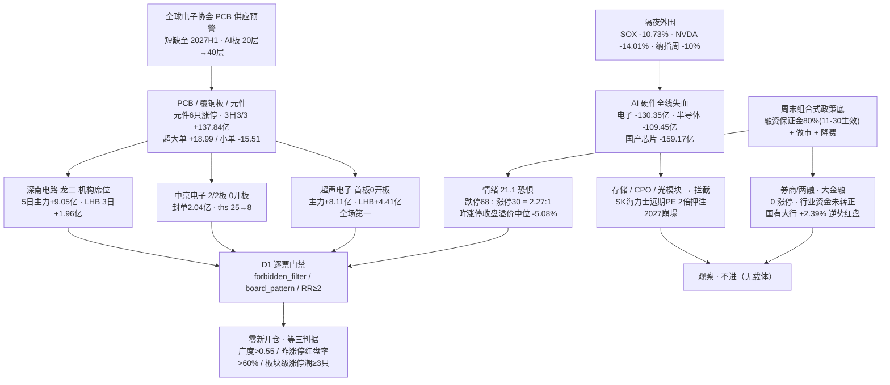

# 2026-11-23 · **群聊情绪共振 · 恐惧 21.1（repair_window 第 8 天）**

> **数据源新鲜度**: partial
> **降级状态**: true（L2 真人层断更 + L3 WeFlow 永久下线 + 周末榜无增量）
> **置信度**: 0.47（0.65 × 0.72 × 1.0，L1_only 分档上限 0.50 内）

## 一句话结论

连跌 7 天后的第 8 天，情绪 21.1 仍落恐惧档：跌停 68 对涨停 30、昨涨停收盘溢价中位 −5.08%、红盘率 30.43%，市场只肯给一个方向出价——**PCB/覆铜板/元件**（3 日 3/3 连续净流入 137.84 亿 + 元件 6 只涨停 + 行业级材料供应预警）；周末政策三箭是 11-30 才生效的**预期**不是资金，防御口袋只吸走全市场流出的 6%——**研究主跟 PCB，动作上零新开仓、等三判据**。

## 关键证据

- **证据 1（钱口唯一）**：印制电路板 +20.39 亿 / 元件 +18.72 亿，**3 日 3/3 连续净流入（合计 137.84 亿）**，四档 超大单 +18.99 / 小单 −15.51；元件 6 只涨停占全市场 30 只的 20%，4 只 0 开板 · 来源 `R7_capital_flow` + `_work/limit_20261120.json`
- **证据 2（催化最硬）**：全球电子协会 PCB 供应预警——玻纤布/树脂/铜箔/覆铜板全线紧张、常规材料短缺至少至 2027H1、AI 服务器用板 20 层→40 层 · 来源 上海证券报，R4 事件 E20261123_005（positive/high）
- **证据 3（派发最硬）**：九阳股份 dc/ths 双榜 #1 **连续 4 个交易日**、当日 **−7.21%**、热值衰减 39% → 红线 4 成立 · 来源 `attention_signals` 逐日 rank/pct/hot 序列
- **证据 4（情绪结构）**：跌停 68 / 涨停 30 = 2.27:1、昨涨停收盘溢价 均值 −3.40% / 中位 −5.08% / 红盘率 30.43%、广度 5.62%、中位 −5.08% · 来源 `R7`（stk_limit 权威口径）+ `R1_style`
- **证据 5（外压）**：US 20261120 收盘 SOX −10.73%、NVDA −14.01%、MU −13.89%、AMD −13.25%；概念端国产芯片 −159.17 亿、CPO −58.86 亿、存储 −98.15 亿 · 来源 `R7 overseas_core_stocks` + `R7 concept_flows`

## 详细分析

### 一、情绪温度：21.1，比当日 R1 基线低 1.0 分，跌停没有收敛

基线取**当日** `R1_style.json`（22.1，崩溃退潮型，恐惧档，第 8 天 repair_window，仓位上限 0.10），不使用前一日基线。R3 在其上做 7 项修正、净 **−1.0**，落到 **21.1**：

| # | 修正项 | 分值 | 依据 |
|---|---|:--:|---|
| A1 | 周末组合式政策底（融资保证金 100%→80% 自 11-30 施行、创业板做市征求意见、沪深降费 深 13.9 亿/沪 13.68 亿、18 只主动 ETF 360 亿、韩台救市） | **+5.0** | R4 四项 high/medium 正面 + 官方源 12 篇同题 |
| A2 | 隔夜外围科技重挫（纳指 −5.28%、SOX −10.73%、NVDA −14.01%、MU −13.89%） | **−4.0** | R7 美股完整收盘 + 游资复盘 |
| A3 | 主力派发（−521.86 亿，20 日 −4460.02；超大单 −172.89 / 小单 +484.71） | **−3.0** | R7 四档拆解：机构砸、散户接 |
| A4 | 人气霸榜派发（九阳 双榜 #1 连续 4 日、当日 −7.21%、热值衰减 39%） | **−2.0** | 红线 4 |
| A5 | 局部赚钱效应（PCB/元件 3 日 3/3 净流入 137.84 亿、元件 6 涨停、龙头 0 开板） | **+3.0** | R7 + 逐票 |
| A6 | 一致性看空浓度（周末饭局三分之二看空、7 连阴历史反弹概率近 100%） | **+2.0** | L2b 游资口径（逆向指标） |
| A7 | 封板质量塌陷（反复开板烂板 38 条、4 板空心） | **−2.0** | R7 诱多五类账本 |

五维交叉校验：22.1（R1 本身即五维加权分）对 21.1，**gap 1.0**，远小于 15 分背离阈值，无背离——R3 的修正全部来自跨源文本与结构变量（政策、外围、派发、封板质量），没有改动量价原始维度。

跌停为什么重要：两套口径并存且不可互换。tushare `limit_list_d` 给 **U28 / Z7 / D58**（炸板率 20.00%），R7 用 `stk_limit` 交易所限价逐票复核后为 **U30 / D68 / Z14**（炸板率 **31.82%**，补录 10 只官方漏收的封死跌停）。炸板率从 11-19 的 47.17% 回落到 31.82% 是**首次跌破 35% 红线**，但跌停:涨停 2.27:1、广度 5.62%、中位 −5.08% 都比前一日更差——**炸板率下降是因为封板家数也被压到 30 家，不是情绪修复**。R7 已按主跌段执行候选砍半（38 只 → 29 张卡、0 可执行）。

### 二、钱只去一个地方：PCB / 覆铜板 / 元件（四腿同向）

这是 20261120 崩溃日全场唯一「涨停簇 + 资金 3 日连续 + 席位 + 消息面」四腿同向的方向：

- **L1 涨停簇**：元件 **6 只涨停 / 全市场 30 只（20%）**——超声电子（首板·封单 1.67 亿·**0 开板**·成交 21.35 亿）、中京电子（**2/2 板**·封单 2.04 亿·0 开板）、满坤科技（20cm·封单 1.21 亿·0 开板）、澳弘电子、骏亚科技、东晶电子；配套 电子化学 光华科技（首板·0 开板）。
- **L1 概念/人气**：PCB概念 概念榜 **14→#2**（Δ+12，全场最大斜率）；中京电子 ths **25→8**（Δ+17）、dc 5→3；超声电子 **新进 dc#8 / ths#11**；沪电股份 ths 41→27。
- **R7 资金**：印制电路板 **+20.39 亿**（3 日 +69.92 亿 **3/3**）、元件 **+18.72 亿**（3 日 +67.92 亿 **3/3**）；四档是 超大单 +18.99 / 小单 −15.51（**机构买、散户卖**）；超声电子主力 +8.11 亿（全场第 2）、龙虎榜 **+4.41 亿（全场净买第一，机构 +0.43 / 沪股通 +1.49）**；深南电路 5 日 +9.05 亿（3/5 正）、龙虎榜 3 日 +1.96 亿（机构 +0.69）。
- **L2b 催化**：上证报《PCB供应预警！常规材料或短缺至2027年上半年》——全球电子协会报告，玻纤布/树脂/铜箔/覆铜板全线紧张、AI 服务器用板从 20 层向 40 层演进；三星电机为 Exynos 供应新一代封装基板；兴森科技拟回购 4-5 亿元；股痴流沙河「光和存储逻辑都受损了，**只有 pcb 是无可替代的**」。

短板必须写明：**5 日与 20 日资金仍为负**（印制电路板 5 日 −4.18、元件 5 日 −17.87、元件 20 日 −306.77 亿）→ 这是「3 日回流」，不是 20 日趋势；元件 6 只涨停也未达 R1 修复判据的「行业 ≥8 家涨停」，所以它是**窄口**不是主线。

### 三、政策三箭：预期交易，没有载体

融资保证金下限 100%→80%（**11-30 起施行**，理论 4000 亿增量）、创业板做市商制度征求意见、沪深交易所与中结算一揽子降费，加上 18 只主动 ETF 合计 360 亿挂牌——这是本轮下跌以来第一个组合式政策底，R4 给 券商/两融 **net_score 1.33（high，3 事件叠加）**，为本日最高分板块，李大霄、安静拆主线、贩财局三口径均称「实质性强于 9.24」。

但盘面没有接住：**券商 0 只涨停**，仅有东方财富 dc **50→24**（Δ+26，+0.22%）、华泰 +1.10%、国泰海通 +0.61% 的相对抗跌；证券 ETF 群体 avg_last −0.61%，行业资金未转正。硬的是银行：**国有大型银行 +2.39% 逆势红盘**、主力 +2.73 亿（超大单 +2.62 / 小单 −6.74）、工商银行 dc **81→5**、建设银行新进 #20。

结论：政策是「预期利好」，本周买的是预期不是资金，中间隔 7 个交易日；按纪律第 7 条（合力来自全市场、无封单承接=不封），**只作情绪观察，不作进攻方向**。

### 四、防御口袋吸不到 6%：不是风格切换

钱确实在找避险口，但都是零散子行业：制冷空调设备 +7.08 亿（3 日 +3.28 / 5 日 +2.23 三窗口全正）、其他农产品加工 +5.02 亿、水产概念 +7.24 亿、红利破净股 +8.91 亿、水力发电 +4.02 亿（5 日 +7.69）、国有大型银行 +2.73 亿。全部加起来约 32 亿，而全市场净流出 **521.86 亿**——**占比不到 6%**。

防御端涨停 6 只（东方海洋/冰山冷热/万向德农/金新农/好当家/大东方）分散在 6 个三级行业，**不成簇 = 不是板块**；封板质量两极：东方海洋 0 开板最硬（LHB +3.14 亿、外资 +0.53、机构 0.00），大东方 3 次开板最烂。白酒更是明确的反证：板块 +4.88 亿，但四档 超大单 −1.31 / 小单 +3.78，**散户抬轿**，且茅台 20 日位置 98%、RR5 0.03。

### 五、红线 4：九阳 4 日霸榜，封板质量同步塌陷

九阳股份 dc 人气 **#1 连续 4 个交易日**（11-17/18/19/20），ths 热股同样 3 日 #1；价格序列 −9.99% → +10.01% → **−7.21%**，3 日振幅 27%；热值 2,847,001 → **1,737,436（衰减 39%）**。人气顶格 + 价格崩塌 = 派发标准形态，按红线 4 不得作正向共振，并反向计入情绪扣分（A4）。同族 文投控股（dc 29→4 但仅 +0.37%，前两日连续跌停）、东方海洋（反包）、大东方（7/14 板）证明**名字票整体处接盘期**。

概念层红线 4 **未触发**：概念榜 #1 未连续 2 日重复（光刻胶 → 算力租赁 → 光刻胶 → 猪肉，consecutive_top1_days=1）；但「猪肉」当日登顶仅 +0.07%（板块几乎零涨），属**抗跌型登顶**而非情绪型登顶，不能当进攻信号。

## 主题一 · PCB / 覆铜板 / 元件（AI 服务器高多层板上游材料短缺）

`共振等级 L1+L2b（真等级 L1_only）` · `阶段 early（首板群第 1 日）` · `态度：进（研究主跟，不授予开仓资格）`

- **大资金意图**: 钱不是在轮动，而是在崩盘日挑「唯一还愿意出价的地方」。全市场主力 −521.86 亿、电子 −130.35 亿、半导体 −109.45 亿的同时，印制电路板 +20.39 亿、元件 +18.72 亿逆势流入且 **3 日 3/3**，四档是超大单 +18.99 对 小单 −15.51 —— **机构接、散户卖**，这是配置盘在产业链里挑「材料短缺受益端」，不是游资打板。对手盘是融资盘（融资融券概念 −503.83 亿）与深股通（−295.20 亿）。
- **为什么走强**: 位置=首板群首日（超声/澳弘/骏亚/东晶/满坤全部 11-20 首板），连板层只有中京电子 1 只；催化=**硬产业事件**（全球电子协会预警：常规材料紧张至少到 2027H1、AI 板 20 层向 40 层演进）+ **硬订单/公告**（三星电机封装基板、兴森回购 4-5 亿、章建平家族重仓科翔股份 13.35 亿）；筹码=龙头 0 开板、封单 1.67-2.04 亿、换手 19.95% 属健康换手。
- **逻辑够不够硬**: 四腿独立同向（L1 涨停/概念/人气、L2b 6 条催化、R7 3 日连续资金 + 席位、R4 事件极性 PCB/覆铜板 0.161 与电子布/玻纤 0.421 正面），是本日唯一四腿齐的方向。短板是 **5/20 日资金仍负**（3 日回流非趋势）。**证伪路径三条**：①超声电子/中京电子 09:30-10:00 任开板不回封 → 首板群断层；②印制电路板单日转净流出 → 3 日链条断裂；③次日无第二只 2 板接上 → 成簇消失。

### 研究票思维链 · 002579 中京电子（2/2 板·高度龙）

- **买入理由**: ①PCB 链唯一 2 连板且 **0 次开板**（封单 2.04 亿、成交 9.9 亿），板型与封板质量同时达标；②人气斜率全场最陡（ths 25→8、dc 5→3），是 PCB 从「板块」变成「题材」的那个人气载体；③R4 三源高置信点名（PCB 短缺正文 + 板块复盘 + 个股联动），催化与 L1 涨停簇同源。
- **风险点**: ①**无龙虎榜级资金背书**——R7 的 research_candidates 没有它，说明席位层没有机构/外资的明确买入证据，2 板有「游资单打」风险；②元件 5 日 −17.87 亿、20 日 −306.77 亿，板块层面仍在失血，弱反抽中的 2 板最容易在次日高开处被兑现；③主跌结构下昨涨停收盘溢价中位 −5.08%，接力票的期望收益本身为负。
- **止损条件**: 以 11-20 收盘价 13.39 与 11-19 首板涨停价为锚，**跌破 12.72（约 −5%，即上一板收盘下方 2%）** 视为连板断板，当日不进；若已持有（R3 不授予，仅记录条件），断板次日不反包则无条件出。
- **可验证假设**: 24h 内——①中京电子 09:30-10:00 封单是否维持 ≥1.5 亿且 0 开板；②元件板块涨停 ≥2 只（成簇延续）；③印制电路板板块主力净额仍为正（>0 亿）。三条中两条不成立 → 降级为「只记观察」。

### 研究票思维链 · 000823 超声电子（首板·资金与席位第一）

- **买入理由**: ①**龙头认定过 2 条**：元件 6 只涨停中唯一「资金 +8 亿级 + 龙虎榜净买第一」的首板（主力 +8.11 亿全场第 2、LHB +4.41 亿、机构 +0.43 / 沪股通 +1.49）；②所属子链 3 日 3/3 连续净流入，是全市场仅两条 5 日仍在失血的行业之一中唯一出现「超大单买、小单卖」结构的；③消息面与它的载板/PCB 主业直接对应（供应预警 + 封装基板）。
- **风险点**: ①**赔率已废**：涨停价=5 日高，RR5 公式分母归零、止损距 −11.99% 超 −10% 硬区间、5 日主力仅 2/5 正 → R7 gate 直接判不过线；②成交 21.35 亿 + 换手 19.95% 已是天量，次日若低开即完成「一日游」；③元件 20 日 −306.77 亿的失血背景没变，个股再强也难改板块趋势。
- **止损条件**: 以 11-20 收盘 18.51 为锚，**跌破 16.66（−10%）** 无条件撤出；若次日高开后 09:30-10:00 跌破开盘价且主力净额转负 → 当日不参与。
- **可验证假设**: 24h 内——①超声电子能否出 2 板（阈值：收盘涨停或封单 ≥1 亿）；②印制电路板板块 3 日连续流入是否延续至第 4 日；③元件板块内 0 开板票数 ≥3。三条中两条不成立 → 只记观察。

## 主题二 · 券商/两融 + 大金融（政策三箭直接受益端）

`共振等级 L1+L2b（真等级 L1_only）` · `阶段 early（政策预期首日）` · `态度：观察（不授予开仓资格）`

- **大资金意图**: 政策 11-30 才生效，本周是「提前占位」：银行拿到超大单 +2.62 亿（同时对冲小单 −6.74 亿），东方财富人气 50→24。但券商行业级资金未转正（证券 ETF 群体 avg_last −0.61%）、0 涨停 → **大资金只肯用权重做防守，不肯用券商做进攻**。
- **为什么走强**: 位置=银行 ETF 与大盘相关系数 −0.36（唯一负相关口袋）、30 日 −0.81% / 5 日 +0.94% 的滞涨起点；催化=硬政策（11-30 施行、理论 4000 亿）+ 硬公告（降费 13.9+13.68 亿、18 只 ETF 360 亿）；筹码=银行 3 日 −7.80 亿、5 日 −5.72 亿仍负 → 今日是首日回补。
- **逻辑够不够硬**: 政策真、R4 1.33 为本日最高，但「预期利好」与「资金进场」差 7 个交易日；缺「板块级涨停」这一条载体。**证伪路径**：次日券商仍 0 涨停 / 证券行业资金继续流出 / 保证金细则出现推迟或缩水澄清。

## 主题三 · 退潮期防御口袋（大行·红利·水电 + 水产/农产品加工 + 制冷空调）

`共振等级 L1+L2b（真等级 L1_only）` · `阶段 late` · `态度：观察不进`

- **大资金意图**: 逃命钱不是进攻钱。全部防御口袋约 32 亿，对全市场流出 521.86 亿的占比不足 6%；白酒是散户接（超大单 −1.31 / 小单 +3.78），银行是机构买但 3 日仍 −7.80 亿 → 大资金在做「减仓后的临时停车位」，不是换风格。
- **为什么走强**: 位置=低位反包（东方海洋自 11-18 跌停位置反包、好当家 4/7 老龙）；催化=分红季 + 回购潮 + 制冷季资金三窗口全正；筹码=东方海洋 0 开板最硬，其余 2-3 次开板。
- **逻辑够不够硬**: 只有「避险 + 分红」两条，无产业景气数据；6 只涨停分散在 6 个三级行业，**不成簇即不是板块**。**证伪路径**：次日防御端涨停 <2 只 / 东方海洋不出 2 板 / 水电红利转净流出。

## 红线与负向警报（6 条）

| # | 类型 | 标的 | 证据 | 结论 |
|---|---|---|---|---|
| N1 | 🔴 红线4 霸榜派发 | 九阳股份 | 双榜 #1 **连续 4 日**；+10.01% → **−7.21%**；热值 2,847,001 → 1,737,436（−39%） | 派发标准形态，禁作正向共振；名字票整体末段 |
| N2 | 🔴 方向整体失血 | 半导体/电子/CPO/存储 | 电子 −130.35 亿、半导体 −109.45 亿、国产芯片 −159.17 亿、CPO −58.86 亿、存储 −98.15 亿 | 隔夜 SOX −10.73% 传导成立，全线拦截 |
| N3 | 🟠 高位空心板 | 真视通 / 盛剑科技 / 大东方 | 真视通 4/4 板但 LHB +0.03 亿；盛剑 4/4 板 4 次开板、LHB −0.42/机构 −0.26；大东方 7/14 板 3 次开板 | 连板梯度失效，昨日溢价中位 −5.08% |
| N4 | 🟠 诱多（机构卖、股价涨） | 满坤科技 / 凡拓数创 / 易天股份 | 满坤 20cm 但机构 −0.06 亿、3 次开板；凡拓 20cm 3 次开板；易天 20cm 机构 −0.01 亿 | PCB 主题内满坤因此剔除，不因「涨幅最大」入选 |
| N5 | 🟡 资源叙事破裂 | 黄金/铜/有色 | 黄金概念 新进 #11 但 −4.31%；证金事判金价泡沫破裂、铜 11-18 破年线；资源开采概念 5 日 −18.08 亿 | 贵金属不得当防御替代品 |
| N6 | 🟡 反包封板质量不足 | 冰山冷热 | 11-19 封死跌停 → +10.03% 反包，但 **2 次开板**、封单 1.35 亿 | 人气与资金都真，承接力不达标准 → 观察不进 |

## 次日打法（三档 · D1 直接消费）

- **高开档**：PCB/元件 高开 >5% → 只认 09:30-10:00 承接（中京电子/超声电子封单回升、换手不失控）；高开 >7% 视为给首板群抬轿，**不出手**。券商/大金融高开 >3% 而 10:00 前无 ≥2 只涨停 → 判政策预期一日游，不进。九阳类名字票高开一律不参与。
- **平开档**：R1 三判据（开盘广度 >0.55 / 昨涨停红盘率 >60% / 板块级涨停潮 ≥3 只）成立 → 允许在 **PCB 链**做承接型低吸（唯一有资格方向，仍需 D1 逐票门禁 RR≥2）；只成立 1 条 → 零新开；一条都不成立（跌停仍 >50 家）→ 当日零新开。
- **二段下杀档**：PCB 10:00 后炸板（中京/超声任一开板不回封）+ 跌停仍 >50 家 → 撤回 PCB 研究资格，当日不做新开仓，仓位压回 R1 下限 0.10 以下；若银行同时转绿 → 防御口袋同步失效，全面转观察。

## 数据源审计

| 源 | 日期 | 状态 | 备注 |
|---|---|:--:|---|
| hotlist/attention_signals（dc 人气 100 · 飙升 100 · ths 热股 100 · 概念 20） | 2026-11-20 | 🟢 | 320 条 · 双日 diff（对 11-19 档）· 目录为 T-1 已收盘基准 |
| attention_weekend（周末跨日人气） | 2026-11-19 → 11-21 | 🟡 | 24 只在榜；**11-21 与 11-20 同值、11-22 空榜** → 无周末增量 |
| tushare/limit_list_d（逐票 U/Z/D） | 2026-11-20 | 🟢 | 93 行 · U28 / Z7 / D58 · 含板型 up_stat 与封单 |
| R7/stk_limit（权威口径复核） | 2026-11-20 | 🟢 | U30 / D68 / Z14（补录 10 只漏收封死跌停）· 炸板率 31.82% |
| R7_capital_flow（主力/行业/概念/龙虎榜/诱多） | 2026-11-20 | 🟢 | gap=0 · 主力 −521.86 亿 · 行业 40 行 · 诱多五类 71 条 |
| R4_news（事件极性） | 2026-11-22 | 🟢 | 8 事件 · 券商/两融 1.33(high) · PCB/覆铜板 0.161 · AI硬件 −1.146 |
| R1_style（**当日**情绪基线） | 2026-11-23 | 🟢 | 22.1 / 崩溃退潮型 / 恐惧 / 第 8 天 repair_window / cap 0.10 |
| wechat_official_rss（公众号 L2b） | 2026-11-22 | 🟢 | 55 篇 · 14 账号（官方 40 / 自媒体 15） |
| wechat_cli_5groups（真人话语层 L2） | 2026-11-23 | 🔴 | **0 字节 · 7 群 0 条** · 本地库停在 2026-10-28 |
| weflow-analytics（L3 语义共振） | — | 🔴 | 2026-08-19 永久下线 · 全 profile 移除 |
| 群A–群G（7 个焦点群，名已匿名） | 2026-11-23 | 🔴 | 均 0 条，无任何发言可匿名引用 |

## 不确定性 / 反证

**自我批判一：L1_only 的共振不算共振。** 三条主题的真等级都只有 L1_only，L2b 只是观点代位。按红线 3，我没有资格写成「强共振」。主题一的「四腿同向」里，L2b 与 R4 是同一批新闻源的两个切面（R4 就是从公众号与快讯抽取的），独立源应打折扣——真实独立证据是 L1 榜单、涨停逐票、R7 资金这三层。已在 confidence 体现（0.47）。

**自我批判二：情绪分可能偏严。** 相对当日 R1 的 22.1 下调 1.0，主要扣在外围（−4.0）与派发（−3.0）。反证是：政策三箭的力度确实罕见（融资保证金回到 1 月水平 + 做市 + 降费 + 360 亿 ETF），若 11-23 竞价即出现广度 >0.55，说明 21.1 跌过头了。这与 R1「repair_window 第 8 天」一致——**阶段是最早被证伪的东西，不要拿它当仓位理由**。

**自我批判三：PCB 是「3 日回流」不是趋势。** 5 日与 20 日资金仍为负（元件 20 日 −306.77 亿），若次日资金断流，它就只是「崩溃日最后一个能被抱住的窄口」。另一条真实反证来自游资复盘：**9 月末最强的元件板块也是以连续两根长阴彻底破位后转震荡下跌**——同样的板块名字，可以是最强方向，也可以是最后一棒，区别只在次日是否延续。

**自我批判四：防御口袋的判定依赖东方海洋一只票。** 它的 0 开板 + 外资席位很硬，但前两日是 −8.58% / −9.90% 的反包票，属模式外。我不参与；若它次日继续封板，我的「防御口袋不进」判断会显得保守——这个保守我认，因为它属禁令「情绪票接力」。

## 与其他 R/D/E 的关系

- **依赖**: `R1_style.json`（**当日**情绪基线 22.1 / 崩溃退潮型 / cap 0.10）、`attention_signals.json`（T-1 四榜）、`attention_weekend.json`（周末 cross-check）、`_work/limit_20261120.json`（逐票板型）、`wechat_official_rss.jsonl`（L2b 55 篇）、`R7_capital_flow.json`（资金/席位/诱多）、`R4_news.json`（事件极性）
- **被消费**: `D1` 消费 `resonance_top_themes` + `discipline_gate` + `next_day_signal.playbook`；`R2` 可用 PCB/元件 sector 名核对主线宽度（当前仅窄口，未达 ≥8 家行业簇）；`R5` 需对 `negative_theme_warnings`（九阳/真视通/满坤/茅台）加风险标记；`R6` 可用「L1_only 不算共振」「5/20 日资金为负」「4 板空心」作反证素材；`E1` 回填次日三档 playbook 与可验证假设
- **接口约束**: `discipline_gate.open_permission=false`，R3 **不授予任何开仓资格**；`research_only` 4 只 / `watch_pool` 6 只 / `excluded` 5 只均为研究观察，买入决定权归 D1 逐票门禁 + R7 资金闸门 + R5 画像

## Sub-Agent 元数据

- skill: analyze_sentiment_resonance_v1
- artifact: `data/research/20261123/R3_sentiment.json`（61 KB，research_unit_v1）
- 生成耗时: 约 15 分钟
- model: deepseek-v4.1-flash
- 中间件: `_work/r3_l1_diff.json`（四榜双日 diff）、`_work/r3_rss_key.json`（公众号关键篇）、`_work/r3_build.py`（可复算）
- 降级说明: L2 真人层 0 字节 / L3 WeFlow 永久下线 / 周末榜无增量 → `degraded=true`，`confidence=0.47`
