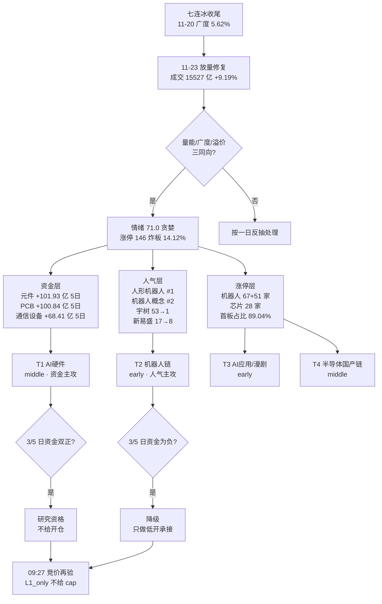

# 2026年11月24日 · **群聊情绪共振**

> **数据源新鲜度**: partial（L1 为 11-23 收盘基准 · L2 群聊断更 · L3 永久下线）
> **降级状态**: true（真等级 L1_only，L2b 仅公众号观点代位）
> **置信度**: 0.46

## 一句话结论

**11-23 是七连冰后的放量修复日（146 涨停 / 炸板率 14.12% / 广度 84.7% / 中位 +2.33%），但高度没打开（首板 89.04%、5 板仅 2 只）。情绪 71.0（贪婪）——资金主攻 AI 硬件（元件/PCB 5 日 +101.93 亿），人气主攻机器人（概念榜 #1/#2 + 涨停 67/51 家），两条腿都不构成已确认主线，11-24 只做低开承接与分歧转强，不追开盘价。**

## 详细分析

### 一、先认市场：这是修复，不是反转

- **七连冰后的第一根放量阳线**：成交 15527 亿（+9.19%）、涨 4306 跌 780、中位 +2.33%，昨日涨停今日收盘溢价中位 **+9.99%**、红盘率 92.86%、再涨停 16 只。盘口逻辑拆解的原话是「超跌反弹第一天，这里如果企稳应该是震荡结构，除非外盘持续超预期，否则走 V 的可能性不大」，猫笔刀给的定性是「顶点到 MA5 附近就止住，不足以说明趋势已经反转」。
- **高度没打开**：1 板 130 只 / 2 板 13 / 3 板 1 / 5 板 2，首板占比 **89.04%**。R1 的 ladder 维度只有 64.4 分，是五维里最低的一块。这意味着 11-24 的接力环境并不好——首板潮的次日，能接力的只有极少数卡位票，大面积高开就是派发。
- **政策摩擦一条腿**：监管明确两融逆周期风控细则、保证金 80% 自 11-30 实施、存量合约同步适用；高位 5 连板个股被交易所问询。文本侧对这个「利好」的解读是分裂的（盘口逻辑拆解直言「谈不上什么利好」），所以情绪分在 A3 扣了 1.5。
- **外盘给的是高开理由，不是追高理由**：纳指 +6.51%、费半 +14.03%、NVDA +31.31%，SOX 盘中 +13.83%；但 E008 的美参议员反对复职 + SEC 调查会计问题同时挂在那里，CPO 的 R4 net_score 被这条腿削掉 33%。高开会被当成利好兑现。

**情绪定档**：71.0 / **贪婪**（R1 当日基线 72.0 起，8 项修正净 −1.0）。炸板率两口径 14.12%（R1）/ 15.08%（R7）都低于 35% 硬红线 → **不触发候选砍半**，但「贪婪 + 高度不足」的组合指向分歧日，不指向加速日。

### 二、四主题共振矩阵

| 维度 | T1 AI硬件 | T2 机器人链 | T3 AI应用/漫剧 | T4 半导体国产 |
|---|---|---|---|---|
| L1 概念榜 | 英伟达新进 #3、CPO #4、PCB #5 | 人形 #1（Δ+5）、机器人 #2（Δ+6）、减速器新进 #12 | AI应用 15→8（Δ+7）、AI视频新进 #18 | 芯片 16→14、光刻胶 5→7 |
| 涨停家数 | AIDC 24（Δ+17）、汽车电子 24 | 机器人 67（Δ+59）、人形 51 | 无独立行，影视院线 +7.63% | 芯片 28（Δ+21）、专精特新 36 |
| 3/5 日资金 | 🟢 元件 +75.87/+101.93、PCB +72.78/+100.84 | 🔴 机械 3日 −37.28 / 5日 −67.42 | 🔴 传媒 5日 −83.96 | 🟡 电子 3日 −43.64 / 5日 +65.82 |
| L2b 观点 | 悲观已定价、缺口仍在 | 「趋势和人气最好」 | 「同一节奏、救命主力」 | 智谱 10 万卡毛利转正 |
| 阶段判定 | middle（低位修复） | early（首板潮中心） | early（旧主线复用） | middle（宽度扩散） |
| 结论 | **进·研究资格** | **观察·只做低开承接** | **观察·降级** | **观察** |

> 说明：四条主题的 `resonance_level` 都标注 `L1+L2b`，但**真等级是 L1_only**——L2 群聊连续 18 个交易日 0 字节、L3 WeFlow 永久下线，L2b 只是公众号观点代位，按红线 3 不计入枚举。**四条都不构成强共振，下游不得当作已确认主线。**

---

### T1 · AI硬件·PCB/覆铜板 + CPO/光模块（英伟达链硬件）· rank 1

**共振证据**：概念榜英伟达概念新进 #3（+4.61%）、CPO 3→4（+4.54%）、PCB 2→5（+4.61%）；个股中际旭创 dc 14→12 / ths 9→5（+6.10%）、新易盛 dc 17→8（+9.92%）、天孚通信飙升 90→23（Δ+67，+13.82%）、东山精密 ths 15→4、中京电子 dc#3（3 连板）、风华高科 +10.02%、福莱新材 ths 44→7（+10.00%）。资金：元件 +54.33 亿（3 日 +75.87 / 5 日 **+101.93**）、印制电路板 +48.03（3 日 +72.78 / 5 日 **+100.84**）、通信网络设备及器件 +64.61（3 日 +66.43 / 5 日 +68.41）——40 个行业里 3/5 日双正有 10 条，但**5 日规模 >50 亿的只有这三条**（电子 5 日 +65.82 但 3 日 −43.64）。R4：PCB/覆铜板 net_score **1.103**（全场最高，双事件叠加）、CPO 0.764。

- **大资金意图**: 机构的对手盘是「AI 资本开支 2027 见顶」的悲观定价。JPM 测算亚洲科技（剔存储）已计入未来 3-4 个月 EPS 下修 25-30%，而零部件 25-30% 供需缺口仍在——所以它们买的是「悲观预期回摆」，不是买景气新高。买点位置也配合：中际旭创 20 日仍 −29.82%、距 20 日高 −34.47%，新易盛 −30.30%，是超跌位而非高位。
- **为什么走强**: 位置（20 日低位）+ 催化（NVDA +31.31% / 费半 +14.03% 是硬外部事件，PCB 订单同比 +56.1% 而出货仅 +13.3%、交期 16-20 周是硬产业数据）+ 筹码（5 日主力 +101.93 亿连续吸金，大单接、小单抛的换手结构）。三维里「位置」和「催化」都硬，筹码是唯一需要第二天验证的一维。
- **逻辑够不够硬**: 四条独立源同向（L1 榜单 + R7 5 日资金 + R4 双事件 1.103 + L2b 三篇产业口径），是本日共振最完整的一条。硬业绩锚缺（PCB 订单是行业口径不是公司口径）、硬政策锚缺。**证伪路径**：①11-24 元件/PCB 主力转净流出且龙头翻绿；②SEC 调查英伟达升级为正式立案；③PCB 板块高开 >7% 后 30 分钟内炸板率 >30%。任一成立即降级为「一日修复」。

**龙头认定**：300502 新易盛（R7 总龙·CPO 5 日资金第一，+9.92% 无板，主力 +22.94 亿 / 5 日 +35.90 亿）；300308 中际旭创（龙二·权重核心，双平台前十）；002463 沪电股份（PCB 5 日资金第一，+2.96%，机构票不是情绪票）；**空间标** 002579 中京电子（3 连板，PCB 交期催化，周末人气榜 3 日连续在榜）。

**思维链 · 300502 新易盛（研究资格，不进执行池）**

- **买入理由**: ①CPO 是唯一 3 日 +31.35 / 5 日 +49.91 亿双正的资金主攻方向，单票主力 +22.94 亿排全场前三；②价格仍在 20 日低位（−30.30%），dc 人气 17→8，属「资金先进、人气后到」的早期结构，不是高位接力。
- **风险点**: ①E008 出口管制法案 + SEC 调查是悬在 CPO 头上的事件腿，一条落地就是估值二次压缩；②+9.92% 只是 20cm 板的半程、且当日未封板（尾盘已有分歧），次日再高开 >5% 相当于把当日半程涨幅再让渡一次，赔率不足 2。
- **止损条件**: 收盘跌破 **172.29 元（−5%）** 无条件离场；或开盘 30 分钟内跌破 176 元（−3%）且元件/PCB 板块主力转净流出 → 当日不持有。
- **可验证假设**: 24 小时内看两件事——①11-24 09:30-10:00 回踩不破 176 元且缩量（量比 <1.0）；②元件板块当日主力净流入为正。两条同时成立=承接有效，否则=一日修复结束。

---

### T2 · 机器人链·人形机器人/减速器/丝杠/轴承 · rank 2

**共振证据**：人形机器人 6→**#1**（Δ+5，+5.91%，热值 159182 为全榜概念第一）、机器人概念 8→#2（Δ+6，+4.40%）、减速器新进 #12（+6.26%，**全榜概念涨幅第一**）、汽车电子新进 #20。涨停：机器人概念 **67 只**（前值 8，Δ+59，连板 8 家）、人形机器人 **51 只**、新能源汽车 51（Δ+45）；行业截面汽车零部件 23、通用设备 15、自动化设备 6、专用设备 7。个股：宇树科技-W 飙升 53→**#1**（+20%，1 板，封单 2.4 亿）、襄阳轴承 +10.01%、埃斯顿 +10.02%、华东重机 dc 30→10、克来机电 52→25。

- **大资金意图**: 这里没有机构，是游资与人气资金在做「政策+催化日历」的预期。对手盘是上周五割在最低点的散户与量化止损盘。买的是「超跌 + 事件密集（11-24 起催化日历）」，不是买业绩。
- **为什么走强**: 位置极低（七连冰后第一根阳线）+ 催化硬（涨停潮本身 + 催化日历）+ 筹码最松（首板 89%，上方没有套牢盘）——但**资金是反的**：机械设备 3 日 −37.28 / 5 日 −67.42 亿、汽车零部件 5 日 −18.28 亿。所以它是「人气三维全硬、资金一维全空」。
- **逻辑够不够硬**: L1 三项第一（概念热值、涨停家数、人气跃升）+ L2b 三篇同向（安静拆主线「趋势和人气最好」）。但独立源只有 2 类（L1 + L2b），R7 给的是反向证据，R4 明确标注「3 日资金未确认 属超跌反抽」。**证伪路径**：①11-24 高开 >4% 后 30 分钟内概念涨停家数跌破 15；②机械设备主力当日再净流出 >20 亿；③宇树科技-W 低开 >2%（总龙不溢价=人气断）。任一成立即按一日反抽处理。

**龙头认定**：688836 宇树科技-W（人气总龙，53→1，112 日在榜，+20% 首板封单 2.4 亿）；002685 华东重机（龙二，dc 30→10，低价弹性）；002472 双环传动（减速器正统中军，未进人气前 20，产业票）；**空间标** 605018 长华集团（2 板）、603960 克来机电（飙升 52→25）。

**思维链 · 688836 宇树科技-W（观察，不进）**

- **买入理由**: ①人气总龙：dc 53→#1（Δ+52）为全市场最大跃升，112 日在榜说明有长期人气底子；②机器人概念 67 只涨停、概念热值全榜第一，板块效应成立，不是单票独走。
- **风险点**: ①708 元高价 + 20cm 波动，一旦分歧单日回撤可到 −10% 以上，盈亏比不适合承接；②1 板而已，上方无连板高度背书，次日若竞价不溢价就是人气断点；③资金面无支撑（机械 5 日 −67.42 亿）。
- **止损条件**: 收盘跌破 **658.44 元（−7%）** 离场；竞价低开 >2% 则当日不参与（总龙不溢价即人气证伪，不等止损）。
- **可验证假设**: ①11-24 竞价溢价 >3% 且机器人概念开盘 15 分钟内涨停 ≥10 家 → 人气延续；②若低开 >2% 且概念涨停 <5 家 → 反抽结束，全链降级为纯观察。

---

### T3 · AI应用·AI漫剧/短剧·端侧AI · rank 3

**共振证据**：AI应用 15→#8（Δ+7，当日第二斜率）、AI视频新进 #18（+5.68%）、人工智能新进 #11、短剧游戏 12→13（+5.44%）。个股凡拓数创 dc 21→13 / ths 32→6（+20%，2 板，封单 0.92 亿）、北纬科技 ths 10→**#1** / dc 9→5（+10.04%）、文投控股 ths 7→2（+4.01%）、浙文影业新进 #9（+9.94%）、慈文传媒 37→16（+10.00%）、芒果超媒飙升 47→27。R4 AI漫剧 net_score 0.516（官方数据：1-9 月微短剧 49 万部为去年 13 倍、用户 8.5 亿）。

- **大资金意图**: 买的是「AI 应用侧新 TAM」的第一波叙事——大模型降价 + 内容产能爆发 + 端侧催化窗口。对手盘是传媒板块 5 日 −83.96 亿的套牢盘，所以这波是「轻筹码弹性」而非「机构建仓」。
- **为什么走强**: 位置低（传媒 5 日 −83.96 亿，套牢盘重但浮筹轻）+ 催化中（AI 漫剧数据硬、智谱 GLM-5.4 上线）+ 筹码差（5 日仍净流出）。三维里只有「催化」是硬的。
- **逻辑够不够硬**: L1 三概念同向 + L2b 两篇同向，但 R4 是**单事件** 0.516，且资金 5 日 −83.96 亿。**证伪路径**：11-24 凡拓数创断板且传媒主力继续净流出 → 降级为「无新东西的旧主线复用」（盘口逻辑拆解原话就是「并没有新东西」）。

**龙头认定**：301313 凡拓数创（2 板 20cm，双平台前十，封单 0.92 亿，题材纯度最高）；002148 北纬科技（ths #1，周末榜 3 日连续在榜，低位低价情绪票）；002343 慈文传媒（+10%，内容产能）。

**结论**：**观察·降级**。三只龙头里只有凡拓数创有板型身位，但它已 2 板 20cm、封单不足 1 亿，RR < 2 且不在今日核心；北纬科技是纯情绪票，属模式外。D1 若要用，只在 09:27 竞价验「凡拓是否溢价 + 传媒主力是否转正」两条。

---

### T4 · 半导体国产链·国产算力芯片/先进封装/设备（存储除外）· rank 4

**共振证据**：芯片概念 28 只涨停（Δ+21，9天6板、连板 5）、专精特新 36（新进）、新型工业化 19；概念榜芯片 16→14（+3.77%）、光刻胶 5→7（+4.16%）；个股瑞芯微 ths 新进 #12（+10.00%）、有研新材 16→10（+5.71%）、盛剑科技 dc 19→14（+10.00%）。L2b：智谱 GLM-5.4 上线、10 万卡国产芯片推理毛利转正；R4 AI算力芯片 0.867 但注明「E008 管制风险直指该链」。

- **大资金意图**: 买国产替代的「推理侧经济性拐点」——10 万卡国产芯片推理毛利转正，意味着替代从「能用」变「划算」。但今日资金只给了电子 +69.21 亿（3 日仍 −43.64），说明机构没有整链加仓。
- **为什么走强**: 宽度（28 只涨停）而非高度；概念榜热度只是微升（Δ+2）。是「补涨扩散」不是「主线发动」。
- **逻辑够不够硬**: 涨停宽度 + 智谱催化两条，但资金 3 日 −43.64 亿、榜单斜率几乎为零，且必须与存储切开（存储 9→15、目标价被下调）。**证伪路径**：11-24 芯片涨停家数跌破 10 且电子 3 日继续为负 → 宽度扩散结束。

**结论**：**观察**。本主题没有能过「龙头或低位」双筛的独立龙头（瑞芯微是趋势票不是连板票），不作为 11-24 首选方向。

---

### 三、单源方向（不给主线身份，只给 09:27 竞价池资格）

| 方向 | 级别 | 量化证据 | 判定 |
|---|---|---|---|
| 商业航天 | L1_only | 概念榜 10→9（+3.68%）、**19 只涨停（Δ+13，3天3板）**、L2b 0 条专属观点 | 保留观察。19 家涨停是规则抓得到的硬证据；但它是 10 月起反复出现的老方向，历史上两次触发人气派发警报 → 不给 cap，竞价再验 |
| 名字辈/低价玄学 | L1_only | 九阳 dc#2 +10.01%、东方海洋 #7 +10.13%、好当家 #15 +10.14%、日出东方 ths#8 +7.86%、大东方 #11 +9.94%、海洋王 #13 +9.97%；周末榜 3 日连续在榜 6 只 | 只透传热度。无产业逻辑、纯名字/低价接力，属模式外 + 九阳已反复炸板反包（见 N1）→ **拦截**，任何仓位都不给 |

> 自检：「如果明天商业航天涨停潮，是系统的错还是市场的意外？」——是系统的错：19 只涨停、Δ+13 已经量化在案，规则不是没看见，只是它只有单源，所以只给竞价资格不给主线。名字辈同理，看见了但不做。

### 四、负向与剔除

| 编号 | 对象 | 证据 | 结论 |
|---|---|---|---|
| N1 | 九阳股份 002242 | dc #1 连续 3 日（11-17/18/19）+ 11-20 #1 + 周末 3 日 best_rank 1；5 日价格 +10.02 / −9.99 / +10.01 / −7.21 / +10.01 | **红线 4 派发末端**，11-23 的涨停不解除警报；不得当接力标的 |
| N2 | 存储芯片 | 概念榜 9→15（前日 −6.61%）；高盛下调三星目标价 −30%、SK 海力士 −43%，DRAM 2028 同比 −19% | **方向已反转**，半导体主题必须切掉存储腿 |
| N3 | 机器人链 | 机械 3 日 −37.28 / 5 日 −67.42、汽零 5 日 −18.28；R4 注明「3 日资金未确认」 | 人气≠趋势，高开不追 |
| N4 | AI硬件 | E008 美参议员反对 + SEC 调查，CPO net_score 被削 33% | 外压腿未消，高开 >5% 一律不追 |
| N5 | 华胜天成 | dc 6→9 而当日 −3.87%，周末 3 日连续在榜 | 人气残值，不作算力链低吸替代 |
| N6 | 银行/猪肉 | 银行 5 日 −47.29 亿、工商银行 ths 29→3 却 −2.66%、建设银行新进 #20 −2.90%；猪肉 #1→#6 | 防御资金流出=风险偏好回升的确认，但防御票本身不构成进攻方向 |

**剔除**：存储芯片/DRAM（N2）、猪肉（#1→#6）、消费/白酒（L2b 8 篇均为防守口径、L1 无涨停簇）、钴/能源金属（L4 硬政策但股端 5 日仍流出，交 R4/R7 跟进）。

## 关键证据

- 证据 1: 11-23 涨停 146 / 炸板 24（炸板率 14.12%）、最高 5 板、首板占比 89.04%、涨 4306 跌 780（广度 84.7%）· 来源 R1 market_structure
- 证据 2: 元件 +101.93 亿 / PCB +100.84 亿 / 通信网络设备 +68.41 亿（5 日），全市场仅此三条 3/5 日双正 · 来源 R7 sector_net_inflow
- 证据 3: 机器人概念 67 只涨停（前值 8，Δ+59）、人形机器人 51 只、减速器概念 +6.26% 为全榜涨幅第一 · 来源 limit_cpt / attention_signals
- 证据 4: 宇树科技-W dc 53→#1（Δ+52，+20%，封单 2.4 亿）；新易盛 dc 17→8（+9.92%）；天孚通信飙升 90→23（Δ+67）· 来源 attention_signals
- 证据 5: 机械设备 3 日 −37.28 / 5 日 −67.42 亿（机器人链资金反向）· 来源 R7
- 证据 6: 官方 L2b「机器人、端侧、AI漫剧是今天救命的主力，也是上一波反弹行情的主线」「走 V 的可能性不大」· 来源 92 篇公众号复盘

## 不确定性 / 反证

1. **最大的反证是「这不是反转」**。盘口逻辑拆解把 11-23 的操作价值定在「五五开」，猫笔刀说「不足以说明趋势反转」，安静拆主线说「最多救半条狗命」。如果 11-24 高开后炸板率 >30%、涨停家数跌破 40，本日的 71.0 就是一次性脉冲，所有主题都要降级。
2. **科创50 当日 −0.26%，与「AI 硬件主攻」矛盾**。创业板 +3.08%、深成指 +1.93%，但科创50 收绿——权重半导体（制造/设备）没有跟上。说明 AI 硬件内部也是分层的：**光模块/PCB 强、晶圆制造弱**，不能整链看多。
3. **机器人链是人气与资金的背离**。67 只涨停 + 概念热值第一，但机械设备 5 日 −67.42 亿。这种结构在 A 股通常只能维持 2-3 日情绪脉冲；若 11-24 没有新增资金进场，11-25 就会开始退潮。我把机器人排在 AI 硬件之后，正是因为这个背离。
4. **L2 群聊断更 18 个交易日**，本次判断完全依赖 L1 榜单 + L2b 公众号 + 上游 R1/R4/R7 的二手交叉。群内一致性、游资真实仓位这两类信息永久缺失，置信度被契约上限压到 0.50 以下（实际 0.46）。
5. **公众号一致预期偏乐观**。92 篇里多篇把「百股涨停」直接等同于情绪反转，缺少次日分歧讨论——一致预期本身是反向变量。

## 与其他 R/D/E 的关系

- 依赖: R1_style.json（情绪基线 72.0 / 修复段第 2 日 / cap 0.95）、R4_news.json（事件极性矩阵）、R7_capital_flow.json（行业与个股资金）、attention_signals.json（四榜 T-1）、limit_cpt（概念涨停簇）、wechat_official_rss（L2b 92 篇）
- 被消费: D1（canghai-plan）作为情绪与主题输入（真等级 L1_only，不得当已确认主线）；R2 参考主题热度但不替代板块排序；R5 对 T1/T2 龙头做独立画像；E1 复盘回填「21:00 后主题是否延续」与 sentiment 校准

## 数据源审计

| 源 | 日期 | 状态 | 备注 |
|---|---|:--:|---|
| tushare/dc_hot + ths_hot（attention_signals） | 2026-11-23 | 🟢 | 四榜 320 行（dc 人气 100 / dc 飙升 100 / ths 热股 100 / ths 概念 20）· T-1 收盘基准 · 双日 diff 已算 |
| tushare/limit_cpt_list | 2026-11-23 | 🟢 | 20 行概念涨停簇 · 对比 11-20 前值 |
| tushare/limit_list_d（经 R1） | 2026-11-23 | 🟢 | 146 涨停 / 24 炸板 / 3 跌停 · 1 板 130 / 2 板 13 / 3 板 1 / 5 板 2 |
| wechat_official_rss（L2b） | 2026-11-24 | 🟢 | 92 篇 / 16 个账号（官方 76、自媒体 16）· 窗口 11-23 06:43 → 11-24 00:00 |
| wechat_cli_5groups（L2 群聊） | 2026-11-24 | 🔴 | 0 字节 · 7 群 0 条 · 本地库停在 2026-10-28（连续 18 个交易日） |
| WeFlow analytics（L3） | — | 🔴 | 2026-08-19 ngrok 隧道失效，全 profile 移除 · 永久不可用 |
| R1_style（上游） | 2026-11-24 | 🟢 | confidence 0.525 · status complete · gap_flags=[cross_asset, margin] |
| R4_news（上游） | 2026-11-24 | 🟢 | 8 条 top event · 事件极性矩阵 12 行 |
| R7_capital_flow（上游） | 2026-11-24 | 🟡 | status ok · data_quality=ok_with_lagging_margin_etf（两融/ETF T+1 滞后） |
| attention_weekend | 2026-11-23 | 🟢 | 周末 11-20/21/22 三日连续在榜 23 只 |

## Sub-Agent 元数据

- skill: analyze_sentiment_resonance_v1@1.1
- artifact: data/research/20261124/R3_sentiment.json（66,522 B）
- 中间件: data/research/20261124/_work/（r3_rss.json · r3_concept_clusters.json · r3_stock_rank.json · r3_build.py）
- 生成耗时: 约 30 分钟（06:43 起）
- model: deepseek-v4.1-flash
