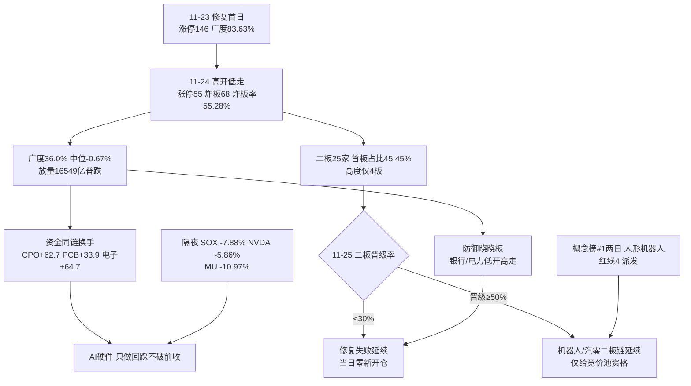

# 2026年11月25日 · **群聊情绪共振**

> **数据源新鲜度**: partial（L1 为 11-24 收盘基准 · L2 群聊断更 · L3 永久下线）
> **降级状态**: true（真等级 L1_only，L2b 仅公众号观点代位）
> **置信度**: 0.43

## 一句话结论

**11-24 是「修复失败日」：涨停 55 / 炸板 68（炸板率 55.28%，R7 权威口径 56.16%）/ 广度 36.0% / 中位 −0.67%，放量 16549 亿却普跌；概念榜 #1 人形机器人连续两日（热值 25.6 万，涨幅 5.91%→1.23%，涨停 51→14 腰斩）触发红线 4 派发。情绪 43.0（中性偏冷 · 震荡/主跌）——今日只做低开承接与二板晋级确认，零开仓资格。**

## 详细分析

### 一、先认市场：修复没被接住，这是「存量博弈的第二腿」

11-23 的强修复（涨停 146、广度 83.63%、中位 +2.41%）在 11-24 只活了一个竞价：深成指、创业板指早盘一度 +4%，收盘翻绿（沪 +0.27% / 深 −0.29% / 创 −0.05%）。跨市场对照最能说明问题——隔夜与日内周边全在涨（韩国 +6.32%、台湾 +8.99%、日经 +3.91%），只有 A 股把利好卖成了单边阴线，游资复盘口径直接称其为「悬案」。这不是外生风险偏好问题，是**存量资金的兑现行为**。

| 维度 | 11-23（修复首日） | 11-24（修复失败） | 读数 |
|---|---|---|---|
| 涨停 / 炸板 / 跌停 | 146 / 24 / 3 | 55 / 68 / 2 | 🔴 炸板反超涨停 |
| 炸板率 | 14.12%（R7 15.08%） | 55.28%（R7 56.16%） | 🔴 双口径均越 35% 红线 |
| 广度 / 中位 | 83.63% / +2.41% | 36.0% / −0.668% | 🔴 广度腰斩 |
| 成交额 | 15527 亿 | 16549 亿（+6.58%） | 🟡 放量下跌 |
| 梯队 | 1板130 / 2板13 / 3板1 / 5板2 | 1板25 / 2板25 / 3板4 / 4板1 | 🟡 首板占比 45.45% |
| 昨日涨停溢价（中位） | — | +3.26%、红盘率 74.66%、再涨停 30 | 🟡 未达修复阈值 |

**阶段定位**：R1 判 high_chop（高位震荡）· 修复段第 3 个交易日（修复首日 20261123，T-1 回吐、修复未确认），主线数 1 条 = **无主线**（行业次日留存 28.0%、截面解释力 9.52%），仓位上限 0.60。按交易纪律，炸板率 ≥35% 的交易日所有输出必须标「情绪=震荡/主跌」并把候选数砍半——今天执行了减半（7 方向 → 3 主题 + 3 观察 + 4 剔除）。

### 二、三主题共振矩阵（真等级全部 L1_only）

| 维度 | T1 半导体国产链 | T2 AI硬件 CPO/PCB | T3 AI应用 漫剧/影视 |
|---|---|---|---|
| 概念榜排名 | 芯片 14→15、光刻胶 7→6 ⬆ | 英伟达 #3→#3、CPO #4→#4、PCB 5→7 ⬇ | AI应用 8→13 ⬇、短剧 13→14 |
| 涨停簇 | 芯片 13（前 28）、专精特新 13、全筑 6天4板 | 中京电子 4板 0开板 封单 1.97 亿；工业富联 11 次开板 | 浙文/横店 2板、创源 2板、文投 11/21 |
| 资金腿 | 🟡 电子 +64.7 亿（超大单 +68.0 / 小单 −10.3） | 🟢 CPO +62.7 / PCB +33.9 / 元件 +30.5 | 🔴 无行业级资金 |
| L2b 观点 | 🟢 BIS 新规取消豁免 → 国产超节点（上证报）+ 功率半导体涨价 | 🟢 PCB 长逻辑（研报口径）+ 官方收评「算力硬件显著回落」 | 🟡 官方收评「AI漫剧反复活跃」 |
| 位置 | 高位（中芯 pos20 95.7、华虹 94.6） | 中低位（旭创 pos20 15.1、新易盛 26.5） | 低位（二板簇） |
| 阶段 | middle | middle | early |
| 态度 | **进·研究资格** | **观察·只回踩** | **观察·等晋级** |

### T1 · 半导体国产链·国产算力芯片/超节点/设备（功率半导体涨价）· rank 1

- **大资金意图**: 钱没有换方向，只在科技硬件内部做高低切换——电子行业单日 +64.73 亿（超大单 +68.00、小单 −10.25，典型的「大单接、小单抛」健康换手），但全市场主力 5 日 −682.71 亿、20 日 −3467.06 亿（20 日仅 8 日为正）。半导体这条腿拿到的是「同链换手」的份额，不是新钱进场。

- **为什么走强**: 三条腿同时存在——①硬政策腿：BIS 11-16 新规对中国设计公司取消豁免，14nm 及以下代工须逐笔审批，海外流片通道收紧是既成事实，超节点（柜内纵向扩展 + 统一内存编址）成为弥补单芯片算力短板的工程解；②价格腿：功率半导体新一轮涨价窗口（财联社明日主题前瞻）；③盘面腿：华虹宏力 +10.36%（净流入 +5.20 亿）、中芯国际 +4.04%、寒武纪 +6.03%、长川科技 +3.28%，芯片概念仍有 13 家涨停。

- **逻辑够不够硬**: 逻辑最硬、位置最差。机构口径（调研先知）已把「2027 资本开支见顶」当成一致预期、半导体远期 PE 约 10 倍，说明上行空间也被锁死；叠加隔夜 SOX −7.88%、NVDA −5.86%、MU −10.97%，今日开盘价天然被外压定价。**结论是不追高、只做低开承接，且当日无票过盈亏比闸门。**

| 身位 | 标的 | 位置/资金 | 闸门结果 |
|---|---|---|---|
| 龙头 | 688347 华虹宏力 | +10.36%、pos20 94.6、净流入 +5.20/5日 +17.37 | 🔴 止损距 −25.98%、RR5 0.08 → 不过 |
| 龙二 | 688981 中芯国际 | +4.04%、pos20 95.7、距 20 日高 −1.05% | 🔴 赔率最差 → 不过 |
| 低位前排 | 300604 长川科技 | +3.28%、pos20 55.6、距 20 日高 −11.44%、净流入 +2.24/5日 +8.99 | 🟡 止损距 −8.15% 落在硬区间内，但 RR5 1.15 < 2 → 仍不过 |

**长川科技思维链（研究观察层，不授开仓资格）**

- **买入理由**: 全是链内「位置最低 + 止损距唯一合规」的组合——pos20 55.6（中位）、距 20 日高 −11.44%，止损距 −8.15% 是半导体腿里唯一落进 −10% 硬区间的；净流入单日 +2.24、5 日 +8.99，设备端 3/5 日资金未转负。
- **龙头认定**：按 R7 分层属「低位前排」而非龙头；按纪律 §2「只做龙头或低位，躲中位」，pos20 55.6 正处于中位 → **中位票不授予开仓资格**，只能作为研究观察样本。
- **盈亏比**：RR5 1.15 < 2（5 日现实目标空间不足）、RR20 1.59；止损距 −8.15% 在区间内但赔率不达标 → 违反纪律 §5「盈亏比优先于胜率」，降级观察。
- **禁止清单命中**：①中位票（§2）；②布局在隔夜外压定向打击的半导体链（N5）；③研究卡未过 RR 闸门（R7 execution=0）。三项命中 → 当日不进执行池。
- **风险点**: ①短期：隔夜 SOX −7.88% 直压半导体开盘，设备股高 beta 的低开幅度可能 >3%；②中期反证：机构把本轮半导体上涨定性为「短期情绪属性较强」，增量资金不来则板块内部分化，设备端中位票最先被甩下；③位置本身是中位（pos20 55.6），不具备「低位补涨」的赔率。
- **止损条件**: 若强行观察转试仓，唯一下限是 −8.15%（跌破无条件出）；分时跌破均价且量比 <1 亦出。
- **可验证假设**: ①开盘低开 ≤−2% 且 10:00 前回补至前收上方；②10:00 前芯片概念涨停家数回升 ≥15（T-1 为 13）；③长川量比 >1.2 且分时不破均价。三条缺一即证伪。

### T2 · AI硬件·CPO/光模块 + PCB/元件（英伟达链硬件）· rank 2

- **大资金意图**: 这是当日唯一「单日与 5 日双正」的资金腿（CPO +62.72、PCB +33.92、元件 +30.47），单票中际旭创 +11.77（5 日 +50.60 全场第一）、工业富联 +22.93（+33.12）、新易盛 +1.87（5 日 +43.02）、沪电 +6.09（+29.02）、天孚 +6.30（+22.27）。但市场主力 5 日仍 −682.71 亿，说明是**同一条链里的高低切换**，而不是新钱进场。

- **为什么走强**: 长逻辑还在（Vera Rubin 整机平台带动高端 PCB 需求、光通信 1.6T 商用 / 3.2T 硅光 2027 送样），但当日是「兑现而非启动」——官方收评直接写「算力硬件股显著回落、资金集中兑现」，上证报写「AI算力高开低走、银行电力低开高走」，工业富联盘中 11 次开板、CPO 总龙新易盛 −0.74% 滞涨。

- **逻辑够不够硬**: 逻辑硬、情绪已伤、位置尚可（旭创 pos20 15.1、距 20 日高 −34.5%）。三条腿里最不该做的是「追高开」——隔夜 NVDA −5.86% 已经把高开定价掉了。只做回踩不破前收。

| 身位 | 标的 | 位置/资金 | 闸门结果 |
|---|---|---|---|
| 总龙 | 300502 新易盛 | −0.74%、pos20 26.5、净流入 +1.87/5日 +43.02、20 日 +40.47（CPO 唯一 20 日为正） | 🔴 止损距 −15.56%、RR5 0.78 → 不过 |
| 龙二 | 300308 中际旭创 | −0.05%、pos20 15.1、净流入 +11.77/5日 +50.60 | 🔴 止损距 −9.36% 合规，但 RR5 1.33 < 2 → 不过 |
| 低位赔率 | 688498 源杰科技 | −1.92%（回踩不破）、pos20 14.0 全池最低、净流入 +5.43/5日 +8.31/20日 +12.75 | 🟢 止损 −7.60% / RR5 2.08 / RR20 6.17 三项全过，但 R7 仍标 research_only（外压腿） |
| 高度 | 002579 中京电子 | +9.98%、4/4 板、0 开板、封单 1.97 亿 | 🔴 R7 对 4 板全部拦截，只作温度计 |
| 杂毛剔除 | 逸豪新材 / 澳弘电子 / 宝鼎科技 | 盘中冲高回落、炸板 | 🔴 兑现盘，不进研究池 |

**新易盛思维链（总龙，但不给开仓资格）**

- **买入理由**: CPO 链唯一「5 日 +43.02 亿且 20 日仍 +40.47 亿为正」的总龙，位置 pos20 26.5、距 20 日高 −30.09%，属低位修复而非高位追价。
- **龙头认定**：总龙，过纪律 §2 第 1 条（唯一 20 日资金为正）。
- **盈亏比**：RR5 0.78 < 2、止损距 −15.56% 超 −10% 硬区间 → **赔率不成立**，按纪律 §5 必须降级 watch，不能进 execution。
- **禁止清单命中**：①中位以上位置的权重票在炸板率 56% 的日子里承接差；②隔夜半导体单杀（N5）；③RR 闸门未过。
- **风险点**: ①短期：CPO/PCB 昨日高开低走、资金集中兑现，工业富联 11 次开板说明封单承接很薄；②中期反证：主力 5 日 −682.71 亿、20 日 −3467.06 亿，同链换手一停，权重票回撤弹性最大；③隔夜 NVDA −5.86%、MU −10.97%，海外链开盘价即兑现价。
- **止损条件**: 若转试仓，止损 −15.56% 已越硬区间 → 只能以「前收 + 分时均价」作动态止损，破前收 1% 即出。
- **可验证假设**: ①09:30-10:00 回踩前收不破且缩量（量比 <1）；②中京电子开板后 30 分钟内回封；③CPO 板块 10:00 前不跌破 T-1 收盘 3%。任一失败即当日不新增。

### 附 · 源杰科技思维链（全池唯一三项过闸，但仍不给开仓资格）

- **买入理由**: ①位置最低：pos20 14.0 为全池最低、距 20 日高 −31.92%，当日 −1.92% 属回踩不破；②资金未撤：主力 +5.43 亿（超大单 +2.95 / 小单 −0.05）、5 日 +8.31、20 日 +12.75 为正，光芯片细分资金第一。
- **风险点**: ①短期外压：隔夜光通信链 GLW −5.94%、MRVL −9.10%，海外映射会在开盘直接打低；②中期反证：通信设备板块 20 日仍 −73.61 亿失血、5 日资金仅 3/5 正（非连续），存量回流的持续性未被证明。
- **止损条件**: −7.60%（收盘价口径，跌破无条件出）；若开盘跳空低开 >4% 则不参与当日任何承接。
- **可验证假设**: ①开盘低开 ≤−2% 且 10:00 前收复前收；②CPO 板块 10:00 前不跌破 T-1 收盘 3%；③源杰量比 >1.1 且分时不破均价。三条同时成立才谈承接，任一失败即证伪。

### T3 · AI应用·AI漫剧/短剧·影视（低位二板簇）· rank 3

- **大资金意图**: 无行业级资金（传媒/影视未进 R7 单日正腿），纯情绪腿——钱是从机器人/汽零的涨停池里溢出到低位补涨，不是主动配置。

- **为什么走强**: 官方收评点名「AI漫剧概念反复活跃，浙文影业、横店影视走出 2 连板，文投控股涨停」；飙升榜里文投控股 21→5（Δ+16、29 日在榜）、浙文影业 56→27（Δ+29）——人气在向低位二板集中。

- **逻辑够不够硬**: 不够硬。AI应用概念榜 8→13（Δ−5）、人工智能 11→18（Δ−7），热度和榜位双双后退，只有个股在涨。按「先认市场再认个股」，这条腿只能等晋级结果，不做预埋。

### 三、单源方向（不给主线身份，只给 09:27 竞价池资格）

| 方向 | 级别 | 量化证据 | 判定 |
|---|---|---|---|
| 机器人链（人形/减速器/轴承/汽零二板簇） | L1_only | limit_cpt 机器人概念 **up_nums 31 = 当日并列第一**（前 67，Δ−36）、板块 +0.68% 不深负；二板 23 家中汽零 5 + 通用设备 5；克来机电/长华集团 3 板 0 开板（封单 3.35/0.88 亿） | **保留观察 · 不给 cap**。若明日二板潮，是系统的错（up_nums 并列第一 + 23 家二板已在手）；但红线 4 派发未解除（见 N1）、涨停 51→14 腰斩 → 只给竞价资格，只在「二板分歧转强 / 低开承接」两种形态下被 D1 再验一次 |
| 具身数据/物理AI数据采集（创维数字/奥比中光/均普智能） | L1_only | 财联社《【明日主题前瞻】物理AI发展的关键资源，具身数据领域发展有望提速》列首个栏目；国信证券：需求向亿小时级迈进、对应百亿元市场 | **观察**。新分支 + 新催化，但只有一篇文章背书、L1 无独立榜行 → 等出现首板再进视野，不预设 |
| 智能音箱/端侧AI | L1_only | 概念榜**新进 #5**（+2.92%，热值 65,982，前一日不在榜）；智能家居 9 家涨停（+0.87%）、消费电子 8 家（+0.87%）；L2b 0 条专属观点 | **观察**。唯一「榜位在动、价格与涨停都没跟」的新方向 → 早期信号，进竞价池，无资金前不给仓位 |

### 四、负向与剔除

| 编号 | 对象 | 证据 | 结论 |
|---|---|---|---|
| N1 | 人形机器人 / 机器人概念 | 概念榜 #1 连续 2 日（热值 256,193，涨幅 5.91%→1.23%）；涨停 51→14（Δ−37）；总龙宇树科技-W 从 11-23 dc#1（+20.0%）掉到 11-24 #16（+1.41%） | **红线 4 派发**：人气顶格 + 动能衰减 + 总龙滞涨；不进正向共振，只给竞价资格 |
| N2 | 九阳股份 002242 | dc 人气 #1 于 11-17/18/19/20 连续四日、11-24 回 #1；4/6 板、封单 3.17 亿；价格 +10.02/−9.99/+10.01/−7.21/+10.01/+10.01 交替炸板 | **红线 4 派发末端**，名字辈玄学接力，任何仓位都不给 |
| N3 | 概念榜前 4 | 人形 #1/#1、机器人 #2/#2、英伟达 #3/#3、CPO #4/#4 两日完全不动；减速器 12→20（Δ−8）、人工智能 11→18（Δ−7） | 热度没扩散、只在同一条腿内部降温 = 存量博弈，新方向（智能音箱/兵装）只有榜位没有簇 |
| N4 | 全市场情绪 | 炸板率 55.28% / 56.16% 双口径越 35%；广度 36.0%；放量 +6.58% 却普跌 | 触发「情绪=震荡/主跌 + 候选砍半」，本文已执行 |
| N5 | CPO/PCB/存储/半导体开盘 | US 20261124：SOX −7.88%、NDX −1.99%、纳指 −1.48%、NVDA −5.86%、MU −10.97%、MRVL −9.10%；道指 +0.85%、AAPL +1.43% | **半导体单杀**而非全市场崩塌 → 高开自带回吐，只做低开承接 |
| N6 | 银行/电力/核电/猪肉 | 银行（工行/交行/宁波）、电力（中国核电/长江电力/国投电力）低开高走；金新农 8天5板 2 分钟垂直涨停；同时算力硬件兑现 | 避险腿吸金 = 风险偏好未回升的确认；防御票不构成进攻方向 |

**剔除**：存储芯片（MU −10.97% + 2027 capex 见顶一致预期，方向已反转）、防御口袋（N6）、名字辈/低价玄学（N2）、商业航天（榜位 9→8 但涨停家数 <8、L2b 无新催化）。

## 关键证据

- 证据 1：11-24 炸板率 55.28%（U55/Z68）与 R7 权威口径 56.16%（64/82）**双口径均越 35% 红线**，广度 36.0%、中位 −0.668%、成交 16549 亿放量 +6.58% 却普跌 → 修复失败 · 来源 limit_list_d / R7 stk_limit
- 证据 2：概念榜前 4 名连续两日同序，人形机器人两日 #1（热值 256,193）且涨停 51→14 腰斩 → **红线 4 派发** · 来源 attention_signals 20261123/20261124
- 证据 3：二板 25 家 / 首板 25 家、首板占比 45.45%、高度仅 4 板（中京电子 0 开板封单 1.97 亿）→ 明日是**晋级淘汰日**而非启动日 · 来源 limit_list_d 逐票
- 证据 4：资金同链换手（CPO +62.72 / PCB +33.92 / 元件 +30.47 / 电子 +64.73），但全市场主力 5 日 −682.71、20 日 −3467.06 → 没有新钱 · 来源 R7
- 证据 5：官方收评「机器人延续强势但筹码分歧抬升、普涨难持续、资金偏抱团前排」+「算力硬件显著回落」→ 两条主战场都在分化，不是扩散 · 来源 财联社早知道 2026-11-24
- 证据 6：隔夜 SOX −7.88% 而道指 +0.85%、AAPL +1.43%，周边市场（韩 +6.32%、台 +8.99%、日 +3.91%）全涨 → 外部不是风险源，A 股是存量兑现问题 · 来源 R7 overseas_core_stocks

## 数据源审计

| 源 | 日期 | 状态 | 备注 |
|---|---|:--:|---|
| tushare/dc_hot + ths_hot（attention_signals） | 2026-11-24 | 🟢 | 320 条 · 四榜全 alive（dc 人气 100 / dc 飙升 100 / ths 热股 100 / ths 概念 20）· T-1 收盘基准 · 双日 diff 已算 |
| tushare/limit_cpt_list | 2026-11-24 | 🟢 | 20 条 · 概念涨停簇 · 对比 11-23 前值（当日 20 行全部 Δ 负，因 11-23 为 146 涨停高基数） |
| tushare/limit_list_d（经 R1） | 2026-11-24 | 🟢 | 125 条 · U55 / Z68 / D2 · 1板 25 / 2板 25 / 3板 4 / 4板 1 |
| wechat_official_rss（L2b） | 2026-11-24 | 🟢 | 94 篇 · 16 个账号（官方 78：上证 38 / 证券时报 34 / 财联社 6；自媒体 16）· 窗口 11-24 07:16 → 22:34 |
| wechat_cli_5groups（L2） | 2026-11-25 | 🔴 | 0 条 · 0 字节 · 7 群 0 条 · 本地微信库停在 2026-10-28（连续 19 个交易日）→ 判永久断更，不以旧文本冒充今日情绪 |
| weflow-analytics（L3 / MCP） | — | 🔴 | DOWN · 2026-08-19 永久下线（mcp_health 报 not found），共振上限止于 L1+L2b |
| R1_style | 2026-11-25 | 🟡 | 1 条 · status=degraded（confidence 0.472）· 情绪基线 52.7 · 无主线/轮动结构 · 仓位上限 0.60 |
| R7_capital_flow | 2026-11-25 | 🟢 | 1 条 · 情绪=震荡/主跌 · 主力 d5 −682.71 · 执行候选 0 · 3 张研究卡全部未过 RR 闸门 |

**情绪温度与打分**

| 项 | 值 | 依据 |
|---|---|---|
| R1 基线 | 52.7 | 五维加权（涨停 55 / 跌停 96 / 连板 72 / 炸板率 0 / 资金 26.8） |
| R3 跨源修正 | −10.0 | A1 −4 修复失败确认、A2 −2 红线4 派发、A3 −2.5 涨停池腰斩、A4 −1.5 二板淘汰、A5 +3 公众号逆向一致、A6 −3 隔夜半导体单杀、A7 +1 新方向换手、A8 −1 同链换手 |
| 最终 | **43.0** | 中性偏冷 · 震荡/主跌 |
| 5 维交叉校验 | 52.7（gap 9.7） | 低于 15 分背离阈值，无背离 |

## 不确定性 / 反证

1. **最可能错的地方是「修复失败」这个定性**：股痴流沙河的逆向口径明确「跌停很少、连板很多，连板梯队的竞争会孕育新核心龙头」，如果今日二板晋级率 ≥50%（23 家里至少 12 家晋级），情绪会在盘中而不是开盘修复——那 43.0 就是过度悲观。反证指标：10:00 前涨停 ≥40、炸板率回落 <40%。
2. **红线 4 的机械风险**：人形机器人「#1 两日」按规则就是派发，但它的涨停家数仍是全市场并列第一（31 家）、板块仍是红的（+0.68%）。若今日它再掀涨停潮，是规则的错（红线 4 用于「人气顶格 + 价格派发」的组合，本次价格确实是涨的）。这条已写进 watch W1 并给出竞价资格，不再做二次加权。
3. **隔夜外压的方向性**：SOX −7.88% 是「半导体单杀」而非全市场崩（道指 +0.85%、AAPL +1.43%）。若今日 A 股半导体低开后快速拉回、CPO 收红，说明外压只影响开盘价不影响趋势，A6 的 −3 需要回补。
4. **L2 缺位的结构性偏差**：连续 19 个交易日没有真人话语，L2b 官方源占 83%，观点层「多头被高开低走伤到」的一致性可能被官方收评的客观语气稀释——真实的散户情绪可能比本文更悲观（或更麻木）。这是本文置信度只给 0.43 的主要原因。

## 与其他 R/D/E 的关系

- **依赖**：`data/research/20261125/R1_style.json`（情绪基线 52.7、阶段 high_chop、仓位上限 0.60、涨停结构/广度）、`data/research/20261125/R7_capital_flow.json`（四档资金、行业/概念净流入、隔夜美股、执行候选 0）、`data/research/20261124/attention_signals.json`（四榜 T-1 基准）、`data/raw/20261125/wechat_official_rss.jsonl`（L2b 94 篇）
- **被消费**：D1（canghai-plan）读 `resonance_top_themes` / `watch_directions` / `discipline_gate.open_permission` / `next_day_signal.playbook`；R2 用 `concept_clusters` 与红线 4 名单做主线交叉；R5 用 `negative_theme_warnings` 避免给派发票做画像；E1 复盘用 `sentiment_score_basis.adjustments` 做反向校准

## Sub-Agent 元数据

- skill: analyze_sentiment_resonance_v1
- artifact: data/research/20261125/R3_sentiment.json
- 生成耗时: 约 6 分钟（含 tushare limit_cpt 双日拉取 2 秒）
- model: deepseek-v4.1-flash
- 群名处理: 匿名化（L2 本日 0 条，无任何群发言可引用）