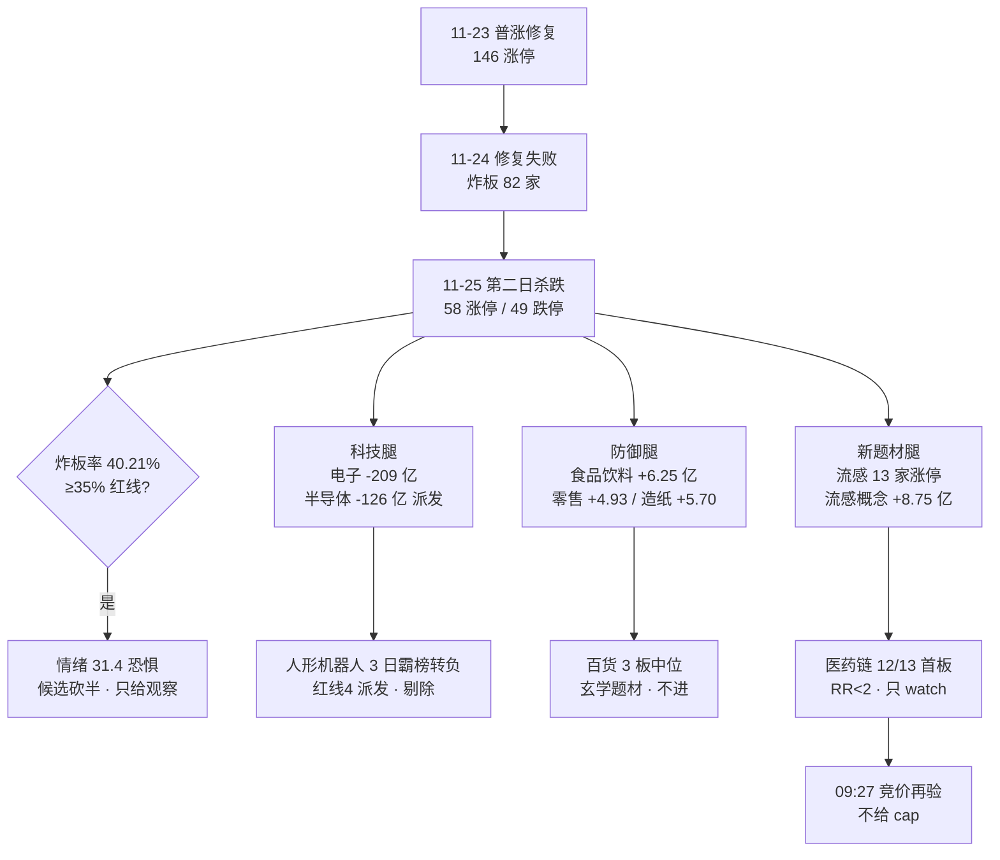

# 2026-11-26 · **群聊情绪共振**

> **数据源新鲜度**: partial（L1 三榜为 11-25 收盘基准，L2 断更、L3 下线）
> **降级状态**: degraded=true（L2 0 字节 / L3 永久下线 / dc 人气榜 0 行 / 两融 T+1）
> **置信度**: 0.44

## 一句话结论

情绪 31.4（恐惧）：11-25 缩量普跌第 2 日，炸板率 40.21% 过红线、候选砍半；唯一逆势成簇是流感/医药（13 家涨停、12 家首板、资金 +8.75 亿健康换手），但真等级只到 L1_only，全池 RR<2，当日只给观察不给开仓。

## 详细分析

### 一、先认市场：这不是「跌一天」，是修复失败后的第二次杀跌

- **广度与量能同时塌**：涨 567 / 跌 4588（涨家占比 11.0%）、中位 **−3.68%**、成交 13829 亿（**−16.43%**，缩量 2751 亿）。缩量普跌的意思是承接盘枯竭，不是恐慌换手——恐慌换手会放量，枯竭只会让分时像斜坡。猫笔刀的原话是「分时线稳定下跌，好像一切都是理所应当的，官军净买 500 亿也没水花」。
- **炸板率过红线**：权威口径（stk_limit 逐票复核）涨停 58 / 跌停 49 / 炸板 39 = **炸板率 40.21%**（R1 limit_list_d 51/43/30 = 37.04%，官方源漏收 7 只封死涨停；xtick 57/44/37 = 39.36%）。三口径全部 ≥35% → 按纪律**候选砍半**。
- **天梯没打开**：1 板 43 / 2 板 6 / 3 板 6 / 4 板 2 / 5 板 1，首板占比 74.1%；晋级率 1→2 仅 17.65%、2→3 24%。昨日涨停今日收盘溢价中位 **−4.47%**、红盘率 34.55%、再涨停只有 14 只 → 接力是亏钱效应，不是赚钱效应。
- **钱的流向只有一个答案**：主力 **−490.23 亿**（前一日 −37.32，摆动 −452.91），电子 −209.37 亿（超大单 −116.70 / 小单 +166.52 = 派发）、半导体 −126.22 亿；接住的是食品饮料 +6.25、白酒 +6.12、造纸 +5.70、一般零售 +4.93、化学制药 +4.69、新零售 +11.22，且只有医药/零售/造纸是「超大单正 + 小单负」的健康换手。钱没有变多，只是从硬件换到了防御。
- **隔夜又是半导体单杀**：纳指 −0.62%、SOX −0.65%、NVDA −3.91%、MU −4.53%，而 AAPL +0.43%、META +3.40%。BNP 把美光目标价下调 54%、判断 DRAM/NAND 2027 年中转跌 → 存储叙事从「缺货」翻成「下行周期」，今日科技链开盘仍被压制。

### 二、三主题共振矩阵

| 维度 | T1 流感/呼吸道用药 | T2 中药/OTC 防御 | T3 消费·百货零售 |
|---|---|---|---|
| L1 概念榜 | 流感 #4（+0.58%，全场最高位的逆势品种）、青蒿素 #5、仿制药 #14 新进 | 中药 0 命中 | 零售/百货/新零售 0 命中 |
| 涨停簇 | 流感 up_nums 13（并列第一，前值 <8 = 实质新增）；医药链 13 家（化学制药 6 + 医药商业 4 + 中成药 3） | 中药Ⅱ 3 家全首板 | 百货 3 + 一般零售 1，杭州解百 3/3 |
| 资金 | 流感 +8.75 亿（超大单 +9.54 / 小单 −8.88 健康）；化学制药 +4.69（超大单 +5.37 / 小单 −5.25） | 中药概念 +8.62 亿（超大单 +10.78，全概念第 2 高） | 一般零售 +4.93 / 百货 +4.35 / 新零售 +11.22，全为健康换手 |
| 板块涨幅 | +0.58% vs 全市场中位 −3.68% = **+4.26pp** | +0.34% 逆势 | 百货 +1.84% = 全场唯一正涨幅行业 |
| L2b 观点 | 5 篇（收评/午报/特一点名/赛诺菲呼吸药） | 2 篇 | 3 篇（财闻私享点名玄学归因） |
| 板型 | 12/13 首板、唯一 2 板天圣、封板 09:25–09:39 集中 | 3/3 首板，封成比 0.3~1.8% | 1 家 3 板 + 3 家首板 |
| 阶段 | **early**（新题材第 1 天） | early（同链扩散） | **late**（3 板中位） |
| 结论 | **观察**（只竞价验证，不给开仓） | **降级**（并入 T1，只当替代腿） | **不进**（玄学 + 中位 + RR 0.54） |

> 说明：三条主题 `resonance_level` 标 `L1+L2b / L1_only`，但**真等级最高只有 L1_only**——L2 群聊连续 19 个交易日 0 字节、L3 WeFlow 永久下线，L2b 公众号仅为观点代位，按红线 3 不计入枚举。**三条都不构成强共振，下游 R2/D1 不得当作已确认主线。**

### T1 · 流感/呼吸道用药（化学制药 + 医药商业 + 布洛芬/抗病毒原料）· rank 1

**共振证据**：概念榜流感 #4（+0.58%）、青蒿素 #5（+1.42%）、创新药 16→2（+14 名最大斜率）、仿制药一致性评价 #14 新进；limit_cpt 流感 up_nums 13 与人工智能并列第一（前值 <8）；飙升榜前 10 有 **5 席是医药**（新赣江 #1、亨迪 #2、康芝 #4、金迪克 #8、拓新 #9）——这是「新题材进榜」而不是「老面孔滞留」的特征。封板集中度：天圣 09:25 一字、特一 09:31、石药景峰 09:32、亨迪 09:33、哈三联 09:38、盘龙 09:38、拓新 09:39，全部在开盘 15 分钟内。

**大资金意图**：从硬件抽出来的钱没有离场，而是找「超跌 + 有新闻 + 能封住」的池子躲——医药单日超大单净买 5 亿级、小单净卖 5~10 亿级，是机构/大单承接散户割肉盘的典型换手结构，不是拉高派发。
**为什么走强**：流感进入流行季（R4 事件 score +0.70、化学制药 6 只 + 医药商业 4 只涨停）+ 赛诺菲 410 亿美元收购呼吸病药企 + 板块此前 5 日主力 −20.73 亿的超跌基数，三条同时给到了「叙事 + 位置」。
**逻辑够不够硬**：叙事硬（季节性流感可验证、被官媒独立报道 5 篇），资金硬（单日健康换手），但**趋势不硬**——5 日资金仍为负（流感 −18.12 / 化学制药 −20.73 / 医药生物 −81.25），说明这是新钱对抗存量撤离，最多给 2 日保质期，不能当波段主线。

**板型**：医药链 13 家里 12 家首板、仅天圣 1 家 2 板，无 3 板以上；封成比中位 0.4%（偏弱），只有天圣 5.9%、特一 1.8%、拓新 1.6% 三只算硬封。

| 票 | 板型/身位 | 封单 | 封成比 | 首封 | 换手 | 纪律判定 |
|---|---|---|---|---|---|---|
| 002872 天圣制药 | 2/2 板（链内最高） | 0.90 亿 | **5.9%** | 09:25 | 1.5% | 龙一但市值仅 15.3 亿，小盘硬板不可承接 |
| 002728 特一药业 | 1/1 首板 | 0.74 亿 | 1.8% | 09:31 | 2.8% | 龙二·首板最硬 + 官媒点名 |
| 301211 亨迪药业 | 20cm 首板（布洛芬原料） | 0.46 亿 | 1.0% | 09:33 | 4.7% | 弹性核心·飙升 #2 |
| 301089 拓新药业 | 20cm 首板（抗病毒原料） | 0.31 亿 | 1.6% | 09:39 | 7.9% | 弹性核心·飙升 #9 |
| 300086 康芝药业 | 20cm 首板 | 0.04 亿 | **0.2%** | 09:59 | 15.2% | **杂毛剔除**（弱封 + 开板 2 次） |
| 000756 新华制药 | 1/1 首板 | 0.35 亿 | 0.6% | 10:20 | 6.8% | **剔除**（尾板 + 开板 3 次） |

**首推票思维链（三只，均为观察不建仓）**

- 002872 天圣制药 — **买入理由**：链内唯一 2 板、封成比 5.9% 全链最高、09:25 一字封且零开板，接力位最正；**风险点**：流通仅 15.3 亿，一字 2 板后次日极可能「高开抢跑→兑现」，且流通小意味着承接薄；**止损条件**：竞价 +3%（7.31）介入、止损 6.67（−8.8%，板价下方 6%）、3 板目标 7.81 → **RR 0.8 < 1，直接拒**，只作情绪指标看；**可验证假设**：若明日竞价 ≤+1% 且 09:30 后封单回升至 0.5 亿以上，则 3 板概率上行，否则视为兑现。
- 002728 特一药业 — **买入理由**：首板里封单最硬（0.74 亿 / 封成比 1.8%）、09:31 秒板零开板、官媒独立点名「30 万手买单封板」；**风险点**：中药 OTC 逻辑弹性弱于原料药，且 41.9 亿流通里换手仅 2.8%，接力资金没真正进来；**止损条件**：介入上限 8.52（+2%）、止损 8.01（−6.0%）、隔日再板目标 9.18 → **RR 1.28 < 2 → 降 watch**；**可验证假设**：竞价 ≤+2% 且 10:00 前不透板价，则为可承接；若竞价 >+4% 直接放弃。
- 301211 亨迪药业 — **买入理由**：布洛芬原料与流感需求直接对应、20cm 弹性、飙升榜 #2 说明关注度刚起；**风险点**：20cm 票止损距天然放大、封成比 1.0% 不算硬，次日若竞价高开 >5% 就是给首板盘抬轿；**止损条件**：介入上限 11.33、止损 10.55（−6.9%）、再板目标 12.44（+9.8%）→ **RR 1.4 < 2 → watch**；**可验证假设**：若 09:30–10:00 换手放大到 8% 以上而价格维持板价上方，则 20cm 二板成立。

### T2 · 中药/OTC 防御（中药概念 + 医药商业扩散）· rank 2

**共振证据**：中药概念资金 **+8.62 亿**（超大单 +10.78，是全概念第 2 高），中药Ⅱ 3 家涨停（桂林三金 09:40、特一 09:31、盘龙 09:38）全首板；但 ths 概念榜 0 命中、三只票均未进个股人气前 50 → **热榜腿为空**，只能算 T1 的替代腿。

**大资金意图**：中药是「低估值 + 高股息 + OTC 现金流」的防御口袋，在缩量普跌日承接从成长股撤出的钱，与流感叙事只是部分重叠。
**为什么走强**：医药整体超跌 + 流感新闻外溢 + OTC 四季报预期，没有独立催化。
**逻辑够不够硬**：资金硬（超大单 +10.78 亿）、叙事软（无独立事件）、身位低（3/3 首板）——够做「T1 失败时的替补」，不够独立立项；封成比 0.3~1.8%，桂林三金/盘龙次日高开即兑现。

**结论：降级**——并入 T1 医药链，只在 T1 龙头被封死买不到时用特一作替代，不另给额度。

### T3 · 消费防御·百货/零售（杭州解百 3 板 + 北高峰题材）· rank 3

**共振证据**：百货 3 家（杭州解百 3/3、国芳集团、中央商场）+ 一般零售 家家悦，杭州解百封单 2.46 亿 / 封成比 **4.0%**（全市场 58 家涨停里第二档，仅次克来机电 6.3%）；资金三档全健康（一般零售 +4.93、百货 +4.35、新零售 +11.22）；百货行业 **+1.84%** 是全场唯一正涨幅行业；杭州解百 ths 热股新进 #42。

**大资金意图**：纯防御承接 + 事件驱动的短线溢价，超大单 +5.21 亿买的是「低位百货 + 本地题材」，不是行业景气。
**为什么走强**：财闻私享的归因最直接——「杭州北高峰财神庙明天重开，杭州解百、创源股份三连板，带动大消费」；叠加 11-25 全市唯一正涨幅行业的位置优势。
**逻辑够不够硬**：**不硬**。玄学题材没有可验证的持续催化、3 板已进中位、龙头 61.4 亿流通里换手 5.4%，次日要么一字要么冲高兑现；RR 0.54 且止损距 −12.6% 越出硬区间。

**结论：不进**——模式外（玄学）+ 中位（3 板）+ RR<1 三重否决，只在「大盘转修复且解百缩量回踩不破 5 日线」时重新评估。

### 三、单源方向（不给主线身份，只给 09:27 竞价池资格）

| 方向 | 量化腿 | 判定 |
|---|---|---|
| 乡村振兴/农业（饲料·渔业·农化） | 乡村振兴 up_nums 12（前值 <8 实质新增）、概念资金 +6.34 亿、板块 −2.03% vs 中位 −3.68%（未深负）；正虹科技/金新农、獐子岛/好当家、赤天化/百傲化学 6 家可归因 | 竞价池资格，**限低位首板**；金新农 6/9、好当家 6/10 已是高位连板，不接 |
| 创新药（热榜斜率腿） | ths 概念 16→2（Δ+14 全场最大）、pct −0.80% 抗跌；limit_cpt 9 家全首板；但无概念资金正腿（医药生物 5 日 −81.25 亿） | 只当 T1 扩散腿观察，不进票池 |
| 医美/医药电商（医药链边缘） | 医美 6 家全首板 + 资金 +5.18 亿（超大单 +5.01）；医药电商 8 家全首板 | T1 走强则跟随，T1 崩则同步失效 |

### 四、负向与剔除

- **N1 红线 4 · 概念霸榜派发：人形机器人 / 机器人概念**——概念榜 #1 连续 3 日（11-23 +5.91% → 11-24 +1.23% → 11-25 **−5.77%**），同期机器人概念涨停 **31→11（−20，全表最大负 delta）**、人形机器人从 14 家跌出前 20。人气顶格 + 家数腰斩 + 价格转负 = 派发三段确认，**不得作正向共振**。
- **N2 行业级派发：半导体/存储/CPO/PCB/光刻胶**——半导体 −126.22 亿（超大单 −70.97 / 小单 +89.54）、电子 −209.37 亿；板块 存储 −7.30% / 光刻胶 −7.19% / PCB −6.00% / CPO −5.58%。热榜仍高（CPO #3、PCB #11、存储 #13）而价格资金同步反向 = 出货窗口。
- **N3 高标派发：中京电子（5/5 板）**——14:54 尾盘才封、换手 42.5%、封成比 1.0%，R7 龙虎榜当日净卖 **−0.55 亿**，所属 CPO/PCB 双线深跌。
- **N4 人气滞留·价格崩塌：文投控股 #10→#11（+10.18%→−9.87%）、北纬科技 #11→#10（+3.07%→−9.99%）、东方海洋 #6→#5（+9.93%→−4.41%）**——榜位不动而价格反向，短剧游戏/AI视频进派发段。
- **N5 高标孤立：九阳股份（5/7 板）**——热股 #1 连续 2 日、封单 2.74 亿、开板 7 次、流通 293.7 亿，小家电无第二只涨停，资金借人气出货形态。
- **N6 资源腿反向：锂（碳酸锂 −7%、三个月 −50%）/ 黄金白银（VIX 飙升、金银重挫）**——不构成防御替代。

## 关键证据

- 证据 1：流感概念 **up_nums 13 并列第一**、板块 +0.58% 对全市场中位 −3.68% 高出 4.26pp、概念资金 +8.75 亿且超大单正/小单负 · 来源 `limit_cpt_list` + `R7_capital_flow.sector_net_inflow.concept_top10`
- 证据 2：医药链 13 家涨停中 **12 家首板**，封板集中 09:25–09:39，天圣封成比 5.9% 为链内唯一硬封 · 来源 `limit_list_d` 逐票（`fd_amount/float_mv`、`first_time`、`open_times`）
- 证据 3：炸板率 **40.21%**（58 涨停 / 39 炸板，stk_limit 权威）三口径全部 ≥35%，晋级率 1→2 仅 17.65%、昨日涨停收盘溢价中位 −4.47% · 来源 `R7_capital_flow.limit_universe` + `R1_style.market_structure.premium` + xtick `/doc/hot/emotion`
- 证据 4：主力 −490.23 亿、半导体 −126.22 亿派发 vs 化学制药 +4.69 亿 / 一般零售 +4.93 亿 / 中药概念 +8.62 亿健康换手 · 来源 `R7_capital_flow.main_force` + `sector_net_inflow`
- 证据 5：L2b 86 篇里医药/流感至少 5 篇独立报道、零售 3 篇、存储转空 5 篇；猫笔刀「像 924 之前」、安静拆主线「十日三模式只有 11-23 一天能赚」、股痴流沙河「病了」 · 来源 `data/raw/20261126/wechat_official_rss.jsonl`

## 不确定性 / 反证

- **共振真等级只有 L1_only**：L2 群聊连续 19 个交易日 0 字节，无法验证「群内一致性」；L2b 是编辑过的观点，天然比群聊更乐观/更慢。三条主题都不应被下游当已确认主线。
- **医药可能只是「超跌 + 新闻」的双腿共振**：流感季节性叙事通常只有 2–3 日保质期，5 日资金仍为负（化学制药 −20.73 亿）说明存量在撤；若次日科技链反抽夺回注意力，医药会瞬间失去资金。
- **R4 与人形机器人叙事冲突**：R4 给「人形机器人零部件 +0.602」正面分（小鹏 IRON 2027 量产 + 亦庄具身智能社区），而 L1/资金/涨停三层全部指向派发（N1）。本报告以资金为准，但若次日机器人放量反包，说明 R4 的事件腿先于资金腿生效——这是本判断最可能错的地方。
- **涨停家数三口径分歧**：58（stk_limit 含 7 只 ST/*ST 补录）/ 57（xtick）/ 51（limit_list_d）。剔掉 ST 补录后有效涨停约 51 家，情绪强度比表面更弱，方向上不利好。
- **一致预期风险**：公众号复盘几乎一致把下跌归因于「情绪/流动性」并等待「官军护盘」，缺少对「护盘无效后继续阴跌」的推演；一致预期偏「等救」本身是反向变量。
- **观察票无一通过赔率闸门**：天圣 RR 0.8、特一 1.28、亨迪 1.4、杭州解百 0.54，全部 <2。R3 的「观察」不等于「可买」，D1 若要开仓须自行复算。

## 与其他 R/D/E 的关系

- 依赖：`R1_style.json`（情绪基线 31.9 / 阶段 high_chop 第 2 天 / 仓位上限 0.10）、`R4_news.json`（流感事件 +0.70、机器人零部件 +0.602）、`R7_capital_flow.json`（权威涨停 58/49/39、行业与概念资金）、`data/research/20261125/attention_signals.json`（T-1 三榜）、`_r1_limit_cpt_20261125.json`（概念涨停簇）、`wechat_official_rss.jsonl`（L2b 观点）
- 被消费：R2（主线筛选需 R3 的正向/派发标记）、R5（个股画像取今日人气位、封成比与派发警报）、R6（反证引用 N1–N6 派发清单与「真等级 L1_only」缺口）、D1（情绪档 31.4 / 竞价池三条单源方向 / 硬否决 4 条）、E1（复盘对照情绪定档与主题存活率）

## 数据源审计

| 源 | 日期 | 状态 | 备注 |
|---|---|:--:|---|
| tushare ths_hot/dc（attention_signals） | 2026-11-25 | 🟢 | 三榜 100 行（ths 概念 20 / ths 热股 50 / dc 飙升 30）· dc 人气榜 0 行已降级标注 · 双日 diff 已算 |
| tushare limit_cpt_list | 2026-11-25 | 🟢 | 20 行概念涨停簇 · 对比 11-24 前值（机器人 31→11） |
| tushare limit_list_d（经 R1） | 2026-11-25 | 🟡 | 124 行 · U51/D43/Z30 · 官方源漏收 7 封死涨停 / 6 封死跌停 / 9 炸板 |
| xtick /doc/hot/emotion | 2026-11-25 | 🟢 | 涨停 57 / 跌停 44 / 炸板 37 / 最高 5 板 / 晋级率 17.65%–100% |
| R7 stk_limit 权威复核 | 2026-11-25 | 🟢 | 涨停 58 / 跌停 49 / 炸板 39 / 炸板率 40.21% / 天梯 43-6-6-2-1 |
| wechat_official_rss（L2b） | 2026-11-26 | 🟢 | 86 篇 / 14 号（官方 72、自媒体 14）· 窗口 11-25 早间 → 当晚 |
| wechat_cli_5groups（L2 群聊） | 2026-11-26 | 🔴 | 0 字节 · 7 群 0 条 · 本地库停在 2026-10-28（连续 19 个交易日） |
| WeFlow analytics（L3） | — | 🔴 | 2026-08-19 profile 移除 · 永久不可用 |
| R1_style（上游） | 2026-11-26 | 🟢 | status complete · confidence 0.525 · 31.9 恐惧 · cap 0.10 |
| R4_news（上游） | 2026-11-26 | 🟢 | 8 条 top event · 14 行极性矩阵 · 流感 +0.602 |
| R7_capital_flow（上游） | 2026-11-26 | 🟡 | status complete · 0.76 · data_quality=ok_with_lagging_margin_etf（两融/ETF T+1） |

## Sub-Agent 元数据

- skill: analyze_sentiment_resonance_v1@1.1
- artifact: data/research/20261126/R3_sentiment.json（50,264 B）
- 中间件: data/research/20261126/_work/（r3_rule_base.json · r3_rss_opinions.json · r3_compose.py · limit_list_20261125.json）
- 生成耗时: 约 30 分钟（06:02 起）
- model: deepseek-v4.1-flash
