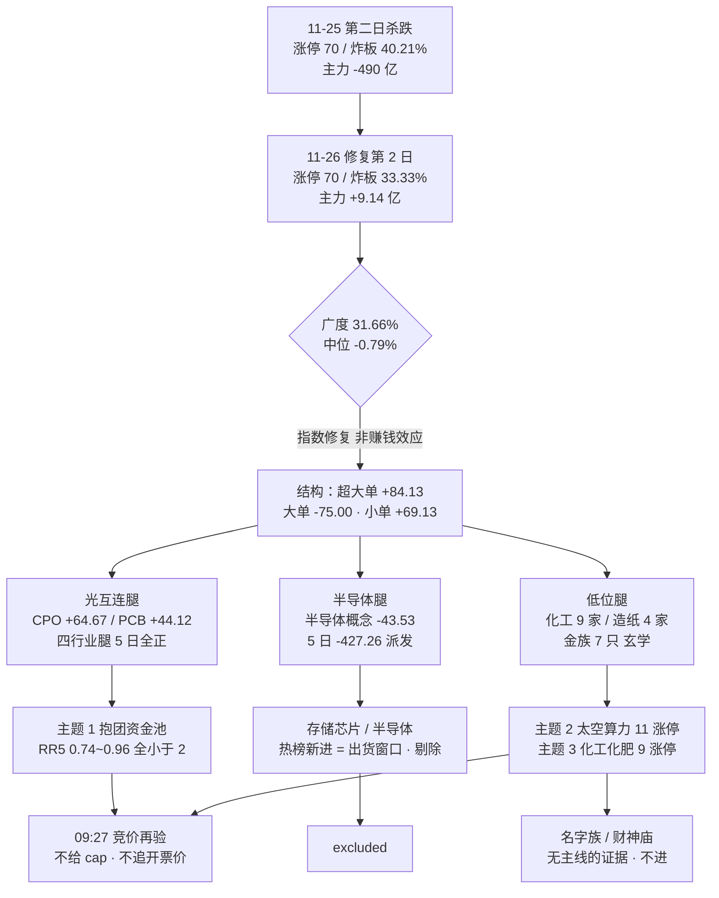

# 2026-11-27 · **群聊情绪共振**

> **数据源新鲜度**: partial（L1 为 11-26 收盘基准；L2 断更、L3 下线）
> **降级状态**: degraded=true（L2 群聊 0 字节 / L3 永久下线 / ths 概念榜 0 行 / 两融 T+1）
> **置信度**: 0.41（无群聊腿 → 共振真等级最高只到 L1_only）
> **情绪**: 52.4 · 中性 · 修复段第 2 日（R1 基线 54.9，净修正 −2.5）

## 一句话结论

修复第 2 天钱只回流 CPO/PCB 一条链（四行业腿单日与 5 日全正），但广度 31.7%、中位 −0.79%、炸板率 33.33% 逼近分歧线——**指数在修，赚钱效应没修**；主线仍未确认，唯一有资金腿的方向赔率不过闸（RR5 0.74~0.96），今日只做低位新题材首板/二板（太空算力、化工化肥），其余全部观察。

## 详细分析

### 一、先认市场：这是「缩量修复 + 结构分化」，不是主线启动

11-25 是全市场第二日杀跌（主力 −490.23 亿、炸板率 40.21%），11-26 主力反手 **+9.14 亿**，超大单 **+84.13 亿** 而大单 **−75.00 亿**、小单 +69.13 亿——**机构在接、游资在退、散户在买**。指数收红（沪 +0.01% / 创 +0.29%），但上涨仅 1683 家、下跌 3375 家、中位 −0.76%，成交 13172 亿（−4.75%）连续两日缩量。

这一段的位置必须认准：R1 判 `high_chop` 高位震荡、修复段第 2 个交易日，仓位上限 0.45，明写**无主线**（行业次日留存 16.0%、行业截面解释力 10.48%）。按纪律 §0 的四问，第 2 问的答案就是「修复段第 2 日 = 验证/分歧日」——打法只能是**低开承接 + 分歧转强 + 低位首板/二板**，不能追开盘价，更不能把抱团方向的回流当主升。

> 「抱团午后和尾盘有点高潮的样子……市场缩量背景下抱团是绕不开的选项，只是注意阶段性节奏」——盘口逻辑拆解
> 「市场情绪依然很低迷，买盘寥寥，全天两市成交只有 1.31 万亿，继续创阶段新低……临收盘前还是官军出来买了点，但是买量不多」——猫笔刀

### 二、三主题共振矩阵

| # | 主题 | 标明等级 | 真等级 | 身位 | 涨停簇 | 资金腿 | 消息/官媒腿 | 赔率 | 处置 |
|---|---|---|---|---|---|---|---|---|---|
| T1 | PCB/CPO/光模块/通信设备 | L1+L2b | **L1_only** | middle（回流第 1 天） | 9 家（元器件 6 + 通信设备 3） | ✅ 四行业腿 d1 与 5 日全正 | ✅ 官媒 5 篇 | ❌ RR5 0.74~0.96 | 主题·只给竞价 |
| T2 | 太空算力/商业航天/6G | L1+L2b | **L1_only** | early（首板/二板） | 11 家 | ❌ 0 命中 | ✅ 2 篇 + FCC 事件 | 一字板不可排队 | 观察方向 |
| T3 | 化工/化肥（钾肥大合同） | L1+L2b | **L1_only** | early（7/9 首板） | 9 家（化工原料 5 + 农药化肥 4） | ❌ 0 命中 | ✅ 2 篇 | 弱封占比高 | 观察方向 |

> 三条的 `resonance_level` 一律标 L1+L2b，但**真等级只有 L1_only**：L2 群聊 0 字节永久断更、L3 WeFlow 永久下线，L2b 公众号仅观点代位、按红线 3 不计入枚举。**下游不得把任何一条当已确认主线**，只给 09:27 竞价池资格，开仓须独立过 `forbidden_filter` / `risk_reward` 闸门。

### T1 · PCB/CPO/光模块/通信设备 · rank 1

**共振证据**：概念榜 CPO **#1**（11-24 #4 → 11-25 #3 → 11-26 #1）、PCB #4（#7→#11→#4，Δ+7）、算力租赁 #2（#12→#2）；个股热榜五席——中京电子 #4、青山纸业 #6、中际旭创 #9（15→9，主力 +16.9 亿）、东山精密 #14、超声电子 #18（人气在榜 77 天）。涨停簇 9 家，其中 PCB 四只（崇达、骏亚、澳弘、盛洋）全部早盘封板。

| 代码 | 名称 | 身位 | 封单 | 封成比 | 首封 | 开板 | 行业 |
|---|---|---|---|---|---|---|---|
| 002815 崇达技术 | 元器件 | 2/4 板 | 1.16 亿 | 5.5% | 10:11 | 1 | PCB |
| 603386 骏亚科技 | 元器件 | 首板 | 0.73 亿 | **40.6%** | 09:31 | 0 | PCB（官媒点名） |
| 605058 澳弘电子 | 元器件 | 首板 | 0.80 亿 | 15.1% | 10:12 | 0 | PCB |
| 603703 盛洋科技 | 元器件 | 首板 | 0.82 亿 | **102.5%** | 09:25 | 0 | 元器件（太空算力交叉） |
| 002199 东晶电子 | 元器件 | 3/5 板 | 0.32 亿 | 12.3% | 09:38 | 2 | 元件 |
| 003040 楚天龙 | 通信设备 | 首板 | 0.91 亿 | **60.7%** | 10:03 | 0 | 通信设备 |
| 603118 共进股份 | 通信设备 | 首板 | 0.19 亿 | 1.3% | 13:18 | 12 | 通信设备（弱封） |
| 000889 中嘉博创 | 通信设备 | 首板 | 0.18 亿 | 2.0% | 09:51 | 4 | 通信设备（弱封） |

- **大资金意图**：把 11-25 砸出去的仓位**买回来**，不是新增建仓。证据是 CPO 概念 5 日前值为 **−299.55 亿**、当日 +64.67 亿；元件 5 日前 −140.83 → +108.49 亿；期指四品种基差贴水同步收窄（IF −1.904%→−1.301%、IC −2.061%→−1.251%）= 对冲盘减仓。钱的方向很硬，但性质是**回补**。
- **为什么走强**：三腿同日落地——产业腿（PCB 供需改善研报 + 先进封装放量）、事件腿（三部委 6G 基站与核心网设备方案）、外部腿（美股深 V，纳指盘中 −4.53% 收 −0.62%）。官媒 5 篇同向（财联社收评/午报/VIP 日报 + 证券时报 + 上证报），是本日唯一被三家媒体同时放在标题位的方向。
- **逻辑够不够硬**：**硬的是资金方向，软的是参与位置**。R7 三张研究卡（中际旭创/东山精密/生益科技）全部 `research_only`：RR5 = 0.74 / 0.94 / 0.96 全 < 2、止损距 −8.4~−12.1%。距 20 日高只剩 3~4%，追高就是负赔率。结论：方向成立但**今日不是上车位**，只做回踩承接。

- 002815 崇达技术 — **买入理由**：链内成交额最大（21.1 亿）、封成比 5.5%、2/4 板身位、PCB 供需改善研报口径的焦点票；**风险点**：11-25 曾 −3.55%，说明筹码在抖；封单 1.16 亿对应 21.1 亿成交只是 5.5%，属「大票弱封」；**止损条件**：竞价 ≤+2%（15.56）才介入，止损 14.30（−8.1%），次日板目标 16.79（+7.9%）→ **RR ≈ 1.0 < 2，直接降 watch**，只有回踩 14.6~14.9 承接时 RR 才升到 1.8；**可验证假设**：若 09:27 竞价 ≤+2% 且 10:00 前封单回到 1.5 亿以上、零开板，则 3 板概率上行；高开 >+5% 直接放弃。
- 002565 顺灏股份 — **买入理由**：11-25 −7.04% 后 11-26 一字反包（09:25 首封、封单 2.11 亿 / 成交 2.11 亿 = 封成比 100%），FCC 百万卫星太空 AI 数据中心事件直指；**风险点**：一字板买不到，次日必高开；4 天 2 板属反包不是主升；行业归类「造纸」与太空算力概念错配，题材纯度仅靠事件标签；**止损条件**：只有竞价 ≤+3%（8.68）才参与，止损 7.92（−8.8%），次日板目标 9.27 → **RR ≈ 1.1，不排队、只作弱转强观察**；**可验证假设**：竞价 ≤+3% 且 09:35 前成交额 >1.5 亿（昨日 2.1 亿）则二板成立；若竞价 +7% 以上直接放弃。

### T2 · 太空算力 / 商业航天 / 6G · rank 2

**共振证据**：商业航天概念榜 #3（#8→#9→#3，Δ+6）、6G 新进 #8；limit_cpt 商业航天 **up_nums 11**；官媒两条硬腿——上证报《利好来了！商业航天概念，批量涨停》、盘前纪要明列「太空算力：顺灏股份、上海沪工、钧达股份、盛洋科技、西部材料」；事件腿 = FCC 批准 SpaceX 100 万颗卫星太空 AI 数据中心 + 三部委 6G 基站方案。

- **大资金意图**：**没有记录**。R7 概念资金 top10 里既无商业航天也无卫星互联网——这波是游资在打事件，不是机构在建仓。通信设备 +37.76 亿不能借给它，那是 T1 的光互连钱。
- **为什么走强**：竞价定生死。顺灏 09:25 一字、盛洋 09:25 秒板（封成比 102.5%）——两笔秒板把「太空算力」做成当日唯一的新题材标签；11 家里首板/二板为主、无 3 板以上高度，身位极低。
- **逻辑够不够硬**：事件是真的（FCC + 6G 方案都在官方文本里），但业绩链条在 2027 之后，属**纯情绪题材**。缺资金腿意味着次日不接力即散；一字板不可排队，只能等竞价弱转强。按 skill「修复段单源新题材涨停 ≥5 家即保留为观察方向」条款，给竞价资格、**不授主线身份**。

### T3 · 化工 / 化肥（钾肥大合同涨价）· rank 3

**共振证据**：涨停 9 家（化工原料 5 + 农药化肥 4），上证报《钾肥大合同涨价，两股直线涨停》、财联社收评「化工板块震荡反弹」；热股榜金牛化工 #7（12→7，3/3 板）。

| 代码 | 名称 | 身位 | 封单 | 封成比 | 首封 | 开板 |
|---|---|---|---|---|---|---|
| 000912 泸天化 | 农药化肥 | 首板 | 0.36 亿 | 36.0% | 09:36 | 0 |
| 301190 善水科技 | 染料涂料 | 首板 | 0.65 亿 | 20.3% | 09:43 | 0 |
| 002453 华软科技 | 化工原料 | 首板 | 0.79 亿 | 34.3% | 10:47 | 0 |
| 002470 金正大 | 农药化肥 | 首板 | 0.45 亿 | 14.1% | 09:58 | 3 |
| 002226 江南化工 | 化工原料 | 首板 | 0.41 亿 | 6.3% | 10:17 | 2 |
| 002246 北化股份 | 化工原料 | 首板 | 0.14 亿 | 1.9% | 10:13 | 7 |
| 600691 潞化科技 | 农药化肥 | 首板 | 0.06 亿 | 1.8% | 14:30 | 5 |
| 600722 金牛化工 | 化工原料 | 3/3 板 | 1.32 亿 | 8.8% | 09:31 | 0 |

- **大资金意图**：无行业资金记录（R7 化工/农药化肥不在 top10 也不在 bottom10）→ 这是**消息脉冲**，不是资金建仓。
- **为什么走强**：钾肥大合同涨价是唯一价格事件，叠加 11-25 化工超跌；9 家里 7 家首板，低位属性正。
- **逻辑够不够硬**：**半硬**。价格事件短期真实、低位首板通道合规；但 9 家里 5 家开板（北化 7 次、潞化 14:30 尾盘、金麒麟 13:03）、封板质量参差，且龙头金牛 3/3 已在中位——属纪律 §2「躲中位」的范围。只做低位首板（泸天化、善水），不接力中位。

### 三、单源方向（不给主线身份，只给 09:27 竞价池资格）

| 方向 | 量化证据 | 缺哪条腿 | 判定 |
|---|---|---|---|
| 国产算力 / 昇腾链 | 算力租赁 #12→#2（Δ+10）、东数西算 #17→#5（Δ+12）、6G/华为/芯片/昇腾/人工智能全部新进热榜；R4 净分 **1.214** 当日最强（广东算力规划 + ISSCC 自研 HBM）；证券时报「近 150 万手封单！300324，20% 涨停！算力芯片，午后异动」 | 资金腿反向：半导体概念 −43.53 亿（5 日 −427.26）、数字芯片设计 −10.99（−126.05） | **观察**：消息先行资金未到；不能与 T1 光互连混为一谈（半导体在派发） |
| 造纸 / 包装（4 家硬板） | 山鹰国际 09:25 秒板（1.84 亿 / 成交 0.4 亿 = 封成比 460%）、顺灏 2/4 一字、岳阳林纸 13:15、大胜达 10:49（开板 5 次） | 无涨价事件、无行业资金 | **观察**：纯低位扩散，明日出 2 板才升格 |
| 名字族 / 财神庙玄学 | 官媒双篇（证券时报《爆发！“金”字头，涨停潮》、上证报《“金”字辈，多股涨停》）；财闻私享注释「金新农连续大涨，刺激名字带金的个股」；统计 **7 只「金」涨停**（金牛化工、金螳螂、金正大、金健米业、金三江、金辰股份、金麒麟）；杭州解百 4/4（盘前纪要「财神庙」） | 全部是玄学 | **不进**：纪律④模式外的钱永远不赚；只作情绪读数（= 无主线的证据） |

### 四、负向与剔除

| 编号 | 类型 | 对象 | 证据 | 结论 |
|---|---|---|---|---|
| N1 | 红线 4 · 霸榜退位 | 人形机器人 / 机器人概念 | 人形机器人 #1 → #1 → #6（被 CPO 顶掉）；机器人概念 up_nums 15、delta +4、pct −0.71% 仅与中位持平；R7 通用设备 5 日 −0.10 亿 | 派发/退位；不作正向共振，R5/D1 不得当接力方向 |
| N2 | 行业级派发 · 热榜与资金反向 | 半导体 / 存储 / 芯片 | 半导体 −25.67（5日 −252.29）、半导体概念 −43.53（−427.26）、存储芯片 −28.17（−252.74）；同期芯片概念新进 #10、先进封装新进 #20；R4：GFHK 下调 2027 DRAM 合约涨幅至 6/3/0/0 | 热榜新进 + 资金派发 = 出货窗口 |
| N3 | 高标弱封 | 东方海洋 / 克来机电 / 宏达高科 | 东方海洋 12/24 板、开板 8 次、封成比 2.1%（0.65 亿 / 31.0 亿）；克来机电 5/5 板 + 监管工作函；宏达高科 2/2 封单 4.57 亿但成交仅 1.8 亿、开板 2 次 | 高标尾部，一律不进候选 |
| N4 | 无主线投机化 | 名字族 / 财神庙 | 7 只金族涨停 + 官媒两篇 + 缩量（1.32 万亿、−4.75%） | 「资金找不到主线」的直接证据 |
| N5 | 广度与量能 | 全市场 | 上涨 1683 / 下跌 3375、中位 −0.76%、成交 −4.75% 两日连缩、炸板率取严 33.33% | 指数修复靠权重护盘，赚钱效应未修复 |

**剔除清单**：一带一路（up_nums 19 但板块 −0.07%、篮子过宽 = 口径噪音）、渔业/水产（归入 N3 高标）、ST 摘帽（R7 补录的 *ST 建艺 / *ST 瑞茂 / *ST 华幸）、纯概念（高新发展封单 0、克来机电自认不涉人形机器人且前三季亏损）。

## 关键证据

- 证据 1：主力由 **−490.23 亿反手到 +9.14 亿**，超大单 +84.13 / 大单 −75.00 / 小单 +69.13；四行业腿 d1 与 5 日同为正（元件 +45.27/+108.49、印制电路板 +44.12/+109.91、通信设备 +37.76/+66.77、通信网络设备及器件 +34.68/+97.72）· 来源 `R7_capital_flow.json`（2026-11-26 收盘）
- 证据 2：涨停三口径 **70（R7 stk_limit 权威）/ 68（xtick）/ 65（limit_list_d）**，炸板率取严 33.33% < 35%，但 1→2 板晋级率仅 21.43%（xtick）· 来源 R7 + xtick `/doc/hot/emotion` + R1
- 证据 3：概念榜三日序列 CPO #4→#3→**#1**、PCB #7→#11→#4、人形机器人 #1→#1→#6 · 来源 tushare ths_hot 三连拉
- 证据 4：L2b 90 篇 / 15 账号，PCB 相关 5 篇、商业航天 2 篇、化工 2 篇；无板块命中的宏观情绪 8 条（猫笔刀「买盘寥寥」、盘口逻辑「抱团高潮信号」、股痴流沙河「量能未到 2 万亿还是小票行情」）· 来源 `wechat_official_rss.jsonl`
- 证据 5：跌幅侧对照——11-25 的 CPO −5.58%、PCB −6.00% 在 11-26 全部转为资金净买，属**回补**而非新起 · 来源 R7 5 日/10 日序列
- 证据 6：L2 群聊 7 群 **0 条 0 字节**（连续 20 个交易日），本地库最后消息 2026-10-28 → 折叠为「无群聊腿」，未用旧文本冒充今日情绪 · 来源 `data/raw/20261127/wechat_cli_5groups.jsonl`

## 不确定性 / 反证

1. **最大缺口是 L2**：没有群聊层，「7 群一致性」这条腿今天完全缺失，所以三条主题的真等级只能到 L1_only。若明日群聊恢复而它们没接力，说明今日的共振是我在替市场想象。
2. **T1 的反证最锋利**：盘口逻辑拆解明写「抱团午后和尾盘有点高潮的样子……要么出破局票，要么就是抱团高潮信号」。若今日 CPO/PCB 高开 >2% 后炸板，T1 不是主线而是**高潮日**，明天就是补跌起点。
3. **T2 缺资金腿**：11 家涨停没有一分钱行业资金记录，事件（FCC 百万卫星 / 6G）离业绩太远。一字板买不到、散票承接薄，最可能是「只演一天」。
4. **T3 弱封**：9 家里 5 家开板（北化 7 次、潞化 14:30 尾盘），所谓「化工反弹」的封板质量低于同日的 PCB，不能与 T1 并列。
5. **赔率腿全线不过关**：R7 唯一的三张卡 RR5 0.74~0.96；我自己给 T1/T2 首推票粗算也是 1.0~1.1。这意味着「方向对但今天买就是亏赔率」——这是今日最该说清的事实，不是选股问题。
6. **口径分歧**：涨停 70 / 68 / 65 三个数，本报告一律用 R7 权威 70；若下游看 R1 的 65 会得到「首板占比 78.5%」的另一个结论（51/65），两者不矛盾但不可混算。

## 与其他 R/D/E 的关系

- **依赖（上游）**：`R1_style.json`（情绪基线 54.9 / 无主线 / high_chop 修复第 2 日 / cap 0.45）、`R4_news.json`（8 事件 / 15 板块极性，国产算力 1.214 最强）、`R7_capital_flow.json`（行业与概念资金、stk_limit 权威涨停口径、三张研究卡 RR）、`attention_signals.json`（T-1，20261126）、`wechat_official_rss.jsonl`（L2b）、`limit_cpt_list`（概念涨停簇）、xtick `/doc/hot/emotion`（三口径互验）。
- **被消费（下游）**：R2（主线研判，须看本报告的 `resonance_strength_cap` 再判主线）、R5（对 T1/T2/T3 龙头逐票画像，须补 RR 与筹码）、R6（反证，重点打「T1 抱团高潮」与「T2 零资金腿」）、D1（盘前决策，只把本报告当竞价池资格、不授 cap）、E1（盘后复盘，核对 T2 是否一日游）。
- **明确边界**：本报告不做板块排序（R2）、不做个股画像（R5）、不做基本面与技术分析（R4/R5）；指数与个股的建议性结论一律为「观察/降级」，不构成开仓指令。

## 数据源审计

| 源 | 状态 | 抓取日期 | 记录数 | 备注 |
|---|---|---|---|---|
| attention_signals（dc 人气 + 飙升 + ths 热股 + ths 概念） | 🟢 ok | 2026-11-26 | 2023（persistent）/ 50 + 30 + 50 榜单 | ths 概念榜 0 行 → 概念级单平台 |
| limit_list_d 逐票（R3 直连 + 行业归类） | 🟡 partial | 2026-11-26 | 65 | 官方漏收 5 涨停 / 4 跌停 / 6 炸板 |
| xtick `/doc/hot/emotion` | 🟢 ok | 2026-11-26 | 1 | 涨停 68 / 跌停 8 / 炸板 30 |
| R7 stk_limit 权威复核 + 行业/概念资金 | 🟢 ok | 2026-11-26 | 70 | 本报告涨停家数一律用此口径 |
| R1_style（当日基线 + 市场结构） | 🟢 ok | 2026-11-26 | 1 | status=complete、confidence 0.525 |
| R4_news（事件与板块极性） | 🟢 ok | 2026-11-26 | 8 事件 / 15 板块 | 国产算力 1.214 为最强腿 |
| wechat_official_rss（L2b 公众号） | 🟢 ok | 2026-11-27 06:01 | 90 篇 / 15 账号 | 19 feed 全通、核心 9/10 |
| wechat_cli_5groups（L2 群聊，7 群） | 🔴 empty | 2026-11-27 06:01 | 0 | 0 字节 · 本地库停 2026-10-28 · 连续 20 个交易日 |
| WeFlow analytics（L3） | 🔴 unavailable | — | — | 2026-08-19 永久下线 |
| 两融余额 | 🟡 stale | 2026-11-25 | 1 | T+1 滞后，未含 11-26 |
| 盘前竞价数据 | 🔴 unavailable | — | — | 06:43 抓取，未开盘；板型判断均为收盘静态 |

## Sub-Agent 元数据

- skill: `analyze_sentiment_resonance_v1`（L1+L2b 双源，L2/L3 永久断更）
- artifact: `data/research/20261127/R3_sentiment.json`（52,732 B · 43 个顶层字段）
- 中间件: `data/research/20261127/_work/`（r3_raw_build.json、r3_limit_20261126_ind.json、r3_concept_hot_3d.json、r3_rss.json、r3_build.py）
- 生成耗时: 约 9 分钟（06:34 起，06:43 落盘）
- model: deepseek-v4.1-flash
- 情绪: 52.4 / 中性 / 修复段第 2 日 · 三口径炸板率取严 33.33%（未触发 35% 砍半）· 主题 3 条 + 观察方向 3 条 + 剔除 5 条 + 负向 5 条
