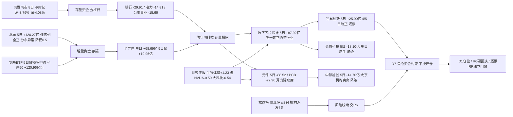

# 2026年10月26日 · **资金面**

> **数据源新鲜度**: partial · **降级状态**: true · **置信度**: 0.66
> **数据归属**: A 股资金/龙虎榜/两融/ETF/北向 = 2026-10-23 收盘；美股 = 2026-10-23 收盘（周末无更新）
> **staleness**: 20261026 为交易日，resolved_trade_date=20261023，trading_gap=0 → ok。周一盘前用上周五收盘是最新可得，不判过期，也不冒充今日数据。
> **预生成声明**: 本件于 2026-10-24 提前为周一生成（prepared_for_trade_date=20261026），非「当日盘前重跑旧数据」。

## 🧭 一句话结论
**1023 是单日修复，不是主升确认。** 指数大涨，但全市场主力单日只有 `+2.80 亿`，5 日 `-964.20 亿`、20 日 `-4,982.78 亿`；两融两市 8 个交易日再降约 `987 亿`，去杠杆没停。真增量只有宽基 ETF 份额与北向（北向序列分布异常，已降权）。科技只有数字芯片设计 5 日转正，元件/PCB 继续被卖，隔夜美股也只修复存储/代工、没修复算力龙头。**20261026 给「选择性承接」，不给「全面进攻」。**

## 📊 详细分析: 先认市场, 再认资金

**一、指数与资金背离, 单日强不等于趋势转。** 1023 涨停 82 家、跌停 6 家、炸板 12 家（炸板率 12.77%，<35% 属强区间），上证 `+0.89%`、深证 `+2.79%`、创业板 `+4.16%`，是近一个月最强的一天。但同日东财主力拆单净额只有 `+2.80 亿`（净流入率 0.01%）。拉长看：5 日 `-964.20 亿`（4/5 日流出）、10 日 `-2,462.13 亿`（9/10 日流出）、20 日 `-4,982.78 亿`（16/20 日流出）。更硬的一条是两融：沪市融资余额 10-13 `12,860.65 亿` → 10-23 `12,373.51 亿`（`-487.14 亿`，-3.79%），深市 10-13 `12,220.59 亿` → 10-22 `11,721.63 亿`（`-498.96 亿`，-4.08%）。**杠杆在撤，指数在涨 —— 修复成立，主升未确认。**

**二、科技内部三层分化, 只有一层是真持续。** 单日流入前三：半导体 `+68.69 亿`、电子 `+66.52 亿`、数字芯片设计 `+62.46 亿`。换到 5 日口径立刻分层 —— 数字芯片设计 `+87.92 亿`、半导体 `+10.96 亿`、电子 `-47.38 亿`。半导体单日 +68.69 亿意味着此前 4 个交易日合计约 -57.7 亿，是标准的一日回补；数字芯片设计 5 日为正但 10/20 日仍为负（-43.10 / -267.74），属于「先于行业转正的子行业」。同时元件 `-27.75 亿`（5 日 -88.52）、印制电路板 `-24.12 亿`（5 日 -72.96）继续被卖，与隔夜 NVDA `-0.59%`、AVGO `-0.48%` 同向 —— 算力/光模块/PCB 是这轮修复里缺席的一段。

**三、防守让位是存量搬家, 不是增量进场。** 银行 `-29.91 亿`（5 日 -33.18，板块 -0.54%）、国有大型银行Ⅲ `-14.61 亿`（-2.75%）、电力 `-14.81 亿`、公用事业 `-15.66 亿`，资金从红利/防守切向科技。这也解释了指数大涨而全市场主力净额近乎为零：买盘集中，卖盘同样集中。医药生物 `-17.13 亿` 但板块 `+1.69%`，价资背离，不进。

**四、北向与 ETF 是唯一确定的增量, 但两者都不能当主动买盘。** 北向 1023 净买 `+31.32 亿`，5 日 `+120.27 亿`（5/5 日净流入）、10 日 `+247.46 亿`、20 日 `+507.09 亿`。**但这条序列 32 个交易日 32 天全为正、日均 24.6 亿、标准差仅 3.1 亿，hgt 与 sgt 每日几乎等额 —— 不符合真实北向的分布，判为口径/代理异常，只做方向参考，权重 0.5。** ETF 侧近 5 个交易日份额净申购：科创50ETF `+120.96 亿份`（+17.23%）、沪深300ETF `+66.90 亿份`（+23.43%）、创业板ETF `+58.35 亿份`（+22.91%）。**份额不是净买入金额**，宽基同申购只能说明有指数化承接。

**五、隔夜美股: 反弹但不全面。** 美股 20261023 收盘 SPX `-0.52%`、IXIC `-0.21%`、DJI `-1.23%`；7 只半导体等权篮子 `+1.23%`（MU +2.46、MRVL +2.26、AMD +1.74、INTC +1.72、TSM +1.49，但 NVDA -0.59、AVGO -0.48），大科技均值 `-0.54%`，恒生科技 `+2.05%`。前一日 1022 是普跌（NVDA -4.40、MU -6.26、AMD -8.10），所以 1023 只是收回一部分。映射 20261026：存储/国产替代链（长鑫、兆易、粤芯）有温和外部顺风；AI 算力/CPO（中际旭创）仍是中性偏压制。**不能把「半导体篮子转正」当成科技链整体绿灯。**

**六、龙虎榜: 28 只结构性风险, 8 只属「价涨净卖」最该防。** 1023 上榜 81 只 / 101 条事由 / 1,010 条席位（去重 916 条）。按单日口径重算：价涨净卖 8 只、机构派发而游资接 6 只、高换手净卖 9 只、下跌净卖 10 只。最活跃席位为开源证券西安西大街 20 笔 / 15 票 / 净买 `+8.26 亿`，东莞证券南京分公司 7 笔 / 净卖 `-2.63 亿`，国泰海通上海分公司 6 笔 / 净卖 `-2.19 亿`。**本 skill 不授予 hard_reject，硬否决唯一来源是 R6。**

## 📈 板块时序资金（亿元）

口径：东财板块主力拆单净额，单位亿元；行业分类含父子层级（电子 ⊃ 半导体 ⊃ 数字芯片设计），**父子不相加**，不做正交化。窗口按交易日计：5 日=1019/1020/1021/1022/1023，10 日=1012—1023，20 日=0918—1023。40 个板块具备完整 20 日序列。

| 板块 | 1023 单日 | 5 日 | 10 日 | 20 日 | 板块涨跌 | 5日方向 |
|---|---:|---:|---:|---:|---:|:--:|
| 半导体 | 68.69 | 10.96 | -115.17 | -580.74 | +3.70% | 🟢 |
| 电子 | 66.52 | -47.38 | -352.20 | -1,384.52 | +2.72% | 🔴 |
| 数字芯片设计 | 62.46 | 87.92 | -43.10 | -267.74 | +5.27% | 🟢 |
| 计算机 | 40.80 | -6.78 | -86.89 | -207.47 | +4.08% | 🔴 |
| 消费电子零部件及组装 | 23.08 | 42.98 | -18.12 | -132.14 | +2.67% | 🟢 |
| 消费电子 | 22.02 | 44.29 | -17.87 | -133.93 | +2.97% | 🟢 |
| 软件开发 | 22.64 | -1.72 | -29.83 | -58.55 | +5.02% | 🔴 |
| IT服务Ⅱ | 15.37 | 8.00 | -29.25 | -90.08 | +3.78% | 🟢 |
| 传媒 | 16.20 | -59.31 | -67.73 | -96.50 | +2.64% | 🔴 |
| 银行 | -29.91 | -33.18 | -42.34 | -82.71 | -0.54% | 🔴 |
| 元件 | -27.75 | -88.52 | -137.03 | -450.30 | +0.14% | 🔴 |
| 印制电路板 | -24.12 | -72.96 | -87.66 | -317.62 | -0.77% | 🔴 |
| 国有大型银行Ⅲ | -14.61 | n/a | n/a | n/a | -2.75% | 🔴 |
| 电力 | -14.81 | n/a | n/a | n/a | -0.35% | 🔴 |
| 医药生物 | -17.13 | n/a | n/a | n/a | +1.69% | 🔴 |

说明：国有大型银行Ⅲ/电力/医药生物未补 20 日序列，只给单日口径，不臆造多日累计。板块排名是资金事实，不是 R2 主线排序，也不构成买入名单。

### 半导体: 资金三问
- **大资金意图**：单日 `+68.69 亿`（净流入率 2.69%）、板块 +3.70%，超大单是主要买方；但 5 日仅 `+10.96 亿`、20 日 `-580.74 亿` —— 这是空头趋势里的第一次集中回补，不是持续建仓。拆单只能说明大单方向，识别不了机构身份。
- **为什么走强**：位置=20 日深度净流出后的超跌位；催化=存储涨价预期与国产替代，隔夜 MU +2.46% 提供顺风；筹码=设计端先转正、元件/PCB 仍在流出。三维里只有「催化+超跌」成立，筹码结构未转好。
- **逻辑够不够硬**：只有东财板块资金一套底源 + 个股拆单，同源不算双独立共识；硬业绩/硬政策未在 R7 核验。态度=**观察**。证伪路径：次日半导体净额转负且跌破 1023 收盘 → 回补被证伪。

### 数字芯片设计: 资金三问
- **大资金意图**：5 日 `+87.92 亿`（唯一持续为正的子行业）、单日 `+62.46 亿`、净流入率 4.99%。父行业半导体 5 日只有 +10.96 亿，设计端拿走了绝大部分 —— 大单在做「设计优先于制造/配套」的结构选择。
- **为什么走强**：位置=10 日仍 -43.10 亿，未回到 20 日均值上方；催化=存储价格与国产算力订单预期；筹码=兆易创新 5 日 +25.90 亿（4/5 日为正）而长鑫科技 5 日 -18.10 亿，同为存储链却相反 —— 板块正流入是少数权重贡献，不是全面共振。
- **逻辑够不够硬**：板块 5 日转正 + 个股资金持续，两条同向，但同属东财拆单同源；两融口径显示龙头在降杠杆（兆易 10 日 -10.0%、中际旭创 -23.7%），与「主力买」分歧。态度=**观察**，只做确认后的低吸，不追单日高潮。

### 软件开发: 资金三问
- **大资金意图**：单日 `+22.64 亿`、板块 +5.02%、净流入率 3.80%，但 5 日 `-1.72 亿`、20 日 -58.55 亿 —— 单日流入几乎全来自 1023 一天，前 4 日合计约 -24.4 亿。大单方向是「日内回补」而非趋势建仓。
- **为什么走强**：位置=20 日持续流出后的低位；催化=AI 应用与信息化政策预期；筹码=垂直应用软件 5 日 -2.66 亿、IT服务Ⅱ 5 日 +8.00 亿，内部不一致 → 资金在挑个股而不是买板块。
- **逻辑够不够硬**：单日强、5 日弱，最容易被误读成「主线启动」；需要次日再验证一次同向净流入。态度=**观察**，不因单日 +5.02% 追高。

## 🔎 昨日前十: 五日追踪

定义：2026-10-23 全市场主力净流入额前十（东财 `moneyflow_dc`，单日 6,030 行去重后按净额降序），**不是**龙虎榜前十、北向前十，也不是买入名单。五日窗口为 2026-10-19/20/21/22/23 五个交易日，是回溯而不是未来收益。个股净额原为万元，下表统一折算亿元。

| 昨日排名 | 标的 | 1023 净流入(亿) | 5日累计(亿) | 5日为正 | 5日区间涨跌 | 1023 收盘 | R7 资金态度 |
|---:|---|---:|---:|---:|---:|---:|---|
| 1 | 中际旭创 300308.SZ | 0.00 | -14.70 | 2/5 | -7.28% | 612.63 | 降级 |
| 2 | 长鑫科技 688825.SH | 0.00 | -18.10 | 2/5 | +3.20% | 42.85 | 降级 |
| 3 | 宁德时代 300750.SZ | 0.00 | -37.60 | 1/5 | -11.02% | 237.6 | 降级 |
| 4 | 兆易创新 603986.SH | 0.00 | +25.90 | 4/5 | +3.38% | 292.0 | 观察 |
| 5 | 天娱数科 002354.SZ | 0.00 | +12.11 | 4/5 | +8.22% | 8.03 | 观察 |
| 6 | 粤芯半导-U 301660.SZ | 0.00 | +6.07 | 3/5 | -4.81% | 33.64 | 观察 |
| 7 | 歌尔股份 002241.SZ | 0.00 | +10.43 | 3/5 | +14.92% | 23.11 | 观察 |
| 8 | 东方财富 300059.SZ | 0.00 | -0.72 | 1/5 | +2.60% | 18.55 | 降级 |
| 9 | 寒武纪 688256.SH | 0.00 | +8.48 | 2/5 | +0.40% | 932.2 | 观察 |
| 10 | 利亚德 300296.SZ | 0.00 | +11.83 | 4/5 | +60.88% | 7.32 | 观察 |

三条结论：①**名次不等于趋势** —— 中际旭创、长鑫科技、宁德时代、东方财富四只昨日大额流入，5 日仍是净流出，属单日反手；②**持续性是唯一可用的筛子** —— 兆易创新(4/5)、天娱数科(4/5)、利亚德(4/5)、歌尔股份(3/5)、粤芯半导(3/5) 五日为正；③**涨幅与资金要分开看** —— 利亚德 5 日 `+60.88%` 而资金只 +11.83 亿，属高换手推动；粤芯半导 5 日资金 +6.07 亿但区间 -4.81%，属价资背离。

### 兆易创新 603986.SH · 观察(资金侧研究核心)
- **大资金意图**：1023 净流入 `+12.94 亿`、净流入率 10.03%、价格 +5.51%，价资同向；但 1022 单日 `-1.26 亿` 且价格 -3.91%，说明买盘是「分歧后再进」，不是一路加仓。拆单只反映大单方向，不识别账户身份。
- **为什么走强**：位置=20 日仍处净流出后的修复位，1023 收盘 292.0 元创区间新高；催化=存储涨价（MU 隔夜 +2.46%）+ 国产替代；筹码=融资余额 160.12 亿（1012）→ 144.04 亿（1023），约 -10.0%，杠杆在撤而大单在买 —— 结构是「杠杆退、大单进」。
- **逻辑够不够硬**：板块（数字芯片设计 5 日 +87.92 亿）与个股（5 日 +25.90 亿，4/5 日为正）同向，是本次唯一「板块+个股」双正组合；但两者同属东财拆单同源，不算独立第二源；硬业绩/订单未在 R7 核验。态度=**观察**，不给开仓权限。

| 交易日 | 主力净额(万元) | 收盘 | 当日涨跌 |
|---|---:|---:|---:|
| 20261019 | +56,623.26 | 282.44 | +0.21% |
| 20261020 | +16,618.07 | 282.43 | +0.00% |
| 20261021 | +68,947.36 | 288.02 | +1.98% |
| 20261022 | -12,583.88 | 276.75 | -3.91% |
| 20261023 | +129,382.86 | 292.0 | +5.51% |

板型=未知（交 R2）；龙头认定=未通过（缺 R2 主线与梯队核验）；RR=未知（无目标/止损，不构成执行依据）；禁止清单=未全量核验（≠零命中）。
- **买入理由**（研究假设，非执行指令）：①存储链外部顺风确认（MU +2.46%、TSM +1.49%），国产替代与资金同向；②5 日 4/5 日净流入、累计 +25.90 亿，持续性成立，且 1023 净流入率 10.03% 是十只里最高。
- **风险点**：①半导体 20 日仍 -580.74 亿，行业级逆风未反转；②融资余额 10 日 -10.0%，杠杆盘撤离，若次日大单转负会「双杀」；③1023 单日 +5.51% 已计入较多预期，追高位置差。
- **止损条件**（研究失效线，不是交易指令）：收盘跌破 `276.75 元`（1022 收盘）或 5 日主力净额转负，任一成立即作废本票资金承接假设。
- **可验证假设**：20261026 大单净额 > 0 且收盘 ≥ `292.00 元` → 承接成立；净额 < 0 且收盘 < `276.75 元` → 证伪；一正一负 → 维持观察不加码。

### 天娱数科 002354.SZ · 观察(传媒独立强度)
- **大资金意图**：1023 净流入 `+11.48 亿`、净流入率 49.68%、涨停 +10.00%；龙虎榜净买 `+4.89 亿` 为全市场第一。资金在买「个股题材」而不是传媒板块（板块 5 日 -59.31 亿）。
- **为什么走强**：位置=从 7.30 元（1022 收盘 -7.71%）一日反包到 8.03 元涨停；催化=AI 应用/传媒题材叠加；筹码=融资余额仅 6.02 亿且 1022 净偿还 0.74 亿 —— 杠杆没追，推动力来自游资与大单。
- **逻辑够不够硬**：板块资金与个股资金完全相反，是「个股独立行情」典型形态，持续性取决于次日接力；单一来源 + 龙虎榜样本，证据强度中等。态度=**观察**，只做分歧，不接一字板。

| 交易日 | 主力净额(万元) | 收盘 | 当日涨跌 |
|---|---:|---:|---:|
| 20261019 | +5,035.85 | 7.42 | +2.91% |
| 20261020 | +5,434.81 | 7.68 | +3.50% |
| 20261021 | +11,953.19 | 7.91 | +2.99% |
| 20261022 | -16,101.58 | 7.3 | -7.71% |
| 20261023 | +114,753.92 | 8.03 | +10.00% |

- **买入理由**（研究假设）：①龙虎榜净买第一（+4.89 亿）+ 主力净流入率 49.68%，十只里资金最集中；②传媒板块整体被卖而个股逆势涨停，筹码集中度高。
- **风险点**：①涨停追高，次日承接成本高；②传媒 5 日 -59.31 亿、20 日 -96.50 亿，板块无合力，个股孤立；③游资主导，撤离速度快。
- **止损条件**：次日跌破 `7.30 元`（反包前收盘）即视为反包失败。
- **可验证假设**：20261026 开盘不低于 7.30 元且主力净额仍为正 → 独立强度延续；低开跌破 7.30 元且净额转负 → 一日游。

### 利亚德 300296.SZ · 观察(高位妖股, 只做分歧)
- **大资金意图**：1023 涨停 `+20.00%`、主力净流入 `+6.25 亿`，5 日 +11.83 亿（4/5 日为正）；但龙虎榜是「机构专用净卖 `-6,028 万`、榜单整体净买 `+1.76 亿`」—— 机构在出、游资在接。
- **为什么走强**：位置=5 日累计 +60.88%，已在高位；催化=题材叠加情绪；筹码=融资余额 9.46 亿（1009）→ 10.62 亿（1022），净增 1.09 亿，是**杠杆追涨**而非机构加仓。
- **逻辑够不够硬**：价格强度足够，资金结构最差 —— 机构专用净卖 + 杠杆加速进场是典型「末端特征」。态度=**观察**，明确不追高，只在分歧回踩时看承接。

| 交易日 | 主力净额(万元) | 收盘 | 当日涨跌 |
|---|---:|---:|---:|
| 20261019 | -1,442.85 | 4.55 | +1.11% |
| 20261020 | +3,670.41 | 4.69 | +3.08% |
| 20261021 | +52,711.16 | 5.63 | +20.04% |
| 20261022 | +839.58 | 6.1 | +8.35% |
| 20261023 | +62,535.64 | 7.32 | +20.00% |

- **买入理由**（研究假设）：①5 日主力 +11.83 亿、4/5 日为正；②连续两个 20% 涨停说明筹码锁定度好。
- **风险点**：①5 日 +60.88%，位置极差；②机构专用净卖 6,028 万，专业资金在派发；③两融净增 1.09 亿是杠杆追涨，一旦跌停容易连环平仓。
- **止损条件**：收盘跌破 `6.10 元`（1022 收盘）即视为强势结构破坏。
- **可验证假设**：20261026 若高开但回踩不破 6.10 元且净额仍为正 → 分歧转一致；跌破 6.10 元 → 高位派发确认，移出观察池。

### 长鑫科技 688825.SH · 降级
- **大资金意图**：1023 净流入 `+16.12 亿`（排名 2），但 5 日累计 `-18.10 亿`、仅 2/5 日为正；1022 单日 -4.29 亿、1019 -14.88 亿，属「单日反手 + 前期大额出货」。
- **为什么走强**：价格 42.85 元 +7.93%，与存储链外盘顺风同向；但融资余额 87.79 亿（1023）日内买卖基本打平，杠杆没跟；大宗 5 笔，最新 1021 卖方为中金上海分公司。
- **逻辑够不够硬**：单日资金与 5 日资金方向相反，且大宗出现机构卖出，证据冲突；只有价格一条支持。态度=**降级**，不进研究核心。

### 中际旭创 300308.SZ · 降级
- **大资金意图**：1023 净流入 `+16.43 亿`（排名 1）+ 价格 +3.82%，但 1022 单日净流出 `-22.94 亿`、价格 -8.76%，5 日累计 `-14.70 亿`；是「暴跌后一天反手」。
- **为什么走强**：1023 收盘 612.63 元仍低于 1019 的 660.70 元；融资余额 313.60 亿（1009）→ 239.28 亿（1022），约 -23.7%，杠杆大幅撤离；大宗 25 笔，1023 四笔合计约 3.14 亿、平价成交，卖方全为机构专用、买方为营业部 —— 机构换手给游资。
- **逻辑够不够硬**：隔夜 NVDA -0.59%、AVGO -0.48%，算力/光模块外部未修复；融资 -23.7% 与大宗机构卖出同向，与单日主力流入反向。态度=**降级**。

### 宁德时代 300750.SZ · 拦截
- **大资金意图**：1023 净流入 `+12.97 亿`、价格 +7.80%，但 5 日 `-37.60 亿`、仅 1/5 日为正；单日买入不构成资金基础。
- **为什么走强**：融资余额 221.32 亿（1021）→ 198.11 亿（1022），1022 偿还 35.41 亿，杠杆快速降。
- **逻辑够不够硬**：5 日 -11.02% 的区间跌幅 + 单日反手，属反弹不是反转。态度=**拦截**（不进研究核心）。

### 其余五只一句话判定
- **歌尔股份 002241.SZ · 观察**：5 日 +10.43 亿（3/5）、1023 涨停 +10.00%、龙虎榜净买 +4.51 亿；消费电子零部件 5 日 +42.98 亿，板块有合力，但融资 1022 净偿还 0.32 亿，持续性待验。
- **粤芯半导-U 301660.SZ · 观察**：5 日 +6.07 亿（3/5）、1023 +20.01%，但区间 -4.81%，价资背离；新股无涨跌幅参考位，只观察。
- **寒武纪 688256.SH · 观察**：5 日 +8.48 亿但仅 2/5 日为正、区间 +0.40%，方向未定；融资 170.11 亿（1012）→ 149.98 亿（1023）持续降杠杆。
- **东方财富 300059.SZ · 降级**：单日 +7.73 亿，5 日 -0.72 亿、1/5 日为正，券商情绪未形成资金趋势。
- **利亚德**见上；**兆易创新/天娱数科**为本次资金侧研究核心。

## ⚠️ 龙虎榜诱多识别: 只给风险线索, 硬否决归 R6

口径：东财 `top_list` + `top_inst`（81 只 / 101 条事由 / 1,010 条席位 → 去重 **916** 条）。本轮修正两处口径：①榜单净额取「单日上榜事由」，剔除『连续三日累计』『严重异常期间』等跨日窗口（凡拓数创由 `-6,221 万` 回到当日 `-1,506 万`）；②机构专用净额按（标的·席位·买额·卖额）去重（凡拓机构净卖由 `-3.23 亿` 修正为当日 `-8,120 万`）。四类信号如下：

| 信号 | 定义 | 命中 |
|---|---|---:|
| A 价涨净卖（诱多嫌疑） | 当日涨幅≥5% 且榜单净卖≥1,500 万 | 8 |
| B 机构派发/游资接 | 涨幅≥5%、榜单净买>0 但机构专用净卖≥1,000 万 | 6 |
| C 高换手净卖 | 换手≥30% 且净卖≥1,000 万 | 9 |
| D 下跌净卖 | 当日跌幅≥5% 且榜单净卖≥1,500 万 | 10 |

去重后 **28 只**（有跨类重叠）。**龙虎榜是选定席位样本，不是全市场主力净额，也不构成操纵或诱多证据。**

**A. 价涨净卖 —— 最该防的一端**

| 标的 | 当日涨跌 | 榜单净额(万元) | 机构专用(万元) | 净卖率 | 换手 |
|---|---:|---:|---:|---:|---:|
| 索辰科技 688507.SH | +14.01% | -30,284 | 0 | -12.77% | 29.19% |
| 风语筑 603466.SH | +10.04% | -12,684 | 0 | -9.47% | 16.7% |
| 云汉芯城 301563.SZ | +11.93% | -5,864 | 1,246 | -3.6% | 15.85% |
| 大业股份 603278.SH | +9.99% | -5,599 | 0 | -3.37% | 33.42% |
| 华依科技 688071.SH | +20.00% | -4,422 | -1,937 | -6.29% | 19.71% |
| 晶丰明源 688368.SH | +20.00% | -4,118 | -5,001 | -3.95% | 8.53% |
| 海洋王 002724.SZ | +9.99% | -1,555 | -1,511 | -0.9% | 28.1% |
| 凡拓数创 301313.SZ | +20.00% | -1,506 | -8,120 | -0.9% | 39.32% |

**B. 机构派发、游资接（榜单整体净买，机构专用在卖）**

| 标的 | 当日涨跌 | 榜单净额(万元) | 机构专用(万元) | 换手 |
|---|---:|---:|---:|---:|
| 福莱新材 605488.SH | +10.01% | +10,621 | -16,658(跨日窗口) | 11.65% |
| 利亚德 300296.SZ | +20.00% | +17,573 | -6,028(当日) | 27.92% |
| 慈文传媒 002343.SZ | +10.00% | +1,295 | -4,390(当日) | 42.36% |
| 大洋电机 002249.SZ | +7.37% | +2,681 | -2,227(跨日窗口) | 15.77% |
| 襄阳轴承 000678.SZ | +9.98% | +12,200 | -2,139(跨日窗口) | 27.27% |
| 平安电工 001359.SZ | +10.00% | +6,306 | -1,077(当日) | 7.63% |

**C. 高换手净卖（换手≥30% 且净卖≥1,000 万）**

| 标的 | 当日涨跌 | 榜单净额(万元) | 净卖率 | 换手 |
|---|---:|---:|---:|---:|
| 沈鼓集团 601091.SH | -4.59% | -11,872 | -7.05% | 39.44% |
| 冰山冷热 000530.SZ | +0.42% | -10,106 | -4.79% | 38.59% |
| 百洋股份 002696.SZ | +4.49% | -6,164 | -5.09% | 35.56% |
| 大业股份 603278.SH | +9.99% | -5,599 | -3.37% | 33.42% |
| 星光股份 002076.SZ | -7.78% | -3,104 | -3.27% | 36.2% |
| 天洋新材 603330.SH | -6.31% | -2,973 | -2.29% | 30.77% |
| 宇特光电 920157.BJ | -7.19% | -1,871 | -3.96% | 52.77% |
| 凡拓数创 301313.SZ | +20.00% | -1,506 | -0.9% | 39.32% |
| 文峰光电 920296.BJ | +0.81% | -1,417 | -3.34% | 63.04% |

**D. 下跌净卖（跌幅≥5% 且净卖≥1,500 万）**

| 标的 | 当日涨跌 | 榜单净额(万元) | 净卖率 | 换手 |
|---|---:|---:|---:|---:|
| 盛视科技 002990.SZ | -9.94% | -14,830 | -8.3% | 10.16% |
| 金健米业 600127.SH | -6.45% | -6,806 | -3.39% | 27.67% |
| 万里石 002785.SZ | -9.99% | -6,227 | -20.66% | 5.52% |
| 闽发铝业 002578.SZ | -9.92% | -5,596 | -33.71% | 5.77% |
| 海量数据 603138.SH | -8.69% | -5,001 | -6.04% | 18.48% |
| 星光股份 002076.SZ | -7.78% | -3,104 | -3.27% | 36.2% |
| 慕思股份 001323.SZ | -6.75% | -3,051 | -4.41% | 2.79% |
| 天洋新材 603330.SH | -6.31% | -2,973 | -2.29% | 30.77% |
| 宇特光电 920157.BJ | -7.19% | -1,871 | -3.96% | 52.77% |
| 哈空调 600202.SH | -9.95% | -1,678 | -8.36% | 9.31% |

- **大资金意图**：A 组索辰科技净卖率 `-12.77%`、凡拓数创 20% 涨停日机构专用净卖 `-8,120 万` + 换手 39.32%，是「拉高派发」的典型形态；B 组则是机构出、游资接，方向刚好相反的两股钱在同一只票上换手。但席位是样本，不能推出「全部机构在撤」。
- **为什么走强**：A/B 组多数是情绪推动（20%/10% 涨停），与资金方向相反；C/D 组则是「已经跌了还在净卖」，属接力失败的一端。
- **逻辑够不够硬**：只有龙虎榜一源，缺少封单/分时/公告交叉；只能作为风险线索提交 R6，**本 skill 不授予 hard_reject**（`no_hard_reject_issued=true`）。对已持有这些标的的场景，这是减仓或降级的依据，不是买入依据。

### 席位协同（4 日窗口：1020—1023）
同一席位 + 同一标的在 4 个交易日内 ≥3 日上榜，共 **52 组**（其中 4/4 全勤 15 组）。4/4 全勤标的集中在：时代万恒(600241.SH)、百洋股份(002696.SZ)、金健米业(600127.SH)、冰山冷热(000530.SZ)、沈鼓集团(601091.SH)。要注意 **连续上榜 = 席位反复参与，不等于净买**，方向必须看个股当日净额；`元道退`/`*ST卓然` 属 ST/退市整理，已标 `risk_flag`，不进研究核心。

| 席位 | 当日笔数 | 涉及标的 | 净买(亿) |
|---|---:|---:|---:|
| 开源西安西大街营业部 | 20 | 15 | +8.26 |
| 国新北京分公司 | 5 | 5 | +2.65 |
| 国泰海通上海长宁区江苏路营业部 | 11 | 8 | +2.65 |
| 东莞南京分公司 | 7 | 4 | -2.63 |
| 国泰海通上海分公司 | 6 | 4 | -2.19 |
| 国泰海通三亚迎宾路营业部 | 1 | 1 | +2.06 |
| 中国国际金融股份有限公司上海分公司 | 24 | 16 | +1.93 |
| 国泰海通湛江万豪世家营业部 | 2 | 2 | +1.90 |

## 🌎 外部传导: 隔夜美股核心个股

数据说明：`data/raw/20261026/overseas_snapshot.json` 本批次未产出（manifest=`intel_only`）。处理链：①回溯最近一份 `data/raw/20261023/overseas_snapshot.json`（美股归属 20261022，只作对照）；②用 `tushare.us_daily` 直拉 20261023 收盘作为**本次隔夜主证据**（14/14 覆盖，NVDA 已用 MCP 复核）；③SOX 无代码，用 7 只半导体等权篮子替代，不冒充费半指数。

| 标的 | 20261023 收盘(美元) | 20261023 涨跌 |
|---|---:|---:|
| MU | 877.55 | +2.46% |
| MRVL | 228.51 | +2.26% |
| AMD | 516.79 | +1.74% |
| INTC | 86.96 | +1.72% |
| TSM | 418.51 | +1.49% |
| MSFT | 524.51 | +0.66% |
| AAPL | 347.73 | -0.14% |
| GLW | 123.69 | -0.24% |
| AVGO | 321.68 | -0.48% |
| NVDA | 210.96 | -0.59% |
| TSLA | 372.22 | -0.63% |
| AMZN | 248.00 | -0.95% |
| META | 642.62 | -0.96% |
| GOOGL | 320.21 | -1.24% |

| 指数 | 收盘 | 涨跌 |
|---|---:|---:|
| SPX | 7,623.68 | -0.52% |
| IXIC | 25,955.34 | -0.21% |
| DJI | 52,215.16 | -1.23% |
| HSI | 23,093.37 | +0.69% |
| HKTECH | 3,871.66 | +2.05% |

- **大资金意图**：1023 是 1022 普跌后的反弹，买盘集中在存储/代工/模拟（MU +2.46、TSM +1.49、AMD +1.74、INTC +1.72），算力龙头仍在被卖（NVDA -0.59、AVGO -0.48）。资金在做「跌深反弹 + 结构切换」，不是风险偏好整体回升。
- **为什么走强**：半导体篮子 `+1.23%` 但大科技均值 `-0.54%`、DJI `-1.23%`，反弹宽度不足；恒生科技 `+2.05%` 强于美股，亚洲科技相对强度更好。
- **逻辑够不够硬**：只有 tushare 一套美股日线 + 一份 20261022 本地快照对照，无 SOX 原值、无期权隐波；传导结论只能到「方向参考」，不能到「幅度预测」。

传导映射（A 股方向）：

| 美股标的 | 隔夜涨跌 | 对应 A 股链条 | 判断 |
|---|---:|---|---|
| MU | +2.46% | 存储链（长鑫科技/兆易创新/粤芯半导） | 外部顺风 |
| MRVL | +2.26% | 定制 ASIC / 光模块配套 | 外部顺风 |
| AMD | +1.74% | 国产算力/CPU 替代 | 弱顺风 |
| INTC | +1.72% | 半导体设备/材料 | 弱顺风 |
| TSM | +1.49% | 晶圆代工/先进封装 | 弱顺风 |
| NVDA | -0.59% | AI 算力/CPO/光模块（中际旭创） | 中性偏压制 |
| AVGO | -0.48% | 光模块/交换机 ASIC | 中性偏压制 |
| GOOGL | -1.24% | AI 应用/软件（同花顺/天娱数科） | 压制 |
| META | -0.96% | AI 应用/传媒 | 压制 |
| GLW | -0.24% | 光纤/玻璃基板 | 中性 |

结论：存储链（长鑫/兆易/粤芯）有温和顺风，代工/设备（TSM/INTC）弱顺风；AI 算力与 CPO（中际旭创）中性偏压制；AI 应用/传媒（同花顺/天娱数科）受 GOOGL `-1.24%`、META `-0.96%` 压制。**不能用半导体篮子转正给科技链整体开绿灯。**

## 🧺 ETF、两融与期货

**ETF 五日份额净申购（20261016—20261023，单位亿份）**

| ETF | 净申购份额 | 份额变动 |
|---|---:|---:|
| 科创50ETF华夏 588000.SH | +120.96 亿份 | +17.23% |
| 沪深300ETF华泰柏瑞 510300.SH | +66.90 亿份 | +23.43% |
| 创业板ETF易方达 159915.SZ | +58.35 亿份 | +22.91% |
| 中证1000ETF南方 512100.SH | +27.96 亿份 | +34.60% |
| 创业板50ETF华安 159949.SZ | +20.89 亿份 | +11.70% |
| 中证500ETF南方 510500.SH | +15.27 亿份 | +26.45% |
| 中证2000ETF华泰柏瑞 563300.SH | +10.28 亿份 | +24.41% |
| 游戏ETF华泰柏瑞 159869.SZ | +0.36 亿份 | +0.45% |

同期净赎回：半导体ETF国联安 -0.52 亿份、新能源ETF南方 -0.55 亿份、芯片ETF国泰 -1.14 亿份 —— 宽基被申购、行业 ETF 被赎回，是「指数化承接」而非「行业加仓」的典型组合。份额不等于金额，不能折算成净买入资金与主力净额相加。

**两融（去杠杆仍在继续）**

| 交易所 | 最新日 | 融资余额(亿) | 当日融资净额(亿) | 融券余额(亿) |
|---|---|---:|---:|---:|
| 沪市 | 2026-10-23 | 12,373.51 | -95.30 | 185.69 |
| 深市 | 2026-10-22 | 11,721.63 | -131.09 | 102.78 |

窗口变动：沪市 1013→1023 `-487.14 亿`（-3.79%），深市 1013→1022 `-498.96 亿`（-4.08%），两市合计约 `-987 亿`。**深市到 10-22（交易所 T-2 滞后），两市不可同日相加，变动只作方向参考。** 沪市近 5 日：

| 交易日 | 融资余额(亿) | 当日融资净额(亿) | 融券余额(亿) |
|---|---:|---:|---:|
| 20261019 | 12,590.48 | +8.34 | 186.77 |
| 20261020 | 12,579.78 | -9.93 | 186.51 |
| 20261021 | 12,573.21 | -6.37 | 184.79 |
| 20261022 | 12,469.38 | -103.25 | 184.99 |
| 20261023 | 12,373.51 | -95.30 | 185.69 |

**期货与期权**：盘前无实时盘口，IF/IC/IM 期现基差 `unavailable`；50ETF/300ETF 隐波无合规同源，`unavailable`。这两项**不参与**本次结论，也不以昨收价差冒充基差。

## 🔁 跷跷板与时序边界

40 个东财行业全集、780 个配对、20 个交易日（0918—1023）净额相关系数：**无一对达到 corr ≤ -0.6**，`seesaw_pairs` 为空。最强负相关 `-0.41`（垂直应用软件 vs 股份制银行Ⅲ），其后是 股份制银行Ⅲ vs 东方财富热股 `-0.388`、软件开发 vs 股份制银行Ⅲ `-0.347` —— **负相关的一端几乎全是银行，另一端全是软件/科技**，与 1023「银行 -29.91 亿、科技 +」的当日方向一致。

方向反转（一方 5 日净流入、另一方 5 日净流出）共 `69` 组，幅度最大的是：数字芯片设计 5 日 `+87.92 亿` vs 中特估 `-88.52 亿`、人形机器人 `+104.13 亿` vs 红利股 `-59.00 亿`。

边界说明：这是同一天的资金对立 + 相关性不足的统计结果，不是可交易的跷跷板轮动信号；780 组零命中说明本窗口**没有统计级跷跷板**，也不能反推「全市场不存在跷跷板」。

## 📌 关键证据

1. **主力单日 +2.80 亿 vs 5 日 -964.20 亿 / 20 日 -4,982.78 亿**（`moneyflow_mkt_dc`，1023 收盘）—— 指数大涨而主力未转正，修复不等于主升。
2. **两融两市 8 日 -987 亿（沪 -3.79% / 深 -4.08%）**（`tushare.margin`，沪 1023 / 深 1022）—— 杠杆资金同步撤退，与主力净流出同向，是本次最硬的一条反向证据。
3. **数字芯片设计 5 日 +87.92 亿、半导体 5 日 +10.96 亿、电子 5 日 -47.38 亿**（`moneyflow_ind_dc`）—— 科技内部只有设计端真正转正。
4. **元件 -88.52 亿 / PCB -72.96 亿（5 日）** 与 **NVDA -0.59%、AVGO -0.48%** 同向 —— 算力/光模块链内外一致偏弱。
5. **龙虎榜 28 只结构性风险：价涨净卖 8 只（索辰 -3.03 亿、风语筑 -1.27 亿、凡拓机构 -8,120 万）+ 机构派发 6 只（福莱新材机构 -1.67 亿）** —— 风险线索，交 R6 独立评价。
6. **北向 5 日 +120.27 亿（5/5）但序列 32/32 全正、标准差仅 3.1 亿** —— 分布异常，降权到 0.5，不能当增量证据用。

## 数据源审计

| 源 | 日期 | 状态 | 备注 |
|---|---|:--:|---|
| tushare.moneyflow_dc | 2026-10-23 | 🟢 | 30,142 条 · 全市场五日；个股净额万元；1023 单日 6,030 行 |
| tushare.moneyflow_ind_dc | 2026-10-23 | 🟢 | 1,012 条 · 行业 496 + 概念 516；40 个板块有 20 日序列 |
| tushare.moneyflow_mkt_dc | 2026-10-23 | 🟢 | 33 条 · 20260901—20261023；MCP 实时复核一致 |
| tushare.moneyflow_hsgt | 2026-10-23 | 🟡 | 32 条 · 32/32 全正、σ=3.1 亿 → 口径异常，降权 |
| tushare.top_list | 2026-10-23 | 🟢 | 101 条 · 覆盖 81 只；多事由取单日口径 |
| tushare.top_inst | 2026-10-23 | 🟢 | 1,010 行 → 去重 916 行 |
| tushare.limit_list_d | 2026-10-23 | 🟢 | 涨停 82 / 炸板 12 / 跌停 6（MCP 复核） |
| tushare.margin | 2026-10-23 | 🟢 | 沪 9 日 + 深 8 日（深市 T-2） |
| tushare.fund_share | 2026-10-23 | 🟢 | 105 条 · 15 只 ETF 7 日份额 |
| tushare.us_daily | 2026-10-23 | 🟢 | 14 条 · 隔夜主证据（NVDA 已复核） |
| tushare.index_global | 2026-10-23 | 🟢 | 5 条 · SPX/IXIC/DJI/HSI/HKTECH；SOX 不可得 |
| vibe.get_block_trades | 2026-10-23 | 🟢 | 36 条 · 10 只候选；仅旭创/长鑫/寒武纪有记录 |
| vibe.get_margin_trading | 2026-10-23 | 🟢 | 80 条 · 8 只 × 10 日 |
| vibe.get_dragon_tiger | 2026-10-23 | 🟢 | 98 条 · 与 top_list 交叉一致 |
| vibe.get_fund_flow | — | 🔴 | 0 条 · 代理不通 → 走 tushare.moneyflow_dc |
| overseas_snapshot.json | 2026-10-22 | 🟡 | 12 条 · 20261026 目录未产出，仅作对照 |

## 🧯 不确定性 / 反证

- **单日修复可能一天结束**：1023 是暴力反弹（创业板 +4.16%），但 4-5 板真空、2 板层 10 日 -9.2%（R1 记录），若 20261026 炸板率回升 >30% 或涨停 <50 家，资金侧应立刻降维。
- **北向序列不可信**：32 天全正、hgt≈sgt、日波动极小，真实北向不会这样走。已降权 0.5；若把北向当核心增量，本次结论会被高估。
- **龙虎榜口径风险**：同一标的有「连续三日累计」「严重异常期间」等多套金额，混用会放大数倍（凡拓单日 -1,506 万 vs 三日 -6,221 万）；机构专用净额若不去重会重复计数。本次已统一单日口径 + 去重，但**跨日结构（机构持续派发）本报告看不到**。
- **ETF 份额 ≠ 净买入**：份额申购可能是做市、套利或被动申赎，不能当成主动看多，也不与主力净额相加。
- **两融时间不一致**：深市只到 10-22，两市不可同日相加；且融资余额是存量，不直接等于当日买卖。
- **覆盖缺口**：R2 20261026 主线与龙头尚未产出，本报告不认定任何票为龙头；期现基差/隐波/vibe 实时分单不可得；SOX 原值不可得。
- **自我反证**：若 20261026 出现「半导体净额转负 + 数字芯片设计跌破 1023 收盘」，则「设计端先转正」的核心判断被证伪，应把科技链降回观察；若北向转为净卖出而 ETF 份额继续增长，则「指数化承接」判断成立、北向降权正确。

## 🔗 与其他 R/D/E 的关系

- 依赖（上游）：`data/raw/20261026/manifest.json`（intel_only）、`data/research/20261026/R1_style.json`（仓位/情绪参考）、`data/raw/20261023/overseas_snapshot.json`（对照）、tushare 资金/龙虎榜/两融/ETF/美股直连。
- 被消费（下游）：R2（板块资金约束，不替它排序）、R5（逐票资金/大宗/两融事实）、R6（诱多线索与结构缺口，由它出 hard_reject）、D1（资金约束与仓位衰减输入）、E1（复盘回填 T+0/T+1 资金验证）。
- 权限边界：R7 **不授予开仓权限**、不改预算、不生成止损价与买卖点；`research_candidates` 全部 `research_only=true`、`execution_eligible=false`。

## Sub-Agent 元数据

- skill: `analyze_capital_flow_v1` v1.3
- artifact: `data/research/20261026/R7_capital_flow.json`（+ 同名 `R7_capital_flow_20261026.json`）
- 子能力：`hot_money_synergy_v1`（4 日窗口协同 52 组，4/4 全勤 15 组）、`detect_seesaw_pairs_v1`（780 组 0 命中）
- 覆盖：板块 1,012 个（单日）/ 40 个（20 日序列）、个股 30,142 条（五日）、龙虎榜 81 只（去重 916 席位行）、诱多类风险 28 只、ETF 15 只、美股 14 只 + 5 指数、两融 2 交易所
- 本次重跑修正：龙虎榜四分类信号 / 席位与机构净额去重 / 榜单净额改单日口径 / 补深市两融 / 北向分布异常降权
- batch: `premarket_full` · staleness: ok（trading_gap=0，prepared_for_trade_date=20261026）
