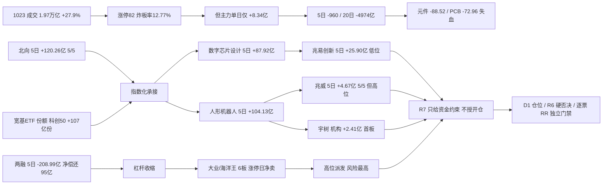

# 2026年10月26日 · **资金面**

> **数据源新鲜度**: partial · **降级状态**: true · **置信度**: 0.74
> **数据归属**: A股资金/龙虎榜/两融/ETF/北向 = 2026-10-23 收盘；美股 = 2026-10-23 收盘
> **staleness**: resolved_trade_date=20261023，是 20261026 之前最近交易日（周一盘前用上周五收盘），按交易日缺口计为 0 → ok。不冒充今日数据，也不判过期。

## 🧭 一句话结论

**1023 是放量修复，不是主升确认。** 主力单日只有 +8.34 亿、5 日仍 -960.29 亿，真增量只有北向与宽基 ETF；进攻资金只认「数字芯片设计 + 人形机器人」两条线，6 板高位股当日反被龙虎榜净卖。

## 📊 详细分析：先认市场，再认资金

**一、放量的成色：宽度极好，钱没跟上。** 1023 全市场成交 `19,728.5 亿`，比 1022 的 `15,418.6 亿` 放大 27.9%；上涨 4,526 家、下跌 909 家（83.3% 上涨），涨停 82 / 跌停 6 / 炸板 12，炸板率从 41.07% 直落到 12.77%，连板高度 6 板。但同日东财主力拆单净额只有 `+8.34 亿`。拉长看：5 日 `-960.29 亿`（4/5 日流出）、10 日 `-2,461.60 亿`（9/10）、20 日 `-4,974.20 亿`（16/20）。**结论：这是空头趋势里的一次集中回补，不是资金趋势反转。**

**二、唯一的真增量是「指数化承接」，不是主动加仓。** 北向 1023 净买 `+31.32 亿`，5 日 `+120.27 亿`（5/5 日净流入）、10 日 `+247.46 亿`、20 日 `+507.09 亿`（源缺 20261019 单日）。ETF 侧 5 个交易日份额净申购：科创50ETF `+107.01 亿份`（+14.95%）、沪深300ETF `+60.47 亿份`（+20.71%）、创业板ETF `+53.69 亿份`（+20.70%）、中证500ETF `+9.20 亿份`（+14.42%）；同期芯片ETF `-1.10 亿份`。两融反向：上证融资余额 `12,373.51 亿`，5 日 `-208.99 亿`，1023 融资买入 829.90 亿、偿还 925.20 亿（净偿还 95.30 亿）。**宽基被申购、行业 ETF 被赎回、杠杆在收缩 —— 典型的被动承接组合，不能当成主动看多。**

**三、科技内部三层分化，只有设计端真转正。** 单日流入前三：半导体 `+68.69 亿`、电子 `+66.52 亿`、数字芯片设计 `+62.46 亿`。切到 5 日立刻分层：数字芯片设计 `+87.92 亿`、消费电子 `+44.30 亿`、消费电子零部件 `+42.97 亿` 为正；半导体 5 日只剩 `+10.96 亿`（单日即 +68.69 亿，意味着前四日合计约 -57.7 亿，是一日回补）；电子 5 日 `-47.38 亿`、元件 `-88.52 亿`、PCB `-72.96 亿`、半导体设备 `-76.52 亿` 继续失血。**同一板块里，设计在吸钱、配套在放血，不能整包看多。**

**四、机器人是第二条独立主线候选，但只是修复。** 概念 5 日：人形机器人 `+104.13 亿`（10 日 +2.38、20 日 -240.35）、减速器 `+48.46 亿`（10 日 +26.61）、传感器 `+59.97 亿`；行业口径机器人 `+23.28 亿`、自动化设备 `+14.23 亿`、电机Ⅲ `+12.60 亿`。龙虎榜同日机器人链：兆威机电 `+2.14 亿`、宇树科技 `+2.11 亿`、埃斯顿 `+1.72 亿`、宁波东力 `+1.25 亿`、襄阳轴承 `+1.22 亿`、鸣志电器 `+0.88 亿`。**资金分散在多只票而不是单票独走，是板块合力特征；但人形机器人概念 20 日仍 -240.35 亿（机器人行业口径 20 日仅 -2.36 亿），属于修复段而非主升段。**

**五、高位股当天就在派发。** 6 板大业股份涨停日主力净额 `-1.71 亿`、龙虎榜 `-5,599 万`、换手 33.42%；6 板海洋王主力 `-1.76 亿`、机构专用 `-1,511 万`、开板 5 次、封单仅 `345 万`。连板高度虽到 6，但两只高度股同日被卖，**说明情绪高度与资金承接已经脱钩，高位接力是本周最大的亏钱路径。**

**六、隔夜美股只修了存储与代工，没修算力。** 半导体篮子（MU/NVDA/AVGO/AMD/TSM）均值 `+0.92%`，但结构分化：MU `+2.46%`、AMD `+1.74%`、TSM `+1.49%`，而 NVDA `-0.59%`、AVGO `-0.48%`；大科技均值 `-0.54%`，指数普跌（SPX -0.52%、IXIC -0.21%、DJI -1.23%）。**映射今日：存储链（兆易/长鑫/粤芯）有温和外部顺风，CPO/光模块（中际旭创）与 AI 应用（天娱数科）仍是逆风。**

## 📈 板块时序资金（亿元）

口径：东财板块主力拆单净额，单位亿元；行业含父子层级（电子 ⊃ 半导体 ⊃ 数字芯片设计），**父子不相加**；496 个行业全量、20 日序列全覆盖。窗口按交易日：5 日 = 1019/1020/1021/1022/1023，10 日 = 1012—1023，20 日 = 0918—1023。

| 板块 | 1023 单日 | 5 日 | 10 日 | 20 日 | 板块涨跌 | 5日方向 |
|---|---:|---:|---:|---:|---:|:--:|
| 半导体 | +68.69 | +10.96 | -115.17 | -580.74 | +3.70% | 🟢 |
| 电子 | +66.52 | -47.38 | -352.20 | -1,384.52 | +2.72% | 🔴 |
| 数字芯片设计 | +62.46 | +87.92 | -43.10 | -267.74 | +5.27% | 🟢 |
| 计算机 | +40.80 | -6.78 | -86.89 | -207.47 | +4.08% | 🔴 |
| 消费电子零部件及组装 | +23.08 | +42.97 | -18.13 | -132.14 | +2.67% | 🟢 |
| 消费电子 | +22.02 | +44.30 | -17.87 | -133.93 | +2.97% | 🟢 |
| 软件开发 | +22.64 | -1.73 | -29.85 | -58.57 | +5.02% | 🔴 |
| 传媒 | +16.20 | -59.32 | -67.73 | -96.50 | +2.64% | 🔴 |
| 机器人 | +10.88 | +23.28 | +18.70 | -2.36 | +3.10% | 🟢 |
| 自动化设备 | +6.12 | +14.23 | -21.91 | -118.34 | +1.80% | 🟢 |
| 电机Ⅱ | +2.17 | +12.60 | +7.95 | +4.25 | +3.36% | 🟢 |
| 集成电路封测 | +4.72 | +12.96 | -9.99 | -60.97 | +1.92% | 🟢 |
| 元件 | -27.75 | -88.52 | -137.03 | -450.30 | +0.14% | 🔴 |
| 印制电路板 | -24.12 | -72.96 | -87.66 | -317.62 | -0.77% | 🔴 |
| 电力设备 | +0.44 | -182.41 | -358.82 | -397.42 | +0.55% | 🔴 |
| 电池 | +11.25 | -113.36 | -230.99 | -164.50 | +1.42% | 🔴 |
| 有色金属 | -7.52 | -91.48 | -225.89 | -351.21 | +0.94% | 🔴 |
| 医药生物 | -17.13 | -88.64 | -162.84 | -207.13 | +1.69% | 🔴 |
| 银行 | -29.91 | -33.18 | -42.34 | -82.71 | -0.54% | 🔴 |

概念 5 日口径（交叉标签，不与行业相加）：人形机器人 `+104.13`、AI眼镜 `+75.51`、智能穿戴 `+73.89`、无线耳机 `+64.76`、传感器 `+59.97`、减速器 `+48.46`、消费电子概念 `+46.10`、汽车芯片 `+45.69`。**消费电子链条（AI眼镜/穿戴/耳机/传感器）资金连续性强于算力链，这是本次最反直觉的一条。**

### 半导体：资金三问
- **大资金意图**：单日 `+68.69 亿`（净流入率 2.69%）、板块 +3.70%，超大单是主要买方；但 5 日只剩 `+10.96 亿`、20 日 `-580.74 亿`，说明这是空头趋势里的第一次集中回补。拆单只能说明大单方向，不能识别机构身份。
- **为什么走强**：位置=20 日深度净流出后的超跌位；催化=存储涨价（隔夜 MU +2.46%）与国产替代；筹码=板块内部分化，设计端先转正，元件/PCB/设备仍在流出。
- **逻辑够不够硬**：只有东财拆单一套底源 + 个股拆单，同源不算双独立共识；硬业绩/订单未在 R7 核验。**态度=观察**。证伪路径：次日板块净额转负且跌破 1023 收盘 → 回补被证伪。

### 数字芯片设计：资金三问
- **大资金意图**：5 日 `+87.92 亿`（唯一持续为正的科技子行业）、单日 `+62.46 亿`、净流入率 4.99%、板块 +5.27%；在父行业半导体 5 日仅 +10.96 亿的背景下，设计端拿走了绝大部分资金 —— 大单在做「设计优先于制造/配套」的结构选择。
- **为什么走强**：位置=10 日仍 -43.10 亿、20 日 -267.74 亿，尚未回到均值上方；催化=存储价格 + 国产算力订单预期；筹码=个股层面兆易创新 5 日 `+25.90 亿`（4/5 日为正），长鑫科技 5 日 `-18.10 亿`，同为存储却相反 —— 板块正流入是少数权重股贡献，不是全面共振。
- **逻辑够不够硬**：板块 5 日转正 + 个股资金持续，两条证据同向但同源；融资余额口径显示兆易 15 日 `-16.9%`、中际旭创 `-24.4%`，杠杆在撤与大单在买形成分歧。**态度=观察**，只做确认后的低吸，不追单日高潮。

### 人形机器人：资金三问
- **大资金意图**：概念 5 日 `+104.13 亿`、单日 `+71.43 亿`，减速器 5 日 `+48.46 亿`、10 日 `+26.61 亿`（少数 10 日仍正的链）；龙虎榜同日 6 只机器人链个股净买合计约 `+9.3 亿`，是当日最集中的板块级合力。
- **为什么走强**：位置=20 日仍 `-240.35 亿`，属深度回撤后的第一波修复；催化=人形机器人量产预期与零部件国产化；筹码=资金分散在减速器/电机/丝杠多条支线，不是单票拉抬。
- **逻辑够不够硬**：板块 5 日与 10 日同向为正、且个股分散，强于「单票独走」形态；但 20 日未转正，且核心票（兆威/宇树）位置已在 20 日区间 100 分位。**态度=观察，只做分歧不追高。**

## 🔎 昨日前十：五日追踪

定义：2026-10-23 全市场主力净流入额前十（东财 moneyflow_dc，单日 6,030 行按代码去重后降序），**不是**龙虎榜前十、不是北向前十、更不是买入名单。五日窗口 2026-10-19 至 2026-10-23，是回溯而非未来收益。

| 昨日排名 | 标的 | 1023 净流入(亿) | 5日累计(亿) | 5日为正 | 5日区间涨跌 | 1023 收盘 | 净流入率 | R7 态度 |
|---:|---|---:|---:|---:|---:|---:|---:|---|
| 1 | 中际旭创 300308.SZ | +16.43 | -14.70 | 2/5 | -8.56% | 612.63 | 5.88% | 降级 |
| 2 | 长鑫科技 688825.SH | +16.12 | -18.10 | 2/5 | -4.82% | 42.85 | 8.14% | 降级 |
| 3 | 宁德时代 300750.SZ | +12.97 | -37.60 | 1/5 | -14.22% | 237.60 | 5.11% | 拦截 |
| 4 | 兆易创新 603986.SH | +12.94 | +25.90 | 4/5 | +3.60% | 292.00 | 10.03% | 观察 |
| 5 | 天娱数科 002354.SZ | +11.48 | +12.11 | 4/5 | +11.37% | 8.03 | 49.68% | 观察 |
| 6 | 粤芯半导-U 301660.SZ | +10.36 | +6.07 | 3/5 | -3.05% | 33.64 | 28.64% | 降级 |
| 7 | 歌尔股份 002241.SZ | +8.00 | +10.43 | 3/5 | +15.96% | 23.11 | 27.82% | 观察 |
| 8 | 东方财富 300059.SZ | +7.73 | -0.72 | 1/5 | +2.60% | 18.55 | 11.14% | 降级 |
| 9 | 寒武纪 688256.SH | +7.12 | +8.48 | 2/5 | +0.40% | 932.20 | 5.68% | 观察 |
| 10 | 利亚德 300296.SZ | +6.25 | +11.83 | 4/5 | +62.67% | 7.32 | 14.81% | 降级 |

三条结论：
① **名次不等于趋势** —— 中际旭创、长鑫科技、宁德时代、东方财富四只昨日大额流入，5 日仍是净流出，属单日反手；
② **持续性是唯一可用的筛子** —— 兆易（4/5）、天娱（4/5）、利亚德（4/5）、歌尔（3/5）、粤芯（3/5）五日为正；
③ **涨幅与资金要分开看** —— 利亚德 5 日 +62.67% 而资金仅 +11.83 亿，是高换手推动、不是大单持续建仓；粤芯 5 日资金 +6.07 亿但区间 -3.05%，是价资背离。

## 🎯 研究核心逐票（research_only，不授开仓）

### 兆易创新 603986.SH · 观察（本次资金侧首推研究标的）

- **大资金意图**：1023 净流入 `+12.94 亿`、净流入率 10.03%（十只里最高）、价格 +5.51%，价资同向；5 日 `+25.90 亿`、4/5 日为正，是十只里唯一「板块 5 日为正 + 个股 5 日为正 + 位置低」三条件同时成立的标的。拆单只反映大单方向，不识别账户身份。
- **为什么走强**：位置=20 日区间 12.2 分位、距 20 日高点 -27.4%，属低位；催化=存储涨价（隔夜 MU +2.46%、TSM +1.49%）+ 国产替代；筹码=融资余额 15 日 -16.9%（160 亿级→144.04 亿），杠杆在撤而大单在买，结构是「杠杆退、大单进」。
- **逻辑够不够硬**：板块（数字芯片设计 5 日 +87.92 亿）与个股（5 日 +25.90 亿）同向，且位置低，是本次最强组合；但两者同属东财拆单同源，不算独立第二源；硬业绩/订单未在 R7 核验。**态度=观察，不给开仓权限。**

| 交易日 | 主力净额(亿) | 收盘 | 当日涨跌 |
|---|---:|---:|---:|
| 2026-10-19 | +5.66 | 282.44 | +0.21% |
| 2026-10-20 | +1.66 | 282.43 | 0.00% |
| 2026-10-21 | +6.89 | 288.02 | +1.98% |
| 2026-10-22 | -1.26 | 276.75 | -3.91% |
| 2026-10-23 | +12.94 | 292.00 | +5.51% |

板型=未知（交 R2）；龙头认定=未通过（R2 未产出主线/梯队）；RR=未知（R7 不生成目标/止损）；禁止清单=未全量核验（≠零命中）。

- **买入理由**（研究假设，非执行指令）：①隔夜存储链外部顺风确认（MU +2.46%、TSM +1.49%），国产替代与资金同向；②5 日 4/5 日净流入、累计 +25.90 亿，持续性成立，1023 净流入率 10.03% 为十只最高；③位置仍在 20 日区间 12 分位，不是追高位置。
- **风险点**：①半导体 20 日仍 -580.74 亿，行业级逆风未反转，单日回补可能一天结束；②融资 15 日 -16.9%，杠杆持续撤离，若次日大单转负会形成「双杀」；③1023 已 +5.51%，短期获利盘集中。
- **止损条件**（研究失效线，不是交易指令）：收盘跌破 `276.75 元`（1022 收盘）或 5 日主力净额转负，任一成立即作废本票资金承接假设。
- **可验证假设**：20261026 大单净额 > 0 且收盘 ≥ `292.00 元` → 承接成立；净额 < 0 且收盘 < `276.75 元` → 证伪；一正一负 → 维持观察不加码。

### 天娱数科 002354.SZ · 观察（涨停 + 龙虎榜第一，但板块无合力）

- **大资金意图**：1023 净流入 `+11.48 亿`、净流入率 49.68%、涨停 +10.00%；龙虎榜净买 `+4.89 亿` 全市场第一，其中机构专用 `+0.67 亿`。资金在买「个股题材」而非传媒板块（板块 5 日 -59.32 亿）。
- **为什么走强**：位置=从 7.30 元（1022 收盘 -7.71%）一日反包到 8.03 元涨停，20 日区间 92.8 分位；催化=AI 应用/传媒题材；筹码=融资余额仅 6.02 亿且 15 日 -1.3%，杠杆没追，推动力来自游资与大单。
- **逻辑够不够硬**：板块资金与个股资金完全相反，是「个股独立行情」的典型形态，持续性取决于次日接力而非板块；单一来源（东财拆单）+ 龙虎榜样本，证据强度中等。**态度=观察，只做分歧，不接一字板。**

| 交易日 | 主力净额(亿) | 收盘 | 当日涨跌 |
|---|---:|---:|---:|
| 2026-10-19 | +0.50 | 7.42 | +2.91% |
| 2026-10-20 | +0.54 | 7.68 | +3.50% |
| 2026-10-21 | +1.20 | 7.91 | +2.99% |
| 2026-10-22 | -1.61 | 7.30 | -7.71% |
| 2026-10-23 | +11.48 | 8.03 | +10.00% |

- **研究假设**：①涨停日龙虎榜净买第一 + 净流入率 49.68%，是十只里资金最集中的一只；②传媒板块被卖而个股逆势涨停，筹码集中度高。
- **风险点**：①涨停后次日承接成本高；②传媒 5 日 -59.32 亿、20 日 -96.50 亿，板块无合力；③游资主导，撤离速度快。
- **研究失效线**：次日跌破 `7.30 元`（反包前收盘）即视为反包失败。

### 兆威机电 003021.SZ · 观察（资金最强，位置最差）

- **大资金意图**：5 日 `+4.67 亿`、**5/5 日全部为正**（本次唯一），龙虎榜净买 `+2.14 亿`、机构专用 `+1.44 亿`；但 1023 单日仅 `+1.47 亿`，是链内资金分散后的其中一份。
- **为什么走强**：减速器/人形机器人主线，2 板；筹码=融资余额 15 日 `+8.3%` 杠杆在追。
- **逻辑够不够硬**：资金持续性最好，但 5 日 +50.11%、20 日区间 100 分位、开板 5 次 —— **强资金 + 高位置的组合，只能等分歧不能追**。态度=观察（不追高）。

### 宇树科技-W 688836.SH · 观察（容量核心，价格门槛高）

- **大资金意图**：5 日 `+10.41 亿`（3/5）、1023 `+4.89 亿`，龙虎榜净买 `+2.11 亿`、机构专用 `+2.41 亿`（机构买入高于榜单净买，说明其他席位在卖）；封单 `4.04 亿`，为全部首板最厚。
- **为什么走强**：人形机器人辨识度最高、成交 47.70 亿全组第一；但一手约 6 万元，散户参与门槛高，属机构/大资金配置标的。
- **逻辑够不够硬**：容量与封单质量最好，但 20 日区间 100 分位、5 日 +46.14%，位置已高，且机构与其他席位方向分歧。态度=观察。

### 歌尔股份 002241.SZ · 观察（资金与位置匹配度最好之一）

- **大资金意图**：5 日 `+10.43 亿`（3/5）、1023 `+8.00 亿`，龙虎榜 `+4.51 亿`、机构专用 `+0.22 亿`；消费电子板块 5 日 `+44.30 亿` 有合力。
- **为什么走强**：AI 眼镜/智能穿戴/无线耳机链条资金连续性强（概念 5 日分别 +75.51/+73.89/+64.76 亿）；位置 20 日区间 67.5 分位，不是最高位。
- **逻辑够不够硬**：板块与个股同向、位置中性，是仅次于兆易的组合；但融资 15 日 -0.4% 无杠杆配合，且 5 日资金只有 3/5 日为正。态度=观察。

## ⛔ 拦截与降级清单

| 标的 | 5日主力(亿) | 5日为正 | 区间涨跌 | 关键负面证据 | R7 态度 |
|---|---:|---:|---:|---|---|
| 宁德时代 300750.SZ | -37.60 | 1/5 | -14.22% | 大宗 30 笔、融资 -19.4%，单日流入无基础 | 拦截 |
| 大业股份 603278.SH | -0.23 | 3/5 | +61.05% | 6 板；龙虎榜 -5,599 万、换手 33.42%、非两融 | 拦截 |
| 海洋王 002724.SZ | -1.17 | 3/5 | +61.18% | 6 板；机构专用 -1,511 万、开板 5 次、封单 345 万 | 拦截 |
| 中际旭创 300308.SZ | -14.70 | 2/5 | -8.56% | 融资 -24.4%、大宗 25 笔卖方全为机构专用 | 降级 |
| 长鑫科技 688825.SH | -18.10 | 2/5 | -4.82% | 大宗 5 笔卖方为中金上海/北京建国门 | 降级 |
| 利亚德 300296.SZ | +11.83 | 4/5 | +62.67% | 机构专用 -6,028 万（榜单净买 +1.76 亿） | 降级 |
| 粤芯半导-U 301660.SZ | +6.07 | 3/5 | -3.05% | 价资背离、换手 47.35%、融资 +29.5% | 降级 |

**执行候选 = 0。** R7 不授予开仓权限、不改预算、不生成止损/目标/买点；上述全部 `research_only=true`、`execution_eligible=false`。

## ⚠️ 龙虎榜诱多识别：只给风险线索，硬否决归 R6

口径：东财 `top_list` 单日事由行（剔除「连续三个交易日」「严重异常期间」累计口径，避免与单日重复计算）+ `top_inst` 机构专用席位按金额去重。1023 上榜 81 只 / 101 条事由，其中单日口径 61 只；vibe 全市场 98 条与之交叉一致。判定规则：价涨/涨停但榜单净卖 ≥1,500 万；净卖率 ≤ -5%；机构专用净卖 ≥1,000 万；换手 ≥30% 且净卖；榜单占成交 ≥60% 且净卖；榜单占成交 >90% 且买卖等额。**命中 28 条（榜单净卖型 25 + 机构净卖型 3）。**

**A. 榜单净卖型（价涨/涨停但榜单选出货）**

| 标的 | 当日涨跌 | 榜单净额(万元) | 机构专用(万元) | 净卖率 | 命中条件 |
|---|---:|---:|---:|---:|---|
| 索辰科技 688507.SH | +14.01% | -30,284 | 0 | -12.77% | 价涨但净卖≥1500万、净卖率≤-5% |
| 风语筑 603466.SH | +10.04% | -12,684 | 0 | -9.47% | 价涨但净卖≥1500万、净卖率≤-5% |
| 沈鼓集团 601091.SH | -4.59% | -11,872 | 0 | -7.05% | 净卖率≤-5%、换手≥30% |
| 冰山冷热 000530.SZ | +0.42% | -10,106 | -3,701 | -4.79% | 价涨但净卖、机构净卖≥1000万 |
| 百洋股份 002696.SZ | +4.49% | -6,164 | -4,089 | -5.09% | 价涨但净卖、机构净卖、换手≥30% |
| **大业股份 603278.SH** | **+9.99%** | **-5,599** | 0 | -3.37% | 6 板涨停但净卖、换手 33.42% |
| 华依科技 688071.SH | +20.00% | -4,422 | -1,937 | -6.29% | 20% 涨停但净卖、机构净卖 |
| 晶丰明源 688368.SH | +20.00% | -4,118 | -5,001 | -3.95% | 20% 涨停但净卖、机构净卖 |
| **海洋王 002724.SZ** | **+9.99%** | **-1,555** | **-1,511** | -0.90% | 6 板涨停但净卖、机构净卖 |
| 凡拓数创 301313.SZ | +20.00% | -1,506 | -13,096 | -0.90% | 20% 涨停、机构专用净卖 1.31 亿 |

**B. 机构净卖型（榜单整体净买，机构专用在卖 ——「机构出、游资接」）**

| 标的 | 当日涨跌 | 榜单净额(万元) | 机构专用(万元) | 净买率 | 命中条件 |
|---|---:|---:|---:|---:|---|
| 利亚德 300296.SZ | +20.00% | +17,573 | -6,028 | 4.16% | 机构专用净卖≥1000万 |
| 慈文传媒 002343.SZ | +10.00% | +1,295 | -4,390 | 0.61% | 机构专用净卖≥1000万 |
| 平安电工 001359.SZ | +10.00% | +6,306 | -1,077 | 20.03% | 机构专用净卖≥1000万 |

- **大资金意图**：索辰科技净卖率 -12.77%、凡拓数创机构专用净卖 1.31 亿，说明涨停/大涨当日有专业资金在派发；但席位只是样本，不能推出「全部机构在撤」。
- **为什么走强**：多数标的是情绪推动（10%/20% 涨停），与资金方向相反；凡拓、华依、晶丰均为 20% 涨停 + 机构净卖 + 高换手，是「拉高派发」的高风险组合。
- **逻辑够不够硬**：只有龙虎榜一源，缺封单/分时/公告交叉，只能作为风险线索提交 R6。**本 skill 不授予 hard_reject（`no_hard_reject_issued=true`）。** 对已持有上述标的的场景，这些记录是减仓/降级的依据，不是买入依据。

协同观察：3 日内同一营业部 ≥2 次上榜同一票共 156 组。最活跃席位为开源证券西安西大街（40 只、净买 +12.57 亿）、东方财富拉萨金融城（40 只、+0.76 亿）、高盛上海世纪大道（39 只、+2.57 亿）、中金上海分公司（27 只、+3.11 亿）。高协同样本：利亚德 + 国泰海通上海长宁江苏路 3 日 `+2.03 亿`；海洋王 + 华泰深圳彩田路 2 日 `+1.60 亿`（同一票另有 2 个席位同期净卖 9,919 万 / 6,100 万，典型对倒分歧）；金健米业 + 国泰海通上海分公司 3 日 `-1.48 亿`（持续卖出）。

## 🌎 外部传导：隔夜美股核心个股

数据：`data/raw/20261026/overseas_snapshot.json`（本次已产出，us_stocks 状态 ok，12/12 覆盖；indices 状态 degraded；fx degraded）。

| 标的 | 2026-10-23 收盘(美元) | 涨跌 |
|---|---:|---:|
| MU | 877.55 | +2.46% |
| AMD | 516.79 | +1.74% |
| TSM | 418.51 | +1.49% |
| MSFT | 524.51 | +0.66% |
| AAPL | 347.73 | -0.14% |
| GLW | 123.69 | -0.24% |
| AVGO | 321.68 | -0.48% |
| NVDA | 210.96 | -0.59% |
| TSLA | 372.22 | -0.63% |
| AMZN | 248.00 | -0.95% |
| META | 642.62 | -0.96% |
| GOOGL | 320.21 | -1.24% |

| 指数 | 收盘 | 涨跌 |
|---|---:|---:|
| 标普500 SPX | 7,623.68 | -0.52% |
| 纳斯达克 IXIC | 25,955.34 | -0.21% |
| 道指 DJI | 52,215.16 | -1.23% |
| 恒生指数 HSI | 23,093.37 | +0.69% |
| 韩国 KS11 | 5,550.30 | +0.30% |

- **大资金意图**：半导体篮子（MU/NVDA/AVGO/AMD/TSM）均值 `+0.92%`，但只有存储与代工在涨（MU +2.46、TSM +1.49、AMD +1.74），算力龙头仍在被卖（NVDA -0.59、AVGO -0.48）；大科技均值 `-0.54%`，指数普跌。**是跌深反弹 + 结构切换，不是风险偏好回升。**
- **为什么走强**：MU 的强势来自存储价格预期，属于产业价格逻辑；NVDA/AVGO 走弱反映算力订单预期未改善。
- **逻辑够不够硬**：只有 tushare 一套美股日线、无 SOX 原指数、无期权隐波；传导只能到「方向参考」，不能到「幅度预测」。

传导映射：存储链（兆易/长鑫/粤芯）**外部顺风**；代工/设备（TSM）**弱顺风**；AI 算力/CPO（中际旭创）**中性偏压制**；AI 应用/传媒（天娱数科）受 GOOGL -1.24%、META -0.96% **压制**。**不能用半导体篮子转正给科技链整体开绿灯。**

## 🧺 ETF、两融与期货

**ETF 五日份额净申购（2026-10-19 → 2026-10-23，亿份）**

| ETF | 净申购份额 | 份额变动 | 最新份额 |
|---|---:|---:|---:|
| 科创50ETF华夏 588000.SH | +107.01 | +14.95% | 822.93 |
| 沪深300ETF华泰柏瑞 510300.SH | +60.47 | +20.71% | 352.43 |
| 创业板ETF易方达 159915.SZ | +53.69 | +20.70% | 313.05 |
| 中证500ETF南方 510500.SH | +9.20 | +14.42% | 73.01 |
| 半导体ETF国联安 512480.SH | +2.92 | +1.39% | 213.74 |
| 芯片ETF国泰 512760.SH | -1.10 | -1.07% | 101.93 |

宽基被大额申购、行业 ETF 份额几乎不动甚至赎回 —— **指数化承接，不是行业加仓**；份额不等于金额，不能与主力净额相加。

**两融（2026-10-23，上证口径）**：融资余额 `12,373.51 亿`，融资买入 829.90 亿、偿还 925.20 亿（净偿还 95.30 亿），融券余额 185.69 亿，两融余额 12,559.20 亿；上证融资余额 5 日 `-208.99 亿`。深市当日未返回，不做沪深合计、不与 20 日合计序列混算（20 日序列在 1023 发生口径断点）。

**期货与期权**：盘前无 IF/IC/IM 实时盘口，期现基差 `unavailable`；50ETF/300ETF 隐波无合规同源，`unavailable`。这两项不参与结论，也不以昨收价差冒充基差。

## 🔁 跷跷板与时序边界

275 个显著行业（|20 日净额|>5 亿）、37,675 个配对、20 个交易日净额相关：**corr ≤ -0.6 共 15 对，其中同时满足 5 日方向反转的只有 3 对** —— 垂直应用软件（5 日 -2.65 亿 / 当日 +15.72 亿）vs 其他石化（+0.34 / -1.41），corr -0.688；模拟芯片设计（+5.18 / +4.83）vs 铁路运输（-4.63 / -1.41），corr -0.618；磨具磨料（+0.38 / +0.26）vs 原料药（-6.47 / -1.14），corr -0.603。

边界：这是净额序列的统计负相关 + 单周方向对立，**不是轮动因果**；样本为显著板块而非正交全集，少数命中不能外推为「全市场只有这三组跷跷板」。

## 📌 关键证据

1. **主力单日 +8.34 亿 vs 5 日 -960.29 亿**（`moneyflow_dc`）—— 指数放量大涨而主力未转正，修复不等于主升。
2. **数字芯片设计 5 日 +87.92 亿、半导体 5 日 +10.96 亿、电子 5 日 -47.38 亿**（`moneyflow_ind_dc`）—— 科技内部只有设计端真正转正。
3. **人形机器人 5 日 +104.13 亿 + 减速器 10 日 +26.61 亿**，且龙虎榜 6 只链内个股同日净买 —— 第二条线有板块合力，但 20 日仍 -240.35 亿。
4. **北向 5 日 +120.27 亿（5/5）+ 宽基 ETF 爆量份额（科创50 +107.01 亿份）** —— 唯一的确定性增量，属指数化承接。
5. **诱多线索 28 条**，含 6 板大业股份 -5,599 万、6 板海洋王机构净卖 -1,511 万、凡拓数创机构净卖 -1.31 亿 —— 风险线索，交 R6 独立评价。

## 数据源审计

| 源 | 数据日期 | 状态 | 备注 |
|---|:--:|:--:|---|
| tushare.moneyflow_dc | 2026-10-23 | 🟢 | 30,142 条全市场五日；个股净额单位万元 |
| tushare.moneyflow_ind_dc（行业5日） | 2026-10-23 | 🟢 | 2,480 条 = 496 行业 × 5 日 |
| tushare.moneyflow_ind_dc（20日） | 2026-10-23 | 🟢 | 496 行业 + 501 概念 × 20 日，全覆盖无缺日 |
| tushare.moneyflow_mkt_dc | 2026-10-23 | 🟢 | 20 条大盘主力净额 |
| tushare.moneyflow_hsgt | 2026-10-23 | 🟢 | 32 条；缺 20261019 |
| tushare.top_list | 2026-10-23 | 🟢 | 101 条事由 / 81 只 |
| tushare.top_inst | 2026-10-23 | 🟢 | 1,010 条席位 |
| tushare.limit_list_d | 2026-10-23 | 🟢 | 涨停 82 / 炸板 12 / 跌停 6 |
| tushare.margin（上证） | 2026-10-23 | 🟡 | 仅 SSE 一条，深市未返回 |
| tushare.margin_detail | 2026-10-23 | 🟢 | 10 只候选逐票；大业/海洋王非两融标的 |
| tushare.block_trade | 2026-10-23 | 🟢 | 3 只有记录：中际旭创 25 / 长鑫 5 / 宁德 30 |
| tushare.fund_share | 2026-10-23 | 🟢 | 6 只 ETF × 5 日份额 |
| tushare.daily / daily_basic | 2026-10-23 | 🟢 | 27,842 条行情 / 5,572 条市值换手 |
| overseas_snapshot（us_stocks） | 2026-10-23 | 🟢 | 12 只，状态 ok |
| overseas_snapshot（indices） | 2026-10-23 | 🟡 | 状态 degraded；SOX 不可得 |
| overseas_snapshot（fx） | 2026-10-24 | 🟡 | 单点 USDCNH 6.66807，未验证交易日，不入结论 |
| vibe.get_dragon_tiger | 2026-10-23 | 🟢 | 98 条，与 tushare 去重后一致 |
| vibe.get_block_trades | 2026-10-23 | 🟢 | 抽样 300308(25)/688825(5)，逐笔与 tushare 一致 |
| vibe.get_margin_trading | 2026-10-23 | 🟢 | 300308/603986 各 15 行与 tushare 一致 |
| vibe.get_fund_flow | — | 🔴 | 代理断开 + TUSHARE_TOKEN 未配置；走 tushare 主路 |

## 🧯 不确定性 / 反证

- **单日修复可能一天结束**：1023 是暴力反弹（创业板 +4.16%），但 4-5 板真空、2 板层薄（仅 9 只）。若 20261026 炸板率回升 >30% 或涨停 <50 家，资金侧应立即降维到极小试仓/空仓。
- **ETF 份额 ≠ 净买入**：宽基份额申购可能是做市、套利或被动申赎，不能当主动看多；本报告不与主力净额相加。
- **北向口径限制**：缺 20261019 单日；不与 ETF 申赎、龙虎榜股通席位相加。
- **两融口径断点**：margin_market_20d 序列在 1023 只剩上证，若直接算 5 日变动会得出 -12,223 亿的假数；本报告仅用 SSE 同口径（-208.99 亿）。
- **龙虎榜不是操纵证据**：席位样本只说明特定营业部行为，「机构专用」不能当成同一家机构；累计口径与单日口径不可混用（海洋王单日 -1,555 万、三日累计 +7,933 万）。
- **覆盖缺口**：R2 主线/龙头未产出（20261026 无 R2 文件），本报告不认定任何票为龙头；期现基差、隐波、vibe 实时分单不可得；美股只有 tushare 单源。
- **自我反证**：若 20261026 出现「半导体/数字芯片设计净额转负 + 跌破 1023 收盘」，则「设计端先转正」的核心判断被证伪；若人形机器人链净额转负且兆威/宇树开板，则第二条线回到观察池外。

## 🔗 与其他 R/D/E 的关系

- **依赖（上游）**：`data/raw/20261026/manifest.json`（global_severity=2）、`data/raw/20261026/overseas_snapshot.json`、`data/research/20261026/emotion_cycle.json`（main_up 0.45）、`data/research/20261026/_r7_data/*`（tushare 全量 + vibe 抽样）。
- **被消费（下游）**：R2（板块资金约束，不替它排序/定主线）、R5（逐票资金/大宗/两融事实）、R6（诱多线索与结构缺口，由它出 hard_reject）、D1（资金约束与仓位衰减输入）、E1（复盘回填 T+0/T+1 资金验证）。
- **权限边界**：R7 不授予开仓权限、不改预算、不生成止损价与买卖点；12 只候选全部 `research_only=true`、`execution_eligible=false`，`execution_candidates` 为空。

## Sub-Agent 元数据

- skill: `analyze_capital_flow_v1` v1.3
- artifact: `data/research/20261026/R7_capital_flow_20261026.json`（同目录 `R7_capital_flow.json` 软链指向当日）
- 子能力: `hot_money_synergy_v1`（协同 156 组，其中 3 日重复 33 组）、`detect_seesaw_pairs_v1`（15 对 corr≤-0.6，3 对方向反转）
- 覆盖: 行业 496（单日+20日）/ 概念 501、个股 30,142 条（五日）、龙虎榜 81 只（单日口径 61 只）、诱多线索 28 条、ETF 6 只、美股 12 只 + 5 指数
- batch: `premarket_full` · staleness: ok（交易日缺口 0）· model: ark-code-latest
