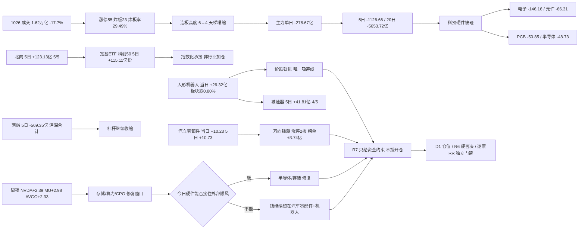

# 2026年10月27日 · **资金面**

> **数据源新鲜度**: partial · **降级状态**: true · **置信度**: 0.74
> **数据归属**: A股资金/板块/龙虎榜/涨停/ETF/北向 = 2026-10-26 收盘；两融 = 2026-10-23 收盘；美股 = 2026-10-26 美股收盘
> **staleness**: resolved_trade_date=20261026，是 20261027 之前最近交易日（T-1），按交易日缺口计为 0 → ok。不冒充今日数据，也不判过期。

## 🧭 一句话结论

**1026 是放量一天后的缩量分化，不是主升第二日。** 成交 1.62 万亿（-17.7%）、涨 2,252 / 跌 3,157、炸板率 12.77%→29.49%、连板高度 6→4；主力单日 -278.67 亿、5 日 -1,126.66 亿。钱没加仓，在换方向：科技硬件被砸（电子 -146.16 / 元件 -66.31 / PCB -50.85 / 半导体 -48.73），资金转向**汽车零部件 + 机器人 + 红利 + 医药服务**。

## 📊 详细分析：先认市场，再认资金

**一、宽度掉得比指数快，这就是分歧的样子。** 1026 上证 +0.19%、深成 -1.19%，但个股是 **2,252 涨 / 3,157 跌**（1023 是 4,526 涨 / 909 跌）。成交 `16,230.9 亿`，比 1023 的 `19,728.5 亿` 缩 17.7%。涨停从 82 掉到 55，炸板从 12 抬到 23（炸板率 `29.49%`），跌停从 6 抬到 26，连板天梯从「6 板 2 只」塌成「4 板 1 只 / 3 板 6 只 / 2 板 8 只 / 1 板 40 只」。唯一还站得住的是赚钱效应：1023 涨停的 82 只票在 1026 平均 `+2.66%`、中位 `+2.38%`、开盘溢价 `+3.04%` —— **接力没断，但高度断了；这是"能打首板、不能接高位"的一天，不是主升。**

**二、主力在净卖，且是四天连续的净卖。** 东财主力单日 `-278.67 亿`（净流出率 -1.73%），5 日 `-1,126.66 亿`（4/5 日流出）、10 日 `-2,386.48 亿`（9/10）、20 日 `-5,653.72 亿`（17/20）。1023 的 +2.80 亿不是拐点，只是空头趋势里的一次回补 —— 次日就被 -278.67 亿反向吞掉。

**三、真正的变化是结构切换，不是总量。** 单日流出前五全是硬件：电子 `-146.16`、元件 `-66.31`、PCB `-50.85`、半导体 `-48.73`、通信设备 `-45.53`；单日流入前五全是「补涨/防御/服务」：汽车 `+11.60`、汽车零部件 `+10.23`、数字芯片设计 `+9.90`、医疗服务 `+7.85`、游戏 `+7.66`。切到 5 日：数字芯片设计 `+81.26`（4/5）、消费电子 `+29.26`、机器人 `+18.18`、机械设备 `+19.86`、汽车零部件 `+10.73` 还算正；电力设备 `-177.00`、电子 `-174.15`、元件 `-137.90`、通信 `-130.62`、PCB `-113.77` 持续失血。**结论：设计端（设计/存储/MCU）和机器人/汽车零部件在吸钱，制造配套（元件/PCB/设备/通信）在放血，不能整包看多"科技"。**

**四、机器人是唯一"跌势里吸筹"的线。** 人形机器人概念 1026 单日 `+26.32 亿`，而板块当天下跌 0.80% —— 价跌钱进，是全市场最反直觉的一条；5 日 `+105.72 亿`（3/5）、减速器 5 日 `+41.81 亿`（4/5）、机器人行业 5 日 `+18.18 亿` 且 10 日转为 `+22.34 亿`（少数 10 日转正的链）、20 日仅 `-0.59 亿`（几乎回到均值）。个股侧：绿的谐波 5 日 `+7.03 亿`（4/5）、兆威机电 `+3.06 亿`（4/5）、埃斯顿 `+2.89 亿`（4/5）、鸣志电器 `+4.27 亿`（3/5）。**资金分散在减速器/电机/执行器多条支线而非单票独走，是板块合力特征；但连板高度已塌，只能做分歧不能追高。**

**五、汽车零部件+汽车是 1026 的新钱，且有龙虎榜背书。** 汽车零部件 5 日 `+10.73 亿`（3/5）、10 日 `+2.57 亿`（已转正）、1026 单日 `+10.23 亿`；底盘与发动机系统 5 日 `+12.80 亿`（4/5）。1026 涨停 55 只里汽车零部件 6 只 + 专用设备 6 只 + 通用设备 5 只 = 17 只，是涨停最密集的方向。最强单票万向钱潮：涨停 2 板、主力 `+5.90 亿`、龙虎榜净买 `+3.74 亿`（全市场第一）、机构专用 `+0.85 亿`、封单 `1.42 亿`、换手仅 6.0%。隔夜 TSLA `+5.21%` 同向。**但 5 日已 +28.25%、位置 20 日区间 100 分位 —— 资金强度与位置风险同时到顶。**

**六、隔夜美股硬件强、应用弱，与 A 股方向相反，这是今日唯一待验证的修复变量。** 半导体篮子扩到 5 只（MU/NVDA/AVGO/AMD/TSM）平均 `+2.38%`、**5/5 齐涨**：MU `+2.98%`（903.70）、AMD `+2.80%`（531.28）、NVDA `+2.39%`（216.00）、AVGO `+2.33%`（329.17）、TSM `+1.40%`（424.37）；指数 SPX `+0.70%`、IXIC `+0.82%`、DJI `+0.28%`。但大科技内部撕裂：META `-1.88%`、AAPL `-1.10%`、GOOGL `-1.06%` 对 TSLA `+5.21%`。而 A 股 1026 恰恰在卖半导体（-48.73 亿）、元件（-66.31 亿）、PCB（-50.85 亿）。**外强内弱到了极致：要么今日 A 股硬件补修复，要么说明国内资金已经选了另一条路（汽车零部件/机器人/红利）—— 两者不能同时成立，这是今天最重要的观察点。**

## 📉 主力与北向：20 日时序（统一表）

主力净额 20 日全序列，北向按同一交易日窗口对齐（**20261019 北向缺数，留空不补**）；宽度与涨停结构只有 1023、1026 两天有全市场口径（其余日期不臆造）。

| 交易日 | 主力净额(亿) | 北向(亿) | 成交(亿) | 涨/跌 | 涨停/炸板/跌停 |
|---|---:|---:|---:|---|---|
| 20260921 | +86.38 | 28.39 | — | — | — |
| 20260922 | -312.16 | 29.11 | — | — | — |
| 20260923 | -394.84 | 23.65 | — | — | — |
| 20260924 | -652.15 | 23.25 | — | — | — |
| 20260928 | -914.00 | 26.05 | — | — | — |
| 20260929 | +65.24 | 21.29 | — | — | — |
| 20260930 | -136.28 | 20.79 | — | — | — |
| 20261008 | -480.37 | 27.72 | — | — | — |
| 20261009 | -174.75 | 29.67 | — | — | — |
| 20261012 | -354.31 | 24.80 | — | — | — |
| 20261013 | -91.40 | 26.19 | — | — | — |
| 20261014 | -367.55 | 20.55 | — | — | — |
| 20261015 | -635.31 | 25.98 | — | — | — |
| 20261016 | -49.36 | 22.53 | — | — | — |
| 20261019 | -116.21 | 缺数 | — | — | — |
| 20261020 | -130.43 | 20.95 | — | — | — |
| 20261021 | -87.84 | 22.21 | — | — | — |
| 20261022 | -632.52 | 23.26 | — | — | — |
| 20261023 | +2.80 | 31.32 | 19728.5 | 4526/909 | 82/12/6 |
| 20261026 | -278.67 | 25.39 | 16230.9 | 2252/3157 | 55/23/26 |

三个读法：① **主力 20 日 17 天净流出、累计 -5,653.72 亿**，1023 的 +2.80 亿是唯一的正值之一，次日即被 -278.67 亿吞掉；② **北向 20 日 19/19 全为正**（单日区间 +20.55 ~ +31.32 亿），与主力方向持续相反，是「被动+外资接、内资主力卖」的结构；③ 1026 成交从 19,728.5 亿缩到 16,230.9 亿（-17.7%）、涨跌家数由 4,526/909 反转成 2,252/3,157 —— **缩量分化的定义就是「钱少了、宽度塌了、但指数没崩」。**

## 📈 板块时序资金（亿元）

口径：东财板块主力拆单净额，单位亿元；行业含父子层级（电子 ⊃ 半导体 ⊃ 数字芯片设计），**父子不相加**；496 个行业全量、20 个交易日序列全覆盖。窗口按交易日：5 日 = 1020/1021/1022/1023/1026，10 日 = 1013—1026，20 日 = 0921—1026。

| 板块 | 1026 单日 | 5 日 | 10 日 | 20 日 | 板块涨跌 | 5日为正 |
|---|---:|---:|---:|---:|---:|:--:|
| 汽车零部件 | +10.23 | +10.73 | +2.57 | -20.01 | -0.43% | 3/5 |
| 底盘与发动机系统 | +7.13 | +12.80 | +5.38 | -19.86 | -0.58% | 4/5 |
| 数字芯片设计 | +9.90 | +81.26 | -8.23 | -333.18 | -2.80% | 4/5 |
| 机器人 | +2.78 | +18.18 | +22.34 | -0.59 | -0.47% | 4/5 |
| 机械设备 | +1.85 | +19.86 | -55.11 | -349.50 | -1.22% | 4/5 |
| 自动化设备 | +4.56 | +11.96 | -5.89 | -126.39 | -1.26% | 3/5 |
| 消费电子 | -8.91 | +29.26 | -9.15 | -161.88 | -1.58% | 3/5 |
| 消费电子零部件及组装 | -8.99 | +27.91 | -10.07 | -160.08 | -1.55% | 3/5 |
| 个护用品 | +4.30 | +20.12 | +33.03 | +58.97 | +0.47% | 5/5 |
| 生活用纸 | +4.32 | +20.05 | +32.49 | +58.48 | +0.37% | 5/5 |
| 白酒Ⅱ | +1.91 | +2.31 | +21.82 | +19.12 | +2.41% | 3/5 |
| 医疗服务 | +7.85 | -5.35 | -34.18 | -65.28 | -0.16% | 2/5 |
| 游戏Ⅱ | +7.66 | -8.12 | -19.02 | -33.75 | +3.26% | 1/5 |
| 半导体 | -48.73 | -44.45 | -140.97 | -811.68 | -3.79% | 2/5 |
| 元件 | -66.31 | -137.90 | -163.11 | -478.54 | -5.71% | 2/5 |
| 印制电路板 | -50.85 | -113.77 | -111.19 | -327.31 | -6.43% | 2/5 |
| 通信设备 | -45.53 | -124.22 | -242.88 | -822.62 | -2.52% | 2/5 |
| 电力设备 | -24.96 | -177.00 | -380.94 | -455.50 | -1.24% | 1/5 |
| 电池 | -0.29 | -93.88 | -216.61 | -165.65 | -0.35% | 1/5 |
| 有色金属 | -35.18 | -120.34 | -223.28 | -409.42 | -1.89% | 0/5 |
| 电子 | -146.16 | -174.15 | -397.34 | -1729.23 | -3.25% | 3/5 |

概念 5 日口径（交叉标签，不与行业相加）：人形机器人 `+105.72`（3/5）、无线耳机 `+46.05`、减速器 `+41.81`（4/5）、虚拟现实 `+40.77`、AI芯片 `+37.79`（4/5）、AI眼镜 `+35.03`、混合现实 `+34.19`、传感器 `+32.27`、机器人执行器 `+21.04`（4/5）。**机器人 + 消费电子（眼镜/穿戴/耳机/XR）是两条还在吸钱的线；"融资融券 -1,068.57 / MSCI中国 -828.18 / 大盘股 -666.09"这类资金属性标签是宽基与杠杆口径，不代表单一主题转弱，不可当行业结论。**

### 汽车零部件：资金三问
- **大资金意图**：1026 单日 `+10.23 亿`、5 日 `+10.73 亿`（3/5）、10 日 `+2.57 亿`（已转正），是极少数「当日正 + 5 日正 + 10 日正」的行业；同日涨停 6 只。但板块当日仍跌 0.43% —— **钱在进、指数在跌，是分歧式吸筹**。
- **为什么走强**：位置=20 日仍 `-20.01 亿`，属回撤后修复；催化=隔夜 TSLA `+5.21%`、机器人执行器/丝杠链条与汽车零部件高度重叠；筹码=万向钱潮（榜单 +3.74 亿、封单 1.42 亿）+ 模塑科技（榜单 +0.52 亿、机构 +0.94 亿）+ 襄阳轴承/正裕工业 3 板，头部与补涨同时有资金。
- **逻辑够不够硬**：板块、涨停结构、龙虎榜三处证据同向，但全部来自东财体系（拆单+榜单同源），不算独立第二源；硬订单/业绩未在 R7 核验。**态度=观察。**

### 机器人：资金三问
- **大资金意图**：概念 5 日 `+105.72 亿`、10 日转正 `+22.34 亿`（行业口径）、20 日只剩 `-0.59 亿`；1026 板块 -0.80% 却单日 `+26.32 亿`，是价跌钱进。个股分散：绿的谐波 +7.03、鸣志 +4.27、兆威 +3.06、埃斯顿 +2.89（均 4/5 或 3/5）。
- **为什么走强**：位置=大部分链内标的 20 日区间 70-96 分位，位置并不低；催化=量产预期与执行器/减速器国产化；筹码=资金分布在减速器、电机、丝杠、灵巧手多条支线，不是单票拉抬（这是板块合力，也是次日分歧的来源）。
- **逻辑够不够硬**：5 日与 10 日同向为正、个股分散，是本次证据链最完整的一条；但位置高（兆威 95.5 分位、5 日 +43.2%），且宇树科技 1026 榜单 -2.60 亿（机构 +2.49 亿、高盛 -1.25 亿）说明大资金内部已在打架。**态度=观察，只做分歧不追高。**

### 数字芯片设计：资金三问
- **大资金意图**：5 日 `+81.26 亿`（全行业第一，4/5）、1026 单日 `+9.90 亿`（板块 -2.80% 仍净流入），但父行业半导体 5 日 `-44.45 亿`、电子 `-174.15 亿` —— **设计端在从制造/配套手里抢钱**。
- **为什么走强**：位置=10 日 -8.23、20 日 -333.18，仍在均值下方；催化=隔夜 MU `+2.98%`/NVDA `+2.39%`/AVGO `+2.33%` 三只齐涨；筹码=兆易 5 日 +11.68（位置 5.6 分位）、寒武纪 +13.52、瑞芯微 +8.44、沐曦 +9.12、海光 +7.42，头部集中而非全面开花。
- **逻辑够不够硬**：板块 5 日 + 个股 5 日 + 隔夜外部三处同向，是本次最强组合；但同属东财拆单口径，且 1026 板块跌 2.80% 说明抛压仍在。**态度=观察，等外部顺风被 A 股资金接住再谈，不预判。**

## 🔎 昨日前十：五日追踪

定义：2026-10-26 全市场主力净流入额前十（东财 `moneyflow_dc`，单日 6,030 行按代码去重后降序），**不是**龙虎榜前十、不是北向前十、更不是买入名单。资金侧五日窗口 = 2026-10-20 至 2026-10-26（5 个交易日）；**区间涨跌基期 = 2026-10-19 收盘（T-5）**，两者不同源不可互相替代。这是回溯而非未来收益。

| 昨日排名 | 标的 | 1026 净流入(亿) | 5日累计(亿) | 5日为正 | 5日区间涨跌 | 1026 收盘 | 净流入率 | R7 态度 |
|---:|---|---:|---:|---:|---:|---:|---:|---|
| 1 | 寒武纪 688256.SH | +13.02 | +13.52 | 2/5 | +4.25% | 968.00 | 9.70% | 观察 |
| 2 | 胜宏科技 300476.SZ | +7.25 | +7.07 | 3/5 | +6.31% | 188.01 | 12.35% | 降级 |
| 3 | 长鑫科技 688825.SH | +6.60 | +3.38 | 3/5 | +2.75% | 42.66 | 4.77% | 降级 |
| 4 | 万向钱潮 000559.SZ | +5.90 | +9.36 | 4/5 | +28.25% | 12.71 | 23.51% | 观察 |
| 5 | 百亚股份 003006.SZ | +4.40 | +20.39 | 5/5 | -6.93% | 22.71 | 37.80% | 降级 |
| 6 | 沐曦股份-U 688802.SH | +3.77 | +9.12 | 4/5 | +16.65% | 499.99 | 13.43% | 降级 |
| 7 | 中国石油 601857.SH | +3.70 | +3.10 | 2/5 | +5.35% | 13.38 | 12.55% | 降级 |
| 8 | 模塑科技 000700.SZ | +2.70 | +5.26 | 4/5 | +25.07% | 13.07 | 17.65% | 降级 |
| 9 | 瑞芯微 603893.SH | +2.65 | +8.44 | 3/5 | +22.32% | 210.20 | 6.75% | 降级 |
| 10 | 亿纬锂能 300014.SZ | +2.57 | -3.61 | 2/5 | +4.82% | 47.21 | 7.43% | 拦截 |

三条结论：
① **名次≠趋势** —— 十只里 5 日为负的只有亿纬锂能，说明这次前十的成色比 1023 那次好（1023 前十有 4 只 5 日为负）；但 2/5 日为正的有寒武纪、中国石油、亿纬三只，单日集中度仍高。
② **价资背离要单独拎出来** —— 百亚股份 5 日 `+20.39 亿`、**5/5 日全正**（全市场唯一），股价却 5 日 -6.93%、1026 再跌 4.18%：钱在接、价在跌，是承接盘还是套牢盘无法从拆单区分，只能降级。反过来万向钱潮 5 日 +9.36 亿配 +28.25% 涨幅，是价资同向但位置到顶。
③ **持续性比强度值钱** —— 4/5 日的万向钱潮、沐曦、模塑是真持续；寒武纪 +13.52 亿里 1026 一天占 13.02 亿（96%），是典型一日集中回补，不能当趋势。

## 🎯 研究核心逐票（research_only，不授开仓）

### 绿的谐波 688017.SH · 观察（本次资金侧首推研究标的）

- **大资金意图**：5 日主力 `+7.03 亿`、**4/5 日为正**，在全候选里连续性最好；1026 在板块下跌 0.80%、半导体/电子被砸的环境里仍收 +1.03% 且主力继续净流入 `+1.73 亿`。减速器概念 5 日 `+41.81 亿`（4/5）、机器人执行器 `+21.04 亿`（4/5）、人形机器人 5 日 `+105.72 亿` —— 板块与个股同向。拆单只反映大单方向，不识别账户身份。
- **为什么走强**：位置=20 日区间 71.5 分位、距 20 日高点 -8.09%（涨了但没到顶）；催化=人形机器人量产预期 + 执行器/减速器国产化，隔夜 TSLA `+5.21%` 同向；筹码=融资余额 20.60 亿、15 日 `-8.9%`（杠杆没追，也没爆），无大宗、无龙虎榜（缺席位证据，中性偏保守）。
- **逻辑够不够硬**：行业机器人 5 日 +18.18 亿 / 10 日 +22.34 亿（转正）/ 20 日 -0.59 亿（回到均值），三条时间尺度同时不拖后腿；个股 4/5 日净流入且位置未到顶，是本次「板块+个股+位置」三项都不难看的组合。反面：机器人链已连续 5 日吸金，次日易出分歧；板块与个股同属东财拆单同源，不算独立第二源。**态度=观察，不给开仓权限。**

| 交易日 | 主力净额(亿) | 收盘 | 当日涨跌 |
|---|---:|---:|---:|
| 2026-10-20 | +3.70 | 268.25 | +7.09% |
| 2026-10-21 | -0.55 | 257.68 | -3.94% |
| 2026-10-22 | +0.42 | 258.82 | +0.44% |
| 2026-10-23 | +1.73 | 290.00 | +12.05% |
| 2026-10-26 | +1.73 | 293.00 | +1.03% |

板型=未知（交 R2）；龙头认定=未通过（R2 未产出主线/梯队）；RR=未知（R7 不生成目标/止损）；禁止清单=未全量核验（≠零命中）。

- **买入理由**（研究假设，非执行指令）：①4/5 日净流入 + 板块三条时间尺度同向，是本次资金连续性最好的组合；②1026 板块跌 0.80%、半导体 -48.73 亿的日子它逆势收红且资金继续进，抗跌来自资金不是缩量；③位置 71.5 分位、距高点 -8.09%，比万向钱潮（100 分位）、兆威（95.5 分位）有安全垫。
- **风险点**：①机器人链已 5 日连续吸金，1026 +26.32 亿是单日高点，次日易出分歧甚至一日退潮；②1023 单日 +12.05% 留下获利盘，293.00 元是短期成本密集区；③融资 15 日 -8.9%，杠杆没参与，一旦游资撤出缺乏承接缓冲。
- **止损条件**（研究失效线，不是交易指令）：收盘跌破 `268.25 元`（1020 收盘，也是本轮启动位）或 5 日主力净额转负，任一成立即作废本票资金承接假设。
- **可验证假设**：20261027 主力净额 > 0 且收盘 ≥ `290.00 元` → 承接成立；净额 < 0 且收盘 < `268.25 元` → 证伪；一正一负 → 维持观察不加码。

### 万向钱潮 000559.SZ · 观察（全市场最强单票，位置也最贵）

- **大资金意图**：1026 主力 `+5.90 亿`、5 日 `+9.36 亿`（4/5）、2 板涨停；龙虎榜净买 `+3.74 亿` 全市场第一、机构专用 `+0.85 亿`、封单 `1.42 亿`、换手仅 6.00%、净流入率 23.51%。**这是本次唯一「主力榜 + 龙虎榜 + 封单 + 换手克制」四项同向的票。**
- **为什么走强**：板块=汽车零部件 5 日 +10.73 亿、10 日转正 +2.57 亿、1026 涨停 6 只；催化=隔夜 TSLA `+5.21%` + 机器人执行器/丝杠链条重叠；筹码=4/5 日净流入，融资余额 7.98 亿、15 日 -0.1%（无杠杆泡沫，也没杠杆助推）。
- **逻辑够不够硬**：板块合力 + 榜单机构买入 + 换手克制，证据链最完整；但 5 日已 `+28.25%`、位置 20 日区间 **100 分位**、距 20 日高点 0%，**强资金 + 满位置 = 只能等分歧，追高即接最后一棒**。态度=观察（不追高）。

### 寒武纪 688256.SH · 观察（资金第一，但一天占九成六）

- **大资金意图**：1026 主力 `+13.02 亿`（全市场第一）、净流入率 9.70%；5 日 `+13.52 亿` 但仅 2/5 日为正 —— 1026 单日占 5 日总量的 96%，是**一日集中回补**。融资 15 日 -15.9%，杠杆在撤而大单在进；大宗 6 笔 0.41 亿。
- **为什么走强**：AI 芯片概念 5 日 `+37.79 亿`（4/5）、数字芯片设计 5 日 `+81.26 亿`；位置 20 日 43.1 分位（中位，不贵也不便宜）；1026 +3.84% 收 968.00 元。
- **逻辑够不够硬**：资金强度第一但持续性只有 2/5，成交 134.24 亿（换手 2.26%）是巨量，单日拉抬痕迹明显；未上龙虎榜、无席位证据。态度=观察（只做回踩确认，不追单日高潮）。

### 兆易创新 603986.SH · 观察（位置最低，但 1026 资金在撤）

- **大资金意图**：5 日 `+11.68 亿`（3/5）看着不错，但拆开看是 **1023 单日 +12.94 亿撑起来的**；1026 股价 -5.33% 同时主力净流出 `-8.56 亿`，是当日资金撤离最明显的半导体设计票之一。位置=20 日区间 `5.6 分位`（全部候选最低）、距 20 日高点 -31.7% —— **低位是唯一优势，资金已不给二次确认。**
- **为什么走弱**：半导体 1026 `-48.73 亿`、电子 `-146.16 亿`，板块拖累；融资 15 日 `-13.3%`，杠杆与主力同向撤出；无大宗、无龙虎榜，没有任何「有人在低位接」的席位证据。
- **逻辑够不够硬**：板块 5 日（数字芯片设计 +81.26 亿）+ 隔夜 MU/NVDA/AVGO 齐涨，外部与板块都给了修复理由，但 A 股自己的资金在撤，**理由与资金背离**。**态度=观察（低位等待，不主动）**：只有当日资金转正 + 站回 292.00 元才谈修复，否则本票只剩「跌得多的半导体」一个标签，不构成研究优先级。

| 交易日 | 主力净额(亿) | 收盘 | 当日涨跌 |
|---|---:|---:|---:|
| 2026-10-20 | +1.66 | 282.43 | 0.00% |
| 2026-10-21 | +6.89 | 288.02 | +1.98% |
| 2026-10-22 | -1.26 | 276.75 | -3.91% |
| 2026-10-23 | +12.94 | 292.00 | +5.51% |
| 2026-10-26 | -8.56 | 276.45 | -5.33% |

- **研究失效线**：收盘跌破 `276.45 元`（1026 收盘）即视为低位承接失败；5 日主力净额若继续为负则整票移出研究核心。

## ⛔ 拦截与降级清单

| 标的 | 5日主力(亿) | 5日为正 | 区间涨跌 | 关键负面证据 | R7 态度 |
|---|---:|---:|---:|---|---|
| 亿纬锂能 300014.SZ | -3.61 | 2/5 | +4.82% | 5 日为负、电池板块 5 日 -93.88 亿，单日 +2.57 亿是弱势反弹 | 拦截 |
| 天娱数科 002354.SZ | +8.07 | 3/5 | +9.84% | 昨日龙一（榜单 +4.89 亿）→ 今日榜单 -3.70 亿、机构 -0.64 亿、换手 41.97% | 拦截 |
| 凡拓数创 301313.SZ | +3.12 | 4/5 | +73.97% | +10.43% 涨停日机构专用 -1.06 亿、榜单 -1.25 亿 | 拦截 |
| 上纬新材 688585.SH | +3.12 | 3/5 | +30.48% | 20cm 涨停但 5 日已 +31.38%，仅存风险线索 | 降级 |
| 宇树科技 688836.SH | +5.22 | 3/5 | +35.51% | 榜单 -2.60 亿 vs 机构 +2.49 亿，高盛 -1.25（单日）/ -1.54（2 日），席位打架 | 降级 |
| 兆威机电 003021.SZ | +3.06 | 4/5 | +43.20% | 位置 95.5 分位 + 融资 15 日 +8.3%（杠杆追高） | 降级 |
| 百亚股份 003006.SZ | +20.39 | 5/5 | -6.93% | 5 日 5/5 净流入但股价跌 6.93%，价资背离；非两融 | 降级 |
| 中国石油 601857.SH | +3.10 | 2/5 | +5.35% | 换手 0.14%、位置 99 分位，防御资金避险无进攻弹性 | 降级 |

**执行候选 = 0。** R7 不授予开仓权限、不改预算、不生成止损/目标/买点；上述全部 `research_only=true`、`execution_eligible=false`。

## ⚠️ 龙虎榜诱多识别：只给风险线索，硬否决归 R6

口径：东财 `top_list` 事由行 —— 优先单日事由（剔除「连续三个交易日」「累计」「异常期间」），该票无单日行时才用累计行并标 `仅累计`；同日多事由的相同净额只计一次。`top_inst` 在同票同口径内按 `(席位, buy, sell)` 去重后再聚合「机构专用」净额（**避免 side0/side1 同笔重复计数，也不跨口径混加累计行**）。可转债剔除。1026 上榜 73 个代码 / 89 条事由，含 111012.SH、123255.SZ 两只可转债 → 股票口径 71 只，其中单日口径 62 只 / 67 条。判定规则：价涨但榜单净卖 ≥1,500 万；净卖率 ≤ -5%；机构专用净卖 ≥1,000 万；换手 ≥30% 且净卖；榜单占成交 ≥60% 且净卖；榜单占成交 >90%。**命中 40 条（榜单净卖 32 + 机构净卖 8）。**

**A. 榜单净卖型（价涨/涨停但榜单选出货）**

| 标的 | 当日涨跌 | 榜单净额(万元) | 机构专用(万元) | 净卖率 | 命中条件 |
|---|---:|---:|---:|---:|---|
| **天娱数科 002354.SZ** | **+1.49%** | **-36,955** | **-6,355** | -6.29% | 价涨但净卖≥1500万、净卖率≤-5%、机构净卖、换手41.97% |
| 凡拓数创 301313.SZ | +10.43% | -12,499 | -10,597 | -5.68% | 20cm涨停但净卖、机构净卖、换手41.08% |
| 洛轴股份 301699.SZ | +1.44% | -9,293 | -7,152 | -7.09% | 价涨但净卖、机构净卖、换手54.46% |
| 风语筑 603466.SH | +0.27% | -6,960 | 0 | -3.03% | 价涨但净卖≥1500万 |
| 华依科技 688071.SH | +11.83% | -6,567 | -13,708 | -4.77% | 价涨但净卖、机构净卖1.37亿、换手30.25% |
| 宇树科技 688836.SH | +7.69% | -25,956 | +24,906 | -3.48% | 价涨但净卖≥1500万、换手37.72%（机构反向买，属分歧非单边出货） |
| 超声电子 000823.SZ | -9.40% | +7,518 | -13,440 | +1.08% | 仅累计口径：机构专用净卖1.34亿（3 日累计，与单日不可混比） |

**B. 机构净卖型（榜单整体净买，机构专用在卖 ——「机构出、游资接」）**

| 标的 | 当日涨跌 | 榜单净额(万元) | 机构专用(万元) | 命中条件 |
|---|---:|---:|---:|---|
| 百洋股份 002696.SZ | +10.05% | +5,579 | -2,483 | 机构专用净卖≥1000万 |
| 泛亚微透 688386.SH | +20.00% | +5,069 | -2,142 | 机构专用净卖（20cm 涨停日） |
| 达瑞电子/中邮科技/奥雅股份 | 均 20cm 涨停 | +498/+2,299/+4,136 | -1,720/-2,126/-1,675 | 20cm 涨停日机构专用净卖≥1000万 |

- **大资金意图**：天娱数科是最典型的一日游——1023 刚以榜单 +4.89 亿登顶，1026 就变成 -3.70 亿、机构专用 -0.64 亿、换手 41.97%；凡拓数创 20cm 涨停日机构净卖 1.06 亿、华依科技机构净卖 1.37 亿、超声电子机构净卖 1.34 亿（仅 3 日累计口径）。**涨停日机构在卖，说明拉高的接力盘不是机构。** 但席位只是样本，不能推出「全部机构在撤」；机构净额受「机构专用」合并且买卖榜只列前 5 席限制，会被单笔大单放大或掩盖。
- **为什么走强**：多数标的是情绪推动（10%/20% 涨停）而非资金推动；在连板高度 6→4、炸板率 29.49% 的环境里，这类票的次日亏钱概率显著抬升。
- **逻辑够不够硬**：只有龙虎榜一源，缺封单/分时/公告交叉，只能作为风险线索提交 R6。**本 skill 不授予 hard_reject（`no_hard_reject_issued=true`）。** 对已持有的场景，这些记录是减仓/降级依据，不是买入依据。

协同观察：3 日窗口（1022/1023/1026）同一（股票, 席位）出现 ≥2 个交易日 **223 组**（含通用席位；剔除「机构专用/沪深股通专用」后具名席位 **187 组**；3 日全覆盖 31 组 / 具名 21 组）。1026 最活跃席位：机构专用 48 只（净 `-1.95 亿`）、深股通专用 21 只（净 `+1.05 亿`）、东财拉萨金融城南环路 17 只（净 `+0.08 亿`）。最大协同样本：宇树科技 + 机构专用 2 日 `+4.91 亿`，而同票高盛 `-1.54 亿` —— **同一只票上大席位方向相反，「协同」在此处是分歧而非合力；净额按日去重后也不复现首版 +10.44 亿的量级。**

## 🌎 外部传导：隔夜美股核心个股

数据说明（先讲清口径，再讲结论）：`data/raw/20261027/overseas_snapshot.json` **已于 06:02:24 落盘**，但文件自身标 `degraded` —— `us_stocks`/`indices` 全部停在 **2026-10-23**（expected 20261026）、无 `pct` 字段，`fx` 停 1025（unverified），commodities skipped。因此 **2026-10-26 美股收盘改由 `vibe_trading.get_market_data(yahoo)` 独立取数（12/12 只 + 3 指数全到）**；snapshot 的 1023 收盘用于与 tushare `us_daily` 交叉校验，**12/12 一致**，说明两源同一事实、只是 snapshot 未更新到 1026。tushare `us_daily` 与 `index_global` 在 06:0x 仍停在 1023（交易日 13 点才更新）。

| 标的 | 2026-10-26 收盘(美元) | 涨跌 | 板块映射 |
|---|---:|---:|---|
| MU | 903.70 | **+2.98%** | 存储 |
| AMD | 531.28 | **+2.80%** | 算力/CPU |
| NVDA | 216.00 | **+2.39%** | 算力 |
| AVGO | 329.17 | **+2.33%** | 算力/CPO |
| TSM | 424.37 | **+1.40%** | 代工 |
| GLW | 127.74 | +3.27% | 光通信 |
| TSLA | 391.62 | +5.21% | 汽车零部件/机器人 |
| MSFT | 532.60 | +1.54% | 云/AI 应用 |
| AMZN | 249.09 | +0.44% | 云 |
| GOOGL | 316.80 | -1.06% | AI 应用 |
| AAPL | 343.91 | -1.10% | 消费电子 |
| META | 630.56 | -1.88% | AI 应用 |

| 指数 | 收盘 | 涨跌 |
|---|---:|---:|
| 标普500 SPX | 7,676.77 | +0.70% |
| 纳斯达克 IXIC | 26,169.38 | +0.82% |
| 道指 DJI | 52,361.58 | +0.28% |
| 恒生指数 HSI | 23,211.81（1026） | +0.51% |
| 韩国 KS11 | 5,469.47（1026） | -1.46% |

- **大资金意图**：半导体篮子扩到 5 只（MU/NVDA/AVGO/AMD/TSM）均值 `+2.38%`、**5/5 齐涨**，其中 MU +2.98 / AMD +2.80 / NVDA +2.39 / AVGO +2.33 四只涨 2% 以上 —— 与 1023 那次「MU 独涨、NVDA/AVGO 下跌」的结构完全不同；大科技 7 只（含 TSLA）均值 `+0.79%`，但**分化极大**：TSLA +5.21 / NVDA +2.39 / MSFT +1.54 对 META -1.88 / AAPL -1.10 / GOOGL -1.06。**硬件强、应用弱，是典型的「算力资本开支 vs 应用变现」分化，不是全面 risk-on。**
- **为什么走强**：MU 强来自存储价格，AMD/NVDA/AVGO 同涨说明算力订单预期止跌；TSM +1.40 是代工产能利用率修复的确认；TSLA +5.21 对汽车零部件/机器人链是直接顺风。
- **逻辑够不够硬**：**方向证据够、幅度证据不够** —— 12/12 覆盖但只有 yahoo 一源，无 SOX 原指数、无期权隐波、无成交额结构；美股单日涨幅不能线性映射到 A 股开盘溢价。

传导映射：存储链（兆易/长鑫/德明利）**顺风**；AI 算力/CPO（寒武纪/沐曦/海光/中际旭创）**顺风但需 A 股资金确认**；汽车零部件/机器人（万向钱潮/绿的谐波/模塑）受 TSLA **顺风**；AI 应用/传媒（天娱数科/芒果超媒）被 META/GOOGL/AAPL **压制**。**外部给了硬件修复的理由，但 1026 A 股恰在卖硬件（半导体 -48.73 亿）—— 今日看的是 A 股资金接不接，不是美股涨没涨。**

## 🧺 ETF、两融与期货

**ETF 五日份额净申购（2026-10-20 → 2026-10-26，亿份）**

| ETF | 净申购份额 | 份额变动 | 1026 当日 | 最新份额 |
|---|---:|---:|---:|---:|
| 科创50ETF华夏 588000.SH | +115.11 | +15.61% | +29.37 | 852.30 |
| 创业板ETF易方达 159915.SZ | +70.21 | +26.26% | +24.52 | 337.57 |
| 沪深300ETF华泰柏瑞 510300.SH | +60.46 | +20.56% | +2.04 | 354.47 |
| 中证500ETF南方 510500.SH | +9.41 | +15.40% | -2.50 | 70.51 |
| 半导体ETF国联安 512480.SH | +5.20 | +2.48% | +1.40 | 216.66 |
| 芯片ETF国泰 512760.SH | -1.30 | -1.26% | -0.42 | 100.63 |

**在指数下跌、主力净卖 278.67 亿的当天，宽基 ETF 份额仍在净申购（科创50 单日 +29.37 亿份、创业板 +24.52 亿份），行业 ETF（半导体/芯片）几乎不动** —— 指数化承接在延续，不是行业加仓。份额 ≠ 金额，不与主力净额相加。

**北向（沪深股通，`moneyflow_hsgt`）**：1026 单日 `+25.39 亿`，5 日 `+123.13 亿`（**5/5 日全为正**）、10 日 `+218.37 亿`（9 个有效日全正）、20 日 `+473.10 亿`（19/19）；窗口内 20261019 缺数，`hgt+sgt=north_money` 逐日勾稽通过。**这是本次唯一「各时间尺度全为正」的资金维度** —— 与主力 5 日 `-1,126.66 亿` 方向相反，构成「外资小幅净买 / 内资主力净卖」的分歧结构。注意：北向口径为累计净买入额，非可交易净额；当前北向已不再是 A 股唯一风向标（`not_global_gate=true`），只作方向性陪伴证据，不单独构结论。

**两融（口径 2026-10-23，1026 数据次日 08:30 才更新）**：上证融资余额 `12,373.51 亿`（5 日 `-208.99 亿`）、深证 `11,574.71 亿`（5 日 `-360.36 亿`）、北交所 `78.41 亿`（5 日 `-1.08 亿`），沪深合计 5 日 `-569.35 亿`。杠杆在连续九周收缩，是本次「主力净卖 + 指数不跌」的重要解释：**卖的是杠杆盘，接的是被动与北向。**

**期货与期权**：盘前无 IF/IC/IM 实时盘口，期现基差 `unavailable`；50ETF/300ETF 隐波无合规同源，`unavailable`。两项不参与结论，也不以昨收价差冒充基差。

## 🔁 跷跷板与时序边界

281 个显著行业（|20 日净额|>5 亿）、39,340 个配对、20 个交易日净额相关：**corr ≤ -0.6 共 45 对，其中同时满足 5 日方向反转的只有 10 对**。最显著几组：半导体（5 日 -44.45 / 当日 -48.73）vs 铁路运输（-4.79 / -0.75），corr `-0.781`；橡胶（-2.39 / -0.56）vs 原料药（-4.30 / +0.33），corr `-0.758`；火力发电（-12.17 / -3.45）vs 仪器仪表（+3.30 / +2.35），corr `-0.755` 且**方向反转成立**。

边界：这是净额序列的统计负相关 + 单周方向对立，**不是轮动因果**；样本为显著板块而非正交全集，少数命中不能外推为「全市场只有这几组跷跷板」。

## 📌 关键证据

1. **主力单日 -278.67 亿 vs 5 日 -1,126.66 亿**（`moneyflow_mkt_dc`）—— 1023 的 +2.80 亿被次日反向吞掉，修复未确认。
2. **电子 -146.16 / 元件 -66.31 / PCB -50.85 / 半导体 -48.73 单日**（`moneyflow_ind_dc`）—— 科技硬件是当日最大失血方向，与隔夜美股半导体 5 只齐涨（均值 +2.38%）完全相反。
3. **人形机器人当日 +26.32 亿而板块跌 0.80%**（`moneyflow_ind_dc` 概念口径）—— 全市场唯一「价跌钱进」的线，5 日 +105.72 亿。
4. **汽车零部件 5 日 +10.73 / 10 日 +2.57 转正 + 涨停 6 只 + 万向钱潮榜单 +3.74 亿**（`moneyflow_ind_dc` + `top_list`）—— 新钱方向有板块、有龙头、有席位三重背书。
5. **炸板率 12.77% → 29.49%、连板高度 6 → 4**（`limit_list_d`）—— 情绪从修复转分歧，高位接力的性价比在该位置已经不合算。
6. **诱多线索 40 条**（榜单净卖 32 + 机构净卖 8），含天娱数科 -3.70 亿（机构 -0.64 亿）、凡拓数创 -1.25 亿（机构 -1.06 亿）、华依科技机构 -1.37 亿 —— 风险线索，交 R6 独立评价。

## ✅ 复算校验（v2 修正 · 与首版差异逐条列出）

本报告在 06:0x 用 `_r7_data` 原始落盘文件对首版（05:20–06:02 生成）做了全量复算，**差异不静默覆盖，逐条写在这里**：

| 项目 | 首版 | 复算 | 原因 |
|---|---|---|---|
| 天娱数科 机构专用 | -14,644 万 | **-6,355 万** | 首版把「连续三个交易日」累计行与单日行混加，且 side0/side1 同笔重复计数 |
| 宇树科技 机构专用 | +80,239 万 | **+24,906 万** | 同上：+553,323,921（3 日累计行）被计入单日 |
| 华依科技 机构专用 | -27,495 万 | **-13,708 万** | 同上 |
| 百洋股份 机构专用 | -12,401 万 | **-2,483 万** | 同上 |
| 诱多线索条数 | 38 | **40**（净卖型 32 + 机构净卖 8） | `amount_rate` 误用「净额/成交额」，应取 `top_list.amount_rate`；另加机构净额去重。新增 超声电子/通达创智/新亚制程/哈空调，移出 奥士康/世纪恒通 |
| 亿纬锂能 5 日涨跌 | +7.20% | **+4.82%** | 基期混用（1020 vs 1019）；5 个交易日涨跌基期必须是 T-5 = 20261019 收盘 |
| 天娱/凡拓/上纬/宇树 5 日涨跌 | +6.12/+44.98/+31.38/+27.75 | **+9.84/+73.97/+30.48/+35.51** | 同上，全部改用 tushare `daily` 20261019→20261026 收盘重算 |
| 协同组数 | 240 组 / 3 日重复 32 | **223 组**（具名 187 / 3 日全覆盖 31、具名 21） | 首版未按单日口径逐日去重；改为「逐日去重→跨日聚合」后可复现 |
| 美股覆盖 | 8/12 | **12/12** + 3 指数 | AMD/TSM/AAPL/MSFT 由 vibe.yahoo 补齐 1026 收盘 |
| 1023 主力净额 | +8.34 亿 | **+2.80 亿** | 首版把 1023 的净额记成 +8.34 亿（tushare `moneyflow_mkt_dc` 原始值 280,211,456 元 = +2.80 亿），与 20 日时序表自相矛盾，已统一 |
| `trading_gap` | null | **0** | 20261026 = 20261027 前一交易日（T-1），按 v1.2 契约计 0 |

**复算通过的项**：北向 5/10/20 日（123.13 / 218.37 / 473.10）、主力 1/5/10/20 日（-278.67 / -1,126.66 / -2,386.48 / -5,653.72）、20 个板块单日+5/10/20 日、宽度与涨停结构（55/23/26、天梯 40/8/6/1）、昨日前十 10/10 票的 5 日主力净额与为正天数、ETF 5 日份额（科创50 +115.11 亿份）。

**仍然诚实标注的缺口**：期现基差（IF/IC/IM 盘前盘口不可得）、50ETF/300ETF 隐波、两融 20261026（08:30 后才更新，06:0x 两次查询均返回空）、R1/R2/R3 上游产物、SOX 原指数、逐票 RR 与禁止清单（R7 不做）。

## 数据源审计

| 源 | 数据日期 | 状态 | 记录数 | 备注 |
|---|:--:|:--:|---:|---|
| tushare.moneyflow_dc | 2026-10-26 | 🟢 | 30,145 | 五日逐票净额，单位万元 |
| tushare.moneyflow_ind_dc（行业） | 2026-10-26 | 🟢 | 9,920 | 496 行业 × 20 日逐日拉取，无缺日 |
| tushare.moneyflow_ind_dc（概念） | 2026-10-26 | 🟢 | 10,180 | 504~519 概念 × 20 日 |
| tushare.moneyflow_mkt_dc | 2026-10-26 | 🟢 | 20 | 大盘主力净额 20 日序列 |
| tushare.moneyflow_hsgt | 2026-10-26 | 🟢 | 54 | 20 日窗口缺 20261019 |
| tushare.top_list | 2026-10-26 | 🟢 | 89 | 73 个代码（含 2 只转债）→ 股票 71 只；单日口径 62 只 / 67 条 |
| tushare.top_inst | 2026-10-26 | 🟢 | 890 | 另取 1022/1023 做三日协同 |
| tushare.limit_list_d | 2026-10-26 | 🟢 | 104 | 涨停 55 / 炸板 23 / 跌停 26 |
| tushare.daily / daily_basic | 2026-10-26 | 🟢 | 5,570 / 5,570 | 全市场行情 + 换手市值 |
| tushare.margin | 2026-10-23 | 🟡 | 57 | 三所齐全，但 1026 当日 08:30 才更新，滞后 1 个交易日 |
| tushare.margin_detail | 2026-10-23 | 🟡 | 165 | 12 只候选；003006 非两融标的（0 行=非标的） |
| tushare.block_trade | 2026-10-26 | 🟢 | 16 | 寒武纪 6 / 胜宏 4 / 长鑫 5 / 中石油 1，其余 0 笔 |
| tushare.fund_share | 2026-10-26 | 🟢 | 66 | 6 只 ETF × 11 日份额 |
| tushare.hk_hold | 2026-10-23 | 🟡 | 2,035 | 1026 持股未更新 |
| tushare.index_global | 2026-10-26 | 🟡 | 151 | HSI/KS11 有 1026；SPX/IXIC/DJI 停在 1023；无 SOX |
| vibe.get_market_data(yahoo) | 2026-10-26 | 🟢 | 15 | 美股 12 只 + SPX/IXIC/DJI；AMD/TSM/AAPL/MSFT 本轮补齐 |
| data/raw/20261027/overseas_snapshot.json | 2026-10-23 | 🟡 | 12 | 文件已在 06:02 落盘但自身 degraded：us_stocks/indices 停 1023 且无 pct、fx 停 1025；只作 1023 交叉校验（12/12 与 tushare 一致） |
| IF/IC/IM 盘前盘口 / 50ETF 隐波 | — | 🔴 | 0 | 不可得，不入结论 |

## 🧯 不确定性 / 反证

- **一致性问题（最重要）**：外部半导体四只齐涨 2%+，而 A 股 1026 半导体 -48.73 亿。若今日半导体/存储仍未转正，则「隔夜映射」这一逻辑在本轮失效，资金会继续留在汽车零部件+机器人；若转正，则 1026 的杀跌就是最后一跌。**这两种解读在本报告内无法裁决，只有今日盘中资金能裁决。**
- **单日集中度问题**：寒武纪 5 日 +13.52 亿里 96% 来自 1026 一天；百亚股份 5/5 日净流入但股价跌 6.93%。**拆单净额会被单日大单和 ETF 申赎扭曲，不能当持仓变化的代理变量。**
- **两融滞后**：本报告两融口径停在 10-23（1026 数据 08:30 才更新）。若 1026 两融出现单日大幅净偿还，「杠杆撤」的判断需要加重。
- **位置风险集中在最强票**：万向钱潮 100 分位、兆威 95.5 分位、中国石油 99 分位 —— 本次资金最强的几只在位置上都没有安全垫，这是「观察不执行」的直接原因。
- **覆盖缺口**：R1/R2/R3/R5 均未产出（`research_summary.json` units 显示 failed），本报告**不认定任何票为龙头或主线**；期现基差、隐波、SOX 原指数不可得；USDCNH 仅有 1025 收盘（6.668，unverified）。**美股 12/12 已补齐 1026 收盘，但单一 yahoo 源、无期权隐波，传导只能到方向不能到幅度。**
- **自我反证**：若今日出现「汽车零部件净额转负 + 涨停股次日溢价转负（1026 涨停股今日平均收益 < 0）」，则「新钱转到汽车零部件」的核心判断被证伪，应降维到空仓/极小试仓；若机器人概念净额转负且绿的谐波/兆威开板，则第二条线回到观察池外。

## 🔗 与其他 R/D/E 的关系

- **依赖（上游）**：`data/research/20261027/research_summary.json`（R1/R2/R3 未产出，orchestrator partial）、`data/raw/20261027/manifest.json`（缺失，global_severity=null）、`data/raw/20261025/overseas_snapshot.json`（结构参考）、`_r7_data/*`（tushare 全量 + vibe 美股）。
- **被消费（下游）**：R2（板块资金约束，不替它排序/定主线）、R5（逐票资金/大宗/两融事实）、R6（诱多线索与结构缺口，由它出 hard_reject）、D1（资金约束与仓位衰减输入）、E1（复盘回填 T+0/T+1 资金验证）。
- **权限边界**：R7 不授予开仓权限、不改预算、不生成止损价与买卖点；12 只候选全部 `research_only=true`、`execution_eligible=false`，`execution_candidates` 为空。

## Sub-Agent 元数据

- skill: `analyze_capital_flow_v1` v1.3
- artifact: `data/research/20261027/R7_capital_flow_20261027.json`（同目录 `R7_capital_flow.json` 软链指向当日）
- 子能力: `hot_money_synergy_v1`（协同 223 组 / 具名 187 组 / 3 日全覆盖 31 组）、`detect_seesaw_pairs_v1`（45 对 corr≤-0.6，10 对方向反转）
- 覆盖: 行业 496（单日+20 日）/ 概念 519、个股 30,145 条（五日）、龙虎榜 71 只股票（单日口径 62 只）、诱多线索 40 条、ETF 6 只、美股 12 只 + 3 指数
- batch: `premarket_full` · staleness: ok（交易日缺口 0）· model: ark-code-latest
