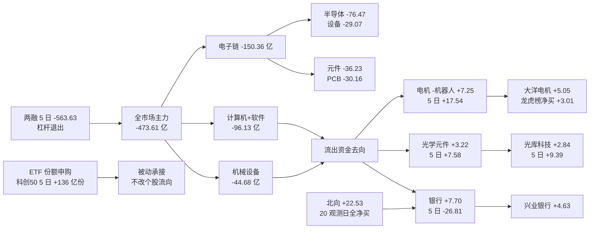

# 2026年10月28日 · **资金面**

> **数据源新鲜度**: partial（A 股资金/板块/龙虎榜/涨停/北向 = 2026-10-27 收盘全量；两融/ETF 份额 = 2026-10-26；美股 = 2026-10-26 收盘）
> **降级状态**: degraded=true（3 个维度缺口：两融滞后 1 日、ETF 份额滞后 1 日、美股 10-27 交易日四通道均未落库）
> **置信度**: 0.72（data_coverage 0.86 / source_independence 0.55 / timeliness 0.78 / reproducibility 0.88）
> **数据归属**: resolved_trade_date = 20261027，trading_gap = 0（1027 是 1028 之前最近交易日，按契约不算 stale）
> **06:00 闸门**: ✅ 通过 —— generated_at = 2026-10-28T06:01:30+08:00 ≥ trade_date 06:00，check_r7_staleness 无 finding。

## 🧭 一句话结论

主跌日：宽度崩、电子链被卖 150 亿，钱只进银行/电机机器人/光学元件；外资 20 个观测日全净买、ETF 申购在接、内资在跑。候选减半到 6 只，全部 research_only。

---

## 📊 详细分析

### 一、宽度：从「单日普涨」到「单边主跌」只隔了两个交易日

10-23 是全月最好的一天：4526 家上涨、成交 19728 亿，涨停 82 只、炸板率仅 12.77%。10-26 缩量分化（2252/3157，16231 亿），10-27 直接塌成 606 家上涨 / 4922 家下跌——下跌占比 88.4%，涨超 5% 的只有 102 家，跌超 5% 的有 948 家，比例 1:9.3。成交 14729 亿，比 1023 峰值缩 25.3%，是缩量下跌，不是恐慌抛售，是「没人接」。

涨停 41 / 炸板 28 / 跌停 22，炸板率 **40.58%**，比 1026 的 29.49% 抬升 11.09pp，越过 35% 的情绪红线。连板天梯是 1 板 29 / 2 板 8 / 3 板 0 / 4 板 3 / 5 板 1——**3 板整层空缺**，高度从 6 板（1023）掉到 5 板且是孤票，中间层断档，这是典型的「退潮第一天」结构，不是「洗盘」。

唯一还没坏的是隔日赚钱效应：1026 的 55 只涨停在 1027 平均溢价 +1.36%、中位 +0.82%、开盘溢价 +1.58%、正收益占比 50.9%。意思是**昨天打的首板今天还有一半以上能赚钱**，但连板接力已经没溢价——所以今天的资金面结论不是「空仓」，是**只能做低位首板、不能接高位连板**。

### 二、三股钱在打架：内资大单跑、外资连买、杠杆在退

东财主力口径（超大单+大单）20 个交易日只有 2 天净流入，累计 **-6,218.45 亿**；5 日 -1,473.98 亿（5 日日均 -294.80 亿），今日单日 -473.61 亿。

同期北向 **20 个观测日全部净买入**（跨 21 个交易日，缺 20261019），累计 +495.63 亿，今日 +22.53 亿（沪股通 +11.41、深股通 +11.13，hgt+sgt 与 north_money 逐日勾稽 8/8 一致）。两融余额（最新 1026）5 日 **-563.63 亿**（沪 -243.83 / 深 -319.12 / 北 -0.68），杠杆在撤。ETF 份额端，科创50ETF 5 日 **+136.38 亿份**、创业板ETF +79.71 亿份、沪深300ETF +62.51 亿份——被动资金在跌里申购。

三个口径方向相反，**不能互相证明**：北向是沪深股通成交净额（含大量被动/对冲盘），主力是东财单笔拆单口径，两融是杠杆余额，ETF 是份额申赎。能确定的只有一句话：**跌的过程中，外资通道和被动资金在接，内资大单和杠杆在跑**。前者决定「跌不深」，后者决定「涨不动」。

### 三、板块：电子链单日被卖 150 亿，钱只去了三个地方

净流出前八全部是成长链：电子 -150.36 亿（5 日 -335.12 亿）、半导体 -76.47（5 日 -101.63）、计算机 -62.27、机械设备 -44.68、元件 -36.23（5 日 **-174.75**）、软件开发 -33.86、数字芯片设计 -31.24、印制电路板 -30.16（5 日 -148.65）。半导体设备今天 -29.07 亿、跌幅 -6.32%，是全场最惨的子板块。

注意一个**内部背离**：数字芯片设计 5 日还是 +48.55 亿（全市场 5 日流入第一），但今天 -31.24 亿、板块跌 5.00%——5 日的多头筹码今天开始派发，这是「5 日榜不能单独用」的教科书案例。

流入端只有三个方向站得住：
1. **银行** +7.70 亿（股份制 +6.77、国有大行 +3.54），但 5 日仍 -26.81 亿 → 单日护盘/配置，不是趋势反转；
2. **电机-机器人链** +7.25 亿、5 日 **+17.54 亿**、3/5 日净流入，机器人 +9.26、底盘与发动机 +9.15 → 全场唯一「今日 + 5 日双正」的进攻链；
3. **光学元件** +3.22 亿、5 日 +7.58、4/5 日净流入（板块股价跌 2.33% 但资金在进）。

另外两条防御链是「连续吸筹型」：个护用品 5 日 +18.89 亿、生活用纸 +18.81 亿、美容护理 +15.48 亿，**全部 5/5 日净流入**，价格却没动——这是左侧建仓的形态，不是主题进攻。

口径提醒：东财行业是父子层级（电子 ⊃ 半导体 ⊃ 数字芯片设计），父子净额**不可相加**；概念板块是交叉标签（人形机器人 ⊂ 机器人概念），跨表相加会重复计数。

### 四、昨日前十的 5 日追踪：延续率 50%，真吸筹只有两只

把 1026（基准日）主力净流入前十按**当日净额**排序，再逐只追到 1027 与 5 日累计：

| # | 名称 | 1026 净额(亿) | 1027 净额(亿) | 1027 涨跌 | 5日净额(亿) | 5日正流入天数 | 5日涨幅 | 是否延续 |
|---|---|---|---|---|---|---|---|---|
| 1 | 寒武纪 | +13.02 | -7.10 | -5.68% | +8.11 | 2/5 | -1.67 | ❌ 反手 |
| 2 | 胜宏科技 | +7.25 | -4.98 | -7.40% | -0.72 | 2/5 | -1.56 | ❌ 反手 |
| 3 | 长鑫科技 | +6.60 | +1.45 | +0.80% | +21.99 | 4/5 | 3.56 | ✅ 延续 |
| 4 | 万向钱潮 | +5.90 | -3.31 | -5.74% | +5.13 | 3/5 | 20.89 | ❌ 反手 |
| 5 | 百亚股份 | +4.40 | +2.53 | +1.37% | +19.23 | 5/5 | -5.66 | ✅ 延续 |
| 6 | 沐曦股份-U | +3.77 | +0.06 | -5.77% | +7.49 | 4/5 | 9.92 | ✅ 延续 |
| 7 | 中国石油 | +3.70 | +0.18 | -1.35% | +3.49 | 3/5 | 3.94 | ✅ 延续 |
| 8 | 模塑科技 | +2.70 | +0.14 | +3.90% | +3.52 | 4/5 | 29.95 | ✅ 延续 |
| 9 | 瑞芯微 | +2.65 | -4.43 | -8.18% | -0.90 | 2/5 | 12.31 | ❌ 反手 |
| 10 | 亿纬锂能 | +2.57 | -2.72 | -1.33% | -3.55 | 2/5 | — | ❌ 反手 |

5 只延续、5 只反手，**隔日延续率 50%**（沐曦 +0.06 亿属弱延续，实质接近归零，不计入「真吸筹」）。三个读法：

- **寒武纪是最典型的样本**：1026 单日 +13.02 亿全场第一，1027 反手 -7.10 亿、股价 -5.68%，5 日只剩 +8.11 亿（2/5 日正）——一天的钱两天撤完。
- **真吸筹只有两只**：百亚股份 5 日 **+19.23 亿、5/5 日全正**（价格还跌 5.66%），长鑫科技 5 日 **+21.99 亿、4/5 日正**。这两只的共同点是「板块 5 日也正」+「连续多日流入」，而不是「某一天特别大」。
- **万向钱潮要小心**：5 日 +5.13 亿、ret5 +20.89%，但 1027 已 -3.31 亿、跌 5.74%。涨幅把资金吸引进来，资金已经开始走，属高位接力末端。

这条经验今天就两条可用：**单日大额 ≠ 吸筹；5 日连续 + 板块同向 = 吸筹**。

### 五、龙虎榜：钱在两个极端，一边单向扫货，一边涨停净卖

1027 全市场龙虎榜 88 条事由 / 78 个代码，其中 71 个是单日事由口径。

净买前六：

| 名称 | 涨跌 | 净买(亿) | 净买率 | 龙虎榜占成交 | 换手 | 口径 |
|---|---|---|---|---|---|---|
| 大洋电机 | +10.00% | +3.01 | 21.22% | 33.09% | 10.16% | single_day |
| 光洋股份 | +10.03% | +1.67 | 15.7% | 55.61% | 3.87% | single_day |
| 慈文传媒 | -10.00% | +1.62 | 9.36% | 21.36% | 39.65% | single_day |
| 海洋王 | +10.00% | +1.33 | 6.37% | 26.62% | 28.85% | single_day |
| 澳弘电子 | -8.67% | +1.14 | 4.12% | 26.48% | 14.66% | single_day |
| 洛轴股份 | -5.28% | +1.03 | 12.68% | 31.86% | 35.39% | single_day |

净卖前六：

| 名称 | 涨跌 | 净买(亿) | 净买率 | 龙虎榜占成交 | 换手 | 口径 |
|---|---|---|---|---|---|---|
| 金马游乐 | -14.02% | -2.13 | -13.33% | 48.18% | 10.39% | single_day |
| 襄阳轴承 | +10.03% | -1.30 | -8.74% | 31.24% | 20.57% | single_day |
| 华瓷股份 | -10.00% | -1.30 | -14.98% | 30.75% | 15.16% | single_day |
| 皇台酒业 | +6.81% | -0.80 | -10.4% | 27.6% | 31.67% | single_day |
| 天津普林 | -9.30% | -0.70 | -2.95% | 31.67% | 15.59% | single_day |
| 星光股份 | -8.93% | -0.64 | -3.2% | 25.94% | 21.42% | single_day |

席位层面最值得记的两条：
- **国泰海通深圳海岸城海德三道**：全天只做一只票，买 1.58 亿、卖 32 万，**净买 1.58 亿 ≈ 全市场单席位第 4**——大洋电机的板是这类资金单向扫出来的；
- **东莞证券南京分公司**：3 只票净卖 -1.93 亿，是当日最大空头席位；而**金马游乐**（-14.02%）净卖 -2.13 亿居首，是纯粹的出货。

机构专用席位上，正向的是天娱数科 +0.98 亿（4 席）、世纪恒通 +0.96 亿（4 席）、洛轴股份 +0.78 亿（3 席）；反向的是杰克科技 -1.90 亿（5 席）、金马游乐 -1.22 亿（6 席）、华正新材 -1.17 亿（2 席）。
口径说明：每股每档事由的机构净额 = 选中事由（单日优先）下按 (买入额, 卖出额) 去重后的席位聚合——**同一席位会同时出现在买方 top5 与卖方 top5，两行数值相同，只计一次**；旧口径直接累加会把机构净额放大 2 倍以上（阳光乳业 1.88 亿 → 实际 0.37 亿）。

### 六、诱多识别：21 只票出现派发/弱封线索

六条规则（A 拉高派发 / B 机构派发 / C 弱封 / D 仅累计口径净卖 / E 炸板回封 / F 当日炸板 / G 高位上榜）命中 21 只，风险最高的前 10：

| 名称 | 涨跌 | 龙虎榜净额(万) | 机构专用净额(万) | 换手 | 命中 |
|---|---|---|---|---|---|
| 科瑞思 | +20.00% | -2833.3 | -2500（单日） | 30.2% | B_机构席位净卖(<-0.2亿)而股价大涨；C_弱封(封单/成交=2.0%<5%)；G_高位累计涨幅上榜 |
| 弘景光电 | +20.00% | +3930.3 | -1439（单日） | 19.2% | C_弱封(封单/成交=4.5%<5%)；E_炸板回封9次；G_高位累计涨幅上榜 |
| 皇台酒业 | +6.81% | -8022.9 | -5349（单日） | 31.7% | A_拉高派发(涨>5%+换手>20%+龙虎榜净卖<-0.3亿)；B_机构席位净卖(<-0.2亿)而股价大涨 |
| 阳光乳业 | +10.00% | +3663.8 | +3697（单日） | 15.5% | C_弱封(封单/成交=3.0%<5%)；E_炸板回封4次 |
| 胜通能源 | +9.99% | +4319.8 | -2450（单日） | 6.7% | B_机构席位净卖(<-0.2亿)而股价大涨；E_炸板回封3次 |
| 海洋王 | +10.00% | +13313.5 | —（无机构席位） | 28.9% | C_弱封(封单/成交=1.6%<5%)；E_炸板回封6次 |
| 申达股份 | +10.06% | +3671.9 | —（无机构席位） | 4.8% | C_弱封(封单/成交=0.4%<5%)；E_炸板回封5次 |
| 沪光股份 | +10.00% | +3319.8 | —（无机构席位） | 4.2% | C_弱封(封单/成交=1.3%<5%)；E_炸板回封2次 |
| 襄阳轴承 | +10.03% | -13046.2 | +3015（单日） | 20.6% | A_拉高派发(涨>5%+换手>20%+龙虎榜净卖<-0.3亿) |
| 国脉科技 | +9.99% | +7854.1 | +2002（3日累计） | 6.6% | E_炸板回封2次 |

三条最硬的证据：

1. **襄阳轴承**（4 连板、涨停）：龙虎榜单日净卖 **-1.30 亿**（净卖率 -8.74%）、换手 20.57%，国新证券北京分公司 3 日累计净卖 **-6,729 万**——涨停板上在派发。同一天这个席位买入光洋股份 +7,098 万，**同一笔钱的高低位切换**，不是新钱进场。
2. **皇台酒业**（+6.81%）：龙虎榜净卖 -0.80 亿、机构净卖、换手 31.67%，A+B 双命中。
3. **科瑞思**（20% 涨停）：封单只占成交 **2.0%**、龙虎榜净卖 **-2,833 万**、机构专用净卖 **-2,500 万**（单日口径，去重前误记 -6,183 万），B+C+G 三命中；同类的还有申达股份封单 **0.4%**、沪光股份 1.3%、海洋王 1.6%、阳光乳业 3.0%、弘景光电 4.5%（且炸板回封 9 次）。**今天封住的板里，一半是纸封**。

3 日协同：同一 (股票, 席位) 在 20261023/1026/1027 出现 ≥2 个交易日的有 69 组，剔除「机构专用/沪深股通专用」后具名 68 组，3 日全覆盖 6 组。协同最多的是「游资反复做同一只票」，方向以净卖为主——**反复上榜不等于反复买**。

> 边界：龙虎榜是选定席位样本，不等于全市场主力净额，也不构成操纵证据。本 skill 只交风险线索，**hard_reject 权归 R6**，本轮未下任何 hard_reject。

### 七、外部传导：外盘半导体在涨，A 股在卖 —「外强内弱」第 1 天

隔夜美股（**10-26 收盘，10-27 交易日未落库**）：

| 代码 | 涨跌 | 收盘 | 数据日 |
|---|---|---|---|
| NVDA | +2.39% | 216.0 | 20261026 |
| AAPL | -1.10% | 343.91 | 20261026 |
| MSFT | +1.54% | 532.6 | 20261026 |
| GOOGL | -1.06% | 316.8 | 20261026 |
| AMZN | +0.44% | 249.09 | 20261026 |
| META | -1.88% | 630.56 | 20261026 |
| TSLA | +5.21% | 391.62 | 20261026 |
| AMD | +2.80% | 531.28 | 20261026 |
| INTC | +4.04% | 90.47 | 20261026 |
| TSM | +1.40% | 424.37 | 20261026 |
| AVGO | +2.33% | 329.17 | 20261026 |
| MU | +2.98% | 903.7 | 20261026 |
| GLW | +3.27% | 127.74 | 20261026 |
| MRVL | +2.31% | 233.78 | 20261026 |

指数：

| 指数 | 收盘 | 涨跌 | 数据日 |
|---|---|---|---|
| SPX | 7676.7724 | +0.70% | 20261026 |
| DJI | 52361.5814 | +0.28% | 20261026 |
| IXIC | 26169.38 | +0.82% | 20261026 |

10-27 亚洲（已更新）：

| 指数 | 收盘 | 涨跌 |
|---|---|---|
| HKTECH | 3800.43 | -1.48% |
| HSI | 23041.32 | -0.73% |
| TWII | 46096.23 | +0.12% |
| N225 | 63268.37 | +1.73% |
| KS11 | 5638.34 | +3.09% |

半导体篮子（MU +2.98% / NVDA +2.39% / AVGO +2.33% / AMD +2.80% / TSM +1.40%）等权 **+2.38%**；光通信 GLW **+3.27%**、MRVL **+2.31%**；大盘科技 6 只等权 +0.53%。10-27 亚洲接力：韩国 KS11 **+3.09%**（半导体权重）、日经 +1.73%，但港股科技 -1.48%、恒指 -0.73%。

> 快照来源：`data/research/20261028/_r7_data/overseas_snapshot_20261028.json`（官方 fetch 脚本重取，asof 2026-10-28T04:41:51+08:00）。机器 freshness 判定：美股 expected_session=**20261027** / observed=**20261026** → fresh 0/12，即全部 **stale**；HSI/KS11 为 1027 **fresh**；SOX/HSCEI/HSTECH/DXY 缺失（missing=['HSCEI', 'HSTECH', 'SOX']）。规范路径 `data/raw/20261028/overseas_snapshot.json` 缺失（fetch 未落盘），R7 未越权写 data/raw。

映射到 A 股，三句话：

- **存储/DRAM**：MU +2.98%、韩国半导体 +3.09%，外部情绪偏暖；但 1027 A 股半导体 -4.54%、半导体设备 -6.32%，是内外背离的第 1 天。外部只提供修复窗口，**不给方向**，要等 A 股自己的资金转正（今日半导体 -76.47 亿）。
- **CPO/光模块**：GLW +3.27%、MRVL +2.31%，但 A 股通信设备 5 日 -135.23 亿、中际旭创 20 日 -32.27%。外部涨只说明「跌多了有反弹窗口」，不改变资金撤离事实——今天中际旭创 +5.26 亿主力净流入可作反弹观察，不做方向。
- **港股/中概**：HKTECH -1.48% 与 A 股成长同步走弱，说明这轮杀的是中国科技资产的估值端，不是外围情绪。

**诚实标注**：10-27 美股自身收盘在 tushare us_daily、index_global、vibe yahoo、vibe akshare 四处均未落库，本段美股口径一律为 10-26 收盘，滞后 1 个美股交易日。不编造 10-27 数值。

---

## 🗺️ 资金流向图

---

## 🔍 思维链 · 三问

### 电机-机器人链（今日唯一「今日+5日双正」的进攻链）

- **大资金意图**: 电机Ⅱ 单日 +7.25 亿、5 日 +17.54 亿、3/5 日净流入；机器人 +9.26 亿、底盘与发动机 +9.15 亿方向一致。大洋电机单日主力 +5.05 亿（净额占成交 35.57%）、龙虎榜净买 3.01 亿（净买率 21.22%、龙虎榜占成交 33.09%），买方前五有 4 席国泰海通系。这是「板块级别 + 单票级别」同时确认的唯一一条链。
- **为什么走强**: 不是业绩驱动，是资金在成长链（电子 -150 亿、计算机 -62 亿）失血时找不到进攻方向，退到「有订单叙事 + 有机器人题材 + 位置低」的电机链。本质是**主跌日里的相对强势资金抱团**，不是增量资金进场。
- **逻辑够不够硬**: 一半硬。硬的部分：板块双正、龙虎榜单向扫货、封单占成交 7.74%；不硬的部分：大洋电机 ret5 已 +22.03%、pos20 97.1 分位、距 20 日新高只差 0.65%，首板就在历史高位，且 20 日主力净额只有 +4.29 亿（说明这波是刚进来 3 天的钱）。**结论：可研究，但位置不便宜，需要次日不炸板才算成立。**

### 银行（今日流入第一，但是「防守」不是「进攻」）

- **大资金意图**: 银行 +7.70 亿居首，兴业单日 +4.63 亿（净额占成交 13.55%）、pos20 98.6 分位、距 20 日新高 -0.10%。但银行 5 日 -26.81 亿、20 日 -79.98 亿，且兴业融资余额 5 日 -2.31%。
- **为什么走强**: 全市场跌 4922 家的时候，唯一能容纳大资金且不做估值的就是银行。这是**避险资金的自然停靠**，不是主动进攻。
- **逻辑够不够硬**: 单日硬、趋势不硬。今日流入只是把 5 日的部分失血补回来，且杠杆在撤。如果今天成长链继续杀，银行还有防守价值；一旦成长链修复，这批钱会第一时间回流。**只能当防守仓，不能当进攻主线。**

### 个护/生活用纸（连买 5 天但价格不动 = 左侧）

- **大资金意图**: 个护用品 5 日 +18.89 亿、生活用纸 +18.81 亿、美容护理 +15.48 亿，**全部 5/5 日净流入**；百亚股份 5 日 +19.23 亿、5/5 日正、净额占成交 23.49%，20 日累计 +59.67 亿。
- **为什么走强**: 价格没怎么涨（百亚 ret5 -5.66%、pos20 51.8 分位），说明这是**在建仓不是在拉升**——主跌环境里资金买消费防御，本质是「找不跌的地方放钱」。
- **逻辑够不够硬**: 资金证据硬（连续 5 天、板块同向、个股同向），但**方向证据不硬**（钱在买、价在跌，右侧未确认）。且流通盘小、日均成交 10 亿级别，装不下大资金。**只能当观察仓，不能当进攻票。**

---

## 🎯 研究候选池（6 只 · 炸板率 40.58% ≥ 35% 强制减半）

> 全部 `research_only = true`、`execution_eligible = false`。R7 不授予开仓权限、不给买点/目标价/仓位。

| 名称 | 代码 | 今日净额 | 5日净额 | 正天数 | 今日涨幅 | 价格位置 | 两融 | 大宗 | R7 态度 |
|---|---|---|---|---|---|---|---|---|---|
| 大洋电机 | 002249.SZ | +5.05 | +5.26 | 3/5 | +10.00% | pos20 97.1 | +0.92% | 0 笔 | 资金确认·位置警告 |
| 光洋股份 | 002708.SZ | +0.82 | +2.40 | 4/5 | +10.03% | pos20 87.4 | 无数据 | 0 笔 | 降级观察·机构派发 |
| 长鑫科技 | 688825.SH | +1.45 | +21.99 | 4/5 | +0.80% | pos20 20.2 | -2.97% | 5 笔 | 资金确认·板块逆风 |
| 百亚股份 | 003006.SZ | +2.53 | +19.23 | 5/5 | +1.37% | pos20 51.8 | 无数据 | 0 笔 | 资金确认·防御吸筹 |
| 光库科技 | 300620.SZ | +2.84 | +9.39 | 4/5 | +2.94% | pos20 39.3 | +7.13% | 2 笔 | 观察·逆势流入 |
| 兴业银行 | 601166.SH | +4.63 | +2.80 | 3/5 | +2.25% | pos20 98.6 | -2.31% | 0 笔 | 资金确认·防守仓 |

### 1. 大洋电机 002249.SZ · 7.70 元 · 首板涨停

- **买入理由**: 单日主力 +5.05 亿（全市场第 3）、净额占成交 35.57%；龙虎榜净买 +3.01 亿（全市场第 1）、净买率 21.22%、龙虎榜成交占全场 33.09%；买方前五含国泰海通深圳海岸城海德三道（买 1.58 亿 / 卖 32 万）等 4 席国泰海通系。板块电机 +7.25 亿、5 日 +17.54 亿、3/5 日正，属唯一双正链。
- **风险点**: ret5 +22.03%、pos20 **97.1 分位**、距 20 日新高仅 -0.65%——首板即历史高位；20 日主力净额仅 +4.29 亿，说明这波是最近 3 天才进来的钱，没有中线筹码垫底；炸板 1 次、封单占成交 7.74%，在主跌日属于「不算弱但也不够硬」；两融 5 日仅 +0.92%、15 日 -3.00%，杠杆没跟。**最大风险是次日高位放量不接力直接反手**（参考 1026 寒武纪 13 亿 → 1027 -7.1 亿的样本）。
- **止损条件**（资金口径，非交易指令）: 次日出现「主力净流出 > 2 亿」或「龙虎榜由净买转净卖」或「电机板块 5 日净额转负」→ 资金逻辑证伪。
- **可验证假设**: 若今日电机Ⅲ 板块仍净流入且 5 日净额维持 > +10 亿，则该链的资金确认延续；若板块转负而个股独撑，则视作单票行为、降级。

### 2. 长鑫科技 688825.SH · 43.00 元 · 存储/DRAM

- **买入理由**: 5 日主力 **+21.99 亿（全市场第一）**、4/5 日净流入；在半导体板块单日 -76.47 亿、5 日 -101.63 亿的背景下仍 +1.45 亿，是 1026 前十中唯一 1027 继续净流入的电子票；单日融资买入 10.85 亿（大额杠杆参与）。
- **风险点**: 板块逆风是硬约束——半导体 5 日 -101.63 亿、半导体设备今日 -6.32%；pos20 只有 20.2 分位、距 20 日高点 -28.13%，属「低位但趋势未修复」；融资余额 5 日 -2.97%、15 日 -3.51%，高换手是博弈不是建仓；30 日内 5 笔大宗全部平价、卖方 4/5 为中金系营业部（合计 0.33 亿）→ 机构借大宗转仓，不是出货也不是吸筹。
- **止损条件**: 半导体板块 5 日净额继续下探（<-120 亿）或个股单日主力转出 > 5 亿 → 逆势流入假设失效。
- **可验证假设**: 若今日半导体板块资金转正、且长鑫仍保持净流入，则「个股强于板块」成立，可升级；若板块继续失血而个股补跌，则本票只是资金临时避风港。

### 3. 百亚股份 003006.SZ · 23.02 元 · 个护用品

- **买入理由**: 5 日主力 **+19.23 亿、5/5 日全正**、20 日 +59.67 亿；净额占成交 23.49%；个护用品/生活用纸/美容护理三条板块全部 5/5 日净流入（+18.89 / +18.81 / +15.48 亿）。是全市场唯一「个股 5/5 + 板块 5/5」同时成立的组合。
- **风险点**: 价格 bearish——ret5 -5.66%、pos20 51.8 分位、距 20 日高点 -7.85%，钱在买价在跌=左侧建仓，右侧未确认；日均成交 10.76 亿、流通盘小，容量有限；东财两融无该票行（`unavailable`，非 0），无法用杠杆验证。
- **止损条件**: 5 日净流入中断（出现 2 个连续净流出日）或个护板块 5 日转负 → 连续吸筹假设失败。
- **可验证假设**: 若今日仍净流入且股价站上 5 日均线，则「建仓转拉升」成立；若继续「买而不涨」超过 3 日，则视为被动配置盘、剔除。

### 4. 光洋股份 002708.SZ · 17.22 元 · 2 连板

- **买入理由**: 2 连板（缩量封板，换手仅 3.87%、封单占成交 50.16%）、主力 +0.82 亿、净额占成交 24.03%、5 日 +2.40 亿（4/5 日正）、龙虎榜净买 +1.67 亿（净买率 15.70%）；汽车零部件/底盘系统 5 日 +9.15 亿。
- **风险点**: **机构专用 3 席合计净卖 5,201 万（该票只有『连续三日累计』口径，不是单日），而游资净买 1.67 亿 = 游资在接机构的货**；买方国新证券北京分公司同日卖出襄阳轴承 7,191 万——同一笔钱的高低切换，是「卖高位买次高」，不是新钱；东财两融无该票行，杠杆维度缺失；2 连板在主跌日属高危位置（3 板整层空缺，接力断层）。
- **止损条件**: 机构席位继续净卖或封单占成交跌破 20% → 视为接货完成、撤离。
- **可验证假设**: 若今日机构席位转净买、且封单维持 > 30%，则「机构换手非出货」成立；若机构继续净卖而游资撤，则 3 板不成立。

### 5. 光库科技 300620.SZ · 253.14 元 · 光器件/CPO

- **买入理由**: 通信设备板块 5 日 -135.23 亿的背景下，个股 5 日 +9.39 亿（4/5 日正）、今日 +2.84 亿；融资余额 5 日 **+7.13%** 同向（与绝大多数票的杠杆退出相反），是资金与杠杆同时验证的少数票。
- **风险点**: 15 日融资 -11.83%，说明 5 日的加杠杆只是修复不是趋势；10-14/10-15 两笔机构专用平价大宗（合计 2,222 万）属机构间转仓，既不是吸筹也不是出货，不要当利好读；pos20 仅 39.3 分位、距 20 日高点 -16.42%，逆势抢反弹而非右侧；CPO 外盘（GLW +3.27%）只给窗口不给方向。
- **止损条件**: 通信设备板块 5 日继续失血或个股单日主力转出 > 2 亿 → 逆势流入证伪。
- **可验证假设**: 若今日 CPO 链出现板块级净流入（通信设备当日转正）且光库保持净流入，则升级为「板块修复启动」；否则仅视为个股行为。

### 6. 兴业银行 601166.SH · 19.10 元 · 股份行

- **买入理由**: 单日主力 +4.63 亿、净额占成交 13.55%、pos20 98.6 分位、距 20 日新高 -0.10%；银行板块 +7.70 亿居首，股份制银行 +6.77 亿、国有大行 +3.54 亿同步。全市场 4922 家下跌时唯一站住的大权重方向。
- **风险点**: 融资余额 5 日 -2.31%、15 日 -6.43%，**杠杆在撤，买盘更像被动配置/护盘**；银行 5 日仍 -26.81 亿、20 日 -79.98 亿，单日流入不等于趋势反转；一旦成长链修复，防守资金会第一时间回流，银行是「跌势里的临时仓位」不是「独立主线」。
- **止损条件**: 银行板块 5 日净额继续为负（<-30 亿）而个股独撑，或成长链单日转正 > 100 亿 → 防守逻辑让位。
- **可验证假设**: 若今日指数继续下杀而银行维持净流入，则「防守仓」成立；若指数反弹而银行转为净流出，则确认其为被动配置盘。

---

## 🚫 剔除清单（12 只 · 为什么不做）

| 名称 | 代码 | 剔除理由 | 命中规则 |
|---|---|---|---|
| 襄阳轴承 | 000678.SZ | 4 连板涨停但主力 -1.01 亿、龙虎榜单日口径净卖 -1.30 亿（净卖率 -8.74%）、换手 20.57%，且国新证券北京 3 日累计净卖 -6,729 万——价涨钱走的派发结构，命中诱多规则 A | A_拉高派发 |
| 慈文传媒 | 002343.SZ | 跌停 -10%、换手 39.65%，龙虎榜净买 +1.62 亿（机构 +3,462 万）属撬板资金，单日对赌性质，不是可跟随的资金确认 | 撬板非配置 |
| 寒武纪 | 688256.SH | 1026 主力 +13.02 亿全场第一，1027 反手 -7.10 亿、股价 -5.68%，一日游；算力链无 5 日资金支撑 | 次日反转 |
| 胜宏科技 | 300476.SZ | 1026 +7.25 亿 → 1027 -4.98 亿、-7.40%，PCB/元件 5 日 -174.75 亿，板块失血 | 次日反转、板块失血 |
| 瑞芯微 | 603893.SH | 1026 +2.65 亿 → 1027 -4.43 亿、-8.18%，数字芯片设计今日 -31.24 亿，5 日 +48.55 亿的筹码在派发 | 次日反转 |
| 万向钱潮 | 000559.SZ | 1026 +5.90 亿 → 1027 -3.31 亿、-5.74%，虽然 ret5 +20.89%，但资金已撤，属高位接力末端 | 次日反转 |
| 中际旭创 | 300308.SZ | 单日 +5.26 亿但股价 -2.94%、ret20 -32.27%，通信设备 5 日 -135.23 亿；单日抄底无板块合力 | 无板块合力 |
| 药明康德 | 603259.SH | 单日 +3.84 亿但股价 -3.10%，医疗研发外包 5 日 -9.52 亿、今日 -2.95 亿，逆势单票流入不构成方向 | 无板块合力 |
| 方正电机 | 002196.SZ | 主力 +2.84 亿但当日炸板未封（Z）、pos20 74.1 分位，板型不合格；电机链只取板型成立的票 | 炸板未封 |
| 雪人集团 | 002639.SZ | 单日 +5.71 亿居全市场第 1，但 5 日仅 +4.95 亿、制冷空调设备板块 5 日 -4.08 亿、当日板块 -2.98% → 单日脉冲、无板块合力，属资金临时停靠而非主线吸筹 | 单日脉冲 |
| 粤传媒 | 002181.SZ | +3.83 亿、+6.56%，但影视动漫制作板块当日 -2.87%、5 日 -9.06 亿、板块内仅 1.24 亿流入 → 单票资金不外溢，跟着传媒反弹做的是情绪不是资金 | 无板块合力 |
| 贵州茅台 | 600519.SH | +2.56 亿折 1.8 万亿流通市值 ≈ 0.01%，属指数/配置盘的自然流入；白酒无板块方向（5 日无正流入）→ 体量级别不构成资金信号 | 体量不足 |
| 亿纬锂能 | 300014.SZ | 1026 +2.57 亿 → 1027 -2.72 亿，5 日 -3.55 亿，电池链资金持续流出 | 次日反转 |

特别说明 **中际旭创**（+5.26 亿、股价 -2.94%）与 **药明康德**（+3.84 亿、-3.10%）：单日资金在买、股价在跌，但所属板块 5 日分别 -135.23 亿 / -9.52 亿，属「无板块合力的单票抄底」，不做方向；可留在观察名单等板块转正。

---

## 🔄 跷跷板配对（20 日相关 ≤ -0.6 + 5 日「一侧负转正」）

**表 A：相关最强的前 5 对（全部同向，无切换）**

| 配对 | 20日相关 | A 5日净额(亿) | B 5日净额(亿) | 5日方向 |
|---|---|---|---|---|
| 半导体 ↔ 铁路运输 | -0.847 | -101.63 | -3.88 | ❌ 同向 |
| 橡胶 ↔ 原料药 | -0.765 | -2.79 | -5.22 | ❌ 同向 |
| 通信应用增值服务 ↔ 冶钢原料 | -0.763 | -2.79 | -2.89 | ❌ 同向 |
| 电子 ↔ 铁路运输 | -0.751 | -335.12 | -3.88 | ❌ 同向 |
| 铁矿石 ↔ 通信应用增值服务 | -0.748 | -1.86 | -2.79 | ❌ 同向 |

**表 B：5 日出现方向反转的 6 对（一侧由负转正）**

| 配对 | 20日相关 | A 前5日 → 近5日(亿) | B 前5日 → 近5日(亿) | 转正方 | 转正方今日(亿) |
|---|---|---|---|---|---|
| 铁路运输 ↔ 数字芯片设计 | -0.7 | -4.68 → -3.88 | -70.36 → +48.55 | 数字芯片设计 | -31.24 |
| 铁路运输 ↔ 磨具磨料 | -0.66 | -4.68 → -3.88 | -3.38 → +0.02 | 磨具磨料 | -1.20 |
| 能源及重型设备 ↔ 乘用车 | -0.655 | -16.56 → +4.06 | -11.46 → -17.10 | 能源及重型设备 | -2.01 |
| 能源及重型设备 ↔ 电动乘用车 | -0.625 | -16.56 → +4.06 | -9.25 → -14.46 | 能源及重型设备 | -2.01 |
| 铁路公路 ↔ 磨具磨料 | -0.612 | -8.67 → -5.90 | -3.38 → +0.02 | 磨具磨料 | -1.20 |
| 炼化及贸易 ↔ 风电整机 | -0.609 | -0.97 → +3.58 | -5.93 → -5.80 | 炼化及贸易 | -0.84 |

审计：东财行业 496 个，取 |20日净额|>5 亿的 297 个，测 43,956 对，相关 ≤ -0.6 的 **57 对**，其中 5 日出现方向反转的 **6 对**（判定口径：前 5 日合计 < 0 且近 5 日合计 > 0，且恰好一侧翻转）。表 A 相关最强的前 8 对**无一反转**，全部同向流出。

怎么读表 B：这 6 对里有 5 对是「小体量板块 +0.02~+4.06 亿的技术性转正」（磨具磨料 +0.02、炼化及贸易 +3.58、能源及重型设备 +4.06），体量不足以构成切换。唯一有量的是 **数字芯片设计：前 5 日 -70.36 亿 → 近 5 日 +48.55 亿**，对应的正是「半导体失血 −101.63 亿」的另一面——但**今日它自己又净流出 -31.24 亿、板块跌 5.00%**，说明这次转正在今天已经回吐，反转信号是滞后的，不能当今日的方向。

所以结论分两层：**表 B 存在 6 对反转，但没有任何一对在今日仍成立**；这不是「成长→价值」的板块轮动，而是**全市场统一减仓**（主力 20 日 -6,218 亿）。这也解释了为什么电机链能吸到钱（5 日 +17.54 亿）却吸不到量：钱不是从一个板块搬到另一个板块，是净离场，只有少量资金在找避风港。

---

## ⚖️ 不确定性 / 反证（自我批判）

1. **最可能错的地方是「主跌」定性**。炸板率 40.58%、跌停 22 家确实指向退潮，但成交 1.47 万亿只是从 1.97 万亿缩下来，并没有缩到地量；且北向 20 个观测日全部净买（跨 21 个交易日，缺 20261019）、ETF 份额在申购。如果今日成长链出现单日 100 亿级回流，本报告的「电子链不接」结论会立刻过时。**对冲方式是每天重算 5 日净额，不锚定单日结论。**
2. **东财主力口径本身有内生偏差**。超大单+大单拆单会被算法拆成中单，主力净额对倒手率高的票（如长鑫 151 亿成交）参考价值下降；这也是我不把「净额占成交比」当成唯一指标的原因。
3. **龙虎榜 ≠ 全市场**。78 个代码只覆盖当日异动样本，席位归因（尤其「同一营业部=同一笔钱」）是相关性推断，不是证据链。襄阳轴承与光洋股份的席位重合只能说明「该席位同日双向操作」，不能证明是同一操盘方。
4. **美股缺 10-27 是实质缺口，且已核实为「供给侧缺口」**。今日开盘前最该知道的是「隔夜美股 10-27 收盘」；官方 fetch 脚本判定 expected_session=1027、observed=1026，tushare us_daily（13:00 更新）、index_global、yahoo/sina、akshare/sina 四通道一致停在 1026 → 不是本系统取数失败，而是上游尚未发布，13:00 前不可能补齐。所有「外强内弱」判断都建立在 10-26 的 T-2 数据上，**过时一天，可能是完全相反的信号**。这条在今日交易中应视为「外部维度不可用」，而不是「外部偏暖」。
5. **R2 未产出**。本报告不继承任何主线/龙头认定，研究对象是从资金榜反推的——这意味着它可能与今日真正的主线无关。若 R2 后续出主线，应以 R2 为准重排优先级。
6. **两融与 ETF 份额滞后 1 日**。1027 的杠杆与申赎变化要到今日 08:30 后才可见，本报告的「杠杆在撤」结论建立在 1026 数据上，1027 可能已经转向。

---

## 🔗 与其他 R/D/E 的关系

- **依赖（上游）**: `data/research/20261028/_r7_data/*`（tushare 原始）、vibe-trading MCP（东财独立通道）、`data/raw/20261028/`（manifest 缺失；overseas_snapshot 规范路径缺失，已用官方 fetch 脚本重取并落 `_r7_data/overseas_snapshot_20261028.json`）— **R2 未产出，未继承**
- **被消费（下游）**: D1（`R7.staleness_status` / `main_force.sector_flows` / `hot_money.distribution_alerts` / `research_candidates`）、R6（反证的事实底座，hard_reject 由其独立判定）、E1（次日复盘对照）、R5（个股画像的资金维度）
- **不授予**: 开仓权限、仓位预算、买点/目标价/止损价（`execution_candidates = []`，6 只全部 `research_only`）
- **子 skill**: `hot_money_synergy_v1`（3 日协同 69 组）、`detect_seesaw_pairs_v1`（57 对强负相关）

---

## 🧮 时序资金流（近 10 个交易日 · 主力 × 北向 × 成交额）

| 交易日 | 主力净额(亿) | 北向(亿) | 成交额(亿) |
|---|---|---|---|
| 20261014 | -367.63 | +20.55 | — |
| 20261015 | -637.51 | +25.98 | — |
| 20261016 | -49.53 | +22.53 | — |
| 20261019 | -116.07 | — | — |
| 20261020 | -125.69 | +20.95 | 14715 |
| 20261021 | -94.69 | +22.21 | 14421 |
| 20261022 | -632.18 | +23.26 | 15419 |
| 20261023 | +8.34 | +31.32 | 19728 |
| 20261026 | -281.84 | +25.39 | 16231 |
| 20261027 | -473.61 | +22.53 | 14729 |

主力与北向按交易日左连接；本表只展示 `northbound.series_last12` 的最近 12 日（tushare moneyflow_hsgt 原始库更早日期有数，但未纳入 20 日窗口合计之外的补值）；北向 20 日窗口为 20 个观测日 / 跨 21 个交易日，缺 20261019；成交额仅覆盖已落 daily 的交易日（6/20），缺的记 —，不用估算值填充。

20 日窗口 20260922-20261027：主力累计 -6218.45 亿、仅 2 天正；同期北向（20260921-20261027，20 个观测日 / 跨 21 个交易日）全净买 +495.63 亿。**这是 A 股当前最核心的矛盾：内资大单在系统性撤离，外资通道在系统性买入。**

---

## 🧾 两融与 ETF（滞后 1 个交易日）

| 市场 | 融资余额(亿) | 两融余额(亿) | 5日变化(亿) | 数据日 |
|---|---|---|---|---|
| SZSE | 11545.62 | 11650.28 | -319.12 | 20261026 |
| SSE | 12346.97 | 12533.42 | -243.83 | 20261026 |
| BSE | 78.10 | 78.10 | -0.68 | 20261026 |

| ETF | 最新份额(亿份) | 当日变化 | 5日净申购(亿份) | 数据日 |
|---|---|---|---|---|
| 沪深300ETF | 354.47 | +2.04 | +62.51 | 20261026 |
| 中证500ETF | 70.52 | -2.50 | +6.70 | 20261026 |
| 创业板ETF | 347.07 | +9.50 | +79.71 | 20261026 |
| 科创50ETF | 852.3 | +29.37 | +136.38 | 20261026 |
| 半导体ETF | 215.14 | +1.40 | +4.32 | 20261026 |
| 光伏ETF | 57.45 | -0.26 | -1.72 | 20261026 |
| 黄金ETF | 120.63 | -0.87 | -1.03 | 20261026 |

ETF 只能读申赎方向：科创50ETF 5 日 +136.38 亿份、创业板 +79.71、沪深300 +62.51 → 被动在跌里申购；光伏 -1.72、黄金 -1.03 → 防御与新能源在赎回。**份额变化是申赎代理，不是资金净流入金额。**

---

## 📋 数据源审计

| 源 | 状态 | 数据日 | 记录数 | 备注 |
|---|---|---|---|---|
| tushare.moneyflow_dc | 🟢 ok | 20261027 | 120510 | 20 个交易日 × 约 6030 只；单位万元 |
| tushare.moneyflow_ind_dc / concept | 🟢 ok | 20261027 | 9920 | 行业 496 个 + 概念 519 个 × 20 日；单位元；父子层级不相加 |
| tushare.moneyflow_hsgt | 🟢 ok | 20261027 | 12 | 北向净额，单位万元 |
| tushare.top_list | 🟢 ok | 20261027 | 88 | 88 条事由 / 78 代码 |
| tushare.top_inst | 🟢 ok | 20261027 | 880 | 席位明细 880 行 |
| tushare.limit_list_d | 🟢 ok | 20261027 | 91 | 涨停 41 / 炸板 28 / 跌停 22 |
| tushare.daily / daily_basic | 🟢 ok | 20261027 | 5570 | 6 个交易日全市场 |
| tushare.margin | 🟡 partial | 20261026 | 126 | 市场级两融滞后 1 个交易日 |
| tushare.fund_share | 🟡 partial | 20261026 | 7 | 7 只 ETF，份额滞后 1 个交易日 |
| tushare.index_daily / index_global | 🟢 ok | 20261027 | 6 | A 股 6 只指数；全球指数美股段止于 20261026 |
| tushare.us_daily | 🟢 ok | 20261026 | 14 | 美股 14 只，最新 bar 2026-10-26 |
| vibe_trading.get_market_data | 🟡 partial | 2026-10-26 | 17 | yahoo/akshare 两通道最新 bar 均为 2026-10-26，与 tushare 一致 |
| vibe_trading.get_block_trades | 🟢 ok | 20261027 | 2 | 候选 6 票，仅光库科技 30 日内 2 笔 |
| vibe_trading.get_margin_trading | 🟡 partial | 2026-10-26 | 3 | 3/6 票有数据，002708/002196/003006 东财无两融行 |
| vibe_trading.get_dragon_tiger | 🟢 ok | 20261027 | 2 | 002249/002708 席位明细，与 tushare 净买一致 |
| vibe_trading.get_fund_flow | 🟢 ok | 20261027 | 6 | 6/6 票与 tushare DC 差值 ≤0.6% |
| overseas_snapshot | 🟡 stale | 20261026 | 18 | 官方 fetch 脚本重取；snapshot.status=degraded；US 14 只中 12 只在册(INTC/MRVL 不在 fetch 目标清单)，全部 observed=20261026 / expected=20261027 → stale；HSI/KS11 为 20261027 fresh；SOX/HSCEI/HSTECH/DXY 缺 |
| R2_main_sectors | 🔴 error | — | 0 | 1028 R2 未产出，本研究不继承 R2 主线 |

缺口清单：两融市场级 1027（滞后 1 日）、ETF 份额 1027（滞后 1 日）、美股 1027 交易日（四通道均缺）、SOX 原指数、50ETF/300ETF 隐波、IF/IC/IM 盘前基差、`overseas_snapshot.json` 规范路径（已用 `_r7_data` 副本替代）、`manifest.json`、R2 主线。

校验记录：北向 hgt+sgt=north_money 8/8；个股主力单位万元、板块单位元（曾混用已修正）；龙虎榜 tushare↔vibe 双源一致（3.01 / 1.67 亿）；连板天梯 29+8+3+1=41 自洽；炸板率 28/(28+41)=40.58%。

---

## 🧾 Sub-Agent 元数据

- skill: `analyze_capital_flow_v1@1.3`
- artifact: `data/research/20261028/R7_capital_flow_20261028.json`（软链别名 `R7_capital_flow.json`）
- 原始数据: `data/research/20261028/_r7_data/`（98 个文件）
- 中途计算: `_facts.json`（计算层）/ `_vibe_snapshot.json`（MCP 原始与 provenance）/ `_cand_daily.json`（候选 40 日行情）
- batch: premarket_full · 数据归属 20261027 · trading_gap 0 · staleness ok
- confidence: 0.72 · degraded: true · 覆盖: 行业 496 + 概念 519 × 20 日 / 个股 120,510 行
- model: ark-code-latest · 校验: `tests/checks/check_r7_staleness.py 20261028`（0 finding（generated_at ≥ 06:00））
