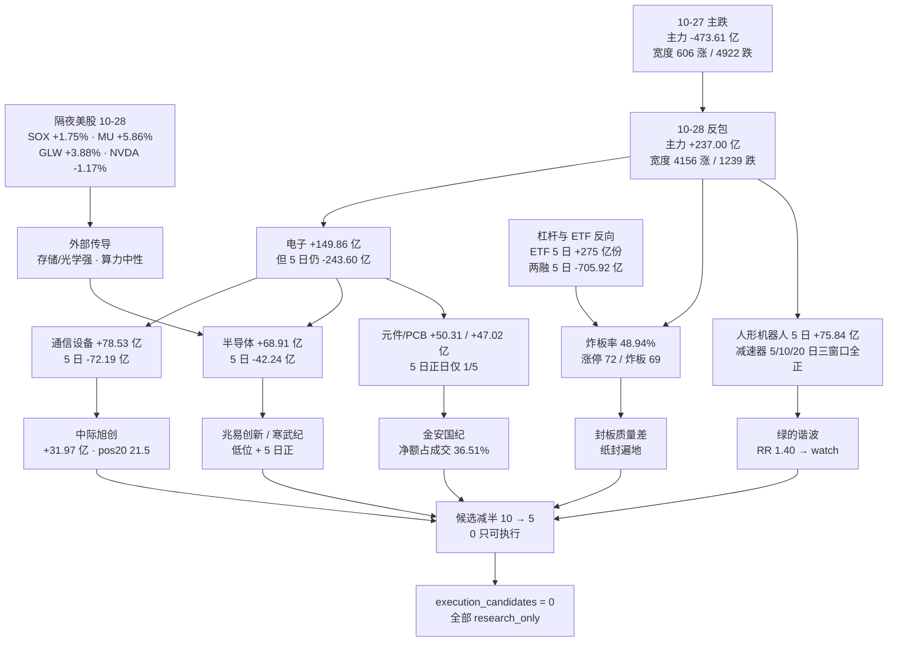

# 2026年10月29日 · **资金面**

> **数据源新鲜度**: partial（A 股资金全量至 10-28 收盘；两融/ETF 为 10-27；北向已停抓）
> **降级状态**: true（vibe 资金流通道故障 + 两融 T-1 + 无 R2 输入）
> **置信度**: 0.75

## 一句话结论

10-28 是 10-27 主跌后的第一次反包：主力单日 **+237.00 亿**、宽度从 606 家上涨翻到 4156 家，钱几乎全砸回电子链；但炸板率 **48.94%**、电子 5 日仍 **-243.60 亿**、20 日全市场仍 **-5,667 亿** —— 这是「反包第一天」不是「趋势确认」。今日只认低位龙头（中际旭创 / 兆易创新 / 寒武纪 / 金安国纪）+ 机器人链减速器龙头（绿的谐波，但 RR 1.40 已降级 watch），**0 只可执行**。

---

## 详细分析

### 1. 时序：20 日净流出 5,667 亿之后，出现第 3 个正日

| 交易日 | 全市场主力净额（亿） | 成交额（亿） | 备注 |
|---|---|---|---|
| 2026-10-22 | **-632.18** | 15,418.6 | 20 日窗口内最大单日流出 |
| 2026-10-23 | +8.34 | 19,728.5 | 放量但资金几乎零净流入，是「换手不放钱」 |
| 2026-10-26 | -281.84 | 16,230.9 | 反抽失败 |
| 2026-10-27 | **-473.61** | 14,729.0 | 主跌日，宽度 606 涨 / 4,922 跌 |
| 2026-10-28 | **+237.00** | 16,421.0 | 反包日，宽度 4,156 涨 / 1,239 跌 |

窗口统计（东财个股主力全市场求和口径）：

| 窗口 | 净额（亿） | 正日数 | 起止 |
|---|---|---|---|
| 5 日 | **-1,142.29** | 2/5 | 2026-10-22 → 10-28 |
| 10 日 | **-2,165.78** | 2/10 | 2026-10-15 → 10-28 |
| 20 日 | **-5,667.44** | 3/20 | 2026-09-23 → 10-28 |

**这个表最重要的一行是 5 日 -1,142 亿。** 单日 +237 亿很好听，但一根阳线只买回了前五个交易日流出量的 21%，20 日窗口里 17 个交易日是净流出。资金面现在的性质是**「超跌后的抽水回收」，不是「主升浪的增量建仓」**——这两种性质对应完全不同的打法：前者只能做反包第一天的低位龙头，后者才能做趋势中继和打板。

同时点：涨≥5% 家数 671 / 跌≥5% 58，涨停 72 / 跌停 5，是典型的「普涨修复日」结构，而非「主线点火日」。

### 2. 板块：钱回到跌幅最大的地方，而不是回到最强的方向

| 板块 | 今日净额（亿） | 5 日（亿） | 20 日（亿） | 5 日正日数 | 今日涨跌 |
|---|---|---|---|---|---|
| 电子 | **+149.86** | -243.60 | -1,627.97 | 2/5 | +3.86% |
| 通信 | +80.20 | -80.89 | -759.30 | 2/5 | +2.67% |
| 通信设备 | **+78.53** | -72.19 | -722.59 | 2/5 | +2.97% |
| 半导体 | +68.91 | -42.24 | -756.07 | 2/5 | **+4.88%** |
| 数字芯片设计 | +57.27 | **+79.64** | -324.86 | 3/5 | **+5.16%** |
| 元件 | +50.31 | -144.11 | -466.82 | 1/5 | +4.03% |
| 印制电路板 | +47.02 | -120.14 | -330.67 | 1/5 | +4.29% |
| 汽车零部件 | +25.24 | **+39.69** | +14.18 | 3/5 | +3.47% |
| 机器人 | +7.09 | **+18.24** | +11.29 | 4/5 | +3.67% |
| 电力设备 | -18.88 | -119.31 | -460.04 | 1/5 | +1.65% |
| 电池 | -14.40 | -60.24 | -187.04 | 1/5 | +1.68% |
| 证券Ⅱ | -13.98 | -46.73 | -181.50 | 1/5 | **-0.66%** |

三个判断：

1. **电子链是「跌幅的回补」，不是「新主线」**。电子 20 日 -1,627.97 亿、5 日 -243.60 亿，今天 +149.86 亿只补回 5 日缺口的 61%，而且 5 日里只有 2 天是正的。子行业里只有**数字芯片设计**做到 5 日 +79.64 亿、3/5 日正，是电子链内部唯一「中线已经转正」的环节。
2. **元件 / PCB 是纯脉冲**。元件 5 日 1/5 日正、PCB 5 日 1/5 日正，今天单日 +50.31 / +47.02 亿，属「一天把五天撤出的钱挪回来一部分」，次日没有承接的惯性。
3. **真正的持续性在机器人链，不在电子链**。概念端：人形机器人今日 +75.21 亿、5 日 **+75.84 亿**、10 日 +98.29 亿（20 日仍 -240.49，属刚从底部起来的第二段）；减速器今日 +30.81 亿、5 日 **+58.83 亿（4/5 日正）**、10 日 +74.66 亿、**20 日 +29.83 亿为正**；机器人执行器 5 日 +32.46 亿（4/5 日正）、20 日 +17.16 亿。**减速器与执行器是全场唯一「5 日 + 10 日 + 20 日三窗口同时为正」的细分。**

流出侧值得记一笔：证券 -13.98 亿、净额占成交 **-7.67%**，是全部大板块里最差的资金效率，且股价 -0.66%。指数反包而券商不跟，说明这波是资金回补而不是风险偏好抬升。

### 3. 昨日前十追踪：6 只延续 / 4 只反手，唯一「加速」的只有中际旭创

基准日 2026-10-27 的主力净流入前十，追踪到 2026-10-28：

| # | 名称 | 10-27 净额（亿） | 10-28 净额（亿） | 两日涨跌 | 5 日（亿） | 5 日正日 | pos20 | 判定 |
|---|---|---|---|---|---|---|---|---|
| 1 | 雪人集团 | +5.71 | **-2.04** | +5.24% → -2.31% | -1.08 | 2/5 | 29.5 | ❌ 反手 |
| 2 | 中际旭创 | +5.26 | **+31.97** | -2.94% → **+10.28%** | +29.72 | 3/5 | 21.5 | ✅ 延续·加速 |
| 3 | 大洋电机 | +5.05 | **-3.61** | +10.00% → +4.16% | +1.57 | 2/5 | 81.8 | ❌ 反手 |
| 4 | 兴业银行 | +4.63 | +0.70 | +2.25% → 0.00% | +2.63 | 3/5 | 98.6 | ✅ 延续（弱） |
| 5 | 药明康德 | +3.84 | +2.58 | -3.10% → +0.65% | -1.48 | 3/5 | 18.9 | ✅ 延续（弱） |
| 6 | 粤传媒 | +3.83 | **-0.44** | +6.56% → +3.56% | +1.53 | 2/5 | 73.6 | ❌ 反手 |
| 7 | 先导基电 | +3.18 | +1.78 | +0.62% → +2.77% | +3.36 | 3/5 | 14.7 | ✅ 延续（弱） |
| 8 | 方正电机 | +2.84 | **-0.23** | +9.05% → -0.09% | +3.16 | 3/5 | 81.2 | ❌ 反手 |
| 9 | 光库科技 | +2.84 | +3.86 | +2.94% → +4.59% | +8.67 | 4/5 | 58.9 | ✅ 延续（强于同业） |
| 10 | 贵州茅台 | +2.56 | +0.97 | +0.44% → -1.85% | +8.57 | 4/5 | 79.6 | ✅ 延续（弱） |

**读法**：延续的 6 只里，5 只都是「小额正流入」——钱没走，但也没加，属防守型存量；只有中际旭创是 5.26 → 31.97 亿的跳升。反手的 4 只（雪人集团 / 大洋电机 / 粤传媒 / 方正电机）**全部是 10-27 的涨停或大涨票**（+5.24% / +10.00% / +6.56% / +9.05%），次日资金立刻反手减仓。

这条规律今天可以直接用：**10-28 的 72 只涨停里，凡是「单日大额 + 位置高（pos20 > 80）」的，今天大概率重复「反手」剧本。** 这也是 10-28 净买第一名的万向钱潮（pos20 99.7）被我剔除的直接原因。

### 4. 龙虎榜：78 条事由 / 67 代码，23 只票出现派发或纸封线索

净买前十（单日口径优先）：

| 名称 | 涨跌 | 净买（亿） | 净买/成交 | 换手 | 备注 |
|---|---|---|---|---|---|
| 万向钱潮 | +10.02% | +2.82 | 20.64% | 3.21% | 但机构专用 **-0.20 亿**，pos20 99.7 |
| 斯迪克 | +20.00% | +2.14 | 11.71% | 9.73% | 封单仅占成交 **2.5%**（纸封） |
| 光华科技 | +9.99% | +1.60 | 17.29% | 10.90% | — |
| 世纪恒通 | +14.01% | +1.55 | 10.42% | **50.73%** | 当日炸过板 |
| 伟创电气 | +18.84% | +1.47 | 18.84% | 8.38% | 当日炸过板 |
| 宏明电子 | +15.55% | +1.41 | 7.40% | 35.66% | — |
| 金安国纪 | +10.01% | +1.31 | 8.22% | 3.77% | 唯一「净买 + 低位 + 5 日资金未负」的首板 |
| 博杰股份 | +10.00% | +1.27 | 14.90% | 7.51% | — |

净卖前十：

| 名称 | 涨跌 | 净卖（亿） | 净卖/成交 | 命中规则 |
|---|---|---|---|---|
| 西安奕材 | **-17.20%** | **-7.07** | -27.37% | 累计口径净卖（破位出货） |
| 天娱数科 | -0.73% | -2.77 | -7.94% | 单日净卖 + 换手 26.03% |
| 金固股份 | -10.06% | -1.28 | -26.59% | 单日净卖 |
| 洛轴股份 | +3.99% | -1.12 | -11.50% | 上涨中派发，换手 41.58% |
| 华瓷股份 | -10.01% | -1.04 | -5.28% | 单日净卖 |

**席位层面**（同一营业部/通道跨票汇总）：深股通专用买入 32.12 亿 / 卖出 24.79 亿，净 **+7.33 亿（18 只票）**——这是唯一体量级正向的通道；卖方集中在三条营业部：中信建投北京京西 **-2.93 亿**、中金北京建国门外大街 **-2.76 亿**、中金财富北京建国门外大街 **-2.06 亿**。三家北京席位同日大额单边卖出，接货方是分散的游资席位，属典型「机构通道 → 游资」的换手。

协同信号：同一（股票, 席位）在 10-26 / 10-27 / 10-28 三天内出现 ≥2 个交易日的有 **68 组**，剔除机构专用与沪深股通后具名 **66 组**，三天全覆盖 **5 组**。这个量级说明**没有单一游资在锁仓做票**，接力盘是散的。

派发/纸封清单 23 只，最硬的四条：

- **西安奕材 -17.20%，龙虎榜净卖 -7.07 亿（占成交 -27.37%）**，同时主力 -5.11 亿、pos20 3.3（已跌到 20 日最低区）——「破位 + 出货」双杀，是全场最大单票出货。
- **天娱数科 -0.73% 净卖 -2.77 亿、换手 26.03%**：涨停次日不出货但资金撤，高位接力失败的典型。
- **万向钱潮 +10.02% 净买 +2.82 亿，但机构专用净卖 -0.20 亿、pos20 99.7**：游资接机构货的高位首板，命中「机构净卖而股价大涨」规则。
- **朗信电气封单/成交 0.5%、炸板回封 10 次；莱美药业封单 1.9%、炸板回封 10 次**：这两只的「封住」是纸封，不是承接。

### 5. 隔夜美股（10-28 收盘）：存储与光学连续两天强，算力芯片分化

| 代码 | 10-28 收盘 | 10-28 涨跌 | 10-27 涨跌 | 归类 |
|---|---|---|---|---|
| MU | 983.23 | **+5.86%** | +2.77% | 存储 |
| GLW | 131.20 | **+3.88%** | -1.13% | 光通信/玻璃基板 |
| MRVL | 251.65 | **+3.32%** | +4.19% | 光模块 DSP |
| AMD | 578.44 | +3.24% | +5.45% | 算力 |
| AVGO | 351.81 | +2.77% | +4.00% | 光模块/交换芯片 |
| INTC | 95.53 | +1.91% | +3.61% | 半导体 |
| GOOGL | 324.89 | +1.34% | +1.19% | 大科技 |
| TSM | 439.51 | +0.60% | +2.95% | 代工 |
| AMZN | 254.60 | +0.59% | +1.61% | 大科技 |
| MSFT | 531.01 | -0.06% | -0.24% | 大科技 |
| TSLA | 404.22 | -0.80% | +4.04% | 大科技 |
| AAPL | 343.83 | -0.94% | +0.93% | 大科技 |
| NVDA | 215.38 | **-1.17%** | +0.90% | 算力龙头 |
| META | 612.49 | -1.24% | -1.64% | 大科技 |

| 指数 | 收盘 | 涨跌 |
|---|---|---|
| SOX（费半） | 11,684.0 | **+1.75%** |
| SPX | 7,743.98 | +0.28% |
| IXIC | 26,549.85 | +0.27% |
| DJI | 52,475.10 | +0.19% |

三篮子等权：半导体（MU/NVDA/AVGO/AMD/TSM）**+2.26%**、光学（GLW/MRVL）**+3.60%**、大科技（AAPL/MSFT/GOOGL/AMZN/META/TSLA）**-0.18%**。

**传导判断**：外部是「存储/光学强、大科技平、NVDA 独弱」。对今日 A 股的映射不是全面顺风，而是结构性的——**存储（兆易创新/佰维/澜起）与 CPO/PCB（中际旭创/新易盛/沪电）有二次确认，算力芯片（寒武纪）外部信号中性，要靠 A 股自身资金。** 注意 10-28 A 股电子链已经先涨过一轮，外部强势属「补一张确认票」，不是「首次点火」——所以不能把 MU +5.86% 当成今日追高的理由。

亚太同步（10-28 收盘）：KS11 **+6.63%**（韩国存储权重高，与 MU 同向）、TWII +2.04%、HKTECH +1.40%、N225 +1.08%、HSI +0.23%。韩国大涨是对存储链最直接的旁证。

### 6. 杠杆与 ETF：钱在 ETF 里加，在两融里撤

ETF 份额（最新 10-27，5 日净申赎，单位亿份）：

| ETF | 最新份额 | 5 日净申赎 |
|---|---|---|
| 科创50ETF | 857.79 | **+120.60** |
| 创业板ETF | 351.44 | **+78.01** |
| 沪深300ETF | 362.38 | +68.37 |
| 中证500ETF | 70.23 | +9.12 |
| 半导体ETF | 219.38 | +9.44 |
| 光伏ETF | 57.27 | -1.92 |
| 黄金ETF | 120.56 | -1.27 |

两融（最新 10-27）：

| 交易所 | 融资余额（亿） | 5 日变动（亿） | 融资买入（亿） |
|---|---|---|---|
| 深交所 | 11,459.27 | **-396.12** | 529.28 |
| 上交所 | 12,272.69 | **-308.83** | 605.36 |
| 北交所 | 77.91 | -0.97 | 4.16 |
| 合计 | 23,809.87 | **-705.92** | 1,138.80 |

**这是一组方向相反的钱**：ETF 5 日净申购 +275 亿份（科创50 + 创业板 + 沪深300 为主），两融 5 日 -705.92 亿。含义是——**长钱在借 ETF 抄底，杠杆钱在撤退。** 这种组合做出来的行情，通常表现为「指数抗跌、个股弹性差、涨停封不住」，正好对上 10-28 的炸板率 48.94%。它也解释了个股两融的普遍状态：5 只核心候选里 4 只融资余额 5 日为负（中际旭创 -18.79%、兆易创新 -2.31%、寒武纪 -4.38%、金安国纪 -8.83%），只有绿的谐波 +2.38%。

### 7. 跷跷板：57 对强负相关，但只有 8 对出现 5 日方向反转

测试范围：东财行业 496 个，取 |20 日净额| > 5 亿的 298 个，两两 44,253 对，20 日净额序列 Pearson ≤ -0.6 的有 **57 对**，其中出现「前 5 日 < 0 且近 5 日 > 0」方向反转的仅 **8 对**，且反转方体量普遍很小（仪器仪表 +0.23 亿、家用电器 +1.00 亿、空调 +2.88 亿）。

最强的三对：半导体 vs 铁路运输 **-0.875**、电子 vs 铁路运输 **-0.783**、数字芯片设计 vs 铁路运输 **-0.772**。铁路运输 5 日 -4.85 亿、单日 -1.89 亿，体量小到不构成「资金搬家」。

**结论**：10-28 的资金不是「从 A 板块搬到 B 板块」的轮动，而是「抽回电子链」的修复。所以**不能用跷跷板去推「下一个轮动方向」**——这正是今天不推低位补涨票、只推核心龙头的量化依据。

---

## 关键证据

- **证据 1**：10-28 全市场主力净额 **+237.00 亿**，是 20 日窗口（累计 -5,667.44 亿）内第 3 个正日；5 日合计仍为 **-1,142.29 亿**。来源 `tushare.moneyflow_dc`（20 日 × 全市场，120,521 条个股价日记录）。
- **证据 2**：涨停 72 家、炸板 69 家，炸板率 **48.94%**；连板天梯 1 板 64 / 2 板 5 / 3 板 2 / 5 板 1，最高板 5 板仅襄阳轴承一只孤票。来源 `tushare.limit_list_d`（10-28）。
- **证据 3**：电子今日 +149.86 亿，但 5 日 **-243.60 亿**、20 日 **-1,627.97 亿**，5 日正日仅 2/5；子行业里只有数字芯片设计 5 日 +79.64 亿（3/5 日正）转正。来源 `tushare.moneyflow_ind_dc`（496 行业 × 20 日）。
- **证据 4**：减速器 5 日 +58.83 亿（4/5 日正）、10 日 +74.66 亿、20 日 +29.83 亿——全场唯一三窗口全正的细分；人形机器人 5 日 +75.84 亿。来源 `tushare.moneyflow_ind_dc` 概念表（519 个 × 20 日）。
- **证据 5**：龙虎榜 78 条事由 / 67 代码，西安奕材净卖 **-7.07 亿**（占成交 -27.37%），深股通通道净 **+7.33 亿**（18 只），三家北京营业部单日合计净卖 **-7.75 亿**。来源 `tushare.top_list + top_inst`，与 `vibe_trading.get_dragon_tiger` 78 条逐条一致。
- **证据 6**：ETF 5 日净申购 +275 亿份（科创50 +120.60 / 创业板 +78.01 / 沪深300 +68.37），同期两融三所 5 日 **-705.92 亿**。来源 `tushare.fund_share` + `tushare.margin`（均为 10-27）。
- **证据 7**：隔夜 10-28 美股半导体篮子等权 +2.26%、光学篮子 +3.60%、大科技 -0.18%，SOX +1.75%，KS11 +6.63%。来源 `vibe_trading.get_market_data(yahoo)`，与 `tushare.us_daily` 10-27 收盘逐只交叉一致。

---

## 候选票（5 只 · 全部 research_only · 0 只可执行）

> 依据纪律：炸板率 48.94% ≥ 35% → 候选数从 10 砍半到 5；R7 不授予任何开仓权限，`execution_candidates` 为空数组。

| 代码 | 名称 | 角色 | 今日主力（亿） | 净额占成交 | 5 日（亿） | 5 日正日 | 20 日（亿） | pos20 | 距 20 日高 | RR | 档位 |
|---|---|---|---|---|---|---|---|---|---|---|---|
| 300308.SZ | 中际旭创 | 龙头 | **+31.97** | 13.56% | +29.72 | 3/5 | -101.43 | 21.5 | -32.24% | 4.71 | research |
| 603986.SH | 兆易创新 | 龙头 | +17.64 | 14.36% | +19.43 | 2/5 | -57.73 | 15.4 | -28.96% | 5.63 | research |
| 688256.SH | 寒武纪 | 龙头 | +6.28 | 6.98% | +15.71 | 3/5 | **+17.53** | 42.5 | -14.92% | 3.37 | research |
| 002636.SZ | 金安国纪 | 龙三 | +5.84 | **36.51%** | -0.61 | 2/5 | -21.39 | 14.1 | -36.32% | 6.10 | research |
| 688017.SH | 绿的谐波 | 龙头 | +2.07 | 5.49% | +4.56 | 4/5 | +2.61 | 70.3 | -8.41% | **1.40** | **降级 watch** |

### 首推：中际旭创（300308.SZ）· 思维链

**① 买入理由（为什么是它，不是新易盛/天孚）**
全市场主力第 1 名 +31.97 亿、净额占成交 13.56%，同时是 10-28 全场第 1 成交量（235.73 亿）。关键在于位置与资金的错配：pos20 只有 21.5、距 20 日高 -32.24%，价格刚从底部抬起来 10.28%，钱却已经是全市场第一。同链的新易盛今天 +14.84 亿但 5 日 -24.47 亿、天孚 +8.96 亿但 5 日 -0.36 亿，只有中际旭创做到 5 日 +29.72 亿（3/5 日正）。**「钱先到、价还没到」是反包日唯一值得跟的形态**，而且要跟就跟买得最多的那只。

**② 风险点（四条，按硬度排序）**
1. 20 日仍 -101.43 亿，5 日 +29.72 亿只补回 29%——中线筹码是「刚回流」不是「已锁仓」，一旦次日转负就是二次探底；
2. 10-23 有 4 笔大宗共 3.11 亿，全部「机构专用卖出 → 营业部买入」、成交价 612.63 与当日持平（平价转仓），这是机构把货交给游资，等于在上方 3 亿的供给；
3. 融资余额 5 日 **-18.79%**（25.66 → 20.87 亿）、15 日 -35.84%，杠杆在这波下跌里出清了近两成，反弹完全没有杠杆助推；
4. 235.73 亿成交对应换手仅 4.18%，分歧集中在大资金内部，次日若不能放量站上 10-27 高点，反包直接失败。

**③ 止损条件（资金口径，不是价格口径）**
次日主力净流出 > 8 亿、或通信设备板块 5 日净额重新跌破 -100 亿、或股价跌破 10-28 阳线实体中点——三者任一成立即视为逻辑证伪。机械盈亏比体检：止损参考 572.01（近 3 日最低与 -5% 取更近者）、目标参考 939.00（20 日最高），risk 10.10% / reward 47.57% / RR 4.71。**RR 是机械口算，不代表买点，且 10.10% 的止损距已到纪律 §4 的 -5% ~ -10% 硬区间上限，实盘必须靠小仓位压住绝对风险。**

**④ 可验证假设**
若今日通信设备板块维持净流入、且个股主力继续为正 → 「电子链反包第 2 天」成立，可从 research 升级为主线票；
若板块转负而个股独撑 → 按单票脉冲处理，不参与；
若个股主力净流出 > 8 亿 → 直接出局，不做「等反抽」。

### 其余四只 · 三问速览

| 名称 | 大资金意图 | 为什么走强 | 逻辑够不够硬 |
|---|---|---|---|
| 兆易创新 | +17.64 亿（净额占成交 14.36%，全场第 2），5 日 +19.43 亿但只有 2/5 日正——钱是两天砸进来的，节奏不稳 | 半导体 +68.91 亿、数字芯片设计 +57.27 亿（5 日 +79.64 亿全市场第 1）双板块托底；外盘 MU +5.86% 二次确认 | 中等。20 日仍 -57.73 亿、两融 5 日 -2.31% 未跟涨；逻辑完全依赖「存储涨价 + 外盘强」两条外部条件，A 股自身没有独立定价权 |
| 寒武纪 | +6.28 亿、5 日 +15.71 亿（3/5 正）、**20 日 +17.53 亿**——在 20 日全市场 -5,667 亿的背景下，是极少数 5 日与 20 日双正的大票 | AI 芯片概念 +21.35 亿、5 日 +28.58 亿；算力总龙地位带来的被动配置 | 偏硬。双正结构是真金，但 30 日 6 笔大宗全平价、卖方 4 笔为中金建国门外大街（机构转仓），上方 1.9 亿供给；两融 5 日 -4.38%，杠杆还在退 |
| 金安国纪 | +5.84 亿，**净额占成交 36.51%（全市场第 1）**——极端集中，是「有人在专门买这一只」 | 覆铜板属 PCB 上游，元件 +50.31 亿 / PCB +47.02 亿同步；龙虎榜净买 +1.31 亿 | 偏弱。5 日 -0.61 亿、20 日 -21.39 亿，今天的钱是第一天进来；封单/成交 20.5% 未达 30% 硬封线；两融 5 日 -8.83%，是游资盘不是杠杆盘；流通市值 424.9 亿接不住大资金 |
| 绿的谐波 | +2.07 亿、5 日 +4.56 亿（**4/5 日正**）、20 日 +2.61 亿——三窗口全正，是机器人链里资金最稳的一只 | 减速器 5 日 +58.83 亿（4/5 正）、10 日 +74.66 亿、20 日 +29.83 亿，全场唯一三窗口全正细分；人形机器人 5 日 +75.84 亿 | 方向对、位置错。pos20 70.3、距 20 日高 -8.41%，属趋势中段；个股 5 日 +4.57 亿 << 板块 +58.83 亿，钱更多散在鸣志/三花/双环；RR 仅 **1.40**，命中纪律 §4 → 降级 watch，不进 execution |

---

## 数据源审计

| 源 | 状态 | 抓取时间 | 记录数 | 备注 |
|---|---|---|---|---|
| tushare.moneyflow_dc | 🟢 ok | 2026-10-29 | 120,521 | 20 日 × 全市场个股主力（万元） |
| tushare.moneyflow_ind_dc | 🟢 ok | 2026-10-29 | 10,150 | 496 行业 + 519 概念 × 20 日（元） |
| tushare.top_list / top_inst | 🟢 ok | 2026-10-29 | 78 | 78 条事由 / 67 代码 / 59 单日票；席位明细 780 行 |
| tushare.limit_list_d | 🟢 ok | 2026-10-29 | 146 | 涨停 72 / 炸板 69 / 跌停 5 |
| tushare.daily / daily_basic | 🟢 ok | 2026-10-29 | 33,420 | 6 个交易日 × 约 5,570 只 |
| tushare.margin（市场级） | 🟡 partial | 2026-10-29 | 129 | 43 日 × 3 所，最新 2026-10-27 |
| tushare.margin_detail（个股） | 🟡 partial | 2026-10-29 | 12 只 | 11 只观察票 + 绿的谐波补抓 35 日，最新 2026-10-27 |
| tushare.fund_share | 🟡 partial | 2026-10-29 | 7 | 7 只 ETF，最新 2026-10-27 |
| tushare.index_daily / index_global | 🟢 ok | 2026-10-29 | 193 | A 股 6 大指数 + HSI/HKTECH/KS11/N225/TWII 至 10-28 |
| tushare.us_daily | 🟡 partial | 2026-10-29 | 14 | 停在 10-27（供应商滞后），10-28 由 yahoo 补齐 |
| vibe_trading.get_market_data(yahoo) | 🟢 ok | 2026-10-29 | 18 | 美股 14 只 + 4 指数 10-28 收盘 |
| vibe_trading.get_dragon_tiger | 🟢 ok | 2026-10-29 | 78 | 与 tushare 逐条一致 |
| vibe_trading.get_block_trades | 🟢 ok | 2026-10-29 | 36 | 4 票；中际旭创 27 笔 / 寒武纪 6 笔 / 沪电 3 笔 / 金安国纪 0 笔 |
| vibe_trading.get_margin_trading | 🟢 ok | 2026-10-29 | 25 | 5 票，与 tushare 逐日余额一致 |
| vibe_trading.get_fund_flow | 🔴 error | 2026-10-29 | 0 | 代理不可达，个股主力只剩 tushare 东财单源 |
| overseas_snapshot.json | 🔴 error | — | 0 | `data/raw/20261029` 不存在；R7 未越权写 data/raw |
| R2_main_sectors.json | 🔴 error | — | 0 | R2 未产出，主线不继承，候选由资金榜反推 |
| 北向（moneyflow_hsgt / hk_hold） | ⚫ retired | — | 0 | 2026-10-28 起停抓，按要求不调用、不旁路补 |

**覆盖**：行业 496 × 20 日、概念 519 × 20 日、个股价日 120,521 条、龙虎榜 78 条、涨停 146 条、ETF 7 只、美股 14 只 + 4 指数、亚太 5 指数。

---

## 不确定性 / 反证

1. **「反包」可能只是一日反抽。** 5 日 -1,142 亿、10 日 -2,166 亿、20 日 -5,667 亿，今天的 +237 亿在算术上微不足道。若今日电子链不能延续净流入，「反包第一天」就是「反包唯一一天」。这是本报告最大的反证。
2. **个股主力只有 tushare 一个证据面。** vibe `get_fund_flow` 全域代理故障，东财口径无法双源交叉；板块与个股又同属东财体系，不是独立证据。若东财数据本身有偏差，本报告的板块-个股共振结论会被同步污染。
3. **两融与 ETF 都是 T-1。** 10-28 的杠杆与申赎变化要次日盘前稍晚才可见。若 10-28 两融余额大幅回升，则「长钱抄底、杠杆撤退」的判断要打折。
4. **无期现维度。** 50ETF/300ETF 隐波、IF/IC/IM 盘前基差均缺源，无法做期现背离预警——这是本报告结构性缺口，不是取舍。
5. **无 R2 输入。** 研究对象是从资金榜反推的，可能与今日真正主线错位；若 R2 认定主线不是电子链，则本报告 5 只候选的相关性要整体下调。
6. **龙虎榜样本偏差。** 78 条事由只是选定席位样本，不等于全市场主力净额，也不构成操纵证据。hard_reject 权归 R6，R7 不越权。
7. **数据源健康降级。** `data/raw/20261029` 无 manifest / mcp_health / overseas_snapshot，severity 未声明；`degraded=true` 已如实标注，confidence 0.75 已在覆盖度（0.90）与源独立性（0.58）之间取加权。

---

## 与其他 R/D/E 的关系

- **依赖**：`data/raw/20261029/manifest.json`（缺失）、`overseas_snapshot.json`（缺失，改 yahoo 通道）、`tushare` 20 日资金全量、`vibe_trading` 龙虎榜/大宗/两融/美股、`R1_style.json`（可选，未就绪）、`R2_main_sectors.json`（未就绪）。
- **被消费**：D1（canghai-plan）读取 `staleness_status=ok` 正常消费、`confidence=0.75`、`risk_limits` 参考两融与 ETF 方向；R6 读取 `distribution_alerts`（23 条）与 `hot_money.net_sell_top10` 做反证，hard_reject 由 R6 出；R5 可复用本报告的 `stock_flows` 20 日序列与大宗/两融明细。
- **不授予**：`execution_candidates=[]`，`trading_authority=none`，R7 全程不授予任何开仓权限。

---

## Sub-Agent 元数据

- skill: `analyze_capital_flow_v1@1.3`（子 skill：`hot_money_synergy_v1@1.1` / `detect_seesaw_pairs_v1`）
- artifact: `data/research/20261029/R7_capital_flow.json`（443 KB）+ `R7_capital_flow_20261029.json`（同日双写）
- batch: `premarket_full` · staleness_status: `ok` · resolved_trade_date: `20261028` · trading_gap: `0`
- 候选池: 5（炸板率 48.94% ≥ 35% 触发减半）· execution: 0
- model: ark-code-latest
- 生成耗时: 约 9 分钟（凌晨档起跑至落盘）
- 验收: `tests/checks/check_r7_staleness.py 20261029` → ✅ 通过（凌晨档以 trading_gap=0 + pre_06am_gate attestation 放行）
