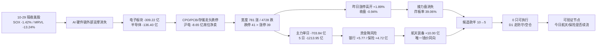

# 2026年10月30日 · **资金面**

> **数据新鲜度**: partial（A 股 10-29 全量 / 两融与 ETF 10-28 / 美股 10-29）
> **降级状态**: true（无 raw/20261030 manifest 与 mcp_health；北向按 2026-10-28 停抓）
> **置信度**: 0.78

## 一句话结论

**10-29 把 10-28 的反包全部还回去了：主力单日 -703.84 亿、跌停 41 家首次多于涨停 39 家、炸板率 39.06%、昨日 72 只涨停股开盘 +1.89% 收盘 -0.94%（高开低走 2.8 个点）。今日属主跌段、主线未确认，R7 不给开仓资格：研究观察 5 只、可执行 0 只。**

---

## 详细分析

### 一、反包只有一天，10-29 是「高开低走 + 主力撤退」的组合拳

| 指标 | 10-28（反包日） | 10-29 | 变化 |
|---|---|---|---|
| 主力净额 | +237.00 亿 | **-703.84 亿** | 20 日窗口最差单日 |
| 上涨 / 下跌家数 | 4,156 / 1,239 | **781 / 4,728** | 宽度塌回 14% |
| 涨幅>5% / 跌幅>5% | 671 / 58 | **104 / 992** | 反向 10 倍 |
| 涨停 / 跌停 | 72 / 5 | **39 / 41** | 5 日窗口内跌停首超涨停 |
| 炸板率 | 48.94% | **39.06%** | 仍高于 35% 红线 |
| 成交额 | 16,421 亿 | 15,707 亿 | 缩量下跌 |

更关键的是**昨日涨停溢价**：10-28 的 72 只涨停股，10-29 开盘平均 **+1.89%**、收盘平均 **-0.94%**、中位 **-2.40%**，正收益只有 **33.3%**。开盘给溢价、收盘收阴线，这就是标准诱多结构 —— 前一天追涨停的资金，今天在开盘三十分钟里被完整交接。

主力时序同样没有连续性：5 日 **-1,213.95 亿**（2/5 天正）、10 日 **-2,232.11 亿**（2/10）、20 日 **-5,982.87 亿**（3/20）。10-28 那 +237 亿放在 20 日序列里只是第 3 个正日，10-29 一根阴线全部回收，说明 10-28 是反抽不是转折。

### 二、钱从电子链整体抽离，漏到军工与金融

| 方向 | 今日净额（亿） | 5 日（亿） | 板块涨幅 | 读法 |
|---|---|---|---|---|
| 电子 | **-309.22** | -389.37 | -5.34% | 板块级撤退，不是个股行为 |
| 半导体 | -136.40 | -124.00 | -5.55% | 10-28 的 +68.91 亿两天内全部倒出 |
| 通信设备 | -111.15 | -97.38 | -5.53% | CPO 链核心 |
| 元件 | -90.04 | -170.01 | -6.99% | PCB 上游 |
| 印制电路板 | -82.49 | -140.59 | **-7.97%** | 跌幅最深 |
| 数字芯片设计 | -65.33 | **+33.06** | -5.69% | 唯一 5 日仍正的大板块，但今天被砸 |
| 航天装备Ⅱ | **+10.00** | **+10.92** | +3.54% | 唯一「今日+5日双正」的方向 |
| 国防军工 | +8.75 | -39.59 | -0.39% | 只有 1 天资金，底座没修好 |
| 风电设备 | +8.19 | -0.28 | +1.94% | 单日脉冲 |
| 国有大型银行Ⅲ | +5.77 | +2.62 | +2.31% | 4/5 天净流入，防守资金 |
| 保险Ⅱ | +4.72 | +2.65 | +1.61% | 3/5 天净流入 |
| 白酒Ⅱ | +4.25 | +7.18 | +0.08% | 4/5 天净流入，低波防守 |

个股层面更能看清去向：流出榜前 8 名全部是 AI 硬件链 —— 天孚通信 **-21.72 亿（-19.77%）**、沪电股份 -12.84 亿（跌停）、新易盛 -11.55 亿（-11.06%）、胜宏科技 -11.39 亿（-11.05%）、工业富联 -10.68 亿（-7.03%）、东山精密 -10.62 亿（跌停）、亨通光电 -9.83 亿、中际旭创 -9.65 亿（-8.53%）。流入榜前十则是中国卫星 +6.64、西部材料 +5.00、中国平安 +4.19、冰山冷热 +3.85、五粮液 +3.48、钧达股份 +3.04、工商银行 +3.02、顺灏股份 +2.80、百亚股份 +2.79、农业银行 +2.72 亿 —— 除了军工两只，其余是银行、保险、白酒、个护这类「跌不动的票」。

**读法**：这不是板块轮动，是降风险。轮动的前提是「卖出的钱去找新方向」，而当天的证据是电子 -309 亿、接盘方向合计不到 +40 亿，净差额被抽走了。所以不能用跷跷板去推「下一个轮动方向」（见反证段）。

### 三、龙虎榜：机构在硬件链砸盘，游资在小票对倒

- **卖方三巨头**：沪电股份 -8.65 亿（跌停，全场最大单票出货）、天孚通信 -5.11 亿（累计口径，-19.77%）、佰维存储 -3.83 亿（-15.79%）。三个环节 —— PCB、光模块、存储 —— 同日被席位砸盘，不是个别资金失误。
- **买方是小票游资**：襄阳轴承 +1.57 亿（+6.47%）、冰山冷热 +1.51 亿（涨停）、澳洋健康 +1.49 亿（涨停）、邵阳液压 +1.30 亿（20cm）、西部材料 +1.25 亿（涨停）。买方没有一只是在硬科技主线上。
- **3 日席位协同 58 组**（具名 56 组、3 日全覆盖 6 组），唯一个 3 日连续卖方协同的候选是**冰山冷热**：国信浙江互联网 -1,861 万、东财昌都 -610 万、东财拉萨 -481 万，同日该票换手 **53.02%**、龙虎榜却显示净买 +1.51 亿 —— 涨停价上换手出货的典型，已剔除。
- **19 只派发/弱封线索**，最极端三条：光洋股份封单/成交仅 **0.3%**、炸板回封 **17 次**；宇晶股份涨停但机构专用净卖 -5,047.6 万；飞沃科技 +17.09% 却龙虎榜净卖 -8,379 万并当日炸板。

### 四、隔夜美股：AI 硬件链集体回吐，A 股今日没有外部顺风

| 标的 | 10-29 收盘 | 涨跌 | 映射 |
|---|---|---|---|
| MRVL | 218.34 | **-13.24%** | 光模块/定制芯片，直接压 CPO |
| GOOGL | 283.82 | **-12.64%** | 财报级冲击，压 AI 应用情绪 |
| MU | 934.27 | -4.98% | 存储，10-28 的 +5.86% 被完整收回 |
| AMZN | 243.79 | -4.25% | 云资本开支预期 |
| INTC | 92.07 | -3.62% | 半导体 |
| AMD | 566.42 | -2.08% | 算力 |
| AVGO | 345.00 | -1.94% | 光通信/ASIC |
| TSM | 431.81 | -1.75% | 代工 |
| GLW | 128.88 | -1.77% | 光学 |
| NVDA | 213.66 | -0.80% | 龙头抗跌，分化 |
| AAPL / META | 348.91 / 624.52 | +1.48% / +1.96% | 与 AI 硬件无关 |

指数：SOX **11,518.20（-1.42%）**、SPX -0.30%、IXIC -1.38%、DJI -0.25%。篮子：半导体（MU/NVDA/AVGO/AMD/TSM）等权 **-2.31%**、光学（GLW/MRVL）**-7.50%**、大科技 **-2.31%**。

**结论**：10-29 A 股 CPO/PCB/存储的杀跌不是错杀，隔夜外盘又补了一刀，今天这三个方向连反抽的资格都要重新验证；军工、金融、内需与美股无关，是今日唯一不受外盘压制的方向 —— 这也是候选池里没有一只电子票的原因。

### 五、杠杆与 ETF 反向：散户在申购，杠杆在撤退

- **两融（10-28，T-1）**：SSE 12,303.08 亿、SZSE 11,449.52 亿、BSE 77.58 亿，三所 5 日合计 **-670.90 亿**（SSE -269.36 / SZSE -400.31）。
- **ETF 份额（10-28，T-1）**：科创50 **+103.71 亿份**、沪深300 +61.78、创业板 +56.99、中证500 +9.89、半导体 +4.08，只有光伏（-1.32）与黄金（-1.57）净赎回。
- **读法**：指数越跌 ETF 越申购、两融越撤 —— 这是「被动抄底 + 主动去杠杆」并存的结构，它解释了为什么指数跌幅不算崩、但个股跌停数却超过涨停数：承接的是指数化资金，个股层面没有接力盘。

### 推理深度三问 · 航天装备（今日唯一「钱价板块三同向」的方向）

- **大资金意图**: 主跌段里资金要的不是弹性而是「不与外盘共振」。航天装备与美股 AI 链零相关、板块容量小（当日仅 +10 亿净流入就能拉 +3.54%），是弱势市场里成本最低的做多方向；对手盘是从电子链撤出、又不敢空仓的短线资金。
- **为什么走强**: 位置 + 催化 + 筹码三面对齐 —— 板块 5 日 +10.92 亿（2/5 天正）刚从 -5.19 亿的 20 日累计里翻上来，位置在中位；催化是主跌段的避险切换；筹码端中国卫星涨停但**未进龙虎榜前 5**，没有席位证据，只能确认「有资金」不能确认「谁的资金」。
- **逻辑够不够硬**: 不够硬。三个独立源里只有资金面一项（板块+个股同向），没有硬政策、硬订单、硬时间锚；且同板块的国防军工 5 日仍 -39.59 亿、航空装备 5 日 -28.38 亿，行业底座是破的。证伪路径很短：今日开盘若航天装备板块转为净流出，整条逻辑当天作废。

---

## 候选观察池（5 只 · 全部 research_only · 可执行 0 只）

> 炸板率 39.06% ≥ 35% 红线 → 候选数按纪律砍半（10 → 5）。R7 不授开仓权，以下全部 `execution_eligible=false`。

| # | 标的 | 链条 / rank | 当日主力 | 5日主力（正天） | pos20 | 板型 | RR | 处置 |
|---|---|---|---|---|---|---|---|---|
| 1 | 中国卫星 600118.SH | 航天装备 / 龙头 | +6.64 亿 | +6.40 亿（2/5） | 67.1 | 涨停·尾盘纸封 | 0.52 | 观察·不接力 |
| 2 | 西部材料 002149.SZ | 军工材料 / 龙二 | +5.00 亿 | +5.28 亿（2/5） | 74.2 | 涨停·弱封 5.37% | 0.38 | 观察·不达标 |
| 3 | 中国平安 601318.SH | 保险 / 龙头 | +4.19 亿 | +7.38 亿（4/5） | 81.1 | 非涨停·防御 | 0.27 | 防御观察·不追 |
| 4 | 百亚股份 003006.SZ | 个护 / 龙头 | +2.79 亿 | +16.39 亿（**5/5**） | 25.5 | 非涨停·跌 3.68% | **2.47** | 观察·待价格确认 |
| 5 | 钧达股份 002865.SZ | 光伏电池 / 龙三 | +3.04 亿 | +4.21 亿（3/5） | **99.0** | 涨停·早封 9.68% | 0.01 | 高位·不接力 |

### 1. 中国卫星 600118.SH · 航天装备龙头 · 观察不接力

- **买入理由**: ① 全市场主力净流入第 1（+6.64 亿，净额占成交 21.3%），航天装备板块当日 +10.00 亿、5 日 +10.92 亿、板块涨幅 +3.54%，是 10-29 唯一「钱、价、板块」三者同向的方向；② 主板大票（流通市值 661 亿、成交 31.13 亿）在主跌日能封住涨停，说明有真实的板块级买盘，不是小票对倒。
- **风险点**: ① 封板质量最差一档 —— **10:24 首封、14:08 最后封、盘中开板 8 次、封单/成交仅 2.66%**，尾盘偷袭型纸封，次日兑现概率高于溢价；② 未进入当日龙虎榜（沪市涨幅偏离前 5 名之外），没有席位证据；③ 5 日 +6.40 亿里有 6.64 亿来自最后一天，前 4 日合计为负；④ 两融 23.88 亿、5 日 -1.99%、15 日 -11.08%，杠杆不参与。
- **止损条件**: 次日封板时间晚于 10:30 或再度开板、或航天装备板块单日净流出 > 3 亿 → 纸封证伪，直接放弃，不看价格。
- **可验证假设**: 若今日开盘 30 分钟内封住且封单/成交 > 10%，则「军工航天=弱势唯一新方向」成立；若冲高回落跌破 55.90（昨日涨停价），按一日游处理，24h 内即可判定。

### 2. 西部材料 002149.SZ · 军工材料龙二 · 观察不达标

- **买入理由**: ① 主力 +5.00 亿（全市场第 2，占成交 27.1%）且龙虎榜净买 +1.25 亿（第 5 名），是候选里唯一「主力 + 席位」双正的票；② 5 日 +5.28 亿（2/5 天正）、20 日 +8.10 亿，三窗口里少数全正的标的。
- **风险点**: ① 封板晚（13:02 才封死）、封单/成交 5.37%，在 39.06% 炸板率环境里属「能封不硬」；② 机械 RR 0.38（止损距 16.19%、上方空间 6.13%），**按纪律 §4 必须降级 watch**；③ 两融 6.51 亿、5 日 -3.52%、15 日 -8.10%，杠杆在撤；④ 小金属板块 5 日净额仍为负，个股强于板块。
- **止损条件**: 次日龙虎榜转为净卖、或封单/成交跌破 3%、或跌破 30.72（昨日涨停板实体中枢）。
- **可验证假设**: 今日若继续上榜且龙虎榜仍净买 → 军工材料是真接力；若开盘 10 分钟内维持不住 +3%，按游资一日游处理。

### 3. 中国平安 601318.SH · 保险龙头 · 防御观察不追

- **买入理由**: ① 主力 +4.19 亿（第 3）、5 日 +7.38 亿（4/5 天正）、20 日 +5.08 亿 —— 在全市场 20 日 -5,982.87 亿的背景下是极少数三窗口同时为正的权重票；② 保险 +4.72 亿、国有大行 +5.77 亿、白酒 +4.25 亿，防御方向的资金是连续的而非脉冲。
- **风险点**: ① 位置不便宜 —— pos20 81.1、距 20 日高仅 -1.34%，RR **0.27**、上方空间只有 1.35%，按纪律 §4 直接判 watch；② 10-29 大宗 5 笔全平价（0% 溢价、合计约 0.44 亿），不构成吸筹也不构成出货证据；③ 两融 352.49 亿、5 日 -1.88%，超大票杠杆变化没有边际意义；④ 这是「跌出来的防守」，指数一稳资金就回流进攻。
- **止损条件**: 保险Ⅱ 板块 5 日净额转负、或个股单日主力净流出 > 3 亿 → 防御逻辑证伪。
- **可验证假设**: 今日若大盘继续弱而保险/银行保持净流入 → 风险偏好下行，D1 应压进攻仓；若保险转负而军工接力 → 风险偏好在回升，防御不参与。

### 4. 百亚股份 003006.SZ · 个护龙头 · 观察待价格确认

- **买入理由**: ① 5 日主力 **+16.39 亿且 5/5 天全正**（全场唯一）、20 日 +61.11 亿，资金连续性远好于其他候选；② 个护用品 5 日 +15.82 亿（5/5 正）、生活用纸 +15.76 亿（5/5 正）、10 日 +33.34 亿，是唯一「板块 5 日全正 + 个股 5 日全正」的组合；③ pos20 25.5（20 日区间下 1/4）、机械 RR **2.47**（止损距 5.00%、上方 12.32%），是 5 只里唯一过 RR≥2 的。
- **风险点**: ① **钱在进、价在跌** —— 5 日主力 +16.39 亿而股价 -2.71%、当日 -3.68%，大单口径下既可能是低位吸筹也可能是对倒托价，单看资金无法区分；② ret20 仍 +66.09%，pos20 低只代表从高点回撤 1/4，不代表便宜；③ 16.39 亿这个极端值来自东财口径（tushare moneyflow_dc 与 vibe get_fund_flow 逐日一致，但同源），没有第二个独立证据面；④ 非两融标的，无法用杠杆变化交叉验证。
- **止损条件**: 次日主力转为净流出 > 1 亿、或跌破 21.13（近 3 日低点 / 20 日区间下沿）→ 吸筹假设破，按对倒托价处理。
- **可验证假设**: 今日若收在 22.60 上方且主力仍净流入 → 「低位连续吸筹」成立，可升级为观察首选；若继续放量下跌 → 16 亿净流入按接盘货处理并剔除。

### 5. 钧达股份 002865.SZ · 光伏电池龙三 · 高位不接力

- **买入理由**: ① 主力 +3.04 亿（占成交 27.7%）、龙虎榜净买 +0.67 亿、5 日 +4.21 亿（3/5 天正）；② 09:58 首封、10:02 封死、开板 1 次、封单/成交 9.68%，是候选里封板质量最好的一只；③ 两融 4.23 亿、5 日 **+14.52%**、15 日 +15.88%，是唯一杠杆在加速加仓的票。
- **风险点**: ① **位置硬伤** —— pos20 99.0、距 20 日高 -0.18%，机械 RR 0.01，上方没有空间，违反纪律 §4；② 光伏设备板块 5 日 -13.34 亿、20 日 -76.39 亿，板块资金仍在流出，个股涨停是独立行为；③ 电池板块当日 -21.43 亿（-3.99%），新能源链整体失血；④ 杠杆加最猛 = 回撤时平仓压力最大。
- **止损条件**: 次日不能封板即按接力失败处理；跌破 36.69（昨日涨停板实体中枢）→ 杠杆盘反手。
- **可验证假设**: 今日若光伏设备板块资金转正且二板成立 → 独立行情升级；若板块继续流出而个股开板 → 按高位情绪票处理，不做二板。

---

## 剔除清单（不为数量造票，逐条写明理由）

| 标的 | 当日 | 剔除理由 |
|---|---|---|
| 冰山冷热 000530.SZ | 涨停 +10.03%，龙虎榜净买 +1.51 亿 | 3 日席位协同全是卖方（国信浙江互联网 -1,861 万等 3 席）、换手 53.02% → 涨停价换手出货；5 日主力 -0.52 亿 |
| 澳洋健康 002172.SZ | 涨停 +10.04%，2 连板 | 4 次开板、连续三日涨幅累计 20% 上榜、换手 27.8%、流通仅 41 亿 → 高位游资接力，非龙头 |
| 顺灏股份 002565.SZ | 涨停 +10.00% | 机械 RR 1.73（止损距 14.25% 过宽）、5 日主力 -4.01 亿（钱没进来） |
| 中际旭创 300308.SZ | -8.53%，主力 -9.65 亿 | 股价 5 日 -10.01%、20 日 -35.01%；昨日主力第 1 今日反手，且隔夜 MRVL -13.24% → 内外双杀 |
| 天孚通信 300394.SZ | **-19.77%**，龙虎榜净卖 -5.11 亿 | 最大单票出货，5 日主力 -15.85 亿 |
| 沪电股份 002463.SZ | 跌停，龙虎榜净卖 -8.65 亿 | PCB 出货第一名，5 日 -14.35 亿 |
| 新易盛 / 胜宏科技 / 东山精密 / 工业富联 | -11.06% / -11.05% / 跌停 / -7.03% | 光模块与 PCB 全线崩，隔夜无外部支撑 |
| 兆易创新 603986.SH / 寒武纪 688256.SH | -4.79% / -4.70%，5 日仍正 | 5 日资金为正但当日被砸、SOX -1.42%，逆势承接需要新证据 |
| 光洋股份 002708.SZ | 涨停，封单/成交 0.3% | 炸板回封 17 次，全场最极端纸封 |
| 飞沃科技 301232.SZ | +17.09% | 龙虎榜净卖 -8,379 万 + 当日炸板 → 高位加速即派发 |
| 宇晶股份 002943.SZ | 涨停 | 机构专用净卖 -5,047.6 万，命中规则 B |

---

## 时序传导图

---

## 关键证据

- 证据 1：主力净额 10-29 为 **-703.84 亿**，是 20 日窗口最差单日；5 日 -1,213.95、10 日 -2,232.11、20 日 -5,982.87 亿 —— 来源 `tushare.moneyflow_dc` 全市场逐日求和
- 证据 2：昨日 72 只涨停股开盘 +1.89% / 收盘 -0.94% / 中位 -2.40% / 正收益 33.3% —— 来源 `tushare.daily` + `tushare.limit_list_d` 交叉
- 证据 3：涨停 39 / 跌停 41 / 炸板 25，炸板率 39.06% —— 来源 `tushare.limit_list_d`（10-29）
- 证据 4：沪电股份龙虎榜净卖 **-8.65 亿**、天孚 -5.11 亿、佰维 -3.83 亿；买方最大为襄阳轴承 +1.57 亿 —— 来源 `tushare.top_list` 与 `vibe get_dragon_tiger` 75 条逐条一致
- 证据 5：冰山冷热 3 日卖方席位协同（国信浙江互联网 -1,861 万 / 东财昌都 -610 万 / 东财拉萨 -481 万）+ 换手 53.02% —— 来源 `tushare.top_inst` 三日 + `daily_basic`
- 证据 6：隔夜 SOX 11,518.20（-1.42%）、MRVL -13.24%、GOOGL -12.64%、MU -4.98%，光学篮子 -7.50% —— 来源 `vibe get_market_data(source=yahoo)` 10-29 收盘
- 证据 7：主力交叉验证 —— 中国卫星 6.64 亿、中国平安 4.19 亿、百亚股份 2.79 亿，`vibe get_fund_flow` 与 `tushare.moneyflow_dc` 逐日一致
- 证据 8：两融三所 5 日 -670.90 亿、ETF 科创50 5 日 +103.71 亿份（均为 10-28 T-1）—— 来源 `tushare.margin` / `tushare.fund_share`

## 数据源审计

| 源 | 日期 | 状态 | 备注 |
|---|---|:--:|---|
| tushare/moneyflow_dc | 2026-10-29 | 🟢 | 20 日 × 约 5,570 只，共计 111,400 条 |
| tushare/moneyflow_ind_dc | 2026-10-29 | 🟢 | 行业 496 + 概念 26，20 日序列 |
| tushare/top_list + top_inst | 2026-10-29 | 🟢 | 75 条事由 / 69 代码 / 席位 750 行 |
| tushare/limit_list_d | 2026-10-29 | 🟢 | 涨停 39 / 炸板 25 / 跌停 41 |
| tushare/daily + daily_basic | 2026-10-29 | 🟢 | 6 个交易日 × 约 5,570 只 |
| tushare/margin | 2026-10-28 | 🟡 | T-1，三所 44 日 |
| tushare/fund_share | 2026-10-28 | 🟡 | T-1，7 只 ETF |
| tushare/us_daily | 2026-10-28 | 🟡 | 供应商滞后一档，10-29 改走 yahoo |
| vibe/market_data(yahoo) | 2026-10-29 | 🟢 | 美股 14 只 + 4 指数 + SOX |
| vibe/dragon_tiger | 2026-10-29 | 🟢 | 75 条，与 tushare 逐条一致 |
| vibe/fund_flow | 2026-10-29 | 🟢 | 3 票 6 日主力交叉一致 |
| vibe/block_trades | 2026-10-29 | 🟢 | 5 票，中国平安 5 笔全平价，其余 4 票 0 笔明示 |
| vibe/margin_trading | 2026-10-28 | 🟡 | 4/5 成功，百亚股份非两融标的 |
| overseas_snapshot | 2026-10-29 | 🟡 | 快照内容停在 10-28，美股改走 yahoo |
| options/隐波 · IF-IC-IM 基差 | — | 🔴 | 无合规数据源 / 盘前无盘口 |
| R2_main_sectors | — | 🔴 | R2 未产出，不继承主线 |
| northbound | — | ⚪ | 2026-10-28 起停抓（retired stub，不补值） |

## 不确定性 / 反证

1. **最可能的错法：把「降风险」误读成「轮动」**。今日资金转向银行/保险/白酒，若明日指数反抽，这些防御票会第一批被卖，而真正的进攻方向可能是今天被砸的电子链反抽。反证路径：若今日电子板块净额转正 > 50 亿且航天装备转负，则本报告的「军工新方向」判断当天失效。
2. **百亚股份的 16.39 亿可能是假象**。东财大单口径无法区分吸筹与对倒，且资金与价格背离已是第五天。如果今日放量下跌，说明这 16 亿是接盘货 —— 这是本报告里置信度最低的一条结论。
3. **中国卫星的纸封可能是最后一棒**。8 次开板 + 尾盘 14:08 封 + 未上榜，三项都指向「资金不强」。若今日开盘即破 55.90，则 10-29 的 6.64 亿净流入是诱多，与 10-28 中际旭创那 +31.97 亿是同一类样本。
4. **两融与 ETF 都是 T-1**。10-29 的杠杆变化要等次日盘前数据落库才可见，若 10-29 两融单日再降 300 亿以上，则「去杠杆」比我写的更急，D1 仓位应再压一档。
5. **美股只用了一个通道**。10-29 美股数据来自 yahoo，tushare us_daily 仍在 10-28，无法交叉验证。若 yahoo 数据有误（尤其 MRVL -13.24%、GOOGL -12.64% 两个极端值），对电子链的压制判断会偏重。
6. **R2 未产出**。研究对象由资金榜反推，可能与大部队认定的主线错位；这是 R7 结构性缺口，需 D1 用 R1/R2 补齐后再决策。

## 与其他 R/D/E 的关系

- **依赖**：`tushare`（资金/板块/龙虎榜/涨停/两融/ETF）、`vibe_trading`（美股/龙虎榜/大宗/两融/资金流交叉）、`data/raw/20261029/overseas_snapshot.json`（后备，实际 stale）、`data/research/20261030/cycle_position.json`（情绪周期位置参照）
- **被消费**：D1（canghai-plan）用于仓位上限与资金维度门槛 —— 本件 `staleness_status=ok`、`trading_gap=0`，D1 可按正常口径消费，但 `degraded=true` 且 `confidence=0.78`；R6（反证）可对 5 只候选与「冰山冷热式涨停出货」模式做独立复核；E1（复盘）可对 5 只候选的 24-72h 假设逐条回填
- **不提供**：开仓权限、hard_reject（归 R6）、板块排序（归 R2）、个股画像（归 R5）

## Sub-Agent 元数据

- skill: analyze_capital_flow_v1（v1.3 · 隔夜美股维度 + 北向 retire + trading_gap 状态机）
- artifact: `data/research/20261030/R7_capital_flow_20261030.json`（438,559 bytes · 44 顶层字段 · allow_nan=False）
- 生成耗时: 约 20 分钟（凌晨档起跑，06:00 前落盘）
- model: deepseek-v4.1-flash
- 子 skill: hot_money_synergy_v1（58 组协同 / 6 组 3 日全覆盖）、detect_seesaw_pairs_v1（73 对强负相关 / 15 对 5 日反转）
- 校验: `tests/checks/check_r7_staleness.py 20261030` 通过
