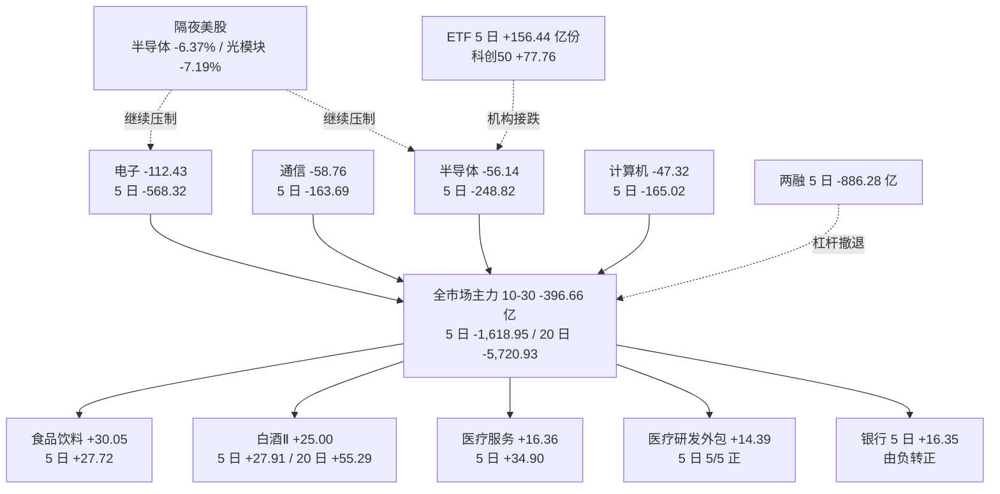

# 2026-11-02 · **资金面**

> **数据源新鲜度**: partial
> **降级状态**: true（个股主力单源 + 大宗溢价率不可用 + 无 SOX）
> **置信度**: 0.84

## 一句话结论

10-30 主力 **-396.66 亿**、跌停 82 > 涨停 47、炸板率 39.74%，钱只剩白酒/食品/医疗 CRO 三处；隔夜美股半导体篮子 -6.37%，科技链今日继续被压制——主跌段，候选砍半 5 只全 research_only。

## 详细分析

### 一、时序资金流：三个窗口连起来看，这是连续失血而不是单日调整

| 交易日 | 全市场主力净额（亿元） | 成交额（亿元） | 涨 / 跌 |
|---|---|---|---|
| 10-23 | +8.34 | 19,728 | 4,526 / 909 |
| 10-26 | -281.84 | 16,231 | 2,252 / 3,157 |
| 10-27 | -473.61 | 14,729 | 606 / 4,922 |
| 10-28 | +237.00 | 16,421 | 4,156 / 1,239 |
| 10-29 | -703.84 | 15,707 | 781 / 4,728 |
| **10-30** | **-396.66** | **16,877** | **893 / 4,602** |

三个窗口一起读：5 日 **-1,618.95 亿**（正日 1/5）、10 日 **-2,579.24 亿**（2/10）、20 日 **-5,720.93 亿**（3/20）。10-28 那次 +237 亿的反包，被 10-29、10-30 两天（-703.84、-396.66）连本带利还了回去，20 日窗口只有 3 个正日——**这不是风格轮动，是持续的资金撤离**。

宽度和封板质量同步恶化：10-30 上涨 893 家 / 下跌 4,602 家，跌超 5% 的 1,483 家（10-28 只有 58 家）；涨停 47 / 跌停 82 / 炸板 31，炸板率 **39.74%**，连续第二个交易日站在 35% 红线上方。10-29 的 39 只涨停在 10-30 平均 **-0.68%**（高开 +0.96% 后走弱，正收益占比 48.7%）——**隔日溢价机制已经失效**，这是主跌段最硬的特征。

指数层面同日确认：上证 -1.44% / 深成 -2.73% / 创业板 -4.13% / 科创50 -5.48% / 中证500 -2.91%，成长端跌幅是大盘的三倍，资金不是"减仓"，是"弃成长"。

### 二、板块：钱只剩三处，科技链是持续失血不是回调

| 板块 | 10-30 | 5 日 | 10 日 | 20 日 | 5 日正日 | 当日涨幅 |
|---|---|---|---|---|---|---|
| 食品饮料 | +30.05 | +27.72 | +21.11 | +23.79 | 3/5 | +0.83% |
| 白酒Ⅱ | +25.00 | +27.91 | +34.40 | +55.29 | 4/5 | +5.15% |
| 医疗服务 | +16.36 | +34.90 | +17.61 | -4.05 | 4/5 | +1.58% |
| 医疗研发外包 | +14.39 | +28.86 | +16.65 | -1.95 | 5/5 | +3.37% |
| 银行 | -1.04 | +16.35 | -16.83 | -62.78 | 4/5 | +0.77% |
| **电子** | **-112.43** | **-568.32** | **-615.70** | **-1,765.12** | **1/5** | -4.62% |
| 通信 | -58.76 | -163.69 | -220.27 | -764.88 | 1/5 | -5.48% |
| 半导体 | -56.14 | -248.82 | -237.86 | -813.51 | 1/5 | -5.45% |
| 通信设备 | -52.19 | -152.11 | -203.81 | -722.40 | 1/5 | -5.85% |
| 计算机 | -47.32 | -165.02 | -171.80 | -344.98 | 0/5 | -5.41% |

三条结论写在表里：

1. **白酒是唯一「5 日 + 20 日双正 + 当日上涨 + 4/5 正日」的板块**（20 日 +55.29 亿说明它不是今日才进来的避险盘，而是已经走了三周的加仓），食品饮料同步（20 日 +23.79 亿）。
2. **医疗服务/CRO 是「5 日强、20 日弱」的反转结构**：医疗研发外包 5 日正日 5/5、5 日 +28.86 亿，但 20 日仍 -1.95 亿——钱是最近一周才回流的，方向新、底座薄。
3. **电子系是「5 日正日 1/5」的持续失血**：电子 5 日 -568.32 / 20 日 -1,765.12 亿，半导体 5 日 -248.82 / 20 日 -813.51 亿。10-28 的反包是电子主导的，10-29、10-30 两天全部吐回——**"钱回到跌幅最大处"这个假设已经被证伪两次**。

概念端印证同一结论：CRO +34.42 亿（5/5 正）、白酒 +27.28、酿酒概念 +26.15、创新医疗服务 +24.58、味蕾经济 +23.50 是唯一有连续性的方向；而"融资融券"标签 5 日 -1,539.12 亿、"基金增仓" -1,036.43 亿，说明这不是板块轮动，是全市场资金属性整体缩水。

### 三、昨日前十 5 日追踪：9/10 的 5 日合计为正，与 10-29 的 8/10 反手完全镜像

| # | 标的 | 10-30 净额（亿） | 5 日合计（亿） | 5 日正日 | 5 日涨幅 | 20 日位置 |
|---|---|---|---|---|---|---|
| 1 | 宁德时代 | +10.90 | -6.42 | 2/5 | -1.97% | 低位 |
| 2 | 金安国纪 | +8.18 | +9.23 | 3/5 | +5.36% | 34.4 |
| 3 | 五粮液 | +7.37 | +7.53 | 3/5 | +1.14% | 79.0 |
| 4 | 埃斯顿 | +5.33 | +2.60 | 2/5 | +0.21% | 中位 |
| 5 | 泸州老窖 | +5.29 | +5.17 | 3/5 | +10.12% | 100.0 |
| 6 | 贵州茅台 | +4.94 | +7.29 | 4/5 | +4.27% | 99.2 |
| 7 | 招商银行 | +4.87 | +12.99 | 4/5 | +4.26% | 100.0 |
| 8 | 君正股份 | +4.11 | +9.39 | 3/5 | +3.99% | 中位 |
| 9 | 宏昌电子 | +3.94 | +3.54 | 2/5 | -2.06% | 中位 |
| 10 | 巨轮智能 | +3.01 | +2.64 | 3/5 | -1.32% | 中位 |

**9/10 的 5 日合计为正**，钱这次是往「低波动消费 + 银行」里躲，而不是往高位科技里追——与 10-29 前十「8/10 反手」的情况正好相反。

但不能读成"消费已经接棒"：把前一日（10-29）的前十拿来看，10-30 只有 **6 延续 / 4 反手**，被反手的四只（中国卫星、冰山冷热、顺灏股份、农业银行）全是 10-29 的当日强势票。**在主跌段里，"昨日强势"是负资产，"昨日低位"才是正资产**——这条规则今天比任何板块判断都重要。

### 四、龙虎榜诱多识别：28 只票命中派发/弱封，最硬的四条

| 标的 | 涨幅 | 龙虎榜净额 | 机构专用 | 命中项 |
|---|---|---|---|---|
| 金安国纪 | +10.00% | +1.32 亿（占成交 32.51%） | **-0.68 亿** | B 机构净卖 + C 弱封 1.28% |
| 泸州老窖 | +10.01% | +4.61 亿（净买率 14.79%） | +2.86 亿 | C 弱封 0.38% + 13:27 才首封 |
| 东方海洋 | +10.12% | -0.62 亿 | -0.41 亿 | A 拉高派发 + B 机构净卖 |
| 澳洋健康 | +10.06% | -0.24 亿 | -0.30 亿 | B 机构净卖 + C 弱封 4.7% + E 回封 2 次 |
| 古井贡酒 | +10.00% | +1.38 亿 | +0.72 亿 | C 弱封 4.2% + E 炸板回封 7 次 |
| 九安医疗 | +9.99% | +1.33 亿 | -0.28 亿 | B 机构净卖 + E 回封 2 次 |
| 苏州天脉 | -15.06% | -1.02 亿 | -0.47 亿 | D 累计口径净卖（高位分歧） |
| 亿田智能 | -19.33% | -0.75 亿 | -0.49 亿 | D 累计口径净卖 |

四条最硬的读法：

- **金安国纪是标准的一日游结构**：游资单边接筹（东莞证券苏州聚茂街两笔合计 +2.72 亿、国新证券北京 +1.56 亿、开源证券西安西大街 +1.16 亿），机构专用净卖 -0.68 亿，封单/成交 1.28%、10:09 才封住。游资买得越集中，次日越没有人接。
- **泸州老窖的涨停质量与资金结构互相矛盾**：机构 +2.86 亿接的正是两个游资席位的货（华泰上海浦东滨江大道 -0.40 亿、中信深圳深南中路 -0.29 亿），而封单/成交只有 0.38%、13:27 才首封。机构在涨停板上接游资的货，通常是"借涨停出货"而非"抢筹"。
- **白酒内部已经分化**：泸州老窖、古井贡酒、皇台酒业、巴比食品四只白酒/食品涨停，三只出现弱封或多次炸板回封（古井 7 次、皇台 6 次、巴比 6 次）——**板块有钱，但封板质量不支持"明天一致高开"**。
- **跌停/大跌票的累计口径净卖是高位分歧的直接证据**：苏州天脉 -15.06%（-1.02 亿）、亿田智能 -19.33%（-0.75 亿）、博盈特焊 -16.70%（-0.51 亿）、通达海 -18.05%（-0.06 亿），这四只都在高位放量下跌且龙虎榜净卖。

3 日席位协同（同股同席位 ≥2 日）本日 156 组、其中连续 3 日 26 组；最集中的是澳洋健康（平安证券浙江分公司 3 日 +0.65 亿买入，而机构专用同期 -0.30 亿、封单 4.7%）——**游资连续买、机构连续卖的票，是本日最典型的诱多样本**。

### 五、杠杆撤退 vs 机构申购：两个方向相反的力

| 通道 | 5 日变化 | 读法 |
|---|---|---|
| 两融（三所合计） | **-886.28 亿** | SSE 12,168.67 亿（-390.53）、SZSE 11,187.83 亿（-492.15）、BSE 74.82 亿（-3.60） |
| 科创50ETF 份额 | +77.76 亿份 | 越跌越买，机构用指数工具接跌 |
| 创业板ETF 份额 | +42.44 亿份 | 同上 |
| 沪深300ETF 份额 | +36.24 亿份 | 同上 |
| 半导体ETF 份额 | +3.96 亿份 | 逆势小额申购 |
| 中证500ETF / 光伏 / 黄金 | -4.16 / -0.36 / -1.23 亿份 | 减仓 |

**杠杆资金在撤（-886 亿），机构在申购宽基（+156 亿份）**——这解释了"指数跌得凶但 ETF 份额涨"的背离，也解释了为什么炸板率连续两天 35% 以上：接盘的是配置盘（不追板），砸盘的是杠杆盘（必须卖）。对超短的含义：**反弹会有，但不会有连板效应**。

### 六、外部传导：隔夜（10-30 周五）美股是半导体单边杀跌

| 标的 | 涨跌 | 标的 | 涨跌 |
|---|---|---|---|
| INTC | **-28.58%** | NVDA | -4.22% |
| AMD | **-10.88%** | GLW | -4.32% |
| MRVL | **-10.05%** | AAPL | -1.23% |
| TSM | -5.95% | MSFT | -1.55% |
| AVGO | -5.48% | GOOGL | -1.40% |
| MU | -5.30% | META / AMZN / TSLA | -1.53 / -1.41 / -0.87 |

| 篮子 / 指数 | 10-30 | 指数 | 10-30 |
|---|---|---|---|
| 半导体篮子（MU/NVDA/AVGO/AMD/TSM） | **-6.37%** | IXIC | -2.86% |
| 光模块篮子（GLW/MRVL） | **-7.19%** | SPX | -1.82% |
| 大科技篮子（6 只） | -1.33% | DJI | -1.09% |
| — | — | HSI / HKTECH | **+1.46 / +0.29%** |
| — | — | TWII / N225 / KS11 | -2.49 / -2.12 / **-3.48%** |

**映射到今日 A 股**：存储（兆易创新 10-30 -8.75 亿、佰维存储 -4.57 亿）对应 MU -5.30%；CPO/光模块（天孚通信 -7.97 亿、中际旭创 -3.49 亿）对应 MRVL -10.05%、GLW -4.32%；算力芯片对应 AMD/INTC/TSM。三条线在 A 股 5 日资金里本来就是负的（电子 -568 亿），外部再踩一脚——**今日科技链不是"低吸机会"，是"继续躲"**。反过来，港股逆势收红（HSI +1.46%）而台韩杀半导体（KS11 -3.48%），正好映射 A 股「科技杀、消费医药扛」的分化。

### 七、跷跷板：银行 vs 软件，是本轮最清晰的一次风格切换

20 日净额序列强负相关 74 对，其中 21 对出现 5 日方向反转，结构高度一致：

- **银行** 5 日 +16.35 亿（前 5 日 -33.18 亿，由负转正）↔ **软件开发** 5 日 -88.55 亿（前 5 日 -1.72 亿，失血加速）
- 股份制银行Ⅲ 5 日 +9.50 亿 ↔ 横向通用软件 -30.65 / 垂直应用软件 -57.90 亿

最强的负相关（半导体 vs 铁路运输 -0.85）反而没有交易价值——两侧 5 日都为负，是同步缩量。**真正在切换的是"软件/AI 应用 → 银行/消费"这条线**，它和"电子没钱、消费医药有钱"是同一件事的两个侧面。

## 关键证据

- 证据 1：全市场主力 10-30 **-396.66 亿**，5 日 -1,618.95 / 10 日 -2,579.24 / 20 日 -5,720.93 亿，20 日仅 3 个正日 · 来源 `tushare.moneyflow_dc`（120,531 条个股-日）
- 证据 2：涨停 47 / 跌停 82 / 炸板 31，炸板率 **39.74%**（10-29 为 39.06%），最高板 5 · 来源 `tushare.limit_list_d`
- 证据 3：10-29 涨停 39 只在 10-30 平均 **-0.68%**、中位 -0.28%、高开 +0.96%、正收益占比 48.7% · 来源 `tushare.daily` + `limit_list_d`
- 证据 4：白酒Ⅱ 当日 +25.00 / 5 日 +27.91 / 20 日 +55.29 亿且涨幅 +5.15%；电子 5 日 -568.32 / 20 日 -1,765.12 亿且 5 日正日仅 1/5 · 来源 `tushare.moneyflow_ind_dc`（496 行业 × 20 日）
- 证据 5：医疗研发外包 5 日 +28.86 亿、**5/5 全正**；CRO 概念 5 日 +34.42 亿、5/5 全正 · 来源 `tushare.moneyflow_ind_dc`（概念 516 × 20 日）
- 证据 6：龙虎榜 96 条 / 83 只 / 67 只单日口径票；金安国纪单日净买 +1.32 亿（占成交 32.51%）但机构专用 **-0.68 亿**、封单 1.28% · 来源 `tushare.top_list` + `top_inst`
- 证据 7：两融三所 5 日 **-886.28 亿** 而 ETF 份额 5 日 +156.44 亿份（科创50 +77.76）· 来源 `tushare.margin` + `tushare.fund_share`
- 证据 8：隔夜美股半导体篮子 **-6.37%**、光模块 -7.19%，IXIC -2.86%；HSI +1.46% vs KS11 -3.48% · 来源 `raw/overseas_snapshot` + `tushare.us_daily` + `index_global`
- 证据 9：银行 5 日 +16.35 亿（前 5 日 -33.18 亿）反转，软件开发 5 日 -88.55 亿（前 5 日 -1.72 亿）加速失血，20 日相关 -0.61 ~ -0.71 · 来源 `detect_seesaw_pairs_v1` inline

## 候选票（5 只 · 全部 research_only / execution_eligible=false）

> 炸板率 39.74% ≥ 35% → 候选数由 10 砍半至 5。R7 不授予开仓权限，execution 池为 0，最终否决权在 R6。

| 标的 | 认定 | 当日 | 5 日主力 | 20 日主力 | 位置 | RR | 闸门 |
|---|---|---|---|---|---|---|---|
| 康龙化成 300759 | 龙二（CXO） | +3.42% | +4.74 亿（5/5） | -0.13 亿 | 51.6 中位 | **2.66** | 通过体检 |
| 药明康德 603259 | 龙头（CXO 总龙） | -0.62% | +9.39 亿（4/5） | -14.14 亿 | 17.9 低位 | 10.43 | **watch**：主力与外资大宗背离 |
| 百亚股份 003006 | 龙头（个护/生活用纸） | +3.33% | +14.90 亿（5/5） | +61.21 亿 | 45.7 中位 | 2.30 | **watch**：止损带 3.79% 窄于 5% |
| 泸州老窖 000568 | 龙一（白酒当日先锋） | +10.01% | +5.17 亿（3/5） | +6.03 亿 | 100.0 高位 | 0.00 | **watch**：纸封 0.38% + 高位 |
| 金安国纪 002636 | 龙头（覆铜板/CCL） | +10.00% | +9.24 亿（3/5） | -7.81 亿 | 34.4 深跌反抽 | 6.34 | **watch**：机构净卖 + 弱封 1.28% |

### 康龙化成（300759.SZ）· 龙二 · 研究首选观察

**买入理由**：CRO/医疗研发外包是 10-30 唯一"5 日 5/5 全正 + 板块上涨"的成长方向（板块 5 日 +28.86 亿）；个股 5 日主力 +4.74 亿全正、ret5 +11.09%、pos20 51.6、距 20 日高 -11.75%，是五只候选里位置最干净的。两融 5 日 +14.72%（vibe 东财通道与 tushare 双源核对一致：10-30 融资余额 8.08 亿），10-30 单日融资买入 1.82 亿 vs 偿还 1.27 亿——**杠杆在加仓，不是在撤退**。

**风险点**：20 日主力仅 -0.13 亿，说明这波是 5 日内新进资金，没有 20 日底座；10-23 有一笔 160.41 万股大宗（0.61 亿）由华泰上海浦东滨江大道卖出、机构专用接手，机构只接了 0.61 亿，量级不足以构成筹码锁定；CXO 是外需敏感方向，隔夜海外医药链条不在本快照覆盖内。

**止损条件**：跌破 39.30（近 3 日最低）即 5 日全正结构失效，无条件出；机械止损距 -5.00%、机械目标 46.88（20 日最高）、RR 2.66。

**可验证假设**：若今日 CRO 概念继续净流入且个股站稳 41.37，则"医药/CRO 是本轮唯一有持续性的成长方向"成立；若板块单日净流出 > 3 亿或个股跌破 39.30，假设当日作废。

**大资金意图**：融资盘在加、主力 5 日全正、pos20 中位——是"边拉边建"而不是"拉高派发"。
**为什么走强**：弱市里唯一有 20 日业绩预期支撑（CXO 订单）且 5 日资金全正的方向，配置盘和融资盘同时进场。
**逻辑够不够硬**：中等偏硬。资金连续性满分，但 20 日底座为零，属"新方向试错"，只能研究不能重仓。

### 药明康德（603259.SH）· 龙头 · 观察不接力

**买入理由**：CXO 总龙，5 日主力 +9.39 亿（4/5 正）、pos20 17.9 低位、距 20 日高 -16.46%，机械 RR 10.43 全场最高；两融 5 日 +3.67%（45.12 亿，双源一致）。

**风险点**：30 日大宗 21-25 笔、合计 **5.72 亿**，卖方反复是瑞银证券上海花园石桥路与中金上海分公司（外资/QFII 通道），买方是广发慈溪浒山路等游资席位——**主力净流入与外资大宗派发同时成立**；20 日主力 -14.14 亿；10-30 板块 +3.37% 而个股 -0.62%，跑输板块，龙头地位今日不成立。大宗成交价恒等于当日收盘（东财与 tushare 双源一致），**溢价率不可用**，无法判断是平价倒手还是折价出货。

**止损条件**：跌破 139.33（近 3 日最低）即反抽结束；注意机械止损距仅 -1.89%，不在 -5~-10% 硬区间，RR 10.43 是失真值，不构成买入依据。

**可验证假设**：若今日放量收回 5 日线且 CRO 概念继续流入，低位反抽可延续；若外资席位继续在大宗端卖出且主力单日转负，直接剔除出候选池。

**大资金意图**：外资在减、游资在接、融资盘小幅加——三方分歧，没有合力。
**为什么走强**：低位 + 板块 β，不是个股 α。
**逻辑够不够硬**：不硬。龙头身份与资金方向矛盾，本日只做观察。

### 百亚股份（003006.SZ）· 龙头 · 观察（高控盘小票）

**买入理由**：个护用品 / 生活用纸是 10-30 唯一"5 日 5/5 全正"的细分（板块 5 日 +14.20 / +14.23 亿）；个股 5 日主力 +14.90 亿全正、20 日 +61.21 亿、ret5 +3.19%、pos20 45.7、RR 2.30。

**风险点**：日净额占成交比连续 5 日在 **23.11%~37.80%**，属极端高控盘结构；流通市值仅 98.5 亿、日换手 25.36%，流动性风险与"一人控盘"风险并存；不是两融标的（vibe 与 tushare 双源均无数据），无龙虎榜、无大宗，**资金主体不可识别**；PE_TTM 98.2 无估值安全垫。

**止损条件**：跌破 22.11（近 3 日最低）；机械止损距 -3.79% 窄于 -5% 下限，按纪律 §4 判止损带不合格 → 只 watch，不进 execution。

**可验证假设**：若今日继续净流入且净额占成交比维持 20% 以上，则"个护/生活用纸是弱市防御型新增量"成立；净额率一旦掉到 10% 以下即判定高位换手出货。

**大资金意图**：单一资金主体连续 5 日吃进，占成交两三成——控盘式吸筹，不是配置盘。
**为什么走强**：小市值 + 消费防御 + 单一资金推动，与板块资金同向但幅度远超板块。
**逻辑够不够硬**：资金硬度最高、可验证性最差。高控盘票只能远观。

### 泸州老窖（000568.SZ）· 龙一 · 降级 watch

**买入理由**：白酒是唯一"5 日 + 20 日双正 + 当日上涨"的板块（板块 5 日 +27.91 / 20 日 +55.29 亿，当日 +5.15%）；个股涨停 +10.01%、成交 31.16 亿、龙虎榜净买 **+4.61 亿（净买率 14.79%）**，其中机构专用 **+2.86 亿**，是当日机构买盘最集中的一只。

**风险点**：封单/成交仅 **0.38%**、13:27 才首封，纸封；pos20 = 100.0（20 日最高位），机械 RR = 0.00；龙虎榜两个游资席位在涨停日净卖出（华泰滨江大道 -0.40 亿、中信深南中路 -0.29 亿），是机构单方面接游资的货；两融 5 日 -6.69%，杠杆在涨停前撤退。

**止损条件**：开盘跌破 73.22 直接放弃；若 10:30 前无法重新封板，按纸封一日游处理。

**可验证假设**：若今日白酒板块继续净流入且个股 30 分钟内封板、封单/成交 > 10%，则"白酒=弱市唯一有钱的方向"被确认；否则视为防御资金的临时避风港。

**大资金意图**：机构在涨停板上接游资卖出，更像"承接出货"而非"抢筹"；真抢筹不会只挂 0.38% 的封单。
**为什么走强**：弱市防御 + 20 日板块资金底座（+55.29 亿），是"有钱的地方"，不是"有新故事的地方"。
**逻辑够不够硬**：方向硬、板硬不起来。板块有钱但封板质量最差，只 watch。

### 金安国纪（002636.SZ）· 龙头 · 降级 watch（诱多风险最高）

**买入理由**：电子 5 日 -568.32 亿的背景下逆势涨停 +10.00%、成交 40.80 亿、换手 26.93%；单日口径龙虎榜净买 +1.32 亿（占成交 **32.51%**），三日累计口径 +2.78 亿；5 日主力 +9.24 亿（3/5 正）；两融 5 日 +14.61%，10-30 单日融资买入 5.20 亿（占成交 12.7%）——杠杆在追板。

**风险点**：机构专用 **-0.68 亿**而股价涨停（命中诱多 B 项）；封单/成交 1.28%、盘中开板 1 次、10:09 才最后封住（命中 C 项）；20 日主力 -7.81 亿、ret20 -26.93%，是深跌股第一次反抽；买方全是游资抱团（东莞证券苏州聚茂街、国新证券北京、开源证券西安西大街），无机构承接；电子板块本身 5 日 -568 亿，个股逆势涨停缺板块底座。

**止损条件**：跌破 60.50（近 3 日最低）；若次日封板晚于 10:30、或再度开板、或覆铜板概念单日净流出 > 3 亿，按游资一日游处理。

**可验证假设**：若今日电子板块止跌且个股 10:30 前封板、封单/成交 > 10%，则"覆铜板涨价是电子内部唯一逆势主线"成立；否则证伪。

**大资金意图**：游资点火 + 融资盘追涨，机构在涨停板上卖——典型的一日游资金结构。
**为什么走强**：覆铜板涨价预期 + 深跌反弹，是题材驱动的个股行为，不是板块行为。
**逻辑够不够硬**：最不硬的一条。RR 6.34 好看，但机构净卖 + 弱封 + 无板块底座三项同时成立，只 watch。

## 数据源审计

| 源 | 状态 | 抓取时间 | 记录数 | 备注 |
|---|---|---|---|---|
| tushare.moneyflow_dc | ✅ ok | 11-02 08:28 | 120,531 | 个股主力 20 日全量 |
| tushare.moneyflow_ind_dc | ✅ ok | 11-02 08:28 | 9,920 | 行业 496 / 概念 516 × 20 日 |
| tushare.top_list + top_inst | ✅ ok | 11-02 08:28 | 96 / 960 | 10-28~10-30 三日 |
| tushare.limit_list_d | ✅ ok | 11-02 08:28 | 160 | 10-30 全量，U47/D82/Z31 |
| tushare.daily / daily_basic | ✅ ok | 11-02 09:15 | 5,571 | 10-30 收盘（首轮漏抓，已补） |
| tushare.margin | ✅ ok | 11-02 09:15 | 138 | 三所 46 个交易日 |
| tushare.fund_share | ✅ ok | 11-02 09:15 | 7 只 | 10-30 份额 |
| tushare.block_trade | ⚠️ partial | 11-02 09:16 | 59 | 成交价 = 收盘价，溢价率不可用 |
| tushare.us_daily / index_global | ✅ ok | 11-02 09:15 | 14 / 246 | 无 ^SOX 代码 |
| raw.overseas_snapshot | ✅ ok（整体 degraded） | 11-02 07:21 | 12 美股 | us_stocks=ok，indices/fx=degraded |
| vibe.get_margin_trading | ✅ ok | 11-02 09:19 | 60 | 4 票与 tushare 完全一致；003006 非两融标的 |
| vibe.get_block_trades | ✅ ok | 11-02 09:19 | 22 | premium_ratio 全部 0.0 |
| vibe.get_fund_flow | ❌ error | 11-02 09:19 | 0 | ProxyError + TUSHARE_TOKEN 未注入 MCP |
| 北向（moneyflow_hsgt/hk_hold） | 🚫 retired | — | 0 | 2026-10-28 用户决定停抓，未旁路补 |

## 不确定性 / 反证

1. **R2 未产出，候选池是纯资金反推**。本件 09:22 落盘时 `data/research/20261102/` 无 `R2_main_sectors.json`，我没有继承任何主线池。若 R2 的板块结论与"消费+医药"不一致，以 R2 为准，本件只提供资金约束。
2. **个股主力只有东财一个源**。vibe `get_fund_flow` 代理故障（ProxyError，fallback 侧 TUSHARE_TOKEN 未注入），个股口径没有第二来源。两融和大宗做了双源核对（4 票逐日一致），但资金流本身没有。
3. **白酒可能是"防御避风港"而不是"新一轮主线"**。证据两面：20 日 +55.29 亿说明钱已经进来三周（支持主线），但 10-30 板块内四只涨停有三只弱封/多次炸板（古井 7 次回封、皇台 6 次、巴比 6 次），且泸州老窖是机构接游资的货——**板块有钱 ≠ 明天有一致性溢价**。这一条如果读反，今天的候选排序就全错。
4. **隔夜美股只到 10-30 收盘**。10-31/11-01 是周末，周末消息面对科技链的影响不在本件覆盖范围（归 R4）。若周末出现半导体利好，本件的"科技链继续压制"会被削弱。
5. **ETF 申购不等于看多**。5 日 +156.44 亿份里有 +77.76 来自科创50，可能是被动配置/再平衡，不必然是主动抄底；它与两融 -886 亿的组合只能说明"资金属性在换手"，不能说明"底部已到"。
6. **跷跷板的因果不成立**。银行 vs 软件 -0.61~-0.71 的相关只是统计同步，不能推出"钱从软件必然流到银行"；21 对反转里多数是小体量板块，可交易性有限。
7. **主跌段的候选注定只能研究**。5 只候选 0 只可执行，不是保守，是纪律：战报里唯一 RR 达标且位置中位的只有康龙化成，其余四只都被弱封/高位/止损带/资金背离中的至少一项卡住。

## 与其他 R / D / E 的关系

- **依赖**：`data/raw/20261102/manifest.json`、`data/raw/20261102/overseas_snapshot.json`（us_stocks 维度）；`data/research/20261102/R2_main_sectors.json` **缺失**（未继承主线池）；R1 风格结论未落盘，本件不引用。
- **被消费**：R2（板块资金约束）、R5（候选票画像的输入）、R6（反证素材：本件 28 条派发线索是 R6 的 hard_reject 原料）、D1（仓位上限与 execution 门禁）、E1（复盘对照）。
- **本件不授权开仓**：`execution_candidates = []`，5 只候选全部 `research_only=true` / `execution_eligible=false`；hard_reject 权在 R6，R7 不干预。

## Sub-Agent 元数据

- skill: `analyze_capital_flow_v1@1.0`（v1.3 契约：隔夜美股维度 + 北向 retire + trading_gap 状态机）
- artifact: `data/research/20261102/R7_capital_flow_20261102.json`（162 KB，`R7_capital_flow.json` soft link 指向当日）
- 中间数据: `data/research/20261102/_r7_data/`（`_facts.json` / `_cand_metrics.json` / `compute_digest.log`）、`_work/`（20 日原始抓取）
- 生成耗时: 约 2,940 秒（含首轮抓取中断后补抓 10-30 日线/两融/ETF）
- 用 model: deepseek-v4.1-flash
- 子 skill: `hot_money_synergy_v1@1.2`（inline）、`detect_seesaw_pairs_v1@1.1`（inline）
