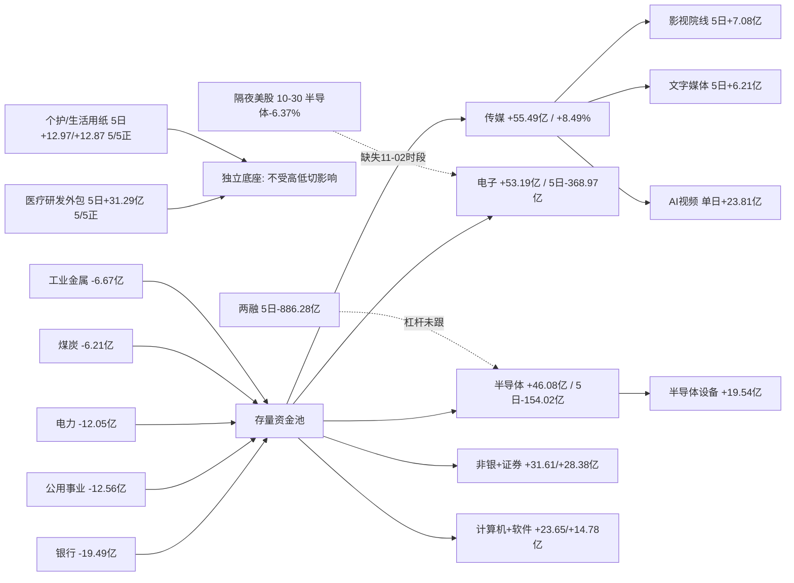

# 2026-11-03 · **资金面**

> **数据源新鲜度**: partial（A 股 11-02 全量；两融/ETF 滞后至 10-30；美股隔夜缺 11-02 时段）
> **降级状态**: true（confidence 0.82；data_coverage 0.94 / source_independence 0.60 / timeliness 0.72 / reproducibility 0.92）
> **置信度**: 0.82

## 一句话结论

11-02 是主跌后的**修复第一天**，且修复质量不低：涨停 125 / 跌停 8、炸板率 18.3%、宽度 0.840、成交 17951.9 亿（放量 6.37%）、主力单日 **+119.54 亿**；但 5 日仍 **-1217.57 亿**、20 日 -4683.28 亿，**只有一天回补，不是趋势反转**。钱的方向极其明确：**卖银行/电力/煤炭，买传媒/电子/半导体/非银**；真正有 5 日底座的只有医疗研发外包（5/5 正、+31.29 亿）与个护/生活用纸（各 5/5 正）。

## 一、今日定性：修复段，不是主升段

| 指标 | 11-02 | 10-30（对照） | 判读 |
|---|---|---|---|
| 涨停 / 跌停 | **125 / 8** | 47 / 82 | 结构彻底反转，跌停消失 |
| 炸板率 | **18.30%** | 39.74% | 首次回到 20% 以下，题材能封住 |
| 宽度（上涨占比） | **0.840**（4681 涨 / 818 跌） | 0.160（893 / 4602） | 普涨 |
| 成交额 | **17951.9 亿** | 16877.1 亿 | +6.37%，放量修复 |
| 主力净额 | **+119.54 亿** | -396.66 亿 | 20 日窗口内第 4 个正日 |
| 5 日 / 10 日 / 20 日 | **-1217.57 / -2343.63 / -4683.28** | — | 一天回补只占 5 日失血的 9.8% |
| 连板高度 | 6 板（青岛食品） | 5 板 | 高度未被打开，只是数量爆发 |
| 前日涨停次日溢价 | 平均 **+2.83%**、中位 +1.53%、正收益 66% | — | 隔日接力赚钱效应由负转正 |

**判读**：这是「跌深 + 情绪修复 + 存量高低切」的三合一，不是增量入场。证据有三条：① 主力单日净额占成交额仅 0.67%，普涨不是靠主力买出来的；② 两融 5 日 -886.28 亿（截至 10-30），杠杆仍在撤；③ 5 日主力仍为巨量净流出。按**修复段**给温度，不给主升定性。

## 二、时序资金流：20 日只有 4 个正日

| 交易日 | 主力净额（亿） | 成交额（亿） |
|---|---|---|
| 09-29 | +66.13 | — |
| 09-30 | -136.10 | — |
| 10-08 | -482.85 | — |
| 10-09 | -169.44 | — |
| 10-12 | -356.26 | — |
| 10-13 | -90.39 | — |
| 10-14 | -367.63 | — |
| 10-15 | **-637.51** | — |
| 10-16 | -49.53 | — |
| 10-19 | -116.07 | — |
| 10-20 | -125.69 | — |
| 10-21 | -94.69 | — |
| 10-22 | -632.18 | — |
| 10-23 | +8.34 | — |
| 10-26 | -281.84 | — |
| 10-27 | -473.61 | 14729.0 |
| 10-28 | +237.00 | 16421.0 |
| 10-29 | **-703.84** | 15707.1 |
| 10-30 | -396.66 | 16877.1 |
| **11-02** | **+119.54** | **17951.9** |

20 日累计 -4683.28 亿、正日 4 个；最近 5 日 -1217.57 亿、正日 2 个（10-28、11-02）。**每一次正日之后都跟着更大的负日**（10-28 +237 → 10-29 -703.84），这是典型的「反弹即出货」节奏。要确认修复有效，需要看到**连续两日**净流入且 5 日累计转正，今天（11-03）是验证日。

## 三、板块：卖什么、买什么，一眼就能看清

### 3.1 单日净流入前八（11-02）

| 板块 | 单日净额（亿） | 涨幅 | 5 日 | 20 日 | 5 日正日 |
|---|---|---|---|---|---|
| 传媒 | **+55.49** | **+8.49%** | -2.94 | -61.11 | 2/5 |
| 电子 | +53.19 | +2.72% | **-368.97** | -1388.23 | 2/5 |
| 半导体 | +46.08 | +2.77% | -154.02 | -614.10 | 2/5 |
| 非银金融 | +31.61 | +3.91% | -25.04 | -162.52 | 1/5 |
| 证券 | +28.38 | +4.48% | -28.04 | -129.59 | 1/5 |
| 计算机 | +23.65 | +5.48% | -132.96 | -277.31 | 1/5 |
| 半导体设备 | +19.54 | +4.22% | -20.70 | -81.58 | 2/5 |
| 软件开发 | +14.78 | +6.58% | -72.34 | -102.56 | 1/5 |

### 3.2 单日净流出前八（11-02）

| 板块 | 单日净额（亿） | 涨幅 | 5 日 |
|---|---|---|---|
| 银行 | **-19.49** | -0.84% | -3.91 |
| 公用事业 | -12.56 | +1.26% | -45.31 |
| 电力 | -12.05 | +1.39% | -43.63 |
| 城商行 | -8.22 | -1.48% | -14.73 |
| 交通运输 | -7.77 | +1.45% | -16.81 |
| 工业金属 | -6.67 | +0.66% | -19.05 |
| 水力发电 | -6.46 | +0.16% | -12.29 |
| 煤炭 | -6.21 | -0.08% | -13.03 |

### 3.3 真正有 5 日底座的方向（全市场只有这几条）

| 板块 | 5 日净额 | 5 日正日 | 单日 | 20 日 |
|---|---|---|---|---|
| 医疗研发外包（CRO） | **+31.29** | **5/5** | +5.91 | +13.74 |
| 医疗服务 | +31.42 | 4/5 | +4.36 | +12.41 |
| 个护用品 | +12.97 | **5/5** | +3.06 | +60.11 |
| 生活用纸 | +12.87 | **5/5** | +2.96 | +59.34 |
| 美容护理 | +7.27 | **5/5** | +2.26 | +48.05 |
| 白酒 | +23.55 | 3/5 | **-2.45** | +57.21 |
| 食品饮料 | +20.86 | 2/5 | **-3.94** | +22.03 |

**三问（对当日最热的两条线）**

**① 传媒（当日第一，+55.49 亿 / +8.49%）**

- **大资金意图**：不是外资、不是公募，是游资 + 机构混合抢筹。龙虎榜前十里传媒占 5 席（捷成股份 +3.31 亿、粤传媒 +2.04 亿、风语筑 +1.92 亿、巨人网络 +1.82 亿、果麦文化 +1.20 亿），其中机构专用席位也在买（果麦 +1.84 亿 14 行、捷成 +1.39 亿、粤传媒 +0.99 亿）——机构与游资同向，这在近期少见。
- **为什么走强**：三个子行业同时点火——文字媒体 5 日 +6.21 亿、影视院线 5 日 +7.08 亿、数字媒体单日 +14.15 亿；题材端是「AI视频」概念当日 +23.81 亿（该概念 today = 5d = 20d，说明是当日新增口径／新点火）。同时它是 20 日 -61.11 亿的长期失血板块，位置低、筹码松，适合做修复段的第一波题材。
- **逻辑够不够硬**：**一半硬一半软**。硬的部分是「钱真、机构真买、子行业 5 日转正」；软的部分是「封板质量差」——捷成封单 2.64%、开板 3 次、13:46 才首封；粤传媒封单 3.03%、13:44 才首封；芒果超媒 20% 涨停却被龙虎榜净卖 0.53 亿、慈文传媒净卖 0.71 亿且股价 -2.60%，**板块内部已经分化**。结论：传媒是「今日最强钱方向」，但不是「可以追板的板块」，只能做隔日低吸或首板卡位。

**② 电子/半导体（+53.19 / +46.08 亿）**

- **大资金意图**：机构回补 + 杠杆观望。买单集中在超跌成长：东山精密 +13.44 亿（超大单 +17.55 亿）、兆易创新 +9.41 亿、北方华创 +8.03 亿（净额占成交 13.30%）、中微 +5.32 亿；但这些票 20 日主力分别为 -81.71 / -24.72 / -2.96 / -13.21 亿，两融 5 日全线为负（东山 -12.41%、北方华创 -10.23%、中微 -10.55%）——**机构在回补，杠杆在撤退**。
- **为什么走强**：10-30 被美股半导体杀穿（AMD -10.88%、INTC -28.58%、MRVL -10.05%、TSM -5.95%），A 股跟着杀了一天（电子 -112 亿级），11-02 属于超跌反抽 + 指数修复的被动回补，不是产业逻辑更新。
- **逻辑够不够硬**：**不硬**。5 日仍 -368.97 / -154.02 亿，20 日 -1388.23 / -614.10 亿；一天回补只占 5 日失血的 14.4% / 29.9%。且今日真正的隔夜线（11-02 美股）缺失，外部无法背书。定性：**修复段的第一天反抽，可以参与个股，不能当主线重仓**。

## 四、昨日前十 5 日追踪（base = 2026-11-02）

| # | 标的 | 当日净额（亿） | 当日涨幅 | 净额占成交 | 5 日 | 5 日正日 | 5 日涨幅 | 20 日位置 |
|---|---|---|---|---|---|---|---|---|
| 1 | 东山精密 | +13.44 | +7.13% | 11.27% | **-0.35** | 2/5 | -12.55% | 7.1（低位） |
| 2 | 东方财富 | +12.30 | +6.31% | 14.22% | **+0.01** | 1/5 | +0.86% | 85.0（高位） |
| 3 | 兆易创新 | +9.41 | +3.05% | 10.36% | +9.30 | 2/5 | -9.02% | 8.8（低位） |
| 4 | 北方华创 | +8.03 | +5.28% | 13.30% | +3.58 | 3/5 | -6.23% | 20.6（低位） |
| 5 | 宁德时代 | +7.43 | +3.12% | 5.92% | +0.39 | 2/5 | +0.92% | 中位 |
| 6 | 君正股份 | +7.00 | +3.09% | 10.13% | **+17.45** | 4/5 | **+13.97%** | 44.1（中位） |
| 7 | 长飞光纤 | +5.56 | +8.15% | 13.33% | -1.44 | 2/5 | -8.16% | 15.0（低位） |
| 8 | 中际旭创 | +5.36 | -0.54% | 2.84% | **+29.44** | 3/5 | -7.49% | 4.4（低位） |
| 9 | 中微公司 | +5.32 | +1.36% | 9.02% | -3.32 | 2/5 | -13.90% | 9.7（低位） |
| 10 | 国芳集团 | +5.29 | +9.97% | 43.13% | +4.84 | 3/5 | +17.35% | 57.8（中位） |

**7/10 的 5 日合计为正，但要分两类读**：

- **真底座**：君正股份（5 日 +17.45 亿、4/5 正、5 日涨 +13.97%，是唯一「资金 + 价格 + 位置」三者都不难看的）、中际旭创（5 日 +29.44 亿但股价 5 日 -7.49% → 钱在接、价没起来）、兆易创新（+9.30 亿、2/5）。
- **单日冲量**：东山精密当日全市场第一（+13.44 亿）但 5 日 -0.35 亿、20 日 -81.71 亿；东方财富当日 +12.30 亿但 5 日只有 +0.01 亿、5 日仅 1 天为正、20 日位置 85 分位。**「当日第一大买盘」大概率是别人的回补盘**，追第一名等于接最后一手。

**前一交易日（10-30）前十的次日结局：3 延续 / 7 反手**

| 标的 | 10-30 净额（亿） | 11-02 净额（亿） | 11-02 涨幅 | 结果 |
|---|---|---|---|---|
| 宁德时代 | 10.90 | +7.43 | +3.12% | 延续 |
| 贵州茅台 | 4.94 | +1.62 | +3.38% | 延续 |
| 君正股份 | 4.11 | +7.00 | +3.09% | 延续 |
| 金安国纪 | 8.18 | **-5.29** | +0.03% | 反手 |
| 五粮液 | 7.37 | -3.12 | -0.60% | 反手 |
| 埃斯顿 | 5.33 | -1.54 | -0.89% | 反手 |
| 泸州老窖 | 5.29 | -0.49 | +3.50% | 反手（涨但资金走） |
| 招商银行 | 4.87 | -3.16 | -0.85% | 反手 |
| 宏昌电子 | 3.94 | -0.35 | -1.74% | 反手 |
| 巨轮智能 | 3.01 | -1.47 | -1.34% | 反手 |

这是全篇最硬的一条证据：**10-30 的榜单是消费/银行/防御票，11-02 有 7/10 被抽走**（五粮液 -3.12、招行 -3.16、泸州老窖 -0.49 全部转负）。防御抱团不是自然轮动，是被主动解散去补科技与题材。而 11-02 的新榜单换成了电子/半导体/券商/小票 —— **榜单本身换了一整代人**，说明这不是同一批资金在做切换，而是新钱进场做修复。

## 五、龙虎榜诱多识别：钱是真的，板是假的

11-02 龙虎榜 81 条 / 73 只 / 64 只为单日口径（涨幅偏离、换手、振幅类）。净买前十与净卖前十：

| 净买前十 | 净额（亿） | 净买率 | 净卖前十 | 净额（亿） |
|---|---|---|---|---|
| 捷成股份 | +3.31 | 15.00% | 万邦医药 | -1.64 |
| 银之杰 | +2.45 | 13.68% | 盛洋科技 | -1.16 |
| 粤传媒 | +2.04 | 17.99% | 正帆科技 | -0.91 |
| 风语筑 | +1.92 | 14.25% | 传智教育 | -0.76 |
| 巨人网络 | +1.82 | 12.88% | 光洋股份 | -0.72 |
| 冰山冷热 | +1.50 | 8.30% | 慈文传媒 | -0.71 |
| 襄阳轴承 | +1.29 | 4.44% | 华是科技 | -0.63 |
| 果麦文化 | +1.20 | 9.97% | 天洋新材 | -0.58 |
| 皇台酒业 | +1.03 | 11.34% | 芒果超媒 | -0.53 |
| 一鸣食品 | +1.03 | 11.86% | 百花医药 | -0.52 |

机构专用席位净买前六：果麦文化 +1.84 亿（14 行）、捷成股份 +1.39 亿、粤传媒 +0.99 亿、皇台酒业 +0.94 亿、冰山冷热 +0.69 亿、巨人网络 +0.61 亿 —— **机构在传媒/AI 应用上是真买**。

**派发/弱封线索 26 只，最硬的四条**：

1. **沈阳机床**：2 连板，但封单/成交仅 **0.2%**、盘中开板 **8 次**（13:32 首封、14:56 才最后封住）、机构专用净卖 —— 当日最脆的连板，接力即接刀。
2. **襄阳轴承**：2 连板，封单 2.4%、开板 2 次、机构净卖，5 日涨幅 **+36.7%** 已在高位 —— 高位弱封 + 机构走。
3. **芒果超媒**：**20% 涨停，龙虎榜却净卖 -0.53 亿**、20 日位置 95.8 分位、机械 RR 0.27 —— 标准的高位诱多标本；同日慈文传媒净卖 0.71 亿且股价 -2.60%，传媒内部已开始分层。
4. **捷成股份**：净买 3.31 亿全市场第一（净买率 15%、占成交 26.77%），但封单 2.64%、开板 3 次、13:46 才首封 —— **钱真、板假**，只可低吸不可追板。

另外三只拉高派发型：光洋股份（+7.99% 却净卖 0.72 亿 + 当日炸板）、华是科技（+19.99% 却净卖 0.63 亿 + 开板 2 次）、正帆科技（+19.99% 却累计口径净卖 0.91 亿）。

**席位协同度下降**：同一 (股票, 席位) 在 10-29 / 10-30 / 11-02 出现 ≥2 天的组合共 **52 组**、3 日连续仅 **5 组**（对照 10-30 的 156 组 / 26 组）。说明跨日接力明显减弱，11-02 的买盘更像「单日集中出手」，**还没形成可持续的游资抱团**——这也解释了为什么传媒内部当天就分化。

## 六、跷跷板：唯一确认的反转对是「软件 ← 银行」

20 日净额序列 Pearson 相关 ≤ -0.6 的组合 **65 对**，其中 12 对出现 5 日方向反转。最强负相关仍是「铁路运输 vs 半导体」-0.774，但两侧 5 日都为负（-3.35 / -154.02 亿），属**同步缩量**不是轮动。

真正可用的反转对是：

| A 侧 | 20 日相关 | A 5 日 | A 单日 | B 侧 | B 5 日 | B 单日 |
|---|---|---|---|---|---|---|
| 软件开发 | **-0.726** | -72.34 | **+14.78** | 股份制银行 | +7.67 | **-5.70** |

这一对与板块表完全同向（银行 -19.49 亿、计算机 +23.65 亿），是 11-02 高低切最干净的一条证据：**钱从银行搬到软件，不是两个板块各自波动**。

## 七、隔夜美股：最新只到 10-30，真正的隔夜线缺失

`data/raw/20261103/overseas_snapshot.json` **不存在**（该目录未生成）。按 skill 要求不编造数值，改用 tushare `us_daily` + `index_global` 现场直取重建：

| 标的 | 收盘 | 涨跌（10-30） |
|---|---|---|
| MU | 884.74 | **-5.30%** |
| NVDA | 204.64 | -4.22% |
| AVGO | 326.08 | -5.48% |
| AMD | 504.80 | **-10.88%** |
| TSM | 406.13 | -5.95% |
| INTC | 65.76 | **-28.58%** |
| MRVL | 196.40 | -10.05% |
| GLW | 123.31 | -4.32% |
| AAPL / MSFT / GOOGL | 344.63 / 521.91 / 279.84 | -1.23% / -1.55% / -1.40% |
| AMZN / META / TSLA | 240.35 / 614.99 / 399.81 | -1.41% / -1.53% / -0.87% |

篮子：半导体（MU/NVDA/AVGO/AMD/TSM 等权）**-6.37%**、光模块（GLW/MRVL）**-7.19%**、大科技 **-1.33%**；IXIC -2.86%、SPX -1.82%、DJI -1.09%。

**缺口必须说清楚**：11-02（周一）美股已于 05:00 CST 收盘，但 tushare 尚未落库（已用 NVDA + IXIC 单点复拉确认 20261102 行不存在）。也就是说，**今天 A 股真正的隔夜线是缺失的**，上表全部是 10-30 的旧线。所以：

- 「A 股 11-02 用一天吃掉了 10-30 的美股阴线」成立（电子 +53.19、半导体 +46.08）；
- 「11-02 夜盘美股企稳 → 今日科技链可以接着修复」**不成立，因为没有数据**；
- 今日科技链的持续性只能看 A 股自身竞价与开盘 30 分钟承接，不能拿外盘当理由。

亚太 11-02：HSI +0.42%、HKTECH +2.25%、KS11 +2.24%，TWII -0.65%、N225 -0.33% —— 港股科技与韩国强、台湾弱，与 A 股「传媒/软件强、硬件分化」同向。

## 八、杠杆与配置盘：两份数据都滞后一天

| 维度 | 最新日期 | 读数 | 判读 |
|---|---|---|---|
| 两融（SSE） | 2026-10-30 | 12168.67 亿，5 日 -390.53 亿 | 杠杆撤 |
| 两融（SZSE） | 2026-10-30 | 11187.83 亿，5 日 -492.15 亿 | 杠杆撤 |
| 两融（BSE） | 2026-10-30 | 74.82 亿，5 日 -3.60 亿 | — |
| 三所合计 | 2026-10-30 | **5 日 -886.28 亿** | 杠杆资金仍在净撤 |
| 科创50ETF | 2026-10-30 | 5 日 **+77.76 亿份** | 配置盘逆势申购 |
| 创业板ETF | 2026-10-30 | +42.44 亿份 | 同上 |
| 沪深300ETF | 2026-10-30 | +36.24 亿份 | 同上 |
| 半导体ETF | 2026-10-30 | +3.96 亿份 | 小幅 |
| 中证500ETF | 2026-10-30 | -4.16 亿份 | 流出 |
| 光伏ETF / 黄金ETF | 2026-10-30 | -0.36 / -1.23 亿份 | 流出 |

7 只 ETF 5 日合计 +154.65 亿份：**杠杆在撤、配置盘在接**的分歧结构延续。但这两组数据都只到 10-30，**11-02 放量普涨当天的申赎与两融变动是空白**，不能用来判断今日的承接力度——今天唯一的杠杆/配置证据要等盘后补。

## 九、资金流向图

## 十、研究候选（6 只，全部 research_only，execution_eligible=false）

R7 不授予开仓权，以下是资金面体检结果，供 R2/R5/D1 排序使用：

| # | 标的 | 环节 | 龙头认定 | 当日净额（亿） | 净额占成交 | 5日 | 20日 | 位置 | RR | 止损带 | 态度 |
|---|---|---|---|---|---|---|---|---|---|---|---|
| 1 | 君正股份 300223 | 存储接口/DRAM | 龙二（存储链弹性核心） | +7.00 | 10.13% | +17.45（4/5） | +14.28 | 44.1 中位 | 4.15 | -5.00% ✓ | 研究·首选观察 |
| 2 | 北方华创 002371 | 半导体设备 | 龙头（设备总龙） | +8.03 | 13.30% | +3.58（3/5） | -2.96 | 20.6 低位 | 5.46 | -5.00% ✓ | 研究·观察（杠杆未跟） |
| 3 | 兆易创新 603986 | 存储芯片 | 龙头（NOR/DRAM 总龙） | +9.41 | 10.36% | +9.30（2/5） | -24.72 | 8.8 低位 | 10.31 | **-3.81% ✗** | 观察·不进 |
| 4 | 粤传媒 002181 | 传媒/AI 应用 | 龙头（主板首个放量板） | +1.97 | 17.36% | +4.51（2/5） | +7.34 | 59.3 中位 | 2.77 | -5.00% ✓ | 降级 watch（板型否决） |
| 5 | 康龙化成 300759 | CXO/CDMO | 龙二 | +1.16 | 5.59% | +5.71（**5/5**） | +2.05 | 63.8 中位 | **1.93 ✗** | -5.00% | 观察·RR 差 0.07 |
| 6 | 东山精密 002384 | PCB/FPC | 龙头（电子最大单票流入） | +13.44 | 11.27% | -0.36（2/5） | **-81.71** | 7.1 低位 | 17.53 | -5.00% ✓ | 观察·不进 |

**为什么只有两只「过线」**：君正股份与北方华创是唯二「RR ≥ 2 且止损距落在 -5~-10% 硬区间 + 位置不在 80 分位以上」的票。其余四只各有硬伤：兆易止损距 -3.81% 出界（RR 10.31 是数字幻觉）、康龙 RR 1.93 差 0.07、粤传媒板型否决、东山 20 日 -81.71 亿让 RR 失真。**R7 层面没有任何一只具备 execution 资格**。

### 首推票思维链：君正股份（300223）

**买入理由**

存储链唯一「5 日与 20 日同时为正 + 站在中位」的票：5 日主力 +17.45 亿（4/5 天为正）、20 日 +14.28 亿，11-02 单日 +7.00 亿、净额占成交 10.13%；主力拆档看大单 +4.10 亿、超大单 +2.90 亿都在买，中小单合计 -7.00 亿（散户卖、主力接）。两融余额 30.29 亿、5 日 +2.32%——整个电子链里少数杠杆在加而非在撤的标的；东财与 tushare 两源逐日一致。机械 RR 4.15（入场 113.00 / 止损 107.35 / 目标 135.90），三项纪律闸门全过。

**风险点**

① 20 日 +14.28 亿相对 477.8 亿流通市值不算重仓，底座是「一周新进」而非「季度建仓」；② 所属半导体板块 5 日仍 -154.02 亿，个股是逆板块吸金，板块不配合时难以独走；③ 20cm 品种日内波动大，追高容错只有一半；④ 今日真正的隔夜美股缺失，若夜盘半导体继续杀，A 股这边的高开就是最好的出货窗口。

**止损条件**

跌破 107.35（近 3 日低点与 -5% 的较近者）无条件止损；若半导体板块单日净流出 > 20 亿，即使未破位也降为观察。

**可验证假设**

「存储是本轮修复里唯一有 5 日资金底座的科技细分」——验证方式：今日开盘不破 110、板块不止跌而个股仍净流入 → 成立；若单日主力净额转负超过 3 亿 → 证伪，5 日底座是一周行情而非趋势。

## 十一、不确定性 / 反证（对自己的批判）

20 日内前 3 个正日之后都跟着更大的负日（09-29 +66.13→09-30 -136.10、10-23 +8.34→10-26 -281.84、10-28 +237.00→10-29 -703.84），若今日主力再度转负且涨停数跌破 80，11-02 就是「反抽结束」而不是「修复开始」。
2. **成交额放量但主力占比只有 0.67%**。这意味着普涨由散户与游资推动，一旦次日没有新钱，回落速度会和上涨一样快。
3. **传媒的内部矛盾是本篇最大的软点**。板块当日第一、机构真买，但龙头封板质量全在 5% 以下、芒果超媒同一天被净卖。同一个板块既是「最强钱方向」又是「诱多高发区」，只能靠次日竞价分辨，盘前无法定论。
4. **隔夜美股缺失**导致「科技链修复可持续」这一判断缺少外部锚。所有关于半导体的正面读数都只到 11-02 收盘，没有 11-02 夜盘。
5. **两融/ETF 滞后一天**，杠杆与配置盘的最新态度是空白。若 11-02 两融实际继续大幅下降，则 11-02 的修复质量要打折。
6. **数据同源**：个股主力、板块主力、龙虎榜同为东财口径，vibe 只是同源交叉（6/6 一致只能证明抓取无误，不能证明口径独立）。
7. **R2 未产出**，本候选池是资金流反推，没有主线生命周期与龙头地位的外部确认；R6 才是硬否决权所有者，本件不发布任何 hard_reject。

## 十二、数据源审计

| 源 | 状态 | 抓取时间 | 记录数 | 备注 |
|---|---|---|---|---|
| tushare moneyflow_dc（个股 20 日） | 🟢 ok | 2026-11-03 | 120549 股日 | 11-02 全市场 5571 只 |
| tushare moneyflow_ind_dc（行业 20 日） | 🟢 ok | 2026-11-03 | 496 板块 × 20 日 | 东财行业口径 |
| tushare moneyflow_ind_dc（概念 20 日） | 🟢 ok | 2026-11-03 | 534 概念 × 20 日 | 含宽基/资金属性标签 |
| tushare top_list / top_inst | 🟢 ok | 2026-11-03 | 81 条 / 73 只 | 3 日窗口 |
| tushare limit_list_d | 🟢 ok | 2026-11-03 | 161 条（U125/D8/Z28） | 5 日窗口 |
| tushare daily / daily_basic | 🟢 ok | 2026-11-03 | 5571 只 | 6 日窗口 |
| tushare margin | 🟡 partial | 2026-11-03 | 138 行 | 最新 2026-10-30，11-02 未发布 |
| tushare fund_share | 🟡 partial | 2026-11-03 | 7 只 ETF | 最新 2026-10-30 |
| tushare us_daily / index_global | 🟡 partial | 2026-11-03 | 14 只 + 8 指数 | 最新完整收盘 2026-10-30 |
| vibe get_dragon_tiger | 🟢 ok | 2026-11-03 | 80 条 | 与 tushare 个股层面一致 |
| vibe get_fund_flow | 🟢 ok | 2026-11-03 | 6 只 | 与 tushare 主力净额 6/6 完全一致 |
| vibe get_margin_trading | 🟡 partial | 2026-11-03 | 5/6 只 | 兆易创新读超时，已用 tushare 补齐 |
| vibe get_block_trades | 🟢 ok | 2026-11-03 | 6 只 / 14 笔 | 东山 11、北方华创 2、康龙 1 |
| data/raw/20261103/overseas_snapshot.json | 🔴 error | — | — | 文件不存在，已用 tushare 现场重建并标 stale |
| 北向（moneyflow_hsgt / hk_hold） | ⚪ retired | — | — | 2026-10-28 起停抓，不补 |

## 十三、与其他 R/D/E 的关系

- **依赖**：`data/research/20261103/_work/*`（tushare 抓取）、`_r7_data/_facts.json`（计算层）、`_r7_data/_cand_metrics.json`（候选指标）、vibe-trading MCP 交叉。
- **被消费**：R2（主线板块排序，可用板块 5 日底座与跷跷板反转对）、R5（对上述 6 只候选做画像）、D1（用 execution_candidates=[] + 候选 RR/止损带做仓位与门禁判断）、E1（盘后复核）。
- **不授予**：任何开仓权限。execution_candidates = 0，全部 research_only=true。
- **硬否决权**：归 R6，本件只交风险线索（26 只派发/弱封），no_hard_reject_issued=true。

## Sub-Agent 元数据

- skill: analyze_capital_flow_v1@1.3（child: hot_money_synergy_v1@1.2 / detect_seesaw_pairs_v1@1.1）
- artifact: `data/research/20261103/R7_capital_flow_20261103.json`（147536 B，schema R7_capital_flow_v1，staleness_status=ok）
- 生成耗时: 约 6400 秒（04:36 启动抓取 → 06:23 落盘，含两次会话中断恢复）
- model: deepseek-v4.1-flash
- 覆盖: 496 行业 / 534 概念 / 120549 股日 / 81 条龙虎榜 / 14 只美股 / 8 个全球指数
- 候选: 6 只 research_only，execution_candidates 0
- 一致性: tushare 与 vibe 双通道主力净额 6/6 完全一致；两融 5/5 逐日一致
