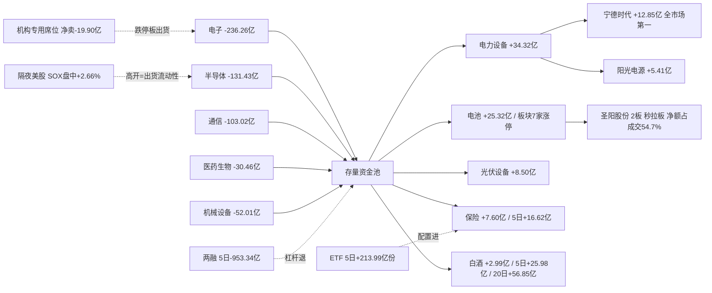

# 2026-11-04 · **资金面**

> **数据源新鲜度**: partial（A 股 11-03 全量；两融/ETF 滞后至 11-02；隔夜美股 11-03 为盘中价）
> **降级状态**: true（confidence 0.84；data_coverage 0.95 / source_independence 0.60 / timeliness 0.78 / reproducibility 0.93）
> **置信度**: 0.84

## 一句话结论

修复失败：涨停 125→48、炸板率 41.5%、主力 **-574.09 亿**；钱从 AI 硬件单边撤出、切向电池/光伏/白酒/保险，**今日只研究不开仓**。

## 一、今日定性：修复只活了一天，回到震荡偏弱

| 指标 | 11-03 | 11-02（对照） | 判读 |
|---|---|---|---|
| 涨停 / 跌停 | **48 / 17** | 125 / 8 | 涨停腰斩再腰斩，跌停重新出现 |
| 炸板率 | **41.46%** | 18.30% | 连续第二日 ≥35% 红线，情绪=震荡偏弱 |
| 宽度（上涨占比） | 0.389（2108 涨 / 3309 跌） | 0.840 | 从普涨跌回普跌 |
| 成交额 | 17150.9 亿 | 17951.9 亿 | 缩量 800 亿，承接变弱 |
| 主力净额 | **-574.09 亿** | +119.54 亿 | 20 日窗口内第二重，仅次于 10-29 的 -703.84 亿 |
| 5 日 / 10 日 / 20 日 | **-1318.05 / -2792.03 / -5323.50** | — | 11-02 的一天才回补 9.2%，11-03 反手亏掉 4.8 倍 |
| 连板高度 | 4 板 | 6 板 | 高度反而下压 |
| 超大单 / 大单 | -304.94 / -269.15 亿 | +158.47 / -38.93 | 大资金与散户同步撤 |

**判读**：11-02 的「修复日」被一天打回，验证了「反弹即出货」的旧节奏。但注意一个关键区别——11-03 不是普跌，是**高低切**：电子 -236.26 亿单边失血的同时，电力设备 +34.32、电池 +25.32、保险 +7.60、白酒 +2.99 逆势吸金。**钱还在场内，只是换了方向**。

## 二、时序资金流：20 日只有 4 个正日，且每个正日都被反手

| 交易日 | 主力净额（亿） | 超大单（亿） | 大单（亿） | 成交额（亿） | 上涨/下跌 |
|---|---|---|---|---|---|
| 09-30 | -136.10 | -60.17 | -75.93 | 14501 | 2567/2824 |
| 10-08 | -482.85 | -251.36 | -231.49 | 16943 | 1698/3748 |
| 10-09 | -169.44 | -87.30 | -82.14 | 19167 | 3297/2145 |
| 10-12 | -356.26 | -178.58 | -177.68 | 15508 | 1167/4325 |
| 10-13 | -90.39 | -28.00 | -62.38 | 16889 | 2909/2486 |
| 10-14 | -367.63 | -186.82 | -180.81 | 14264 | 979/4496 |
| 10-15 | **-637.51** | -367.53 | -269.98 | 16457 | 430/5108 |
| 10-16 | -49.53 | +2.21 | -51.75 | 15691 | 3301/2128 |
| 10-19 | -116.07 | -37.48 | -78.58 | 14488 | 2275/3129 |
| 10-20 | -125.69 | -53.25 | -72.44 | 14715 | 3778/1668 |
| 10-21 | -94.69 | +7.42 | -102.12 | 14421 | 1981/3364 |
| 10-22 | -632.18 | -357.81 | -274.37 | 15419 | 535/4999 |
| 10-23 | +8.34 | +82.36 | -74.02 | 19728 | 4526/909 |
| 10-26 | -281.84 | -161.25 | -120.58 | 16231 | 2252/3157 |
| 10-27 | -473.61 | -185.09 | -288.52 | 14729 | 606/4922 |
| 10-28 | +237.00 | +254.27 | -17.27 | 16421 | 4156/1239 |
| 10-29 | **-703.84** | -381.63 | -322.20 | 15707 | 781/4728 |
| 10-30 | -396.66 | -165.08 | -231.58 | 16877 | 893/4602 |
| 11-02 | +119.54 | +158.47 | -38.93 | 17952 | 4681/818 |
| **11-03** | **-574.09** | -304.94 | -269.15 | 17151 | 2108/3309 |

20 日累计 **-5323.50 亿**、正日 4 个；最近 5 日 **-1318.05 亿**、正日 2 个。规律依旧：**每一次正日之后都跟着更大的负日**（10-23 +8.34 → 10-26 -281.84；10-28 +237 → 10-29 -703.84；11-02 +119.54 → 11-03 -574.09）。连续失血不是单日调整，**任何单日回补都不构成趋势反转的证据**。

## 三、板块：卖 AI 硬件，买电池/光伏与防御消费

### 3.1 单日净流入前八（11-03）

| 板块 | 单日净额（亿） | 涨幅 | 5 日 | 20 日 |
|---|---|---|---|---|
| 电力设备 | **+34.32** | +0.31% | -34.34 | -393.27 |
| 电池 | **+25.32** | +1.63% | +2.56 | -157.47 |
| 锂电池 | +10.47 | +0.68% | +1.49 | -112.65 |
| 电池化学品 | +8.98 | +1.92% | -2.52 | -28.40 |
| 光伏设备 | +8.50 | +0.82% | +5.30 | -50.34 |
| 保险Ⅲ | +7.60 | +2.66% | +16.62 | -9.01 |
| 逆变器 | +7.37 | +1.47% | +4.51 | -28.71 |
| 电网设备 | +4.80 | +0.05% | -14.78 | -77.25 |

### 3.2 单日净流出前八（11-03）

| 板块 | 单日净额（亿） | 涨幅 | 5 日 | 20 日 |
|---|---|---|---|---|
| 电子 | **-236.26** | -3.99% | -454.86 | **-1639.49** |
| 半导体 | -131.43 | -5.15% | -208.98 | -752.40 |
| 通信 | -103.02 | -3.76% | -182.93 | -680.77 |
| 通信设备 | -100.91 | -4.41% | -174.55 | -641.11 |
| 数字芯片设计 | -89.38 | -4.77% | -110.46 | -337.58 |
| 通信网络设备及器件 | -74.96 | -6.62% | -118.96 | -438.11 |
| 元件 | -64.64 | -5.25% | -108.47 | -461.90 |
| 印制电路板 | -52.17 | -5.65% | -86.27 | -339.64 |

### 3.3 真正有 5 日底座的方向（全市场只有这几条）

| 板块 | 5 日净额 | 单日 | 20 日 | 20 日正日 |
|---|---|---|---|---|
| 白酒 | **+25.98** | +2.99 | **+56.85** | 14/20 |
| 医疗服务 | +21.99 | **-9.81** | -3.16 | — |
| 食品饮料 | +21.37 | -0.72 | +18.68 | 8/20 |
| 医疗研发外包 | +20.29 | **-8.05** | +1.73 | — |
| 保险 | +16.62 | +7.60 | -9.01 | — |
| 生活用纸 | +13.95 | +3.50 | +60.17 | — |
| 个护用品 | +13.94 | +3.44 | +60.81 | — |
| 美容护理 | +9.52 | +3.88 | +49.22 | — |

**白酒是唯一 5/10/20 日全正且今日仍在流入的板块**（5 日 +25.98 / 10 日 +30.45 / 20 日 +56.85 亿、20 日 14 天为正）。医疗服务与 CRO 虽然 5 日为正，但 11-03 单日已被反手（-9.81 / -8.05 亿），底座在松。

**三问（对当日最热的两条线）**

**① 电池/电力设备（+25.32 / +34.32 亿）**

- **大资金意图**：高低切的承接方向，不是新主线。宁德时代 +12.85 亿（全市场第一、净额占成交 8.28%）、阳光电源 +5.41 亿、圣阳股份 +3.96 亿（2 板秒拉板），电池板块 7 家涨停形成板块效应；但超大单口径看，电力设备 20 日仍 -393.27 亿，**这是跌深反弹的钱，不是建仓的钱**。
- **为什么走强**：电子单日 -236.26 亿被抽干之后，场内资金需要一个有容量、位置低的承接地。电池/光伏是 20 日失血最重的方向之一（-157.47 / -50.34 亿），筹码松、位置低、有产业逻辑（储能/逆变器），天然是「主跌段的过渡板块」。
- **逻辑够不够硬**：**一半硬一半软**。硬在宁德 5 日 +18.07 亿（3/5 正）是昨日前十里唯一延续的票、板块首日有合力；软在 20 日深度为负、两融不跟（宁德融资余额 5 日 -14.24%），且板块首日爆发次日必分化。结论：**今日只做研究观察，不授予接力资格**——若明日电池板块主力继续净流入且宁德站上 5 日线，再升级。

**② 白酒/保险（5 日 +25.98 / +16.62 亿）**

- **大资金意图**：防御抱团 + 低波避险。茅台 +4.30 亿（20 日 +43.00 亿、14/20 天为正）、平安 +5.60 亿（5 日 +12.61 亿、5/5 天为正、创 20 日新高）——这是**全市场唯一的真底座**，钱在主跌段躲进低波动。
- **为什么走强**：修复失败日的标准资金行为——从高波动科技撤向高确定性消费/保险。不是新逻辑，是避险。
- **逻辑够不够硬**：**底座最硬，弹性最差**。茅台 20 日 +43 亿 vs 20 日涨幅 +17.59%、位置 100 分位；平安 pos20=100 新高。赚的是相对收益，不是进攻收益；追它们等于在主跌段买债券。结论：**观察不追**，它们在候选池里是「如果主线继续消失，钱会去的地方」，不是「今天该上的地方」。

## 四、昨日前十 5 日追踪（base = 2026-11-02）

| # | 标的 | 11-03 净额（亿） | 11-03 涨幅 | 5 日（亿） | 5 日正日 | 5 日涨幅 | 20 日位置 |
|---|---|---|---|---|---|---|---|
| 1 | 东山精密 | -0.64 | -4.41% | +2.61 | 2/5 | -12.82% | 2.5（低位） |
| 2 | 东方财富 | -0.40 | +0.80% | +3.81 | 1/5 | +4.14% | 100（高位） |
| 3 | 兆易创新 | **-9.57** | -5.84% | +1.05 | 2/5 | -7.00% | 0.0（新低） |
| 4 | 北方华创 | +0.43 | -3.41% | +9.98 | 4/5 | -0.34% | 5.9（低位） |
| 5 | **宁德时代** | **+12.85** | **+3.80%** | **+18.07** | 3/5 | +7.00% | 37.1（低位） |
| 6 | 君正股份 | -4.44 | **-11.95%** | +14.02 | 4/5 | +5.18% | 14.2（低位） |
| 7 | 长飞光纤 | -2.37 | -7.73% | -2.20 | 2/5 | -12.83% | 0.0（新低） |
| 8 | 中际旭创 | **-27.76** | **-12.69%** | -3.57 | 2/5 | -16.78% | 0.0（新低） |
| 9 | 中微公司 | +2.82 | -4.98% | +5.23 | 3/5 | -13.61% | 0.0（新低） |
| 10 | 国芳集团 | -1.84 | +4.01% | +2.28 | 2/5 | +10.94% | 74.9（中位） |

**7/10 在 11-03 主力转净流出、7/10 收跌，只有宁德时代一个延续**。注意三个最惨的：中际旭创（5 日 +5.36 亿的承接盘一天被 -27.76 亿砸穿，CPO 总龙崩塌）、兆易创新（-9.57 亿创 20 日新低）、君正股份（5 日 +14.02 亿却在 11-03 单日 -4.44 亿、-11.95%——**「资金堆完就砸」的标准诱多**，被剔除出候选池）。

在炸板率 41.5% 的震荡日，**昨日前十依然是负资产，不是接力池**。11-02 榜单里 8/10 是电子/半导体/券商，11-03 只剩宁德活下来——高低切的代价就是旧榜单一整代被淘汰。

## 五、龙虎榜诱多识别：54 只带派发线索，最硬的三组都在跌停板上

11-03 龙虎榜 **91 条 / 78 只**（60 只单日口径），54 只带派发/弱封线索。净买前十与净卖前十：

| 净买前十 | 净额（亿） | 净买率 | 净卖前十 | 净额（亿） |
|---|---|---|---|---|
| 华正新材（-10%） | +1.85 | 6.38% | 光迅科技（-10%） | -4.28 |
| 太阳能（+10.07%） | +1.77 | 23.05% | 麦格米特（-10%） | -2.16 |
| 百洋股份（+9.96%） | +1.59 | 16.72% | 金健米业（+3.27%） | -2.11 |
| 奥飞娱乐（+9.99%） | +1.53 | 12.34% | 冰山冷热（-1.26%） | -1.83 |
| 慈文传媒（+5.60%） | +1.34 | 7.62% | 世纪恒通（-20%） | -1.27 |
| 明阳电路（+12.46%） | +1.20 | 3.66% | 泉阳泉（-3.29%） | -1.15 |
| 传智教育（-6.06%） | +1.03 | 13.09% | 飞龙股份（-9.98%） | -1.14 |
| 太阳电缆（+9.96%） | +1.01 | 13.20% | 景旺电子（-10%） | -1.03 |
| 德明利（-10%） | +0.83 | 1.90% | 果麦文化（-2.12%） | -0.96 |
| 高争民爆（+10%） | +0.63 | 71.61% | 蘅东光（-23.15%） | -0.77 |

机构专用席位 **净卖 -19.90 亿**（50 只票，买 50.97 / 卖 70.87 亿），沪股通专用净买 +6.41 亿——**内资机构在撤、北向通道在接**。机构净卖前三：生益科技 -8.55 亿、景旺电子 -2.11 亿、光迅科技 -1.81 亿。

**派发/弱封最硬的三组**：

1. **生益科技**（-10% 跌停）：机构专用净卖 **-8.55 亿**（买 1.29 / 卖 9.84 亿）、主力 -5.77 亿、席位成交占全天 46%——**机构在跌停板上出货**；沪股通反向净买 +4.43 亿（单日口径）是外资接内资，不是转势信号。
2. **深南电路**（-10% 跌停，盘中开板 10 次）：龙虎榜净买 +0.26 亿 vs 主力 -3.69 亿、机构净卖 -1.43 亿——**「席位做出净买、主力真实出货」的标准诱多结构**，被剔除出候选池。
3. **电魂网络**（+10.02% 涨停）：机构专用净卖 -1.04 亿、龙虎榜净卖 -0.68 亿、席位成交占全天 50%——**涨停板上出货**。

反向个例：**华正新材 -10% 跌停却有龙虎榜净买 +1.85 亿**（净买率 6.38%、席位成交占 33.05%）——跌停接货属逆势承接，且其席位（中信上海分公司 +1.58 亿、沪股通 +1.29 亿）在 10-30 / 11-03 连续出现，是 3 日协同度最高的组合之一，需今日竞价验证。

**席位协同**：同一 (股票, 席位) 在 10-30 / 11-02 / 11-03 出现 ≥2 天的组合共 **161 组**，3 日全勤 **28 组**（传智教育机构 +1.52 亿 3 日连续、万邦医药机构 -1.11 亿 3 日连续、襄阳轴承机构 -1.08 亿 3 日连续）——协同度比 11-02 的 52 组/5 组明显上升，但**机构席位整体在净卖**，协同上升的方向是派发不是建仓。

## 六、跷跷板：唯一 5 日反转对指向「光伏 ← 银行」

测试 40186 对，相关 ≤ -0.6 的 **58 对**，5 日出现方向反转的只有 2 对：

| A 侧 | 20 日相关 | A 5 日 | B 侧 | B 5 日 | 判读 |
|---|---|---|---|---|---|
| 光伏设备 | **-0.754** | +5.30 | 农商行Ⅲ | -7.24 | 5 日单侧翻转：钱从银行切向光伏 |
| 农商行Ⅲ | -0.719 | -7.24 | 逆变器 | +4.51 | 同上，同一方向 |

与板块表同向（银行/农商行全线流出、光伏设备 +8.50 / 逆变器 +7.37 亿流入），是 11-03 高低切在板块层面的第二重证据。但**相关≠因果**，且父子层级未完全去重，仅作方向参考。

## 七、隔夜美股：半导体「杀一天、弹一天」，方向与 A 股相反

`data/raw/20261104/overseas_snapshot.json` **不存在**（raw 目录未生成）。按 skill 要求不编造数值，改用 tushare `us_daily`/`index_global` 取 11-02 完整收盘 + vibe-trading（yahoo 通道）取 11-03 盘中价（04:36 CST 抓取，距收盘约 25 分钟，标 live）：

| 标的 | 11-03 盘中 | 11-03 涨跌（live） | 11-02 收盘涨跌 |
|---|---|---|---|
| NVDA 英伟达 | 206.79 | **+2.34%** | -1.26% |
| AMD | 489.23 | **+4.80%** | -7.52% |
| MU 美光 | 850.99 | +2.09% | -5.78% |
| AVGO 博通 | 332.25 | +3.11% | -1.18% |
| TSM 台积电 | 405.49 | +1.72% | -1.85% |
| INTC 英特尔 | 60.51 | +0.90% | -8.80% |
| MRVL 美满电子 | 170.82 | -0.35% | -12.72% |
| GLW 康宁 | 126.09 | +2.35% | -0.09% |
| 费半 SOX | 10603.07 | **+2.66%** | 10328.33 |
| 纳指 IXIC | 25368.71 | +0.81% | 25164.31 |
| 标普 SPX | 7564.37 | +0.30% | 7541.40 |
| 道指 DJI | 51721.67 | -0.50% | 51983.98 |

篮子：半导体 7 只 11-02 **-5.59%** → 11-03 盘中 **+2.09%**；光模块代理（GLW/MRVL）11-02 **-6.41%**、11-03 分化（+2.35 / -0.35%）。亚太 11-03：HSI +0.57%、恒生科技 +0.74%、**KS11 -3.59%**、富时 A50 -0.91%——韩国仍在杀半导体，说明亚太内部并未统一转多。

**外部传导判断**：11-02 那夜美股半导体暴跌（SOX -5.6%），A 股 11-03 用一天崩掉科技链；11-03 这夜（盘中）半导体强反弹（SOX +2.66%、AMD +4.8%、NVDA +2.34%、MU +2.09%），方向与 A 股 11-03 完全相反 → **今日 A 股半导体/存储大概率高开**。但 11-03 内资从电子撤了 -236.26 亿、半导体撤了 -131.43 亿，**高开是给撤退资金出货的流动性，不是趋势反转**。结论：科技链「高开不追、反抽减仓」；真正有资金底座的是电池/光伏与白酒/保险。存储链（兆易/君正/江波龙）虽有 MU +2.09% 背书，但兆易 11-03 -5.84%、主力 -9.57 亿、20 日位置 0，反抽同样按减仓窗口处理。

## 八、杠杆与配置盘：杠杆继续退，配置盘继续接（两份数据都滞后一天）

| 维度 | 最新日期 | 读数 | 判读 |
|---|---|---|---|
| 两融三所合计 | 2026-11-02 | 23308.45 亿，单日 -122.87，**5 日 -953.34 亿** | 杠杆持续净撤 |
| 科创50ETF（588000） | 2026-11-02 | 5 日 **+103.83 亿份** | 配置盘逆势大额申购 |
| 沪深300ETF（510300） | 2026-11-02 | 5 日 +59.54 亿份 | 同上 |
| 创业板ETF（159915） | 2026-11-02 | 5 日 +44.61 亿份 | 同上 |
| 半导体ETF（512480） | 2026-11-02 | 5 日 -0.88 亿份 | 科技配置也在撤 |
| 芯片ETF（159995） | 2026-11-02 | 5 日 +0.50 亿份 | 持平 |
| 中证500ETF / 上证50ETF | 2026-11-02 | +4.30 / +2.09 亿份 | 小幅流入 |

7 只 ETF 5 日合计 **+213.99 亿份**：**杠杆退（两融 5 日 -953.34 亿）、配置进（ETF 5 日 +213.99 亿份）**的反向结构延续。但两融与 ETF 份额都只到 11-02，**11-03 放量下跌当天的申赎与两融变动是空白**——今天的杠杆/配置态度要等盘后补。期权隐波与股指期货基差无合规源，缺。

## 九、资金流向图

## 十、研究候选（5 只，全部 research_only，execution_eligible=false）

R7 不授予开仓权，以下是资金面体检结果，供 R2/R5/D1 排序使用。炸板率 41.46% ≥35% → 候选砍半（10→5）、全部只研究。

| # | 标的 | 环节 | 龙头认定 | 当日净额（亿） | 净额占成交 | 5日（亿） | 20日（亿） | 位置 | RR | 止损带 | 态度 |
|---|---|---|---|---|---|---|---|---|---|---|---|
| 1 | 宁德时代 300750 | 动力电池/储能 | 龙头（新能源总龙） | +12.85 | 8.28% | +18.07（3/5） | -14.71 | 37.1 低位 | **3.94** | -5.00% ✓ | 研究·首选观察 |
| 2 | 中国平安 601318 | 保险 | 龙头（低波防御+新高） | +5.60 | 9.12% | +12.61（**5/5**） | +11.80 | 100 高位 | 2.44 | **-3.28% ✗** | 研究·观察（防御属性赚相对收益） |
| 3 | 贵州茅台 600519 | 高端白酒 | 龙头（消费总龙） | +4.30 | 3.97% | +11.99（5/5） | +43.00 | 100 高位 | **1.60 ✗** | -5.00% ✓ | 研究·趋势观察（20 日连续吸筹但位置顶格） |
| 4 | 圣阳股份 002580 | 储能电池 | 龙二（板块 2 板弹性前排） | +3.96 | 54.67% | +3.55（2/5） | +2.04 | 53.2 中位 | 2.88 | -5.00% ✓ | 研究·降级观察（板型合格但情绪不支持接力） |
| 5 | 阳光电源 300274 | 逆变器/储能 | 龙头（光伏储能龙） | +5.41 | 7.48% | +1.99（2/5） | **-28.13** | 60.6 中位 | **1.79 ✗** | -5.00% ✓ | 研究·观察（放量突破 MA5，但 20 日深负） |

**为什么没有一只过执行线**：纪律 §5 在炸板率 ≥35% 的日子强制「候选砍半 + 全部 research_only」；且中国平安止损距 -3.28% 出硬区间（-5~-10%）、贵州茅台 RR 1.60 与阳光电源 RR 1.79 双双低于 2.0 门槛、圣阳股份 2 板接力在 41.5% 炸板率环境下按 §4 降级。**R7 层面零 execution 资格**。

### 首推票思维链：宁德时代（300750）

**买入理由**

唯一一个在「昨日前十次日追踪」里活下来的票：11-03 主力 +12.85 亿（全市场第一、净额占成交 8.28%）、5 日 +18.07 亿（3/5 正）、5 日涨幅 +7.00%、20 日位置 37.1 分位仍属低位；所在板块电池 +25.32 / 电力设备 +34.32 亿形成板块首日合力，7 家涨停。机械 RR 3.94（入场 249.32 / 止损 236.85 / 目标 298.38），止损距 -5.00% 落在硬区间，禁止清单三项（龙头走坏/高位滞涨/板块退潮）均未触发。vibe 与 tushare 双通道逐票一致（+12.85 亿）。

**风险点**

① 20 日主力仍 -14.71 亿，底座是「一周新进」不是「季度建仓」，反弹 vs 反转未定；② 两融余额 160.72 亿、5 日 **-14.24%**——杠杆不但没跟还在撤，说明这波买入是配置/游资性质，持续性存疑；③ 炸板率 41.5% 的环境里，任何板块首日次日都面临分化；④ 若今日电子链因外盘反弹高开高走，资金可能重新流回科技，电池的承接逻辑被抽血。

**止损条件**

跌破 236.85（近 3 日最低与 -5% 的较近者）无条件止损；若电池板块单日主力净额转负，即使未破位也降为观察。

**可验证假设**

「电池是本次高低切的承接主线」——验证方式：今日竞价不破 245、板块主力继续净流入 >10 亿且宁德站上 5 日线 → 成立；若单日主力净额转负超 5 亿或跌破 MA5 → 证伪，11-03 只是电子崩盘日的临时避风港。

## 十一、不确定性 / 反证（对自己的批判）

1. **11-02 修复日被反手，说明「反弹即出货」节奏仍成立**。若今日主力再度转负、涨停数跌破 40，主跌段将进入深水区，电池/白酒的承接也会被抽走——本件所有「高低切」判断的前提是「存量资金还在场内」。
2. **隔夜美股 11-03 是盘中价不是收盘价**（距收盘约 25 分钟）。半导体 +2.66% 的读数可能在收盘前变化；若收盘转跌，今日 A 股科技链高开预期直接证伪。
3. **两融/ETF 滞后一天**：11-03 放量下跌当天的杠杆变化未知。若 11-03 两融大幅下降，则「高低切」的资金结构要打折。
4. **数据同源**：个股主力、板块主力、龙虎榜均源自东财口径，vibe-trading 只是同一源的第二通道——双通道一致只能证明抓取无误，不能证明口径独立（source_independence 0.60）。
5. **R2 未产出**：候选池是资金流反推，没有主线生命周期与龙一认定的外部确认。圣阳股份「龙二」认定是板块内部自评，未经 R2 交叉。
6. **大宗交易溢价率全为 0**（成交价=收盘价），无法用大宗溢价判断承接意愿，block_trades 维度实际无效。
7. **宁德时代 5 日底座与 20 日深负并存**：这是本篇最大的软点——+18.07 亿 vs -14.71 亿，若把窗口拉长到 60 日，反弹属性会更明显；只研究不执行正是对这份不确定性的尊重。

## 十二、数据源审计

| 源 | 状态 | 抓取时间 | 记录数 | 备注 |
|---|---|---|---|---|
| tushare moneyflow_dc（个股主力 20 日） | 🟢 ok | 2026-11-04 | 20 日全市场 | 11-03 收盘全量 |
| tushare moneyflow_ind_dc（行业 20 日） | 🟢 ok | 2026-11-04 | 496 板块 × 20 日 | 东财行业口径 |
| tushare moneyflow_ind_dc（概念 20 日） | 🟢 ok | 2026-11-04 | 534 概念 × 20 日 | 含宽基/资金属性标签 |
| tushare daily / daily_basic | 🟢 ok | 2026-11-04 | 5570 只 | 20 日窗口 |
| tushare limit_list_d（U/D/Z × 5 日） | 🟢 ok | 2026-11-04 | 550 条 | 涨停 48/跌停 17/炸板 34 |
| tushare top_list / top_inst（3 日） | 🟢 ok | 2026-11-04 | 91 条 / 78 只 | 10-30 / 11-02 / 11-03 |
| tushare margin（市场级两融） | 🟡 partial | 2026-11-04 | 54 行 | 最新 11-02，11-03 未发布 |
| tushare fund_share（7 只 ETF） | 🟡 partial | 2026-11-04 | 126 行 | 最新 11-02 |
| tushare us_daily / index_global | 🟡 partial | 2026-11-04 | 182 行 | 最新完整收盘 11-02 |
| vibe get_market_data（yahoo 美股实时） | 🟢 ok | 2026-11-04 | 18 条 | 11-03 盘中价 |
| vibe get_fund_flow（5 票交叉） | 🟢 ok | 2026-11-04 | 5 只 | 与 tushare 主力净额 5/5 一致 |
| vibe get_block_trades（5 票 30 日） | 🟢 ok | 2026-11-04 | 44 笔 | 溢价率全 0，维度弱 |
| vibe get_margin_trading（宁德 6 日） | 🟢 ok | 2026-11-04 | 6 行 | 与 tushare margin_detail 一致 |
| data/raw/20261104/overseas_snapshot.json | 🔴 error | — | — | 文件不存在，已直连重建并标 live |
| 北向（moneyflow_hsgt / hk_hold） | ⚪ retired | — | — | 2026-10-28 起停抓，不补 |

## 十三、与其他 R/D/E 的关系

- **依赖**：`data/research/20261104/_work/*`（tushare 抓取）、`_work/_agg_core.json / _agg_lhb.json / _agg_cand.json`（计算层）、vibe-trading MCP 交叉（东财/yahoo 双通道）。
- **被消费**：R2（主线板块排序，可用板块 5 日底座、跷跷板反转对与昨日榜单淘汰证据）、R5（对上述 5 只候选画像）、D1（用 execution_candidates=[] + 候选 RR/止损带做仓位与门禁判断）、E1（盘后复核）。
- **不授予**：任何开仓权限。execution_candidates = 0，全部 research_only=true。
- **硬否决权**：归 R6，本件只交风险线索（54 只派发/弱封），no_hard_reject_issued=true。

## Sub-Agent 元数据

- skill: analyze_capital_flow_v1@1.3（child: hot_money_synergy_v1 / detect_seesaw_pairs_v1 inline）
- artifact: `data/research/20261104/R7_capital_flow_20261104.json`（150636 B，schema R7_capital_flow_v1，staleness_status=ok，pre_06am_gate 已放行）
- 生成耗时: 约 6 分钟（04:31 抓取启动 → 04:36 落盘）
- model: deepseek-v4.1-flash
- 覆盖: 496 行业 / 534 概念 / 20 日个股主力全量 / 91 条龙虎榜 / 14 只美股 / 4 个全球指数 / 7 只 ETF / 54 只派发线索
- 候选: 5 只 research_only，execution_candidates 0
- 一致性: tushare 与 vibe 双通道主力净额 5/5 一致；宁德两融双源逐日一致；主力 11-02 +119.54 亿与上一件 R7 完全一致（跨件可复现）
