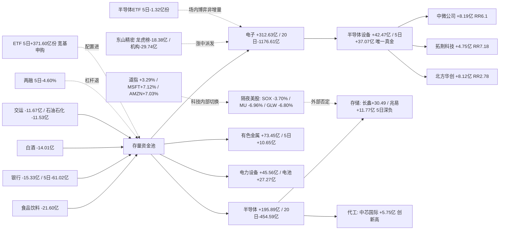

# 2026-11-05 · **资金面**

> **数据源新鲜度**: partial（A 股 11-04 全量；两融/ETF 滞后至 11-03；隔夜美股 11-04 为盘中价）
> **降级状态**: true（confidence 0.82；data_coverage 0.93 / source_independence 0.62 / timeliness 0.90 / reproducibility 0.93；vibe-trading 掉线缺独立第二源）
> **置信度**: 0.82

## 一句话结论

11-04 全市场级回补 **+500.28 亿**（近 20 日最大单日），但钱全部堆在电子单链（电子 +312.63 亿 / 半导体 +195.89 亿），20 日底座仍深负；隔夜 **SOX -3.70%、MU -6.96%、GLW -6.80%** 精准打在昨日涨得最猛的存储/CPO 上 —— **今日电子链是「昨日合力、今日外部否定」，只认半导体设备（5 日 +37.07 亿真金）一个方向，全部研究不执行**。

## 一、今日定性：资金修复日，但不是情绪主升（数据日 11-04）

| 指标 | 11-04 | 11-03（对照） | 判读 |
|---|---|---|---|
| 涨停 / 跌停 | **118 / 9** | 48 / 17 | 涨停翻倍再翻倍，跌停减半 |
| 炸板率 | **21.85%** | 41.46% | 跌破 35% 红线，情绪=修复 |
| 宽度（上涨占比） | **0.838（4667 涨 / 779 跌）** | 0.389 | 从普跌回到普涨 |
| 成交额 | **20518.9 亿** | 17150.9 亿 | 放量 +3368 亿，回补有量 |
| 主力净额 | **+500.28 亿** | -571.43 亿 | 近 20 日最大单日回补 |
| 超大单 / 大单 | **+474.06 / -392.75 亿** | -304.62 / +91.24 | 大资金进、散户出，方向干净 |
| 5 日 / 20 日累计 | -1048.74 / **-4685.50 亿** | — | 单日回补只填 20 日深坑的 10.7% |
| 连板高度 | **3 板** | 4 板 | 高度反而下压，梯队没重建 |
| 中位数涨幅 | +1.88% | — | 有广度，但赚钱效应在首板不在接力 |

**判读**：这是一次**资金修复**，不是**情绪主升**。涨停 118、炸板率回到 21.85%、主力 +500 亿是 20 日窗口内唯一一个像样的正日，但最高板只有 3 板（11-02 曾 6 板），连板梯队没有重建 —— 说明钱进的是「低位补涨 + 超跌反抽」，不是「高位接力」。结构极窄：电子一个板块吃下 +312.63 亿，而食品饮料 -21.60、银行 -15.33、白酒 -14.01、证券 -3.52 亿同期失血 —— **这是从消费金融切向科技的单日高低切，不是全市场加杠杆**。

## 二、时序资金流：20 日只有 4 个正日，且每次回补都被反手

| 交易日 | 主力净额（亿） | 超大单（亿） | 大单（亿） | 上证% | 深成% |
|---|---|---|---|---|---|
| 10-08 | -480.37 | -250.44 | +136.32 | -0.79 | -2.07 |
| 10-09 | -174.75 | -88.92 | -41.19 | +0.05 | +0.17 |
| 10-12 | -354.31 | -179.31 | +26.38 | -0.43 | -2.03 |
| 10-13 | -91.40 | -28.32 | -0.45 | +0.10 | -0.25 |
| 10-14 | -367.55 | -187.31 | +56.57 | -0.88 | -1.97 |
| 10-15 | **-635.31** | -367.49 | +151.46 | -1.59 | -2.43 |
| 10-16 | -49.36 | +1.13 | -112.36 | +0.24 | -0.12 |
| 10-19 | -116.21 | -38.18 | -65.06 | +0.39 | +0.13 |
| 10-20 | -130.43 | -53.89 | +53.12 | +0.12 | -0.14 |
| 10-21 | -87.84 | +9.97 | -24.97 | -0.60 | -0.82 |
| 10-22 | **-632.52** | -358.11 | +149.98 | -1.48 | -2.96 |
| 10-23 | +2.80 | +81.03 | -134.28 | +0.89 | +2.79 |
| 10-26 | -278.67 | -161.17 | -19.52 | +0.19 | -1.19 |
| 10-27 | -471.14 | -185.28 | +100.31 | -1.33 | -2.50 |
| 10-28 | +230.30 | +251.98 | -200.56 | +0.91 | +2.02 |
| 10-29 | **-698.36** | -380.58 | +192.73 | -0.82 | -2.92 |
| 10-30 | -396.66 | -165.51 | +32.66 | -1.44 | -2.73 |
| 11-02 | +117.43 | +158.32 | -226.79 | +1.08 | +1.63 |
| 11-03 | -571.43 | -304.62 | +91.24 | -0.82 | -1.21 |
| **11-04** | **+500.28** | +474.06 | -392.75 | **+2.16** | **+4.22** |

20 日累计 **-4685.50 亿**、正日仅 4 个。规律依旧：**每个正日之后都跟着更大的负日**（10-23 +2.80 → 10-26 -278.67；10-28 +230.30 → 10-29 -698.36；11-02 +117.43 → 11-03 -571.43）。11-04 的 +500.28 亿是否重演「回补一日游」，取决于今日外部环境 —— 而隔夜美股给出的答案是否定（见第七节）。**一个正日不构成趋势反转的证据**，尤其当它只有一条链在买。

## 三、板块：电子单日爆量 vs 20 日深坑，设备是唯一真金

### 3.1 单日净流入前八（11-04）

| 板块 | 单日净额（亿） | 涨幅 | 5 日 | 20 日 |
|---|---|---|---|---|
| 电子 | **+312.63** | +7.61% | -292.09 | **-1176.61** |
| 半导体 | **+195.89** | +10.64% | -82.00 | -454.59 |
| 数字芯片设计 | +82.47 | +10.29% | -85.27 | -203.37 |
| 通信设备 | +76.94 | +5.72% | -176.14 | -560.45 |
| 通信 | +75.86 | +4.63% | -187.28 | -597.65 |
| 有色金属 | +73.45 | +4.67% | +10.65 | -240.93 |
| 通信网络设备及器件 | +57.38 | +7.25% | -127.61 | -384.12 |
| 元件 | +49.86 | +7.26% | -108.94 | -372.72 |

### 3.2 单日净流出前八（11-04，去重）

| 板块 | 单日净额（亿） | 涨幅 | 5 日 | 20 日 |
|---|---|---|---|---|
| 食品饮料 | **-21.60** | -1.03% | +8.20 | -17.11 |
| 银行 | **-15.33** | -0.18% | -61.02 | -112.68 |
| 白酒 | -14.01 | -1.81% | +15.78 | +33.24 |
| 交通运输 | -11.67 | +0.44% | -34.98 | -82.40 |
| 石油石化 | -11.53 | +0.23% | -14.61 | -9.12 |
| 公用事业 | -10.51 | +0.85% | -49.74 | -148.96 |

### 3.3 真正有 5 日底座的方向（全市场只有这几条）

| 板块 | 5 日净额 | 单日 | 20 日 | 判读 |
|---|---|---|---|---|
| **半导体设备** | **+37.07** | +42.47 | -36.02 | 电子链唯一 5 日净流入子行业 |
| 医疗研发外包 | +32.16 | +17.86 | -2.70 | 医药底座 |
| 电力设备 | +30.11 | +45.56 | -357.29 | 跌深反弹 |
| 医疗服务 | +29.17 | +15.26 | -13.96 | 医药底座 |
| 光伏设备 | +28.47 | +21.66 | -29.67 | 跌深反弹 |
| 电池 | +27.27 | +10.31 | -157.14 | 跌深反弹 |
| 锂电池 | +25.31 | +10.82 | -103.63 | 跌深反弹 |
| 小金属 | +23.67 | +28.82 | -40.95 | 有色底座 |

**半导体设备是唯一 5 日净流入（+37.07 亿）的电子子行业** —— 11-04 电子 +312.63 亿是「首日反抽 + 设备先行」的组合，不是全链条 20 日建仓。医药（研发外包/服务）与有色（小金属）是科技之外仅有的两条 5 日底座；电池/光伏/电力设备的 5 日正数来自 11-03 的高低切承接，20 日仍是深坑。

**三问（对当日最热的两条线）**

**① 电子/半导体（+312.63 / +195.89 亿）**

- **大资金意图**：高低切首日，不是全链条建仓。长鑫科技 +30.49 亿（全市场第一、净额占成交 14.52%）、兆易创新 +11.77 亿、北方华创 +8.12 亿、中微公司 +8.19 亿、中芯国际 +5.75 亿，半导体当日 19 家涨停；但电子 20 日仍 -1176.61 亿、半导体 -454.59 亿、数字芯片设计 -203.37 亿 —— **这是超跌反抽的钱，不是季度建仓的钱**。
- **为什么走强**：11-03 的 -571.43 亿把电子砸出 20 日深坑（电子 20 日正日仅 8/20），筹码彻底松动；11-04 指数放量 +2.16%/+4.22% 给出普涨窗口，场内资金选择最超跌的链条做修复。
- **逻辑够不够硬**：**只有设备一条线硬**。半导体设备 5 日 +37.07 亿、20 日 -36.02（接近转正）、北方华创 20 日 +9.09 亿 —— 这是「5 日连续加仓 + 位置在半山腰」的结构；而存储（长鑫 5 日 -16.01、兆易 -4.81）、CPO/光模块（通信 5 日 -187.28）是「单日爆量 + 5 日深负」，且被隔夜 MU -6.96% / GLW -6.80% 直接否定。结论：**设备可研究，存储/CPO 按反抽第二日高危兑现区处理**。

**② 消费/金融失血（食品饮料 -21.60 / 银行 -15.33 / 白酒 -14.01 亿）**

- **大资金意图**：11-03 的防御底座在 11-04 被整体抽走。茅台 -5.65 亿（5 日 +5.37 亿仍在，20 日 +32.02 亿）、平安 -1.24 亿 —— 不是趋势坏，是**跷跷板另一端被抽血**：钱从低波动防御切向高波动科技。
- **为什么走弱**：修复日资金永远优先买弹性，白酒/银行是 11-03 避险资金的老巢，一旦科技给机会就被抛弃。银行 5 日 -61.02、20 日 -112.68 亿，底座其实早就在松动。
- **逻辑够不够硬**：**对今日而言不构成机会**。白酒 5 日 +15.78、20 日 +33.24 亿的底座还在，但单日 -14.01 亿说明 11-03 的承接被反手 —— 消费金融要等科技链二次分歧时才有回流条件，**今日观察不追**。

## 四、昨日前十 5 日追踪（base = 2026-11-03 主力净流入前十）

| # | 标的 | 11-03 净额（亿） | 11-04 净额（亿） | 11-04 涨幅 | 5 日（亿） | 5 日正日 | 5 日涨幅 | 20 日位置 |
|---|---|---|---|---|---|---|---|---|
| 1 | 宁德时代 | +12.85 | +6.19 | +1.43% | **+37.16** | 4/5 | +10.36% | 41.6（低位） |
| 2 | N皇冠 | +7.41 | —（次新无续） | — | — | — | — | — |
| 3 | 中国平安 | +5.60 | **-1.24** | -1.06% | +9.24 | 4/5 | +3.25% | 84.1（高位） |
| 4 | 阳光电源 | +5.41 | **+7.12** | **+7.20%** | +12.68 | 3/5 | **+18.97%** | 93.1（高位） |
| 5 | 中芯国际 | +4.54 | +5.75 | **+9.00%** | +12.87 | 4/5 | +9.12% | **100（新高）** |
| 6 | 贵州茅台 | +4.30 | **-5.65** | **-2.27%** | +5.37 | 4/5 | +8.69% | 85.0（高位） |
| 7 | 圣阳股份 | +3.96 | **-3.49** | +2.04% | +0.14 | 2/5 | +16.30% | 59.8（中位） |
| 8 | 百亚股份 | +3.72 | +2.33 | +7.94% | **+14.26** | **5/5** | -1.69% | 49.6（中位） |
| 9 | 紫金矿业 | +3.37 | **+8.03** | **+6.56%** | +11.97 | 4/5 | +4.65% | 60.9（中位） |
| 10 | 慈文传媒 | +3.23 | -1.33 | -2.65% | +0.79 | 2/5 | -7.23% | 47.6（中位） |

**与 11-03 完全不同的一集：这次前十没有整体死掉，7/10 在 11-04 继续净流入**，只有平安/茅台/圣阳/慈文被反手 —— 而它们恰好是 11-03 的防御与题材票，说明 11-04 的钱**从防御切向进攻**。三个亮点：**紫金矿业 +8.03 亿（有色启动）、阳光电源 +7.12 亿（电力设备延续）、中芯国际 +5.75 亿创 20 日新高（代工被资金选中）**；宁德时代 +6.19 亿延续但缩量（5 日 +37.16 亿是最强底座）。反手最惨的是圣阳股份（5 日 +0.14 亿、换手 32.35%，11-03 的高换手涨停被证实是博弈盘）。**昨日前十今日的接续质量决定了高低切能否从「一日游」变成「主线」** —— 而隔夜美股只支持其中半导体设备/代工一侧。

## 五、龙虎榜诱多识别：最硬的一组是「涨 7% 却净卖 18 亿」的东山精密

11-04 龙虎榜 **256 条 / 170 只**（3 日窗口 11-02~11-04），其中今日 **84 条 / 72 只**。机械规则命中 **20 条派发线索，high 级 8 条**。净买前十与净卖前十：

| 净买前十 | 涨幅 | 净额（亿） | 净卖前十 | 涨幅 | 净额（亿） |
|---|---|---|---|---|---|
| 银之杰 | +12.13% | +7.10 | 东山精密 | +7.04% | **-18.38** |
| 冰山冷热 | +10.00% | +3.15 | 正帆科技 | +20.00% | -3.89 |
| 海洋王 | -8.62% | +2.63 | 万邦医药 | +4.15% | -2.55 |
| 索辰科技 | +20.00% | +1.73 | 金健米业 | +3.96% | -2.36 |
| 皇台酒业 | -4.66% | +1.70 | 七匹狼 | -9.97% | -1.90 |
| 掌阅科技 | +4.94% | +1.67 | 澳弘电子 | +7.05% | -1.89 |
| 引力传媒 | +10.00% | +1.67 | 泉阳泉 | -10.00% | -1.67 |
| 襄阳轴承 | -3.85% | +1.51 | 蘅东光 | +21.80% | -1.15 |
| 晓程科技 | +19.99% | +1.19 | 天洋新材 | -9.91% | -1.06 |
| 华峰测控 | +20.00% | +0.96 | 江丰电子 | +20.00% | -1.05 |

机构专用席位 **3 日窗口聚合净卖 -48.94 亿（111 只票）**，沪股通专用净买 **+14.87 亿（31 只）** —— **内资机构在撤、通道资金在接**。机构聚合净卖前三：生益科技 **-34.32 亿**（9 行，跌停板出货的延续）、东山精密 **-15.98 亿**（6 行）、安集科技 -3.16 亿。

**诱多/派发最硬的三组**：

1. **东山精密**（+7.04% 收涨却被净卖）：龙虎榜净额 **-18.38 亿**、机构专用 **-29.74 亿**（买 13.69 / 卖 29.67 亿）、全市场主力 +4.27 亿、换手 14.34% —— **「股价大涨 + 龙虎榜巨额净卖 + 机构专用巨额净卖」四重同向，涨中派发的最标准样本**。20 日位置 12.8 分位、20 日涨幅 -37.39%，是深跌反弹里的出货。
2. **正帆科技 / 江丰电子**（+20.00% 涨停却被净卖）：正帆龙虎榜 -3.89 亿、机构专用 -3.89 亿、主力 +2.52 亿、换手 9.94%；江丰 -1.05 亿、机构 -0.87 亿、主力 +4.38 亿、换手 11.06% —— **设备链 20cm 涨停板上的机构出货**，与全市场主力净买方向相反，是「涨停板上边拉边卖」。
3. **澳弘电子**（+7.05% / 净卖 -1.89 亿 / 主力 -0.92 亿）：**主力与龙虎榜同向卖** + 20 日强势股反手，四重证据里的第三类（20 日强势股反手）。

**反向个例**：华峰测控 +20.00% 龙虎榜净买 +0.96 亿、机构专用 +0.96 亿、主力 +1.45 亿 —— 设备链里龙虎榜与主力同向的唯一 20cm，与 3.3 节「半导体设备是唯一真金」交叉验证。

**席位协同**：同一（股票, 席位）3 日窗口出现 ≥2 天的组合共 **169 组**，3 日全勤 **38 组**（银之杰机构 +5.27 亿 2 日、皇台酒业机构 +3.38 亿 2 日、襄阳轴承深股通 +2.03 亿 3 日、慈文传媒机构 +1.63 亿 3 日）。协同度比 11-03 的 161/28 组继续上升，但**机构席位整体仍在净卖（-48.94 亿）**，协同上升的方向主要是通道与游资，不是机构建仓。**边界**：龙虎榜只是选定席位样本，不等于全市场主力净额，也不构成操纵证据；hard_reject 权在 R6，本件 no_hard_reject_issued=true。

## 六、跷跷板：唯一 5 日反转对指向「锂电池 ← 股份制银行」

测试 495 个行业 **122265 对**，相关 ≤ -0.6 的 **22 对**，5 日出现方向反转的 4 对：

| A 侧 | 20 日相关 | A 5 日 | B 侧 | B 5 日 | 判读 |
|---|---|---|---|---|---|
| 锂电池 | **-0.633** | +25.31 | 股份制银行Ⅲ | -19.59 | 5 日单侧翻转：钱从银行切向锂电 |
| 医疗器械 | -0.704 | -9.44 | 有色金属 | +10.65 | 5 日单侧翻转：医疗失血、有色吸金 |
| 白酒Ⅱ | -0.647 | +15.78 | 其他电源设备Ⅱ | -8.02 | 白酒还在吸、电源被抽 |
| 白酒Ⅲ | -0.647 | +15.78 | 其他电源设备Ⅱ | -8.02 | 同上 |

与板块表同向（银行 -15.33 亿 / 锂电池 +25.31 亿 / 有色 +73.45 亿），是 11-04 高低切的板块层第二重证据。**注意**：白酒 5 日 +15.78 亿仍与银行/电源反向 —— 防御内部在分化，白酒的底座比银行硬。**相关≠因果**，仅作轮动参照。

## 七、隔夜美股：指数分化 + 半导体单独被杀，正好砍在昨日最热的三条线上

`data/raw/20261105/overseas_snapshot.json` **不存在**（11-05 raw 目录未生成）。按 skill 要求不编造数值：基础取 `data/raw/20261104/overseas_snapshot.json`（只到 11-03 收盘），11-04 美股时段用 **sina 实时**补（04:36 CST 抓取，距收盘约 24 分钟，**盘中价非收盘价**）：

| 标的 | 11-04 盘中 | 11-04 涨跌（live） | 11-03 涨跌 |
|---|---|---|---|
| MU 美光（存储） | 795.61 | **-6.96%** | +2.58% |
| GLW 康宁（光纤） | 117.56 | **-6.80%** | +2.39% |
| INTC 英特尔 | 57.85 | -4.45% | — |
| NVDA 英伟达 | 201.85 | -2.34% | +2.29% |
| TSM 台积电 | 395.68 | -2.25% | +1.55% |
| AVGO 博通（CPO） | 325.46 | -2.01% | +3.07% |
| AMD | 482.50 | -0.29% | +3.65% |
| TSLA | 385.63 | -3.23% | -1.32% |
| AAPL | 351.64 | **+5.95%** | -1.90% |
| MSFT | 558.08 | **+7.12%** | +2.74% |
| AMZN | 268.32 | **+7.03%** | +2.06% |
| GOOGL | 291.35 | +4.04% | +0.37% |
| META | 632.97 | +1.92% | +2.36% |
| 费半 SOX | 10208.43 | **-3.70%** | — |
| 纳指 IXIC | 25810.19 | +1.73% | +0.83% |
| 道指 DJI | 53488.79 | **+3.29%** | -0.38% |

篮子：半导体 7 只平均 **-3.44%**，存储 MU -6.96%、光纤 GLW -6.80%、CPU INTC -4.45%；同时 AAPL/MSFT/AMZN **+6~7%**、道指 +3.29% —— **这不是 risk-off，是「大盘科技内部从半导体切向软件/消费电子」**。亚太 11-04：HSI +1.67%、KS11 +0.62%（未同步杀半导体）。

**外部传导判断**：SOX -3.70% / MU -6.96% / GLW -6.80% 精准命中 11-04 A 股涨得最猛的**存储（长鑫/兆易）、CPO（通信链）、光模块（GLW 代理）**三条线 → **今日 A 股半导体存储/CPO 开盘情绪被压制，11-04 的 +312.63 亿爆量面临「外部不认」的第一道检验**。唯一例外是半导体设备（国产替代逻辑不受美光影响，SOX 只压开盘情绪）与代工（TSM -2.25% 温和）。**结论：存储/CPO 高开=兑现窗口，设备/代工是唯一外部没否定的科技方向**。

## 八、杠杆与配置盘：杠杆继续退，配置继续进（两份数据都滞后一天）

| 维度 | 最新日期 | 读数 | 判读 |
|---|---|---|---|
| 两融三所合计 | 2026-11-03 | **22988.6 亿**，5 日 **-4.60%** | 杠杆持续净撤（11-04 数据 11-05 08:30 后才有） |
| 科创50ETF（588000） | 2026-11-03 | 5 日 **+189.93 亿份**（+22.14%） | 配置盘大额申购，比 11-02 的 +103.83 亿份继续放大 |
| 沪深300ETF（510300） | 2026-11-03 | 5 日 +83.49 亿份（+23.04%） | 同上 |
| 创业板ETF（159915） | 2026-11-03 | 5 日 +77.97 亿份（+22.19%） | 同上 |
| 中证500ETF（510500） | 2026-11-03 | 5 日 +17.79 亿份（+25.33%） | 中小盘也在申购 |
| 芯片ETF（512760） | 2026-11-03 | 5 日 +3.74 亿份（+3.66%） | 温和 |
| **半导体ETF（512480）** | 2026-11-03 | 5 日 **-1.32 亿份（-0.6%）** | **电子爆量时科技配置没跟** |
| 纳指ETF（513100） | 2026-11-03 | 5 日 0.00 亿份 | 持平 |

7 只 ETF 5 日合计 **+371.60 亿份**：**杠杆退（两融 5 日 -4.60%）、配置进（宽基 5 日 +371.60 亿份）**的反向结构延续，且科创50申购在 11-04 大涨前夜还在放大。**关键反证**：半导体ETF/芯片ETF 份额 5 日合计仅 +2.42 亿份 —— **11-04 电子 +312.63 亿的爆量是场内资金博弈，不是增量申购**，这进一步支持「高低切首日」而非「增量建仓」的定性。两融与 ETF 份额只到 11-03，**11-04 大涨当天的杠杆/申赎变动要等盘后补**。期权隐波与股指期货基差无合规源，缺。

## 九、资金流向图

## 十、研究候选（6 只，全部 research_only，execution_eligible=false）

R7 不授予开仓权，以下是资金面体检结果，供 R2/R5/D1 排序使用。炸板率 21.85% < 35% → 不触发候选数减半条款；但 R7 层面仍给 **0 个 execution 资格**。

| # | 标的 | 环节 | 龙头认定 | 当日净额（亿） | 净额占成交 | 5 日（亿） | 20 日（亿） | 位置 | RR | 止损带 | 态度 |
|---|---|---|---|---|---|---|---|---|---|---|---|
| 1 | 中微公司 688012 | 半导体设备 | 龙头 | +8.19 | 9.66% | +13.38 | -2.25 | 31.8 低位 | **6.10** | -5.00% ✓ | 研究·首位观察 |
| 2 | 拓荆科技 688072 | 半导体设备 | 龙头 | +4.75 | 9.96% | +4.11 | **+5.58** | 31.7 低位 | **7.18** | -5.00% ✓ | 研究·首位观察 |
| 3 | 北方华创 002371 | 半导体设备 | 龙头（国产替代总龙） | +8.12 | 12.94% | +16.27（4/5） | **+9.09** | 43.2 中位 | 2.78 | -5.00% ✓ | 研究·观察（等回踩不追高） |
| 4 | 中芯国际 688981 | 晶圆代工 | 龙头 | +5.75 | 9.29% | +12.87（4/5） | +24.75 | **100 高位** | **1.60 ✗** | -5.00% ✓ | 研究·观察（RR 不合格降级 watch） |
| 5 | 长鑫科技 688825 | 存储 | 龙头 | +30.49 | 14.52% | **-16.01** | -84.78 | 43.4 中位 | 3.13 | -5.00% ✓ | 研究·观察（**外部否定：MU -6.96%**） |
| 6 | 兆易创新 603986 | 存储 | 龙头 | +11.77 | 10.38% | **-4.81** | -14.07 | 25.2 低位 | 4.64 | -5.00% ✓ | 研究·观察（**外部否定：MU -6.96%**） |

**为什么没有一只过执行线**：R7 不授开仓权（execution_candidates=0，全部 research_only）；中芯国际 RR 1.60 < 2.0 → 按纪律 §4 降级 watch；长鑫/兆易 `overseas_conflict=true` —— 美光 MU 盘中 -6.96% 直接否定存储链，昨日买盘今日面对证伪，反抽第二日按高危兑现区处理；中微/拓荆/北方华创 RR 与止损带都合格，但它们是「5 日新进 + 20 日深坑」的反弹结构，必须等今日设备板块承接验证（SOX -3.70% 低开不破位）才能升级。**R7 层面零 execution 资格，hard_reject 权归 R6**。

### 首推票思维链：中微公司（688012）

**买入理由**

半导体设备子行业是 11-04 电子 +312.63 亿爆量里**唯一 5 日净流入的真金**（行业 5 日 +37.07 亿、单日 +42.47 亿、涨幅 +15.22%）。中微 11-04 +16.62% 收 240.01（20cm 未涨停），主力 +8.19 亿占成交 9.66%，5 日 +13.38 亿连续加仓，20 日位置 31.8 分位、距 20 日高 -23.4% —— **位置比北方华创更低、5 日资金同样连续**。机械 RR 6.10（入场 240.01 / 止损 228.01 / 目标 313.24），止损距 -5.00% 落在硬区间，禁止清单（龙头走坏/高位滞涨/板块退潮）均未触发。外部传导对设备最温和：SOX -3.70% 只压开盘情绪，国产替代逻辑不受 MU -6.96% 影响（overseas_conflict=false）。

**风险点**

① 20 日仍小幅净流出（-2.25 亿），5 日加仓是刚起步不是长期建仓，反弹 vs 反转未定；② 两融 5 日 -11.76%，杠杆盘在减 —— 这波买入是配置/游资性质，持续性存疑；③ 20cm 品种波动大，若 SOX 压制导致低开，昨日的 16.6% 涨幅容易变成浮筹；④ 设备链 20cm 涨停里正帆科技/江丰电子龙虎榜被机构净卖（-3.89 / -1.05 亿），板块内部有出货盘。

**止损条件**

跌破 228.01（-5% 机械止损线）无条件离场；5 日均线 220 为结构失效线（跌破即「5 日加仓结构」证伪）；若半导体设备行业单日主力净额转负超 15 亿，即使未破位也降为观察。

**可验证假设**

「半导体设备是电子链唯一 5 日真建仓方向」—— 验证方式：今日设备子板块仍有 ≥2 家 20cm 涨停（或 ≥3 家涨幅 >5%）、中微不破 230 → 成立，高低切从一日游升级为主线候选；若设备开盘即翻绿、中微领跌 → 证伪，11-04 只是超跌普涨日的补涨末端，存储/CPO 的崩塌会把设备一起拖下水。

## 十一、不确定性 / 反证（对自己的批判）

1. **隔夜美股是盘中价不是收盘价**（04:36 CST 抓取，距收盘约 24 分钟）。SOX -3.70%、MU -6.96% 可能在收盘前变化；若尾盘半导体拉回，今日 A 股科技链的外部否定预期直接弱化。
2. **单日回补 vs 趋势反转未定**：20 日 -4685.50 亿、正日仅 4 个，历史上每个正日之后都跟着更大的负日。11-04 的 +500.28 亿是否重演「回补一日游」，取决于今日承接 —— 本件所有「设备是唯一真金」的判断都以「今日设备不破位」为前提。
3. **跨件口径差异**：11-03 主力净额本件 -571.43 亿 vs 上一件 R7 -574.09 亿（moneyflow_mkt_dc 重取约 0.5% 差异），方向不变，但逐日对比时以本件为准。
4. **两融/ETF 滞后一天**：11-04 大涨当天的杠杆与申赎变动未知（11-05 08:30 后披露）。若 11-04 两融大幅回升，则「场内博弈非增量申购」的定性要打折。
5. **数据同源**：个股主力、板块主力、龙虎榜、大宗均源自东财/tushare 口径，vibe-trading 掉线 → 无独立第二源交叉（source_independence 0.62）。双通道缺失是本件 confidence 0.82 而非 0.9 的主因。
6. **R2 未产出**：候选池由 R7 自建（资金 + 涨停 + 5 日净流入），没有主线生命周期与龙一认定的外部确认；「设备=唯一真金」是资金面单视角结论。
7. **北向 retired**：龙虎榜「沪股通专用净买 +14.87 亿」是席位数据，不等于北向资金整体，也不构成对 2026-10-28 停抓决定的变相恢复。
8. **大宗交易维度弱**：block_trades 30 日记录存在但溢价率缺失（部分为 null），无法用大宗溢价判断承接意愿，block_trades 维度实际贡献有限。

## 十二、数据源审计

| 源 | 状态 | 抓取时间 | 记录数 | 备注 |
|---|---|---|---|---|
| tushare moneyflow_dc（个股主力 20 日） | 🟢 ok | 2026-11-05 04:31 | 20 日全市场 | 11-04 收盘全量 |
| tushare moneyflow_ind_dc / con_dc（行业+概念 20 日） | 🟢 ok | 2026-11-05 04:32 | 496 行业 + 534 概念 × 20 日 | 东财口径 |
| tushare daily / daily_basic | 🟢 ok | 2026-11-05 04:32 | 5572 只 | 20 日窗口 |
| tushare limit_list_d（U/D/Z × 5 日） | 🟢 ok | 2026-11-05 04:32 | 5 日 | 涨停 118/跌停 9/炸板 33 |
| tushare top_list / top_inst（龙虎榜 3 日窗口） | 🟢 ok | 2026-11-05 04:33 | 256 条 / 170 只 | 11-02~11-04；今日 84 条/72 只 |
| tushare margin（市场级两融） | 🟡 partial | 2026-11-05 04:33 | 10 行 | 最新 11-03，11-04 未披露 |
| tushare fund_share（7 只 ETF） | 🟡 partial | 2026-11-05 04:33 | 7 只 | 最新 11-03（T+1） |
| tushare block_trade（大宗 30 日） | 🟢 ok | 2026-11-05 04:32 | 30 日 | 溢价率部分缺失，维度弱 |
| data/raw/20261104/overseas_snapshot.json | 🟡 partial | 2026-11-04 22:30 | 11-03 收盘 | 11-05 raw 未生成 |
| sina gb_ 实时（美股 13 只 + 3 指数） | 🟢 ok | 2026-11-05 04:36 | 16 条 | **盘中价**（距收盘约 24 分钟） |
| vibe-trading MCP（block/margin/fund_flow 交叉） | 🔴 error | — | — | stdio 掉线，vibe_trading_degraded=true |
| 北向（moneyflow_hsgt / hk_hold） | ⚪ retired | — | — | 2026-10-28 起停抓，不补 |

## 十三、与其他 R/D/E 的关系

- **依赖**：`data/research/20261105/_work/*`（tushare 抓取：mfd/ind/con/daily/limit/top_list/margin/block_trade）、`_core.json`（计算层）、`_us_live.json`（sina 美股实时）、`data/raw/20261104/overseas_snapshot.json`（11-03 收盘快照）。
- **被消费**：R2（板块排序，可用「半导体设备唯一 5 日真金」与昨日前十 7/10 延续的证据）、R5（对上述 6 只候选画像）、D1（用 execution_candidates=0 + 候选 RR/止损带做仓位与门禁判断）、E1（盘后复核）。
- **不授予**：任何开仓权限。execution_candidates = 0，全部 research_only=true。
- **硬否决权**：归 R6，本件只交风险线索（20 条派发/弱封，high 8 条），no_hard_reject_issued=true。

## Sub-Agent 元数据

- skill: analyze_capital_flow_v1@1.3（child: hot_money_synergy_v1 / detect_seesaw_pairs_v1 inline）
- artifact: `data/research/20261105/R7_capital_flow_20261105.json`（311933 B，schema R7_capital_flow_v1，staleness_status=ok，pre_06am_gate 已放行）
- 生成耗时: 约 7 分钟（04:31 抓取启动 → 04:38 落盘）
- model: deepseek-v4-flash
- 覆盖: 496 行业 / 534 概念 / 20 日个股主力全量 / 256 条龙虎榜（3 日）/ 16 条美股实时 / 3 指数 / 7 只 ETF / 30 日大宗
- 候选: 6 只 research_only，execution_candidates 0
- 一致性: 主力 11-04 +500.28 亿与 11-03 前件 -574.09 亿（本件 -571.43 亿，±0.5% 口径差）可复现；昨日前十 base 与上一件 R7 前十一致
