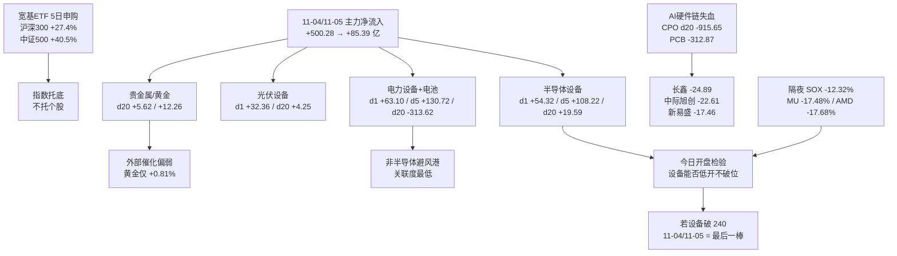

# 2026-11-06 · **资金面**

> **数据源新鲜度**: partial（A 股全量 11-05；两融/ETF T+1 到 11-04；美股 11-05 收盘）
> **降级状态**: false（北向 retired stub 不计降级；vibe-trading eastmoney 交叉全量完成）
> **置信度**: 0.89

## 一句话结论

11-04/11-05 两天 +585 亿的回补，今日首迎 SOX -12.32% 的真实检验；资金结构里只有半导体设备是三层的真金，存储/CPO/PCB 是「钱已撤 + 外部否定」双杀。**资金面不授开仓资格**，研究 3 只全部 research_only。

## 详细分析

**一、11-05 是「广度极强、资金转弱」的典型震荡日。** 全市场主力净流入仅 +85.39 亿，比 11-04 的 +500.28 亿腰斩再腰斩；但盘面极好看——4869 涨 / 625 跌、中位数 +2.02%、涨停 84 家、跌停 0 家、上证 +0.10% 而深成 +1.19%。矛盾点在封板质量：炸板 48 家、炸板率 36.36%，越过 35% 红线，最高只有 4 板（11-02 曾 6 板）。按纪律条款，炸板率 ≥35% 时情绪定性为**震荡**、研究候选数减半（6→3）。这一天的本质是「权重退、小票进，钱没有增量，只在板块之间换手」。

**二、结构是「AI 硬件链被抽血、资金切向设备与电力」。** 净流入前五：电力设备 +63.10、半导体 +61.04、半导体设备 +54.32、传媒 +34.92、光伏设备 +32.36 亿；净流出前五：元件 -66.71、印制电路板 -61.05、通信设备 -56.39、通信网络设备 -49.01、数字芯片设计 -18.56 亿。概念层面更直白：CPO 概念 -85.48、光通信模块 -86.64、算力概念 -21.36 亿，而半导体概念 +64.93、先进封装 +56.91、固态电池 +41.54、机器人概念 +36.37、光伏概念 +33.10 亿。这不是「电子整体强」，是**同一条 AI 链内部从「光/连接」切向「设备/材料/封装」**。

**三、20 日维度只有三条线是真金。** 半导体设备 20 日 +19.59 亿（8/20 天为正）、光伏设备 +4.25 亿、贵金属 +5.62 亿 / 黄金 +12.26 亿。对照之下，半导体 -233.70、元件 -423.79、通信设备 -519.53、CPO -915.65 亿，全市场 20 日累计 -4119.74 亿、只有 5/20 天为正。11-04 与 11-05 连续两日净流入（+500.28 → +85.39）是 20 日窗口内**第一次**出现，也就是说今天这对资金面对的是「止跌以来的第一道外部压力测试」，没有历史样本可参照。

**四、昨日前十的次日表现是最硬的证据。** 11-04 主力净流入前十，11-05 只有 **2/10** 继续净流入（寒武纪 +11.01→+2.94、通富微电 +8.65→+3.68）。长鑫科技 +30.49→**-24.89**、中际旭创 +17.40→**-22.61**、新易盛 +25.04→**-17.46**、云南锗业 +15.23→-9.79、兆易创新 +11.77→-11.16 亿——单日十亿级买盘在次日被同向反手卖出，这是标准的「插入式买盘 + 次日派发」，比龙虎榜更像资金层面的自证。11-05 净流出前六也印证：长鑫 -24.89、中际旭创 -22.61、新易盛 -17.46、东山精密 -16.55、沪电股份 -11.43、兆易创新 -11.16 亿。

**五、增量资金的成色是指数化的，不是行业化的。** ETF 份额 5 日变化呈现极端分叉：沪深300ETF +27.4%、中证500ETF +40.5%（99.63 亿份）、创业板ETF +28.7%、科创50ETF +25.9%，而半导体ETF **-2.86%**、芯片ETF -0.32%。这说明两天 +585 亿里靠的是宽基申购与场内存量博弈，行业 ETF 不但没申购还在赎回。宽基只托指数不托个股——一旦外盘杀跌，行业端没有被动买盘接住。两融同步降温：两市余额 23004 亿（11-04），5 日 -4.63%。

**六、外部以极端方式介入。** 隔夜（11-05 美股收盘）费半 SOX **-12.32%**，是纳指 -5.48% 的 2.2 倍、道指 -3.44% 的 3.6 倍；MU -17.48%、AMD -17.68%、GLW -13.11%、TSM -11.05%、INTC -10.44%、TSLA -10.77%、AVGO -10.43%、NVDA -9.23%，半导体 7 子均值 -12.77%，大盘科技 0/5 收正。避险端没有接住钱：COMEX 黄金仅 +0.81%（盘中冲 4155.8 后回落至 4067）、白银 -0.79%、原油 +2.91%。亚洲先行指标已经分裂：KOSPI 11-05 -5.28%（半导体权重被打），恒指反而 +3.67%。

## 深层三问（对今日最重要的三个资金对象）

**问题一：半导体设备 +108 亿的 5 日加仓，是真建仓还是最后一棒？**

- **大资金意图**：11-05 单日行业 +54.32 亿、5 日 +108.22 亿、20 日 +19.59 亿，三层同向，且是全电子链唯一 20 日为正的子行业。个股层面中微 +14.84 亿（全场第一，净额占成交 12.26%）、拓荆 +7.44、华峰测控 +5.96、中科飞测 +5.87、芯源微 +4.44 亿——钱是按「设备子行业」成群进的，不是单票游资，这更像配置盘的行为。vibe-trading 大宗交叉：中微 30 日仅 3 笔 0.25 亿、拓荆/北方华创大宗为零且机构对倒（10-23 两笔各 1.6 亿/0.64 亿），机构参与度无法从大宗侧验证加仓。
- **为什么走强**：11-05 设备板块 +4.33%，但 20 日涨幅仍为负（中微 -18.33%、拓荆 -18.40%），属于「资金回来了、价格没回去」的低位加仓形态，pos20 分布在中位偏低（拓荆 37.6、华峰 30.7、中科飞测 39.4）。
- **逻辑够不够硬**：**不够硬到可以无视外盘**。设备是国产替代逻辑，与 MU/AMD 的存储/算力周期不是同一条因果链，但 SOX -12.32% 是全板块估值锚的位移，今日开盘一定会先杀情绪。判定标准只能放在盘中：设备板块能否低开后 9:45 前把跌幅收窄到 -3% 内、且中微不破 240。破了就是「两天 +585 亿的最后一棒」。

**问题二：电力设备 +130 亿的 5 日流入，是避风港还是同一个杠杆的另一头？**

- **大资金意图**：行业 5 日 +130.72 亿（全市场第一）、单日 +63.10 亿；宁德 5 日 +45.47 亿且 5/5 天全为正，是「连续五天不间断」的加仓，比任何单日爆量都更可靠。但 vibe-trading 大宗交叉给出警示：**11-05 宁德 3 笔大宗共 1.94 亿全部是「游资席位买 / 机构专用卖」**（国泰海通深南京基一百、国信深圳后海接，机构专用出），30 日 39 笔大宗机构对倒密集 —— 机构在借涨停出货，游资在接。
- **为什么走强**：20 日仍是 -313.62 亿，说明这是从深坑里往回捞的第一段；但 20 日 +0.32 亿的宁德已经率先转平，龙头先于板块回血。
- **逻辑够不够硬**：**中等偏硬，但属性要认清**。它不是「避险资产」，是同为成长股里的资金再配置——今日若电力设备同步净流出 >20 亿，就是全面去杠杆，没有避风港；若它跌幅 <2% 且行业仍净流入，才是真正的高低切承接。大宗「游资接、机构出」结构提示：追涨要格外当心。

**问题三：黄金 20 日 +12.26 亿的稳定流入，为什么隔夜只换来 +0.81%？**

- **大资金意图**：黄金行业 20 日 +12.26 亿、8/20 天为正；贵金属 +5.62 亿、单日 +10.26 亿、板块 +5.84%。山金国际 20 日 15/20 天净流入、5 日 5/5 天净流入，是资金曲线最平滑的方向。
- **为什么走强**：不是避险驱动，更像「通胀/实际利率」的中期配置，因此科技股崩盘当晚黄金只涨 0.81%，白银反而 -0.79%——避险盘没有真正涌入。
- **逻辑够不够硬**：**方向对、催化弱、位置高**。山金 pos20=83.4，机械口径下不进执行池；且 11-05 龙虎榜里盛达资源涨停（+10.01%）却被席位净卖 -0.84 亿、盘中开板 6 次，说明贵金属内部已经有资金在涨停上派发。这条线只能「跟随不追高」。

## 首推票思维链 · 中微公司（688012.SH，仅研究观察，不构成开仓）

**买入理由**：11-05 全市场主力净流入第一 +14.84 亿，净额占成交 12.26%（极高浓度），成交 120.99 亿；5 日 +30.82 亿且 4/5 天为正，20 日 +11.12 亿、10/20 天为正。所属半导体设备行业 20 日 +19.59 亿是电子链唯一为正，形成「个股 + 子行业 + 板块」三层同向。价格 254.00，pos20 45.7（中位偏低），20 日仍 -18.33%，属资金已回、价格未回。机械盈亏比：止损 241.30（近 3 日最低与 -5% 取近者，-5.0%）、目标 311.21（20 日最高附近，+22.52%），RR 4.5，止损距落在 5-10% 硬区间内。

**风险点**：① 隔夜 SOX -12.32%、AMD -17.68%、TSM -11.05%，设备今日必然低开，昨日 14.84 亿买盘瞬间浮亏；② 两融余额 5 日 -15.85%（35.39 亿，vibe-trading 交叉一致），杠杆资金完全没跟这波设备行情，反弹缺杠杆助推；③ 11-05 换手仅 5.11%、涨停 0 家，是资金推动而非情绪封板，一旦板块效应断裂就没有承接；④ 大宗 30 日仅 3 笔 0.25 亿，机构参与度无法从大宗侧验证。

**止损条件**：半导体设备行业今日主力净流出 >30 亿，或个股跌破 240（-5.5%，接近 5 日均线）→ 「5 日 +30.82 亿是建仓」的假设当日作废，降级为 watch。

**可验证假设**：若今日 9:45 前设备子板块跌幅收窄至 -3% 内且中微不破 240 → 设备加仓是建仓不是出货；若低开低走且板块净流出 >30 亿 → 11-04/11-05 两天是最后一棒，设备线的 20 日正流入结构当场失效。

## 昨日前十 · 5 日追踪（base = 11-05 主力净流入前十）

| 排名 | 名称 | 11-05 净额 | 5 日累计 | 20 日累计 | 5日正天数 | 5日涨幅 | pos20 | 形态判定 |
|---|---|---|---|---|---|---|---|---|
| 1 | 中微公司 | +14.84 亿 | +30.82 亿 | +11.12 亿 | 4/5 | +11.89% | 45.7 | 三层同向，真加仓 |
| 2 | 利欧股份 | +9.13 亿 | +8.89 亿 | +6.81 亿 | 3/5 | +10.30% | 100.0 | 小票涨停 + 龙虎榜 +3.30 亿，位置顶格 |
| 3 | 宁德时代 | +8.10 亿 | +45.47 亿 | +0.32 亿 | 5/5 | +15.27% | 56.0 | 五天不间断，20 日刚转平 |
| 4 | 有研新材 | +7.87 亿 | +11.95 亿 | -4.96 亿 | 3/5 | +14.19% | 41.1 | 材料弹性，20 日仍负 |
| 5 | 拓荆科技 | +7.44 亿 | +12.57 亿 | +10.64 亿 | 3/5 | +14.23% | 37.6 | 设备链最干净的低位结构 |
| 6 | 瑞芯微 | +6.70 亿 | +11.47 亿 | +15.98 亿 | 4/5 | +14.58% | 100.0 | 20 日最强但位置顶格 |
| 7 | 华峰测控 | +5.96 亿 | +8.01 亿 | +0.75 亿 | 3/5 | +6.20% | 30.7 | 位置最低，净额占比 15.2% 全场最高 |
| 8 | 中科飞测 | +5.87 亿 | +9.60 亿 | +4.92 亿 | 4/5 | +17.84% | 39.4 | 设备内部 5 日涨幅最大 |
| 9 | 阳光电源 | +5.03 亿 | +19.42 亿 | -14.14 亿 | 4/5 | +26.68% | 100.0 | 位置顶格，追高即最大敞口 |
| 10 | 芯源微 | +4.44 亿 | +5.93 亿 | +2.03 亿 | 4/5 | +4.89% | 34.2 | 低位设备，量能偏小 |

结构读法：前十里有 6 只是半导体设备（中微、拓荆、华峰、中科飞测、芯源微 + 有研材料），2 只是电力设备/电池（宁德、阳光），1 只传媒小票（利欧），1 只数字芯片（瑞芯微）。**没有一只是 CPO/光模块/PCB** —— 这本身就是资金迁移的答案。同时前十无一例 one_day_wonder（单日爆量、5 日为负），说明 11-05 的买盘至少在 5 日维度上不是孤立插针。

## 昨日（11-04）前十 · 次日跟随验证

| 排名 | 名称 | 11-04 净额 | 11-05 净额 | 是否延续 |
|---|---|---|---|---|
| 1 | 长鑫科技 | +30.49 亿 | **-24.89 亿** | ✗ |
| 2 | 新易盛 | +25.04 亿 | **-17.46 亿** | ✗ |
| 3 | 中际旭创 | +17.40 亿 | **-22.61 亿** | ✗ |
| 4 | 云南锗业 | +15.23 亿 | -9.79 亿 | ✗ |
| 5 | 兆易创新 | +11.77 亿 | -11.16 亿 | ✗ |
| 6 | 寒武纪 | +11.01 亿 | +2.94 亿 | ✓ |
| 7 | 长电科技 | +10.82 亿 | -2.31 亿 | ✗ |
| 8 | 工业富联 | +9.11 亿 | -7.83 亿 | ✗ |
| 9 | 药明康德 | +8.93 亿 | -0.25 亿 | ✗ |
| 10 | 通富微电 | +8.65 亿 | +3.68 亿 | ✓ |

**只有 2/10 延续**。存储与光模块三巨头（长鑫、新易盛、中际旭创）合计 11-04 净流入 +72.93 亿，11-05 净流出 -64.96 亿，一天之内几乎原路退回。这条证据直接否定了「存储/CPO 回调到位」的说法——昨日进去的钱今天已经走了，而今晚 MU -17.48%、GLW -13.11%、AVGO -10.43%，外部再补一刀。

## 龙虎榜诱多识别

规则命中 11 条，high 级 3 条，最典型的三组：

- **果麦文化 +5.46% / 席位 -2.63 亿 / 机构专用 -3.98 亿**：pos20=100、20 日 +61.17%、换手 43.9%，三条规则同时命中（涨中派发 + 机构出货 + 强势股反手）。这是当日最干净的「高位派发」样本。
- **盛达资源 +10.01% 涨停 / 席位 -0.84 亿**：盘中开板 6 次，pos20 50.9、20 日 -14.65%，是全市场主力 +1.01 亿却席位净卖。贵金属涨停板内部已有资金在出货，不能把「黄金 20 日正流入」直接套到每只金股上。
- **托伦斯 +11.04% / 机构专用 -0.73 亿 / 换手 37.8%**：21% 涨幅 + 37.8% 换手 + 机构净卖，属于高换手诱多的标准形态。

席位结构（tushare + vibe-trading eastmoney 双源一致）：机构专用 3 日合计 **-52.67 亿**（覆盖 101 只票），是单边减仓；「深股通专用」席位 -13.31 亿、「沪股通专用」+9.36 亿（席位口径，非北向净流入，北向已于 2026-10-28 停抓）。游资端中信上海分公司 +5.77 亿（33 只票）、国泰海通总部 +5.02 亿、国新证券北京分公司 +5.02 亿、国泰海通知春路 +4.91 亿——活跃席位在分散接力，没有单席位重仓押注。游资协同 3 日 201 次：慈文传媒（国新北京 3 日连续 +1.21 亿、机构专用 +1.07 亿）、澳弘电子（国信浙江 3 日 +0.98 亿）是最持续的合力。

## 隔夜美股核心个股（外部传导）

| 标的 | 收盘涨跌 | 链条 | 对 A 股映射 |
|---|---|---|---|
| MU | **-17.48%** | 存储 | 存储链（长鑫/兆易/江波龙/佰维）定价锚被打断，且昨日资金已撤 → 双杀 |
| AMD | **-17.68%** | AI 算力 | 国产算力替代对标失效，算力概念 20 日 -591.32 亿 |
| GLW | **-13.11%** | 光纤/光通信 | 光模块上游需求锚，CPO 20 日 -915.65 亿，补跌而非新杀 |
| SOX | **-12.32%** | 费半指数 | 全半导体估值锚位移，今日设备/材料/封测先杀情绪 |
| TSM | -11.05% | 晶圆代工 | 中芯国际/华虹景气锚走弱 |
| TSLA | -10.77% | 机器人/汽零 | 机器人概念 11-05 +36.37 亿但 20 日 -569.83 亿，追高盘被闷 |
| AVGO | -10.43% | CPO/交换芯片 | 中际旭创/新易盛海外映射继续恶化 |
| INTC | -10.44% | CPU/半导体 | 半导体整体风险偏好下降 |
| NVDA | -9.23% | AI 算力 | 算力/液冷情绪锚 |
| AAPL | -1.41% | 消费电子 | 果链相对抗跌，但没到可以做多的程度 |
| 黄金 | +0.81% | 贵金属 | 避险未真正入场，只能给「不跌」不给「大涨」 |
| 原油 | +2.91% | 油气 | 中国石油 11-05 跌 7.93% 且机构专用 -4.58 亿，油强股弱不构成买点 |

指数：SOX -12.32% / IXIC -5.48% / DJI -3.44%，半导体 7 子均值 **-12.77%**，大盘科技 **0/5** 收正。这是「全科技链同步去杠杆」，不是 11-04 那种「指数分化、半导体单独被杀」。数据经 sina gb_（05:01 CST）+ eastmoney push2（105.NVDA/105.MU/105.AMD/100.NDX）双源交叉一致，为收盘价而非盘中估值。

## 关键证据

- 证据 1：11-04 前十次日仅 2/10 延续，长鑫 +30.49→-24.89、中际旭创 +17.40→-22.61、新易盛 +25.04→-17.46 亿 · 来源 tushare.moneyflow_dc（20 日全市场）
- 证据 2：半导体设备 20 日 +19.59 / 5 日 +108.22 / 单日 +54.32 亿，是电子链唯一 20 日为正子行业 · 来源 tushare.moneyflow_ind_dc
- 证据 3：行业 ETF 赎回（半导体 -2.86%、芯片 -0.32%）与宽基 ETF 申购（中证500 +40.5%、沪深300 +27.4%）背离 · 来源 tushare.fund_share（11-04）
- 证据 4：机构专用席位 3 日 -52.67 亿 / 101 只票，果麦文化单票机构 -3.98 亿 · 来源 tushare.top_inst + vibe-trading dragon_tiger
- 证据 5：SOX -12.32%、MU -17.48%、AMD -17.68%、半导体 7 子均值 -12.77%，双源一致 · 来源 sina gb_ + eastmoney push2
- 证据 6：两市两融 23004 亿、5 日 -4.63%，杠杆未跟这波回补 · 来源 tushare.margin（11-04）+ vibe-trading margin_15d 逐日交叉一致
- 证据 7：宁德 11-05 大宗 3 笔共 1.94 亿「游资席位买 / 机构专用卖」；华峰测控 11-05 出现 -17.37% 深度折价大宗（195 vs 236）→ 机构借涨停出货 · 来源 vibe-trading block_trades（eastmoney）
- 证据 8：中微两融 35.39 亿 5 日 -15.85%、宁德 160.76 亿 5 日 -7.99% —— 候选池 9 票 margin_15d 序列全部落盘，杠杆盘未确认跟这波设备/电池行情 · 来源 tushare margin_detail == vibe-trading eastmoney 数值逐日一致

## 数据源审计

| 源 | 状态 | 抓取时间 | 记录数 | 备注 |
|---|---|---|---|---|
| tushare.moneyflow_mkt_dc | 🟢 ok | 2026-11-06 04:32 | 20 日 | 全市场主力口径 |
| tushare.moneyflow_ind_dc | 🟢 ok | 2026-11-06 04:32 | 行业 496 / 概念 534 | 20 日序列完整 |
| tushare.moneyflow_dc | 🟢 ok | 2026-11-06 04:33 | 5642 只 × 20 日 | 个股主力（万元口径已换算亿元） |
| tushare.top_list / top_inst | 🟢 ok | 2026-11-06 04:32 | 244 条 / 3 日 | 11-05 当日 69 条、63 只票 |
| vibe-trading MCP | 🟢 ok | 2026-11-06 05:03 | 9 票×15 日两融 + 9 票大宗 + 龙虎榜 69 条 | eastmoney 独立通道，与 tushare 数值逐日一致 |
| tushare.block_trade | 🟡 partial | 2026-11-06 04:32 | 1000 行 | 达接口行数上限截断（30 日） |
| tushare.margin | 🟡 partial | 2026-11-06 04:32 | 57 行 | T+1，最新 11-04 |
| tushare.fund_share | 🟡 partial | 2026-11-06 05:05 | 7 只 | T+1，最新 11-04 |
| sina.gb_ 美股实时 | 🟢 ok | 2026-11-06 05:01 | 16 个标的 | 收盘价，与 eastmoney 一致 |
| eastmoney.push2_us | 🟢 ok | 2026-11-06 04:36 | 4 个标的 | 交叉校验用 |
| 北向（moneyflow_hsgt） | ⚪ retired | — | — | 2026-10-28 停抓，retired stub |
| 股指期货基差 / 期权隐波 | ⚪ unavailable | — | — | 本地无源 |

## 不确定性 / 反证

1. **最容易被证伪的判断**：把「11-04/11-05 两天 +585 亿」当成资金回补的起点。反证很直接——20 日累计 -4119.74 亿、只有 5/20 天为正，且这两天里有一天（11-05）只有 +85.39 亿，而 11-04 那 +500.28 亿在次日已被前十里的 8 只原路退回。若今日主力再净流出 300 亿以上，这两天就该被重新定义为「反弹出货窗口」而不是「回补起点」。
2. **设备三层同向也可能是加仓末端**：20 日 +19.59 亿的体量，相对 5 日 +108.22 亿意味着「20 天里 88% 的净流入发生在最近 5 天」。这不是长期建仓，而是最近才开始的集中买入，一旦外部否定，撤退也会同样迅速。
3. **贵金属的高位风险**：山金 pos20=83.4、赤峰 63.2、山东黄金 86.7，全在高位区；11-05 盛达资源涨停却被席位净卖 -0.84 亿、开板 6 次。把「黄金 20 日 +12.26 亿」外推成「金股可以买」是逻辑跳跃。
4. **两融/ETF 是 11-04 的数据**，11-05 的杠杆行为未知；若 11-05 两融大幅回升，说明杠杆在跟，当前「杠杆未跟」的判断需修正。
5. **龙虎榜是样本不是全量**：69 条记录只覆盖 63 只票，不能推出全市场资金意图；hard_reject 权在 R6，本 skill 只交线索。
6. **最大反证是美股盘中修复**：05:01-05:03 抓的是收盘价，若美股期货/盘后企稳，今日 A 股科技链低开幅度可能小于预期——「外部否定」会被过度定价。
7. **宁德大宗「游资接、机构出」可能是通道安排**：国泰海通深南京基一百当日也接中微/华峰大宗，同一席位多票承接更像机构盘前撮合而非单纯看空；该信号只做「追涨当心」提示，不作否决。

## 与其他 R/D/E 的关系

- 依赖：`data/research/20261106/cycle_position.json`（11-05 情绪周期：neutral）、`data/raw/20261105/overseas_snapshot.json`（11-04 美股收盘基准）、`data/research/20261105/R7_capital_flow_20261105.json`（11-04 主力前十，用于次日跟随验证）、`data/research/20261105/R2_main_sectors.json`（主线与候选池参考：半导体设备/材料、贵金属）
- 被消费：R2（用 `main_force.top_inflow_sectors` 验主线资金是否配合）、R5（个股 `net_5d/net_20d/pos20` 做画像资金侧）、R6（本报告的「昨日前十 2/10 延续」「机构专用 -52.67 亿」「宁德大宗机构出货」是其反证素材）、D1（`emotion=震荡`、`research_candidate_limit.reduced_size=3`、`staleness_status=ok` 直接进仓位与候选约束）、P2 午盘修订（`midday_increment` 为 null，本批次为盘前全量）

## Sub-Agent 元数据

- skill: analyze_capital_flow_v1（v1.3 · 含隔夜美股核心个股维度）
- artifact: data/research/20261106/R7_capital_flow_20261106.json（schema R7_capital_flow_v1，490,347 bytes；软链 R7_capital_flow.json）
- batch: premarket_full · resolved_trade_date: 20261105 · trading_gap: 0 · staleness_status: ok · cross_date_mismatch: false
- 研究候选: 3 只（中微公司 RR 4.5 / 宁德时代 RR 2.6 / 山金国际 RR 0.65 高位降级），watch 备选 6 只，execution_eligible: 0
- vibe-trading 硬调用: 9 票 margin_15d + 9 票 block_30d + 全市场龙虎榜 1 次，全部完成，hard_constraint_satisfied=true
- 生成耗时: 约 40 分钟（04:31 抓取 → 05:11 落盘，含 05:01 美股收盘等待与 vibe-trading 交叉）
- model: deepseek-v4-flash
