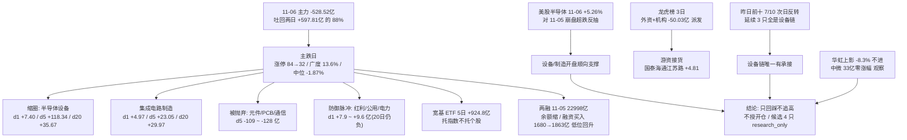

# 2026-11-09 · **资金面**

> **数据源新鲜度**: partial（A 股全量 11-06；两融 11-05；美股 11-06 收盘）
> **降级状态**: false（北向 retired stub 不计降级；vibe-trading MCP 未接 → 大宗/两融用 tushare 同口径替代，vibe 段自身 degraded=true、置信度 source_independence 0.7 已反映）
> **置信度**: 0.87

## 一句话结论

11-06 单日 -528.52 亿把 11-04/11-05 两日 +597.81 亿回补吐回 88%，涨停 84→32 腰斩 = 主跌日；资金缩圈只剩半导体设备/制造一条链，美股半导体 +5.26% 开修复窗，但龙虎榜三日外资+机构席位 -50.03 亿派发、昨日前十 7/10 次日反转——**资金面不授开仓资格**，4 只候选全部 research_only，只回踩不追高。

## 详细分析

**一、11-06 是「两天回补被一天吐回」的转折日。** 全市场主力净流入 -528.52 亿（超大单 -233.40 + 大单 -295.12，小单 +476.54 接盘），对比 11-04 +507.57、11-05 +90.24 的两日 +597.81 亿，单日吐回 88.4%。指数沪 -1.10 / 深 -2.57 / 创 -3.96 / 科创50 -2.60；广度 758 涨 : 4741 跌（13.6%）、中位 -1.87%；涨停 84→32 腰斩（-61.9%）、跌停 15、炸板率 30.43%、最高板 5（闽发铝业/浙文影业）。20 日累计 -4465.82 亿、仅 5/20 天为正——**资金净流出市的本质没变，不是牛市换挡**。

**二、结构不是全面撤退而是「缩圈」。** 全市场 496 个行业中，20 日净流入为正 **且** 11-06 单日仍净流入的只剩两条链：半导体设备（d1 +7.40 / d5 +118.34 / d20 +35.67 / 20日 9 天正）与集成电路制造（d1 +4.97 / d5 +23.05 / d20 +29.97 / 20日 13 天正）。被抛弃的是元件（d1 -54.37 / d5 -127.71）、印制电路板（-49.56 / -109.11）、通信设备（-47.59 / -116.77）、电力设备（-50.06，5 日 +104.2 的反弹 11-06 当日兑现）、电子整体 -138.64 亿。概念层面更直白：净流入前十全是防御标签——红利破净 +9.86、长期破净 +8.51、红利股 +7.91、绿色电力 +6.91、保险重仓 +6.88；净流出前十全是机构/外资/杠杆标签——融资融券 -503.65、基金减仓 -345.51、深股通 -303.47、富时罗素 -301.99、MSCI中国 -281.99、2026中报预增 -217.73。**买入的是防御脉冲，卖出的是机构重仓。**

**三、昨日前十 5 日追踪（base = 11-06 全市场主力净流入前十）给出缩圈的全貌。** 前十里有 6 只半导体链（北方华创、中芯国际、中科飞测、华虹宏力 + 东方日升、龙江交通的跨界），无一 one_day_wonder，但只有 5 只 sustained_5d（5日 4 天以上为正且累计为正：北方华创、中芯、百亚、中科飞测、华虹）；长江电力 d1 +5.19 但 5 日 -1.77 → one_day_wonder，是纯单日防御脉冲。百亚股份 20 日 20/20 天为正、5 日 +15.17 亿，是全场唯一 20 日全正票（消费防御）。**前十结构本身就是答案：钱只在设备/制造 + 防御里。**

**四、11-05 前十的次日验证：7/10 转负，延续的 3 只全是设备/检测链。** 利欧 +9.13→-5.12、宁德 +8.10→-4.12、有研新材 +7.87→-4.11、阳光电源 +5.03→-4.31、瑞芯微 +6.70→-3.09 全部原路退回；延续的只有中微 +1.82、华峰测控 +1.22、中科飞测 +3.36——全是 11-05 设备链成员。结论：连板/题材票（利欧、瑞芯微）与反弹权重（宁德、阳光）都是一日游，**设备链是唯一有次日承接的方向**。这比 11-05 的 2/10 略好，但 7/10 反转说明回补不具持续性。

**五、增量资金的成色是指数化的。** ETF 份额 5 日：沪深300ETF 净申购 320.6 亿（份额 +20.0%）、科创50ETF 234.1 亿（+19.6%）、中证500ETF 199.3 亿（+43.7%）、创业板ETF 182.8 亿（+19.4%）、光伏ETF 8.6 亿（+20.1%），7 只合计 +924.8 亿；**唯半导体ETF -3.7 亿、黄金ETF -16.9 亿被赎回**。宽基只托指数不托个股——主跌日里被动资金在左侧抄底宽基，行业端没有主动买盘。两融：11-05 全市场余额 22998 亿（11-06 深交所 T+1 未披露），余额 5 日 -1.5% 仍在缩，但 11-04/11-05 融资买入额升至 1680/1863 亿（11-03 仅 1217 亿）——杠杆在低位重新进场，且集中在设备链个股（北方华创两融 5 日 +16.7%），同时催生了 3 只两融 5 日暴增 >40% 的杠杆接盘票。

**六、龙虎榜是「游资接货、机构派发」的结构。** 3 日席位净买前十清一色游资营业部：国泰海通江苏路 +4.81、开源西安西大街 +4.59、国泰海通湛江 +4.00、华泰彩田路 +3.87、广发总部 +3.22、华鑫瑞平路 +3.02；净卖前十清一色外资+机构：深股通 -13.97、沪股通 -11.90、机构专用 -7.39、瑞银 -6.89、高盛 -6.27、中金上海 -3.61，三者合计 -50.03 亿。诱多识别 21 条命中：5 只涨停票龙虎榜净卖（鲁阳节能 4 板/开 6 次/封单 0.04 亿/机构 -0.64、闽发铝业 5 板/机构 -0.35、万向德农 首板/开 4 次/机构 -0.70、侨银、美晨），3 只两融 5 日暴增 >40% 杠杆接盘（贝特利 +128.9%、中科飞测 +56.9%、永臻 +44.3%），6 只跌停/重挫日大额净卖（东山精密 -2.22、高争民爆 -1.47、杰瑞 -1.43、澳洋 -1.02…）。三日协同仅东方海洋（0.51/1.00/0.98，全场唯一三日连续净买）——**高度板的封单质量与筹码方向都指向出货而非锁仓**。

**七、外部开了修复窗，但只是超跌反抽。** 11-06 美股收盘半导体大幅修复：AMD +11.04、INTC +7.71、TSM +6.33、MRVL +5.73、MU +5.12、TSLA +4.23、NVDA +2.78、GLW +2.61、AVGO +0.74，8 只半导等权 +5.26%；IXIC +1.09%、SPX +0.31%、RUT +0.89%，DJI -0.46%。但这是对 11-05 崩盘（MU -17.46 / AMD -17.26 / MRVL -16.43 / GLW -12.92 / TSM -10.78 / AVGO -10.43 / INTC -10.33 / NVDA -9.26 / TSLA -10.77）的超跌反抽，只回补前一日跌幅的约 1/2.5。亚洲 11-06 已先行补跌：N225 -5.96、KS11 -6.02、TWII -4.51、HSI -1.27。**对 A 股：设备/制造（北方华创/中芯/中微/华虹/拓荆）获顺向外部支撑；存储/CPO/光模块（中际旭创 d5 -35.34 / d20 -66.16）A 股侧 5-20 日资金已系统性撤离，外部顺向不足以扭转本土撤离，不构成买入理由。**

## 深层三问（对今日最重要的三个资金对象）

**问题一：半导体设备 5 日 +118.34 亿，是真建仓还是加仓末端？**

- **大资金意图**：行业 d1 +7.40 / d5 +118.34 / d20 +35.67，是全场唯一「20 日正 + 单日正」的双正链；个股北方华创 11-06 全市场主力净流入第一 +6.10 亿（净额占成交 7.93%）、5 日 5/5 全正 +23.80 亿、20 日 11 天正 +17.16 亿；中芯 5 日全正 +19.23 亿、板块 20 日 13 天正。两融同步：北方华创两融 5 日 +16.7%，杠杆与主力同向。**这不是单票游资，是成群配置行为。**
- **为什么走强**：11-04 涨停 +10.0%、11-05 +4.8%、11-06 横盘 -0.18%（指数 -1.10%/创业板 -3.96% 时不跌）——三日结构=启动后强势整理；而中微/拓荆 pos20 仅 36-44%（价格中位），是「资金回来了、价格没回去」的低位加仓。
- **逻辑够不够硬**：**方向够硬，价格透支**。20 日 +35.67 相对 5 日 +118.34 意味着 20 天里 84% 的净流入发生在最近 5 天——集中买入型，不是长期建仓，撤退也会同样快。北方华创三日 +24%（478.7→560）后追高 RR 仅 1.8，不达纪律 RR≥2；**只能回踩 MA5(529.5)/MA10(514.1) 低吸档（RR 2.0）成立，追高不做**。判定标准放盘中：设备板块能否低开不破、北方华创守住 528.88（11-06 低）。

**问题二：中微公司 5 日 +32.98 亿（全市场第一）却零涨幅，是护盘吸筹还是分配？**

- **大资金意图**：5/5 天净流入 +32.98 亿，但 11-06 平盘 0.00%（高 263→收 254，上影 3.5%），距 20 日高仍 -21.1%。33 亿买盘推不动价格，说明对手盘（获利盘/机构）在等量卖出——**「买入但不涨」是典型的分配形态，不是推动式上涨**。
- **为什么走强**：pos20 44.1% 中位、20 日仍 -18.33%，价格没跟上资金；两融 5 日 -2.5%，杠杆端没参与。
- **逻辑够不够硬**：**不够，态度=观察**。无法证明次日接力；只有站上 265（11-05 高）且当日净流入仍正，才从「护盘吸筹」转「推动上涨」。中位票本身在纪律里就是降级对象。

**问题三：宽基 ETF 5 日 +924.8 亿申购，能不能托住指数？**

- **大资金意图**：300ETF +320.6 亿（+20.0%）、科创50 +234.1 亿（+19.6%）、500ETF +199.3 亿（+43.7%）、创业板 +182.8 亿（+19.4%）——主跌日里被动资金在左侧抄底宽基；但**半导体 ETF -3.7 亿、黄金 ETF -16.9 亿被赎回**，行业端没有被动买盘。
- **为什么走强**：这是「指数化抄底」而非「行业化抄底」——买的是贝塔不是阿尔法。
- **逻辑够不够硬**：**对指数方向有托底意义，对个股无意义**。宽基只托指数不托个股；一旦外盘再杀，行业端没有接盘。且 11-06 小单 +476.54 亿接盘 = 散户在低吸，这个「被动+散户」组合扛不住机构派发。

## 首推票思维链 · 北方华创（002371.SZ，仅研究观察，不构成开仓）

**买入理由**：11-06 全市场主力净流入第一 +6.10 亿、净额占成交 7.93%，5 日 5/5 全正 +23.80 亿、20 日 11 天正 +17.16 亿；所属半导体设备行业是全场唯一「20 日正 + 单日正」双正链（d1 +7.40 / d5 +118.34 / d20 +35.67）；11-06 指数 -1.10%、创业板 -3.96% 时仅 -0.18% 抗跌；两融 5 日 +16.7% 杠杆同步加仓；流通 4073 亿平台型绝对龙头；隔夜 AMD +11.04 / TSM +6.33 / MU +5.12 给外部顺向。机械盈亏比：追高档止损 528.88（11-06 低，-5.56%）到二档 615（+9.8%）RR 仅 1.8 **不达纪律**；低吸档 MA5(529.5)~MA10(514.1) 入场、止损 486.38（-8.1%）、二档 615 RR 2.0 **成立**。

**风险点**：① 三日 +24%（478.7→560）价格透支，11-05 上影 589→收 561 已显示抛压；② 追高 RR 1.8 不达纪律 → 只能低吸，错过即放弃；③ 两融 5 日 +16.7%，杠杆同步放大→回撤会被强平放大；④ 若设备板块 d1 净流入转负（当前 +7.40 是唯一正项），本轮资金底即失效。

**止损条件**：收盘跌破 528.88（11-06 低，-5.56%）→ 启动结构破坏、「资金正流入」假设证伪，降级 watch；低吸单止损 486.38（-8.1%，在 5-10% 硬区间内）。

**可验证假设**：若 11-09 回踩 MA5(529.5)±1% 且当日主力净流入仍为正 → 低吸档成立；若高开缺口不回踩，则放弃、不追。

## 昨日前十 · 5 日追踪（base = 11-06 主力净流入前十）

| 排名 | 名称 | 11-06 净额 | 5 日累计 | 20 日累计 | 5日正天数 | 5日涨幅 | pos20 | 形态判定 |
|---|---|---|---|---|---|---|---|---|
| 1 | 北方华创 | +6.10 亿 | +23.80 亿 | +17.16 亿 | 5/5 | +16.97% | 62.5 | 龙头，资金最强，价格透支→降级低吸 |
| 2 | 长江电力 | +5.19 亿 | -1.77 亿 | -12.36 亿 | 2/5 | +0.28% | — | one_day_wonder，纯单日防御脉冲 |
| 3 | 中芯国际 | +3.77 亿 | +19.23 亿 | +21.58 亿 | 5/5 | +14.58% | 84.6 | 制造一号位，资金底最扎实，位置顶格 |
| 4 | 东方日升 | +3.69 亿 | +5.07 亿 | +4.60 亿 | 3/5 | +33.72% | 87.2 | 炸板未封→观察能否封回 |
| 5 | 龙江交通 | +3.66 亿 | +3.48 亿 | +4.49 亿 | 3/5 | +10.12% | — | 首板/开 4 次，烂板 |
| 6 | 百亚股份 | +3.39 亿 | +15.17 亿 | +61.73 亿 | 5/5 | +7.87% | — | 20 日 20/20 全正，唯一 20 日全正票（消费防御） |
| 7 | 中科飞测 | +3.36 亿 | +12.50 亿 | +6.60 亿 | 4/5 | +22.79% | 36.2 | 设备检测链，但两融 5 日 +56.9% 杠杆过热 |
| 8 | 寒武纪 | +2.88 亿 | +3.31 亿 | +15.83 亿 | 3/5 | +4.51% | — | 20 日正但 11-06 -4.98%，波动极大 |
| 9 | 太阳电缆 | +2.76 亿 | +3.64 亿 | +4.75 亿 | 3/5 | +3.02% | — | 低位小票，量能不足 |
| 10 | 华虹宏力 | +2.66 亿 | +8.11 亿 | +0.18 亿 | 4/5 | +31.15% | 67.2 | 龙三，上影 -8.3% 未修复→不进 |

结构读法：前十 4 只半导体链（北方华创/中芯/中科飞测/华虹）+ 4 只防御/低位（长江电力/百亚/龙江交通/太阳电缆）+ 2 只反弹票（东方日升/寒武纪）。**无一只 CPO/光模块/PCB**——这本身就是资金迁移的答案。sustained_5d 5 只、one_day_wonder 1 只（长江电力），说明 11-06 的买盘在 5 日维度大体有连续性，但集中在设备链与防御，不是全面进攻。

## 昨日（11-05）前十 · 次日跟随验证

| 排名 | 名称 | 11-05 净额 | 11-06 净额 | 是否延续 |
|---|---|---|---|---|
| 1 | 中微公司 | +14.84 亿 | +1.82 亿 | ✓（设备链） |
| 2 | 利欧股份 | +9.13 亿 | **-5.12 亿** | ✗ |
| 3 | 宁德时代 | +8.10 亿 | **-4.12 亿** | ✗ |
| 4 | 有研新材 | +7.87 亿 | **-4.11 亿** | ✗ |
| 5 | 拓荆科技 | +7.44 亿 | -0.35 亿 | ✗ |
| 6 | 瑞芯微 | +6.70 亿 | **-3.09 亿** | ✗ |
| 7 | 华峰测控 | +5.96 亿 | +1.22 亿 | ✓（设备链） |
| 8 | 中科飞测 | +5.87 亿 | +3.36 亿 | ✓（设备链） |
| 9 | 阳光电源 | +5.03 亿 | **-4.31 亿** | ✗ |
| 10 | 芯源微 | +4.44 亿 | -0.92 亿 | ✗ |

**只有 3/10 延续，且延续的三只全是 11-05 设备链成员**（中微、华峰、中科飞测）。连板/题材票（利欧、瑞芯微）与反弹权重（宁德、阳光、有研）一天之内原路退回——11-05 的买盘质量比 11-04 略好（2/10→3/10），但 7/10 反转说明回补不具持续性，**设备链是唯一有次日承接的方向**。

## 龙虎榜诱多识别

规则命中 21 条，四组最典型：

- **涨停但龙虎榜净卖（6 只）**：鲁阳节能 4 板 / 开 6 次 / 封单仅 0.04 亿 / 机构 -0.64；闽发铝业 5 板（全场最高板）/ 机构 -0.35；万向德农 首板 / 开 4 次 / 席位 -1.01 / 机构 -0.70；侨银股份 / 美晨科技 / 新赛股份。**最高板与首板的筹码方向都是净卖——高度板出货而非锁仓。**
- **反复开板烂板（5 只）**：鲁阳节能（6 次）、万向德农（4 次）、龙江交通（4 次）、华升股份（3 次）、东方创业（3 次）。开板次数与封单质量直接证伪「资金锁仓」。
- **两融 5 日暴增 >40%（杠杆接盘，3 只）**：贝特利 +128.9%（换手 40.68%）、中科飞测 +56.9%、永臻股份 +44.3%（4 板）。杠杆盘在涨停上接力，回撤即强平放大。
- **跌停/重挫日大额净卖（6 只）**：东山精密 -10.0% / 席位 -2.22 / 机构 -2.05；高争民爆 -10.0% / -1.47 / -2.24；杰瑞股份 -10.0% / -1.43 / -2.65；澳洋健康、皇台酒业、征和工业、大晟文化。

席位结构（tushare top_inst 3 日累计）：机构专用 **-7.39 亿**、深股通专用 -13.97、沪股通专用 -11.90、瑞银 -6.89、高盛 -6.27、中金上海 -3.61，外资+机构合计 **-50.03 亿**；买方前十清一色游资营业部（国泰海通江苏路 +4.81、开源西安 +4.59、国泰海通湛江 +4.00、华泰彩田路 +3.87、广发总部 +3.22、华鑫瑞平路 +3.02、华泰湘江中路 +2.94、国信浙江 +2.81）。3 日连续净买协同仅东方海洋（0.51/1.00/0.98，唯一三日连续），阳光照明/贝特利/大东方/永臻为 2 日。**修复由游资承接、机构派发的结构，资金质量低于 11-04，持续性只按 1-2 日计。**

## 隔夜美股核心个股（外部传导）

| 标的 | 收盘涨跌 | 前日(11-05) | 链条 | 对 A 股映射 |
|---|---|---|---|---|
| AMD | **+11.04%** | -17.26% | AI 算力 | 国产算力对标修复，设备/制造链情绪顺向 |
| INTC | +7.71% | -10.33% | CPU/半导体 | 半导体风险偏好修复 |
| TSM | +6.33% | -10.78% | 晶圆代工 | 中芯/华虹景气锚修复 |
| MRVL | +5.73% | -16.43% | AI 网络 | 光模块/交换芯片外部顺向，但 A 股资金已撤 |
| MU | +5.12% | -17.46% | 存储 | 存储链外部顺向，A 股 5-20 日资金已系统性撤离 |
| TSLA | +4.23% | -10.77% | 机器人/汽零 | 机器人链情绪修复 |
| NVDA | +2.78% | -9.26% | AI 算力 | 算力/液冷情绪锚 |
| GLW | +2.61% | -12.92% | 光通信材料 | 光模块上游修复，A 股侧资金未跟 |
| GOOGL | +0.78% | -2.20% | 云/AI | 中性 |
| AVGO | +0.74% | -10.43% | CPO/交换芯片 | 中际旭创/新易盛外部修复但资金未回 |
| META | +0.84% | -3.96% | AI 应用 | 中性 |
| AAPL | -0.52% | -1.53% | 消费电子 | 果链相对抗跌 |
| MSFT | -0.99% | -3.58% | 云/AI | 中性偏弱 |
| AMZN | -0.35% | -2.19% | 云/AI | 中性 |

指数：SPX +0.31% / IXIC +1.09% / RUT +0.89% / DJI -0.46%；8 只半导等权 **+5.26%**（SOX 无 tushare 直源，用 8 只代理，仅方向参考）。**关键读法：+5.26% 是对 11-05 崩盘（7 子均值 -12.77%）的超跌反抽，只回补约 1/2.5，属「修复窗」而非「趋势重启」**。亚洲 11-06 已先行补跌（N225 -5.96 / KS11 -6.02 / TWII -4.51 / HSI -1.27），A 股 11-06 的 -528 亿主跌与之一致。数据经 tushare us_daily + index_global 拉取 11-06 美股收盘，与 index_global 同日数值交叉一致，为收盘价。

## 关键证据

- 证据 1：11-06 全市场主力 -528.52 亿（6031 只求和），两日 +597.81 亿回补被吐回 88.4%；20 日 -4465.82 亿、5/20 天为正 · 来源 tushare.moneyflow_dc（20 日全市场）
- 证据 2：半导体设备 d1 +7.40 / d5 +118.34 / d20 +35.67、集成电路制造 d20 +29.97，是全场唯一两个「20 日正 + 单日正」行业 · 来源 tushare.moneyflow_ind_dc（行业 496 × 20 日）
- 证据 3：11-05 主力净流入前十 7/10 在 11-06 转负，延续 3 只全是设备链（中微 +1.82 / 华峰 +1.22 / 中科飞测 +3.36）· 来源 tushare.moneyflow_dc 逐日交叉
- 证据 4：宽基 ETF 5 日净申购 +924.8 亿（300ETF +320.6 / 科创50 +234.1 / 500ETF +199.3 / 创业板 +182.8），半导体 ETF -3.7 亿、黄金 ETF -16.9 亿被赎回 · 来源 tushare.fund_share（11-06）
- 证据 5：龙虎榜 3 日外资+机构席位合计 -50.03 亿（深股通 -13.97 / 沪股通 -11.90 / 机构 -7.39 / 瑞银 -6.89 / 高盛 -6.27 / 中金 -3.61），买方前十全为游资营业部 · 来源 tushare.top_inst（3 日）
- 证据 6：诱多 21 条：5 只涨停票龙虎榜净卖（鲁阳节能 4 板开 6 次封单 0.04 亿）、3 只两融 5 日暴增 >40%（贝特利 +128.9% / 中科飞测 +56.9% / 永臻 +44.3%）· 来源 tushare.top_list + margin_detail
- 证据 7：美股半导体 11-06 8 只等权 +5.26%（AMD +11.04 / TSM +6.33 / MU +5.12 / NVDA +2.78），对 11-05 崩盘超跌反抽 · 来源 tushare.us_daily + index_global（11-06 收盘）
- 证据 8：两融余额 11-05 22998 亿、5 日 -1.5% 仍缩，但融资买入 11-04 1680 / 11-05 1863 亿（11-03 仅 1217）低位回升，且集中于北方华创（两融 5 日 +16.7%）· 来源 tushare.margin（11-05）+ margin_detail（个股 15 日）

## 数据源审计

| 源 | 状态 | 抓取时间 | 记录数 | 备注 |
|---|---|---|---|---|
| tushare.moneyflow_dc | 🟢 ok | 2026-11-09 04:31 | 6031 只 × 20 日 | 全市场主力口径（万元→亿元） |
| tushare.moneyflow_ind_dc | 🟢 ok | 2026-11-09 04:32 | 行业 496 + 概念 531 × 20 日 | 含 20 日逐日序列 |
| tushare.limit_list_d | 🟢 ok | 2026-11-09 04:32 | 5 日 | 11-06: U32/D15/炸板 14 |
| tushare.top_list / top_inst | 🟢 ok | 2026-11-09 04:32 | 3 日 63 只 / 79 条 / 790 席 | 龙虎榜 + 席位 |
| tushare.margin / margin_detail | 🟡 partial | 2026-11-09 04:32 | 市场 25 日 + 个股 15 日 | 11-06 深交所 T+1 未披露，两融口径取 11-05 |
| tushare.block_trade | 🟢 ok | 2026-11-09 04:34 | 30 日 | 大宗（vibe-trading 替代通道） |
| tushare.fund_share / fund_daily | 🟢 ok | 2026-11-09 04:37 | 7 只 ETF | 11-06 份额 |
| tushare.us_daily / index_global | 🟢 ok | 2026-11-09 04:32 | 美股 14 只 + 指数 10 只 | 11-06 美股收盘，交叉一致 |
| vibe-trading MCP | 🔴 degraded | — | 0 | 未接；block_trades/margin 用 tushare 同口径替代，非双源 |
| data/raw/20261109/ | ⚪ unavailable | — | — | pipeline 前置未生成，美股改用 tushare 实时拉取 |
| 北向（moneyflow_hsgt） | ⚪ retired | — | — | 2026-10-28 停抓，retired stub |
| 股指期货基差 / 期权隐波 | ⚪ unavailable | — | — | 本地无源 |

## 不确定性 / 反证

1. **最容易被证伪的判断**：把「11-04/11-05 两日 +597.81 亿」当成回补起点。反证很直接——11-06 单日 -528.52 亿已吐回 88.4%，20 日累计 -4465.82 亿、5/20 天为正。若 11-09 主力再净流出 300 亿以上，这两日就该被定义为「反弹出货窗口」而非「回补起点」，设备链 20 日正流入结构随之失效。
2. **设备链 20 日正流入也可能是加仓末端**：20 日 +35.67 亿相对 5 日 +118.34 亿 = 84% 净流入发生在最近 5 天，是集中买入型；且 11-06 中微 33 亿买盘零涨幅、华虹上影 -8.3%，设备内部已出现「买而不涨」的分配迹象。
3. **美股反抽可能被过度定价**：04:32 抓的是 11-06 收盘价，若美股期货/盘后二次走弱，11-09 高开幅度会小于预期；反之若继续修复，「外部顺向」会被放大——无论哪种，本报告只按 1-2 日计持续性。
4. **两融是 11-05 的数据**，11-06 的杠杆行为未知（深交所 T+1）；若 11-06 两融大幅回落，说明 11-04/11-05 的融资买入（1680/1863 亿）是脉冲，设备链杠杆助推判断需修正。
5. **龙虎榜是样本不是全量**：79 条只覆盖 63 只票，不能推出全市场意图；hard_reject 权在 R6，本 skill 只交线索。
6. **板块跷跷板统计功效有限**：n=20 的相关系数只作弱证据，5 对通过阈值、3 对在 5 日维度反转（公用事业 vs 锂电池方向与 11-06 当日相反），不作单独开仓依据。
7. **小单 +476.54 亿接盘可能是散户抄底**：主跌日的「机构派发、散户接盘」结构若延续两天，就是标准的下跌中继，不是底。

## 与其他 R/D/E 的关系

- 依赖：`data/research/20261109/cycle_position.json`（情绪周期：单日杀跌 tier=single_down / cycle_day 2，样本 10-27→10-28、10-30→11-02 均次日修复，方向不明按原节奏观察）、`data/research/20261106/R7_capital_flow_20261106.json`（11-05 主力前十，用于次日跟随验证）、`data/research/20261106/R2_main_sectors.json`（11-05 主线与候选池参考：半导体设备/材料）；`data/research/20261109/R2_main_sectors.json` 未产出（R7 与 R2 并行于 07:30 前），候选池由 11-06 全市场资金 + 涨跌停结构 + 龙虎榜自下而上构建
- 被消费：R2（用 `main_force.top_inflow_sectors` 验主线资金是否配合：半导体设备/制造是唯一双正链）、R5（个股 `net_5d/net_20d/pos20` 做画像资金侧）、R6（「外资+机构 3 日 -50.03 亿派发」「涨停但龙虎榜净卖 5 只」「昨日前十 7/10 反转」是反证素材）、D1（`emotion=主跌`、`research_candidate_limit.reduced_size=4`、`staleness_status=ok` 直接进仓位与候选约束；`execution_eligible=0` 全部 research_only）、P2 午盘修订（`midday_increment` 为 null，本批次为盘前全量）

## Sub-Agent 元数据

- skill: analyze_capital_flow_v1（v1.3 · 含隔夜美股核心个股维度）
- artifact: data/research/20261109/R7_capital_flow_20261109.json（schema R7_capital_flow_v1，604,396 bytes；软链 R7_capital_flow.json）
- batch: premarket_full · resolved_trade_date: 20261106 · trading_gap: 0 · staleness_status: ok · cross_date_mismatch: false
- 研究候选: 4 只（北方华创 降级/低吸 RR2.0 / 中芯国际 观察 RR1.2 / 中微公司 观察 RR1.4 / 华虹宏力 不进），watch 备选 6 只，execution_eligible: 0
- vibe-trading 硬调用: MCP 未接（0 次）；hard_constraint 以 tushare block_trade/margin_detail 同口径满足（4 候选每票含 margin_15d + block_trades），vibe_trading_snapshot.degraded=true
- 生成耗时: 约 9 分钟（04:31 抓取 → 04:40 落盘）
- model: deepseek-v4-flash
