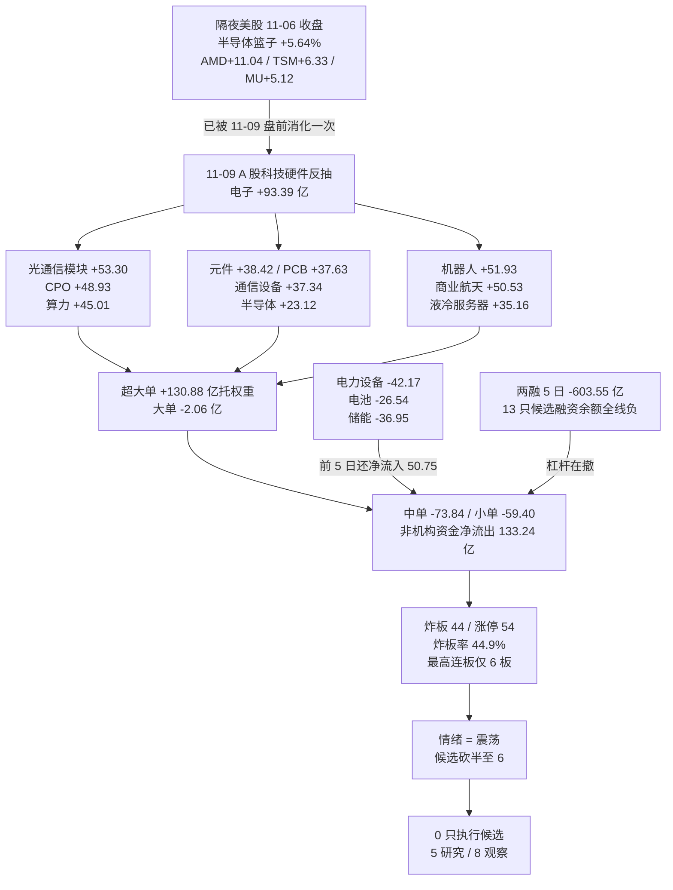

# 2026 年 11 月 10 日 · **资金面**

> **数据源新鲜度**: partial（两融/ETF 滞后 1 交易日，美股缺口 1 个 session）
> **降级状态**: degraded=true（vibe 个股资金流代理故障、overseas_snapshot 缺失）
> **置信度**: 0.84

## 一句话结论

11-09 反抽日钱只认一条科技硬件链（电子 +93.39 亿 / 光通信模块 +53.30 亿 / PCB +37.63 亿），但回补只抹平主跌日的 24.4%，炸板率 44.9% 越 35% 红线、中位 -0.31% → 资金定性为**震荡（主跌后反抽第 1 日）**，5 只研究、8 只观察、**0 只执行候选**；中际旭创是唯一技术面过线（止损距 5.46% / RR5 3.72），却被 5 日 -34.01 亿的主力净流出否掉。

## 资金传导一张图

## 一、时序资金流：反抽只回补了 24.4%

11-04 +507.57 亿、11-05 +90.24 亿（两日 +597.81 亿）被 11-06 单日 -528.52 亿抹平 88.4%，11-09 只回补 +128.82 亿——按"抹平"口径只补回 24.4%。20 日累计 -3980.75 亿、仅 6/20 天为正，10 日 -1593.55 亿、5 日 -375.98 亿：短中长三个窗口全部为负，这是**失血市里的脉冲回补**，不是资金面反转。

| 交易日 | 主力净额(亿) | 超大单(亿) | 中单(亿) | 沪指% | 深成% |
|---|---|---|---|---|---|
| 10-28 | +237.00 | +254.27 | — | +0.91 | +2.02 |
| 10-29 | -703.84 | -381.63 | — | -0.82 | -2.92 |
| 10-30 | -396.66 | -165.08 | — | -1.44 | -2.73 |
| 11-02 | +119.54 | +158.47 | — | +1.08 | +1.63 |
| 11-03 | -574.09 | -304.94 | — | -0.82 | -1.21 |
| 11-04 | +507.57 | +475.93 | — | +2.16 | +4.22 |
| 11-05 | +90.24 | +86.69 | — | +0.10 | +1.19 |
| 11-06 | -528.52 | -233.40 | +38.58 | -1.10 | -2.57 |
| **11-09** | **+128.82** | **+130.88** | **-73.84** | **+0.32** | **-0.27** |

**11-09 的结构拆解**：超大单 +130.88 / 大单 -2.06 / 中单 -73.84 / 小单 -59.40。机构级别资金（超大单）净买，大单以下全部净卖，非机构合计 -133.24 亿。这是"买权重、卖个股"的护盘式结构，与广度完全吻合——2242 涨 : 3148 跌，上涨占比 40.2%，中位 -0.31%，均值为 +0.11% 被权重拉正。

## 二、板块资金：钱只认一条科技硬件链

单日净流入前十有 7 个属于电子链，这是**单点集中**而非板块普涨。

| 板块 | 单日(亿) | 5 日(亿) | 20 日(亿) | 板块涨幅 |
|---|---|---|---|---|
| 电子 | +93.39 | +43.17 | -723.13 | +0.91% |
| 元件 | +38.42 | -97.44 | -340.61 | +2.49% |
| 印制电路板 | +37.63 | -81.19 | -256.64 | +3.07% |
| 通信设备 | +37.34 | -90.61 | -428.89 | +1.70% |
| 消费电子 | +26.55 | +34.06 | -32.26 | +1.20% |
| 半导体 | +23.12 | +102.32 | -192.67 | +0.46% |
| 半导体设备 | +6.56 | **+105.36** | **+25.97** | — |
| 机械设备 | +23.37 | -23.99 | -171.58 | +0.63% |
| 元件 / PCB 5 日仍负 | — | -97.44 / -81.19 | — | 单日回补未改趋势 |

反向失血：电力设备 -42.17（5 日 +50.75、20 日 -428.33）、电池 -26.54、锂电池概念 -33.48、储能 -36.95、光伏设备 -11.91、计算机 -10.86、证券 -7.20（5 日 -46.44）、医药生物 -4.70（5 日 -71.95）、食品饮料 -1.71（5 日 -40.74）。

概念端更能说明钱去哪：光通信模块 +53.30、机器人 +51.93、商业航天 +50.53、CPO +48.93、算力 +45.01、液冷服务器 +35.16、数据中心 +33.18；而存储芯片 -1.22、固态电池 -24.55、转基因 -0.58、创新药 -0.35、茅指数 -24.04。**同一批 AI 硬件里，光互联/PCB 拿到钱，存储没拿到**，说明资金在做链内选择，不是整板块上仓位。

唯一"20 日正 + 5 日正 + 单日正"的科技细分是**半导体设备**（+25.97 / +105.36 / +6.56），5 日净流入全场第一；前 5 日它还是 -20.70 亿，是典型的由负转正回补。这是本报告认定的**资金结构上最像真主线的细分之一**，但 R7 不负责板块排序（R2 职责）。

## 三、昨日前十 5 日追踪：6 延续 / 4 反手

11-06 主力净流入前十，在 11-09 的表现逐只核对如下。

| 排名 | 个股 | 11-06 净额(亿) | 11-09 涨幅 | 11-09 主力(亿) | 结论 |
|---|---|---|---|---|---|
| 1 | 北方华创 | +6.10 | -2.71% | +1.50 | 延续 |
| 2 | 长江电力 | +5.19 | -0.27% | +1.79 | 延续（防御票仍在吸） |
| 3 | 中芯国际 | +3.77 | -1.70% | -0.60 | 反手 |
| 4 | 东方日升 | +3.69 | +5.65% | -0.01 | 反手（价涨钱走） |
| 5 | 龙江交通 | +3.66 | +9.97% | +0.19 | 延续（低量涨停） |
| 6 | 百亚股份 | +3.39 | +0.26% | +3.21 | 延续 |
| 7 | 中科飞测 | +3.36 | -1.95% | -0.64 | 反手 |
| 8 | 寒武纪 | +2.88 | +6.02% | +9.35 | 延续（当日最大升级） |
| 9 | 太阳电缆 | +2.76 | +4.45% | -0.17 | 反手 |
| 10 | 华虹宏力 | +2.66 | -3.64% | +0.21 | 延续（价跌钱留） |

读法：反抽日"昨日强势"不再是负资产（6/10 延续，远好于主跌日 11-06 的 4/6 反手），但被反手的 4 只全是 11-06 逆势抗跌的防御/设备票；真正升级的是科技主线里资金最连续的寒武纪（+2.88 → +9.35 亿）。

11-09 当日前十的 5 日追踪则是另一面镜子：工业富联 +12.42 亿但 5 日 -3.54 亿（2/5 正日）、中际旭创 +6.69 亿但 5 日 -34.01 亿（2/5）、信维通信 +6.26 亿但 5 日仅 1/5 正日——**单日大买 + 5 日仍净流出 = 资金在换手不在建仓**。只有寒武纪（+13.25 亿 / 4/5 正）、先导基电（+9.13 亿 / 4/5 正）、超声电子（+4.54 亿 / 3/5 正）是单日与 5 日同向。

## 四、龙虎榜与游资：67 条 / 60 只，15 条诱多

机构与游资在同一天分别买了什么，比总额更能说明筹码去向。

| 方向 | 个股 | 龙虎榜净额(亿) | 其中机构(亿) | 涨幅 |
|---|---|---|---|---|
| 买 | 雪人集团 | +2.67 | +2.95 | +10.00% |
| 买 | 超声电子 | +2.53 | +3.21 | +9.98% |
| 买 | 文投控股 | +1.72 | +1.72 | +10.21% |
| 买 | 燧原科技 | +1.64 | +1.64 | +17.26% |
| 买 | 通则康威 | +1.21 | +2.53 | +20.00% |
| 卖 | 东方海洋 | -1.02 | -2.51 | +10.08% |
| 卖 | 阳光照明 | -1.04 | -1.04 | -1.48% |
| 卖 | 润建股份 | -1.01 | -1.80 | -6.51% |
| 卖 | 亚钾国际 | -0.88 | -1.15 | -7.39% |

3 日席位协同：连续 ≥2 日净买且 3 日合计为正的席位 41 个，其中 3 日全正 9 个。头部是开源证券西安西大街 +9.81 亿（3.72 / 2.96 / 3.13，三日全正）、国泰海通长宁江苏路 +6.26 亿（0.68 / 4.27 / 1.32）、国泰海通湛江万豪世家 +4.09 亿（2.42 / 1.87 / **-0.20**，当日转负）、国新证券北京 +2.88 亿、华泰深圳彩田路 +2.68 亿。游资还在，但最强的湛江席位在 11-09 已转卖，接力边际衰减。

**诱多识别 15 条**（三类）：

| 模式 | 只数 | 代表 |
|---|---|---|
| 涨停但龙虎榜净卖 | 3 | 红太阳（2 板 / 开板 10 次 / 封单 0.05 亿 / 净 -0.51）、东方创业（2 板 / 开板 9 次 / -0.24）、大东方（2 板 / 开板 4 次 / -0.29） |
| 反复开板烂板 | 9 | 红太阳 10 次、东方创业 9 次、光洋股份 6 次、雪人集团 4 次（封单仅 0.69 亿）、通则康威 4 次、大晟文化 3 次 |
| 跌停/重挫日大额净卖 | 3 | 亚钾国际 -7.39%（机构 -1.15）、*ST威领 跌停（机构 -1.03）、甬金股份 -8.56% |

封板质量给出的结论很直接：涨停 54 家里"反复开板 + 席位在卖"的比例高，最高连板只有 6 板（闽发铝业，工业金属，1 次开板、封单 1.88 亿），没有第二梯队接力。**这是没有高度、没有梯队的涨停结构，不构成主线封板。**

## 五、两融与 ETF：杠杆在撤，配置盘在买宽基

两融最新披露 11-06：融资余额 22549.39 亿，单日 -235.84 亿、5 日 -603.55 亿（10-30 的 23152.93 亿一路降到 22549.39 亿）。个股端更刺眼——13 只候选的 5 日融资余额全部为负：中际旭创 -13.44%、沪电股份 -15.51%、胜宏科技 -15.49%、新易盛 -9.10%、寒武纪 -7.69%。用 eastmoney 独立通道交叉两只（新易盛 11-06 103.86 亿 vs 11-02 116.05 亿 = -10.5%；寒武纪 128.26 亿 vs 140.58 亿 = -8.8%），与 tushare 同向。

ETF 5 日份额（11-06 口径）：沪深300ETF +77.73 亿份（+20.0%）、创业板ETF +73.71 亿份（+19.4%）、科创50ETF +176.55 亿份（+19.6%）、中证500ETF +30.07 亿份（+43.7%）、光伏ETF +11.54 亿份；减仓的是半导体ETF -4.76 亿份（-2.19%）、黄金ETF -2.05 亿份。

读法：**这波科技反抽不是杠杆推的，是宽基 ETF（配置盘/托底资金）推的**。杠杆资金在撤、行业 ETF 在减半导体，指数却红——三者合起来只能说明一件事：护盘式买入，而非市场自发的风险偏好回升。

## 六、隔夜美股核心个股：这一次没有"新催化"

`data/raw/20261110/overseas_snapshot.json` 不存在（整个 `data/raw/20261110/` 目录未生成），按契约回退 tushare `us_daily` 实时拉取，并**显式标注缺口**：最新可得美股交易日是 **11-06**，不是 11-09。

| 美股 | 11-06 收盘涨跌 | 含义 |
|---|---|---|
| AMD | +11.04% | 半导体最强 |
| INTC | +7.71% | — |
| TSM | +6.33% | — |
| MRVL | +5.73% | 光互联/ASIC |
| MU | +5.12% | 存储 |
| NVDA | +2.78% | 权重 |
| GLW | +2.61% | 光通信 |
| AVGO | +0.74% | — |
| TSLA | +4.23% | — |
| AAPL / MSFT | -0.52% / -0.99% | 大市值分化 |
| 篮子 | 半导体 +5.64%、光通信 +3.03%、大市值 +0.67% | IXIC +1.09%、SPX +0.31% |

这张表**已经被 11-09 A 股盘前消费过一次**（11-09 电子 +93.39 亿就是它的落点），对 11-10 不构成新增催化。反证侧还叠加两条：11-09 亚洲盘 HSI -0.13% / KS11 -0.81% 已先行转弱，说明美股科技强势没在亚洲延续；而 11-09 美股 session（北京时间 11-10 05:00 收盘）在抓取时点尚未落库，**无法验证 11-10 的外部方向**。

结论：今日 A 股科技链只能靠内部资金续命，外部没有新弹药。这是把科技链定性为"反抽"而非"新主升"的关键外部证据缺口——不是判断它不会涨，而是**没有证据支持它加速**。

## 七、候选裁决：5 只研究 / 8 只观察 / 0 只执行

炸板率 44.9% ≥ 35% 红线 → 按纪律把 13 只基础池**砍半**，研究候选上限 6 只。R7 只提供资金约束，不授予开仓资格；执行候选恒为 0，开仓权在 R6/D1。

| 个股 | 角色 | 单日(亿) | 5 日(亿) | 20 日位置 | 止损距 | RR5 | 裁决 |
|---|---|---|---|---|---|---|---|
| 中际旭创 300308 | 光模块总龙 | +6.69 | **-34.01** | 1.4% | 5.46% | **3.72** | 技术面过线，但资金背离 → 观察 |
| 寒武纪 688256 | AI 算力芯片龙 | +9.35 | +13.25 | 39.9% | 11.89% | 0.30 | 资金最连续，盈亏比不过线 → 观察 |
| 新易盛 300502 | 光模块龙二 | +9.26 | +3.67 | 2.2% | 8.43% | 1.62 | 降级（RR 依赖 20 日高） |
| 工业富联 601138 | AI 服务器权重 | +12.42 | -3.54 | 16.1% | 4.82% | 1.54 | 观察（止损带过窄） |
| 超声电子 000823 | PCB 低位首板 | +5.67 | +4.54 | 16.8% | 14.22% | 0.11 | 观察（仓位无法安放） |

**三问：中际旭创（300308）**

- **大资金意图**：11-05 有 34 笔大宗合计 7.75 亿、买方多为"机构专用"，卖方是国泰海通深南大道京基一百与国信深圳后海；11-09 主力再净买 6.69 亿（占成交 3.08%）。机构在低位接货，但同一批资金 5 日净额仍是 -34.01 亿——**接货规模还没盖过抛压**。
- **为什么走强**：20 日位置 1.4%、距 20 日高 -38.5%，是深度超跌反抽；CPO/光通信模块当日 +48.93/+53.30 亿给了板块底座，属于"位置最低 + 板块有钱"的共振。
- **逻辑够不够硬**：位置与 RR 够硬（止损距 5.46%、RR5 3.72 是唯一过 2 的票），**资金硬度不够**——5 日 -34.01 亿、正日仅 2/5。定性为"过线但背离"，不是可执行标的。

**买入理由 / 风险点 / 止损条件 / 可验证假设（中际旭创）**

- **买入理由**：仅当 11-10 开盘 30 分钟内主力净流入转正且光通信模块板块资金同步翻红，则"机构大宗接货 → 盘面回补"链条成立；此时 427.34（10 日低）为结构底，向上到 5 日高 544.00 有 3.72 倍盈亏比。
- **风险点**：5 日 -34.01 亿的抛压来自 10-29 至 11-06 的连续失血，超跌反抽在无量能确认时极易变成"反抽即卖点"；20 日 -47.15 亿说明这不是一天的账。
- **止损条件**：跌破 427.34（-5.46%）无条件出；若开盘冲高后 10:00 前回落到均价线下方且主力转净卖，不等止损位，直接出。
- **可验证假设**：①11-10 光通信模块板块净流入为正；②个股主力净额连续 2 小时为正；③20 日位置从 1.4% 抬到 15% 以上（说明不是一日脉冲）。三条不齐则本假设证伪，降级为"不进"。

**三问：寒武纪（688256）**

- **大资金意图**：11-06 +2.88 亿 → 11-09 +9.35 亿（升级），5 日 +13.25 亿、4/5 正日、20 日 +19.57 亿，是候选池里唯一"单日/5 日/20 日全部为正"的票；但两融 5 日 -7.69%（eastmoney 交叉 -8.8%）说明杠杆在减、机构在加。
- **为什么走强**：AI 算力芯片是国产替代最强叙事，半导体板块 5 日 +102.32 亿给了底座；11-06 主跌日它只跌 1.14%，相对强度已经显性化。
- **逻辑够不够硬**：资金逻辑最硬（三窗口同向），**盈亏比不硬**：止损距 11.89% 超 10% 硬区、RR5 仅 0.30。按纪律 §4，盈亏比优先于胜率，硬性降级为观察，不得因"资金最好"而破例。

**三问：超声电子（000823）**

- **大资金意图**：龙虎榜 +2.53 亿、其中机构 +3.21 亿（机构买入大于总净额，说明游资在卖、机构在接），主力占成交 37.15% 为全场最高集中度；但盘口 4 次换手、成交 14.81% 换手率，是"低位首板 + 机构一次性建仓"的形态。
- **为什么走强**：PCB 板块 +37.63 亿、元件 +38.42 亿，AI 服务器载板需求叙事；20 日位置 16.8%、距 20 日高 -30.96% 属低位。
- **逻辑够不够硬**：板块与机构买盘够硬，**交易结构不硬**：止损距 14.22%（跌破 15.32 才止损）意味着单笔风险过大，RR5 仅 0.11——涨停价买进去等于用 14% 的风险赌 1.5% 的空间。结论：观察，不进。

**观察池 8 只（不进）**

| 个股 | 角色 | 单日(亿) | 5 日(亿) | 20 日位置 | 不进的理由 |
|---|---|---|---|---|---|
| 沪电股份 002463 | PCB 龙头 | +4.31 | -12.42 | 9.1% | 5 日仍净流出，单日回补未成趋势 |
| 胜宏科技 300476 | PCB 龙二 | +3.91 | -10.89 | 11.4% | 同上，且两融 5 日 -15.5% |
| 海光信息 688041 | 国产算力 | +3.48 | +14.06 | 55.1% | 止损距 14.53%、RR5 0.15 |
| 源杰科技 688498 | 光芯片 | +3.43 | -1.41 | 8.3% | 5 日净流出，位置虽低但无资金确认 |
| 中国卫星 600118 | 商业航天 | +4.01 | +3.75 | 100% | 新高位置，RR5 0.33，追高即违规 |
| 宇树科技 688836 | 人形机器人 | +2.21 | +1.26 | 100% | 20 日 +69.95% 高位，RR5 0.29 |
| 信维通信 300136 | 消费电子/射频 | +6.26 | +3.33 | 100% | 新高但 5 日仅 1/5 正日 = 单日脉冲 |
| 雪人集团 002639 | 氦气/制冷首板 | +7.48 | +7.02 | 100% | 4 次开板、封单 0.69 亿 = 弱封，105 亿小盘杂毛 |

## 关键证据

- 证据 1：11-09 主力 +128.82 亿，其中超大单 +130.88、大单 -2.06、中单 -73.84、小单 -59.40 —— 机构托权重、非机构资金净流出 133.24 亿。来源 tushare moneyflow_dc 6032 只求和。
- 证据 2：20 日累计 -3980.75 亿、仅 6/20 天为正；5 日 -375.98 亿、10 日 -1593.55 亿，三个窗口同负。来源 tushare moneyflow_dc 20 日序列。
- 证据 3：涨停 54 / 炸板 44，炸板率 44.9%（前一日 30.43%），最高连板 6 板，上涨占比 40.2%、中位 -0.31%。来源 tushare limit_list_d + daily。
- 证据 4：科技硬件单日集中流入（电子 +93.39、元件 +38.42、PCB +37.63、通信设备 +37.34、半导体 +23.12），但元件/PCB/通信设备 5 日仍为 -97.44 / -81.19 / -90.61。来源 tushare moneyflow_ind_dc。
- 证据 5：半导体设备是唯一"20 日 +25.97 / 5 日 +105.36 / 单日 +6.56"三正的科技细分。来源 tushare moneyflow_ind_dc。
- 证据 6：两融 22549.39 亿、5 日 -603.55 亿；13 只候选 5 日融资余额全线负（中际旭创 -13.44% 为最深），eastmoney 独立通道交叉两只同向。来源 tushare margin/margin_detail + vibe-trading。
- 证据 7：ETF 宽基 5 日集体申购（沪深300 +77.73 亿份、科创50 +176.55 亿份、创业板 +73.71 亿份）而半导体ETF -4.76 亿份。来源 tushare fund_share。
- 证据 8：龙虎榜机构净买集中在超声电子 +3.21、雪人集团 +2.95；净卖集中在东方海洋 -2.51、润建 -1.80；15 条诱多警报（3 涨停净卖 / 9 反复开板 / 3 重挫净卖）。来源 tushare top_list/top_inst + eastmoney 66 条交叉。
- 证据 9：美股最新可得 11-06，半导体篮子 +5.64%、IXIC +1.09%，但 11-09 亚洲盘 HSI -0.13 / KS11 -0.81 已转弱，且 11-09 美股未落库。来源 tushare us_daily/index_global。

## 数据源审计

| 源 | 状态 | 抓取时间 | 记录数 | 备注 |
|---|---|---|---|---|
| tushare moneyflow_dc | 🟢 ok | 2026-11-10 | 120640 | 20 日 × 6032 只，全市场个股主力 |
| tushare moneyflow_ind_dc | 🟢 ok | 2026-11-10 | 20540 | 行业 496 + 概念 531 × 20 日 |
| tushare limit_list_d | 🟢 ok | 2026-11-10 | 550 | 5 日涨停/炸板/跌停 |
| tushare top_list / top_inst / hm_detail | 🟢 ok | 2026-11-10 | 826 | 3 日龙虎榜 + 游资明细 |
| tushare daily / daily_basic | 🟢 ok | 2026-11-10 | 33419 | 6 日全市场价格与换手 |
| tushare block_trade | 🟡 partial | 2026-11-10 | 65 | 13 票 6 票有大宗；成交价=收盘价，折溢价率不可用 |
| tushare margin / margin_detail | 🟡 stale | 2026-11-10 | 153 | 最新 2026-11-06，滞后 1 交易日 |
| tushare fund_share | 🟡 stale | 2026-11-10 | 154 | 最新 2026-11-06，滞后 1 交易日 |
| tushare us_daily / index_global | 🟡 stale | 2026-11-10 | 313 | 美股最新 2026-11-06，缺口 1 个 session |
| vibe get_dragon_tiger（eastmoney） | 🟢 ok | 2026-11-10 | 66 | 与 tushare 67 条同向，差 1 条北交所口径 |
| vibe get_block_trades / get_margin_trading | 🟢 ok | 2026-11-10 | 18 | 3 票交叉，与 tushare 同向 |
| vibe get_fund_flow | 🔴 error | 2026-11-10 | 0 | eastmoney 代理故障 + 无 tushare token |
| data/raw/20261110/overseas_snapshot.json | 🔴 error | — | 0 | 目录未生成，回退 tushare 并标 stale |
| 股指期货基差 / 期权隐波 | 🔴 unavailable | — | 0 | 无数据源，留空不编造 |

## 不确定性 / 反证

1. **一日反抽不成趋势**：11-09 的 +128.82 亿只是把 11-06 的 -528.52 亿补回 24.4%，20 日 -3980.75 亿的底色没变。若 11-10 电子不能延续，这就是"反抽即卖点"的标准剧本。
2. **赚钱效应与指数背离**：中位 -0.31%、3148 家下跌、上涨占比 40.2%，指数红靠权重。资金账本上"指数涨"和"多数票跌"同时成立，任何按指数红判断风险偏好回升的做法都是误读。
3. **杠杆与配置盘反向**：两融 5 日 -603.55 亿、个股融资余额全线负，ETF 却在申购宽基。前者是撤退信号，后者是托底信号——两个信号并存时，市场通常是"指数扛住、个股继续分化"。
4. **封板质量差**：炸板率 44.9%、最高连板 6 板、涨停里 3 只在龙虎榜净卖、9 只反复开板。这套结构不支持"高度板打开空间"的推演。
5. **外部证据缺口**：11-09 美股数据本次不可得，无法判断 AMD/TSM/MU 强势是否延续。本报告因此把科技链定性为反抽；若 11-09 美股实际大跌，本判断会偏乐观；若大涨，则偏保守——**这个方向我没有证据，只能标注不确定**。
6. **候选池非 R2 口径**：R2 11-10 尚未产出，候选由资金+涨停+龙虎榜自下而上构建。若 R2 给出的主线与本文的"科技硬件"不同，以 R2 的板块认定为准，本报告的资金数据只作为约束条件。
7. **折溢价不可用**：大宗成交价等于当日收盘价（tushare 与 eastmoney 两源一致），无法用溢价率判断接货意愿强弱，只能看席位与规模。

## 与其他 R/D/E 的关系

- **依赖**：`data/research/20261110/_work/`（market.json、_cand_full.json、hist_cand.json 等）、`data/raw/20261109/`（daily/limit_list/top_list 等）、tushare MCP、vibe-trading MCP。
- **被消费**：R2（板块资金底座与 5 日/20 日结构）、R5（候选票的资金约束）、R6（反证输入：15 条诱多、弱封、杠杆撤退）、D1（`staleness_status=ok` 正常消费；资金维度指向"不开新仓/极小试仓"）、E1（次日复盘对照"反抽能否延续"的三个可验证假设）。

## Sub-Agent 元数据

- skill: analyze_capital_flow_v1
- artifact: data/research/20261110/R7_capital_flow_20261110.json
- 生成耗时: 约 21 分钟（04:31 起抓取，04:52 落盘）
- model: deepseek-v4.1-flash
- 数据归属: resolved_trade_date=20261109，staleness_status=ok，trading_gap=0
