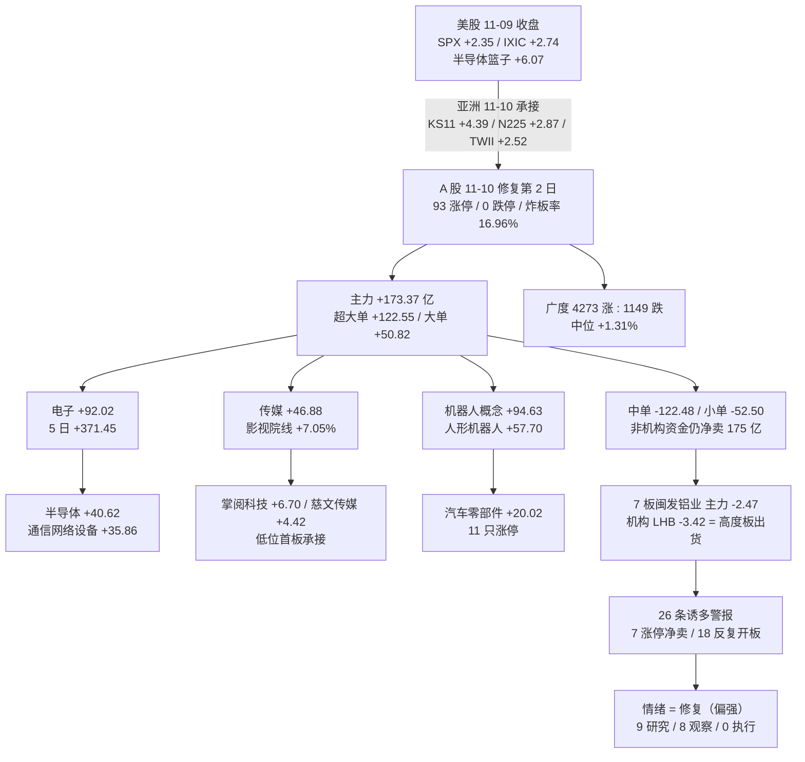

# 2026 年 11 月 11 日 · **资金面**

> **数据源新鲜度**: partial（两融/ETF 滞后 1 交易日，美股缺口 1 个 session）
> **降级状态**: degraded=true（overseas_snapshot 缺失、两融/ETF 与美股各滞后一档）
> **置信度**: 0.86

## 一句话结论

11-10 主力连续第 2 日净买 **+173.37 亿**（且这次是中单小单在卖、大单超大单在买），炸板率从 44.90% 断崖回落到 **16.96%**，涨停 93 / 跌停 0、上涨占比 76.67%、昨日涨停隔日平均 **+4.91%** → 情绪从「震荡」升为**修复（偏强）**；但钱只认电子/半导体 + 传媒 + 机器人，7 板总龙闽发铝业涨停当天被机构净卖 **-3.42 亿** = 高度板在出货、低位首板在承接。R7 给 **9 只研究 / 8 只观察 / 0 只执行**（开仓权归 R6/D1）。

## 资金传导一张图

## 一、时序资金流：两日 +302.19 亿，5 日窗口翻正

11-06 单日 -528.52 亿砸出的坑，11-09 +128.82 与 11-10 +173.37 两日合计回补 **+302.19 亿**（57.2%）；按 5 日窗口口径则已翻正到 **+371.48 亿**（前 5 日 -375.98 亿）。但 10 日 -946.57 亿、20 日 **-3716.99 亿**、仅 7/20 天为正——短窗口修复、中期仍失血。

| 交易日 | 主力净额(亿) | 超大单(亿) | 中单(亿) | 沪指% | 深成% | 创业板% |
|---|---|---|---|---|---|---|
| 10-28 | +237.00 | +254.27 | -198.71 | +0.91 | +2.02 | +3.40 |
| 10-29 | -703.84 | -381.63 | +184.52 | -0.82 | -2.92 | -4.45 |
| 10-30 | -396.66 | -165.08 | +27.71 | -1.44 | -2.73 | -4.13 |
| 11-02 | +119.54 | +158.47 | -226.36 | +1.08 | +1.63 | +1.87 |
| 11-03 | -574.09 | -304.94 | +86.18 | -0.82 | -1.21 | -2.73 |
| 11-04 | +507.57 | +475.93 | -389.26 | +2.16 | +4.22 | +6.40 |
| 11-05 | +90.24 | +86.69 | -166.85 | +0.10 | +1.19 | +0.87 |
| 11-06 | -528.52 | -233.40 | +38.58 | -1.10 | -2.57 | -3.96 |
| 11-09 | +128.82 | +130.88 | -73.84 | +0.32 | -0.27 | -0.27 |
| **11-10** | **+173.37** | **+122.55** | **-122.48** | **+0.08** | **+0.86** | **+1.46** |

**11-10 的拆解**：超大单 +122.55 / 大单 +50.82 / 中单 -122.48 / 小单 -52.50。与 11-09（超大单 +130.88、大单 -2.06）相比，最大变化是**大单开始跟**（-2.06 → +50.82），而中单小单合计净卖 175 亿。

这个组合有两种读法：好的一面是机构级别资金连续两日同向；坏的一面是修复仍是「大钱买、散钱卖」的背离结构。**它足以支持修复，但不足以支持主升**——真正的全面进攻日应当是四个档位同向。

## 二、板块资金：钱只走三条线，资源与防御被抽

行业端 11-10 净流入前十几乎被「科技硬件 + AI 应用 + 机器人」包干：

| 板块 | 单日(亿) | 5 日(亿) | 20 日(亿) | 板块涨幅 |
|---|---|---|---|---|
| 电子 | **+92.02** | +371.45 | -643.93 | +3.29% |
| 传媒 | **+46.88** | +64.74 | -42.72 | +4.53% |
| 半导体 | +40.62 | **+274.37** | -154.19 | +2.97% |
| 通信网络设备及器件 | +35.86 | +43.69 | -272.26 | +3.72% |
| 机械设备 | +34.43 | +62.44 | -143.62 | +2.40% |
| 汽车零部件 | +20.02 | +34.73 | +14.63 | +2.56% |
| 影视院线 | +14.65 | +19.56 | +2.93 | **+7.05%** |
| 广告营销 | +14.29 | +30.31 | +8.77 | +4.40% |

反向失血：铝 -13.26（5 日 -16.07 / 20 日 -27.91）、工业金属 -13.19（5 日 -11.58 / 20 日 -141.59）、有色金属 -13.02（5 日 +45.10 / 20 日 -256.47）、石油石化 -12.02（5 日 -36.37，板块 -0.41%）、国防军工 -8.42（5 日 -17.62）、非银 -3.46（5 日 **-48.38**）、医药生物 -3.15（5 日 -44.64）。

概念端更能说明钱的偏好：机器人概念 +94.63、华为概念 +85.72、通信技术 +71.28、国产芯片 +62.60、虚拟现实 +60.49（板块 +3.98%）、新能源车 +60.02、人形机器人 +57.70、消费电子概念 +57.63、半导体概念 +55.20（5 日 **+314.13**）、CPO 概念 +50.91。反向是典型「旧经济/中字头」被抽：一带一路 -32.89、央国企改革 -27.48、中字头 -24.96、低市盈率 -23.01、天然气 -22.32、中特估 -19.17。

**5 日维度更硬**：电子 +371.45、半导体 +274.37、半导体设备 +118.14、消费电子 +81.83、传媒 +64.74、机械设备 +62.44，全部是「前 5 日流出 → 近 5 日流入」的回补；而食品饮料 -40.69、白酒 -28.60、证券 -38.08 是「前 5 日流入 → 近 5 日流出」的退潮。这一组反转数据是本报告认定「资金换向」的核心证据，不是单日噪声。

## 三、昨日前十 5 日追踪：6 延续 / 4 反手

11-09 主力净流入前十，在 11-10 的表现逐只核对：

| 排名 | 个股 | 11-09 净额(亿) | 11-10 涨幅 | 11-10 主力(亿) | 当前 5 日(亿) | 结论 |
|---|---|---|---|---|---|---|
| 1 | 工业富联 | +12.42 | +1.43% | **-2.06** | +4.14 | 反手 |
| 2 | 寒武纪 | +9.35 | -1.55% | **-2.39** | +23.79 | 反手（价跌钱走） |
| 3 | 新易盛 | +9.26 | +4.43% | **+13.54** | +26.92 | 延续（当日升级为榜首） |
| 4 | 雪人集团 | +7.48 | +0.94% | **-5.48** | +1.58 | 反手（昨日高标出口最重） |
| 5 | 中际旭创 | +6.69 | +4.20% | +9.84 | +3.59 | 延续（升级） |
| 6 | 信维通信 | +6.26 | +6.56% | +4.31 | +9.02 | 延续 |
| 7 | 超声电子 | +5.67 | +3.25% | -1.49 | +3.03 | 反手（价涨钱走） |
| 8 | 先导基电 | +5.28 | +2.29% | +0.49 | +11.61 | 延续（弱延续） |
| 9 | 烽火通信 | +4.67 | +1.66% | +0.15 | +4.17 | 延续（弱延续） |
| 10 | 冰山冷热 | +4.66 | +10.03% | +1.52 | +8.84 | 延续（涨停但仅 1.52 亿） |

读法：6/10 延续不算差，但**结构分化**很清楚——延续的都在光模块/射频/半导体设备（新易盛 +13.54、中际旭创 +9.84），反手的是服务器与算力芯片（工业富联、寒武纪）和昨日冰雪高标（雪人集团 -5.48）。同一条 AI 硬件链内部，钱从「服务器 + GPU」换到「光模块 + 端侧」，不是整链撤退。

11-10 当日前十的 5 日追踪是另一面镜子：新易盛（+13.54 / 5 日 +26.92 / 3 正日）、中际旭创（+9.84 / +3.59 / 3 正日）、瑞芯微（+6.19 / +13.51 / 4 正日）、立讯精密（+4.58 / +17.97 / **5/5 正日**）、掌阅科技（+6.70 / +5.37 / 3 正日）——**单日与 5 日同向**，这是资金在建仓不是换手；反例是源杰科技（+4.18 但 5 日 +7.83 而 20 日 -28.70）、N钶锐（+6.19 新股无历史，剔除）。

## 四、龙虎榜与游资：高度板出货、低位首板承接

11-10 龙虎榜 58 条 / **51 只**（7 只为多原因重复）。机构与游资分向明确：

| 方向 | 个股 | 龙虎榜净额(亿) | 其中机构(亿) | 涨幅 |
|---|---|---|---|---|
| 买 | 富瀚微 | +2.68 | **+4.14** | +20.01% |
| 买 | 安泰集团 | +1.17 | +1.17 | +9.94% |
| 买 | 文投控股 | +1.09 | +1.07 | +10.04% |
| 买 | 盛洋科技 | +1.04 | +1.30 | +10.00% |
| 买 | 康冠科技 | +1.03 | +1.41 | +10.00% |
| 卖 | 澳洋健康 | **-2.05** | -2.31 | +2.43% |
| 卖 | 雪人集团 | -1.77 | -1.54 | +0.94% |
| 卖 | 闽发铝业（7 板） | -1.51 | **-3.42** | +9.98% |
| 卖 | 龙江交通（3 板） | -1.11 | -1.11 | +10.02% |
| 卖 | 大晟文化（2 板） | -0.68 | -0.50 | +10.02% |

3 日席位协同：34 个席位满足「≥2 日净买且 3 日合计为正」，其中 3 日全正 6 个。头部是开源证券西安西大街 **+8.53 亿**（2.93 / 3.12 / 2.48，三日全正且逐日抬量）、机构专用 +6.93 亿（-2.00 / +2.05 / **+6.88**，11-10 大幅加码）、国泰海通长宁江苏路 +5.96 亿（4.27 / 1.32 / **0.37**，逐日衰减）。游资总龙头席位仍在加仓，波段席位在减仓。

**诱多识别 26 条**（三类）：

| 模式 | 条数 | 代表 |
|---|---|---|
| 涨停但龙虎榜净卖 | 7 | **闽发铝业（7 板 / 总 -1.51 / 机构 -3.42）**、龙江交通（3 板 / 11 次开板 / -1.11）、冰山冷热（2 板 / 5 次开板 / -0.23）、大晟文化（2 板 / -0.68） |
| 反复开板烂板 | 18 | 得邦照明 14 次、龙江交通 11 次、东方环宇 9 次、安泰集团 7 次、日海智能 6 次 |
| 重挫日大额净卖 | 1 | 北化股份 -9.94%（机构 -0.45） |

这是本报告最值得警惕的一条：**最高标（7 板）当天涨停、主力净卖 2.47 亿、机构席位净卖 3.42 亿**。高度板在派发，而承接方是低位首板（掌阅/慈文/瑞芯微/富瀚微）。按游资纪律「只做龙头或低位、躲中位」，明日的正确站位是低位新题材，不是接力 7 板。

## 五、两融与 ETF：杠杆刚回头，配置盘还在买宽基

两融最新披露 **11-09**：融资余额 22670.31 亿，单日 **+120.92 亿**（结束 5 日连降），5 日仍 -356.25 亿（23026.56 → 22670.31）。杠杆资金在 11-09 才开始回头，11-10 的 T+1 数据未落库 → **本轮修复的杠杆确认缺席 1 个交易日**，这是把行情定性为「修复」而非「主升」的重要理由。

ETF 份额（11-09 口径）：科创50ETF **+120.36 亿份**（+12.59%）、创业板ETF +66.94 亿份（+17.09%）、沪深300ETF +52.67 亿份（+12.72%）、中证500ETF +18.66 亿份（+23.59%）、光伏ETF +12.80 亿份（+22.44%）；半导体ETF 仅 +0.16 亿份（+0.07%）**基本平**，黄金ETF -1.95 亿份。

读法：宽基申购延续、行业 ETF 不加半导体 → 仍是**托底型配置资金**，不是行业主动加仓。指数红、个股普涨、但增量弹药来自宽基，这个组合支持「修复延续」，不支持「主升加速」。

## 六、隔夜美股核心个股：11-09 这一档已被消化，11-11 没有新弹药

`data/raw/20261111/overseas_snapshot.json` 不存在（整个 `data/raw/20261111/` 未生成），按契约回退 tushare `us_daily` / `index_global` 实时拉取，并显式标注缺口：最新可得美股交易日是 **11-09**，不是 11-10（11-10 session 北京时间 11-11 05:00 才收盘，本次抓取 04:35）。

| 美股 | 11-09 收盘涨跌 | 含义 |
|---|---|---|
| AMD | **+13.26%** | 半导体最强 |
| MRVL | +9.49% | 光互联/ASIC |
| GLW | +9.25% | 光通信 |
| AVGO | +8.78% | 网络芯片 |
| MU | +6.25% | 存储 |
| INTC | +5.49% | — |
| TSM | +3.51% | 代工 |
| NVDA | **-4.27%** | GPU 逆势下跌，分化 |
| META / TSLA | +5.12% / +5.54% | 大市值 |
| 篮子 | 半导体 **+6.07%**、光通信 +9.17%、大市值 +2.88% | SPX +2.35 / IXIC +2.74 / DJI +2.15 |

传导链已经走完一遍：11-09 美股大涨 → 亚洲 11-10 承接（KS11 +4.39 / N225 +2.87 / TWII +2.52 / HSI +0.44）→ A 股 11-10 的 93 涨停与 76.67% 广度。**对 11-11，这一档不构成新增催化**，科技链只能靠内部资金续命。

但 NVDA -4.27 与半导体篮子 +6.07 的分化是可用信息：**存储（MU 链）、光互联（CPO/GLW/MRVL 链）强，GPU 弱**。今日 A 股映射应偏向光模块/CPO/存储，而非算力 GPU 概念——这与 11-10 的资金落点（新易盛、中际旭创、源杰科技、CPO +50.91）方向一致。

## 七、候选裁决：9 只研究 / 8 只观察 / 0 只执行

炸板率 16.96% **低于 35% 红线**，按纪律不触发候选砍半，研究候选上限 10 只。R7 只提供资金约束，不授予开仓资格；**执行候选恒为 0**，开仓权在 R6/D1。

| 个股 | 角色 | 单日(亿) | 5 日(亿) | 20 日(亿) | 20 日位置 | 止损距 | RR5 | 裁决 |
|---|---|---|---|---|---|---|---|---|
| 新易盛 300502 | 光模块龙二 | **+13.54** | **+26.92** | -57.44 | 12.1% | -12.32% | 0.71 | 研究（止损超 10% 硬区） |
| 中际旭创 300308 | 光模块总龙 | +9.84 | +3.59 | -40.02 | 14.3% | **-9.27%** | 1.67 | 研究（RR<2，最接近过线） |
| 瑞芯微 603893 | 端侧 AI 首板 | +6.19 | +13.51 | +15.72 | 100% | -25.39% | 0.00 | 研究（三窗口正，但无空间） |
| 立讯精密 002475 | 消费电子权重 | +4.58 | +17.97 | +24.66 | 92.6% | -13.87% | 0.09 | 研究（三窗口正，追高即违规） |
| 掌阅科技 603533 | 传媒/AI 阅读首板 | **+6.70** | +5.37 | +6.79 | 98.9% | -30.03% | 0.00 | 研究（占成交 32.79%，但位高） |
| 慈文传媒 002343 | 短剧影视首板 | +4.42 | +4.57 | +6.61 | 57.0% | -22.19% | 0.00 | 研究（占成交 46.71% 全场最高） |
| 沪电股份 002463 | PCB 龙头（R2） | +3.02 | -2.04 | -31.50 | 19.5% | -11.32% | 0.51 | 研究（5 日未确认） |
| 信维通信 300136 | 射频前排 | +4.31 | +9.02 | +4.55 | 91.6% | -22.88% | 0.09 | 研究（位高、风险带宽） |
| 中国卫星 600118 | 商业航天龙头（R2） | +0.68 | +5.63 | +6.91 | 94.9% | -19.38% | 0.06 | 研究（主流入但微额） |

**三问：中际旭创（300308，首推研究票）**

- **大资金意图**：11-09 +6.69 亿 → 11-10 +9.84 亿（升级），5 日由 -34.01 翻正到 +3.59 亿（3/5 正日），20 日仍 -40.02 亿；30 日大宗 36 笔合计 7.82 亿，买方多为「机构专用」，卖方是国泰海通深南大道京基一百与国信深圳后海 → **机构在低位持续接货，但接货量刚够对冲抛压，尚未形成净积累**。
- **为什么走强**：20 日位置 14.3%、距 20 日高 -35.77%，是深跌后的反抽；同日光模块链给了底座（电子 +92.02、通信网络设备 +35.86、CPO 概念 +50.91），且 11-09 美股光通信篮子 +9.17% 是外部共振（但已被今日消化）。
- **逻辑够不够硬**：位置与资金方向够硬（止损距 9.27% 正好落在 -5~-10% 硬区间内），**盈亏比不够硬**：RR5 1.67 < 2。按纪律 §4「盈亏比优先于胜率」，只能研究，不能进。

**买入理由 / 风险点 / 止损条件 / 可验证假设（中际旭创）**

- **买入理由**：仅当 11-11 开盘 30 分钟主力净流入转正、且光模块/CPO 板块资金同步翻红时，「机构大宗接货 → 盘面回补」链条才成立；结构底为 10 日低 427.34（-9.27%），向上到 5 日高 471.0 上方才有 2 倍空间。
- **风险点**：5 日刚翻正 3.59 亿，20 日 -40.02 亿的账没还；11-09 美股光通信大涨已被今日消费完，11-11 缺外部推力；若开盘冲高后主力转净卖，反抽即卖点的剧本会重演。
- **止损条件**：跌破 427.34 无条件出；若 10:00 前回落到均价线下方且主力净额转负，不等止损位直接出。
- **可验证假设**：①11-11 光模块/CPO 板块主力净流入为正；②个股主力连续 2 小时净流入；③20 日位置从 14.3% 抬到 25% 以上。三条不齐则降级为「不进」。

**三问：新易盛（300502）**

- **大资金意图**：单日 +13.54 亿（占成交 8.30%，全场第一），5 日 +26.92 亿、3/5 正日，但 20 日 -57.44 亿；两天内从 +9.26 升到 +13.54，是资金强度最高的票。**问题是位置与风险**：20 日位置仅 12.1%（深跌），止损距 -12.32% 超出 -10% 硬区间，RR5 0.71。
- **为什么走强**：光模块是 AI 硬件里唯一「单日 + 5 日」双正的细分；11-09 美股 MRVL +9.49 / GLW +9.25 提供外部背书。
- **逻辑够不够硬**：资金硬、**交易结构不硬**——止损带 12.32% 意味着单笔风险超纪律上限，涨得快也跌得快。

**三问：瑞芯微（603893）**

- **大资金意图**：涨停 + 主力 6.19 亿（占成交 14.94%），5 日 +13.51、20 日 +15.72，是候选池里少数「单日/5 日/20 日全正」的票；两融 5 日 +23.32% 同步加杠杆。
- **为什么走强**：端侧 AI/SoC 叙事 + 半导体板块 5 日 +274.37 亿底座；涨停封板结构干净（0 次开板）。
- **逻辑够不够硬**：资金逻辑最硬，**但位置 100%（20 日新高）+ 止损距 25.39%** → 追高即违规，RR5 0。只能用于判断「钱在端侧」，不能作为买入标的。

**观察池 8 只（不进）**

| 个股 | 角色 | 单日(亿) | 5 日(亿) | 不进的理由 |
|---|---|---|---|---|
| 生益科技 600183 | 覆铜板龙二 | +1.68 | -5.25 | RR5 3.06 全场唯一过 2，但止损距 4.74% < 5% 硬下限 + 5 日未确认 → 降级 |
| 中文在线 300364 | 数字阅读 | +3.93 | +8.53 | 20 日位置 90.6%、止损距 25.82%、RR5 0.10 |
| 冰山冷热 000530 | 冰雪 2 板 | +1.52 | +8.84 | 5 次开板 + 龙虎榜 -0.23 = 弱封；止损距 29.91% |
| 宇树科技 688836 | 人形机器人 | +0.49 | +3.13 | 位置 88.1%、止损距 25.76%、RR5 0.24 |
| 寒武纪 688256 | AI 算力芯片 | -2.39 | +23.79 | 今日主力转卖、股价 -1.55%；止损距 10.5%、RR5 0.53 |
| 工业富联 601138 | AI 服务器 | -2.06 | +4.14 | 昨日前十第 1 今日反手；20 日 -31.5 亿 |
| 雪人集团 002639 | 冰雪/氦气 | **-5.48** | +1.58 | **拦截**：昨日高标今日主力 -5.48、LHB -1.77（机构 -1.54）= 一日游出货 |
| 闽发铝业 002578 | 工业金属 7 板 | **-2.47** | -1.18 | **拦截**：7 板涨停但主力净卖、机构 LHB -3.42 → 典型高度板诱多，禁止接力 |

## 关键证据

- 证据 1：11-10 主力 +173.37 亿（超大单 +122.55、大单 +50.82、中单 -122.48、小单 -52.50），连续第 2 日净买；5 日 +371.48 亿翻正、20 日 -3716.99 亿、7/20 正日。来源 tushare moneyflow_dc 6032 只 × 21 日求和。
- 证据 2：广度 4273 涨 : 1149 跌（76.67%）、中位 +1.31%、涨停 93 / 跌停 0 / 炸板 19（炸板率 16.96%，前一日 44.90%）。来源 tushare daily + limit_list_d。
- 证据 3：11-09 的 54 只涨停在 11-10 平均 +4.91%、48/54 上涨 → 隔日接力赚钱效应恢复。来源 tushare daily 逐票配对。
- 证据 4：行业端电子 +92.02（5 日 +371.45）、半导体 +40.62（5 日 +274.37）、传媒 +46.88、通信网络设备 +35.86、机械设备 +34.43、汽车零部件 +20.02；流出铝 -13.26、工业金属 -13.19、石油石化 -12.02。来源 tushare moneyflow_ind_dc 496 行业 × 21 日。
- 证据 5：5 日反转组——电子 -454.86→+371.44、半导体 -208.98→+274.38、通信 -182.93→+47.39 回补；食品饮料 +21.37→-40.69、白酒 +25.98→-28.60、非银 -13.70→-48.39 退潮。来源 tushare moneyflow_ind_dc。
- 证据 6：龙虎榜 58 条 / 51 只，机构净买富瀚微 +4.14、康冠科技 +1.41、盛洋科技 +1.30；净卖闽发铝业 -3.42、澳洋健康 -2.31、雪人集团 -1.54；26 条诱多（7 涨停净卖 / 18 反复开板 / 1 重挫净卖）。来源 tushare top_list/top_inst + eastmoney 55 条交叉。
- 证据 7：7 板闽发铝业当日涨停但主力 -2.47 亿、机构 LHB -3.42 亿；3 板龙江交通 11 次开板 -1.11 亿 —— 高度板派发。来源 tushare moneyflow_dc + top_inst + limit_list_d。
- 证据 8：两融 22670.31 亿（11-09），单日 +120.92 亿、5 日 -356.25 亿；ETF 宽基 5 日申购（科创50 +120.36 亿份、创业板 +66.94、沪深300 +52.67），半导体 ETF 仅 +0.16 亿份。来源 tushare margin/margin_detail + fund_share。
- 证据 9：美股 11-09 SPX +2.35 / IXIC +2.74、半导体篮子 +6.07、光通信 +9.17，NVDA 逆势 -4.27；亚洲 11-10 KS11 +4.39 / N225 +2.87 / TWII +2.52。来源 tushare us_daily / index_global。

## 数据源审计

| 源 | 状态 | 抓取日期 | 记录数 | 备注 |
|---|---|---|---|---|
| tushare moneyflow_dc | 🟢 ok | 2026-11-11 | 126672 | 21 日 × 6032 只，全市场个股主力 |
| tushare moneyflow_ind_dc | 🟢 ok | 2026-11-11 | 22218 | 行业 496 + 概念 534 × 21 日 |
| tushare limit_list_d | 🟢 ok | 2026-11-11 | 564 | 5 日涨停/炸板/跌停 |
| tushare top_list / top_inst | 🟢 ok | 2026-11-11 | 2244 | 3 日龙虎榜明细 |
| tushare daily / daily_basic / block_trade | 🟢 ok | 2026-11-11 | 11384 | 全市场价格 + 26 票 30 日大宗 |
| tushare margin / margin_detail | 🟡 stale | 2026-11-11 | 434 | 最新 2026-11-09，滞后 1 交易日 |
| tushare fund_share（ETF 7 只） | 🟡 stale | 2026-11-11 | 161 | 最新 2026-11-09，滞后 1 交易日 |
| tushare us_daily / index_global | 🟡 stale | 2026-11-11 | 250 | 美股最新 2026-11-09，缺口 1 个 session |
| vibe get_dragon_tiger（eastmoney） | 🟢 ok | 2026-11-11 | 55 | 与 tushare 58 条同向，差在口径与北交所 |
| data/raw/20261111/overseas_snapshot.json | 🔴 error | — | 0 | 目录未生成，回退 tushare 并标 stale |
| 股指期货基差 / 期权隐波 | 🔴 unavailable | — | 0 | 无数据源，留空不编造 |

## 不确定性 / 反证

1. **两日修复不等于趋势反转**：5 日 +371.48 亿只把 11-06 的 -528.52 亿补回 70.3%，20 日 -3716.99 亿、7/20 正日的底色没变。若 11-11 电子不能延续，这就是「反抽尾声」的标准剧本。
2. **结构仍是「大钱买、散钱卖」**：中单 -122.48 + 小单 -52.50 = 175 亿净卖，与 76.67% 广度背离。上涨由大单托起、由中小单兑现，这种结构通常撑不住连续加速。
3. **高度板在派发**：7 板闽发铝业涨停日机构净卖 3.42 亿、3 板龙江交通 11 次开板净卖 1.11 亿。若明日高标补跌，会直接压制所有接力情绪——这是本报告最看重的下行风险。
4. **杠杆确认缺席**：11-10 两融未落库，11-09 才刚回升 120.92 亿（5 日仍 -356.25）。没有杠杆参与的修复，持续性天然打折。
5. **外部弹药已用尽**：11-09 美股大涨已被 11-10 A 股与亚洲盘完整消化，11-10 session 未收盘 → 11-11 开盘没有新增外部方向；若夜间美股回吐，A 股科技链当日即失去支撑。
6. **R2 主线与资金落点部分错位**：R2 11-10 的三条主线是商业航天/冰雪/PCB，但 11-10 的钱在电子/传媒/机器人。冰雪线已在派发（雪人 -5.48、龙江交通 -1.11、冰山冷热弱封），PCB 只有沪电 +3.02 而 5 日 -2.04。**若 D1 按 R2 旧主线做接力，方向会错**；本报告的资金证据应作为主线的否决/确认条件。
7. **候选池口径**：R2 11-11 尚未产出，本报告继承 R2 11-10 的 14 只 leader + 按当日资金/涨停/龙虎榜补 12 只，共评估 26 只。若 R2 今日认定不同，以 R2 板块认定为准，R7 只作资金约束。

## 与其他 R/D/E 的关系

- **依赖**：`data/research/20261110/R2_main_sectors.json`（三条主线 14 只 leader）、`data/research/20261111/cycle_position.json`（情绪周期基准）、tushare（moneyflow_dc / moneyflow_ind_dc / limit_list_d / top_list / top_inst / margin / fund_share / us_daily / index_global）、vibe-trading get_dragon_tiger。
- **被消费**：R2（板块 5 日/20 日资金底座 + 主线切换证据）、R5（9 只研究候选的资金约束与止损/盈亏比字段）、R6（反证输入：26 条诱多、7 板出货、杠杆缺席）、D1（`staleness_status=ok` 正常消费；资金维度支持「修复偏强、可研究但需盘中确认」）、E1（次日复盘对照：①电子 5 日能否续正 ②高标是否补跌 ③广度能否维持 60% 以上）。

## Sub-Agent 元数据

- skill: analyze_capital_flow_v1@1.3
- artifact: data/research/20261111/R7_capital_flow_20261111.json（117 KB，43 个顶层字段）
- 生成耗时: 约 14 分钟（04:31 起抓取，04:45 落盘）
- model: deepseek-v4.1-flash
- 数据归属: resolved_trade_date=20261110，staleness_status=ok，trading_gap=0
- 免责: R7 不授予开仓资格，execution_candidates 为空；hard_reject 归 R6
