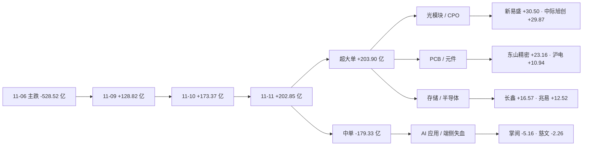

# 2026年11月12日 · **资金面**

> **数据源新鲜度**: partial（A 股全量 T+0 / 两融·ETF T+1 / 美股差 1 个 session）
> **降级状态**: true
> **置信度**: 0.50（R7 证据族自评 0.86，按 manifest severity=2 硬上限压到 0.50）

## 一句话结论

11-11 主力 +202.85 亿、三日累计 +505.04 亿（补回 11-06 主跌的 95.6%），但最高板 7→4、前日涨停隔日溢价只剩 +2.92%；钱从机器人·传媒·端侧切回光模块·CPO·PCB·存储。**10 研究 / 10 观察 / 0 执行**。

## 详细分析

### 时序：三日净买 +505 亿，本质是止血不是转势

11-11 全市场主力净流入 `+202.85 亿`，连续第 3 个交易日净买（11-09 `+128.82`、11-10 `+173.37`），三日合计 `+505.04 亿`，已补回 11-06 单日 `-528.52 亿` 主跌的 **95.6%**。拆结构：超大单 `+203.90`、大单 `-1.05`、中单 `-179.33`、小单 `-21.87` —— **只有机构大单在买，中小单在被抽走**，这与「普涨」的直觉相反，是权重与大票拉指数的典型形态（广度均值 +1.14% 高于中位 +0.59% 也印证）。

但三个窗口必须同时报：5 日 `+66.76 亿`（11-04 的 `+507.57 亿` 滚出窗口后骤降）、10 日 `-980.72 亿`、20 日 `-3146.51 亿`、仅 **8/20 天为正**。三日修复把 11-06 的坑填平了，但没有改变中期失血的方向；11-11 的买入是「补坑 + 抢主线」，不是「趋势资金回场」。

### 结构：一条光互联链吸干了场内的钱

行业端资金高度集中：电子 `+177.41 亿`（5 日 +236.23）、通信设备 `+135.30`（+100.91）、通信 `+133.83`（+105.36）、通信网络设备及器件 `+104.75`（+91.06）、元件 `+81.79`、半导体 `+76.75`（5 日 **+155.23**）、印制电路板 `+72.14`（板块 +5.76%）。概念端更直白：通信技术 +261.64、5G +226.05、**CPO +205.54（+5.83%）**、光通信模块 +190.90（+5.33%）、光纤 +135.80、国产芯片 +118.84、PCB +110.73、算力概念 +107.25。

对照 5 日反转序列：电子从 -292.09 翻到 **+236.23**、通信从 -187.28 到 +105.37、半导体从 -82.00 到 +155.24、元件从 -108.93 到 +10.95 —— 这是**同一条链（光模块 → 光器件 → PCB/覆铜板 → 存储/芯片）在 5 日内完成从失血到吸金的翻转**；反向的电力设备 +30.11→-58.31、电池 +27.27→-41.92、医药 -20.33→-81.94 则是持续退潮。

### 情绪：指数与广度偏强，高度板在退潮

指数沪 +0.46 / 深 +1.32 / 创 +3.11 / 科创50 +2.80；广度 3538 涨 : 1827 跌（63.47%）、中位 +0.59%；85 涨停 / 0 跌停 / 19 炸板，炸板率 18.27%（前一日 16.96%），远低于 35% 硬红线。但**质量在退**：最高连板由 7 板降到 4 板（大东方、日出东方），11-10 的 93 只涨停在 11-11 平均只 `+2.92%`、64/93 上涨、19 只再板 —— 比 11-10 的 +4.91%/48-54 明显衰减。也就是说：**指数在涨，接力在弱化**。

昨日前十 **5 延续 / 5 反手**，延续的三只（新易盛 `+13.54 → +30.50`、中际旭创 `+9.84 → +29.87`、源杰 `+4.18 → +10.42`）全在光模块；反手的五只（掌阅 `+6.70 → -5.16`、N 钶锐 `+6.19 → -0.17`（当日 -16.33%）、瑞芯微 `+6.19 → -0.46`、慈文 `+4.42 → -2.26`、中文在线 `+3.93 → -1.79`）全在 AI 应用/端侧 —— **这不是增量资金行情，是同一天内完成的主线切换**。

### 跷跷板：成长一边彻底压倒资源与白酒

20 日相关里 12 组 rho ≤ -0.45：贵金属/石油石化 -0.67、光学光电子/石油石化 -0.62、光伏设备/煤炭开采 -0.59、光学光电子/食品饮料 -0.56、半导体/白酒Ⅱ -0.54。11-11 跷跷板站在成长一侧：电子 +177.41 / 通信 +133.83 / 半导体 +76.75 流入，石油石化仅 +0.93（5 日 -23.91）、煤炭 -0.87、白酒 -11.06（**-2.97%**）流出。科技硬件内部（电子/半导体/光学光电子/消费电子）相关性仍为正 —— 它们是一条链，不是跷跷板。

## 关键证据

- **证据 1**：主力连续 3 日净买，但结构只有超大单：11-11 `+202.85 亿` = 超大单 `+203.90` + 大单 `-1.05`；中单 `-179.33`、小单 `-21.87`。三日合计 `+505.04 亿`，补回 11-06 的 95.6%。来源 tushare/moneyflow_dc（6032 只/日 × 21 日）。
- **证据 2**：光互联一条链吸金。CPO `+205.54 亿`（+5.83%）、光通信模块 `+190.90`（+5.33%）、光纤 `+135.80`、PCB `+110.73`；行业端电子 +177.41、通信设备 +135.30、半导体 +76.75。来源 tushare/moneyflow_ind_dc（行业 496 / 概念 534）。
- **证据 3**：龙虎榜机构在承接低位硬件。东山精密 `+7.22 亿`（机构专用 `+9.36`）、沪电 `+3.86`（机构 +5.69）、世运电路 `+3.73`、燧原 `+2.56`、光迅 `+2.46`（机构 +3.71）。来源 tushare/top_list+top_inst（85 条 / 848 席），eastmoney 独立通道 82 条同向，五只金额完全一致。
- **证据 4**：高度板在出货。光洋股份 3 板涨停但主力 `-1.13 亿`、龙虎榜 `-1.33`（机构 -1.23）；文投控股 3 板 **9 次开板**；襄阳轴承 2 板 6 次开板、主力 `-0.99 亿`；上海电影 2 板龙虎榜 `-1.07`。38 条诱多警报 = 9 只涨停净卖 + 26 只反复开板 + 3 只重挫净卖。
- **证据 5**：隔夜美股没有给弹药。11-10 SPX -0.38 / IXIC -0.74，半导体篮子 `-0.22`（NVDA -5.47，但 AVGO +3.91 / TSM +2.02 / AMD +1.30）；11-11 A 股光模块 +15%~+20%，与 NVDA 完全背离 → 内资独立定价，不是美股映射。来源 overseas_snapshot（12 只）+ tushare us_daily（补 INTC/MRVL）。

## 推理深度三问 · 光模块链（11-11 资金第一落点）

- **大资金意图**: 机构专用席位三日 `+2.05 / +6.88 / +12.28` 逐级抬升、深股通专用 11-11 单日 `+17.55 亿`，买的是「光互联硬件」的确定性而非应用想象：CPO/光模块是 AI 数据中心唯一已经兑现到订单的环节（新易盛 +16.97%、中际旭创 +15.07%、天孚 +13.96%、源杰 +20%）。对手盘是中小单与 ETF 配置盘——中单 -179.33 亿、半导体 ETF 5 日 -3.64 亿份，说明散户和被动资金在给机构提供筹码。
- **为什么走强**: 位置（新易盛 20 日位置仅 33.9%、天孚 26.3%、剑桥 22.2%，都在 20 日区间下三分之一）+ 催化（光互联订单/CPO 放量，无新硬事件但 11-11 是资金自证）+ 筹码（东山/沪电/光迅龙虎榜机构净买）。三维交叉里，位置是「低位」，筹码是「机构接」，催化是「弱催化」——**位置与筹码硬，催化不硬**。
- **逻辑够不够硬**: 硬的只有两条：①三个窗口同向的行业资金（5 日电子 +236、半导体 +155、通信 +101）；②机构席位三日递增 + 龙虎榜机构净买（tushare 与 eastmoney 双源一致）。不硬的是：没有新产业事件、20 日累计仍 -3146.51 亿、指数靠权重。证伪路径很清楚：**若 11-12 光模块开盘 30 分钟主力净流出转负、且新易盛/中际旭创跌破 11-11 分时均价，则 11-11 只是「单日脉冲 + 一日游」，链上其他票（长鑫 -20.26、兆易 -13.37 的 5 日负值）已经提前给出警告**。

## 每票思维链 · 新易盛（300502.SZ，净额第 1，研究票）

> 定位：R7 首推研究票，**不进执行池**（技术面不过线：止损距 -25.04% 超硬区间、RR5 0.03）。以下四段用于 E1 T+N 回填。

- **买入理由**：①光模块双龙之一，11-11 主力 `+30.50 亿`（净占比 12.09%）全场第一，5 日 `+32.38 亿`（3/5 正），说明资金在这条链上选的是它而不是二线；②20 日位置仅 33.9%（前期杀跌深），不是高位追价；③CPO 概念当日 +5.83%、光通信模块 +5.33%，板块级共振。
- **风险点**：①5 日虽正但 20 日仍 `-12.14 亿`，中期资金没有回来；②止损距 `-25.04%` 意味着按 10 日低点定价会把仓位打穿，任何「现价买入」都是在没有风险边界的位置上下注；③当日 +16.97% 已把隔日溢价提前透支，11-10 涨停股隔日只 +2.92% 的环境下，追高就是接最后一棒。
- **止损条件**：以 11-11 分时均价（约当日均价线）为第一道，**收盘跌破即离场**；以 10 日低点 `-25.04%` 为硬止损（仅作研究跟踪基准，不构成交易参数）。
- **可验证假设**：24 小时内观察三件事 —— ①11-12 开盘 30 分钟主力净额是否仍为正（阈值 > 0 亿）；②CPO 概念 5 日资金是否维持 > +129 亿（11-11 为 +129.65）；③前一日涨停股隔日溢价是否回升到 +4% 以上（11-11 仅 +2.92%）。三项中两项不及格 → 判定 11-11 为链上最后一天强势。

## 隔夜美股与外部传导

11-10 美股：SPX `-0.38` / IXIC `-0.74` / DJI `-0.30`；半导体篮子 `-0.22`，分化明显 —— NVDA `-5.47`、GLW `-3.29`、MU `-1.10`、INTC `-2.09` 弱，AVGO `+3.91`、TSM `+2.02`、AMD `+1.30` 强。亚洲 11-11 完整承接：KS11 `+2.60`、TWII `+3.62`、N225 `+1.30`、HSI `-0.98`。

对 11-12 的映射只有一句：**没有新弹药**。11-11 美股 session 于北京时间 11-12 05:00 才收盘，本报告抓取在收盘前，最新可得仍是 11-10 那一档，而那一档已被 11-11 A 股消费过。因此 11-11 光模块的强势**不能**被解读为「隔夜美股确认」；若 11-12 盘前美股未能给出「NVDA 修复 + AVGO/TSM 续强」组合，光模块链的接力只能靠 A 股自身筹码，高位分歧概率上升。

## 数据源审计

| 源 | 日期 | 状态 | 备注 |
|---|---|:--:|---|
| tushare/moneyflow_dc | 2026-11-11 | 🟢 | 6032 只 · 21 日个股主力净额 |
| tushare/moneyflow_ind_dc | 2026-11-11 | 🟢 | 行业 496 / 概念 534 · 21 日 |
| tushare/limit_list_d | 2026-11-11 | 🟢 | 104 行（85 涨停 / 0 跌停 / 19 炸板） |
| tushare/top_list + top_inst | 2026-11-11 | 🟢 | 85 条 / 848 席 · 3 日 |
| tushare/block_trade | 2026-11-11 | 🟢 | 全市场当日 + 26 票 30 日 |
| tushare/margin | 2026-11-10 | 🟡 | 12 行 · 11-11 T+1 未落库 |
| tushare/fund_share | 2026-11-10 | 🟡 | 7 只 ETF · 11-11 份额未落库 |
| data/raw/20261111/overseas_snapshot.json | 2026-11-10 | 🟡 | 12 只美股 · 11-12 目录未生成，回退前一日 |
| tushare/us_daily + index_global | 2026-11-10 | 🟡 | 14 只美股 + SPX/IXIC/DJI · 补 snapshot 缺的 INTC/MRVL |
| vibe-trading/get_dragon_tiger | 2026-11-11 | 🟢 | eastmoney 82 条 · 与 tushare 同向 |
| 股指期货基差 / 期权隐波 | — | 🔴 | 无数据源，留空不编造 |

## 不确定性 / 反证

- **它可能是错的：R7 的资金结论与 R2 三条主线完全相反。** R2 在 11-11 盘前把「人形机器人 / 传媒 AI 短剧 / 端侧 AI」列为三条主线（机器人概念 11-10 +94.63 亿、34 家涨停）；但 11-11 这三条线全线失血——掌阅 -5.16、慈文 -2.26、瑞芯微 -0.46、康冠 -0.52、宇树 -1.34、襄阳 -0.99、光洋 -1.13。若 11-12 机器人/传媒靠情绪再度拉起，则 R7 的「钱已换链」判断会被打脸。**这正是 R6 该反证的点**：资金迁移是单日还是趋势，需要 11-12 的第二个确认日。
- **技术面全灭 ≠ 没有机会，而是没有可定价的机会。** 10 只研究票的止损距全在 -11% 到 -25%，RR5 几乎全部 0.0x（因为收盘价就是 5 日最高）。这不是 R7 保守，是「强势日收盘价没有风险边界」的算术结果；任何绕过止损距硬区间去追高的做法都是违纪。
- **RR5 口径的结构性偏差**：T+1 现实目标用 5 日高，在普涨日分子趋近 0，导致 RR5 失真；因此同时保留 RR20 供参考（东山 2.59、天孚 2.80、剑桥 3.50、生益 5.08、深南 3.04），但**门禁用 RR5 是纪律，不用 RR20 替代**。
- **两融与 ETF 的 T+1 缺口可能改变结论**：融资余额 11-10 单日 -13.69 亿、5 日 -48.39 亿，杠杆连续流出；若 11-11 两融大幅回补，则「机构单边买、杠杆缺席」的判断需要修正。半导体 ETF 5 日 -3.64 亿份（配置盘不追行业）同样可能与 11-11 的行业大涨矛盾。
- **置信度被压到 0.50 是规则结果，不是数据质量差**：R7 自身证据族评分 0.86（tushare 全量 + eastmoney 交叉 + 覆盖 100%），但 manifest global_severity=2（weflow/qmt down，与本 skill 证据族无关），按 spec §7.5 硬上限 0.50。下游若按 confidence 打折，请优先看 `data_health.dimension_status`。

## 与其他 R/D/E 的关系

- **依赖**：`data/raw/20261111/manifest.json`、`data/raw/20261111/overseas_snapshot.json`、`data/research/20261111/R2_main_sectors.json`（15 只 leader 入池）、tushare MCP、vibe-trading MCP。
- **被消费**：R2（验证主线资金是否配合 → 本报告明确指出机器人/传媒/端侧与资金相反）、R5（20 只个股卡片含 5 日/20 日净额、龙虎榜、两融、大宗）、R6（资金与主线矛盾的反证素材）、D1（板块资金 + 跷跷板 + 0 执行候选）、E1（T+N 回填）。
- **不授予开仓权**：`execution_candidates: []`；20 只卡片全部 `research_only: true` / `execution_eligible: false`。

## Sub-Agent 元数据

- skill: analyze_capital_flow_v1
- artifact: `data/research/20261112/R7_capital_flow_20261112.json`（159 KB · schema R7_capital_flow_v1 · 软链 R7_capital_flow.json）
- 数据归属交易日: 20261111（trading_gap=0，最新可得）
- 生成耗时: 约 23 分钟（盘前抓数 → 落盘）
- model: deepseek-v4.1-flash
- 验收: `tests/checks/check_r7_staleness.py 20261112` 通过（staleness=ok / resolved=20261111 / trading_gap=0 / 04:38 凌晨档凭 pre_06am_gate 放行）
