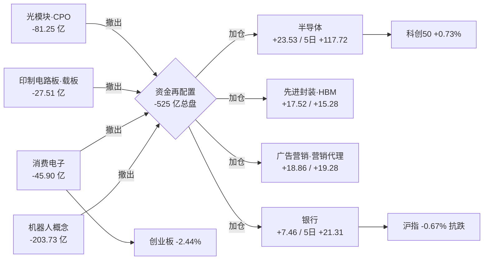

# 2026 年 11 月 13 日 · **资金面**

> **数据源新鲜度**: partial（A 股主力/龙虎榜 ✅ · 两融/ETF ⚠️ T+1 · 美股 ⚠️ 缺 1 session）
> **降级状态**: true
> **置信度**: 0.75（base_confidence: 0.88 × freshness_factor: 0.90 × source_agreement_factor: 0.95 = 0.75）
> **数据归属**: 20261112 收盘（最新可得交易日，trading_gap=0）

## 一句话结论

11-12 主力 **-525.12 亿**把 11-09/10/11 三日 **+505.04 亿**的修复一次性回吐（净剩 -20 亿），四档拆解是 **超大单+大单 -525.12 亿 vs 中小单 +515.50 亿**的派发结构；广度 **875:4635**（15.70%）、炸板率 **18.27% → 48.61%** → 情绪=**震荡（偏弱·修复中断）**。钱卖光模块·CPO·PCB、买半导体（**+23.53 亿 d1 / +117.72 亿 5d**）与广告营销（蓝色光标单票 +23.47 亿）。候选按 ≥35% 炸板率红线砍半 **10 → 5**，全部 research_only、**0 可执行**。

## 详细分析

### 一、市场时序：一根 -525 亿把三日修复抹平

| 交易日 | 主力净额（亿） | 沪指 | 深指 | 创业板 | 科创50 |
|---|---|---|---|---|---|
| 11-05 | +90.24 | +0.10% | — | — | — |
| 11-06 | **-528.52** | -1.10% | — | — | — |
| 11-09 | +128.82 | +0.32% | -0.27% | -0.27% | +0.30% |
| 11-10 | +173.37 | +0.08% | +0.86% | +1.46% | +0.64% |
| 11-11 | +202.85 | +0.46% | +1.32% | +3.11% | +2.80% |
| **11-12** | **-525.12** | **-0.67%** | **-1.68%** | **-2.44%** | **+0.73%** |

| 窗口 | 主力净额（亿） | 读数 |
|---|---|---|
| 单日 11-12 | -525.12 | 11-06（-528.52）以来第二大单日流出；一日摆动 **-727.97 亿** |
| 5 日 | -548.60 | 前一日 +66.76 → 单日让 5 日窗口摆动 **-615.36 亿** |
| 10 日 | -802.00 | 修复未进入中期账户 |
| 20 日 | -3034.11 | 仅 **8/20** 天为正，中期失血未改 |

**四档拆解（11-12）**：超大单 **-254.13 亿**、大单 **-270.99 亿**、中单 **+94.90 亿**、小单 **+420.60 亿**。

**大资金意图**：超大单+大单合计 -525.12 亿，中小单合计 +515.50 亿，两者几乎完全对冲——这是教科书式的**大资金派发、散户接盘**。它不是"获利了结后等回踩"，而是把 11-09/10/11 三日抢跑进来的仓位一次性卖还给市场。11-06 那根 -528.52 亿是恐慌砸盘（沪指 -1.10%），11-12 这根 -525.12 亿是在沪指只跌 0.67%、科创50 仍红的"体面下跌"里完成的——**隐蔽派发比恐慌砸盘更难防**，这也是为什么广度已经崩到 15.70% 而指数看起来只是小幅回调。

**为什么走弱**：三日修复（+505.04 亿）的载体是光模块·CPO·PCB 与消费电子，这三条链在 11-11 一天里吃掉了全部增量（新易盛 +30.50、中际旭创 +29.87、东山精密 +23.16）。11-12 这些票被整条链反手卖出（详见第三节），资金没有离场，而是换到了半导体——但换手过程本身让 4635 只票下跌，赚钱效应从"普涨"塌缩成"单链"，情绪自然从修复切回震荡。

**逻辑够不够硬**：不够硬。硬证据是 -525 亿 + 875:4635 + 48.61% 炸板率三项同向，任何一项单独出现都可能是噪声，三项同时对上是趋势级信号。唯一给它留有余地的是：科创50 逆势 +0.73%、半导体 20 日累计 +85.66 亿是 20 日窗口里唯一为正的成长板块——说明这是"结构性换手中的普跌"，不是"全面撤退"。

### 二、板块：卖光通信、买半导体

| 板块（行业） | 11-12 净额（亿） | 5 日（亿） | 20 日（亿） | 当日涨幅 | 5 日正日 |
|---|---|---|---|---|---|
| 半导体 | **+23.53** | +117.72 | **+85.66** | -0.84% | 4/5 |
| 营销代理 | +19.28 | +18.05 | — | -2.00% | — |
| 广告营销 | +18.86 | +18.53 | — | -2.02% | — |
| 半导体设备 | **+17.33** | +41.79 | +39.44 | +0.75% | — |
| 医疗服务 | +9.70 | -19.26 | — | +0.07% | — |
| 集成电路制造 | +8.85 | +7.12 | — | +1.19% | — |
| 分立器件 | +8.57 | +31.85 | — | -1.53% | — |
| 银行 | +7.46 | +21.31 | -50.55 | +0.02% | — |

| 板块（行业） | 11-12 净额（亿） | 5 日（亿） | 当日涨幅 |
|---|---|---|---|
| 电子 | **-79.05** | +145.13 | -1.58% |
| 通信 | -73.03 | +79.45 | -2.06% |
| 通信设备 | -68.14 | +89.17 | -2.02% |
| 机械设备 | -66.99 | -24.79 | -2.10% |
| 电力设备 | -62.39 | **-183.80** | -2.02% |
| 有色金属 | -59.03 | -98.85 | -2.51% |
| 消费电子 | -45.90 | +1.50 | -2.52% |
| 印制电路板 | -27.51 | +44.44 | -1.64% |
| CPO 概念 | **-81.25** | +133.86 | -1.68% |
| 机器人概念 | **-203.73** | -111.62 | -2.55% |

概念端同向：大基金持股 **+24.49**（5 日 +34.94）、先进封装 **+17.52**（5 日 +83.63）、HBM/高带宽内存 **+15.28**（5 日 +38.99）、中芯概念 **+14.42**、智谱 AI 概念 +18.67。

**大资金意图（半导体）**：板块当日价格 -0.84% 却净流入 +23.53 亿，5 日 +117.72、20 日 +85.66——是全部主板块里唯一"三条窗口全正"的成长方向。价格不涨而钱进，说明买盘在承接抛压，不是追涨；这与美股隔夜半导体独强（11-11 篮子 +6.74、MU +11.89）形成闭环。

**为什么走强**：三条子链同时给钱——设备（+17.33，5 日 +41.79）、制造（+8.85）、封测/先进封装（概念 +17.52，5 日 +83.63）、存储/HBM（+15.28，5 日 +38.99）。这是"国产替代 + 先进封装扩产 + 存储涨价"三条叙事在同一周被资金同时定价，而不是单点题材。

**逻辑够不够硬**：中等偏硬。硬的部分是 20 日累计 +85.66 亿（同期电力设备 -357.66、有色 -228.89、计算机 -242.51），说明它是弱势市场里唯一有中期资金沉淀的方向；不硬的部分是当日 37 只涨停里没有一只是半导体核心（涨停结构仍是零售/光伏/燃气/食品等低位小票），即**板块有钱但没有龙头带板**——11-13 若要做多，只能做资金连续的核心票，不能做半导体里的杂毛补涨。

### 三、昨日前十 5 日追踪：8 反手 / 2 延续

| 昨日候选（11-11 口径） | 11-11 净额 | 11-12 净额 | 11-12 涨幅 | 5 日累计 | 判定 |
|---|---|---|---|---|---|
| 新易盛 | +30.50 | **-16.13** | -4.38% | +33.71 | 反手转负 |
| 中际旭创 | +29.87 | **-26.50** | -6.11% | +12.17 | 反手转负（全场最大单票流出） |
| 天孚通信 | +16.87 | -3.58 | -2.58% | +13.65 | 反手转负 |
| 东山精密 | +23.16 | -5.70 | +1.77% | +5.24 | 反手转负 |
| 沪电股份 | +10.94 | -1.33 | +2.12% | +12.99 | 反手转负 |
| **寒武纪** | +10.31 | **+14.06** | **+8.11%** | +34.21 | **延续** |
| 工业富联 | +8.84 | **-13.84** | -4.85% | -2.14 | 反手转负 |
| 兆易创新 | +12.52 | -1.70 | -0.30% | -3.91 | 反手转负 |
| 生益科技 | +3.30 | -4.42 | -1.52% | -6.01 | 反手转负 |
| **剑桥科技** | +7.11 | **+2.78** | +5.04% | +7.51 | **延续（金额减半）** |

8 只反手全部落在光模块·CPO·PCB·消费电子链；延续的 2 只一只在半导体算力芯片（寒武纪）、一只在光模块龙三（剑桥科技，金额从 +7.11 砍到 +2.78）。**读法**：11-11 的资金前十是一日抢跑，11-12 的钱把光通信整条链反手卖出，只留半导体继续加——这是主线换手，不是普跌撤退，但也意味着昨日的"修复"叙事已经作废。

**今日 5 日资金前十（供 11-13 追踪）**：寒武纪 +34.21、新易盛 +33.71（但单日 -16.13）、源杰科技 +27.88、蓝色光标 +20.20、百亚股份 +17.63、天孚通信 +13.65、沪电股份 +12.99、中际旭创 +12.17、北方华创 +11.76、先导基电 +9.35。**注意**：这十只里有 5 只（新易盛/天孚/沪电/中际旭创）5 日累计仍为正而单日已大额转负——这是"5 日窗口的滞后性陷阱"，11-13 追踪时必须看单日方向而不是 5 日累计。

### 四、龙虎榜诱多识别：42 条警报，71% 上榜票有问题

> **口径说明（本日已修正）**：龙虎榜 `top_inst` 同一席位在买榜（side=0）与卖榜（side=1）各出现一次，且同一票的多个上榜原因行（1 日榜 / 连续三个交易日 3 日累计榜）会重复同一批席位。原口径直接全量相加导致席位双计、并把 1 日与 3 日累计混算。下表"机构（亿）"= 按 (票, 原因口径, 席位, buy, sell) 去重后的**机构专用席位净额**，与 `top_list.net_amount` 全席位口径逐行核对 **69/69 完全一致（差额 0.0000 亿）**。

| 净买前 6 | 净额（亿） | 口径 | 机构（亿） | 涨幅 | 读数 |
|---|---|---|---|---|---|
| 粤芯半导体 | +2.89 | 单日 | **+3.01** | +7.28% | 当日唯一机构明确净买的上榜票 |
| 赛腾股份 | +2.51 | 3 日累计 | 0.00 | +5.57% | 纯游资（深股通 +0.64） |
| 风语筑 | +2.40 | 单日 | +0.35 | **-4.92%** | 下跌中微幅承接，非机构主导 |
| 澳洋健康 | +2.18 | 单日 | **-0.59** | +10.08% | 首板但机构在卖 |
| 吉视传媒 | +1.54 | 单日 | 0.00 | +10.20% | 纯游资封板（股通 -0.10） |
| 襄阳轴承 | +1.47 | 单日 | **-0.08** | +3.54% | 深股通 +1.03 参与，机构缺席 |

| 净卖前 6 | 净额（亿） | 口径 | 机构（亿） | 涨幅 | 读数 |
|---|---|---|---|---|---|
| 福建水泥 | **-3.24** | 单日 | **0.00** | **+9.99%** | 涨停诱多（16 次开板、封单 0.14 亿、全是游资席位） |
| 上海电影 | -2.74 | 单日 | **-2.43** | -9.99% | 机构主导重挫出货 |
| 文投控股 | -2.46 | 单日 | 0.00 | -1.59% | 游资兑现，机构未参与 |
| 福莱新材 | -1.98 | 单日 | **-2.23** | -9.99% | 机构主导重挫出货 |
| 冰山冷热 | -1.67 | 单日 | -1.06 | -2.93% | 机构出货为主 |
| 果麦文化 | -1.54 | 单日 | +0.18 | -10.38% | 重挫但机构微买（-1.54 净卖来自游资） |

- **涨停但龙虎榜净卖 5 只**：福建水泥（-3.24 / 机构 0.00）、惠发食品 3 板（-0.56 / 机构 0.00）、东方海洋（-0.71，26 次开板，机构 -0.41）、北纬科技 2 板 6 次开板（-0.32 / 机构 -0.16）、日上集团 2 板 4 次开板（-0.05 / 机构 -0.56）。
- **反复开板烂板 28 只**：东方海洋 26 次、福建水泥 16 次、百洋股份 11 次、宁波东力 10 次、文投控股 8 次、日出东方 7 次（5 板）。
- **重挫日大额净卖 9 只**：上海电影 -2.74（机构 -2.43）、福莱新材 -1.98（机构 -2.23）、果麦文化 -1.54 为前三。

**诱多结构识别**：59 只上榜票中 42 只有警报（71%）。高度板全部属于"封单撑板、主力不认"：大东方 5 板 0 开板但封单仅 **0.27 亿**、日出东方 5 板 **7 次开板**封单 0.83 亿、亚玛顿 4 板 0 开板封单 1.70 亿而主力仅 +0.16 亿。**结论：11-13 禁止接力任何 3 板以上（含 3 板）的高度板**——涨停结构已从"资金推动"退化为"封单维持"。

**席位协同（3 日 · 去重口径）**：26 个净买席位、7 个三日全正。深股通专用 **+10.76**（3/3）、机构专用 +2.87（2/3）、沪股通专用 **+2.80**（3/3）、国信证券浙江互联 +2.79（3/3）、广发郑州农业路 +2.13（2/3）、东财拉萨金融城南环路 +1.69（3/3）。

**关键读法（与修正前结论相反）**：11-12 这个反手日，**机构专用席位单日净卖 -8.52 亿**（上海电影 -2.43、福莱新材 -2.23、杰克科技 -2.07、山金国际 -1.34、冰山冷热 -1.06），是当日唯一大幅净卖的席位族（32 只上榜票中 24 净卖 / 8 净买）；当日仍在净买的是**外资通道**（沪股通 +2.33、深股通 +0.65，合计 +2.98）与国信浙江互联 +0.78。即 11-12 不是"机构在接"，而是**"机构在撤、外资与游资在接"**。另一条证据：11-11 的游资总龙头席位开源证券西安西大街 3 日合计 **-0.75**（11-11 -1.53、11-12 -0.67）持续净卖。**对 11-13 的含义**：如果 11-13 反手，机构大概率不是接盘方——半导体方向的钱更多来自外资通道与游资，对追高更不利。

### 五、外部传导：11-11 隔夜半导体独强，但 11-13 没有新隔夜

| 美股（11-11 收盘） | 涨跌 | 美股（11-11 收盘） | 涨跌 |
|---|---|---|---|
| MU | **+11.89%** | NVDA | +2.87% |
| MRVL | +9.33% | AMD | +7.32% |
| INTC | +7.52% | TSM | +4.25% |
| GLW | +7.43% | AVGO | +3.99% |
| MSFT | -2.26% | META | -1.97% |
| AMZN | -1.74% | SPX | +1.31% |
| IXIC | +1.60% | DJI | +0.49% |

篮子：半导体 **+6.74%**、光模块代理 +6.92%、存储（MU）+11.89%、大型科技 **-0.36%**。亚太 11-12：恒指 -1.26%、日经 -0.70%、韩综 -0.61%、台指 **-2.63%**。

**外部传导判断**：美股 11-11 是"半导体独强、平台股走弱"，A 股 11-12 已完整消费——半导体 +23.53 亿、科创50 +0.73% 而创业板 -2.44%，正是镜像。**11-12 的新隔夜（北京时间 11-13 05:00 收盘）在本会话 04:31 抓取时不可得**（tushare us_daily 最新仍为 11-11，与 overseas_snapshot 一致）。因此今日存储/CPO/半导体链**没有新的外部增量**：若开盘半导体链高开，那是"已兑现的旧利好"，不能当作新的进攻理由；若低开，则是 11-12 未完成的派发在延续，风险更大。

### 六、ETF / 两融与情绪定位

| ETF（份额，最新 11-11） | 5 日变动（亿份） |
|---|---|
| 半导体ETF | **+3.68** |
| 科创50ETF | **+2.58** |
| 光伏ETF | +9.30 |
| 沪深300ETF | **-2.58** |
| 创业板ETF | -2.83 |
| 中证500ETF | -2.00 |
| 黄金ETF | -0.61 |

两融（11-11）：融资余额 **22731.37 亿**、单日 **+74.75 亿**（连续第二日回升）、5 日 +13.18 亿由负转正、融券余额 291.57 亿。**11-12 的 T+1 数据未落库** → 11-12 主力 -525 亿这一天杠杆端是空白，这是本次判断最大的证据缺口。

**情绪定位**：炸板率 48.61% ≥ 35% 硬红线 + 广度 15.70%（875:4635）+ 主力 -525.12 亿 → 情绪=**震荡（偏弱·修复中断）**，研究候选按纪律砍半 **10 → 5**。宽基 ETF 赎回 + 半导体/科创窄基申购说明配置盘在**结构性切换**而非全面撤退；两融 11-11 回升但缺 11-12 → 杠杆确认缺席。

## 候选与门禁

### 研究候选 5 只（全部 research_only，execution_eligible=false）

| 标的 | 链 / 地位 | 今日主力 | 5 日 | 20 日位置 | 止损距 | RR5 | RR20 | 门禁 |
|---|---|---|---|---|---|---|---|---|
| 深南电路 002916.SZ | PCB/载板 · 龙头 | +3.91 | +6.55（4/5） | 28.1% | -16.12% | 0.39 | **2.56** | 不过线（风险带超 -10%；RR20 参照过 2） |
| 寒武纪 688256.SH | AI 算力芯片 · 总龙 | **+14.06** | **+34.21**（4/5） | 82.6% | -22.92% | 0.21 | 0.21 | 不过线（风险带 + RR5） |
| 通富微电 002156.SZ | 先进封装 · 龙二 | +8.62 | +8.66（3/5） | 78.4% | -20.97% | 0.21 | 0.28 | 不过线（炸板 Z / 3 次开板） |
| 源杰科技 688498.SH | 光芯片 · 低位前排 | +9.70 | **+27.88**（5/5） | 37.4% | -27.17% | 0.25 | 1.68 | 不过线（价跌钱进背离） |
| 北方华创 002371.SZ | 半导体设备 · 龙头 | +5.30 | +11.76（4/5） | 61.7% | -16.19% | 0.29 | 0.62 | 不过线（风险带 + RR5） |

**首推票（研究锚）· 深南电路思维链**

- **买入理由**：全场唯一 20 日盈亏比过 2 的票（RR20 2.56）。5 日 +6.55 亿（4/5 正）、20 日位置 **28.1%**（全场最低的"主线内低位"）、距 20 日高 -29.21%，不存在追高问题；PCB/载板是先进封装（+83.63 亿 5d）与 HBM（+38.99 亿 5d）的上游载体，板块 5 日 +44.44 亿仍为正。
- **风险点**：①止损距 -16.12% 远超 -5~-10% 硬区间，T+1 无法用纪律风险带定价；②PCB 板块当日 -27.51 亿，它是板块内唯一逆势承接的票，单票逆势容易被板块拖回；③两融 5 日 -3.30%，杠杆在减。
- **止损条件**：以 10 日低点 **194.05** 为结构性止损（-16.12%），该距离超出硬区间 → **当日不进**。若要参与，必须等回踩至 219 附近（-5.3% 风险带内）或次日缩量回踩且主力仍为正，否则维持观察。**纪律结论：观察，不进。**
- **可验证假设**：①11-13 若半导体/载板链高开，深南电路应同步走强且主力净额维持 > 0；②若 11-13 板块净额继续为负而它单票为正，则"逆势承接"有效，可升级为次日低吸对象；③若 5 个交易日内不能收复 250（+8%），RR20 2.56 的假设失效，直接降级剔除。

### 观察 10 只（降级/不进）

| 标的 | 一句话结论（进/不进/降级/观察/拦截） |
|---|---|
| 蓝色光标 300058.SZ | 降级观察：全场最大单票 +23.47 亿（东财复核一致）+ 广告营销双板块正，但 5 日仅 2/5 正、RR 0.37、止损距 -22.22% |
| 摩尔线程 688795.SH | 不进：国产 GPU 次新，位置 84.8%、RR 0.18 |
| 华虹宏力 688347.SH | 观察：两融 5 日 +10.13% 最猛，但 5 日资金仅 +1.03 亿（弱确认） |
| 粤芯半导体 301660.SZ | 观察：龙虎榜单日 +2.89、机构专用 +3.01（全榜唯一机构明确净买），但换手 38.27%、RR 0.12 |
| 剑桥科技 603083.SH | 观察：唯一延续的光模块票（+2.78）、RR20 2.38，但 CPO 概念 -81.25 亿对抗不了板块 |
| 吉视传媒 601929.SH | 不进：涨停 + 龙虎榜 +1.54（机构专用 0.00，纯游资），20 日位置 100%、3 次开板、RR 0 |
| 襄阳轴承 000678.SZ | 观察：龙虎榜单日 +1.47 但机构专用 -0.08（机构缺席），炸板 4 次、换手 37.87%、RR 0.30 |
| 亚玛顿 002623.SZ | 拦截：4 板 0 开板但主力仅 +0.16 亿、RR 0（20 日新高），封单撑板 |
| 景旺电子 603228.SH | 观察：PCB 低位 36.0%、RR20 1.77，但 3 次开板 + 两融 -11.66% |
| 工业富联 601138.SH | 拦截：昨日前十第 7 → 今日 -13.84 反手、5 日 -2.14 转负 |

**执行候选：0 只。** 依据：炸板率 48.61% ≥ 35% 红线 + 主力 -525.12 亿 + 5 只研究候选全部不过 -5~-10% 风险带门禁。研究观察 ≠ 开仓资格，D1 不得把本段任何标的直接转为 execution。

## 关键证据

- **证据 1**：主力单日 **-525.12 亿**（前一日 +202.85，摆动 -727.97），超大单+大单 -525.12 亿 vs 中小单 +515.50 亿 → 派发结构。来源 `tushare.moneyflow_dc`（126,631 个股票-日，21 日）。
- **证据 2**：广度 **875 涨 / 4635 跌**（15.70%）、中位 **-1.61%**、均值 -1.50%（中位跌幅 > 均值 = 中小票最惨）；成交 19458.7 亿放量下跌。来源 `tushare.daily`（5573 只）。
- **证据 3**：**37 涨停 / 5 跌停 / 35 炸板**，炸板率 18.27% → **48.61%**；最高板 5 板。来源 `tushare.limit_list_d`。
- **证据 4**：昨日研究候选前十 **8/10 反手转负**，反手全部集中在光模块·CPO·PCB·消费电子（中际旭创 -26.50、新易盛 -16.13、工业富联 -13.84）。来源 `R7_capital_flow_20261112.json` × 本日资金表。
- **证据 5**：半导体 **+23.53 / 5 日 +117.72 / 20 日 +85.66**，是 20 日窗口唯一累计为正的成长板块；先进封装 +17.52（5d +83.63）、HBM +15.28、大基金持股 +24.49 同向。来源 `tushare.moneyflow_ind_dc`（22,056 条板块-日）。
- **证据 6**：**42 条诱多警报**（涨停净卖 5 / 烂板 28 / 重挫净卖 9），59 只上榜票 71% 有问题；福建水泥涨停却净卖 -3.24 亿且**机构专用席位 0.00**（纯游资出货）。来源 `tushare.top_list/top_inst`（69/690 条）+ `vibe_trading.get_dragon_tiger`（东财 65 条，7 只金额两源一致）。
- **证据 7（口径修正后新增）**：11-12 **机构专用席位单日净卖 -8.52 亿**（32 只上榜票中 24 净卖 / 8 净买），当日净买方是外资通道（沪股通 +2.33 + 深股通 +0.65）。来源 `tushare.top_inst` 去重聚合（与 `top_list.net_amount` 逐行核对 69/69 一致）。
- **证据 8**：11-11 美股半导体篮子 **+6.74%**（MU +11.89 / MRVL +9.33 / INTC +7.52），大型科技 -0.36%；11-12 A 股科创50 +0.73% vs 创业板 -2.44% —— 外部传导已兑现，11-13 无新隔夜。来源 `data/raw/20261112/overseas_snapshot.json` + `tushare.us_daily`。

## 数据源审计

| 源 | 状态 | 抓取时间 | 记录数 | 备注 |
|---|---|---|---|---|
| tushare.moneyflow_dc | ✅ ok | 2026-11-13 | 126,631（21 日） | 个股主力，21 日 × ~6,030 只/日 |
| tushare.moneyflow_ind_dc | ✅ ok | 2026-11-13 | 22,056 | 行业 496 + 概念 557 × 21 日 |
| tushare.limit_list_d | ✅ ok | 2026-11-13 | 585（6 日） | 涨跌停 + 炸板 + 连板高度 |
| tushare.top_list / top_inst | ✅ ok | 2026-11-13 | 69 / 690 | 龙虎榜 3 日；**席位聚合已按 (票,口径,席位,buy,sell) 去重** |
| tushare.margin / margin_detail | ⚠️ partial | 2026-11-13 | 60（市场）+ 850（个股） | **T+1 未落库，最新 11-11** |
| tushare.fund_share | ⚠️ partial | 2026-11-13 | 175（7 只 ETF） | **T+1 未落库，最新 11-11** |
| tushare.block_trade | ✅ ok | 2026-11-13 | 85（全市场）+ 104（24 票 30 日） | 大宗成交 |
| tushare.us_daily / index_global | ⚠️ stale | 2026-11-13 | 238 / 361 | **最新 11-11；11-12 session 05:00 收盘未到** |
| data/raw/20261112/overseas_snapshot.json | ⚠️ degraded | 2026-11-12 22:30 | 14 只美股 + 3 指数 | 快照自身标注 status=degraded、asof 11-11 |
| vibe_trading.get_dragon_tiger | ✅ ok | 2026-11-13 | 65 | eastmoney 独立通道，7 只金额与 tushare 一致 |
| vibe_trading.get_fund_flow | ⚠️ partial | 2026-11-13 | 3 票有效 | 002371.SZ ProxyError（东财代理超时 + tushare fallback 无 token） |
| data/raw/20261113/manifest.json | ❌ 缺 | — | 0 | 盘前 04:31 pipeline 前置未跑；回退 20261112 manifest（severity=0） |
| 北向（moneyflow_hsgt / hk_hold） | 🚫 retired | — | 0 | 2026-10-28 用户决定停抓 |

## 不确定性 / 反证

1. **两融缺口**：11-12 主力 -525 亿这一天，融资余额只到 11-11（+74.75 亿回升）。如果 11-12 两融实际大幅下降，则"派发"会被杠杆强平放大，反手幅度会比本报告判断更极端；如果继续回升，则说明杠杆资金在接大单的货，"派发"结论减弱。**这是本报告最不确定的一环。**
2. **美股缺档**：11-13 的新隔夜（11-12 US session）在 04:31 不可得。本报告对存储/CPO/半导体链的判断建立在 11-11 旧档上，若 11-12 美股半导体大跌，今日 A 股半导体链的"结构性承接"会被外部否定。
3. **R2 缺失**：`data/research/20261113/R2_main_sectors.json` 未产出，候选池由资金数据反推（24 只评估 / 15 只卡片化），**没有板块级别的基本面背书**。若 R2 判定今日主线不在半导体，则本报告前 5 只候选的链属性需要重排。
4. **5 日窗口滞后陷阱**：今日 5 日前十里有 5 只（新易盛/天孚/沪电/中际旭创）5 日累计仍为正而单日已大额转负。任何用 5 日累计做"资金连续"结论的消费者都会被骗。
5. **席位口径边界（本日修正）**：修正后"机构（亿）"为去重后的机构专用席位净额，"净额（亿）"为 `top_list` 全席位净额（两者之差即游资/外资/自然人席位）。1 日榜与 3 日累计榜在表中分列，**不可跨口径相加**；跨日席位序列只累加单日榜。修正前的旧口径（席位双计 + 口径混算）会把机构专用虚增到 +14.36 亿并得出"机构在接"的相反结论，该结论已作废。
6. **反证当前提**：若 11-13 出现①半导体板块净额转负而科创50 下跌、②炸板率继续 >40%、③两市主力继续日流出 >300 亿——三条同时成立，则"结构性换手"会被证伪为"全面撤退的第一天"，本报告的可行性判断应整体作废。
7. **口径提醒**：本报告所有"主力净额"是东财口径（超大单+大单），与 tushare `moneyflow_dc` 一致；不能用它替代龙虎榜席位含义，也不能替代两融杠杆行为。

## 与其他 R/D/E 的关系

- **依赖（上游）**：
  - `data/raw/20261112/manifest.json`（severity=0，决定 confidence 无硬上限）
  - `data/raw/20261112/overseas_snapshot.json`（美股 11-11 档）
  - `data/research/20261112/R7_capital_flow_20261112.json`（昨日前十 5 日追踪基准）
  - `R2_main_sectors.json`（**本日缺失**，候选池改由资金反推）
- **被消费（下游）**：
  - `D1 canghai-plan` — 用 `staleness_status=ok`（正常消费，不做仓位衰减）、`main_force.market_windows`、`hot_money.distribution_alerts`、`execution_candidates=[]`
  - `R6 analyze_devil_advocate_v1` — 用 `research_candidates[].gate`、`distribution_alerts`、`yesterday_top10_5d_tracking` 做反证；**注意 `hot_money` 的机构席位结论已按去重口径修正，"机构在接"的说法不再成立**
  - `E1 canghai-review` — 用 `seesaw_pairs`、`overseas_core_stocks` 复盘当日传导
- **本报告不授权开仓**：`execution_candidates=[]`，所有 research_candidates 均 `research_only=true`、`execution_eligible=false`；硬否决权在 R6。

## Sub-Agent 元数据

- skill: `analyze_capital_flow_v1`（v1.3 · 含隔夜美股核心个股维度）
- artifact: `data/research/20261113/R7_capital_flow.json` → `R7_capital_flow_20261113.json`（128 KB）
- 中间数据: `data/research/20261113/_work/`（_calc_market.json / _calc.json / _assemble.json / mf_dc_* / mf_ind_* / topinst_*）
- 生成耗时: 约 40 分钟（04:31 抓取 → 04:39 首次落盘 → 05:12 席位口径修正后重算重落）
- model: deepseek-v4.1-flash
- 校验: `tests/checks/check_r7_staleness.py 20261113` 通过（staleness_status=ok / resolved=20261112 / trading_gap=0 / pre_06am_gate 已附）
- 席位口径修正: 龙虎榜席位聚合按 (票, 原因口径, 席位, buy, sell) 去重；1 日榜与 3 日累计榜分列；去重后全席位净额与 `top_list.net_amount` 逐行核对 69/69 一致（差额 0.0000 亿）
- 候选上限: 5（炸板率 48.61% ≥ 35% → 10 砍半）
