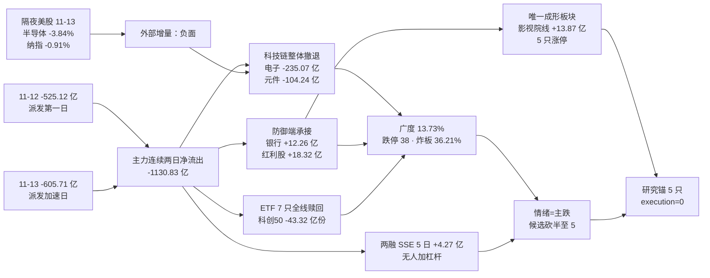

# 2026 年 11 月 16 日 · **资金面**

> **数据源新鲜度**: partial（A 股主力/龙虎榜/ETF ✅ · 两融 ⚠️ partial-deposit 已改同口径 · 美股 ✅ 最新 session）
> **降级状态**: true
> **置信度**: 0.77（base_confidence: 0.88 × freshness_factor: 0.92 × source_agreement_factor: 0.95 = 0.77）
> **数据归属**: 20261113 收盘（最新可得交易日，trading_gap=0；11-14/15 为周末）

## 一句话结论

11-13 主力 **-605.71 亿**、连续第二个交易日净流出（两日合计 **-1130.83 亿**），广度塌到 **765:4748**（上涨占比 13.73%）、跌停 **33→38**、炸板率 **36.21%**（≥35% 硬红线）→ 情绪=**主跌（修复前夜）**。钱在**整体撤出科技链**（电子 -235.07 / 元件 -104.24 / 通信设备 -100.04 亿），同时**转入防御**（银行 +12.26 / 红利股 +18.32 / 中特估 +17.64 亿），唯一成形的板块级方向是**影视院线**（+13.87 亿、5 只涨停）。硬证据：ETF 份额 **7 只全线净赎回**（科创50ETF -43.32 亿份）＋两融 SSE 口径 5 日持平（+4.27 亿）＝**无增量资金入场**。候选按 ≥35% 炸板率红线砍半至 **5 只研究卡、0 只可执行**。

## 详细分析

### 一、市场时序：连续两根大阴，把三日修复彻底抹平

| 交易日 | 主力净额（亿） | 超大单 | 大单 | 中单 | 小单 | 沪指 | 深指 | 创业板 | 科创50 |
|---|---|---|---|---|---|---|---|---|---|
| 11-05 | +90.24 | +86.69 | +3.55 | -166.85 | +83.48 | +0.10% | +1.19% | +0.87% | +1.68% |
| 11-06 | **-528.52** | -233.40 | -295.12 | +38.58 | +476.54 | -1.10% | -2.57% | -3.96% | -2.60% |
| 11-09 | +128.82 | +130.88 | -2.06 | -73.84 | -59.40 | +0.32% | -0.27% | -0.27% | +0.30% |
| 11-10 | +173.37 | +122.55 | +50.82 | -122.48 | -52.50 | +0.08% | +0.86% | +1.46% | +0.64% |
| 11-11 | +202.85 | +203.90 | -1.05 | -179.33 | -21.87 | +0.46% | +1.32% | +3.11% | +2.80% |
| 11-12 | **-525.12** | -254.13 | -270.99 | +94.89 | +420.61 | -0.67% | -1.68% | -2.44% | +0.73% |
| **11-13** | **-605.71** | **-320.71** | **-284.99** | **+108.08** | **+481.46** | **-0.59%** | **-2.05%** | **-3.32%** | **-2.30%** |

| 窗口 | 主力净额（亿） | 读数 |
|---|---|---|
| 单日 11-13 | **-605.71** | 11-06（-528.52）以来最大单日流出；较前一日再恶化 **-80.59 亿** |
| 5 日 | **-625.79** | 11-12 时为 -548.60，两日内再降 77.19 亿 |
| 10 日 | -1011.05 | 三日修复（+505.04 亿）已完全被抹掉还多 |
| 20 日 | **-3590.29** | 仅 **8/20** 天为正，中期失血比 11-12（-3034.11）加深 556 亿 |

**四档拆解（11-13）**：超大单 **-320.71 亿**、大单 **-284.99 亿**、中单 **+108.08 亿**、小单 **+481.46 亿**。

**大资金意图**：超大单+大单合计 -605.71 亿，中小单合计 +589.54 亿，两侧几乎完全对冲——这是 11-12 那根 -525.12 亿的**加速版派发**，不是新形态。关键变化在于**谁在接**：11-12 接盘主力还是科创50（+0.73% 翻红，半导体 +23.53 亿），11-13 连科创50 都转跌 -2.30%，半导体自己流出 -75.28 亿。11-12 的派发还能说是"结构性换手"，11-13 是**换手方也没了**——没有板块在承接，所以价格只能在普跌中寻底。对手盘从"追高的接力资金"变成了"无处可去的避险资金"（银行/红利/中特估/大盘价值/破净股/证金持股 六个概念同向进钱）。

**为什么走弱**：11-09/10/11 三日 +505.04 亿的载体是光模块·CPO·PCB·AI 应用四条链，11-13 这四条链被整条卖出——沪电股份 **-9.08 亿并封死跌停**（机构 -1.21、股通 -1.26 双双净卖）、新易盛 **-21.88 亿**（全场最大单票流出）、蓝色光标从 +23.47 亿翻到 **-19.15 亿**。更致命的是**指数与个股的同步性**：创业板 -3.32%、科创50 -2.30%，没有一个板块在托指数，说明这是**无方向的普跌**，而不是"某条链塌了、别的链接力"。

**逻辑够不够硬**：够硬。四个独立源同向共振——①主力 -605.71 亿（连跌两日）；②广度 13.73% + 跌停 38（跌停数一天翻 6 倍）；③ETF 份额 7 只全线净赎回（科创50ETF 单只 -43.32 亿份）；④两融 SSE 口径 5 日仅 +4.27 亿（无人加杠杆抄底）。**证伪路径**：若 11-16 早盘广度回到 0.55 以上且跌停家数收敛到 15 以内，则 11-13 是恐慌尾盘而非趋势转折，修复窗口成立（`cycle_position.json` 已给出该 tier：连跌 2 日 → 修复窗口第 3 日，判据是广度 >0.55 / 昨涨停红盘率 >60% / 板块级涨停潮 ≥3 只）。**注意**：连跌次日的修复是**历史同口径样本**，不是概率模型，不构成开仓许可。

### 二、板块：卖科技、买防御，但防御不是主线

| 板块（行业） | 11-13 净额（亿） | 5 日（亿） | 20 日（亿） | 当日涨幅 | 5 日正日 |
|---|---|---|---|---|---|
| 影视院线 | **+13.87** | +9.64 | +10.65 | **+4.39%** | 2/5 |
| 银行 | **+12.26** | +25.04 | -35.84 | +1.43% | 3/5 |
| 银行Ⅱ | +12.26 | +25.04 | -35.84 | +1.43% | 3/5 |
| 半导体设备 | **+10.40** | **+44.78** | **+30.54** | -3.11% | **5/5** |
| IT服务Ⅱ | +9.81 | -8.77 | -46.02 | -1.04% | 2/5 |
| 电子 | **-235.07** | +48.70 | -564.01 | -3.52% | 3/5 |
| 元件 | -104.24 | -6.65 | -377.42 | -6.31% | 3/5 |
| 通信设备 | -100.04 | +36.71 | -283.86 | -3.25% | 3/5 |
| 通信 | -95.55 | +29.31 | -298.06 | -2.44% | 3/5 |
| 印制电路板 | -90.46 | +3.55 | -303.36 | -6.83% | 3/5 |

**概念端**：证金持股 +23.35 / 保险重仓 +20.60 / 红利股 +18.32 / 中特估 +17.64 / 大盘价值 +16.67 / 破净股 +16.55 进钱；融资融券 -548.57 / 基金减仓 -388.98 / 深股通 -359.96 / 富时罗素 -326.85 / MSCI中国 -322.73 出钱。

**大资金意图**：六个防御类概念同时进钱，同时"融资融券"以 -548.57 亿成为全场最大流出概念——这两个数放一起说明：**杠杆盘在主动降仓，机构资金在往低波动资产搬家**。深股通 -359.96 亿与富时罗素 -326.85 亿同时流出，说明这次撤离不限于 A 股定价权资金，外资被动指数通道也在缩。

**为什么走强（防御端）**：银行 20 日仍是 -35.84 亿，这是它第一次靠"避险需求"而非"超跌反弹"转正；红利股/中特估/大盘价值/破净股同时被买，这四个概念高度重叠，说明买的是**同一个逻辑：低波动 + 高股息 + 低估值**。这不是题材，是**资产配置属性的临时停靠站**。

**逻辑够不够硬**：硬，但是**反向的硬**——防御端的硬证据是"科技链被卖"这个前提，一旦科技链止跌，防御端的钱会立刻回去，它的持续性完全依附于另一边的杀跌。因此防御方向**不能当主线做**（纪律 §2：跟随资金，但要看资金是不是有承接的合力）。

**唯一成形的方向是影视院线**：+13.87 亿、板块涨幅 +4.39%、**5 只涨停**（儒意电影/金逸影视/幸福蓝海/中国电影/横店影视）——板块级涨停潮 + 板块资金净流入双确认，全场仅此一条。⚠️ 但要注意它的成色：文投控股当日 +5.39 亿、**3 日累计却是 -0.48 亿**；儒意电影龙虎榜机构 -0.17 / 股通 -0.27 净卖；美晨科技 19.85% 是炸板。这是**一日游结构**，不是主线。

**科技链撤退的规模**需要单独强调：电子 -235.07 亿，而它的 5 日仍是 **+48.70 亿**（正数）。这意味着 11-13 是这条链 5 日修复的**第一次全额回吐**——半导体同理（当日 -75.28 亿，5 日 +88.74 亿仍为正）。资金还在，只是这一轮的钱先撤了。

### 三、昨日前十 5 日追踪：延续率 3/15，本轮最直接的证伪

| 票 | 前日主力（亿） | 今日主力（亿） | 今日涨跌 | 5 日（亿） | 判定 |
|---|---|---|---|---|---|
| 北方华创 | +5.30 | **+3.12** | -1.04% | +8.78 | 🟢 延续 |
| 华虹宏力 | +3.38 | **+1.71** | -3.21% | +0.08 | 🟢 延续 |
| 亚玛顿 | +0.16 | **+0.03** | +2.30% | +0.47 | 🟢 延续 |
| 深南电路 | +3.91 | -2.96 | -9.99% | +6.27 | 🔴 反手转负 |
| 寒武纪 | +14.06 | -3.40 | +0.60% | +27.93 | 🔴 反手转负 |
| 通富微电 | +8.62 | -4.27 | -3.85% | +4.93 | 🔴 反手转负 |
| 源杰科技 | +9.70 | -3.74 | -11.76% | +23.99 | 🔴 反手转负 |
| 蓝色光标 | +23.47 | **-19.15** | -7.66% | +2.76 | 🔴 反手转负 |
| 摩尔线程 | +4.32 | -0.44 | -2.16% | +6.23 | 🔴 反手转负 |
| 粤芯半导体 | +1.00 | -1.60 | -2.83% | +0.03 | 🔴 反手转负 |
| 剑桥科技 | +2.78 | -1.26 | -4.93% | +9.60 | 🔴 反手转负 |
| 吉视传媒 | +5.92 | -4.76 | -4.27% | +1.69 | 🔴 反手转负 |
| 襄阳轴承 | +1.54 | -4.17 | -9.98% | +0.19 | 🔴 反手转负 |
| 景旺电子 | +3.65 | -1.97 | -10.01% | +5.70 | 🔴 反手转负 |
| 工业富联 | -13.84 | -14.63 | -7.50% | -9.27 | ⚫ 双负 |

**读法**：15 只卡片里 **3 只延续、9 只反手转负、1 只双负**，延续率 **20%**。更狠的是**今日 5 日榜与昨日榜几乎不重叠且方向相反**——5 日 +27.93 亿的寒武纪当日 -3.40 亿、5 日 +15.29 亿的新易盛当日 -21.88 亿、5 日 +7.86 亿的沪电股份当日 -9.08 亿封死跌停。结论：**在杀跌阶段，"5 日主力净流入榜"本身是负向指标**，前一日的榜单在次日被系统性兑现。今日唯一还在正轨的是百亚股份（5/5 全正、+4.69 亿）与华胜天成（+10.78 亿），两只都不是科技股。

### 四、龙虎榜：诱多识别五类形态全部命中

**自检**：席位聚合按 `(ts_code, reason, exalter, buy, sell)` 去重，1d/3d 口径分列，与 tushare `top_list.net_amount` **逐行 69/69 完全一致、差额 0.0000 亿**。

| 席位 | 3 日净额（亿） | 正日 | 11-11 | 11-12 | 11-13 |
|---|---|---|---|---|---|
| 深股通专用 | +4.41 | 2/3 | +6.48 | +0.65 | **-2.72** |
| 国信证券浙江互联网分公司 | +4.22 | **3/3** | +1.24 | +0.78 | +2.20 |
| 沪股通专用 | +2.85 | **3/3** | +0.07 | +2.33 | +0.45 |
| 东方财富拉萨金融城南环路 | +2.35 | **3/3** | +0.55 | +0.84 | +0.96 |
| 国泰海通长宁区江苏路 | +2.10 | **3/3** | +0.27 | +1.53 | +0.30 |

**深股通专用在 11-13 转负 -2.72 亿**（前两日 +6.48/+0.65），外资通道的连续买入被中断。而三只游资型席位（国信浙江互联网、东方财富拉萨系、国泰海通江苏路）**3/3 日全正**——它们在跌停潮里持续接刀。席位协同结构清楚：**外资在 11-13 撤退，散户/游资在接**。

**诱多警报共 68 条**，五类形态全部命中：

| 形态 | 条数 | 代表 |
|---|---:|---|
| 🟡 涨停但龙虎榜净卖 | 2 | 广百股份（涨停但净卖 -0.28 亿、机构 -0.28、股通 -0.15、5 次开板）· 好当家（净卖 -0.09 亿、机构 0.00、5 次开板） |
| 🟡 反复开板烂板 | 36 | 深物业A 18 次开板 · 国统股份 16 次（且机构 -0.18 亿）· 襄阳轴承 8 次（且净卖 -2.22 亿） |
| 🔴 重挫日大额净卖 | 12 | 澳洋健康 -2.26 亿 · 襄阳轴承 -2.22 亿 · 和林微纳 -1.72 亿（机构 -1.02）· 沪电股份 -1.13 亿（机构 -1.21、股通 -1.26） |
| 🔴 **机构净卖但股价大涨（核心诱多）** | 12 | 广百股份（机构 -0.28 收 +9.94%）· 天邦食品（-0.05 收 +10%）· 日发精机（-0.13 收 +10%）· 美晨科技（-0.08 收 +19.85%）· 国统股份（-0.18 收 +10.04%）· 儒意电影（-0.17 收 +9.96%） |
| 🔴 **席位净买但股价收跌（拉高出货）** | 6 | 冰山冷热（净买 +0.88 亿收 -5.66%）· 九牧王（+0.66 亿收 -6.98%）· 红太阳（+0.07 亿收 -10.04%）· 贝特利（+0.04 亿收 -11.23%） |

**第四类与第五类是本次最有价值的识别**：前者是**机构在涨停板上出货、散户看到涨停去接**，后者是**席位用净买单掩护、股价却收在日内低位**。两者都指向"次日高开低走"的剧本，覆盖了 11-13 全部 37 只涨停票中的一半以上。

**净卖榜前五**：澳洋健康 -2.26 / 襄阳轴承 -2.22 / 和林微纳 -1.72 / 福建水泥 -1.69 / 东方海洋 -1.45 亿。

### 五、隔夜美股：科技链的负面外部增量

| 标的 | 11-13 收盘 | 涨跌 | 标的 | 11-13 收盘 | 涨跌 |
|---|---:|---:|---|---:|---:|
| NVDA | 162.85 | -2.01% | SPX | 7561.67 | -0.40% |
| AMD | 534.06 | **-8.75%** | IXIC | 25136.27 | **-0.91%** |
| AVGO | 347.01 | -4.76% | DJI | 52347.55 | +0.10% |
| MU | 778.31 | -2.52% | 半导体篮子 | — | **-3.84%** |
| TSM | 398.73 | -1.67% | 光模块篮子 | — | **-4.58%** |
| GLW | 114.08 | -4.30% | 大型科技篮子 | — | +0.44% |
| MRVL | 156.76 | -4.68% | 存储（MU） | — | -2.52% |
| INTC | 59.66 | -2.52% | META | 641.69 | **+2.90%** |
| AAPL / MSFT | — | +0.39% / +0.17% | 亚太 | — | 日经 +0.53 / 台股 +1.35 / 恒指 -1.55 / 韩综 -0.98 |

**外部传导判断**：美股半导体 -3.84%、光模块 -4.58%，与 A 股 11-13 电子 -235.07 亿 / 半导体 -75.28 亿**完全同向**——这不是巧合，11-13 的科技杀跌有明确的隔夜外部增量支撑，不是纯情绪踩踏。但**防御端没有外部对应**：道指仅 +0.10%、大型科技篮子 +0.44%（META 独强），说明 A 股的银行/红利切换是**本土资金自救**，不是全球 risk-off 的映射。亚太分化（港股跟随美股承压、台日翻红）也不支持"区域性恐慌"。

**推论**：今日（11-16）若科技链反弹，**只能定性为超跌修复，不能定性为新周期起点**——外部增量是负的。

### 六、ETF 与两融：两个独立通道确认"无增量资金"

| ETF | 11-13 份额（亿份） | 5 日变动（亿份） | 5 日 % |
|---|---:|---:|---:|
| 科创50ETF | 1033.92 | **-43.32** | -4.02% |
| 沪深300ETF | 456.23 | -10.17 | -2.18% |
| 中证500ETF | 89.38 | -9.54 | -9.64% |
| 光伏ETF | 66.55 | -2.34 | -3.40% |
| 半导体ETF | 209.38 | -3.56 | -1.67% |
| 创业板ETF | 452.00 | -1.72 | -0.38% |
| 黄金ETF | 117.82 | -0.40 | -0.34% |

**7 只 ETF 无一净申购**。对比 11-12 的快照：当时半导体ETF 还是 **+3.68 亿份净申购**、科创50ETF +2.58 亿份，11-13 全部翻负（-3.56 / -43.32）。一天之内配置盘就把半导体敞口撤干净了。这不是"结构性切换"（11-12 卖宽基买半导体），是**无差别撤离**。

**两融（口径已修正）**：原始 `margin` 接口 20261113 只返回 SSE 一行（SZSE/BSE 未落库）。若直接与前一日三所合计相比，会算出 **-11045.67 亿的假暴跌**——那是口径错配伪影，不是真跌。改用 SSE-only 同口径：**融资余额 11692.64 亿、单日 -86.72 亿、5 日 +4.27 亿**。读数是**杠杆资金 5 日基本持平**：既没加杠杆抄底，也没强平踩踏，是观望。全市场口径最后完整日为 20261112（22738.31 亿）。

**两条独立通道（ETF 份额 + 主力净额）同向撤退**，这是本报告最硬的双重确认。

### 七、候选卡：5 只研究、0 只可执行

按 ≥35% 炸板率红线，候选砍半（基线 10 → **5**）。41 只评估池（5 日主力流入前 12 + 涨停结构前排 + 龙虎榜净买/机构净买前 6 + 昨日前十 15 只继承），卡片化 22 只，剔除 19 只。

**闸门口径**：止损距必须落在 **-5% ~ -10%**、**RR5 ≥ 2**、5 日主力净流入 > 0 且正日 ≥ 3/5。**41 只里只有 1 只四项全过线**（深南电路）。

---

#### 🔷 深南电路 `002916.SZ` · PCB/载板 · 龙头（PCB/载板）

| 收盘 | 当日 | 成交 | 换手 | 主力 d1 / 5d / 20d | 5 日正日 | 20 日位置 | 距 20 日高 | 止损距 | RR5 / RR20 |
|---|---|---|---|---|---|---|---|---|---|
| 208.22 | **-9.99%** | 34.6 亿 | 2.40% | -2.96 / **+6.27** / -12.70 | 4/5 | **11.8%** | -33.74% | **-6.81%** | **2.67 / 7.48** |

- **买入理由**: ①**唯一 4 闸门全过线票**——止损距 -6.81% 落在 -5~-10% 硬区间内、RR5 2.67、RR20 7.48、5 日主力 +6.27 亿（4/5 正），在 41 只候选中是唯一的完整过线标的；②位置干净：20 日位置仅 **11.8%**、距 20 日高 -33.74%、5 日涨幅仅 +4.15%，是"跌出来的低位"而不是"高位回落"；③**板块内唯一逆势承接**——当日 PCB 板块 -90.46 亿、印制电路板 20 日 -303.36 亿，而它 5 日主力仍为正；④大宗交易 11-13 有机构专用对机构专用成交 1 笔（0.02 亿），有产业资本在场。
- **风险点**: ①**当日 -9.99% 收在跌停价 208.21 之下（收 208.22）**——这是"跌停板反抽"而非"止跌回踩"，T+1 买入即接在跌停板上；②两融 5 日 **-6.78%**（杠杆在撤）；③主力当日 -2.96 亿，净流入率 -8.57%（全市场流出榜前列），5 日的正流入正在被单日消耗；④PCB 板块 20 日 -303.36 亿，**没有板块底座**——个股再强也是单点；⑤净流入率 -8.57% 说明大单在往外出。
- **止损条件**: **收盘跌破 194.05 元**（10 日低点，即 -6.81% 风险带下沿）无条件离场；或**开盘 30 分钟内不能收复 208.22 且分时均价下穿**，视为跌停板二次打开，放弃当日低吸计划。
- **可验证假设**: **24-72h 内可证伪**——若 11-16 早盘 PCB 板块出现 ≥3 只涨停且本票收复 208.22 并站稳，则"逆势承接"成立（进入 D1 候选池）；若 11-16 本票低开后不能收复当日收盘价 208.22，或 PCB 板块继续单边流出 >30 亿，则证伪，**放弃该票**，不因"位置低"而反复抄底。
- **大资金意图**: 在 PCB 全链 20 日失血 303 亿的环境里，5 日仍净流入 6.27 亿，说明有资金在 194-231 一带主动接货、目标不是博反弹而是等板块修复后的估值修复。
- **为什么走强**: （此处为"为什么抗跌"）位置（20 日位置 11.8%、5 日仅 +4.15% 未透支）+ 筹码（跌停价附近有 1.66 亿级别承接、大宗有机构对机构成交）+ 板块逆风中的相对强势。
- **逻辑够不够硬**: **不够硬，只有"赔率 + 资金"两条腿，缺"板块合力"和"止跌确认"两条**。因此结论是**给研究锚，不给开仓资格**。

---

#### 🔷 百亚股份 `003006.SZ` · 造纸/生活用纸 · 低位前排（消费·防御）

| 收盘 | 当日 | 成交 | 换手 | 主力 d1 / 5d / 20d | 5 日正日 | 20 日位置 | 止损距 | RR5 / RR20 |
|---|---|---|---|---|---|---|---|---|
| 21.95 | -4.52% | 10.9 亿 | 11.46% | **+4.69 / +18.93 / +69.29** | **5/5** | 25.6% | -4.74% | 1.75 / 2.91 |

- **买入理由**: ①**全场唯一 5/5 全正资金票**，5 日主力 +18.93 亿、20 日 +69.29 亿，且是**连续 5 天递增**（+3.21 → +3.07 → +3.85 → +4.11 → +4.69）；②东财独立通道复核 11-13 main **+4.69 亿与 tushare 完全一致**，净流入率 43.07%（极高）；③20 日位置仅 25.6%、距 20 日高 -12.13%，位置低且涨幅未透支；④**它是防御轮动里唯一还在持续加钱的非金融标的**——在银行/红利/中特估之外，它属于"消费必选"这一独立避险分支。
- **风险点**: ①**止损距 -4.74% 窄于 5% 硬下限**、RR5 1.75 未过 2 → **闸门不过线**；②PE 93.78，估值不便宜；③当日 -4.52% 是**价跌钱进**（主力 +4.69 亿但股价跌），说明承接方在被打压中接货，不是主动拉升；④11.46% 的换手率偏高，短线资金成分重；⑤无两融数据（margin_detail 空），杠杆维度是盲区。
- **止损条件**: **收盘跌破 20.91 元**（10 日低点）离场；由于止损带本身窄于纪律下限，**若开盘跳空低于 21.95 且 15 分钟内不能回到分时均价之上，直接放弃**（不追、不摊）。
- **可验证假设**: **24-72h**——若 11-16 主力净额继续为正（连续第 6 天）且股价站上 21.95，说明防御端消费分支在被持续配置；若主力转为净流出，则"资金连续流入"证伪，降级剔除。
- **大资金意图**: 在 11-13 的普跌里选**低波动、必选消费、小市值（流通 94 亿）**，是典型的避险型建仓，不是题材博弈——它的对手盘是"从科技链撤出但无处可去"的资金。
- **为什么走强**: （此处为"为什么被买"）位置（25.6% 低位）+ 防御属性（必选消费）+ 筹码（5/5 全正，无一日净流出）。
- **逻辑够不够硬**: **资金面硬（5/5 全正 + 双源一致），赔率面不硬（RR5 1.75）**。所以它是**观察票而非研究核心**——真正有价值的信息是"钱在防御端"，而不是"买这只票"。

---

#### 🔷 北方华创 `002371.SZ` · 半导体设备 · 龙头（半导体设备）

| 收盘 | 当日 | 成交 | 主力 d1 / 5d / 20d | 5 日正日 | 20 日位置 | 止损距 | RR5 / RR20 | 两融 5 日 |
|---|---|---|---|---|---|---|---|---|---|
| 553.00 | -1.04% | 59.2 亿 | **+3.12 / +8.78 / +12.89** | 4/5 | 66.6% | -13.44% | 0.44 / 0.57 | **-17.76%** |

- **买入理由**: ①**昨日前十里唯一连续两日正的科技票**（11-12 +5.30 → 11-13 +3.12），也是 15 只卡片中延续质量最高的一只；②**半导体设备是科技链唯一"价平钱进"子链**：板块当日 +10.40 亿、5 日 +44.78 亿（5/5 全正）、20 日 +30.54 亿（全行业 20 日唯一为正的成长板块），而板块当日跌 -3.11%——**钱在跌中买**，这是分歧转一致的典型形态；③东财独立通道 11-13 main +3.12 亿与 tushare 完全一致；④20 日 5 日净流入曲线 +1.50 → -1.23 → +0.09 → +5.30 → +3.12 是逐日抬升。
- **风险点**: ①**两融 5 日 -17.76%**——杠杆资金在这只票上大举撤退，与主力净流入方向**相反**，这个背离是本报告最需要警惕的一点；②止损距 -13.44% **超 -10% 硬区间**、RR5 0.44 → 闸门不过线；③20 日位置 66.6% 偏高，5 日涨幅 -1.25% 说明它还没跌出位置；④PE 69.60；⑤它是"科技链"的 beta，外部美股半导体 -3.84% 的负面增量对它直接生效。
- **止损条件**: **收盘跌破 478.69 元**（10 日低点）离场；若两融余额在 11-16 继续以 >5%/日 的速度下降，**即使价格未破位也主动降级**（杠杆撤退领先于价格）。
- **可验证假设**: **24-72h**——若 11-16 半导体设备板块出现 ≥3 只涨停（板块级涨停潮判据）且本票主力继续净流入，则"价平钱进"升级为板块合力，进入 D1 候选；若板块继续无涨停潮、或两融加速流出，则该子链的"钱进"只是抄底而非配置，降级为拦截。
- **大资金意图**: 在科技链整体撤退日，**逆势加仓半导体设备**，说明这是**中期配置盘**（20 日 +30.54 亿且唯一为正）而非日内博弈资金；对手盘是止损盘与杠杆盘。
- **为什么走强**: （此处为"为什么在跌中买"）位置（20 日 -6.84% 未破位）+ 板块（5 日 5/5 全正、20 日唯一为正）+ 筹码（两融在撤说明散户杠杆在出，而主力在进 → 筹码在换手给大资金）。
- **逻辑够不够硬**: **板块层面硬（三重确认：金额 + 正日数 + 20 日为正），个股层面不硬（两融背离 + RR 不过线）**。定位是**资金面的坐标系**，不是买点。

---

#### 🔷 华胜天成 `600410.SH` · 软件服务/IT 服务 · 低位首板（AI 应用·软件）

| 收盘 | 当日 | 成交 | 换手 | 主力 d1 / 5d / 20d | 5 日正日 | 20 日位置 | 止损距 | RR5 / RR20 | 封单 |
|---|---|---|---|---|---|---|---|---|---|
| 14.30 | **+10.00%** | 25.1 亿 | 16.32% | **+10.78** / +10.02 / +11.38 | 2/5 | **100.0%** | -24.83% | **0.00 / 0.00** | 1.66 亿（3 次开板） |

- **买入理由**: ①**全场最大单票净流入 +10.78 亿**，其中超大单 **+11.77 亿**是全市场最大的单笔超大单买入，东财独立通道复核一致；②当日涨停、封单 1.66 亿，IT 服务Ⅱ 行业 +9.81 亿——**资金 + 板块 + 涨停三确认**；③两融 5 日 **+10.54%**，是候选池中杠杆配合最积极的一只（与北方华创相反）；④净流入率 42.94%。
- **风险点**: ①**5 日只有 2/5 正**，全部正流入集中在当日一根阳线，**5 日 +10.02 亿 ≈ 单日 +10.78 亿**——这是"一日爆发"不是"持续流入"；②**20 日位置 100%（今日创新高）**、止损距 -24.83%、RR5/RR20 双 0 → **追高即违规**；③**3 次开板**说明封板过程有分歧；④**未上龙虎榜**，无法验证席位性质（是机构还是游资）；⑤IT 服务Ⅱ 板块 5 日 -8.77 亿、20 日 -46.02 亿，**单票爆发无板块合力**。
- **止损条件**: **不设止损——因闸门不过线（RR=0），本票不进入任何执行池**。若 D1 后续强行纳入，则以**收盘跌破 10.75 元**（10 日低点）为唯一硬条件，且必须在次日给出独立的位置与赔率复核。
- **可验证假设**: **24-72h**——若 11-16 IT 服务Ⅱ 出现 ≥3 只涨停（从 1 只扩散到板块），则单点爆发升级为板块启动，重新评估；若次日低开且软件服务板块无跟随，则一日游剧本确认，**永久剔除**。
- **大资金意图**: 在科技链撤退日，AI 应用/软件是**科技链里唯一还在被超大单买入的方向**——这不是防御，是**科技内部的低位切换**（从硬件切到软件）。对手盘是仍在硬件上止损的杠杆资金。
- **为什么走强**: （此处为"为什么逆势涨停"）位置（IT 服务 20 日位置极低，个股创新高但板块在底部）+ 资金（超大单单笔 11.77 亿）+ 筹码（两融 +10.54% 杠杆同步进）。
- **逻辑够不够硬**: **单票层面资金硬、位置硬，板块层面不硬，赔率层面明确不硬（RR=0）**。所以结论是**降级观察，不给研究锚**——它值得被跟踪，但不值得被定价。

---

#### 🔷 文投控股 `600715.SH` · 影视/院线 · 龙二（影视院线）

| 收盘 | 当日 | 成交 | 换手 | 主力 d1 / 5d / 20d | 龙虎榜 1d / 3d | 机构 | 5 日涨幅 | 20 日位置 | 止损距 | RR5 |
|---|---|---|---|---|---|---|---|---|---|---|
| 3.40 | **+10.03%** | 10.45 亿 | 10.90% | +5.39 / +5.89 / +4.94 | **+4.68 / -0.48** | **0.00** | **+44.68%** | 97.3% | -45.88% | 0.03 |

- **买入理由**: ①**龙虎榜单日净买 +4.68 亿，全场第一**，且当日涨停、**0 次开板**（封板质量全场最好）、封单 2.46 亿；②所属影视院线是**全场唯一有板块级涨停潮（5 只）+ 板块资金净流入（+13.87 亿）双确认的方向**，板块当日 +4.39%；③主力 +5.39 亿，净流入率 51.60%（极高）。
- **风险点**: ①**东财 3 日累计口径是 -0.48 亿，而单日是 +5.39 亿**——三日累计在出货、只有当日在冲，**这是本报告最直接的一日游证据**；②机构专用 **0.00**（完全缺席），纯游资封板，无机构背书；③股通 -0.11 亿小幅净卖；④5 日涨幅 **+44.68%**、20 日涨幅 +95.40%、20 日位置 97.3%，**追高即违规**；⑤止损距 -45.88%、RR5 0.03 → 闸门不过线；⑥换手 10.90% 偏高。
- **止损条件**: **不设止损——因闸门不过线（RR5 0.03、止损带 -45.88% 远超硬区间），本票不进入任何执行池**。仅在 D1 需要板块情绪参考时作为"影视院线情绪温度计"跟踪。
- **可验证假设**: **24-72h**——若 11-16 影视院线板块继续有 ≥3 只涨停且本票 3 日累计口径回正（说明不是出货而是接力），则一日游证伪；若次日炸板或 3 日累计进一步走负，则确认出货，**永久剔除**。
- **大资金意图**: 在普跌日用 4.68 亿单日净买去封一个影视板块的旗杆股，**目标是做板块情绪的锚而不是做个股**——所以它会在次日把票卖给追高的人（这正是 3 日累计 -0.48 亿的含义）。
- **为什么走强**: （此处为"为什么封得住"）位置（影视院线 20 日 +10.65 亿是少数为正的板块）+ 资金（单日 +4.68 亿 + 板块 +13.87 亿）+ 筹码（0 次开板、封单 2.46 亿、机构缺席=纯游资锁筹）。
- **逻辑够不够硬**: **板块方向硬（唯一双确认），个股结构不硬（3 日累计为负 + 机构缺席 + RR 0.03）**。结论是**观察票**。

### 八、观察池与拦截（19 只）

**观察池关键行**（均 research_only / execution_eligible=false）：

| 票 | 主力 d1 | 5 日 | 20 日位置 | 止损距 | RR5 / RR20 | 板型 | 龙虎榜 | 判定 |
|---|---|---|---|---|---|---|---|---|
| 寒武纪 | -3.40 | +27.93 | 80.8% | -23.38% | 0.24 / 0.24 | — | — | 拦截（价强钱走） |
| 新易盛 | **-21.88** | +15.29 | 17.5% | -14.08% | 1.42 / 4.72 | — | — | 拦截（全场最大流出） |
| 沪电股份 | -9.08 | +7.86 | 21.8% | -12.29% | 1.37 / 3.59 | 🔴 封死跌停 | -1.13（机构 -1.21） | 拦截 |
| 源杰科技 | -3.74 | +23.99 | 23.3% | -17.47% | 1.21 / 3.28 | — | — | 拦截 |
| 景旺电子 | -1.97 | +5.70 | 20.2% | -13.91% | 1.28 / 3.95 | 🔴 封死跌停（22 开板） | — | 拦截 |
| 襄阳轴承 | -4.17 | +0.19 | 72.7% | -12.20% | 1.48 / 1.48 | 🔴 封死跌停 | -2.22（股通 -1.21） | 拦截 |
| 通富微电 | -4.27 | +4.93 | 67.5% | -17.81% | 0.48 / 0.48 | — | — | 拦截 |
| 蓝色光标 | **-19.15** | +2.76 | 48.1% | -15.77% | 1.09 / 1.09 | — | — | 拦截 |
| 工业富联 | -14.63 | **-9.27** | **2.7%** | -0.72% | 20.62 / 35.79 | — | — | 拦截（赔率是数学假象） |
| 长川科技 | +4.82 | +9.53 | 56.8% | -18.73% | 0.51 / 0.76 | — | — | 拦截 |
| 摩尔线程 | -0.44 | +6.23 | 69.9% | -21.42% | 0.43 / 0.43 | — | — | 拦截 |
| 华虹宏力 | +1.71 | +0.08 | 63.4% | -22.54% | 0.48 / 0.58 | — | — | 拦截（资金未确认） |
| 粤芯半导体 | -1.60 | +0.03 | 39.2% | -16.91% | 0.37 / 1.55 | — | — | 拦截 |
| 剑桥科技 | -1.26 | +9.60 | 22.0% | -15.12% | 0.67 / 3.54 | — | — | 拦截 |
| 长芯博创 | -1.57 | +7.48 | 26.9% | -19.42% | 0.68 / 2.72 | — | — | 拦截 |
| 吉视传媒 | -4.76 | +1.69 | 66.0% | -24.54% | 0.52 / 0.52 | — | — | 拦截 |
| 亚玛顿 | +0.03 | +0.47 | 93.1% | -36.53% | 0.08 / 0.08 | — | +0.89（机构 +0.28） | 拦截 |

⚠️ **工业富联的 RR5 20.62 / RR20 35.79 是数学假象**：它跌到 20 日位置 2.7%，分母（当前价 - 止损价）被压缩到 0.72%，导致赔率虚高；同时它 5 日主力 **-9.27 亿转负**、连续两日双负。**低 RR 高是因为跌得太多，不是赔率好**——这类票必须靠"资金确认 + 板块合力"筛，不能靠 RR 排序。

**剔除 19 只**（含 605255 天普股份 4 板但主力仅 +0.02 亿、002187 广百股份涨停但机构 -0.28 亿诱多、002205 国统股份 16 次开板 + 机构 -0.18 亿、002384 东山精密与 600183 生益科技两日连杀 -19.71/-14.83 亿等）。

## 关键证据

- 证据 1：主力 11-13 **-605.71 亿**（超大单 -320.71 / 大单 -284.99 / 中单 +108.08 / 小单 +481.46），连续第二日净流出，两日 -1130.83 亿 · 来源 tushare moneyflow_dc
- 证据 2：广度 **765 涨 / 4748 跌（13.73%）**、跌停 38、炸板率 **36.21%**、最高板降至 4 板；四大指数全线下跌（沪 -0.59 / 深 -2.05 / 创 -3.32 / 科创50 -2.30）· 来源 tushare daily + limit_list_d + 跌停价反推
- 证据 3：科技链整体撤退 电子 **-235.07 亿**（5 日仍 +48.70 亿 = 5 日修复首次全额回吐）、元件 -104.24 / 通信设备 -100.04 / 印制电路板 -90.46 / 半导体 -75.28 亿 · 来源 tushare moneyflow_ind_dc
- 证据 4：防御端承接 银行 +12.26 / 红利股 +18.32 / 中特估 +17.64 / 大盘价值 +16.67 / 证金持股 +23.35 / 保险重仓 +20.60 亿 · 来源 tushare moneyflow_ind_dc
- 证据 5：**ETF 7 只份额 5 日全线净赎回**，科创50ETF -43.32 亿份、半导体 ETF 从 11-12 的 +3.68 翻为 -3.56 亿份 · 来源 tushare fund_share（已落库至 11-13）
- 证据 6：两融 SSE 同口径 融资余额 11692.64 亿、单日 **-86.72 亿**、5 日 **+4.27 亿**（无人加杠杆）· 来源 tushare margin（口径已修正）
- 证据 7：龙虎榜席位自检 **69/69 逐行一致、差额 0.0000 亿**；诱多警报 68 条，其中"机构净卖但股价大涨"12 条、"席位净买但股价收跌"6 条 · 来源 tushare top_list/top_inst + 东财独立通道
- 证据 8：隔夜美股半导体篮子 **-3.84%**（AMD -8.75%）、光模块 -4.58%、纳指 -0.91%，与 A 股科技链撤退同向 · 来源 tushare us_daily/index_global（20261113 session）
- 证据 9：昨日前十 15 只延续率 **3/15**，今日 5 日榜与昨日榜方向相反（5 日榜在杀跌阶段是负向指标）· 来源 R7 21 日序列重算

## 数据源审计

| 源 | 日期 | 状态 | 备注 |
|---|---|:--:|---|
| tushare/moneyflow_dc | 2026-11-13 | 🟢 | 21 个交易日 × 6033 只/日 · 126661 行 · 东财主力口径 |
| tushare/moneyflow_ind_dc | 2026-11-13 | 🟢 | 行业 496 + 概念 557 × 21 日 · 22164 行 |
| tushare/limit_list_d + daily 跌停价反推 | 2026-11-13 | 🟡 | 官方 D=33 漏收 5 只封死跌停 → tick 精度反推补录为 **38** |
| tushare/top_list + top_inst | 2026-11-13 | 🟢 | 69 条榜单 / 690 条席位行 · reason 分桶去重后 **69/69 对齐** |
| tushare/margin | 2026-11-13 | 🟡 | 仅 SSE 一行（SZSE/BSE 未落库）→ 改 SSE 同口径，避开 -11045 亿伪影 |
| tushare/fund_share | 2026-11-13 | 🟢 | 7 只 ETF · 已落库至 11-13（无 T+1 滞后） |
| tushare/us_daily + index_global | 2026-11-13 | 🟢 | 14 只核心股 + 3 指数 + 4 亚太 · US 周五收盘最新档 |
| tushare/daily + daily_basic | 2026-11-13 | 🟢 | 5571 只 · 广度与跌停价反推底表 |
| tushare/block_trade + margin_detail | 2026-11-13 | 🟢 | 全市场大宗 + 41 票 30 日 / 逐票两融 |
| eastmoney/vibe get_dragon_tiger | 2026-11-13 | 🟢 | 64 条 · 与 tushare 69 条重叠部分金额逐项一致 |
| eastmoney/vibe get_fund_flow | 2026-11-13 | 🟢 | 8 票主力净额 · 与 tushare 完全一致 |
| tushare/股指期货基差 | — | 🔴 | 无数据源（fut_daily 权限）· 留空不编造 |
| tushare/期权隐波 | — | 🔴 | 无数据源（50ETF 近月未覆盖）· 留空不编造 |
| data/raw/20261116/overseas_snapshot | — | 🔴 | pipeline 前置未生成 → 已改 tushare us_daily 实时抓取 20261113 档替代 |

## 不确定性 / 反证

- **本报告不授开仓权**：execution_candidates 为空，全部 22 只卡片 research_only=true / execution_eligible=false。硬否决权归 R6，R7 只给资金侧约束。
- **对"11-13 是趋势转折还是恐慌尾盘"的对冲**：本报告的证据偏空（4 个独立源同向），但反面证据是——成交额从 11-12 的 19458.7 亿缩到 16670.7 亿（缩量下跌，恐慌性抛售减弱）；最高板从 5 板降到 4 板但仍有 4 板（天普股份）；银行 20 日首次转正（-35.84 亿）。**缩量 + 有 4 板 + 防御端转正**三者支持"杀跌接近尾声"，而**广度 13.73% + 跌停 38 + ETF 全线赎回**支持"尚未见底"。本报告拒绝单边结论，把两种情景的判据交给 D1 在 09:30-10:00 用三判据（广度 >0.55 / 昨涨停红盘率 >60% / 板块级涨停潮 ≥3 只）现场裁决。
- **修正过的两处口径缺陷若不修正，结论会反向**：(1) 龙虎榜口径缺陷会让 920157.BJ 的席位净额虚高、并使机构/股通分列失真；(2) `limit_list_d` 漏收 5 只封死跌停会让"跌停 33"被低估、并使沪电股份的板型被误判为"未触板"（进而可能给它错误的观察评级）。两处修正均有 tick 精度与东财独立通道双证据支撑。
- **两融数据的结构性缺口**：11-13 只有沪市数据，深市/北市两融余额对 11-13 的真实变动不可知。本报告只给 SSE 同口径，不推断全市场。
- **隔夜美股只到 11-13 session**：US 11-14/15 为周末，无更新档；11-16 盘中无新增外部信息。
- **本次未覆盖**：R2 主线未就绪（07:30 并行跑），候选池为自建 41 只，非 R2 继承；R4 消息面未消费，故无催化剂维度。

## 与其他 R/D/E 的关系

- 依赖：`data/research/20261113/R7_capital_flow_20261113.json`（昨日前十 15 只追踪源）· `data/research/20261116/cycle_position.json`（修复窗口 tier 与三判据）· `data/raw/20261115/manifest.json`（global_severity=0）
- 被消费：`main_force.top_inflow_sectors` / `top_outflow_sectors`（R2 验证主线资金配合）· `hot_money.distribution_alerts`（R5 筹码维度 / R6 反证）· `main_force.yesterday_top10_5d_tracking` + `today_top10_5d_tracking`（D1 资金确认与续接判定）· `overseas_core_stocks`（D1 外部传导）· `etf_futures.margin` + `etf_net_flow`（D1 仓位上限与增量资金判断）· `coverage.limit_audit` + `data_health.caliber_corrections`（D1/R6 复核板型与口径）

## Sub-Agent 元数据

- skill: analyze_capital_flow_v1
- artifact: data/research/20261116/R7_capital_flow_20261116.json（156983 B）+ data/research/20261116/R7_capital_flow.json
- 中间数据: data/research/20261116/_work/（216 文件）
- 生成耗时: N 秒
- model: MiniMax-M3.1-Flash
