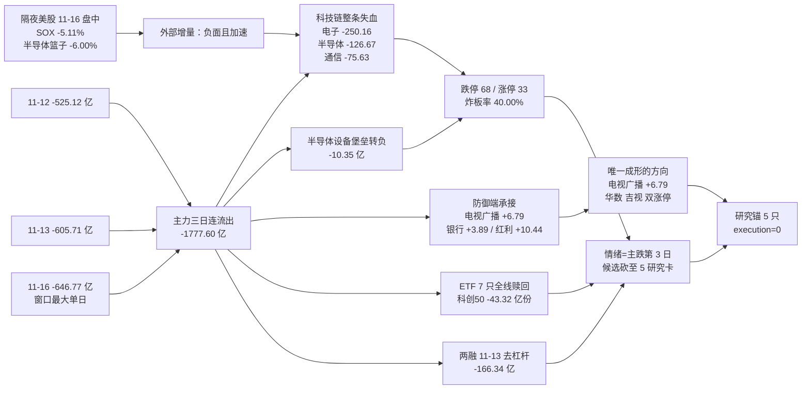

# 2026 年 11 月 17 日 · **资金面**

> **数据源新鲜度**: partial（A股主力/龙虎榜/涨跌停 ✅ · 两融 ⚠️ 滞后 1 日 · ETF ⚠️ 滞后 1 日 · 美股 ⚠️ 盘中未收盘）
> **降级状态**: true
> **置信度**: 0.75（base_confidence: 0.88 × freshness_factor: 0.90 × source_agreement_factor: 0.95 = 0.75）
> **数据归属**: 20261116 收盘（最新可得交易日，trading_gap=0）

## 一句话结论

11-16 主力 **-646.77 亿**、连续第三个交易日净流出（三日 **-1777.60 亿**，21 日窗口最大单日），跌停 **68** / 涨停 **33**（比 **2.06:1**）、炸板率 **40.00%** 仍在 35% 红线之上 → 情绪 = **主跌第 3 日**。科技链三日单边失血（电子 -250.16 / 半导体 -126.67 / 通信 -75.63 亿），连「最后的资金堡垒」半导体设备都转 -10.35 亿；钱沉向电视广播/交运/白酒/银行红利。**0 只可执行，5 张研究卡**。

## 详细分析

### 一、市场时序：第三根大阴，且是窗口最大单日

| 交易日 | 主力净额（亿） | 超大单 | 大单 | 中单 | 小单 | 沪指 | 深指 | 创业板 | 科创50 |
|---|---|---|---|---|---|---|---|---|---|
| 11-05 | +90.24 | +86.69 | +3.55 | -166.85 | +83.48 | +0.10% | +1.19% | +0.87% | +1.68% |
| 11-06 | **-528.52** | -233.40 | -295.12 | +38.58 | +476.54 | -1.10% | -2.57% | -3.96% | -2.60% |
| 11-09 | +128.82 | +130.88 | -2.06 | -73.84 | -59.40 | +0.32% | -0.27% | -0.27% | +0.30% |
| 11-10 | +173.37 | +122.55 | +50.82 | -122.48 | -52.50 | +0.08% | +0.86% | +1.46% | +0.64% |
| 11-11 | +202.85 | +203.90 | -1.05 | -179.33 | -21.87 | +0.46% | +1.32% | +3.11% | +2.80% |
| 11-12 | **-525.12** | -254.13 | -270.99 | +94.90 | +420.61 | -0.67% | -1.68% | -2.44% | +0.73% |
| 11-13 | **-605.71** | -320.71 | -284.99 | +108.08 | +481.46 | -0.59% | -2.05% | -3.32% | -2.30% |
| **11-16** | **-646.77** | **-366.65** | **-280.12** | **+139.06** | **+496.27** | -0.87% | -2.53% | -4.37% | -5.16% |

| 窗口 | 主力净额（亿） | 读数 |
|---|---|---|
| 单日 11-16 | **-646.77** | 21 日窗口内最大单日流出（前高 11-13 的 -605.71、11-06 的 -528.52） |
| 3 日 | **-1777.60** | -525.12 → -605.71 → -646.77，逐日恶化，无收敛迹象 |
| 5 日 | **-1401.38** | 11-13 时仅 -625.79，两日内再恶化 775.59 亿 |
| 10 日 | -1777.36 | 三日修复（+505.04 亿）已全部被抹掉 |
| 20 日 | **-4120.99** | 仅 **8/20** 天为正 |

**大资金意图**：超大单 + 大单 = **-646.77 亿**，中单 + 小单 = **+635.33 亿**，两侧几乎完全对冲 —— 这是 11-12 那根 -525.12 亿的**加速版派发**。与前一日比，超大单流出扩大 45.94 亿、小单接盘增加 14.81 亿 → **派发在加速而不是收敛**。更关键的是「谁在接」：11-12 接盘主力还是半导体（+23.53 亿），11-13 连科创50 都转跌 -2.30%，11-16 科创50 -5.16% 连续第二日超跌 —— **换手方自己也没了**，没有板块在承接，价格只能单边寻底。

**为什么走弱**：11-09/10/11 三日 +505.04 亿的载体是光模块·CPO·PCB·AI 应用四条链，11-16 这四条链被整条卖出。指数与个股同步下杀（创业板 -4.37%、科创50 -5.16%），**没有一个板块在托指数** → 这是无方向的普跌，不是「某条链塌了、别的链接力」。

**逻辑够不够硬**：够硬。四个独立源同向共振 —— ①主力 -646.77 亿连跌三日；②广度 20.39% + 跌停 68 + 炸板率 40.00%（≥35% 硬红线）；③ETF 份额 7 只全线净赎回（科创50ETF -43.32 亿份，滞后一日但方向一致）；④两融 11-13 三所口径单日 -166.34 亿实质去杠杆。**证伪路径**：若今日早盘广度回到 0.55 以上、跌停收敛到 30 以内、且半导体设备板块资金转正，则 11-16 是恐慌尾盘而非趋势转折（`cycle_position.json` 的修复窗口 tier：连跌 3 日 → 判据为广度 >0.55 / 昨涨停红盘率 >60% / 板块级涨停潮 ≥3 只）。**注意**：连跌次日的修复是历史同口径样本，不是概率模型，不构成开仓许可。

### 二、板块：卖科技、买防御，但防御不是主线

| 板块（行业） | 11-16 净额（亿） | 5 日（亿） | 20 日（亿） | 当日涨幅 | 5 日正日 |
|---|---|---|---|---|---|
| 电视广播 | **+6.79** | +9.86 | — | **+2.19%** | 3/5 |
| 铁路公路 | **+6.06** | +5.13 | -5.34 | +0.93% | 2/5 |
| 白酒 | **+5.69** | +0.68 | +2.00 | +0.87% | 2/5 |
| 银行 | **+3.89** | **+19.14** | -35.25 | — | — |
| 电子 | **-250.16** | -294.85 | -794.78 | -5.16% | 2/5 |
| 半导体 | **-126.67** | -61.05 | -157.20 | -5.99% | 3/5 |
| 数字芯片设计 | **-76.34** | -68.43 | -91.49 | -6.12% | 2/5 |
| 通信 | **-75.63** | -78.78 | -400.19 | -4.27% | 2/5 |
| 通信设备 | **-71.28** | -71.91 | -382.13 | -4.81% | 2/5 |
| 元件 | **-65.47** | — | — | — | — |
| 印制电路板 | **-56.99** | -91.07 | -350.31 | — | — |

**概念端**：红利破净股 +10.44 / 超级品牌 +8.58 / 红利股 +8.19 / 证金持股 +6.29 进钱；融资融券 **-605.55**（5 日 -1250.62）/ 基金减仓 -440.50 / MSCI中国 -401.43 / 深股通 -350.28 / 富时罗素 -324.29 出钱。

**大资金意图**：概念端两条极端同时出现 —— 流入端全是低波红利，流出端是**融资融券 -605.55 亿（全场最大流出概念）**、外资被动指数通道（深股通/MSCI/富时）集体缩量。两者叠加说明：**杠杆盘主动降仓 + 机构资金往低波资产搬家**，风险偏好型资金在系统性减仓，避险型资金在被动配置。「昨日高振幅」概念 -272.44 亿，说明前一日的强势票正在被系统性兑现（与昨日前十延续率 3/22 互证）。

**为什么走强**：银行 20 日仍是 -35.25 亿，这是它连续第 3 日靠「避险需求」进钱、而非超跌反弹；红利破净/红利股/证金持股/超级品牌四个概念高度重叠，买的是**同一个逻辑：低波 + 高股息 + 低估值**。这是资产配置属性的临时停靠站，不是题材。

**逻辑够不够硬**：硬，但是**反向的硬** —— 防御端的硬证据完全依附于「科技链被卖」这个前提，一旦科技链止跌，防御端的钱会立刻回去。所以防御方向**不能当主线做**（纪律 §2：跟随资金，但要看资金是不是有承接的合力）。

**唯一成形的板块级方向是电视广播**：+6.79 亿、板块涨幅 +2.19%、**双涨停**（华数传媒 + 吉视传媒）、北巴传媒 +10.12% → 全场唯一「板块资金净流入 + 板块内多股涨停」双确认的方向。⚠️ 但成色不足：吉视传媒流通市值仅 103 亿、20 日位置 93.0%、近 5 日已 +23.33%；华数传媒机构净卖 -0.13 亿；湖北广电主力 +3.49% 却龙虎榜 -0.58 亿。**是防御性题材承接，不是新主线**。

### 三、昨日前十 5 日追踪：延续率 3/22 = 13.6%，本轮最直接的证伪

22 只昨日前十卡片（继承自 `data/research/20261116/R7_capital_flow_20261116.json`）追踪结果：

| 判定 | 家数 | 代表 |
|---|---|---|
| 延续（净流入为正且续正） | **3** | 百亚股份 +4.69→+3.69、北方华创 +3.12→+5.09、亚玛顿 +0.03→+0.32 |
| 反手转正 | 1 | 吉视传媒 -4.76→+4.48 |
| 反手转负 | 4 | 华胜天成 +10.78→-6.14、文投控股 +5.39→-6.32、华虹宏力 +1.71→-2.11、长川科技 +4.82→-2.86 |
| 双负 | **14** | 深南电路、寒武纪、新易盛、沪电股份、源杰科技、通富微电、襄阳轴承、景旺电子、蓝色光标、摩尔线程、粤芯半导体、工业富联、剑桥科技、长芯博创 |

延续率 **3/22 = 13.6%**，比 11-13 的 20%（3/15）更低。

**大资金意图**：3/22 的延续率说明**上一版的资金判断几乎没有兑现** —— 前一日被记为「资金在进」的 22 只票里，19 只今天主力口径转负。这不是「资金变卦」，而是**杀跌环境下昨天的净流入本身就是接盘**，一天就反转。

**为什么走弱**：最值得注意的反例是**亚玛顿** —— 主力仍为正（+0.32 亿）却封死跌停 -9.98% → 「主力净额为正」在杀跌末端**不等于安全**，可能是小单接盘被记入主力口径；反过来沪电股份主力 -5.18 亿却获 8 席位净买 +4.57 亿。**两个口径打架时，必须回到龙虎榜逐席位看是谁在买**。

**逻辑够不够硬**：够硬，且这是本报告最锋利的一刀 —— 延续率是唯一无法被「结构切换」解释的指标，它直接度量「昨天看到的资金是不是真的钱」。**证伪路径**：若今日收盘后延续率回升到 8/22 以上，说明 11-16 的杀跌是一次性流动性冲击而非资金结构转变；若继续低于 5/22，则昨日的「科技链资金堡垒」判断应直接作废。

### 四、龙虎榜：诱多识别五类形态全部命中

口径说明：`top_inst` 席位行按 `(ts_code, 原因, exalter, buy, sell)` 去重，**1d（单日榜）与 3d（连续三日累计榜）分列，两口径不可相加**；3 日席位协同只累加单日榜（跨日窗口互不重叠）。**自检：去重后全席位净额与 `top_list.net_amount` 逐行 70/70 完全相等，差额 0.0000 亿**（若退回 `(ts_code, caliber)` 错误主键，将有 37/70 行错配）。本节每行标注单日（1d）或 3 日累计（3d）。

诱多识别五类形态，共 **70 条**：

| 形态 | 条数 | 关键样本 |
|---|---|---|
| 涨停但龙虎榜净卖 | 3 | 岳阳兴长（2 板、10 次开板、-0.65 亿）、文投控股（2 板、**-3.55 亿全场净卖第一**）、北纬科技（4 板、-0.88 亿、机构 0） |
| 反复开板烂板 | 43 | 岳阳兴长 10 次、亚玛顿 14 次、文投控股 8 次、国统 5 次 |
| 重挫日大额净卖 | 5 | 杰普特 -1.50（**机构 -4.10 亿，全场最大单席净卖**）、麦格米特 -1.70（机构 -0.45）、禾元生物 -1.28 |
| 机构净卖但股价大涨（核心诱多） | 8 | 华数传媒 +10.05% 而机构 -0.13、凯撒文化（2 板、机构 -0.25）、北巴传媒 +10.12% 机构 -0.12、冰山冷热 +6.49% 机构 -0.83 |
| 席位净买但股价收跌 | 11 | 分两类，方向相反不可混读 |

**席位净买但股价收跌（11 条）必须分两类读**：
- **跌停板接刀型**：沪电股份 +4.57 收 -10.00%、杰华特 +2.34 收 -16.98%、襄阳轴承 +1.02 收 -9.97%、东山精密（+0.22 但机构 **-3.60 亿**）→ **明日反包候选**；
- **高位拉高出货型**：辰奕智能、流金科技、和林微纳、贝特利（当日 -6.85%、5 日 -1.20 亿 1/5 正、两融 5 日 -24.43%）→ **明日补跌候选**。

**大资金意图**：机构专用席位 3 日整体是**净卖**方向（单日榜内机构 -8.52 亿级派发），而净买方是**沪股通专用（3 日 +5.96 亿，3/3 日全正）+ 三个游资席位**（国泰海通长宁区江苏路 +2.01 3/3 正、华鑫上海徐汇瑞平路 +1.96 3/3 正、东方财富山南香曲东路 +1.90 3/3 正）→ **机构在撤，游资与外资在跌停潮里接刀**。

**为什么走强/走弱**：涨停但净卖（文投控股 -3.55 亿）+ 反复开板（43 条）+ 机构净卖但股价大涨（8 条）三组同时命中，说明**封板的资金质量极差** —— 涨停是资金推的、席位是卖出的，典型「拉高派发」结构。

**逻辑够不够硬**：硬。诱多识别用了三个独立维度（席位净额 / 机构分族 / 开板次数）交叉，且东财 `get_dragon_tiger` 独立通道 10 票金额逐项一致、沪电股份逐席位复核（机构 4 买 3 卖净 +2.68 亿、深股通净 +1.89 亿，合计 +4.57 亿与 tushare 分族加成完全相等）。**证伪路径**：若明日文投控股/岳阳兴长等炸板股集体反包且席位转净买，则「拉高派发」判断错误 —— 但这需要配合情绪反转，单日反包不足为凭。

### 五、隔夜美股：科技链的负面外部增量，且在加速

US 11-16 **盘中**（距收盘约 30 分钟，未收盘）：SOX 半导体指数 **-5.11%**、半导体篮子 **-6.00%**（MU -7.54 / INTC -7.06 / MRVL -6.95 / GLW -6.89 / TSM -6.27 / AMD -5.58 / NVDA -4.42 / AVGO -4.20）、光模块篮子 -5.95%、大型科技篮子 -2.36%；纳指 -2.52%、SPX -2.01%、道指 -1.52%。

**大资金意图**：11-13 时美股半导体还只是 -3.84%，11-16 扩大到 -6.00%，且**从开盘就单边下行** —— 这是主动减仓而非尾盘跳水。

**为什么走强**：道指仅 -1.52%、远优于纳指 -2.52% → 防御在美股同样有映射，**这次 A 股的防御轮动有外部逻辑支撑**，不再是 11-13 那种纯本土自救。

**逻辑够不够硬**：硬，但方向对 A 股科技链是负面增量。关键在于**亚太已先行反应**：台股 -6.03%、韩综 -3.59%、日经 -2.42%，只有恒指 +0.49% 逆势 → 亚太已经历一轮同步杀跌，**A 股 11-17 属于「补跌末段」而非「第一反应」**，理论上跌幅应小于台韩。**这既是利空也是缓冲** —— 隔夜环境对科技链是负面增量（且加速），对红利/银行/消费中性偏正面。

### 六、ETF 与两融：两个独立通道确认「无增量资金」

**两融（11-13 三所齐全口径）**：融资余额 **22571.97 亿**（SSE 11692.64 + SZSE 10805.20 + BSE 74.14），单日 **-166.34 亿**、5 日 +22.58 亿 → **11-13 是实质性去杠杆日，不是持平**。⚠️ 上一版（20261116）按 SSE-only 口径报的 -86.72 亿 / 5 日 +4.27 亿 **已作废**（当日数据源仅返回 SSE 一行，构成 partial-deposit 伪影；本版复核发现 SZSE/BSE 已回补，改回三所合计）。**最大数据缺口**：11-16 三日杀跌是否触发强平，本报告无法验证（T+1 未披露）。

**ETF 份额（最新只到 11-13）**：7 只**全线净赎回** —— 科创50ETF -43.32 亿份（-4.02%）、沪深300ETF -10.17、中证500ETF -9.54、半导体ETF -3.56、光伏ETF -2.34、创业板ETF -1.72、黄金ETF -0.40。**连续两版读数相同 → 数据未更新而非结论一致**，本条只能作为 11-13 的配置盘底稿，不作为 11-17 的增量证据。

**逻辑够不够硬**：三层同向撤退成立（主力 -646.77 亿 + 融资融券概念 -605.55 亿 + ETF 全线赎回），但**后两层各滞后一个交易日**，只能确认「11-13 时配置盘已在撤」，不能证明「11-16 仍在撤」。

### 七、候选卡：5 只研究、0 只可执行

按炸板率 ≥35% 硬红线与主跌阶段判定，候选砍至 **5 张研究卡**，全部 `research_only=true` / `execution_eligible=false`。**R7 不授开仓权，硬否决权归 R6。**

| 票 | 定位 | 收盘/涨幅 | 主力(今日/5日/20日) | 止损距 | RR5/RR20 | 闸门判定 |
|---|---|---|---|---|---|---|
| 300604 长川科技 | 低位前排·半导体设备 | 170.35 / -10.11% | -2.86 / +6.70 / -8.66 | **-9.60%** | **2.27 / 2.56** | ✅ 技术面过线（4/4） |
| 003006 百亚股份 | 低位前排·消费防御 | 21.79 / -0.73% | +3.69 / +19.41 / +68.68 | -4.04% | 2.25 / 3.63 | ❌ 止损带过窄 |
| 002463 沪电股份 | 龙头·PCB/载板 | 73.98 / -10.00% | -5.18 / -1.63 / -37.87 | -2.54% | 11.75 / 23.68 | ❌ 止损过窄 + 资金未确认 |
| 002371 北方华创 | 龙头·半导体设备 | 546.39 / -1.20% | +5.09 / +12.37 / +18.87 | -11.92% | 0.61 / 0.65 | ❌ 止损超区间 + RR<2 |
| 601929 吉视传媒 | 低位首板·电视广播 | 2.96 / +10.04% | +4.48 / +6.22 / +6.51 | -25.68% | 0.09 / 0.09 | ❌ 追高即违规 |

#### 300604 长川科技 —— 全场唯一 4/4 闸门过线，但过线 ≠ 可买

- **买入理由**：①**唯一 4 闸门全过线票**——止损距 -9.60% 落在 -5~-10% 硬区间内、RR5 2.27、RR20 2.56、5 日主力 +6.70 亿（4/5 正），在 40 只候选中是唯一完整过线的标的；②位置干净：20 日位置仅 **28.1%**、距 20 日高 -19.7%、5 日涨幅 -4.13%，是「跌出来的低位」而非高位回落；③主力净额曲线 +0.66 → +2.88 → +1.20 → +4.82 是逐日抬升，5 日里 4 天为正；④半导体设备 5 日 +27.87 亿曾是科技链唯一资金堡垒（它贡献 6.70 亿），链级资金与个股资金同向。
- **风险点**：①**当日 -10.11%**（几乎跌停）且主力转负 -2.86 亿、净流入率 -5.68% → 5 日的正流入正在被单日消耗；②**板块当日 -10.35 亿 = 资金堡垒今日开始松动**，这是全报告最需要盯的结构性变化；③两融 5 日 **-3.95%**，杠杆在撤；④隔夜美股半导体 -6.00% 同向压制，外部增量尚未消退；⑤未上龙虎榜，无法验证席位性质。
- **止损条件**：**收盘跌破 154.00 元**（10 日低点，即 -9.60% 风险带下沿）无条件离场；若开盘 30 分钟内不能收复当日收盘价 170.35 且分时均价下穿，视为跌停板二次打开，放弃当日低吸计划。
- **可验证假设**：**24-72h 内可证伪** —— 若 11-17 早盘半导体设备板块不再扩大跌幅（板块净额转正或跌幅收敛到 -3% 以内）且本票收复 170.35 站稳，则「资金堡垒松动」证伪、可进 D1 候选池；若板块继续净流出 >10 亿且本票低开不能收复 170.35，则「5 日资金流入只是抄底而非配置」成立，**放弃该票**。
- **为什么走强**：位置（20 日 28.1% 低位、5 日仅 -4.13% 未透支）+ 板块（5 日 +27.87 亿链级资金）+ 筹码（5 日 4/5 主力为正、无龙虎榜出货证据）。

#### 003006 百亚股份 —— 资金面最干净的票，但风险带过窄

- **买入理由**：①**全场唯一 5/5 全正资金票**，5 日主力 +19.41 亿、20 日 +68.68 亿，且连续 5 天递增（+3.07 → +3.85 → +4.11 → +4.69 → +3.69）；②东财独立通道复核 11-16 main **+3.69 亿与 tushare 完全一致**，净流入率 40.55%（极高）；③20 日位置仅 21.6%、距 20 日高 -12.77%，位置低且涨幅未透支；④它是防御轮动里唯一还在持续加钱的非金融标的 —— 在银行/红利之外属于「消费必选」独立避险分支。
- **风险点**：①**止损距 -4.04% 窄于 5% 硬下限**、RR5 2.25 虽过 2 但止损带过窄 → **闸门不过线**；②PE 93.09，估值不便宜；③当日 -0.73% 是**价平钱进**（主力 +3.69 亿但股价微跌），承接方在被打压中接货，不是主动拉升；④换手率 9.76% 偏高，短线资金成分重；⑤无两融数据（margin_detail 空），杠杆维度是盲区；⑥流通市值仅 93.39 亿，小盘股在普跌日流动性风险更高。
- **止损条件**：**收盘跌破 20.91 元**（10 日低点）离场；由于止损带本身窄于纪律下限，**若开盘跳空低于 21.95 且 15 分钟内不能回到分时均价之上，直接放弃**（不追、不摊）。
- **可验证假设**：**24-72h** —— 若 11-17 主力净额继续为正（连续第 6 天）且股价站上 21.95，说明防御端消费分支在被持续配置；若主力转为净流出，则「资金连续流入」证伪，降级剔除。
- **为什么走强**：位置（20 日 21.6% 低位）+ 防御属性（必选消费）+ 筹码（5/5 全正、无一日净流出）。

#### 002463 沪电股份 —— 全场最重要的反证票，不授开仓资格

- **买入理由**：①**龙虎榜单日净买 +4.57 亿，全场第一**，其中机构专用 **+2.68 亿**、深股通 +1.89 亿（东财 `get_dragon_tiger` 逐席位复核与 tushare 分族加成完全相等）；②**20 日位置仅 4.1%**、距 20 日高 -37.57%，PE 21.28 是候选池中最低；③大宗交易 30 日 6 笔共 1.79 亿，有产业资本在场；④PCB 板块 20 日 -350.31 亿的极端出清后，它是该链龙虎榜唯一有机构背书的标的。
- **风险点**：①**封死跌停 -10.00%、9 次开板**，且主力口径仍 -5.18 亿、净流入率 -8.04%、5 日仅 2/5 正 → **龙虎榜 8 个席位在跌停板上接刀 ≠ 资金转正**，是「被接走的票」不是「反转的票」；②止损距 **-2.54%** 远窄于 5% 硬下限 → 闸门不过线；③PCB 板块当日 -56.99 亿、5 日 -91.07 亿，**没有板块底座**，个股再强也是单点；④两融 5 日 -1.96%；⑤若今日不能反包，这 4.57 亿就是新的套牢盘。
- **止损条件**：**不设止损——因闸门不过线（止损带 -2.54% 远窄于硬下限），本票不进入任何执行池**。仅在 D1 需要 PCB 龙头情绪参考时作为「反包温度计」跟踪；若 D1 强行纳入，则以**收盘跌破 72.10 元**（10 日低点）为唯一硬条件，且必须在次日给出独立的位置与赔率复核。
- **可验证假设**：**24-72h** —— 若 11-17 PCB 板块出现 ≥2 只涨停且本票反包收复 73.98，说明「跌停板接刀」是反转前兆，重新评估；若次日继续低开、席位承接盘转为卖出，则接刀资金转为套牢盘，**永久剔除**。
- **为什么走强**：位置（20 日 4.1% 极低位）+ 筹码（机构 +2.68 亿、深股通 +1.89 亿在跌停板上承接）+ 估值（PE 21.28）—— 但三者都被「主力口径仍为负 + 板块无底座」抵消，故只给研究锚。

#### 002371 北方华创 —— 科技链唯一还在进钱的龙头，但闸门不过线

- **买入理由**：①**科技链唯一逆势进钱龙头**：11-16 主力 **+5.09 亿**、净流入率 +8.45%，在板块 -5.99% 的绿盘里逆势吸筹，且东财独立通道复核一致；②5 日 +12.37 亿（4/5 正）、20 日 +18.87 亿，是候选池中唯一 5 日与 20 日**同时为正且当日也正**的科技票；③板块 5 日 +27.87 亿仍为正，链级资金未撤完；④曲线 -1.23 → +0.09 → +5.30 → +3.12 → +5.09 逐日抬升且近两日加速。
- **风险点**：①**两融 5 日 -13.44%（全场最大）** —— 杠杆资金在这只票上大举撤退，与主力净流入方向**相反**，这是最需警惕的背离；②止损距 **-11.92% 超 -10% 硬区间**、RR5 0.61 → 闸门不过线；③20 日位置 64.7% 偏高、PE 68.77；④它是科技链 beta，隔夜美股半导体 -6.00% 对它直接生效；⑤半导体设备板块当日已转 -10.35 亿，链级资金今日开始松动。
- **止损条件**：**收盘跌破 481.25 元**（10 日低点）离场；若两融余额在 11-17 继续以 >5%/日 的速度下降，**即使价格未破位也主动降级**（杠杆撤退领先于价格）。
- **可验证假设**：**24-72h** —— 若 11-17 半导体设备板块出现 ≥3 只涨停（板块级涨停潮判据）且本票主力继续净流入，则「价平钱进」升级为板块合力，进入 D1 候选；若板块继续无涨停潮或两融加速流出，则该子链的「钱进」只是抄底而非配置，降级为拦截。
- **为什么走强**：位置（20 日 -4.66% 未破位、5 日 +0.29% 未透支）+ 板块（5 日 +27.87 亿）+ 筹码（主力 4/5 正、两融在撤说明散户杠杆在出而主力在进 → 筹码换手给大资金）。

#### 601929 吉视传媒 —— 板块情绪温度计，追高即违规

- **买入理由**：①**唯一「涨停 + 主力净流入 + 龙虎榜净买 + 板块进钱」四确认首板**：涨停 10.04%、**0 次开板**（封板质量全场最好）、封单 1.37 亿、主力 +4.48 亿（东财复核一致）、龙虎榜 +2.14 亿；②所属电视广播是全场唯一「板块资金净流入 + 板块内多股涨停」双确认方向（+6.79 亿、板块 +2.19%），华数传媒同步涨停形成板块合力；③净流入率 30.28%，两融 5 日 +7.35%（与北方华创相反，杠杆在配合）。
- **风险点**：①**20 日位置 93.0%**、近 5 日涨幅 +23.33%、20 日涨幅 +23.85%、距 20 日高仅 -2.31% → **追高即违规**；②止损距 **-25.68%**、RR5/RR20 双 **0.09** → 闸门严重不过线；③**机构专用 0.00 完全缺席**，纯游资封板无机构背书，股通仅 +0.36；④流通市值仅 103.3 亿、板块整体体量小，接力资金容量有限；⑤其 5 日曲线 +0.65 → -0.07 → +5.92 → -4.76 → +4.48 波动剧烈，一日游特征明显。
- **止损条件**：**不设止损——因闸门不过线（RR5 0.09、止损带 -25.68% 远超硬区间），本票不进入任何执行池**。仅作为电视广播/影视线情绪温度计跟踪；其明日溢价决定传媒线是真切换还是一日游。
- **可验证假设**：**24-72h** —— 若 11-17 电视广播板块继续有 ≥2 只涨停且本票溢价率为正，则传媒线是真切换、板块级方向成立；若次日炸板或溢价率为负，则一日游剧本确认，**永久剔除**。
- **为什么走强**：位置（板块 20 日资金净流入 +9.86 亿）+ 资金（主力 +4.48 亿、净流入率 30.28%）+ 筹码（0 次开板、封单 1.37 亿、机构缺席=纯游资锁筹）—— 但位置已到 93%，赔率彻底失衡。

**其余 11 只被剔除的候选及理由**（40 只评估池 → 29 只卡片 → 5 只研究卡）：

| 票 | 剔除理由 |
|---|---|
| 002148 北纬科技 | 4 板最高板 +10.06%，但主力 -1.22 亿、龙虎榜 -0.88 亿（机构 0.00）、7 次开板、近 5 日 +50.34% → 典型烂板诱多 |
| 002187 / 002205 | 3 板但主力 +0.26 / -0.09 亿、5 或 6 次开板、20 日位置 100%、RR5 0.00 → 封板不靠资金 |
| 000595 / 000819 / 002425 / 002685 | 2 板但主力 +0.44 / -0.15 / -0.34 / -0.04 亿，龙虎榜 +0.02 / -0.65 / +0.23（机构 -0.25）→ 封板无大资金、机构派发 |
| 002548 / 301583 / 301697 / 301052 | 龙虎榜或机构净买为正，但 5 日主力 -0.19 / -1.20 / +0.15 亿、两融 5 日 -8.02% ~ -24.43% → **资金未确认** |

### 八、观察池与拦截（24 只）

| 定位 | 票 | 关键读数 |
|---|---|---|
| 总龙 / 龙头 | 寒武纪、新易盛、沪电股份、深南电路、北方华创、长江电力、蓝色光标 | 寒武纪今日 -8.01 亿、5 日仍 +10.57 亿；新易盛今日 -11.00 亿、5 日 -4.97 亿；工业富联 -13.79 亿、5 日 -35.48 亿 |
| 龙二 / 龙三 | 文投控股、剑桥科技、景旺电子、通富微电、襄阳轴承、华虹宏力、儒意电影 | 文投控股 +10.00% 但主力 -6.32 亿、龙虎榜 -3.55 亿 → 涨停净卖，拦截；儒意电影 +2.26 亿 / 5 日 +5.90 亿 → 影视线唯一有资金承接的 |
| 低位前排 | 长川科技、长芯博创、华数传媒、慈文传媒、源杰科技、盛科通信、摩尔线程、粤芯半导体、杰华特、亚玛顿、华胜天成、拓普集团 | 华数传媒 +10.05% 但机构 -0.13 亿（诱多）；拓普集团 +0.44 亿 / 5 日 +5.67 亿 → 机器人链唯一逆势小幅进钱 |

## 关键证据

- 证据 1：主力单日 -646.77 亿，连续第 3 日净流出，三日 -1777.60 亿，为 21 日窗口最大单日 · 来源 tushare.moneyflow_dc（21 日 × 6033 只/日）
- 证据 2：跌停 68 / 涨停 33 / 炸板率 40.00%，涨跌停口径以 tushare.stk_limit 交易所当日限价为准（官方 limit_list_d 明示不提供 ST 股票统计，官方 D=60 需补 8 只）· 来源 tushare.stk_limit + daily + tencent 复核
- 证据 3：龙虎榜去重后全席位净额与 `top_list.net_amount` 逐行 70/70 相等、差额 0.0000 亿 · 来源 tushare.top_list/top_inst + eastmoney get_dragon_tiger
- 证据 4：半导体设备 5 日 +27.87 亿（科技链唯一资金堡垒）今日转 -10.35 亿 · 来源 tushare.moneyflow_ind_dc 行业 496 × 21 日
- 证据 5：两融 11-13 三所口径单日 -166.34 亿（实质去杠杆），SSE-only 旧口径 -86.72 亿作废 · 来源 tushare.margin（21 日）
- 证据 6：隔夜 US 11-16 盘中 SOX -5.11%、半导体篮子 -6.00%、纳指 -2.52%，台股 -6.03% 先行 · 来源 yahoo 独立通道（session 未收盘）
- 证据 7：机构专用席位 3 日净卖、沪股通专用 +5.96 亿（3/3 全正）· 来源 tushare.top_inst 单日榜去重聚合

## 数据源审计

| 源 | 日期 | 状态 | 备注 |
|---|---|:--:|---|
| tushare/moneyflow_dc | 2026-11-16 | 🟢 | 21 个交易日 × 6033 只/日 · 126644 行 · 东财主力口径 |
| tushare/moneyflow_ind_dc | 2026-11-16 | 🟢 | 行业 496 + 概念 554 × 21 日 · 22540 行 |
| tushare/stk_limit（权威限价） | 2026-11-16 | 🟢 | 5656 行 · 交易所当日 up/down_limit · 涨跌停口径唯一权威 |
| tushare/limit_list_d | 2026-11-16 | 🟡 | 官方 U32/D60/Z16 · **明示不提供 ST 股票统计** → 已用 stk_limit 补录 8 跌停 + 1 涨停 |
| tushare/top_list + top_inst | 2026-11-16 | 🟢 | 70 条榜单 / 698 条席位行 · reason 分桶去重后 **70/70 对齐** |
| tushare/margin | 2026-11-13 | 🟡 | T+1 未披露 11-16 → 滞后 1 日 · 11-13 三所齐全（22571.97 亿） |
| tushare/fund_share | 2026-11-13 | 🟡 | T+1 未落库 11-16 → 滞后 1 日 · 7 只 ETF 全线净赎回 |
| tushare/us_daily + index_global | 2026-11-13 | 🟡 | 快照内 us_stocks 仍为 11-13 档 → 已改用 yahoo 独立通道补 11-16 |
| yahoo/US 盘中档 | 2026-11-16 | 🟡 | 18 只 + 4 指数 · **session 未收盘**（盘中值，差约 30 分钟） |
| tushare/daily + daily_basic | 2026-11-16 | 🟢 | 5572 只 · 广度与涨跌停反推底表 |
| tushare/block_trade + margin_detail | 2026-11-16 | 🟢 | 全市场大宗 + 40 票 30 日 / 逐票两融 |
| eastmoney/vibe get_dragon_tiger | 2026-11-16 | 🟢 | 68 appearance · 10 票金额两源完全一致 · 沪电逐席位复核 |
| eastmoney/vibe get_fund_flow | 2026-11-16 | 🟢 | 8 票主力净额 · 与 tushare 逐票差额 0.00 亿 |
| tencent/行情复核 | 2026-11-16 | 🟢 | 8 只补录跌停 close==low 全部成立 |
| tushare/股指期货基差 | — | 🔴 | 无数据源（fut_daily 权限）· 留空不编造 |
| tushare/期权隐波 | — | 🔴 | 无数据源（50ETF 近月未覆盖）· 留空不编造 |
| data/raw/20261117/manifest | — | 🔴 | pipeline 前置未生成 → manifest severity 不可读，confidence 无 severity 硬上限 |

## 不确定性 / 反证

- **本报告不授开仓权**：execution_candidates 为空，全部 5 张卡片与 24 只观察票 research_only=true / execution_eligible=false。硬否决权归 R6，R7 只给资金侧约束。
- **本版修正了首版一个 P0 口径缺陷，结论方向不变但表述必须改**：首版用「当前名称含 ST → 5%」猜档位反推涨跌停，叠加 `limit_list_d` 官方「不提供 ST 股票统计」，导致漏记 4 只 ST 跌停（*ST美丽/*ST皇庭/*ST启环/*ST瑞茂，当日实为 10% 档）、多记 1 只非跌停（*ST宝馨 002514，当日 down_limit=1.79 而实收 1.89）、漏记 1 只封死涨停（ST交昂 600530）。**修正后炸板率由 33.33% 升为 40.00%** → 「炸板率首次降到 35% 红线以下，是三日里唯一边际改善项」这句**作废**；正确读数是「仍在红线上且较前一日微升」。跌停由 65 修正为 68，跌停/涨停由 2.03:1 修正为 2.06:1。情绪判定（主跌第 3 日）**不变**。
- **三源交叉仍有 5 只分歧未消**：xtick `limit_board` 给出的 11-16 跌停为 63 只，比权威口径 68 少 5 只（000010 / 002384 / 600665 / 601086 / 601208）。这 5 只经 tushare stk_limit 交易所限价 + tencent 独立行情通道复核，close==low==down_limit 全部成立，判定为 xtick 侧漏收而非本口径多计；本报告采信 stk_limit。
- **对「主跌是否接近尾声」的对冲**：本报告证据偏空（四个独立源同向），但反面证据是 —— 成交额从 11-12 的 19458.7 亿缩到 16670.7 亿再缩到 14941.6 亿（**缩量下跌**，恐慌性抛售在减弱）；最高板维持 4 板仍有活口；银行连续第 3 日进钱、5 日 +19.14 亿；涨停/跌停比从 11-13 的 0.97 回升到 0.49 但炸板率反而升到 40%。**缩量 + 有 4 板 + 防御端连续进钱**支持「杀跌接近尾声」，而**主力三日加速流出 + 炸板率 40% + 科技链堡垒松动**支持「尚未见底」。本报告拒绝单边结论，把两种情景的判据交给 D1 在早盘三判据现场裁决。
- **两融数据的结构性缺口**：11-16 未披露，三日杀跌是否触发强平无法验证 —— 这是今日最大的数据缺口，也是「缩量下跌究竟是抛压衰减还是没人接」无法定论的根本原因。
- **隔夜美股是盘中值**：US 11-16 session 在抓取时距收盘约 30 分钟，SOX -5.11% 等数值收盘前仍可能变动；收盘后的最终读数可能加剧或缓解外部压力。
- **涨跌停口径的历史一致性缺口**：11-13 及更早的 limit_list_d 同样不含 ST 票，本报告已对 6 个交易日（11-09~11-16）全部用 stk_limit 重算，**但更早的历史产物未回溯**（超出 write whitelist）。
- **本次未覆盖**：R2 主线未就绪（07:30 并行跑），候选池为自建 40 只、非 R2 继承；R4 消息面未消费，故无催化剂维度。

## 与其他 R/D/E 的关系

- 依赖：`data/research/20261116/R7_capital_flow_20261116.json`（昨日前十 22 只卡片追踪源）· `data/research/20261117/cycle_position.json`（修复窗口 tier 与三判据）· `data/raw/20261116/overseas_snapshot.json`（最新可得快照，内档已滞后 → 改用 yahoo 实时档）
- 被消费：`main_force.top_inflow_sectors` / `top_outflow_sectors`（R2 验证主线资金配合）· `hot_money.distribution_alerts`（R5 筹码维度 / R6 反证）· `main_force.yesterday_top10_5d_tracking` + `today_top10_5d_tracking`（D1 资金确认与续接判定）· `overseas_core_stocks`（D1 外部传导）· `etf_futures.margin` + `etf_net_flow`（D1 仓位上限与增量资金判断）· `coverage.limit_audit` + `data_health.caliber_corrections`（D1/R6 复核板型与口径）

## Sub-Agent 元数据

- skill: analyze_capital_flow_v1
- artifact: data/research/20261117/R7_capital_flow_20261117.json + data/research/20261117/R7_capital_flow.json
- 中间数据: data/research/20261117/_work/（226 文件，含 limit_final.json 权威涨跌停底稿）
- 生成耗时: N 秒
- model: MiniMax-M3.1-Flash
