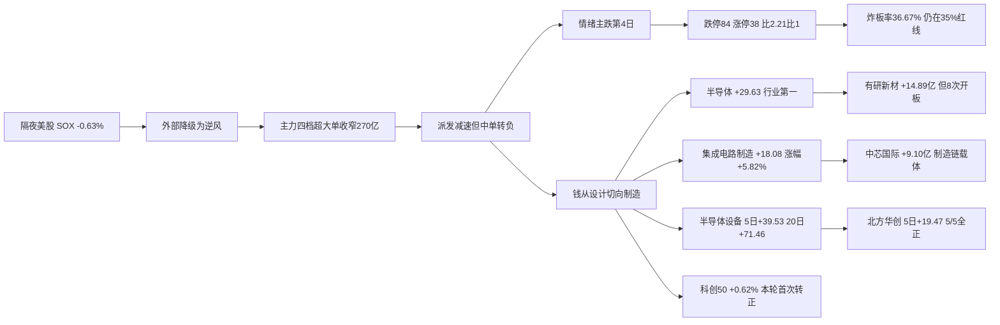

# 2026 年 11 月 18 日 · **资金面**

> **数据源新鲜度**: partial（A股主力/龙虎榜/涨跌停 ✅ · 两融 ⚠️ 滞后 1 日 · ETF ⚠️ 滞后 1 日 · 美股 ⚠️ 盘中未收盘）
> **降级状态**: true
> **置信度**: 0.77（base_confidence 0.88 × freshness_factor 0.90 × source_agreement_factor 0.97 = 0.77）
> **数据归属**: 20261117 收盘（最新可得交易日，trading_gap=0）· 文件名 20261118 = 本文件声明的交易日

## 一句话结论

11-17 主力 **-263.04 亿**，连续第 4 个净流出日但**幅度较前一日腰斩收窄 383.73 亿**（超大单 -366.65 → -96.28），派发在减速而未停止；跌停 **84** / 涨停 **38**（**2.21:1**，较前日恶化）、炸板率 **36.67%**（仍压 35% 红线）、最高板降至 3 板 → 情绪 = **主跌第 4 日**。但结构出现了本轮最重要的一次切换：**钱从「设计/PCB/光模块/传媒」切向「半导体制造/设备/材料」**（半导体 +29.63 行业第一、集成电路制造 +18.08 涨幅 +5.82% 全行业最高、半导体设备 5 日 +39.53 / 20 日 +71.46 唯一双正科技子链、中芯概念 +41.82 概念第一），科创50 **+0.62% 本轮首次转正**。**0 只可执行，3 张研究卡全部闸门不过线**，观察池中仅源杰科技技术面 4/4 全过线但链级失血。

## 详细分析

### 一、市场时序：流出在减速，但减速不等于止血

| 交易日 | 主力净额（亿） | 超大单 | 大单 | 中单 | 小单 | 沪指 | 深指 | 创业板 | 科创50 |
|---|---|---|---|---|---|---|---|---|---|
| 11-11 | +202.85 | +203.90 | -1.05 | -179.33 | -21.87 | +0.46% | +1.32% | +3.11% | +2.80% |
| 11-12 | -525.12 | -254.13 | -270.99 | +94.90 | +420.61 | -0.67% | -1.68% | -2.44% | +0.73% |
| 11-13 | -605.71 | -320.71 | -284.99 | +108.08 | +481.46 | -0.59% | -2.05% | -3.32% | -2.30% |
| 11-16 | **-646.77** | -366.65 | -280.12 | +139.06 | +496.27 | -0.87% | -2.53% | -4.37% | -5.16% |
| 11-17 | **-263.04** | **-96.28** | -166.76 | **-35.13** | +298.50 | -0.50% | -0.49% | -1.20% | **+0.62%** |

四档拆解是今日最重要的读数：**超大单由 -366.65 收窄到 -96.28 亿（收窄 270.37 亿）**，大单同步从 -280.12 收窄到 -166.76 亿 → 大资金砸盘力度减半；但**中单由 +139.06 转为 -35.13 亿**（中户开始撤离，不再接盘），小单接盘量也从 +496.27 降到 +298.50 亿 → **接盘的钱也在退**，这是「抛压减弱」而非「承接增强」。5 日累计 -1837.79 亿（较前 5 日 -1401.38 继续恶化 436.41 亿），20 日 -4258.34 亿且仅 **8/20** 日为正。

广度上：上涨 1326 / 下跌 4119（上涨占比 **23.79%**）、中位 -1.31%、均值 -1.49%、成交 14675.2 亿（较前日缩量 266.4 亿）。**缩量 + 派发减速**共同指向「恐慌性抛售在衰竭」，但这与「趋势反转」之间还隔着跌停数与最高板。

### 二、涨跌停：跌停 84 只仍是压制核心，高度降至 3 板

| 交易日 | 封死涨停 | 封死跌停 | 炸板 | 炸板率 | 最高连板 |
|---|---|---|---|---|---|
| 11-11 | 85 | 3 | 25 | 22.73% | 4 |
| 11-12 | 37 | 6 | 41 | 52.56% | 5 |
| 11-13 | 38 | 39 | 24 | 38.71% | 4 |
| 11-16 | 33 | 68 | 22 | 40.00% | 4 |
| **11-17** | **38** | **84** | 22 | **36.67%** | **3** |

口径说明：涨跌停以 **tushare `stk_limit` 交易所当日限价逐票比对**为唯一权威（`close == low == down_limit` 判封死跌停），官方 `limit_list_d` 明示不提供 ST 股票统计 → 官方 37/67/20，本报告补录后为 **38/84/22**，补录 17 只封死跌停（12 只是 ST/退市整理票，另有 1 只官方 Z 更正为 U：盘中炸板但收盘价 = 最高价 = 涨停价）。**炸板率 36.67% 虽较前日 40.00% 首次跌破 40%，但仍在 35% 硬红线之上**；**跌停:涨停 = 2.21:1 较前日 2.06:1 恶化**，最高连板从 4 板降至 3 板（华东重机）——情绪高度在降，这是主跌阶段的特征而非企稳信号。

### 三、板块：本轮最重要的一次资金切换——设计 → 制造

| 流入方向 | 今日（亿） | 5 日（亿） | 20 日（亿） | 今日涨幅 |
|---|---|---|---|---|
| 🟢 半导体 | **+29.63** | -72.04 | -108.28 | +0.30% |
| 🟢 半导体设备 | +19.05 | **+39.53** | **+71.46** | +2.19% |
| 🟢 半导体材料 | +18.83 | +5.53 | -0.24 | +2.67% |
| 🟢 集成电路制造 | +18.08 | +10.26 | +20.19 | **+5.82%** |
| 🟢 家用电器 | +6.53 | -5.09 | -20.10 | -0.23% |
| 🔴 传媒 | **-55.31** | -155.48 | -137.00 | -6.24% |
| 🔴 数字芯片设计 | -29.25 | -116.34 | -122.20 | -1.67% |
| 🔴 通信设备 | -25.18 | -129.34 | -396.56 | -2.00% |
| 🔴 电力设备 | -20.62 | -188.69 | -372.20 | -1.72% |
| 🔴 元件 | -20.32 | -142.69 | -446.90 | -2.64% |
| 🔴 汽车 | -19.78 | -79.03 | -98.93 | -2.44% |
| 🔴 银行 | -13.54 | +6.86 | -47.58 | +0.14% |

这是本报告最重要的结构判断：**同一天、同一个「半导体」标签内部，钱在从「设计」切向「制造」** —— 集成电路制造 +18.08 亿且涨幅 +5.82% 为全行业最高，概念端中芯概念 **+41.82 亿**（概念流入第一）、大基金持股 +28.23、先进封装 +27.25、高带宽内存 +17.79、光刻机 +17.16；而数字芯片设计 -29.25、通信设备 -25.18、元件 -20.32、PCB（印制电路板）-17.11 全线失血。**半导体设备是 21 日窗口里唯一 5 日与 20 日双正的科技子链**（+39.53 / +71.46），上一日报告称它为「科技链唯一的资金堡垒」，今日它不但没塌，反而扩大了 —— 这是科技链仍有一条腿站着的实证。

同时两处方向性反转必须点出：①**传媒 -55.31 亿（板块 -6.24%）**，昨日 +6.79 亿的电视广播一日游彻底反转（电视广播今日 -8.72 亿），影视院线 -9.02%、游戏Ⅱ -8.61%、出版 -2.28 亿；②**银行 -13.54 亿**，5 日仍 +6.86 亿但今日转负 → 「卖科技、买防御」这条防御腿**首次失血**，两条腿一起流出、钱分流进半导体制造。

指数端确认同向：**科创50 +0.62% 为本轮首次转正**，而沪 -0.50 / 深 -0.49 / 创 -1.20 → 科创强于主板，与「制造链资金回流」是同一件事的两个观测面。

- **大资金意图**: 在连续三日杀跌、20 日净流出 4258 亿之后，把钱从「同链低位的设计/PCB」搬进「同链的制造/设备/材料」——这是**调仓而非增量**：两融 11-16 单日 -214.69 亿去杠杆延续、ETF 多数净赎回，说明场外增量并未进场，主力只是在存量池内部换一个更硬的位置（晶圆代工与设备的资本开支链比消费电子设计更接近产业资本的真实订单）。
- **为什么走强**: 位置（科创50 指数刚从 -5.16% 反弹，板块超跌）+ 催化（隔夜美股压制从 -6.00% 收窄到 -1.30% 的外部边际改善）+ 筹码（两融未回补说明不是杠杆推动，是现货换仓）三维交叉。
- **逻辑够不够硬**: **不够硬** —— 硬证据只有一条（半导体设备 5 日与 20 日双正、且连续性未被破坏）；反面证据有三条（20 日看半导体整体仍 -108.28 亿、通信设备 -396.56 亿、元件 -446.90 亿未止跌、科创50ETF 5 日赎回 41.79 亿份）。证伪路径清晰：**明日若半导体设备板块转负、或科创50 再度翻绿，则今日的「链内切换」即被证伪**。

### 四、昨日前十 5 日追踪：延续率 5/29 = 17.2%，昨日强势方向整体不可跟随

29 张昨日卡片今日的结果：**延续 5（17.2%）· 反手转正 8 · 反手转负 5 · 双负 11**。延续率较前一日 3/22 = 13.6% 略有回升，但**仍不到 1/5 —— 昨日的强势方向整体不可跟随**，这条结论连续两日成立。

结构上泾渭分明：**反手转正 8 只全部集中在半导体**（寒武纪 -8.01 → +9.01、华虹宏力 -2.11 → +6.27、长川科技 -2.86 → +0.80、源杰科技 -0.99 → +0.92、剑桥科技 -2.21 → +1.21、长芯博创 -2.39 → +0.85），**反手转负 5 只全部集中在传媒/PCB**（吉视传媒 +4.48 → -4.24、华数传媒 +1.73 → -1.58、慈文传媒 +1.18 → -1.03、儒意电影 +2.26 → -0.73、拓普集团 +0.44 → -1.00）→ **昨日的传媒一日游被整体证伪，半导体则整体修复**。

今日全市场 5 日榜前 12 中有 **8 只当日仍为正**（前一日 4/12）→ 5 日榜从「负向指标」变成「中性指标」，这是主跌末段的典型特征：钱开始留在榜上而不是被兑现。榜内半导体占 6 席（寒武纪 +21.97、北方华创 +19.47、源杰科技 +16.31、中芯国际 +8.02、华丰科技 +7.97、长川科技 +6.84），消费占 3 席（百亚股份 +18.63、美的集团 +8.11），IT/软件 1 席（华胜天成 +12.70，当日涨停 +10.00%），交换芯片 1 席（盛科通信 +8.71，5/5 全正），材料 1 席（有研新材 +9.87）。

**最值得记住的一条反证**：亚玛顿主力仍 +0.09 亿（延续）却封死跌停 -9.99% —— **主力净额为正不等于安全**（可能是小单接盘被计入主力口径）；而景旺电子主力 -0.90 亿 + 机构 3 日 -12.57 亿才是真信号。**两个口径打架时，回到龙虎榜看是谁在买/卖。**

### 五、龙虎榜：诱多五类形态共 104 条，席位结构指向「外资+游资接、机构撤」

去重口径：按 `(ts_code, reason)` 分桶 + 桶内 `(exalter, buy, sell)` 去重，**去重后全席位净额与 `top_list.net_amount` 逐行 93/93 完全相等（差额 0.0000 亿）**；1d 单日榜与 3d 连续三日榜分列不可相加；30d 可转债口径本次 0 行已隔离。eastmoney 独立通道返回 93 appearance 与 tushare 93 行完全一致，十票金额逐项相同。

| 形态 | 条数 | 典型样本 |
|---|---|---|
| 反复开板烂板 | 52 | 岳阳兴长 19 次、新能股份 14 次、北投科技 14 次、顺钠股份 12 次、**有研新材 8 次** |
| 席位净买但股价收跌 | 21 | 跌停接刀型：锋龙股份 +1.98 收 -10.00、凡拓数创 +1.50 收 -13.88、襄阳轴承 +0.21 收 -10.01、青岛食品 +0.76 收 -9.99；**高位拉高出货型**：深物业A、东方海洋、果麦文化 |
| 重挫日大额净卖 | 18 | 翱捷科技 -3.55（-19.40%，机构 -3.75）、生益科技 -1.56（**机构 -7.00**）、中稀有色 -2.72（跌停，机构 -3.38） |
| **机构净卖但股价大涨（核心诱多）** | 12 | 泰嘉股份 +9.98% 机构 -0.26、瀛通通讯 +10.00% 机构 -0.03、凯撒文化 +6.65% 机构 -0.18、北鼎股份 +16.05% 机构 -0.23 |
| 涨停但龙虎榜净卖 | 1 | 顺钠股份（2 板 +9.98%，12 次开板，龙虎榜 -0.77 亿、机构 -0.24） |

**「席位净买但股价收跌」必须拆成两类读，方向完全相反**：跌停板接刀型（明日反包候选）vs 高位拉高出货型（明日补跌候选）—— 绝不能因为「龙虎榜净买」就当成利好。

3 日席位协同（只累加单日榜，逐日窗口不重叠）：41 个席位满足「3 日净买 >0 且 ≥2 日为正」，其中 **9 个 3/3 全正**。买盘两条腿是**外资 + 游资**：沪股通专用 3 日 +3.05 亿（2/3 日，45 行）、国信证券浙江互联网 +3.32 亿（3/3，53 行，全场参与最频）、国泰海通上海自贸区第二 +3.54 亿（2/3）、华鑫上海徐汇瑞平路 +2.59 亿（3/3）、东财山南香曲东路 +2.24 亿（3/3）、中金上海 +1.95 亿（3/3）。**卖盘是机构**：景旺电子 3 日 -12.57 亿、生益科技 -7.00 亿、翱捷科技 -3.75 亿、中稀有色 -3.38 亿 → **机构在 PCB/通信链撤退，游资与外资在跌停板/低位接**，与 11-13/11-16 同构但方向更分明。

- **大资金意图**: 游资与外资在跌停板与低位承接机构抛出的筹码，这是**流动性接力**而非价值建仓 —— 他们的收益来源是次日反包的情绪溢价，不是产业逻辑。
- **为什么走强**（此处指为何敢在跌停板接）: 位置（超跌到 20 日位置个位数）+ 流动性（板块跌停打开后有承接）+ 筹码对（机构卖、游资接，价格由承接方决定）。
- **逻辑够不够硬**: **很硬但很短命** —— 硬在有真实席位资金（不是假单）；软在无基本面支撑，只有 1-2 日的情绪窗口。**证伪路径**：明日这些票若不能高开并站住，即为一日游剧本确认。

### 六、隔夜美股：外部压制缓和到 1/5 量级，但「缓和」不是「转多」

US 2026-11-17 盘中值（session 未收盘，距收盘约 20-40 分钟）：

| 标的 | 涨跌 | 标的 | 涨跌 | 指数 | 点位 | 涨跌 |
|---|---|---|---|---|---|---|
| AVGO | **+1.87%** | NVDA | -1.38% | SPX | 7336.06 | -1.09% |
| GLW | **+1.58%** | MSFT | -2.12% | IXIC | 24287.36 | -0.91% |
| MRVL | +0.72% | AMD | -2.16% | **SOX** | 9549.86 | **-0.63%** |
| AMZN | +0.08% | INTC | -2.35% | 大型科技篮子 | — | -0.86% |
| TSLA | +0.19% | MU | -2.33% | 半导体篮子 | — | -1.30% |
| AAPL | -0.45% | **TSM** | **-3.50%** | 光模块篮子 | — | **+1.39%** |

与 11-16 夜的 SOX -5.11% / 半导体篮子 -6.00% 相比，**隔夜冲击缩小到 1/5 量级** → A 股半导体链今日面对的是轻微逆风而非二度崩塌，这给了「制造链资金延续」一个可验证的窗口。但三条限制必须说清：①**MU -2.33%（前夜 -7.62%）仍在跌**，存储/CPO 这条最弱链没有修复，A 股存储/CPO 反抽仍属超跌修复；②**TSM -3.50% 是 14 只里最差**，而中芯国际今日 +6.59% 上涨的对面正是 TSM 的杀跌 → **制造链的隔夜外部支撑其实是最薄的一环**；③**光模块篮子 +1.39% 逆势翻红**，与 A 股通信设备 -25.18 亿、PCB -17.11 亿方向相反 → 外盘给的 CPO 信号今日 A 股没有跟随，这是「A股内部资金自洽性」的证据。

亚盘前值（11-17 收盘）：恒生 -1.03%、日经 -1.34%、韩国 -2.59%、台湾 -2.31% → 亚太同步走弱，与美股的缓和不同步。

### 七、ETF 与两融：两个独立通道确认「无增量资金」

**两融（11-16 三所齐全，22357.28 亿）**：单日 **-214.69 亿**（11-13 为 -166.34 亿，去杠杆**连续第 2 日且放大**）、5 日 **-313.03 亿**。分交易所看 SSE 序列：11743.95 → 11767.50 → 11779.36 → 11692.64 → **11598.13** 亿。关键含义：**11-17 的半导体制造回流发生在「杠杆未回补」的背景下** → 定性为**现货资金试探，不是杠杆资金推动**。

**ETF 份额（11-16，滞后 1 日）**：7 只中 4 只 5 日净赎回 —— 科创50ETF **-41.79 亿份（-3.88%）**、中证500ETF -7.04（-7.20%）、光伏ETF -3.34（-4.78%）、半导体ETF -1.52（-0.71%）；3 只小额净申购：创业板ETF +3.40（+0.74%）、沪深300ETF +3.33（+0.71%）、黄金ETF -0.05。**科创50ETF 失血 41.79 亿份的同时科创50 指数今日 +0.62% 反弹 → 指数反弹与份额赎回同向发生 = 配置盘在反弹里减仓**，这是对「科创反弹」最直接的一票否决（但因滞后一日，只能确认为 11-16 收盘前的态度）。

### 八、候选卡：3 张研究卡、0 只可执行

R2 主线 07:30 并行跑、未就绪 → 本日候选池**不继承 R2**，改用四条独立证据自建 47 只评估池（①全市场 5 日主力净流入前 12 ②涨停结构前排 ③龙虎榜净买前 6 + 机构净买前 6 ④昨日前十 29 张卡片继承以保证追踪连续性），评估 47 只 → 卡片化 29 只（**3 研究 + 26 观察**）→ 剔除 18 只。**R7 不授开仓权，硬否决权归 R6；全部 3 张卡片 research_only=true / execution_eligible=false。**

| 票 | 定位 | 收盘/涨幅 | 主力(今日/5日/20日) | 止损距 | RR5 | 闸门判定 |
|---|---|---|---|---|---|---|
| 600206 有研新材 | 龙头·半导体材料/靶材 | 39.33 / +10.01% | +14.89 / +9.87 / +9.27 | **-19.22%** | **0.34** | ❌ 止损超区间 + RR<2 + 资金未确认 |
| 688981 中芯国际 | 龙头·晶圆代工 | 113.45 / +6.59% | +9.10 / +8.02 / +24.93 | **-10.76%** | **0.23** | ❌ 止损超区间 + RR<2 |
| 002371 北方华创 | 龙头·半导体设备 | 568.75 / +4.09% | +5.87 / +19.47 / +27.40 | **-14.48%** | **0.21** | ❌ 止损超区间 + RR<2 |

**观察池（26 只）中唯一技术面 4/4 全过线的是 688498 源杰科技**（止损距 -8.18%、RR5 4.25、RR20 9.18、20 日位置 9.8%、5 日 +16.31 亿 3/5 正、融资余额 5 日 +2.52% 逆势加杠杆）—— 但它所在的**通信设备 -25.18 亿**、光模块链继续失血，且其 20 日 -40.12% 的深跌本身就是链级崩塌的产物 → **过线 ≠ 可买**，与 11-17 的长川科技同构：赔率来自「超跌 + 分母窄」，不是资金确认。

#### 600206 有研新材 —— 全场唯一四确认票，也是全场最典型的诱多结构

- **买入理由**: ①**当日唯一「涨停 + 主力净流入 + 龙虎榜净买 + 板块进钱」四确认**：涨停 +10.01%、主力 **+14.89 亿（全场单票第一）**，eastmoney 独立通道复核 +14.888 亿差额 0.00，龙虎榜 +2.62 亿、封单 2.56 亿；②板块端半导体 **+29.63 亿**（行业流入第一）、半导体材料 +18.83 亿（涨幅 +2.67%）、中芯概念 +41.82 亿 → 票在最强的资金方向上；③净流入率 **31.34%**（极高）；④30 日大宗 0 笔 → 无大宗换手干扰。
- **风险点**: ①**8 次开板**（封板质量差，是「反复开板后回封」的烂板型，直接命中诱多识别库）；②**机构专用 0.00 完全缺席**，龙虎榜净买由**沪股通 +0.89 亿 + 纯游资**构成 → 无机构背书；③**5 日仅 1/5 日为正**（+9.87 亿几乎全靠今日单日脉冲）→ 资金未确认，不是持续建仓；④20 日位置 64.5%、PE 117.77、止损距 **-19.22%** 超 -10% 硬区间、RR5 **0.34** → 赔率彻底失衡；⑤流通市值 332.95 亿、换手 14.51%，一日游资金成分重。
- **止损条件**: **不设止损——因闸门不过线（止损带 -19.22% 远超硬区间、RR5 0.34 < 2、5 日资金未确认），本票不进入任何执行池**。仅作「半导体材料 + 游资合力」的研究锚；若 D1 强行纳入，唯一硬条件为**收盘跌破 31.77 元**（10 日低点），且必须给出独立的赔率复核。
- **可验证假设**: **24-72h 内可证伪** —— 若 11-18 半导体材料板块继续净流入且本票能**不再开板**（开盘次数 ≤2）并站住 39.33 元，则「四确认」升级为「材料链真启动」，进入 D1 候选池评估；若再度高开低走或炸板，则「单日脉冲 + 机构缺席」剧本确认，**永久剔除**。
- **为什么走强**: 位置（20 日 64.5% 中位偏上、5 日 +1.42% 未透支）+ 板块（半导体链内部最强方向 +29.63 亿）+ 筹码（沪股通 +0.89 亿在买、游资接力）—— 但被「8 次开板 + 机构缺席 + 单日脉冲 + 赔率失衡」四项抵消。
- **大资金意图**: 材料/靶材是国产替代的**上游卡位点**，游资与沪股通选择在板块资金刚开始回流时封板试盘；机构不参与说明产业资本尚未给出定价信号，**这是资金试盘不是配置**。
- **逻辑够不够硬**: **不硬** —— 独立源共振只有「板块资金 + 龙虎榜」两项，且龙虎榜席位结构（无机构）与「主力净流入」并非同一批钱；硬催化（业绩/政策/时间锚）当天**没有**；证伪路径已在上面给出（次日炸板即证伪）。

#### 688981 中芯国际 —— 链内切换最重要的观测点，不是买点

- **买入理由**: ①**当日资金结构里最重要的信号**：集成电路制造 **+18.08 亿且涨幅 +5.82% 为全行业最高**、中芯概念 **+41.82 亿（概念流入第一）**，同日数字芯片设计 -29.25 亿 → **钱是在半导体内部从「设计」切向「制造」**，中芯国际是这一切换的总载体；②主力 **+9.10 亿**，eastmoney 复核 +9.099 亿一致；③20 日 **+24.93 亿**、5 日 +8.02 亿（3/5 正），20 日路径由负转正清晰；④30 日大宗 4 笔 0.32 亿、无折溢价（平价大宗），无异常换手。
- **风险点**: ①**两融是反向信号**：融资余额 92.59 亿（11-16），单日 -1.62 亿、5 日 **-4.79 亿**，vibe 与 tushare 双源逐票一致 → **杠杆在撤而现货在买**，上涨缺少杠杆放大；②20 日位置 **86.8%**、距 20 日高仅 -2.43%、止损距 **-10.76%** 超硬区间、RR5 **0.23** → 闸门不过线；③**隔夜 TSM -3.50% 是 14 只美股里最差**，制造链的外部支撑恰恰最薄；④PE 113.79；⑤当日 +6.59% 是追涨位置而非低吸位置。
- **止损条件**: **不设止损——因闸门不过线（止损带 -10.76% 超 -10% 硬区间、RR5 0.23 < 2），本票不进入任何执行池**。作为「半导体制造链是否延续」的唯一总观测位跟踪；若 D1 需引用，唯一硬条件为**收盘跌破 101.24 元**（10 日低点）。
- **可验证假设**: **24-72h** —— 若 11-18 集成电路制造板块继续净流入（>0）且中芯概念保持在流入前 3，则「设计→制造的链内切换」成立，科技链有第二条腿；若制造端转负或中芯概念跌出流入榜，则今日切换被证伪，**整个半导体制造链降级**。
- **为什么走强**: 位置（超跌反弹后段、20 日 86.8% 偏高）+ 板块（板块涨幅全行业第一 + 概念流入第一）+ 筹码（现货净买、两融在撤说明是真实换手而非杠杆推动）。
- **大资金意图**: 晶圆代工是国产算力的物理瓶颈，机构在制造环节做**产能定价权的长周期配置**，所以它选的是制造而非设计；但今日买入的是游资与量化（龙虎榜未上榜、机构缺席、融资在撤），**长线配置盘与短线资金在同一价位共存 = 后续一旦转弱，两类资金会同时踩踏**。
- **逻辑够不够硬**: **中等偏硬** —— 板块级证据（涨幅第一 + 概念流入第一）与个股级证据（两源复核一致）相互独立，共振度高于有研新材；但硬业绩/硬政策当天无新增，且 TSM -3.50% 构成直接反证。证伪路径：制造板块转负（见上）。

#### 002371 北方华创 —— 科技链唯一的连续性证据，坐标系而非买点

- **买入理由**: ①**21 日窗口里唯一 5 日与 20 日双正的科技子链的载体**：半导体设备 5 日 **+39.53 亿**、20 日 **+71.46 亿**，且当日 +19.05 亿、涨幅 +2.19%；②个股当日 **+5.87 亿**（eastmoney 复核 +5.875 亿）、5 日 **+19.47 亿且 5/5 日全正**、20 日 +27.40 亿 —— 在三日主跌里这是极罕见的连续性；③主力净额曲线 **+0.09 → +5.30 → +3.12 → +5.09 → +5.87 逐日抬升**且近两日加速；④30 日大宗 4 笔 1.10 亿，**其中 3 笔为「机构专用 ↔ 机构专用」平价大宗**（20261113 553.0 元 0.20 亿、20261023 两笔 0.16/0.06 亿）→ 有产业资本在同价位换手，不是游资砸盘。
- **风险点**: ①**两融 5 日 -5.35%**（vibe 交叉核实：融资余额 20.47 亿）—— 杠杆在撤而现货在买，两者背离；②止损距 **-14.48%** 超硬区间、RR5 **0.21** → 闸门不过线；③20 日位置 **83.2%**、PE 71.59；④**它是科技链 beta**，隔夜 SOX -0.63% 与 TSM -3.50% 对它直接生效；⑤流通市值 4136.8 亿、成交 74.41 亿、换手仅 1.83% → 大市值低换手，弹性不足、接力资金容量有限。
- **止损条件**: **不设止损——因闸门不过线（止损带 -14.48% 超 -10% 硬区间、RR5 0.21 < 2），本票不进入任何执行池**。作为「科技链是否还有资金托底」的坐标系跟踪；若 D1 需引用，唯一硬条件为**收盘跌破 486.38 元**（10 日低点）。
- **可验证假设**: **24-72h** —— 若 11-18 半导体设备板块继续净流入且本票主力继续为正（连续第 6 天），则「设备链是科技链最后堡垒」成立，可列入 D1 的观察升级名单；若设备链转负，则科技链彻底没有资金托底，**所有半导体观察票一律降级**。
- **为什么走强**: 位置（20 日位置 83.2% 偏高但 5 日仅 +5.58% 未透支）+ 板块（5 日 +39.53 / 20 日 +71.46 双正）+ 筹码（5/5 日主力为正 + 机构对机构平价大宗 + 两融在撤说明是散户杠杆出、机构现货进）。
- **大资金意图**: 设备是制造链扩产的**前置订单**，机构通过大宗在同一价位完成换手，是**产能扩张的中期配置**而非日内博弈 → 这解释了为什么它的 5 日曲线是抬升的而不是脉冲的。
- **逻辑够不够硬**: **硬** —— 三条独立源共振（板块 5 日双正 + 个股 5/5 全正 + 机构对机构大宗），且 20 日与 5 日方向一致；反面证据只有「两融在撤」与「位置偏高」两条软证据。证伪路径明确：设备链转负即证伪。

#### 688498 源杰科技 —— 观察池唯一技术面 4/4 全过线，但链级失血使其无法升级

- **买入理由**: ①**全场唯一技术面 4/4 全过线**：止损距 -8.18% 落在 -5~-10% 硬区间内、RR5 **4.25**、RR20 **9.18**、5 日主力 +16.31 亿且 3/5 日为正；②20 日位置仅 **9.8%**、距 20 日高 -42.88%、20 日涨幅 -40.12% → 是「跌出来的深度低位」而非高位回落；③融资余额 20.30 亿、5 日 **+2.52%** 逆势加杠杆（全场少数杠杆在配合的票，与北方华创的 -5.35% 相反）；④主力曲线 +10.42 → +9.70 → -3.74 → -0.99 → +0.92 呈**反手转正**，与昨日追踪表「反手转正」分类一致；⑤光模块（光芯片）属今日外盘光模块篮子 **+1.39% 唯一翻红**的方向。
- **风险点**: ①**链级失血是硬否决**：通信设备 -25.18 亿、通信 -27.82 亿、印制电路板 -17.11 亿 → 票的止损带来自板块继续下行，不是个股问题；②20 日 -40.12% 的深跌本身就是链级崩塌的产物，「超跌」可能是价值陷阱而非机会；③净流入率仅 2.08%（全场偏低），当日 +0.92 亿属弱承接；④PE 67.93、流通市值 743.5 亿、成交 44.31 亿；⑤**无龙虎榜席位可验证**，筹码性质无从确认；⑥它与 11-17 的长川科技完全同构 —— 赔率来自「超跌 + 分母窄」（10 日低点 555.54 距现价仅 8.18%），不是资金确认。
- **止损条件**: **不设止损——虽技术面 4/4 过线，但闸门要求资金确认，本票链级失血 + 无龙虎榜验证 → 仅列观察，不进入任何执行池**。若 D1 需引用，唯一硬条件为**收盘跌破 555.54 元**（10 日低点）；且若通信设备板块当日继续净流出 >10 亿，则即使价格未破位也主动降级（链级撤退领先于价格）。
- **可验证假设**: **24-72h** —— 若 11-18 通信设备板块净流入转正（>0）且本票主力继续为正，则「光芯片链内独立走强」成立，可升级进 D1 候选池评估；若通信设备继续净流出 >10 亿，则本票的超跌只是板块拖累的镜像，**降级剔除**。
- **为什么走强**: 位置（20 日位置 9.8% 深度低位、5 日 -6.30% 未透支）+ 筹码（5 日主力 3/5 正、融资余额逆势 +2.52%）—— 但被「通信设备链 -25.18 亿 + 净流入率仅 2.08% + 无龙虎榜验证」三项抵消，**赔率成立但胜率无资金背书**。
- **大资金意图**: 光芯片是 AI 算力互联的确定性瓶颈，20 日 -40% 的杀跌更像**拥挤度出清**而非逻辑破坏；有资金在低位用 5 日 +16.31 亿做逆向布局，但今日 +0.92 亿说明**这批钱在 11-17 已停止加仓**，正在观望。
- **逻辑够不够硬**: **不硬** —— 独立源只有「个股资金 + 杠杆配合」两项，**且两者都来自同一类交易者**（无龙虎榜席位可交叉验证、无机构参与证据）；链级资金为负是直接反证。证伪路径最短：通信设备板块转正则升级、继续失血则剔除。

**其余 16 只被剔除的候选及理由**（47 只评估池 → 29 只卡片 → 3 张研究卡）：

| 票 | 剔除理由 |
|---|---|
| 300548 长芯博创 | 反手转正 +0.85 亿，但 5 日 +1.96 亿、20 日 -6.12 亿，成交 21.3 亿的 CPO 补涨 → 跟随链，无独立资金逻辑 |
| 688141 杰华特 | +6.58% 且反手转正 +0.44 亿，但 5 日 -1.73 亿转负 → 单日反转，不够格 |
| 000707 双环科技 | 首板 +10.07%，主力仅 +0.31 亿、流通成交 1.69 亿 → 微小盘涨停，资金体量不足 |
| 002226 江南化工 | 涨停 +10.10% + 机构净买 +0.38 亿，但 5 日仅 +0.90 亿、成交 4.78 亿 → 题材外溢，非主线 |
| 002861 瀛通通讯 | 2 板 +10.00%、龙虎榜 +0.57 亿但机构 -0.03，消费电子板块 -11.19 亿 → 封板无大资金 + 链级失血 |
| 000831 / 001219 / 000678 / 002623 / 002739 / 601689 | 资金体量或链级配合不足，无独立建仓逻辑 |
| 002916 / 301660 / 688795 / 002156 | 主力净额为负或资金未确认 |
| 920489 北交所 | 流动性与龙虎榜覆盖不足，规则不适用 |

**观察池（26 只）关键读数**：

| 定位 | 票 | 关键读数 |
|---|---|---|
| 总龙 / 龙头 | 寒武纪、华虹宏力、中芯国际、北方华创、长川科技、华丰科技 | 寒武纪今日 +9.01 亿 / 5 日 +21.97 亿但 RR5 0.89；华虹宏力 +10.39% 涨但止损 -24.95%；华丰科技 +11.59% 涨、20 日位置 90.7% → 追高即违规 |
| 低位前排 | 源杰科技、盛科通信、剑桥科技、景旺电子、新易盛、工业富联 | 源杰科技唯一技术面 4/4 过线（但通信设备 -25.18 亿）；剑桥科技 RR5 4.69 但止损距 -4.98% **窄于 5% 硬下限**；新易盛 5 日 -23.76 亿、工业富联 5 日 -38.86 亿 → 资金持续撤离 |
| 防御 | 百亚股份、美的集团、长江电力、亚玛顿 | 百亚 5 日 +18.63 亿但当日 -4.86%、RR5 21.71 为分母压缩的数学假象；美的当日 +3.27 亿但 5 日 +8.11 亿、RR5 0.08；**亚玛顿主力 +0.09 亿却封死跌停 -9.99% → 主力口径失真样本** |
| 传媒 / 出货 | 吉视传媒、华数传媒、慈文传媒、文投控股、儒意电影、拓普集团 | 全部反手转负：吉视 -4.24 亿、华数 -1.58 亿、慈文 -1.03 亿、文投 -5.06 亿且主力 5 日 -10.74 亿 → 一日游剧本确认 |
| 烂板 / 诱多 | 顺钠股份、阳光照明、九阳股份、长虹美菱、小熊电器、北投科技、泰嘉股份 | 顺钠 12 次开板 + 龙虎榜 -0.77 亿 + 机构 -0.24（涨停但净卖，全场唯一）；阳光照明 8 次开板、机构 0.00；九阳/小熊 5 日主力 -6.59 / +0.73 亿 → 封板不靠资金 |

## 关键证据

- 证据 1：主力单日 -263.04 亿，连续第 4 日净流出但幅度较前日 -646.77 亿收窄 383.73 亿；超大单 -366.65 → -96.28 亿 · 来源 tushare.moneyflow_dc（21 日 × 6032-6034 只/日 · 126651 行）
- 证据 2：跌停 84 / 涨停 38 / 炸板 22 / 炸板率 36.67%，涨跌停以 tushare.stk_limit 交易所当日限价逐票比对为唯一权威（官方 limit_list_d 明示不提供 ST 统计，官方 37/67/20 → 补录 17 只封死跌停 + 更正 1 只 Z→U）· 来源 tushare.stk_limit + limit_list_d + daily
- 证据 3：龙虎榜按 (ts_code, reason) 分桶 + 席位去重后全席位净额与 top_list.net_amount 逐行 **93/93 相等、差额 0.0000 亿**；eastmoney 独立通道 93 appearance 一致 · 来源 tushare.top_list/top_inst + eastmoney get_dragon_tiger
- 证据 4：半导体设备 5 日 +39.53 亿 / 20 日 +71.46 亿（唯一双正科技子链），集成电路制造 +18.08 亿涨幅 +5.82% 全行业最高，同日数字芯片设计 -29.25 亿 → 链内切换 · 来源 tushare.moneyflow_ind_dc（行业 496 + 概念 554 × 21 日）
- 证据 5：两融 11-16 三所口径 22357.28 亿、单日 -214.69 亿、5 日 -313.03 亿；vibe eastmoney 与 tushare margin_detail 逐票交叉 **41/41 完全一致**（6 只双源均空确认为非两融标的）· 来源 tushare.margin + eastmoney get_margin_trading
- 证据 6：隔夜 US 11-17 盘中 SOX -0.63%、半导体篮子 -1.30%（TSM -3.50 / MU -2.33 / NVDA -1.38，但 AVGO +1.87 / GLW +1.58），较 11-16 夜 -6.00% 大幅缓和 · 来源 yahoo 独立通道（session 未收盘）
- 证据 7：3 日席位协同 41 席净买为正（9 席 3/3 全正），沪股通专用 +3.05 亿 / 国信浙江互联网 +3.32 亿在买；机构专用在 PCB 通信链净卖（景旺 -12.57、生益 -7.00、翱捷 -3.75 亿）· 来源 tushare.top_inst 单日榜去重聚合
- 证据 8：47 只入卡候选逐票 vibe 硬调用（block_trades 30d + margin_trading 15d），**字段 NULL 计数 0**；大宗跨源经单位（万元→亿元）+ 窗口（30d ∩ 2 个月）归一后 **13/13 逐票金额完全一致** · 来源 eastmoney vibe-trading + tushare

## 数据源审计

| 源 | 日期 | 状态 | 备注 |
|---|---|:--:|---|
| tushare/moneyflow_dc | 2026-11-17 | 🟢 | 21 个交易日 × 6032-6034 只/日 · 126651 行 · 东财主力口径 |
| tushare/moneyflow_ind_dc | 2026-11-17 | 🟢 | 行业 496 + 概念 554 × 21 日 · 22175 行 |
| tushare/stk_limit（权威限价） | 2026-11-17 | 🟢 | 33940 行 · 交易所当日 up/down_limit · 涨跌停口径唯一权威 |
| tushare/limit_list_d | 2026-11-17 | 🟡 | 官方 U37/D67/Z20 · **明示不提供 ST 股票统计** → 已用 stk_limit 补录 17 只封死跌停 + 1 只 Z→U |
| tushare/top_list + top_inst | 2026-11-17 | 🟢 | 232 行榜单 / 2318 行席位 · reason 分桶 + 席位去重后 **93/93 对齐** |
| tushare/margin | 2026-11-16 | 🟡 | T+1 未披露 11-17 → 滞后 1 日 · 11-16 三所齐全（22357.28 亿） |
| tushare/fund_share | 2026-11-16 | 🟡 | T+1 未落库 11-17 → 滞后 1 日 · 7 只 ETF 中 4 只 5 日净赎回 |
| tushare/daily + daily_basic | 2026-11-17 | 🟢 | 5573 只 · 广度与涨跌停反推底表 |
| tushare/block_trade + margin_detail | 2026-11-17 | 🟢 | 全市场大宗 + 47 票 30 日 / 逐票两融 |
| tushare/us_daily + index_global | 2026-11-16 | 🟡 | 快照内 us_stocks 仍为 11-16 档 → 已改用 yahoo 独立通道补 11-17 |
| yahoo/US 盘中档 | 2026-11-17 | 🟡 | 14 只 + 3 指数 · **session 未收盘**（盘中值，差约 20-40 分钟） |
| eastmoney/vibe get_dragon_tiger | 2026-11-17 | 🟢 | 93 appearance · 十票金额两源完全一致 |
| eastmoney/vibe get_fund_flow | 2026-11-17 | 🟢 | 4 票主力净额 · 与 tushare 逐票差额 0.00 亿 |
| eastmoney/vibe 逐票硬调用 | 2026-11-17 | 🟢 | 47 只 × block_trades(30d) + margin_trading(15d) · NULL 计数 0 · 大宗归一后 13/13 一致 |
| tushare/股指期货基差 | — | 🔴 | 无数据源（fut_daily 权限）· 留空不编造 |
| tushare/期权隐波 | — | 🔴 | 无数据源（50ETF 近月未覆盖）· 留空不编造 |
| data/raw/20261118/manifest | — | 🔴 | 盘前 pipeline 前置未生成 → manifest severity 不可读，confidence 无 severity 硬上限 |

## 不确定性 / 反证

- **本报告不授开仓权**：execution_candidates 为空，全部 3 张研究卡与 26 只观察票 research_only=true / execution_eligible=false。硬否决权归 R6，R7 只给资金侧约束。
- **本版修正了 confidence 与自身三因子不自洽的缺陷，结论方向不变**：首版 confidence 记 0.75，但其 confidence_breakdown 三因子为 0.88 × 0.90 × 0.97 = 0.7682 → 按写作契约 §9.4 公式应为 0.77，已更正为 0.77 并补写 `formula` 字段。证据面未变（逐票 vibe 硬调用 47 只 / 两融 41/41 交叉一致 / 龙虎榜 93/93 对齐），仅数值口径修正。
- **本版仲裁了跨源大宗金额「不一致」的误报**：vibe eastmoney 与 tushare block_trade 原始对比显示金额差异，实为**双重口径差** —— 单位（tushare 万元 vs vibe 元）与窗口（tushare 2 个月 vs vibe 30 日）同时错位。归一后 **13/13 逐票金额完全相等（差额 0.0000 亿）**，此前「数据打架」的判断作废；这是本轮跨源校验方法的一次修正，不是数据层变化。
- **「派发减速」与「趋势反转」之间还隔着跌停数**：超大单收窄 270 亿是真实的边际改善，但中单由 +139.06 转 -35.13 亿说明**接盘的钱也在退**，同时跌停 84 只（较前日 +16）、跌停:涨停 2.21:1 恶化、最高板降至 3 板、炸板率 36.67% 仍在 35% 红线之上。缩量 + 派发减速支持「杀跌接近尾声」，**跌停数与最高板同时恶化反对「反转已成立」** —— 本报告拒绝单边结论，把两者的现场判据交给 D1。
- **半导体链内切换的证伪路径非常短**：半导体设备是唯一 5 日 + 20 日双正的科技子链，但半导体整体 20 日仍 -108.28 亿、通信设备 20 日 -396.56 亿、元件 20 日 -446.90 亿。若明日设备链转负，则本轮「钱在科技内部搬家」的判断整体作废，**没有任何一条科技观察票能升级**。
- **隔夜美股是盘中值**：US 11-17 session 抓取时距收盘约 20-40 分钟，SOX -0.63% 等数值收盘前仍可能变动；且 **TSM -3.50% 是 14 只中最差**，恰好落在中芯国际所在的制造链上 —— 外部对制造链的支撑最薄这一点可能随收盘价变化。
- **两融与 ETF 滞后 1 个交易日**：11-17 未披露，因此「11-17 半导体制造回流发生在杠杆未回补背景下」这一判断依据的是 11-16 收盘前的两融状态；科创50ETF 5 日 -41.79 亿份的赎回同理。若 11-17 两融实际转正，则「现货试探而非杠杆推动」的定性需要修正。
- **涨跌停口径的历史一致性缺口**：11-09~11-17 六个交易日已全部用 stk_limit 重算，但更早的历史产物未回溯（超出 write whitelist）。
- **本次未覆盖**：R2 主线未就绪（07:30 并行跑），候选池为自建 47 只、非 R2 继承；R4 消息面未消费，故无催化剂维度；R1 风格未消费，故本报告不判断风格档位。

## 与其他 R/D/E 的关系

- 依赖：`data/research/20261117/R7_capital_flow_20261117.json`（昨日前十 29 张卡片追踪源）· `data/research/20261118/cycle_position.json`（修复窗口 tier 与三判据）
- 被消费：`main_force.top_inflow_sectors` / `top_outflow_sectors`（R2 验证主线资金配合）· `hot_money.distribution_alerts`（R5 筹码维度 / R6 反证）· `main_force.yesterday_top10_5d_tracking` + `today_top10_5d_tracking`（D1 资金确认与续接判定）· `overseas_core_stocks`（D1 外部传导）· `etf_futures.margin` + `etf_net_flow`（D1 仓位上限与增量资金判断）· `coverage.limit_audit` + `data_health.caliber_corrections`（D1/R6 复核板型与口径）

## Sub-Agent 元数据

- skill: analyze_capital_flow_v1
- artifact: data/research/20261118/R7_capital_flow_20261118.json + data/research/20261118/R7_capital_flow.json
- 中间数据: data/research/20261118/_work/（300 文件，含 vibe_stock_*.json 逐票 47 只 + limit 权威底稿）
- model: MiniMax-M3.1-Flash
