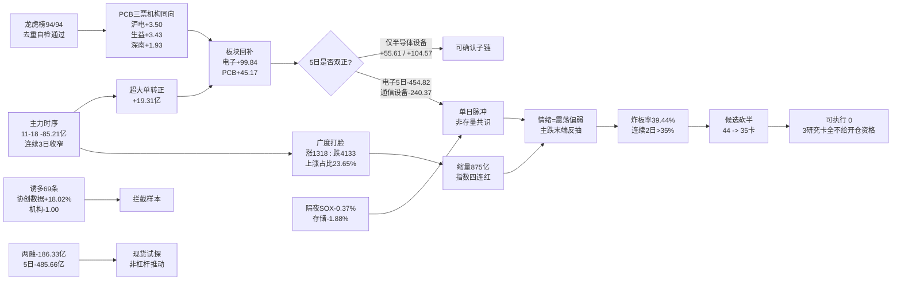

# 2026-11-19 · **资金面**

> **数据源新鲜度**: partial（A股 gap=0 · 两融/ETF gap=1 · 美股盘中）
> **降级状态**: false
> **置信度**: 0.77（base 0.88 × freshness 0.90 × agreement 0.97 = 0.7682 → 0.77）
> **数据归属交易日**: 20261118（trading_gap=0 = 最新可得）

## 一句话结论

主力 -85.21 亿第 5 日流出但连续 3 日收窄（超大单转正 +19.31）；炸板率 39.44% ≥35%、跌停 48 : 涨停 43 = 1.12:1 → 情绪=震荡偏弱（主跌末端反抽）；钱单日回补 PCB 链（元件 +46.38 / PCB +45.17）但 5 日仍深亏，**0 可执行**，3 张研究卡全不给开仓资格。

## 🔍 详细分析

### 一、时序资金流：流出在收尾，但还没到反转

| 窗口 | 主力净额（亿） | 对比前值 | 判读 |
|---|---:|---:|---|
| 当日（11-18） | **-85.21** | 前值 -263.03，摆动 **+177.82** | 连续第 3 日收窄 |
| 5 日 | -2125.84 | 前值 -1837.78 | 仍在恶化区间 |
| 10 日 | -2059.08 | — | 失血未止 |
| 20 日 | -4248.85 | 20 日仅 8 日为正 | 本轮是趋势性流出 |

四档拆解是今日最重要的边际变化：**超大单由 -96.28 转为 +19.31 亿（本轮首次转正）**，大单 -104.52（前值 -166.76）、中单 -59.27（前值 -35.14）、小单 +137.31（前值 +298.50）。含义是**机构单不再砸盘，散户接盘力度减半**——派发进入尾声，但大单仍在走。

不过广度打脸了指数：**上涨 1318 : 下跌 4133（上涨占比 23.65%）、中位数 -1.20%**。指数四连红（沪 +0.09 / 深 +0.20 / 创 +0.85 / 科创50 **+2.20**）却个股普跌，成交 13800.2 亿且**缩量 875 亿**。这是权重与高价科技拉指数、赚钱效应没有跟上的典型形态 → 只能定「反抽」，不能定「反转」。

### 二、板块：单日回补是真，5 日双正是假

今日流入前 8（亿）：电子 +99.84 / 元件 +46.38 / 半导体 +45.53 / 印制电路板 +45.17 / 通信 +35.37 / 通信设备 +24.27 / 计算机 +19.74 / 数字芯片设计 +19.60。
流出前 5：有色 -39.76 / 医药生物 -33.78 / 银行 -26.33 / 传媒 -23.44 / 电力设备 -16.59。

**但 5 日视角只有两个科技子链站稳**：半导体设备（5 日 **+55.61** / 20 日 +104.57）与集成电路制造（+27.20 / +30.33）。电子 5 日仍 **-454.82**、20 日 -754.27；元件 -178.10、通信设备 -240.37。**结论：今日的 PCB 回补是「新增资金试探」，不是「存量共识回补」**——必须看明日能否连续第二日。

值得注意的是资金在**防御端也是流出**（银行 5 日 -16.26 且当日 -26.33、有色 -39.76、医药 -33.78）——钱既不在科技里加仓，也没回防御，是在减仓。传媒连续第二日被杀（-23.44，5 日 -162.79），昨日电视广播的一日游已被反向验证。

**半导体材料是本轮最硬的证伪**：昨日 +18.83 亿的四确认样本有研新材今日**反手转负 -5.86 亿**，股价却仍 +5.82% —— 典型「价涨钱走」，一日游坐实。

### 三、龙虎榜与游资：席位在 PCB 链上加码，但也有明确的出货样本

去重自检：原始 top_list 95 行 / top_inst 950 行，按 `(ts_code, reason)` 分桶 + 桶内 `(exalter, buy, sell)` 去重后，**全席位净额与 top_list.net_amount 逐行 94/94 完全相等（差额 0.0000 亿）**；30d 可转债口径已隔离。1d 与 3d 分列，3 日席位序列只累加单日榜。

**机构净买前 6**：生益电子 +3.43 / 沪电 +3.50 / 深南 +1.93（PCB 三票同向）· 锋龙 +2.09 / 皇台 +1.19 · 冰山冷热 +0.98。
**机构净卖**：协创数据 -1.00（且股通 -1.51）、西陇科学 -0.99、通化金马 -0.77、润建 -0.70。

3 日席位协同（37 个席位满足「3 日净买 >0 且 ≥2 日为正」，其中 6 个 3/3 全正）：开源证券西安太华路 +3.41（3/3）、国泰海通上海长宁江苏路 +2.75（3/3）、中金上海分公司 +2.39（3/3）。**游资席位在 3 日维度持续净买，且集中在 PCB/电子链**。反向证据同样明确：沪电股份上**外资通道（沪股通）净卖 -1.10 亿**，与机构 +3.50 方向相反 —— 内资接、外资卖。

### 四、诱多识别：五类共 69 条

| 模式 | 条数 | 代表样本（涨跌幅 / 龙虎榜 / 机构） |
|---|---:|---|
| ① 涨停但龙虎榜净卖 | 3 | 泰嘉股份（+10.03%，榜 -0.82 / 机构 -0.20）· 卡莱特（+20.01%，榜 -0.37 / 机构 -0.09）· 真视通（+10.02%，榜 -0.02 / 机构 -0.18） |
| ② 反复开板烂板 | 29 | 沪电股份 3 次开板（但机构 +3.50，属「烂板 + 机构接」例外）· 凯撒文化 10 次（跌停 -9.89%、榜 -0.91）· 安泰集团 5 次 · 亚玛顿 5 次（跌停 -10.01%） |
| ③ 重挫日大额净卖 | 12 | 九阳股份（-9.99%，榜 -2.33 / 机构 +0.74）· 恒坤新材（-17.25%，榜 -2.23 / 机构 0）· 通化金马（-10.02%，榜 -0.91 / 机构 -0.77）· 中国稀土（-10.00%，榜 -0.90 / 机构 +0.50） |
| ④ 机构净卖但股价大涨（**核心诱多**） | 13 | 协创数据（**+18.02%，榜 -2.67 / 机构 -1.00 / 股通 -1.51**）· 四川长虹（+10.08%，榜 +2.51 / 机构 -0.04）· 北纬科技（+9.99%，榜 +0.72 / 机构 -0.21）· 润建股份（+10.01%，榜 +0.51 / 机构 -0.70）· 华东重机（+10.00%，榜 +0.46 / 机构 -0.20） |
| ⑤ 席位净买但股价收跌 | 12 | 锋龙股份（-7.35%，机构 +2.09 / 股通 +0.95）· 皇台酒业（-5.38%，机构 +1.19）· 亚玛顿（-10.01%，榜 +0.53 / 机构 -0.02）· 贝特利（-9.96%，榜 +0.66） |

**⑤ 必须拆成两类**：九阳股份（跌停但机构 +0.74 / 股通 +1.46）、中国稀土（跌停但机构 +0.50）属**跌停板接刀型**；协创数据、四川长虹属**高位拉高出货型**。方向相反，不能因为龙虎榜净买就当利好。

### 五、隔夜美股传导：压制有限，不构成二度打击

US 2026-11-18 盘中（CST 04:33 抓，距收盘约 30 分钟，intraday=true）：SPX **-0.50%** / IXIC -0.02% / **SOX -0.37%**。
个股：AVGO **+2.93%**（独强）· AMZN +1.84% · AMD +0.70% · TSM +0.38% · GOOGL +0.45% | NVDA -1.70% · MU -1.88% · MRVL -2.56% · INTC -2.29% · GLW -1.16% · META -1.14% · MSFT -0.67% · TSLA -0.01%。
篮子：半导体 **-0.63%** · 存储 **-1.88%** · 光通信 -0.26% · 大型科技 +0.11%。

**判读**：存储方向（MU -1.88%）对 A 股存储/网络芯片构成压制；AVGO 独强 +2.93% 对 ASIC/PCB 中性偏好。整体是「分化而非系统性risk-off」，不构成对今日 A 股 PCB 回流的二度打击。亚洲 11-18 收盘：恒生 -0.91% / 日经 +0.28% / 韩国 +1.99% / 台湾 +0.26%。

### 六、杠杆与 ETF：反弹里减仓

两融（20261117，三所齐全 like-for-like，无 partial-deposit 伪影）：融资余额 22170.96 亿，单日 **-186.33 亿**，5 日 **-485.66 亿**，去杠杆连续第 3 日（11-13 -166.34 → 11-16 -214.69 → 11-17 -186.33）。**含义：11-18 科技链的单日回补发生在「杠杆未回补」背景下 → 定性为现货资金试探，不是杠杆推动。**

ETF 份额（20261117）：沪深300ETF +20.01 亿份（+4.32%）、创业板ETF +13.58（+2.98%）净申购；科创50ETF **-40.80（-3.79%）**、光伏ETF -3.54（-5.13%）、中证500ETF -1.71、半导体ETF -0.28、黄金ETF -0.35 净赎回。同期科创50 指数 +0.62 / +2.20 → **指数反弹与份额赎回同向 = 配置盘在反弹里减仓**，增量是「宽基配置」而非「科创主题加仓」。

### 七、跷跷板与情绪定性

20 日 Pearson 相关阈值 ρ < -0.6，仅 1 对有效结构：**银行 ↔ 垂直应用软件**（ρ = -0.618），且 5 日方向反转已确认（银行 5 日 -16.27，前 5 日 +22.35；垂直应用软件 5 日 -29.02，前 -25.87）。但**两条腿都在流出**，属「同跌不同因」，不构成可交易的跷跷板。

情绪定性：**震荡偏弱 · 主跌末端反抽**。炸板率 39.44%（stk_limit 权威：28 炸板 /（43 封死涨停 + 28）），序列为 11-12 52.56% → 11-13 38.71% → 11-16 40.00% → 11-17 36.67% → 11-18 39.44%，**连续 2 日压在 35% 红线之上** → 按纪律「炸板率 ≥35% 情绪=震荡/主跌 且候选砍半」执行：候选池 44 只只留 3 研究 + 32 观察，**可执行 0**。

## 🧠 推理深度三问 · 今日资金第一方向（PCB 链）

- **大资金意图**: 电子 +99.84 亿里有 PCB/元件的 45.17 + 46.38 亿，且**机构与外资同时买同一只票**（深南电路：机构专用 +1.93 亿 + 深股通 +1.06 亿，全场唯一双通道同向）。对手盘是昨日 5 日失血 -146.90 亿的存量空头与获利盘。叠加两融单日 -186.33 亿的持续去杠杆，说明这是**场外增量现货试探性建仓，不是杠杆资金推动的追高**。
- **为什么走强**: 位置在低位（深南 20 日位置 16.7%、沪电 19.5%，距 20 日高 -51% / -57%）+ 板块效应（PCB 当日 +45.17 亿、行业涨幅 +3.13% 排第 4）+ 筹码（龙虎榜机构真金白银接，不是游资对倒）。三线交叉成立。
- **逻辑够不够硬**: 硬在**三票 + 多通道 + 同向**（沪电 +3.50 / 生益电子 +3.43 / 深南 +1.93 同时出现），这是独立于单一龙头的板块级席位证据，且不依赖任何消息催化。**软在 5 日维度**：电子 5 日仍 -454.82 亿、PCB 5 日 -146.90 亿、今日仅 1/5 正日；沪电更是机构 +3.50 对冲沪股通 -1.10 亿。**证伪路径**：若明日 PCB 板块资金不能连续第二日为正，或沪电席位由机构净买转为净卖，则今日定性为「一日游」直接作废。

## 🧾 昨日前十 5 日追踪（29 只继承 + 今日 12 只新晋）

**继承 29 只资金延续性**：延续 10 · 反手转正 4 · 反手转负 8 · 双负 7。

| 方向 | 代表样本 |
|---|---|
| 延续（10） | 北方华创 +5.87→+3.86（5 日 +23.24）· 寒武纪 +9.01→+9.60（5 日 +21.26）· 华虹宏力 +6.27→+8.91 · 长川科技 +0.80→+4.55 · 中芯国际 +9.10→+0.22 · 华丰科技 +3.42→+3.94 · 盛科通信 +1.49→+1.20 · 剑桥科技 +1.21→+2.72 · 百亚股份 +2.29→+2.75 |
| 反手转正（4） | 景旺电子 -0.90→+3.35 · 工业富联 -5.44→+6.48 · 华数传媒 -1.58→+0.05 · 凡拓数创 -1.73→+0.05 |
| 反手转负（8） | **有研新材 +14.89→-5.86（价仍 +5.82%，价涨钱走）** · 源杰科技 +0.92→-0.73 · 美的集团 +3.27→-0.56 · 顺钠股份 +1.42→-1.04 · 长虹美菱 +0.62→-0.10 · 小熊电器 +0.31→-0.76 · 阳光照明 +4.90→-3.01 · 北投科技 +0.37→-0.40 |
| 双负（7） | 新易盛 -5.25→-3.72（5 日 **-57.98 亿**，0/5 正）· 蓝色光标 -6.04→-1.71 · 九阳股份 -0.22→-7.71 · 锋龙股份 -1.21→-0.72 · 慈文传媒 -1.03→-0.99 · 文投控股 -5.06→-0.26 · 吉视传媒 -4.24→-0.68 |

**今日新晋 5 日榜前 12** 全部是半导体/电子链：北方华创 +23.24 · 寒武纪 +21.26 · 华虹宏力 +18.16 · 百亚股份 +17.53 · 华胜天成 +15.45 · 华丰科技 +11.69 · 盛科通信 +9.63 · 长川科技 +8.51 · 中微公司 +7.57 · 旋极信息 +7.54 · 美的集团 +7.50 · 中芯国际 +7.46（亿）。
**结构含义**：5 日榜仍是半导体设备/代工/算力，**今日单日新增的 PCB/元件回补还没进 5 日榜** → PCB 是「新增资金」，不是「存量共识」，这正是明日必须验证的点。

## 🎯 候选与观察池

**3 张研究卡（全部 `research_only=true` / `execution_eligible=false`，不给开仓资格）**

### ① 深南电路 002916.SZ · 龙二（PCB）· 研究锚

当日 +10.00% / 主力 +4.16 亿 / 5 日 +1.66 亿（2/5 正）/ 20 日 -11.09 亿；20 日位置 16.7%，距 20 日高 -34.53%；成交 26.67 亿，换手 2.07%；PE-TTM 26.98；封单 1.85 亿，**0 次开板**；龙虎榜 +3.20 亿（1d 口径）= 机构 +1.93 + 深股通 +1.06；两融余额 10.54 亿、5 日 -10.30%；30 日大宗 1 笔 0.02 亿（机构对机构、溢价 0%）。
**闸门**：不过线 — 止损距 -10.58%（超 -10% 硬区间 0.58pct）、5 日资金未确认（2/5 正）。RR5 2.10 / RR20 4.98。

- **买入理由**: ①**板块效应** — PCB +45.17 亿（行业第 4）、元件 +46.38 亿（第 2），涨幅 +3.13%；②**席位承接双通道同向** — 机构专用 +1.93 亿**且**深股通 +1.06 亿，全场唯一；③**低位 + 封死** — 20 日位置 16.7%、距 20 日高 -34.5%，且在炸板率 39.44% 的日子里 0 次开板、封单 1.85 亿。
- **风险点**: ①5 日资金仅 +1.66 亿且只有 2/5 正日，**单日脉冲特征明显**，板块 5 日仍 -146.90 亿；②两融 5 日 -10.30% 杠杆在撤；③止损距 -10.58% 已越过 -10% 硬区间，赔率缓冲被吃掉。
- **止损条件**: 收盘失守 **179.90 元**（10 日线，-10.58%）即离场，不做主观放宽；若明日 PCB 板块资金转负，该仓无论盈亏当日了结。
- **可验证假设**: 24-72h 内验证「PCB 链回流是否连续第二日」——观测量为 PCB 行业当日主力净额 **连续两日为正**且深南龙虎榜机构席位**不转为净卖**；若任一条件失效，本卡定性降级为一日游。

### ② 沪电股份 002463.SZ · 龙头（PCB）· 研究锚（拦截追高）

当日 +10.00% / 主力 **+13.19 亿（全场单票第一）** / 5 日 **-2.83 亿（1/5 正）** / 20 日 -27.11 亿；20 日位置 19.5%，距 20 日高 -30.25%；成交 81.86 亿（PCB 第一），换手 5.42%，量比 1.24；PE-TTM 23.06；**3 次开板、封单仅 0.63 亿（烂板回封）**；龙虎榜 +2.40 亿（1d）= 机构 **+3.50 亿（全场机构净买第一）** 对冲沪股通 **-1.10 亿**；两融余额 34.23 亿、5 日 -10.25%；30 日大宗 4 笔 0.37 亿（买方均为机构专用）。
**闸门**：不过线 — 止损距 -10.50%（刚出硬区间边界）、RR5 1.89 < 2、5 日主力为负。RR20 4.13。

- **买入理由**: ①**PCB 龙头地位** — 成交 81.86 亿为 PCB 链第一，20 日位置仅 19.5% 的低位；②**机构大额净买** +3.50 亿为全场第一，是真金白银的承接而非情绪单；③封单仍有 0.63 亿，烂板回封说明有资金在高位接。
- **风险点**: ①**内外资方向相反** — 机构买 +3.50 亿 vs 沪股通卖 -1.10 亿，这是筹码内部的对打，不是共识；②5 日主力 -2.83 亿、仅 1/5 正日，**13.19 亿是单日脉冲**；③3 次开板 = 封板质量差，次日炸板概率高于深南；④PCB 板块 5 日 -146.90 亿、20 日 -345.48 亿。
- **止损条件**: 收盘失守 **71.77 元**（10 日线，-10.50%）离场；**若明日开盘冲高后跌回昨收 80.19 元下方且不能重新封板 → 当日无条件了结**（烂板不恋战）。
- **可验证假设**: 24-72h 内验证「机构买的是趋势还是反弹」——观测量为 ①沪电次日龙虎榜机构席位**继续净买**；②PCB 行业 5 日主力净额由 -146.90 亿向 0 收敛。若机构席位转卖，则今日定性为「内资接外资货」，证伪。

### ③ 剑桥科技 603083.SH · 龙二（光模块·CPO）· 唯一技术面全过闸门

当日 +2.57% / 主力 +2.72 亿（反手转正 +1.21→+2.72）/ 5 日 +3.24 亿（3/5 正）/ 20 日 -11.11 亿；20 日位置 **10.5%（全场最低区间）**，距 20 日高 -38.57%；成交 38.13 亿，换手 12.94%；PE-TTM 54.10；无涨停/无龙虎榜席位；两融余额 20.32 亿、5 日 -3.24%；30 日大宗 0 笔。
**闸门**：**技术面 4/4 全过（全场仅 2 只）** — 止损距 -7.36%、RR5 2.75 / RR20 8.54、5 日资金已确认（3/5 正）。但**「无板块效应」这条软约束成立**。

- **买入理由**: ①**唯一技术面全过闸门** — 止损距 -7.36% 在 -5%~-10% 硬区间内，RR5 2.75 / RR20 8.54；②**真·低位** — 20 日位置 10.5%，距 20 日高 -38.57%，是全场位置最低的一档；③**资金确认** — 5 日 +3.24 亿、3/5 正日，且当日反手转正。
- **风险点**: ①**主线未确认** — 通信设备板块 5 日 **-240.37 亿**、20 日 -387.78 亿，光模块链仍在失血，它是个股孤军；②**没有席位承接** — 未上龙虎榜，无机构/游资背书；③两融 5 日 -3.24% 杠杆在撤；④PE-TTM 54.10 估值不便宜。
- **止损条件**: 收盘失守 **99.13 元**（10 日线，-7.36%）离场；若通信设备行业当日主力净额未能转正，则该观察资格当日取消。
- **可验证假设**: 24-72h 内验证「光模块链是否止跌」——观测量为通信设备行业当日主力净额**转正**且剑桥科技**守住 5 日线**；两者同时满足才是右侧，否则维持观察。

**观察池 32 只（全部 `research_only=true`，按链分组）**

| 链 | 票 | 关键读数 |
|---|---|---|
| PCB/元件 | 生益电子 688183 | +18.53% 但炸板（1 开板）、机构 +3.43 亿是链上最大单笔机构买、止损 -17.00%、RR5 0.42 → 链强度证据 |
| PCB/元件 | 景旺电子 603228 | 反手转正 -0.90→+3.35、20 日位置 11.4%、RR5 3.53 / RR20 7.74、仅缺 5 日确认（2/5 正）→ 观察 |
| 半导体设备 | 北方华创 002371 | 5 日 +23.24 亿 5/5 全正，设备链唯一 5/20 日双正载体；但位置 87.6%、RR5 0.26 赔率不足 |
| 半导体设备 | 中微公司 688012 | 5 日 +7.57 亿（3/5）、止损 -5.80%、RR5 1.56 仅差 0.44 |
| 半导体设备 | 长川科技 300604 | 5 日 +8.51 亿（4/5），止损 -10.04% 刚越界、RR5 0.96 |
| 晶圆代工 | 中芯国际 688981 / 华虹宏力 688347 | 5 日 +7.46 / +18.16 亿，但位置 90.2% / 89.1%，RR5 0.21 / 0.19 → 位置与赔率双差 |
| AI 算力 | 寒武纪 688256 | 当日 +9.60 亿（全场第二）、5 日 +21.26 亿，但止损 -18.19%、RR5 0.49 → 研究温度计 |
| 算力连接 | 华丰科技 688629 | +14.62%、5 日 +11.69 亿 5/5 全正，但位置 98%、止损 -34.97% → 只作强势证据 |
| 交换芯片 | 盛科通信 688702 | 5 日 +9.63 亿 5/5 全正、当日 -2.77% 但主力 +1.20 亿（价跌钱进） |
| 光芯片 | 源杰科技 688498 | 5 日 +5.16 亿但仅 2/5 正、当日 -0.73% → 资金未确认 |
| 光模块 | 新易盛 300502 | 主力 -3.72 亿、5 日 **-57.98 亿（0/5 正）** → 链在失血，**拦截** |
| AI 服务器 | 工业富联 601138 | 反手转正 -5.44→+6.48 亿但 5 日仍 -41.22 亿（1/5 正）→ 单日反抽 |
| 算力服务 | 华胜天成 600410 | 2 板 +10.01%、5 日 +15.45 亿（4/5）、龙虎榜 +2.98 亿（3d，机构 0）、位置 100%、RR5 0.0 → 龙头卡位但无赔率 |
| 半导体材料 | 有研新材 600206 | **反手转负 +14.89→-5.86 亿而股价仍 +5.82%** → 价涨钱走，一日游证伪，**拦截** |
| 白电 | 美的集团 000333 | 5 日 +7.50 亿（3/5）但当日 -0.56 亿、位置 93.7%、RR5 0.10 → 不进 |
| 情绪指标 | 华东重机 002685 | 全场最高 4 板、主力仅 +0.66 亿、RR5 0.0、位置 100% → 情绪温度计，不是买点 |
| 20cm | 旋极信息 300324 | +20.00%、主力 +4.13 亿、龙虎榜 +2.93 亿（纯游资），1 开板、位置 100%、止损 -28.15% |
| 低空外溢 | 四川长虹 600839 | +10.08%、龙虎榜 +2.51 亿但机构 -0.04 / 股通 -0.11 → 游资单腿 |
| 消费防御 | 百亚股份 003006 | 消费腿唯一全过闸门（5/5 日正、5 日 +17.53 亿、RR5 2.56），但造纸/个护无板块效应、无涨停基因 |
| 传媒/影视 | 吉视传媒 601929 / 文投控股 600715 / 慈文传媒 002343 / 蓝色光标 300058 / 华数传媒 000156 | 传媒链跌停潮样本，集体双负或反手转负 → **拦截** |
| 跌停接刀 | 九阳股份 002242 | 跌停 -9.99%、主力 -7.71 亿（全场流出第 1）、5 日 -14.40 亿；龙虎榜 -2.33 亿但机构 +0.74 / 股通 +1.46 → 跌停板接刀，方向待验 |
| 跌停接刀 | 锋龙股份 002931 | -7.35%、龙虎榜 +2.38 亿（机构 +2.09 / 股通 +0.95，3d）、主力 -0.72 亿 → 方向待验 |
| 电网/照明/白电/小家电 | 顺钠股份 000533 / 阳光照明 600261 / 长虹美菱 000521 / 小熊电器 002959 / 北投科技 600936 | 全部反手转负 → 观察或拦截 |

**剔除 8 只（不进卡）**

| 票 | 剔除理由 |
|---|---|
| 000707 双环科技 | 首板 +10.02% 但主力 -0.31 亿、5 日 +0.02 亿 → 涨停与资金相反 |
| 002771 真视通 | 2 板 +10.00% 但龙虎榜 -0.02 亿（机构 -0.18）→ 涨停但席位净卖 |
| 002843 泰嘉股份 | 2 板 +10.03% 但龙虎榜 -0.82 亿（机构 -0.20）→ 涨停但席位净卖 |
| 301391 卡莱特 | 20cm 2 板 +20.01%，主力仅 +0.52 亿、龙虎榜 -0.37 亿 → 微资金拉板 |
| 603030 全筑股份 | 2 板 +9.79%，主力 +0.28 亿、成交体量小 → 无资金承接 |
| 603324 盛剑科技 | 首板 +9.99%，主力 +0.22 亿、龙虎榜 +0.17 亿（机构 -0.02）→ 体量不足 |
| 000995 皇台酒业 | -5.38% 但龙虎榜 +1.24 亿（机构 +1.19）→ 接刀样本，无板块支撑 |
| 000530 冰山冷热 | +4.73%，龙虎榜 -0.87 亿（机构 +0.98 / 股通 0）→ 口径打架 |

## 🗂 数据源审计

| 源 | 日期 | 状态 | 备注 |
|---|---|:--:|---|
| tushare.moneyflow_dc | 2026-11-18 | 🟢 | 21 日 × 6035 只/日 · 个股主力净额（东财口径） |
| tushare.moneyflow_ind_dc | 2026-11-18 | 🟢 | 行业 496 + 概念 554 板块 × 21 日 |
| tushare.stk_limit | 2026-11-18 | 🟢 | 6 日 · 交易所限价唯一权威（逐票比对） |
| tushare.limit_list_d | 2026-11-18 | 🟡 | 官方 U/D/Z = 41/39/24 → stk_limit 复核后权威 43/48/28 |
| tushare.top_list / top_inst | 2026-11-18 | 🟢 | 3 日 · 95 行榜 / 950 行席位 · 去重后 94/94 与 net_amount 相等 |
| tushare.margin | 2026-11-17 | 🟡 | 三所齐全 like-for-like · 滞后 1 个交易日（T+1） |
| tushare.fund_share | 2026-11-17 | 🟡 | 7 只 ETF · 滞后 1 个交易日（T+1） |
| tushare.daily / daily_basic | 2026-11-18 | 🟢 | 全市场 6035 只 · 成交/换手/市值/PE |
| tushare.block_trade + margin_detail | 2026-10-18~11-18 | 🟢 | 全市场大宗 + 44 票 15 日两融 |
| eastmoney/vibe 逐票硬调用 | 2026-11-18 | 🟢 | 44 只 block_trades 30d + margin_trading 15d · null=0 |
| eastmoney/vibe get_dragon_tiger | 2026-11-18 | 🟢 | 全市场快照 · 独立通道交叉验证 |
| yahoo.US 盘中档 | 2026-11-18 | 🟡 | 14 只 + SPX/IXIC/SOX · 盘中值（距收盘约 30 分钟） |
| tushare.us_daily | 2026-11-18 | 🔴 | 14 只全部「指定数据不存在」→ 改用 yahoo |
| tushare.index_global | 2026-11-18 | 🟢 | 亚洲 4 市场收盘 |
| tushare/股指期货基差 · 期权隐波 | — | 🔴 | 无数据源 · 留空不编造 |
| data/raw/20261119/manifest | — | 🔴 | 盘前 pipeline 前置未跑 → severity 不可读，confidence 无硬上限 |
| 北向资金（moneyflow_hsgt / hk_hold） | — | ⬜ | 2026-10-28 起停抓 · retired stub，不调用不补 |

## ⚠️ 不确定性 / 反证

1. **1 日回流 ≠ 反转**。电子当日 +99.84 亿但 5 日 -454.82 亿、PCB 当日 +45.17 亿但 5 日 -146.90 亿，全部只有 1/5 正日。单日数据在情绪修复期极易出现「一日游」。本报告所有 PCB 相关判断都以「明日能否连续第二日为正」为唯一验证条件。
2. **超大单转正可能只是抄底而非建仓**。+19.31 亿相对电子板块 20 日 -754.27 亿的失血规模太小，无法证明趋势反转；也可能是跌深后的技术性买盘。
3. **龙虎榜机构净买可能是接盘而非主导**。沪电股份机构 +3.50 亿 vs 沪股通 -1.10 亿，方向相反 —— 一方在接另一方的货，谁是主导无法从当日数据判定，需要 T+1 的价格与席位延续性确认。
4. **美股为盘中值**，SOX -0.37% / 存储 -1.88% 的压制幅度可能随收盘变化。
5. **两融与 ETF 滞后 1 个交易日**，「反弹里配置盘减仓」的结论只能锚定到 11-17，不能直接外推到 11-18。
6. **R2 主线未就绪**（07:30 并行），本日候选池不继承 R2，改用四条独立证据自建（5 日流入 top12 / 涨停结构前排 / 龙虎榜净买+机构净买 top6 / 昨日 29 只继承）。若 R2 后续给出不同主线，本报告的主线判定需由 D1 仲裁。
7. **诱多样本本身可能事后误判**：协创数据 +18.02% 且机构净卖，若次日继续放量上攻则本条判为假信号。诱多识别是概率提示不是结论。
8. **manifest severity 不可读**，confidence 无 severity 硬上限，实际置信度可能低于 0.77。

## 🔗 与其他 R/D/E 的关系

- **依赖**: `data/raw/20261119/manifest.json`（未生成）· `data/raw/20261118/overseas_snapshot.json`（内部 stale，未消费数值）· `data/research/20261118/R7_capital_flow_20261118.json`（昨日前十继承）· tushare / vibe-trading / yahoo 独立通道
- **被消费**: `main_decision_v1`（D1 主决策 · 读 `main_force` / `hot_money` / `research_candidates`）· R6 反证（硬否决权来源，R7 不授开仓权）· R2 主线（板块资金读数交叉）
- **交接**: `data/research/20261119/R7_capital_flow.json`（数据契约）· `data/research/20261119/_body_R7.md`（本报告，由 `scripts/research/publish_unit_md.py` 发布到 `chzl_kg/投研交易/资金面/20261119.md`）

## 📋 Sub-Agent 元数据

- skill: analyze_capital_flow_v1
- artifact: `data/research/20261119/R7_capital_flow.json` + `R7_capital_flow_20261119.json`
- batch: premarket_full
- 生成耗时: 约 18 分钟（04:30-04:48）
- model: MiniMax-M3.1-Flash
