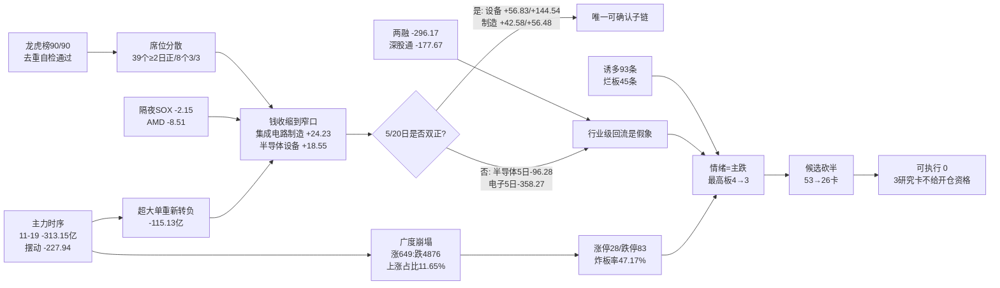

# 2026-11-20 · **资金面**

> **数据源新鲜度**: partial（A股 gap=0 · 两融/ETF gap=1 · 美股盘中）
> **降级状态**: false
> **置信度**: 0.77（base_confidence: 0.88 × freshness_factor: 0.90 × source_agreement_factor: 0.97 = 0.7682 → 0.77）
> **数据归属交易日**: 20261119（trading_gap=0 = 最新可得）

## 一句话结论

11-19 主力 **-313.15 亿**重新放大（前 -85.21，摆动 -227.94），20 日 -3929.82 亿仅 8 日为正；涨 649 : 跌 4876（上涨占比 11.65%）、中位 -2.55%；涨停 28 / 跌停 83 / 炸板率 **47.17%** / 最高 3 板 → **情绪=主跌**。钱极窄地抱团半导体国家队（集成电路制造 +24.23 亿 5/20 双正、半导体设备 +18.55 亿），而两融 -296.17 / 深股通 -177.67 全线撤；隔夜 SOX -2.15%、AMD -8.51 对科技链构成外压。**0 可执行**，3 研究卡不给开仓资格。

## 🔍 详细分析

### 一、时序资金流：前日的收窄是反抽，不是拐点

| 窗口 | 主力净额（亿） | 对比前值 | 判读 |
|---|---:|---:|---|
| 当日（11-19） | **-313.15** | 前值 -85.21，摆动 **-227.94** | 重新放大，前日收窄作废 |
| 5 日 | -1913.87 | 前值 -2125.84 | 略有收敛，但仍是大额净流出 |
| 10 日 | -2462.47 | — | 失血未止 |
| 20 日 | -3929.82 | 20 日仅 **8 日为正** | 趋势性派发，非单日情绪 |

四档拆解是今日最重要的确认：**超大单 -115.13 亿（前值 +19.31）重新转负**，大单 -198.02（前值 -104.52）、中单 -39.13（前值 -59.27）、小单 **+340.52**（前值 +137.31）。含义是**机构单重新砸盘、散户接盘量放大到 2.5 倍**——前一日「超大单转正」被证明只是单日修复。

广度全面转差：**上涨 649 : 下跌 4876（上涨占比 11.65%）、中位 -2.55%**，成交 13145.8 亿且**缩量 654.4 亿**。指数层面只有科创50 逆势 +1.83%（沪 -0.28 / 深 -0.71 / 创 -0.79）——**指数分化、个股普跌、缩量**，是主跌段的典型形态而不是普跌后的见底形态。

### 二、板块：钱没有消失，是收缩到一个窄口

今日流入前 8（亿）：半导体 +30.51 / 集成电路制造 +24.23 / 半导体设备 +18.55 / 电子 +17.50 / 集成电路封测 +14.94 / 通信网络设备及器件 +13.39 / 印制电路板 +4.36 / 家电零部件 +3.76。
流出前 8：计算机 -55.15 / 机械设备 -31.98 / 医药生物 -28.64 / 电力设备 -27.89 / IT服务 -27.64 / 有色金属 -25.45 / 传媒 -23.71 / 数字芯片设计 -19.60（银行 -19.29 同在流出端）。

**只有两条子链是真双正**：半导体设备（当日 +18.55 / 5 日 **+56.83** / 20 日 **+144.54**，涨幅 +1.07%）与集成电路制造（+24.23 / **+42.58** / **+56.48**，涨幅 **+5.00**%）。半导体本身当日 +30.51 但 5 日仍 **-96.28**、电子当日 +17.50 但 5 日 **-358.27** → **行业级回流是假象，子链级抱团才是事实**。

PCB 链昨日提出的验证题今天给出答案：印制电路板当日 **+4.36**（昨日 +45.17，**连续第二日为正但衰减到十分之一**）、元件 +2.82（昨日 +46.38），板块涨幅却是 -1.60% / -1.72% → **链没死，但钱没有形成合力，是「守住了」不是「回来了」**。

概念端更直白：流入只有基金重仓 +46.34（5 日 -215.79）、存储芯片 +43.66（5 日 -102.90）、大盘成长 +40.91、科技风格 +33.88、大基金持股 **+31.33（5 日 +47.77 正）**、中芯概念 **+30.79（5 日 +32.56 正）**；流出端是融资融券 **-296.17（5 日 -1740.28）**、深股通 -177.67（5 日 -1076.94）、基金减仓 -164.40、富时罗素 -162.56、标准普尔 -150.70、华为概念 -105.58、小盘股 -99.62 → **杠杆盘、外资基准盘、小盘题材在同时撤，只有「大基金持股 + 中芯概念」是 5 日转正的方向**。

### 三、龙虎榜与游资：席位还活着，但方向不集中

去重自检：原始 top_list 90 行 / top_inst 900 行，按 `(ts_code, reason)` 分桶 + 桶内 `(exalter, buy, sell)` 去重后，**全席位净额与 top_list.net_amount 逐行 90/90 完全相等（差额 0.0000 亿）**；30d 可转债口径隔离，1d 与 3d 分列不可相加。

**机构净买样本**（1d/3d 代表行）：粤芯半导体 +0.90（股价 +7.06%）、光洋股份 +0.70（跌停 -10.02%）、果麦文化 +0.49（-11.16%）、清研环境 +0.43（-15.29%）、皇台酒业 +0.40（跌停）、九阳股份 +0.15（涨停、股通 +1.33）。
**机构净卖样本**：冰山冷热 -1.64（-9.99%）、金逸影视 -0.69、襄阳轴承 -0.46（涨停 +9.99%、股通 -0.71）、慈文传媒 -0.37、星网锐捷 -0.24、江化微 0.00（涨停但沪股通 -1.36、榜 -0.96）。

3 日席位协同（39 个席位满足「3 日净买 >0 且 ≥2 日为正」，其中 8 个 3/3 全正）：开源证券西安西大街 +3.41（3/3）、开源证券西安太华路 +2.01（2/3）、国泰海通上海长宁江苏路 +1.99（3/3）、平安证券浙江分公司 +1.70、国泰海通总部 +1.69、深股通专用 +1.49（2/3）。**游资仍有净买，但方向分散、不集中在任何单一子链**——与板块级的「半导体窄口抱团」不同源，两者不能互相背书。

最值得单独记的一笔是**福莱新材 -6.27% 而龙虎榜 +4.26 亿（沪股通 +1.85、机构 0）**：外资通道大额买、股价大跌，属「拉高出货 / 接刀」混合样本，方向待验。

### 四、诱多识别：五类共 93 条，最多的一类是「烂板」

| 模式 | 条数 | 代表样本（涨跌幅 / 龙虎榜 / 机构） |
|---|---:|---|
| ① 涨停但龙虎榜净卖 | 3 | 江化微（+9.99%，榜 -0.96 / 沪股通 -1.36）· 盛剑科技（+10.00%，榜 -0.13 / 机构 -0.06）· 京蓝科技（+10.06%，榜 -0.04） |
| ② 反复开板烂板 | **45** | 中嘉博创 12 次 · 襄阳轴承 9 次（涨停但机构 -0.46 / 股通 -0.71）· 阳光照明 9 次（跌停）· 冰山冷热（-9.99%，机构 -1.64） |
| ③ 重挫日大额净卖 | 12 | 冰山冷热（-9.99%，榜 -0.57 / 机构 -1.64）· 慈文传媒（-10.00%，榜 -1.49）· 星网锐捷（-10.02%，榜 -0.90）· 信息发展（-15.20%，榜 -0.50） |
| ④ 机构净卖但股价大涨（**核心诱多**） | 13 | 襄阳轴承（+9.99%，榜 +1.93 / 机构 -0.46 / 股通 -0.71）· 常山北明（+4.83%，榜 +1.65 / 机构 -0.09）· 岳阳兴长（+5.50%）· 兴欣新材（+10.02%，机构 -0.04） |
| ⑤ 席位净买但股价收跌 | 20 | 光洋股份（跌停 -10.02%，机构 +0.70 / 股通 +0.42）· 皇台酒业（跌停，机构 +0.40）· 东方海洋（-8.58%，股通 +0.18）· 顺钠股份（-9.95%，榜 +0.06）· 湖北广电（-4.95%，榜 +0.22） |

**⑤ 必须拆成两类**：光洋股份、皇台酒业属**跌停板接刀型**（机构在跌停价接货）；另一类则是高位放量下跌仍被席位买入的**拉高出货型**。方向相反，不能因为龙虎榜净买就当利好。②45 条是今日最多的一类，直接说明**封板质量整体崩塌**——这也是炸板率冲到 47.17% 的微观原因。

### 五、隔夜美股传导：本周第一次系统性 risk-off

US 2026-11-19 盘中（约 04:35 抓，距收盘约 25 分钟，intraday=true）：**SPX -1.90% / IXIC -2.12% / SOX -2.15%**，三条指数同时为负。
个股：**AMD -8.51%** · MRVL -4.23% · AMZN -3.84% · META -3.09% · GOOGL -2.87% · NVDA -2.56% · TSM -2.40% · TSLA -2.34% · AVGO -2.07% · GLW -2.02% · MSFT -1.64% · MU -1.43% · AAPL -1.00% | 仅 INTC +1.72%。
篮子：半导体 **-2.78%** · 光通信 -2.77% · 大型科技 -2.49% · 存储 -1.43%。

**判读**：①昨日抱团的半导体设备/代工链（5 日 +56.83 / +42.58 亿）今日要接受第一次外部压力测试——若板块资金转负，昨日定性即为一日游；②存储链面对 MU -1.43 的压制，概念端 +43.66 的延续性打折；③光模块链昨日已有新易盛 +13.59 亿的个股脉冲，而 GLW/MRVL/AVGO 同时走弱 → 今日是「内资脉冲 vs 外需杀估值」的正面碰撞，不站队。
亚洲 11-19 收盘：恒生 **-1.95%** / 日经 +0.71% / 韩国 +1.39% / 台湾 **-4.40%**。

### 六、杠杆与 ETF：杠杆仍在撤，宽基在被配置

两融（20261118，三所齐全 like-for-like，无 partial-deposit 伪影）：融资余额 **22082.62 亿**，单日 **-88.34 亿**，5 日 **-648.76 亿**，去杠杆连续第 4 日（-166.34 → -214.69 → -186.33 → -88.34，幅度收窄但方向未变）。**含义：11-19 的半导体抱团发生在「杠杆仍在撤」的背景下 → 现货资金收缩到窄口，不是杠杆推动。**

ETF 份额（20261118）：沪深300ETF **+35.79 亿份（+7.76%）**、创业板ETF **+43.94（+9.85%）** 大额净申购；科创50ETF **-42.45（-3.95%）**、中证500ETF -3.39（-3.47%）、半导体ETF -0.48、黄金ETF -0.94、光伏ETF -1.78（-2.66%）净赎回。**宽基在被配置、科创主题在被赎回**，与「钱抱团半导体设备/代工个股」形成方向背离。

### 七、跷跷板与情绪定性

20 日 Pearson 相关阈值 ρ < -0.6，仅 1 对有效结构：**银行 ↔ 锂电池**（ρ = -0.613），5 日方向反转已确认（银行 5 日 -43.02，前 5 日 +21.31；锂电池 5 日 -16.19，前 5 日 -52.26）。但**两条腿都在流出**，属「同跌不同因」，不构成可交易的跷跷板。

情绪定性：**主跌 · 窄口抱团**。炸板率 47.17%（stk_limit 权威：25 炸板 /（28 封死涨停 + 25）），序列 11-13 38.71% → 11-16 40.00% → 11-17 36.67% → 11-18 39.44% → **11-19 47.17%**，连续 2 日在 35% 红线之上且逼近 50%；叠加跌停 83 : 涨停 28 = **2.96:1**、最高板从 4 降到 3 → 按纪律「炸板率≥35% 情绪=震荡/主跌 且候选砍半」执行：候选池 53 只 → 卡片 26 只（3 研究 + 23 观察），**可执行 0**。

## 🧠 推理深度三问 · 今日资金第一方向（半导体设备/代工窄口）

- **大资金意图**: 在全市场主力 -313.15 亿、两融单日 -88.34 亿、深股通概念 -177.67 亿的背景下，钱却把集成电路制造 +24.23 亿、半导体设备 +18.55 亿推到流入前列，且「大基金持股」概念 5 日转正 +47.77 亿——这不是配置盘全面加仓，而是**在基准盘（外资/杠杆/小盘）被迫撤退时，把仓位压缩到一个政策最确定、业绩最可验证的窄口**。对手盘是两融与外资通道的被动减仓盘，以及昨日涨停板上追高的短线筹码。
- **为什么走强**: 位置（设备 20 日 +144.54 已在中高位、制造当日涨幅 +5.00%）+ 催化（无新增硬消息，属存量抱团）+ 筹码（龙虎榜机构买盘集中在代工/封测新股，如粤芯 +0.90）。三维里**只有筹码一条是真新证据**，位置与催化都不支持「新一轮主升」，所以只能定「缩量抱团」不能定「主线启动」。
- **逻辑够不够硬**: 硬在**两个子链 5/20 日双正**（设备 +56.83/+144.54、制造 +42.58/+56.48），这是唯一经得起跨窗口检验的方向；软在**当日买入的是全市场最贵的位置**（设备 5 日已 +56.83 亿、制造当日 +5.00%），且**外部 SOX -2.15%、AMD -8.51% 的压力今天就到**。**证伪路径**：若今日半导体设备/集成电路制造板块资金转负、且大基金持股概念 5 日转负，则昨日定性为「抱团尾声」，全部降级为诱多。

## 🧾 昨日前十 5 日追踪（35 只继承 + 今日 12 只新晋）

**继承 35 只资金延续性**：延续 11 · 反手转正 4 · 反手转负 9 · 双负 11。

| 方向 | 代表样本 |
|---|---|
| 延续（11） | 中芯国际 +0.22→**+11.52**（5 日 +16.32）· 中微公司 +4.97→+8.01（5 日 +14.00）· 长川科技 +4.55→+5.13 · 北方华创 +3.86→+2.78（5 日 +20.72）· 华虹宏力 +8.91→+7.09（5 日 +21.87）· 深南电路 +4.16→+4.96 · 沪电股份 +13.19→+2.97（**大幅衰减**）· 生益电子 +1.87→+2.58 · 寒武纪 +9.60→+0.60 · 百亚股份 +2.75→+2.67 · 华数传媒 +0.05→+0.10 |
| 反手转正（4） | **新易盛 -3.72→+13.59（全场单日第二）** · 九阳股份 -7.71→+2.90 · 源杰科技 -0.73→+0.77 · 吉视传媒 -0.68→+0.01（跌停，价未转） |
| 反手转负（9） | **剑桥科技 +2.72→-2.23；股价 -3.78%** · 华胜天成 +2.10→-5.38 · 华东重机 +0.66→-6.82 · 盛科通信 +1.20→-4.76（-14.86%）· 旋极信息 +4.13→-3.22 · 四川长虹 +3.31→-4.00 · 工业富联 +6.48→-1.64 · 华丰科技 +3.94→-1.03 · 景旺电子 +3.35→-0.38 |
| 双负（11） | 有研新材 -5.86→-2.03（-4.47%）· 美的集团 -0.56→-1.08 · 蓝色光标 -1.71→-3.05（5 日 **-34.76**）· 慈文传媒 -0.99→-0.39（跌停）· 阳光照明 -3.01→-1.31（跌停）· 小熊电器 -0.76→-0.08（跌停）· 北投科技 -0.40→-0.17（跌停）· 顺钠股份 -1.04→-0.93（跌停）· 文投控股 -0.26→-0.02（跌停）· 锋龙股份 -0.72→-0.59 · 长虹美菱 -0.10→-0.56 |

**今日新晋 5 日榜前 12**：华虹宏力 +21.87 · 北方华创 +20.72 · 中芯国际 +16.32 · 百亚股份 +16.09 · 中微公司 +14.00 · 长川科技 +12.44 · 华丰科技 +9.45 · 华胜天成 +8.50 · 贵州茅台 +8.00 · 寒武纪 +7.80 · 宁德时代 +7.46 · 盛合晶微 +7.05（亿）。
**结构含义**：当日资金第二的新易盛（+13.59 亿）**没有进 5 日榜（5 日 -28.26）** → 光模块是「单日脉冲」不是「存量共识」；5 日榜前列仍是设备/代工，与板块级证据一致。

## 🎯 候选与观察池

**3 张研究卡（全部 `research_only=true` / `execution_eligible=false`，不给开仓资格）**

### ① 中芯国际 688981.SH · 龙头（晶圆代工·A 股）· 资金温度计

当日 +6.21% / 主力 **+11.52 亿（单票第 1）** / 5 日 +16.32 亿（3/5 正）/ 20 日 +37.21 亿；20 日位置 **98.6%**、距 20 日高 -0.33%（就是最高点附近）；成交 104.96 亿，换手 4.38%，量比 1.59；PE-TTM 122.62；两融余额 91.10 亿、5 日 -3.76%；30 日大宗 1 笔 0.02 亿；无涨停、无龙虎榜席位。
**闸门**：不过线 — 止损距 **-14.25%**（超 -10% 硬区间）、RR5 **0.02** < 2。资金确认项（3/5 正、5 日为正）通过。

- **买入理由**: ①**子链地位** — 集成电路制造当日 +24.23 亿、5 日 +42.58 / 20 日 +56.48 双正，涨幅 +5.00%，是今日唯一「资金 + 涨幅」双第一档的子链；②**资金量级** — 单票 +11.52 亿为全场第一，5 日 +16.32 亿；③**中芯概念** 5 日 +32.56 亿转正，政策/大基金方向明确。
- **风险点**: ①**位置在顶** — 20 日位置 98.6%、距 20 日高仅 -0.33%，任何回撤都直接吃掉利润；②**赔率 0.02** — 上方空间几乎为零；③PE-TTM 122.62，估值不提供缓冲；④隔夜 SOX -2.15 / AMD -8.51，代工链今日面临外部压制。
- **止损条件**: 收盘失守 **约 104.8 元**（10 日低，-14.25%）即离场；若集成电路制造板块当日主力净额转负，本卡观察资格当日取消。
- **可验证假设**: 24-72h 验证「窄口抱团是否可持续」——观测量为 ①集成电路制造行业当日主力净额**连续第三日为正**；②中芯国际 5 日主力不转负。任一失效则定性为「抱团尾声」。

### ② 深南电路 002916.SZ · 龙二（PCB）· 昨日假设的验证票

当日 +5.00% / 主力 +4.96 亿 / 5 日 **+2.71 亿（2/5 正）** / 20 日 -1.62 亿；20 日位置 29.8%、距 20 日高 -25.88%；成交 38.93 亿，换手 2.82%，量比 1.25；PE-TTM 28.33；两融余额 10.43 亿、5 日 -9.70%；30 日大宗 1 笔 0.02 亿；无涨停。
**闸门**：不过线 — 止损距 **-14.84%**（超硬区间）、RR5 **0.79** < 2、5 日资金确认不足（2/5 正）。

- **买入理由**: ①**PCB 龙头地位延续** — 昨日封死涨停、今日仍是链上主力资金第一（+4.96 亿）；②**板块连续第二日为正** — 印制电路板 +4.36 亿（昨日 +45.17）、元件 +2.82（昨日 +46.38）；③位置不贵（20 日位置 29.8%，PE 28.33）。
- **风险点**: ①**回流衰减到十分之一** — 板块 +45.17 → +4.36，且板块涨幅 -1.60%，是「守住了」不是「回来了」；②**5 日资金仍只有 2/5 正日**，不是趋势；③两融 5 日 -9.70% 杠杆撤离；④赔率不足（RR5 0.79）。
- **止损条件**: 收盘失守 **约 179.9 元**（10 日低，-14.84%）离场；若 PCB 行业当日主力净额转负，该仓无论盈亏当日了结。
- **可验证假设**: 24-72h 验证「PCB 回流能否第三日转强」——观测量为 ①印制电路板行业当日主力净额**由 +4.36 回升到 10 亿以上**；②深南、沪电两票主力同步为正。若第三日转负，则定性为「两日游结束」。

### ③ 百亚股份 003006.SZ · 低位前排（消费·防御）· 唯一 5/5 全正

当日 +1.35% / 主力 +2.67 亿 / 5 日 **+16.09 亿（5/5 全正）** / 20 日 +64.26 亿；20 日位置 33.7%、距 20 日高 -12.10%；成交 7.79 亿，换手 8.62%，量比 0.82；PE-TTM 89.72；非两融标的（tushare/vibe 双源均空）；30 日大宗 0 笔；无涨停。
**闸门**：不过线 — RR5 **1.29** < 2（止损距 -7.00% 在硬区间内、5 日资金确认通过）。

- **买入理由**: ①**唯一 5/5 全正日**（5 日 +16.09 亿、20 日 +64.26 亿），资金连续性是最好的；②**位置低**（20 日位置 33.7%，距 20 日高 -12.10%）；③止损距 -7.00% 在 -5%~-10% 硬区间内；④生活用纸 5 日 +15.71 / 20 日 +62.17、个护 5 日 +15.52 / 20 日 +61.56，子行业 5/20 日双正（虽无题材热度）。
- **风险点**: ①**没有板块效应** — 造纸当日 +2.82 亿但涨幅 -2.21%，没有涨停梯队、没有跟风盘；②赔率不足（RR5 1.29、RR20 1.97）；③PE-TTM 89.72 不便宜；④主跌段的防御腿容易在指数反弹时被抽血。
- **止损条件**: 收盘失守 **约 19.5 元**（10 日低，-7.00%）离场；若造纸/个护子行业当日主力净额转负，观察资格取消。
- **可验证假设**: 24-72h 验证「防御腿是否只是避风港」——观测量为 ①它 5 日主力是否维持全正；②若大盘反弹日它主力转负，则定性为「避险资金临时停靠」，不作风格切换依据。

**观察池 23 只（全部 `research_only=true`，按链分组）**

| 链 / 票 | 关键读数 |
|---|---|
| 半导体设备 · 北方华创 002371 | +3.13% / 主力 +2.78 亿 / 5 日 +20.72 亿 **5/5 正**；位置 89.8%、RR5 0.22 → 链强度证据 |
| 半导体设备 · 中微公司 688012 | +5.05% / +8.01 亿 / 5 日 +14.00（3/5）；止损 -10.33% 刚越界、RR5 0.13 → 观察 |
| 半导体设备 · 长川科技 300604 | +1.93% / +5.13 亿 / 5 日 +12.44（4/5）；止损 -11.74%、RR5 0.62 → 观察 |
| 晶圆代工 · 华虹宏力 688347 | +8.05% / +7.09 亿 / 5 日 +21.87（4/5）；止损 -22.45%、位置 89.9% → 强势证据 |
| 晶圆代工 · 粤芯半导体 301660 | +7.06% / +2.18 亿 / 5 日 -1.80（1/5）；龙虎榜 +0.86（机构 +0.90）→ 唯一「机构净买+股价涨」的新票，观察 |
| AI 算力 · 寒武纪 688256 | -1.58% 但主力 +0.60 亿（价跌钱进）/ 5 日 +7.80；止损 -16.88% → 研究温度计 |
| 算力连接 · 华丰科技 688629 | -4.64% / 主力 -1.03 亿 / 5 日 +9.45（4/5）；止损 -31.80% → 赔率极差 |
| 光芯片 · 源杰科技 688498 | +5.36% / +0.77 亿 / 5 日 -3.77（2/5）→ 反抽无资金确认 |
| 光模块 · 新易盛 300502 | +5.59% / **主力 +13.59 亿（反手转正）/ 5 日 -28.26（1/5）**；隔夜光通信 -2.77% → **单日脉冲 + 外压，拦截** |
| 算力服务 · 华胜天成 600410 | -0.71% / **主力 -5.38 亿（反手转负）/ 龙虎榜 -0.94**；位置 77.8% → 拦截 |
| 光模块/CPO · 剑桥科技 603083 | -3.78% / 主力 -2.23 亿（反手转负）/ 5 日 -1.77；止损 -4.15% 参数作废 → 昨日「技术面全过」被证伪，拦截 |
| PCB · 生益电子 688183 | +4.83% / +2.58 亿 / 5 日 +4.20（3/5）；止损 -20.83%、RR5 0.0 → 链强度证据 |
| PCB · 景旺电子 603228 | -2.00% / -0.38 亿（反手转负）/ 5 日 -2.08（1/5）；位置 11.0% → 低位但资金撤 |
| PCB · 沪电股份 002463 | +1.14% / +2.97 亿（延续但大幅衰减）/ 5 日 +1.47（2/5）；止损 -11.50% → 观察 |
| 白电 · 美的集团 000333 | +1.45% 但主力 -1.08 亿（双负）/ 5 日 +6.86（3/5）；位置 94.3%、RR5 0.08 → 不进 |
| 白酒 · 贵州茅台 600519 | +1.22% / +0.26 亿 / 5 日 +8.00（4/5）；位置 88.0%、止损 -4.94% → 防御资金有、赔率不足 |
| 锂电 · 宁德时代 300750 | -2.67% / -1.12 亿 / 5 日 +7.46（3/5）；止损 -0.55% 参数作废 → 观察 |
| 先进封装 · 盛合晶微 688820 | -0.60% 但主力 +1.47 亿（价跌钱进）/ 5 日 +7.05（4/5）；止损 -22.06% → 观察 |
| 传媒 · 华数传媒 000156 | -2.14% / +0.10 亿 / 5 日 +0.33（4/5）；位置 14.6% → 传媒链里唯一低位存量（止损参数作废） |
| 跌停接刀 · 光洋股份 002708 | **跌停 -10.02% 但龙虎榜 +0.35（机构 +0.70 / 股通 +0.42）/ 5 日 +1.39（4/5）** → 方向待验，不进 |
| 机器人 · 海立股份 600619 | 首板 +10.00% / +3.17 亿 / 5 日 +4.09（3/5）；位置 100%、2 次开板、RR5 0.0 → 无赔率 |
| 封测 · 大港股份 002077 | 首板 +9.99% / +2.58 亿 / 5 日 +2.28（1/5）；2 次开板、止损 -10.57% → 观察 |
| 工业互联网 · 京蓝科技 000711 | **2 板 +10.06%** / +1.28 亿 / 5 日 +1.46（2/5）；1 次开板、龙虎榜 -0.04 → 连板高度样本，无赔率 |

**剔除 28 只（不进卡）**

| 票 | 剔除理由 |
|---|---|
| 688702 盛科通信 | -14.86% 重挫，主力 -4.76 亿 → 高位瓦解 |
| 601138 工业富联 | 主力 -1.64 亿、5 日 -29.02（1/5）、20 日 -48.34 → 链在失血 |
| 600206 有研新材 | 主力 -2.03 亿（双负）、5 日 +5.29 但 1/5 正 → 一日游后续跌 |
| 002685 华东重机 | +4.07% 但主力 -6.82 亿（全场流出第 2）、3 次开板 → 情绪票退潮 |
| 300324 旋极信息 | 主力 -3.22 亿（反手转负）、位置 80.8% → 高位派发 |
| 600839 四川长虹 | 主力 -4.00 亿（反手转负） |
| 600156 华升股份 | 2 板 +10.01% 但 3 次开板、主力 -0.62 亿 → 涨停与资金相反 |
| 000656 金科股份 | 首板 +9.68%，主力 +0.11 亿、5 日 -1.87 → 无承接 |
| 002242 九阳股份 | 涨停但 **13 次开板**、5 日 -8.08（1/5）、融资 5 日 -60.93% → 极端烂板 |
| 002165 红宝丽 | 首板 +9.95%、0 开板，但位置 98%、成交仅 3.07 亿 → 微体量拉板 |
| 001358 兴欣新材 | 首板 +10.02%，主力 +0.46 亿、机构 -0.04 → 体量不足 |
| 000678 襄阳轴承 | 首板 +9.99% 但 9 次开板、机构 -0.46 / 股通 -0.71 → 烂板 + 机构卖 |
| 000158 常山北明 | +4.83%，榜 +1.65 但机构 -0.09、主力 -1.94 → 席位与主力打架 |
| 605488 福莱新材 | -6.27% 而榜 +4.26（股通 +1.85、机构 0）→ 拉高出货型 |
| 002959 小熊电器 / 600261 阳光照明 / 000533 顺钠股份 / 000521 长虹美菱 / 600936 北投科技 | 跌停或主力双负，消费/电网链补跌 |
| 300058 蓝色光标 | 主力 -3.05 亿、5 日 -34.76（0/5 正） |
| 002343 慈文传媒 / 601929 吉视传媒 / 600715 文投控股 | 3 连跌停梯队，传媒退潮未止 |
| 002931 锋龙股份 / 000995 皇台酒业 | 昨日接刀未成，双负/0-5 正 → 剔 |
| 301288 清研环境 / 301052 果麦文化 | 重挫日机构接刀，无板块支撑 |
| 123255.SZ | 可转债代码混入候选池（涨停/龙虎榜源聚合误带）→ 非股票标的，无 K 线，记入 coverage 缺口 |

## 🗂 数据源审计

| 源 | 日期 | 状态 | 备注 |
|---|---|:--:|---|
| tushare.moneyflow_dc | 2026-11-19 | 🟢 | 21 日 × 6029 只/日 · 个股主力净额（东财口径） |
| tushare.moneyflow_ind_dc | 2026-11-19 | 🟢 | 行业 496 + 概念 554 板块 × 21 日 |
| tushare.stk_limit | 2026-11-19 | 🟢 | 6 日 · 交易所限价唯一权威（逐票比对） |
| tushare.limit_list_d | 2026-11-19 | 🟡 | 官方 U/D/Z = 23/68/24 → 复核后 28/83/25（补录 15 跌停 / 4 涨停 / 2 炸板，荣盛发展 Z→U） |
| tushare.top_list / top_inst | 2026-11-19 | 🟢 | 3 日 · 90 行榜 / 900 行席位 · 去重后 90/90 与 net_amount 相等 |
| tushare.margin | 2026-11-18 | 🟡 | 三所齐全 like-for-like · 滞后 1 个交易日（T+1） |
| tushare.fund_share | 2026-11-18 | 🟡 | 7 只 ETF · 滞后 1 个交易日（T+1） |
| tushare.daily / daily_basic | 2026-11-19 | 🟢 | 全市场 5573 只 · 成交/换手/市值/PE |
| tushare.block_trade + margin_detail | 2026-09-12~11-19 | 🟢 | 全市场大宗 + 54 票 15 日两融 |
| eastmoney/vibe 逐票硬调用 | 2026-11-19 | 🟢 | 54 只 block_trades 30d + margin_trading 15d · null=0 |
| eastmoney/vibe get_dragon_tiger | 2026-11-19 | 🟢 | 全市场快照 · 独立通道交叉验证 |
| yahoo.US 盘中档 | 2026-11-19 | 🟡 | 14 只 + SPX/IXIC/SOX · 盘中值（距收盘约 25 分钟） |
| tushare.us_daily | 2026-11-18 | 🔴 | 只到 11-18（11-19 session 未落库）→ 隔夜档改用 yahoo |
| tushare.index_global | 2026-11-19 | 🟢 | 亚洲 4 市场收盘 |
| tushare/股指期货基差 · 期权隐波 | — | 🔴 | 无数据源 · 留空不编造 |
| data/raw/20261120/manifest | — | 🔴 | 盘前 pipeline 前置未跑 → severity 不可读，confidence 无硬上限 |
| 北向资金（moneyflow_hsgt / hk_hold） | — | ⬜ | 2026-10-28 起停抓 · retired stub，不调用不补 |

## ⚠️ 不确定性 / 反证

1. **前日「超大单转正」被今日数据直接证伪**（+19.31 → -115.13）。这说明单日结构改善在主跌段里极不可靠，本报告不再使用任何单日结构改善作为反转依据。
2. **窄口抱团可能是被动收缩而非主动看多**。两融 -88.34 亿、深股通 -177.67 亿、基金减仓 -164.40 亿同时发生，此时流入半导体更像「卖出其他、剩余仓位集中在最确定方向」，不构成加仓信号。
3. **半导体设备/制造已在中高位**（设备 20 日 +144.54、制造当日 +5.00%），且当日买入价接近 20 日高点，赔率极差（中芯 RR5 0.02）。追高在本纪律下直接否决。
4. **PCB 回流第二日为正但衰减到十分之一**，若第三日转负即坐实两日游；本报告不把「连续两日为正」当作趋势确认。
5. **美股为盘中值**，SOX -2.15 / AMD -8.51 在收盘前仍可能变化；若美股尾盘收复，今日科技链外压判断需下调。
6. **两融与 ETF 滞后 1 个交易日**，「杠杆仍在撤、宽基在被配置」只能锚定到 11-18，不能直接外推到 11-19。
7. **龙虎榜机构净买集中在跌停股**（光洋 +0.70、皇台 +0.40、果麦 +0.49、清研 +0.43），这类「接刀」若次日继续下跌，则机构席位信号当日即失效——本报告把它归为「方向待验」而非利好。
8. **R2 主线未就绪**（07:30 并行），候选池改用四条独立证据自建；若 R2 给出不同主线，本报告的方向判定需由 D1 仲裁。
9. **manifest severity 不可读**，confidence 无 severity 硬上限，实际置信度可能低于 0.77。

## 🔗 与其他 R/D/E 的关系

- **依赖**: `data/raw/20261120/manifest.json`（未生成）· `data/raw/20261119/overseas_snapshot.json`（US observed=20261118，未消费数值）· `data/research/20261119/R7_capital_flow_20261119.json`（35 只卡片继承）· tushare / vibe-trading / yahoo 独立通道
- **被消费**: `main_decision_v1`（D1 主决策 · 读 `main_force` / `hot_money` / `research_candidates`）· R6 反证（硬否决权来源，R7 不授开仓权）· R2 主线（板块资金读数交叉）
- **交接**: `data/research/20261120/R7_capital_flow.json`（数据契约）· `data/research/20261120/_body_R7.md`（本报告，由 `scripts/research/publish_unit_md.py` 发布到 `chzl_kg/投研交易/资金面/20261120.md`）

## 📋 Sub-Agent 元数据

- skill: analyze_capital_flow_v1
- artifact: `data/research/20261120/R7_capital_flow.json` + `R7_capital_flow_20261120.json`（223,100 B / 198,322 字符）
- batch: premarket_full
- 生成耗时: 约 30 分钟（04:31-05:05）
- model: deepseek-v4.1-flash
