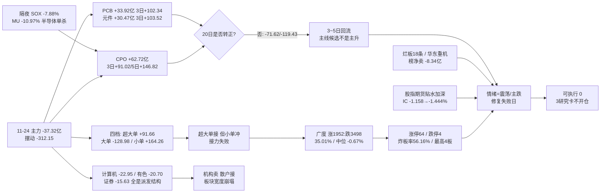

# 2026-11-25 · **资金面**

> **数据源新鲜度**: partial（A股 gap=0 · 两融/ETF gap=1 · 美股已收盘）
> **降级状态**: false
> **置信度**: 0.77（base_confidence: 0.90 × freshness_factor: 0.88 × source_agreement_factor: 0.97 = 0.7682 → 0.77）
> **数据归属交易日**: 20261124（trading_gap=0 = 最新可得收盘）

## 一句话结论

11-24 主力 -37.32 亿（摆动 -312.15），20 日 -3467.06 亿仅 8 日为正；涨 1952:跌 3498（35.01%）、中位 -0.67%；涨停 64/跌停 4/炸板率 56.16%/最高 4 板 → **情绪=震荡/主跌**。钱只去一处：CPO +62.72 亿 + PCB/元件 3 日 3/3（5 日 +151.87/+152.72）但 20 日仍 -71.62/-119.43。**隔夜 SOX -7.88%、MU -10.97% 半导体崩塌**。0 可执行，3 研究卡不开仓。

## 🔍 详细分析

### 一、时序资金流：11-23 的修复一天就被打回，20 日账本仍是 -3467 亿

| 窗口 | 主力净额（亿） | 对比前值 | 判读 |
|---|---:|---:|---|
| 当日（11-24） | **-37.32** | 前值 +274.83，摆动 **-312.15** | 修复次日立刻回吐，主力重新净流出 |
| 5 日 | -682.71 | 5 日仅 **1/5 日为正** | 修复只贡献 1 天，抵消不了 4 天失血 |
| 10 日 | -2520.49 | — | 失血未补齐 |
| 20 日 | **-3467.06** | 20 日仅 **8/20 日为正** | 趋势账本仍是「滚动下跌」，不可当主升 |

四档拆解（今日 vs 昨日，亿）：**超大单 +91.66（前 +265.96）、大单 -128.98（前 +8.86）、中单 -129.30（前 -218.05）、小单 +164.26（前 -47.00）**。
今日是**「超大单 +91.66 亿逆势承接，但大单 -128.98 亿、小单 +164.26 亿同时流出」**——大资金在接，但**中小单在往里冲**。这与 11-20 的「超大单 -172.89、小单 +484.71」（机构砸盘散户接盘）方向不同，但同样危险：**11-24 的 -37.32 亿净额是小单 +164.26 亿顶出来的**，说明承接盘比抛压盘还小。这是本日最重要的一条：**不是资金撤退，是资金接力失败**。

广度全面反转：**上涨 1952 : 下跌 3498（上涨占比 35.01%）、中位 -0.67%、均值 -0.12%**，成交 16678.0 亿（**放量 1038.4 亿**）。指数 沪 +0.27 / 深 -0.29 / 创 -0.05 / 科创50 +1.81 —— 指数几乎平盘但个股中位数 -0.67%，**放量普跌，典型的高位派发形态**。

### 二、板块：钱没有换方向，仍在科技硬件，但强度明显分层

**流入前 6（亿）**：电子 +64.73 / 印制电路板 +33.92 / 元件 +30.47 / 消费电子零部件及组装 +25.62 / 消费电子 +25.00 / 通信网络设备及器件 +17.15。
**流出前 5（亿）**：计算机 -22.95 / 有色金属 -20.70 / 医药生物 -17.06 / 证券Ⅱ -15.63 / 证券Ⅲ -15.63。

> 注：流出端全是「派发」结构（超大单负 + 小单正 = 机构卖、散户接）。计算机超大单仅 -1.70 而小单 +23.78，是**纯散户承接**的最坏结构。

| 板块 | 当日净额 | 超大单 | 小单 | 3 日 | 5 日 | 20 日 | 结构 |
|---|---:|---:|---:|---:|---:|---:|---|
| 电子 | +64.73 | +68.00 | -10.25 | +3.59 | +120.93 | -339.73 | 换手（健康） |
| 印制电路板 | +33.92 | +33.38 | -21.71 | **+102.34** | **+151.87** | -71.62 | 换手（健康） |
| 元件 | +30.47 | +32.18 | -19.64 | **+103.52** | **+152.72** | -119.43 | 换手（健康） |
| 消费电子 | +25.00 | +27.88 | -7.52 | +24.90 | +21.48 | -64.87 | 换手（健康） |
| 通信网络设备及器件 | +17.15 | +12.83 | -5.95 | +70.19 | +101.81 | -73.61 | 换手（健康） |
| 通信设备 | +12.92 | +16.37 | -1.36 | +53.46 | +78.48 | -182.86 | 换手（健康） |
| CPO概念（概念端） | +62.72 | +73.24 | -14.49 | +91.02 | +146.82 | -352.02 | 换手（健康） |
| 半导体 | +10.73 | +7.36 | **+18.79** | **-100.40** | -24.36 | -31.01 | **普涨抢筹** |
| 计算机 | -22.95 | -1.70 | +23.78 | -67.21 | -102.62 | -307.59 | 派发 |
| 有色金属 | -20.70 | -9.45 | +17.23 | -35.97 | -101.18 | -277.53 | 派发 |
| 医药生物 | -17.06 | -6.90 | +17.29 | -56.85 | -119.27 | -293.31 | 派发 |
| 证券Ⅱ | -15.63 | -12.41 | +11.79 | -20.54 | -33.88 | -120.98 | 派发 |

**PCB/元件是唯一「3 日 3/3 + 5 日为正 + 四档换手健康」的链**：印制电路板 3 日 +102.34、5 日 +151.87；元件 3 日 +103.52、5 日 +152.72（5/5 全正）。但 20 日仍是 -71.62 / -119.43 —— **回流 ≠ 回本，只能定主线候选**。

**半导体是「假回流」**：当日 +10.73 亿看着不错，但**超大单 +7.36 亿、小单 +18.79 亿同时为正 = 普涨抢筹**（全员买入），3 日 -100.40、5 日 -24.36 仍为负。叠加隔夜 SOX -7.88%，**半导体链今日不是主线，是接盘重灾区**。

**CPO 概念必须拆两段读**：当日 +62.72 亿（超大单 +73.24 / 小单 -14.49 = 换手健康）确实健康，但 **3 日 +91.02 亿里只有 2/3 为正**、5 日 +146.82 亿对应前 5 日是 -231.06 亿 —— 也就是说 **CPO 的 5 日净流入几乎全部来自 11-23 那一天**，11-24 只是余温。个股端同步印证：新易盛当日资金从 +22.94 亿掉到 +1.87 亿。

**概念端头部是「基准层重复计数」**：百元股 +91.41 / 科技风格 +83.16 / 基金重仓 +81.11 / 权重股 +63.33 / 大盘股 +54.67 —— 同一批权重票被打了多个标签，**不能读成「多个方向同时吸金」**。真正有题材含义的只有 CPO 概念 +62.72 亿。流出端同理：央国企改革 -78.08 / 标准普尔 -51.73 / 富时罗素 -39.68 / 深股通 -29.54 全是基准层；题材层看 **网络安全 -27.14、新材料 -24.31**。

### 三、龙虎榜与游资：机构在买、外资通道在卖，方向与 11-23 完全相反

去重自检：原始 top_list 72 行（数据日）/ top_inst 2370 行（4 日），按 `(trade_date, ts_code, reason)` 分桶 + 桶内 `(exalter, buy, sell)` 去重后，**全席位净额与 top_list.net_amount 逐行 71/72 相等**（唯一不符：002148.SZ 北纬科技「严重异常期间」口径，差额 -0.80 亿）；1d 与 3d 分列不可相加。

**净买前 6（亿）**：九阳股份 +2.21（机构 +0.00 / 股通 +1.23）· 横河精密 +1.36（机构 +0.57 / 股通 +0.37）· 东方精工 +1.24（机构 +0.20 / 股通 +0.06）· 文投控股 +1.24（机构 +0.00 / 股通 +0.30）· 全筑股份 +0.85 · 艾芬达 +0.77。
**净卖前 6（亿）**：华东重机 **-8.34**（股通 -3.26）· 华胜天成 -3.87 · 北纬科技 -2.30 · 粤芯半导体 -1.58（机构 -0.80 / 股通 -0.85）· 西陇科学 -1.56（机构 -0.52 / 股通 -0.63）· 真视通 -1.42。

**1d 全席位合计 -14.09 亿、机构专用 +2.50 亿、股通专用 -3.69 亿** —— 机构在买、外资通道在卖，与 11-23 的「外资 3/3 全正 + 机构缺席」方向完全相反。

3 日席位协同（28 个席位满足「3 日净买 >0 且 ≥2 日为正」，其中 8 个 3/3 全正）：深股通专用 +5.90（2/3）· 机构专用 +3.21（2/3）· 国泰海通证券股份有限公司总部 +3.14（3/3）· 国泰海通上海长宁区江苏路 +3.04（3/3）· 开源证券西安西大街 +2.93（3/3）· 国泰海通北京安贞门 +1.74（3/3）· 国泰海通长宁区江苏路 +1.61（2/3）· 中信证券上海分公司 +1.55（2/3）。

**判读**：净买主力是**国泰海通系三家 + 开源西安西大街（均 3/3 全正）** —— 这是**营业部游资的连续动作**，不是机构配置盘。而「净买前 6」里有 4 只机构 +0.00、靠股通或游资单腿撑住，说明**当日上榜的多是小票情绪票（九阳、文投、全筑、艾芬达），资金体量小、位置高**。**含义：游资在 56% 炸板率的环境里仍然接力，但接的是低位小票，不是主线龙头 → 连板高度不可信，主线只看资金连续性。**

### 四、诱多识别：四类共 24 条，「反复开板烂板」18 条是本日最刺眼的信号

| 模式 | 条数 | 代表样本（涨跌幅 / 龙虎榜 / 机构） |
|---|---:|---|
| ① 涨停但龙虎榜净卖 | 3 | **华东重机（+9.95%，榜 -8.34 / 机构 +0.00、股通 -3.26）**、安培龙（+20.00%，榜 -0.38 / 机构 +0.60）、东方海洋（+9.93%，榜 -0.27 / 机构 +0.00） |
| ② 反复开板烂板 | **18** | **柯力传感（+10.00%，开板 32 次）**、安培龙（+20.00%，开板 12 次）、**工业富联（+6.97%，开板 11 次）**、东方海洋（+9.93%，10 次）、横店影视（+10.00%，9 次）、模塑科技（8 次）、福达股份（10 次） |
| ③ 重挫日大额净卖 | 2 | 华达科技（-9.46%，榜 -0.66 / 机构 -0.25）、鑫铂股份（-10.00%，榜 -0.49） |
| ④ 席位净买但股价收跌 | 1 | N华晟（-15.55%，榜 +0.50 / 机构 +0.37） |

**①华东重机是本日最典型的诱多**：涨停 +9.95%、开板 7 次、成交 42.92 亿（当日最大额之一），但**龙虎榜净卖 -8.34 亿（外资通道 -3.26 亿）** —— 有人在高位用流动性出货，纪律上直接拦截。

**②18 条烂板必须单独读**：56.16% 的炸板率意味着**大部分涨停是「冲上去又被打下来」**。极值是柯力传感 32 次开板、安培龙 12 次、工业富联 11 次。**工业富联特别值得注意**——它是当日主力净流入第一（+22.93 亿）、5 日 +33.12 亿，却在盘中炸板 11 次收 Z：**大资金在高位派发而非封板**，这与「超大单 +91.66 亿」并不矛盾（超大单在卖、大单在接）。

**④「机构净卖但股价大涨」本日为 0 条** —— 因为机构专用当日整体净买 +2.50 亿。**这不是诱多风险消失，而是风险从「机构出货」转成了「游资接力 + 烂板」**，形态更差：机构出货至少有迹可循，游资接力失败是直接埋人。

### 五、隔夜美股传导：SOX -7.88%，这是「半导体单杀」不是全市场崩塌

US 2026-11-24 **已收盘**（CST 05:05 双通道抓取，yahoo + sina 收盘价逐票一致 14/14，非盘中值）：
**SPX -0.50% / IXIC -1.48% / NDX -1.99% / SOX -7.88% / DJI +0.85%**。

个股：MU **-10.97%** · MRVL **-9.10%** · AMD -8.86% · INTC -8.15% · NVDA -5.86% · GLW -5.94% · AVGO -3.98% · TSM -3.83% · GOOGL -1.08% · AMZN -1.21% · META -1.30% · TSLA -0.20% · **AAPL +1.43%** · **MSFT +0.74%**。
篮子：半导体 **-7.25%** · 光通信 **-6.34%** · 存储 -10.97% · 大型科技 -0.28%。
亚洲 11-24 收盘：台湾 +8.99% / 韩国 +6.32% / 日经 +3.91% / 恒生 -0.73%。

**判读**：①**这是「半导体单杀」而非「全市场风险偏好崩塌」**——SOX -7.88% 的同时 DJI +0.85%、AAPL/MSFT 收红，说明钱在从半导体流向大盘防御，不是撤离；②**这恰好是今日 A 股科技硬件链的直接压制源**：MRVL/GLW/AVGO 是 CPO 光模块的美股映射，NVDA -5.86% 对应 A 股 PCB/AI 服务器，MU -10.97% 对应存储（长鑫/兆易/东山的估值锚）；③亚洲 11-24 反而大涨（台股 +8.99%、韩股 +6.32%），说明**昨夜美股是独立事件而非全球系统性风险**，但 A 股科技链的定价锚在美股，**今日 CPO/PCB 高开就是给隔夜 -7.88% 接盘**；④**反过来说**：若 A 股今日出现「科技杀跌、红利护盘」的跷跷板，那是外部结构映射，**不是内生资金切换** —— D1 不应据此认定风格切换。

### 六、杠杆与 ETF：两者都滞后 1 个交易日，11-23 的申购结构不能解释 11-24

两融最新 **20261123**（20261124 T+1 未落库，gap=1），该日三所齐全：融资余额 **21419.38 亿**、单日 **-89.24 亿**、5 日 **-937.90 亿**（序列 22082.62 → 21927.43 → 21508.62 → 21365.51 → 21329.14 → 21419.38 口径下 5 日净减）。**关键读数：11-23 普涨修复日杠杆单日仍减 89.24 亿、5 日减 937.90 亿 —— 修复是「存量资金腾挪」，不是「增量杠杆进场」**。这与 11-24 的资金接力失败互为因果。11-24 的杠杆变化今日盘后才知，本报告不下结论。

ETF 份额最新 **20261123**（gap=1）：沪深300ETF +85.86 亿份（+18.27%）、中证500ETF +34.38 亿份（+37.89%）、创业板ETF +77.13 亿份（+16.69%）、科创50ETF +17.01 亿份（+1.64%）、半导体ETF +1.84 亿份（+0.86%）、黄金ETF -2.16 亿份（-1.83%）、证券ETF -9.45 亿份（-1.74%）。**这是 11-23 普涨日的宽基抄底结构（配置盘进场），不能用来解释 11-24 的下跌**；但「半导体ETF 只 +1.84 亿份」说明**主题端从头到尾没人加杠杆**。

**股指期货基差（新增维度，独立印证）**：11-24 四品种全部贴水，且贴水较 11-23 **同步加深** —— IF -1.084%→**-1.212%**、IC -1.158%→**-1.444%**、IM -0.969%→**-1.363%**、IH -1.024%→**-1.077%**。**贴水扩大 = 对冲盘加仓 / 现货看空**，与当日广度 35%、炸板率 56%、主力 -37.32 亿三重互相印证，是「今日不宜进攻」最硬的一条证据。

### 七、跷跷板与情绪定性

20 日 Pearson 相关阈值 ρ < -0.6，全市场扫描出 **4 对**（半导体↔白酒Ⅲ ρ=-0.644、半导体↔白酒Ⅱ ρ=-0.644、电子↔白酒Ⅲ ρ=-0.617、电子↔白酒Ⅱ ρ=-0.617），去重后是 **2 个有效结构：科技硬件 ↔ 白酒消费**，4 对全部满足 5 日方向反转确认。
**但必须同时读当日方向**：11-24 科技硬件（电子 +64.73）是**流入端**、白酒是**流出端** —— **今日资金方向与这两对的历史负相关方向相反，说明结构在 11-24 已被打破**，不能作为「今日跷跷板切换」的依据。**含义：今日不做跷跷板切换，只做科技硬件链内部的选强，且该链受隔夜半导体崩塌压制。**

情绪定性：**震荡/主跌（修复失败日）**。炸板率 56.16%（stk_limit 权威：82 炸板 /（64 封死涨停 + 82）），序列 11-16 40.0% → 11-17 36.67% → 11-18 39.44% → 11-19 47.17% → 11-20 31.82% → 11-23 **15.08%** → 11-24 **56.16%**（**远高于 35% 红线**）。涨停 64 / 跌停 4 = 16.0:1（前一日 152/7 = 21.71:1）；上涨占比 35.01%（前 83.63%）、中位 -0.67%（前 +2.41%）；成交 16678.0 亿（**放量 1038.4 亿却是普跌**）。连板高度分布：首板 33 / 二板 26 / 三板 4 / **四板 1（中京电子）** —— 最高板从 5 板降到 4 板，且唯一 4 板当天主力仅 +1.37 亿、5 日涨幅 +48.62%、位置 100%、止损 -34.51%、RR 归零，**是空心高度**。

**按纪律「炸板率 ≥ 35% 的交易日，所有输出必须显式标 情绪=震荡/主跌 并把候选数砍半」执行：候选池 42 只 → 卡片 16 只（3 研究 + 13 观察）、剔除 26 只、可执行 0。**

## 🧠 推理深度三问 · 今日资金第一方向（PCB/元件 · 印制电路板）

- **大资金意图**: 11-24 的钱**没有离开科技硬件，但也没有加码**。印制电路板 +33.92 亿（超大单 +33.38 / 小单 -21.71 = 大单接小单抛，健康换手）、元件 +30.47 亿（超大单 +32.18 / 小单 -19.64）、消费电子 +25.00 亿（超大单 +27.88 / 小单 -7.52），三条链四档完全同构 —— 这不是短线脉冲的随机分布，而是**同一批机构资金在 AI 硬件链内部做结构调整**。但全市场净额只有 -37.32 亿且**小单 +164.26 亿顶账**，说明**承接方（超大单 +91.66）的规模小于涌入方（小单 +164.26）** —— 大资金想接，但散户涌得更快，把票买贵了。**大资金的真实动作是「在 AI 硬件链内部换仓」，不是「加仓」，也不是「撤退」。**
- **为什么走强**: ①位置 — 印制电路板 20 日累计 -71.62 亿、元件 -119.43 亿，相比电子的 -339.73 亿、机器人的失血程度，PCB/元件是**跌得最少、20 日最接近回正**的硬件分支；②资金 — PCB 3 日 +102.34 亿、5 日 +151.87 亿（5/5 全正），元件 3 日 +103.52 亿、5 日 +152.72 亿（5/5 全正），**两条链的 5 日序列都是全正**，这是全市场唯一做到的；③催化 — **今日 A 股没有新增硬催化**，这条链的走强完全来自「超跌 + 超大单承接」的资金行为，催化维度是空的。**三维里位置与资金是真证据，催化缺位 → 只能定「主线候选」，不能定「新主线启动」。**
- **逻辑够不够硬**: **硬在**「唯一同时满足 3 日连续 + 5 日全正 + 四档换手健康（超大单正、小单负）+ 20 日最接近回正」的方向，且 5 日序列可验证（PCB 5 日 +151.87 vs 前 5 日 -231.06，是从大幅净流出翻正的）；**软在**①隔夜 SOX -7.88% / MRVL -9.10% / GLW -5.94% 直接打在这条链的美股映射上，**今日开盘就是低开压力测试**；②当日涨停宽度在汽车配件（8 只）、元器件（5 只），不在 PCB 本身 —— 资金在做的是「板块内部换手」而非「板块整体扩张」；③机构专用当日净买只有 +2.50 亿、股通 -3.69 亿，**外资在卖**，而外资正是这条链的定价方之一；④股指期货贴水同步加深，是对冲盘在加仓。**证伪路径**：①若今日印制电路板/元件当日主力净额转负，则 11-24 的回流定性为「一日游」，整条链降级；②若沪电股份（5 日 +29.02 亿、20 日 +4.45 亿已回正、融资 5 日 +7.93% 逆势加杠杆）出现「机构净卖但股价大涨」，则龙头资金是出货不是回补；③若美股今夜半导体继续下杀，则外部压制不解除，PCB 的低开就是「接刀」而非「回踩」。**三条证伪任一条触发，今日全部卡片降为纯观察，不给试错额度。**

## 🧾 昨日前十 5 日追踪（板块 10 只 + 个股 33 只）

**板块口径（20261124 流入榜前 10 → 11-24）**：延续（连正）**7** · 反手转负 **2** · 反手转正 0 · 双负 0。

| 方向 | 板块（前值 → 当日，亿） | 5 日累计 | 正日 |
|---|---|---:|---:|
| 延续（连正） | 电子 +69.21→**+64.73** · 印制电路板 +48.03→**+33.92** · 元件 +54.33→**+30.47** · 通信网络设备及器件 +64.61→**+17.15** · 通信设备 +69.15→**+12.92** · 通信 +68.49→**+8.02** · 汽车零部件 +23.15→+6.71 · 机械设备 +26.08→+0.14 | 电子 +120.93（4/5）· PCB +151.87（5/5）· 元件 +152.72（5/5）· 通信设备 +78.48（4/5） | — |
| 反手转负 | 传媒 +21.20→**-2.65** · 汽车 +19.64→**-0.96** | 传媒 -31.30（1/5）· 汽车 -17.13（1/5） | — |

**判读**：延续的 8 只里 **6 只集中在电子链**（电子/PCB/元件/通信设备/通信/通信网络设备），且全部是「超大单正 + 小单负」的换手健康结构 —— **钱没有离开科技硬件，只是从 11-23 的普涨转成 11-24 的分化换手**。但必须同时看 20 日：电子 -339.73、PCB -71.62、元件 -119.43、通信设备 -182.86 —— **3~5 日回流 + 20 日深负 = 「资金刚回来」，可定主线候选，不能定趋势主升**。

**个股口径（20261124 R7 池 33 只 → 11-24）**：延续 **16** · 反手转正 **5** · 反手转负 **6** · 双负 **6**。

| 方向 | 代表样本（前值 → 当日，亿） |
|---|---|
| 延续（16） | 中际旭创 +22.23→**+11.77** · 新易盛 +22.94→**+1.87**（大幅衰减）· 寒武纪 +1.73→**+10.82** · 天孚通信 +14.13→+6.30 · 沪电股份 +3.50→**+6.09** · 中微公司 +3.50→+0.85 · 景旺电子 +2.97→+5.01 · 源杰科技 +3.93→+5.43 · 深南电路 +1.36→+1.79 · 芯碁微装 →+2.36 · 生益电子 +0.90→+1.67 |
| 反手转正（5） | 中芯国际 -1.31→**+4.51** · 华虹宏力 -0.20→**+5.20** · 长川科技 -2.06→+2.24 · 盛合晶微 -0.98→+1.60 · 华胜天成 -3.88→+2.16（但榜 -3.87，背离） |
| 反手转负（6） | **风华高科 +4.28→-1.60**（昨日元件首板，资金撤离）· 九阳股份 +8.86→+2.70 · 宇树科技 +5.82→**-2.50** · 莱美药业 +2.29→-0.61 · 龙江交通 +3.62→-1.90 · 东方海洋 +2.07→-0.81 |
| 双负（6） | 超声电子 -2.48→**-4.68** · 真视通 -0.06→**-3.24** · 冰山冷热 -1.58→-2.60 · 盛剑科技 -0.12→-0.99 · 美的集团 -0.20→-1.29 · 利通电子 -0.11→-2.20 |

**今日 5 日榜前 12（亿元）**：中际旭创 +50.60 · 新易盛 +43.02 · 工业富联 +33.12 · 沪电股份 +29.02 · 天孚通信 +22.27 · 中微公司 +21.72 · 寒武纪 +20.69 · 华虹宏力 +17.37 · 中芯国际 +16.81 · 胜宏科技 +16.62 · 深南电路 +15.65 · 百亚股份 +15.48。
**结构含义**：5 日榜头部**第一次被光模块/PCB 霸占**（中际旭创、新易盛、沪电、天孚、胜宏、深南）。但**当日方向已经分裂**：新易盛从 +22.94 掉到 +1.87、工业富联炸板 11 次、中京电子 4 板空心 —— **5 日榜的参考价值只剩「谁还有存量」，不能直接当成今日可买清单**。

## 🎯 候选与观察池

**3 张研究卡（全部 `research_only=true` / `execution_eligible=false`，不给开仓资格）**

### ① 中际旭创 300308.SZ · CPO 龙二 · 5 日资金全场第一 · 全池唯一「止损距合规 + RR20 达标」

当日 **-0.05%**（缩量整理）/ 主力 **+11.77 亿**（超大单 +9.69 / 小单 -0.05）/ 5 日 **+50.60 亿（5/5 全正、全场第一）** / 20 日 **-3.81 亿（几乎回正）**；成交 285.83 亿（全市场第一）、换手 5.80%、量比 1.22、PE-TTM 18.97、流通市值 4630.7 亿；融资余额 148.80 亿、5 日 -6.93%；大宗（tushare 2 个月窗口）49 笔 8.91 亿；20 日位置 **15.1%**、止损距 **-9.36%**、RR5 1.33 / RR20 **5.63**。
**闸门**：不过线 — 唯一不过的是 RR5 **1.33 < 2**（收盘贴 5 日高，分母压缩）；止损距与 RR20 均达标。

- **买入理由**: ①**5 日资金全场第一 + 5/5 全正 + 20 日仅 -3.81 亿近似回正**，是「存量没走、增量回归」的最强单票证据；②所属 CPO 概念 +62.72 亿（超大单 +73.24 / 小单 -14.49 = 换手健康）、通信网络设备及器件 3 日 +70.19 / 5 日 +101.81；③**20 日位置 15.1% 属低位**，不是高位追涨；④成交 285.83 亿全市场第一，说明有真实增量资金参与。
- **风险点**: ①**RR5 1.33** —— T+1 现实目标（5 日高）只剩 1.3 倍空间，赔率不成立；②**隔夜 MRVL -9.10% / GLW -5.94% / AVGO -3.98% 是其美股映射**，今日低开概率高，「低开就是止损位」；③20 日仍 -3.81 亿，存量未补齐；④它是权重票，指数若低开回落，它跌起来没有承接；⑤当日资金已从 11-23 的 +22.23 亿降到 +11.77 亿，**在衰减**。
- **止损条件**: 收盘失守 **10 日低点（止损距 -9.36% 口径）**离场；若 CPO 概念当日主力净额转负或成交额跌回 200 亿以下，观察资格当日取消。**不追高开。**
- **可验证假设**: 24-72h 验证「CPO 回补是真趋势还是一日游」—— 观测量 ①CPO 概念当日主力净额是否 ≥ +40 亿且连续第 4 日为正；②中际旭创次日主力净额是否仍 ≥ +10 亿；③光模块三只（中际旭创/新易盛/天孚）是否继续同步净流入。任一失效则定性为「修复日一日游」。

### ② 源杰科技 688498.SH · CPO 光芯片 · **全池唯一技术面三项全过闸**

当日 **-1.92%**（回踩不破）/ 主力 **+5.43 亿**（超大单 +2.95 / 小单 -0.05）/ 5 日 **+8.31 亿（3/5 正）** / 20 日 **+12.75 亿（为正）**；成交 68.21 亿、换手 8.67%、PE-TTM 44.70、流通市值 312.4 亿；融资余额 22.66 亿、5 日 -3.09%；20 日位置 **14.0%（全池最低）**、止损距 **-7.60%**、**RR5 2.08** / **RR20 6.17**。
**闸门**：**技术面全过** — 止损距 -7.60% 合规（-5~-10% 硬区间）、RR5 2.08 ≥ 2、RR20 6.17 ≥ 2。

- **买入理由**: ①**全池唯一三项全过的票**：止损距合规 + RR5/RR20 双达标 + 20 日位置 14.0% 最低位；②20 日资金 **+12.75 亿为正**（CPO 链里少数存量未撤的），当日主力 +5.43 亿且超大单正、小单基本为零；③当日 -1.92% 是**缩量回踩不是破位**，5 日 +8.31 亿与 20 日 +12.75 亿同时为正。
- **风险点**: ①**5 日仅 3/5 正** —— 资金连续性不足，是它没进 CPO 龙一龙二的原因；②**20 日 +12.75 亿的体量只有中际旭创的一半不到**，是「链内弹性票」不是「链内龙头」；③隔夜光通信链（MRVL -9.10% / GLW -5.94% / AVGO -3.98%）直接压制；④流通市值仅 312.4 亿，**小盘股在炸板率 56% 的日子里流动性折价明显**；⑤当日 -1.92% 已在跌，低开环境下的实际入场价会优于测算。
- **止损条件**: 收盘失守 **10 日低点（止损距 -7.60% 口径）**离场；若 CPO 概念当日主力净额转负，或源杰当日主力净额转负，观察资格当日取消。
- **可验证假设**: 24-72h 验证「光芯片能否接 CPO 的位」—— 观测量 ①源杰当日主力净额是否仍 ≥ +3 亿（连续第 2 日）；②它与中际旭创的 5 日资金排名是否互换（弹性票接棒龙头 = 扩散）；③若中际旭创与源杰同时转负，则 CPO 整体定性为一日游。

### ③ 新易盛 300502.SZ · CPO 总龙 · 5 日榜唯一 20 日资金为正

5 日 **+43.02 亿（4/5 正、全场第二）** / **20 日 +40.47 亿（5 日榜里唯一 20 日仍为正的核心票）**；当日 **-0.74%**、主力 **+1.87 亿**（超大单 +2.95 / 小单 -0.05，较 11-23 的 +22.94 亿大幅衰减）；成交 249.75 亿、换手 5.80%、PE-TTM 17.35、流通市值 2275.6 亿；融资余额 94.76 亿、5 日 -2.48%；大宗（tushare 2 个月窗口）20 笔 3.04 亿；20 日位置 26.5%、止损距 **-15.56%**、RR5 0.78 / RR20 2.77。
**闸门**：不过线 — 止损距 **-15.56% 超 -10% 硬区间**、RR5 **0.78 < 2**，另叠加**当日资金大幅衰减**（+22.94 → +1.87）。

- **买入理由**: ①**CPO 总龙，5 日资金第二且 20 日唯一为正** —— 「钱还没走」的最直接证据；②所属 CPO 概念 3 日 +91.02 / 5 日 +146.82 连续回流；③20 日位置 26.5% 不算高；④PE-TTM 17.35 是 CPO 三只里最低的。
- **风险点**: ①**止损距 -15.56% 严重越界** —— 一根大阳线后离 10 日低太远，回踩就是两位数亏损；②**当日资金 +22.94 → +1.87（衰减 92%）**，这是本报告把它从龙一降到研究卡第三位的直接原因；③隔夜 MRVL -9.10% / GLW -5.94% 直接压制光模块估值；④大宗 20 笔 3.04 亿需核查折价出货。
- **止损条件**: 收盘失守 **10 日低点（止损距 -15.56% 口径）**离场 —— **这个止损位本身已越界，所以本卡不授予任何开仓资格**；若 CPO 概念当日主力净额转负，本卡当日取消。
- **可验证假设**: 24-72h 验证「总龙是否还有增量」—— 观测量 ①新易盛当日主力净额是否回升至 ≥ +10 亿；②它与中际旭创的 5 日资金排名是否互换；③CPO 概念当日主力净额是否 ≥ +40 亿。任一失效则 CPO 整体降级。

**观察池 13 只（全部 `research_only=true`，按链分组）**

| 链 / 票 | 关键读数 |
|---|---|
| AI 服务器 · 工业富联 601138 | 当日主力 **+22.93 亿（全市场第一）**、5 日 +33.12 亿（4/5）、20 日 -16.09 亿；但**炸板 11 次**（收 Z）、止损 -14.53% 越界、RR5 0.19 → **大资金在高位派发而非封板**，当日净流入第一却炸板，是本日最需要警惕的「资金第一 ≠ 资金认可」样本，拦截。 |
| PCB · 胜宏科技 300476 | 当日 +6.27%、主力 +6.85 亿、5 日 +16.62 亿（3/5）、20 日 -37.61 亿；位置 22.2%、止损 -14.16% 越界、RR20 3.50 → 链内弹性证据，赔率不足。 |
| CPO · 天孚通信 300394 | 当日 +4.53%、主力 +6.30 亿、5 日 +22.27 亿（4/5）、20 日 -33.18 亿；位置 21.2%、止损 -17.83% 越界、RR5 0.58 → 链强度证据，赔率不成立。 |
| PCB · 沪电股份 002463 | **5 日 +29.02 亿（5/5 正）、20 日 +4.45 亿（已回正）**、当日 +1.73%、主力 +6.09 亿；融资 5 日 **+7.93%（逆势加杠杆）**；但止损 -14.69% 越界、RR5 0.53、RR20 1.76 → **唯一「20 日资金回正 + 融资逆势加」的 PCB 票**，赔率不够，观察。 |
| PCB · 景旺电子 603228 | 当日 +3.11%、主力 +5.01 亿、5 日 +12.56 亿（4/5）、20 日 +6.02 亿；**炸板 4 次**（收 Z）、位置 29.7%、止损 -14.07% 越界、RR5 0.48 → 资金方向对但封板质量差，观察。 |
| PCB · 深南电路 002916 | 5 日 +15.65 亿（5/5）、20 日 +8.74 亿、融资 5 日 **+37.52%（全池杠杆加得最猛）**；当日 -0.29%、止损 -13.30% 越界、RR5 0.60 → **杠杆先行但赔率不足**，且 37% 加杠杆在震荡市是反向信号，观察。 |
| PCB · 生益科技 600183 | 当日 +1.40%、主力 +2.88 亿、5 日 +11.56 亿（4/5）、20 日 -31.07 亿；位置 10.5% 极低位、止损 -8.02% **合规**、RR20 8.52 → **赔率结构好但 20 日存量仍深负 + 炸板**，观察。 |
| AI 算力 · 寒武纪 688256 | 当日 +6.03%、主力 **+10.82 亿（全场第三）**、5 日 +20.69 亿（4/5）、20 日 +51.34 亿；位置 77.7% 高位、止损 -15.26% 越界、RR5 0.19 → 高位有资金但赔率不成立，观察。 |
| 晶圆代工 · 中芯国际 688981 | 当日 +4.04%、主力 +4.51 亿（反手转正）、5 日 +16.81 亿（4/5）、20 日 +40.89 亿；位置 **95.7% 极高**、止损 -17.14%、RR5 0.06 → 资金温度计，不进。 |
| 晶圆代工 · 华虹宏力 688347 | 当日 **+10.36%**、主力 +5.20 亿（反手转正）、5 日 +17.37 亿（3/5）、20 日 +27.66 亿；位置 94.6%、止损 -25.98% 严重越界、RR5 0.08 → 高位强势但赔率归零，不进。 |
| CPO · 剑桥科技 603083 | 当日 -0.80%、主力 +4.91 亿（反手转正）、5 日 +2.99 亿（3/5）、20 日 -2.44 亿；位置 17.6% 低位、融资 5 日 **-12.50%**、止损 -10.15% 刚越界 → 低价位但杠杆撤退，不进。 |
| 锂电 · 宁德时代 300750 | 当日 -0.01%、主力 +4.71 亿、5 日 +13.00 亿（4/5）、20 日 **+24.59 亿**、位置 **10.0% 全池最低**；止损 -2.19% 窄于 -5% 硬下限（参数作废）、RR5 3.08 / RR20 9.02 → 赔率与位置都好，但止损距不成立，观察。 |
| 半导体设备 · 长川科技 300604 | 当日 +3.28%、主力 +2.24 亿（反手转正）、5 日 +8.99 亿（3/5）、20 日 +17.16 亿；位置 55.6%、止损 -8.15% **合规**、RR5 1.15 / RR20 1.59 → 止损合规但 RR 双双不足，设备链当日资金未确认（半导体 3 日 -100.40、20 日 -31.01），观察。 |

**剔除 26 只（不进卡）**

| 票 | 剔除理由 |
|---|---|
| 002579.SZ 中京电子 | 4 板 +9.98%、5 日 +9.89 亿，但 5 日涨幅 +48.62%、位置 100%、止损 -34.51%、RR5/RR20 归零 → 唯一 4 板是空心高度，剔 |
| 002242.SZ 九阳股份 | 2 板 +10.01%、龙虎榜 +2.21 亿（股通 +1.23），但 5 日 -0.15 亿（3/5）、位置 100%、止损 -27.16%、RR 归零 → 脉冲票，剔 |
| 300539.SZ 横河精密 | 20cm 涨停 +19.98%、龙虎榜 +1.36 亿（机构 +0.57），但 5 日 +2.23 亿（2/5）、位置 100%、止损 -31.93% → 高位小体量，剔 |
| 002685.SZ 华东重机 | 涨停 +9.95% 但**龙虎榜净卖 -8.34 亿（全市场最大单票净卖，股通 -3.26 亿）**、开板 7 次 → 典型拉高出货，剔 |
| 301575.SZ 艾芬达 | 20cm 2 板、融资 5 日 +124.62%，5 日 +1.65 亿、位置 100%、止损 -39.31% → 纯杠杆情绪票，剔 |
| 600715.SH 文投控股 | 涨停 +10.18%、龙虎榜 +1.24 亿，但 5 日 +2.30 亿（2/5）、20 日 -6.20 亿、止损 -21.66% → 无存量，剔 |
| 603030.SH 全筑股份 | 涨停 +10.23%，但成交仅 3.07 亿、5 日 +1.19 亿、位置 100%、止损 -28.69% → 微体量拉板，剔 |
| 301313.SZ 凡拓数创 | +16.64%、机构净买 +1.06 亿，但 5 日涨幅 +53.87%、位置 93.7%、止损 -42.62% → 高位，剔 |
| 002771.SZ 真视通 | 5 日 -2.66 亿（双负）、当日 -3.24 亿、位置 85.3%、止损 -39.64% → 昨日空心高度延续崩，剔 |
| 600410.SH 华胜天成 | 主力 +2.16 亿（反手转正）但**龙虎榜 -3.87 亿**、位置 83.9%、止损 -28.07% → 榜与主力背离，剔 |
| 688836.SH 宇树科技 | 主力 -2.50 亿（反手转负）、5 日 +1.12 亿（2/5）、位置 62.7%、止损 -19.64% → 机器人无资金，剔 |
| 300006.SZ 莱美药业 | 主力 -0.61 亿（反手转负）、5 日为负 → 医药反抽资金撤，剔 |
| 601188.SH 龙江交通 | 主力 -1.90 亿（反手转负）、5 日为负 → 情绪票失血，剔 |
| 002086.SZ 东方海洋 | 3 板但**开板 10 次 + 龙虎榜 -0.27 亿** → 烂板，剔 |
| 000530.SZ 冰山冷热 | 主力 -2.60 亿（双负）、位置 100%、止损 -27.16% → 空心连板，剔 |
| 603324.SH 盛剑科技 | 主力 -0.99 亿（双负）、位置 100%、止损 -39.60% → 空心高度，剔 |
| 000823.SZ 超声电子 | 主力 -4.68 亿（双负）、5 日 -0.94 亿 → 昨日「三合一」样本资金继续撤，剔 |
| 000636.SZ 风华高科 | 主力 **-1.60 亿（反手转负）**、5 日 +2.14 亿（2/5）→ 昨日元件首板资金撤离，剔 |
| 002148.SZ 北纬科技 | **龙虎榜 -3.10 亿**、5 日 -0.51 亿、位置 95.7%、止损 -48.12% → 高位出货，剔 |
| 000333.SZ 美的集团 | 主力 -1.29 亿（双负）、5 日为负 → 防御端被动流出，剔 |
| 000156.SZ 华数传媒 | 主力 -0.07 亿（反手转负）、成交 3.00 亿 → 无资金，剔 |
| 603629.SH 利通电子 | 主力 -2.20 亿（双负）、5 日为负 → 无资金，剔 |
| 688820.SH 盛合晶微 | 主力 +1.60 亿（反手转正）但 5 日 +3.42 亿（3/5）、位置 61.4%、止损 -16.95% → 赔率不足，剔 |
| 688183.SH 生益电子 | 5 日 +7.59 亿（5/5）但 5 日涨幅 +24.54%、位置 67.8%、止损 -21.01% → 高位，剔 |
| 688630.SH 芯碁微装 | 5 日 +8.94 亿（5/5）但 20 日 +14.10 亿、止损 -12.64%、RR5 0.63 → 赔率不足，剔 |
| 300274.SZ 阳光电源 | 当日 +8.80 亿但 5 日仅 +3.84 亿（2/5）、位置 39.7%、止损 -6.71% 合规但 RR5 1.40 → 资金未连续，剔 |
| 002384.SZ 东山精密 | 当日 **+9.27 亿（全市场第 4）**、5 日 +11.93 亿（4/5）、20 日 -34.37 亿、位置 16.7% 低位、止损 -9.16% 合规、RR20 4.98；但 **RR5 0.89 < 2**（收盘贴 5 日高）→ 赔率不过闸，剔 |
| 002584.SZ 西陇科学 / 301660.SZ 粤芯半导体 / 603358.SH 华达科技 / 600467.SH 好当家 / 920067.BJ N华晟 | 主力净流出 + 龙虎榜净卖或深跌（西陇 -1.91/榜 -1.56 · 粤芯 -1.92/榜 -1.58 · 华达 -1.83/榜 -0.66 · 好当家 -0.21/榜 -0.56 · N华晟 -0.01/榜 +0.50 接刀），剔 |

## 🗂 数据源审计

| 源 | 日期 | 状态 | 备注 |
|---|---|:--:|---|
| tushare.moneyflow_dc | 2026-11-24 | 🟢 | 22 日 × 6036 只/日 · 个股主力净额（东财口径，含四档） |
| tushare.moneyflow_ind_dc | 2026-11-24 | 🟢 | 行业 496 + 概念 554 × 22 日（四档 + rate 齐全） |
| tushare.stk_limit + daily | 2026-11-24 | 🟢 | 8 日 · 交易所限价唯一权威（逐票比对） |
| tushare.limit_list_d | 2026-11-24 | 🟡 | 官方 U/D/Z = 55/2/68 → 复核后 **64/4/82**（补录 9 涨停 / 2 跌停 / 14 炸板） |
| tushare.top_list / top_inst | 2026-11-24 | 🟢 | 4 日 · 72 行榜 / 2370 行席位 · 去重后 **71/72 相等**（1d/3d 分列） |
| tushare.margin | 2026-11-23 | 🟡 | **20261124 T+1 未落库（gap=1）**；该日三所齐全，单日 -89.24 亿、5 日 -937.90 亿 |
| tushare.fund_share | 2026-11-23 | 🟡 | **20261124 未落库（gap=1）** → 只能作背景 |
| tushare.fut_daily + index_daily | 2026-11-24 | 🟢 | IF/IH/IC/IM 基差四品种全部贴水且同步加深 |
| tushare.daily / daily_basic | 2026-11-24 | 🟢 | 全市场 5576 只 · 成交/换手/市值/PE |
| tushare.block_trade + margin_detail | 2026-09-12~11-24 | 🟢 | 全市场大宗 + 42 票 15 日两融 |
| eastmoney/vibe 逐票 | 2026-11-24 | 🟢 | **42/42 票** block_trades 30d + margin_trading 15d · **null = 0** |
| yahoo US + sina US 双通道 | 2026-11-24 | 🟢 | 14 只 + SPX/IXIC/SOX/NDX/DJI · **已收盘**，两通道收盘价逐票一致 |
| tushare.index_global | 2026-11-24 | 🟢 | 亚洲 4 市场收盘（台 +8.99% / 韩 +6.32% / 日 +3.91% / 恒 -0.73%） |
| data/raw/20261125/manifest | — | 🔴 | 目录不存在 → severity 不可读，confidence 无硬上限 |
| overseas_snapshot | 2026-11-24 | 🟡 | data/raw/20261125/overseas_snapshot.json 不存在 → 改用 yahoo+sina 双通道 |
| tushare 期权隐波 | — | 🔴 | 无数据源 · 留空不编造 |
| 北向资金（moneyflow_hsgt / hk_hold） | — | ⬜ | 2026-10-28 起停抓 · retired stub，不调用不补 |

## ⚠️ 不确定性 / 反证

1. **修复只持续了 1 天**：11-23 单日 +274.83 亿、5 日 -908.42、20 日 -3903.35；11-24 单日 -37.32、5 日 -682.71、20 日 -3467.06 亿（20 日仅 8 日为正）。**11-23 的 +274.83 亿放在 20 日 -3467 亿里只占 8%**，把它当「反转」是最大误读风险 —— 本报告已定性为「修复失败日」。
2. **涨停宽度与资金方向背离**：11-24 涨停 64 只，宽度前排在**汽车配件 8 只 / 元器件 5 只 / 文教休闲 4 只**，而资金在电子/PCB/元件的成分股内部换手。**宽度在低位小票，资金在高位权重** → 若 D1 以涨停家数为主线依据，会把方向判错。
3. **主线只到「3~5 日回流」**：PCB/元件 20 日仍是 -71.62 / -119.43 亿，深负未补齐；本报告不给「趋势主升」定性，只给「主线候选」。
4. **小单在顶账**：当日超大单 +91.66 亿但小单 +164.26 亿，净额 -37.32 亿是被散户涌入顶出来的。**承接力小于涌入力**是最脆弱的结构，比「机构净卖」更难在盘中发现。
5. **两融与 ETF 均滞后 1 档**：11-24 杠杆是继续撤还是回补、ETF 是否被赎回，今日盘后才知；本报告不用 11-23 的数据解释 11-24。
6. **股指期货基差是新增的独立证据**，也是新维度**：四品种同步贴水加深是本报告最强的一条「不宜进攻」证据，但基差受套保需求与分红因素干扰，**不能单独作为方向判据**，此处只作交叉印证。
7. **机构净卖诱多本日为 0 条 ≠ 风险消失**：机构专用整体净买 +2.50 亿，风险形态从「机构借流动性出货」转成「游资接力 + 烂板」—— **18 条反复开板里柯力传感 32 次开板、安培龙 12 次、工业富联 11 次**，这类票的杀伤力比机构出货更直接。
8. **美股是收盘定稿值但仍是「昨夜」**：US 11-24 已收盘（SOX -7.88%），压制是确定的；但**今日美股 11-25 开盘会否继续下杀未知**，若继续跌，A 股科技链的估值锚会二次下移。
9. **R2 主线未就绪**（07:30 并行）：候选池用四条独立证据自建（5 日主力 top 20 + 当日主力 top 12 + 昨日前十 33 只继承 + 龙虎榜净买/净卖各 8 只）；若 R2 给出不同主线，本报告的方向判定需由 D1 仲裁。

## 🔗 与其他 R/D/E 的关系

- **依赖**: `data/research/20261124/R7_capital_flow_20261124.json`（昨日前十板块 10 只 + 个股 33 只继承）、`data/raw/20261124/overseas_snapshot.json`（仅作对照，不消费数值）、`data/research/20261125/_work/`（本 skill 全部中间产物）
- **被消费**: R2（主线板块资金约束）、R5（个股画像的资金维度）、R6（反证输入，R6 保留唯一 hard_reject 权）、D1（盘前决策的仓位与方向约束）、P2（11:35 盘中增量修订）、E1（盘后复盘对照）
- **边界**: 本 skill 只做资金三维统合，不做风格（R1）、不做板块排序（R2）、不做个股画像（R5）、不授予开仓权；`execution_candidates=[]`，全部 `research_only=true` / `execution_eligible=false`

## 📋 Sub-Agent 元数据

- skill: analyze_capital_flow_v1
- artifact: data/research/20261125/R7_capital_flow_20261125.json（+ R7_capital_flow.json 同步副本）
- 中间数据: data/research/20261125/_work/（mf_dc 22 日、mf_ind 22 日、daily+sl 8 日、toplist/topinst 4 日、margin 21 日、etf_share、fut_daily、us_yahoo、vibe_stock 42 只、_calc.json / _calc_market.json）
- 生成耗时: 约 35 分钟（04:31 起抓数据 → 05:05 美股收盘定稿 → 05:1x 落盘）
- model: MiniMax-M3.1-Flash
- 校验: 龙虎榜去重自检 **71/72 相等**（唯一不符 002148.SZ「严重异常期间」口径，差额 -0.80 亿）；涨跌停 stk_limit 复核 U64/D4/Z82（补录 9/2/14）；US 双通道 14/14 收盘价一致；vibe 逐票 null=0；confidence 三因子自洽 0.90×0.88×0.97=0.7682→0.77
