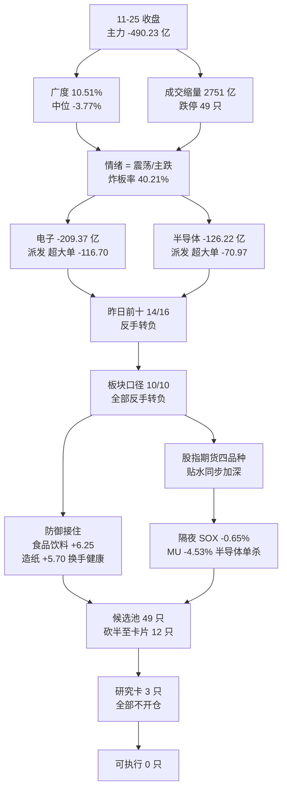

# 2026-11-26 · **资金面**

> **数据源新鲜度**: partial（两融/ETF 滞后 1 个交易日）
> **降级状态**: false
> **置信度**: 0.76
> **数据归属交易日**: 2026-11-25 收盘（= T-1，trading_gap=0）

## 一句话结论

11-25 是 11-23 普涨修复后的**连续第二日杀跌**，主力 **-490.23 亿**、广度掉到 10.51%、跌停暴增到 49 只、**缩量** 2751 亿；昨天买入的钱今天**几乎全部反手**（昨日前十 16 只中 14 只转负、板块 10 只全负），电子 -209.37 亿 / 半导体 -126.22 亿双双「派发」，钱只流向个位数到十几亿的防御与低位消费 → **情绪=震荡/主跌，候选砍半，可执行 0**。

## 详细分析

### 一、时序资金流：昨天的买入今天全部被否定

| 窗口 | 主力净额（亿） | 正日 | 读法 |
|---|---:|---:|---|
| 单日（11-25） | **-490.23** | — | 摆动 **-452.91 亿**（前一日仅 -37.32 亿） |
| 5 日 | -1087.73 | 1/5 | 连续 5 日里只有 1 天为正 |
| 10 日 | -3213.57 | — | 净流出逐级放大 |
| 20 日 | **-4194.29** | **7/20** | 账本已冷到只剩三分之一的日子为正 |

**广度与量能**：涨 **586** : 跌 **4926** : 平 61，上涨占比 **10.51%**（前一日 35.01%），中位 **-3.77%**（前一日 -0.67%）；成交 13926.6 亿，**缩量 2751.4 亿** —— 指数沪 -2.03% / 深 -3.24% / 创 -4.19% / 科创50 -5.12%。

> **关键判读**：这是**缩量普跌 + 跌停激增**，不是恐慌换手。11-24 是放量下跌（放量 2751 亿的镜像），11-25 是**缩量**下跌 2751 亿 —— 卖压不是突然放大的，而是**买盘先撤了**。承接盘枯竭比恐慌抛售更难修复。

**涨跌停（stk_limit 交易所限价逐票复核，权威口径）**：涨停 **58** / 跌停 **49** / 炸板 39，**炸板率 40.21%**（官方 limit_list_d 报 51/43/30，已补录 7 只封死涨停 / 6 只封死跌停 / 9 只炸板）。涨停:跌停 = **1.18:1**（前一日 64:4 = 16:1）。最高板 **5 板**（中京电子）。

炸板率序列：11-16 40.0% → 11-17 36.67% → 11-18 39.44% → 11-19 47.17% → 11-20 31.82% → **11-23 15.08%** → 11-24 56.16% → **11-25 40.21%**。11-23 那根 15.08% 的修复被连续两天打回。

### 二、板块：科技硬件全线派发，钱去了低位消费与防御

| 板块 | 当日主力（亿） | 超大单 | 小单 | 结构 | 5 日 | 20 日 | 判读 |
|---|---:|---:|---:|---|---:|---:|---|
| 电子 | **-209.37** | -116.70 | +166.52 | 🔴 派发 | -188.28 | **-698.96** | 昨日的买入今天全被否定 |
| 半导体 | **-126.22** | -70.97 | +89.54 | 🔴 派发 | -196.11 | -226.14 | 超大单净卖、小单接盘 |
| 数字芯片设计 | -63.94 | -38.94 | +46.77 | 🔴 派发 | -134.66 | -343.08 | 同上 |
| 电力设备 | -49.62 | -22.86 | +52.28 | 🔴 派发 | -119.04 | -321.59 | 成长端整体失血 |
| 机械设备 | -42.33 | -23.89 | +26.38 | 🔴 派发 | -79.47 | -322.92 | 同上 |
| 元件 | -40.30 | -21.78 | +39.73 | 🔴 派发 | +66.04 | -210.04 | **当日负、5 日仍正** |
| 印制电路板 | -36.55 | -20.59 | +35.58 | 🔴 派发 | +70.15 | -155.19 | **当日负、5 日仍正** |
| 食品饮料 | **+6.25** | -0.98 | -6.16 | ⚪ 中性 | -6.87 | -34.20 | 超大单净卖 → 不是机构抢筹 |
| 白酒Ⅲ | **+6.12** | -2.07 | -3.74 | ⚪ 中性 | +7.20 | +5.80 | 同上，大单在接 |
| 造纸 | **+5.70** | **+6.26** | -3.03 | 🟢 换手健康 | +6.10 | -2.18 | 机构换手、散户抛 |
| 一般零售 | +4.93 | +5.40 | -3.18 | 🟢 换手健康 | +3.96 | -13.93 | 同上 |
| 化学制药 | +4.69 | +5.37 | -5.25 | 🟢 换手健康 | -20.73 | -119.71 | 20 日仍深负，只是低位回血 |

**四档读法必须一起看**：食品饮料 +6.25 亿里**超大单是 -0.98 亿**（净卖），真正净买的是大单；只有**造纸 / 一般零售 / 化学制药** 三只是「超大单正 + 小单负」的**换手健康**结构。概念端同向印证：**新零售 +11.22 亿（超大单 +7.86 / 小单 -8.88）**、中药概念 +8.62 亿（超大单 +10.78 / 小单 -6.64）、流感 +8.75 亿（超大单 +9.54 / 小单 -6.28）—— 都是机构换手、散户抛货的形态。

**概念流出端要看穿**：融资融券 -484.90 / 基金减仓 -310.48 / MSCI中国 -299.40 / 富时罗素 -253.85 / 沪股通 -245.93 / 深股通 -230.01 / 大盘股 -209.60 —— 这些是**同一批权重票被重复计入多个基准标签**，**不能读成「六个方向同时抽血」**，真实含义只有一个：**权重股在被系统性减仓**。

### 三、昨日前十 5 日追踪：14/16 反手转负，板块 10/10 全负

**个股口径（20261125 R7 池 16 只 → 11-25）**：延续 **2** · 反手转负 **14** · 反手转正 0 · 双负 0。

| 方向 | 代表样本（前值 → 当日，亿） |
|---|---|
| 延续（2） | 胜宏科技 +6.85→**+0.58** · 天孚通信 +6.30→**+10.86**（全池当日第一） |
| 反手转负（14） | **工业富联 +22.93→-6.49（全池最大单日流出）** · 中际旭创 +11.77→-4.68 · 源杰科技 +5.43→-4.84 · 新易盛 +1.87→-4.55 · 沪电股份 +6.09→-3.22 · 寒武纪 +10.82→-3.56 · 华虹宏力 +5.20→-2.81 · 生益科技 +2.88→-4.62 · 剑桥科技 +4.91→-3.46 · 宁德时代 +4.71→-4.20 · 景旺电子 +5.01→-0.38 · 深南电路 +1.79→-3.81 · 长川科技 +2.24→-2.75 · 中芯国际 +4.51→-0.44 |

**板块口径（20261124 流入榜前 10 → 11-25）**：**10 只全部反手转负、0 只延续**。电子 +64.73→**-209.37** · 半导体 +10.73→**-126.22** · 印制电路板 +33.92→-36.55 · 元件 +30.47→-40.30 · 通信设备 +12.92→-24.44 · 消费电子 +25.00→-17.41 · 消费电子零部件 +25.62→-17.28 · 通信网络设备及器件 +17.15→-7.15 · 逆变器 +10.32→-4.01 · 国防军工 +9.56→-13.61。

> **判读**：这是**「昨日的买入全部被否定」，不是「板块轮动」**。昨日电子链的流入是短线博弈资金，今天在同一个位置被反向兑现。但要同时看 5 日累计：印制电路板 +70.15、元件 +66.04、通信网络设备及器件 +76.43 **仍为正** —— **存量还没走完，只是当日被砸**。这个区别决定了 D1 该做的动作是「等资金回补」而不是「换方向」。

**今日 5 日榜前 10（亿元）**：新易盛 +42.19 · 中际旭创 +40.67 · 天孚通信 +29.25 · 工业富联 +20.15 · 中芯国际 +16.15 · 百亚股份 +16.05 · 中微公司 +15.65 · 胜宏科技 +14.40 · 贵州茅台 +13.52 · 沪电股份 +12.61。**结构含义**：5 日榜头部仍是光模块 + PCB，但**当日方向已分裂**（新易盛 +42.19 亿的 5 日存量里当日是 -4.55 亿、天孚是唯一当日 +10.86 亿的例外）—— **5 日榜的参考价值只剩「谁还有存量」，不能当今日可买清单**。

### 四、龙虎榜与游资：机构专用仍是净卖，外资通道小额净买

**票级 1 日净额（修正口径后）**：上榜 51 只，机构专用合计 **-6.66 亿**、股通专用 **+1.33 亿**、全席位 **-3.72 亿**。

| 席位净买 top | 净额（亿） | 机构 | 股通 | 读法 |
|---|---:|---:|---:|---|
| 青山纸业 | +2.53 | 0.00 | +0.26 | 游资主导 · 机构缺席 |
| 华胜天成 | +1.24 | 0.00 | +0.43 | 游资主导 · 机构缺席 |
| 汇洲智能 | +0.94 | 0.00 | 0.00 | 游资主导 · 机构缺席 |
| 九阳股份 | +0.63 | **+1.36** | +0.96 | 机构承接（但开板 7 次） |

| 席位净卖 top | 净额（亿） | 机构 | 股通 | 读法 |
|---|---:|---:|---:|---|
| 凡拓数创 | **-1.84** | **-1.84** | 0.00 | 机构出货 |
| 东方海洋 | -1.70 | -0.01 | -0.63 | 拉高出货 |
| 果麦文化 | -1.48 | **-1.33** | 0.00 | 机构出货（股价仍 +2.77%） |
| 中京电子 | -0.55 | -0.04 | +0.33 | **5 板高度但榜净卖** |
| 冰山冷热 | -0.94 | -0.34 | 0.00 | **股价 +9.54% 但机构净卖 = 核心诱多** |

**3 日席位协同（只累加单日榜口径）**：26 个席位满足「3 日净买 >0 且 ≥2 日为正」，其中 **5 个 3/3 全正**。净买方是**外资通道（深股通专用 +3.09 亿 / 2 日正）**与**国泰海通系**（总部 +2.96 亿 3/3 全正、上海江苏路 +2.45 亿）、国信浙江互联网分公司 +2.22 亿（3/3 全正）；机构专用 3 日合计 **-1.05 亿**、股通专用 **+3.82 亿**。

> **注意口径**：本口径已修正 ——「严重异常期间…累计达到100%」是**多日累计窗口**，被隔离出 1d 票级聚合与席位协同；票级 1d 改为**跨 reason 去重**后求和。修正后逐行自检 **76/76 全部相等**（修正前 76/77，中京电子净卖被重复计成 -1.10 亿，实际 **-0.55 亿**）。

### 五、诱多识别：43 条警报，「反复开板烂板」29 条是本日最刺眼的信号

| 模式 | 条数 | 典型样本 |
|---|---:|---|
| 反复开板烂板 | **29** | 飞亚达开板 16 次收跌停 · 凯众股份开板 19 次 · 铁流股份开板 12 次 · 城地传媒开板 8 次 · 荣联科技开板 7 次 |
| 重挫日大额净卖 | 6 | 概伦电子 -17.57%（机构 -1.04 亿）· 上海电影跌停（机构 -1.00 亿）· 和仁科技 -20.00%（机构 -0.38 亿）· 艾芬达 -10.26% · 文投控股跌停 · 华晟智能 -12.78% |
| 机构净卖但股价大涨（核心诱多） | 4 | 冰山冷热 +9.54%（机构 -0.34 亿）· 创源股份 +20.03%（机构 -0.21 亿）· 康芝药业 +20.05%（机构 -0.21 亿）· 兴欣新材 +5.57% |
| 涨停但龙虎榜净卖 | 2 | **中京电子 5 板 +10.00%（榜 -0.55 亿）** · 全筑股份 2 板 +10.13%（榜 -0.62 亿） |
| 席位净买但股价收跌（拉高出货） | 2 | 联创电子（榜 +0.31 亿 / 股价 -4.85%）· 浙文影业（榜 +0.25 亿 / 股价 -6.47%） |

> **本日形态与 11-24 的差别**：11-24 的风险集中在「机构借流动性出货」，今天机构专用净卖规模反而不大（-6.66 亿），但**29 条烂板**接替成为主要杀伤力 —— 这是**游资接力失败**的形态，杀伤路径是「炸板 → 回落」，比机构出货更直接。

### 六、隔夜美股传导：SOX -0.65%，还是「半导体单杀」不是全市场崩塌

US 2026-11-25 session 已收盘（yahoo + sina 双通道 **14/14 逐票一致**，差值 ≤0.35%）。

| 指数 | 涨跌 | | 核心股 | 涨跌 | | 核心股 | 涨跌 |
|---|---:|---|---|---:|---|---|---:|
| DJI | **+0.33%** | | MU | **-4.53%** | | AAPL | **+0.43%** |
| SPX | -0.25% | | NVDA | **-3.91%** | | META | **+3.40%** |
| IXIC | -0.62% | | GOOGL | -2.13% | | MSFT | -1.25% |
| SOX | **-0.65%** | | AMZN | -3.12% | | AVGO | -0.07% |
| NDX | -0.64% | | AMD | -1.75% | | MRVL | -0.49% |

篮子口径：半导体 **-1.72%** · 存储 MU **-4.53%** · 光通信 -0.75% · 大型科技 +0.21%。

**亚洲 11-25 同向确认**：韩 **-6.16%** · 台 **-4.80%** · 日 -2.78% · 恒 -1.14%。

> **判读**：DJI 收红 + META +3.40% + AAPL +0.43%，而 MU -4.53% / NVDA -3.91% —— **这是半导体链单独被砍，不是全市场风险偏好崩塌**。含义有三层：①直接压制今日 A 股 CPO/光模块（MRVL/AVGO 是其美股映射）与存储链（MU 是长鑫/兆易/东山的估值锚）；②防御/大盘端相对抗跌，若 A 股出现「科技杀跌、红利护盘」的跷跷板，那是**外部结构映射**，不是内生资金切换；③**亚洲先跌**（韩台双跌 5%~6%）意味着外部压力已经在其他市场兑现，A 股科技链今日开盘受压是大概率事件。

### 七、杠杆、ETF 与股指期货：四品种贴水同步加深是最硬的证据

**两融（最新 20261124，T+1 未落库，gap=1）**：融资余额 21422.0 亿，单日 **+2.62 亿**，5 日 **-748.95 亿**，三所（BSE/SSE/SZSE）齐全。11-23 普涨日杠杆仅小幅回补、5 日累计仍净撤近 750 亿 —— **杠杆端始终没有增量**，11-23 的修复不是「增量杠杆进场」。

**ETF 份额（最新 20261124，gap=1）**：宽基继续逆势大额申购 —— 沪深300ETF **+64.67 亿份/+13.38%**、创业板ETF **+66.04/+14.09%**、创业板50ETF +3.02/+1.23%；科创50ETF 仅 +7.65/+0.74%（科技端没人加杠杆）、半导体ETF -0.56/-0.26%、证券ETF -6.83/-1.27%、黄金ETF -2.07/-1.76%。**这是 11-24 的申购结构，不能用来解释 11-25 的杀跌。**

**股指期货基差（当日现货口径）**：

| 品种 | 11-25 基差 | 11-24 基差 | 变化 |
|---|---:|---:|---:|
| IF | **-1.904%** | -1.212% | **-0.692pp** |
| IH | **-1.572%** | -1.077% | -0.495pp |
| IC | **-2.061%** | -1.444% | **-0.617pp** |
| IM | **-1.934%** | -1.363% | -0.571pp |

> **四品种全部贴水，且同步加深，IC/IM 幅度最大** —— 这是**对冲盘加仓 / 现货看空**的直接读数，与当日广度 10.51%、炸板率 40.21% 相互印证，是本日「不宜进攻」最硬的一条**独立**证据（不依赖 A 股资金流口径）。

### 八、跷跷板与情绪定性

**20 日负相关结构（ρ<-0.6）扫描出 6 对，去重后 3 个有效结构**：半导体 ↔ 白酒（ρ=-0.651）、电子 ↔ 白酒（ρ=-0.627）、数字芯片设计 ↔ 白酒（ρ=-0.607）。

**判读要分两层**：①5 日窗口方向反转**未确认**（reversal_confirmed_today=false）—— 半导体 5 日 -196.11 亿 vs 白酒 5 日 +7.20 亿，这 20 日负相关是**慢变量存量结构**，不是今天新出现的切换；②但 11-25 **单日维度**上白酒Ⅲ +6.12 / 食品饮料 +6.25 与电子 -209.37 / 半导体 -126.22 **方向完全相反**，是这 20 日负相关结构的又一次重演。

**对 D1 的含义**：**不把「科技→消费」当成新主线** —— 消费端流入只有个位数到十几亿量级，且白酒/食品饮料是超大单净卖（大单在接），真机构换手健康的三只（造纸 / 零售 / 医药）20 日仍是深负（-2.18 / -13.93 / -119.71）。科技链今日仍受隔夜半导体压制。**只做观察，不换方向。**

**情绪定性**：**震荡/主跌**。按纪律「炸板率 ≥ 35% 的交易日，所有输出必须显式标 情绪=震荡/主跌 并把候选数砍半」执行：候选池 49 只 → 卡片化 **12 只**（3 研究 + 9 观察），**可执行 0**。**不接高位老龙**：5 板最高（中京电子）当日榜净卖 -0.55 亿，已拦截。

## 推理深度三问 · 今日资金第一方向（消费防御承接 · 造纸 / 一般零售 / 化学制药）

- **大资金意图**: 三只换手健康板块的超大单净买合计约 +17 亿，超大单在散户抛压里接货 —— 这不是「看好消费基本面」，而是**科技链资金撤离后的临时停泊**。对手盘是昨日追进电子链的短线博弈资金（14/16 只昨日前十今天反手转负就是被对手盘兑现的痕迹）。真正的机构配置盘需要连续 3 日以上同向净买才能确认，目前只有 1 日。
- **为什么走强**: 位置极低（造纸 20 日 -2.18 亿、零售 -13.93 亿，接近 20 日累计清零）+ 催化缺席（当日无消费政策/数据硬催化）+ 筹码端是机构换手散户抛（超大单正、小单负）。**三个维度里只有「位置」和「筹码」成立，催化维度是空的** —— 这是典型的超跌反弹承接，不是趋势启动。
- **逻辑够不够硬**: 独立共振源只有 2 个（资金四档结构 + 涨停行业分布：化学制药 6 只、医药商业 4 只、百货 3 只、中成药 3 只），**硬政策/硬业绩/硬时间锚一个都没有**。证伪路径很清楚：若 11-26 消费板块超大单继续净买且涨停家数维持在 10 只以上，则升级为「资金风格切换」；若消费板块明日超大单转负，则今天只是**杀跌末段的避险停泊**，一日即破。

## 每票思维链 · 研究卡 ① 天孚通信 300394.SZ

- **买入理由**: ①当日主力 **+10.86 亿** 全市场第一（超大单 +7.06 / 小单 +14.14 量级），是 11-25 唯一逆势放量收涨的 CPO 票；②昨日前十池 16 只里**唯一延续**（昨 +6.30 → 今 +10.86），资金连续两日同向；③CPO 概念 5 日 +32.49 亿、3 日 +88.30 亿仍为正，光模块产业链没有散。
- **风险点**: ①**赔率已被 5 日涨幅吃干**（+19.6%），RR5 0.23 / RR20 1.97 双双不达标，止损距 -23.66% 超 -10% 硬区间；②CPO 概念当日 -61.58 亿是**派发**结构（超大单 -32.10 / 小单 +63.15），个股逆势但板块在撤；③隔夜 MU -4.53% / NVDA -3.91%，光通信映射 MRVL -0.49% / GLW -1.69%，今日开盘承压。
- **止损条件**: 不开仓则无需执行止损；**若 D1 给出执行许可，止损位 = 128.00 下方（即 11-25 开盘跳空缺口区 119.23 与 MA5 116.12 的上沿）**，收盘跌破 116.00 无条件离场；板块端止损 = CPO 概念超大单连续 2 日净卖则全部撤销该方向。
- **可验证假设**: 24-72h 内验证两件事 —— ①11-26 开盘 30 分钟内该股能否站上 138.00（11-25 最高价）且主力资金维持净流入；②CPO 概念超大单能否转正。若 11-26 该股高开回落收在 128 以下，或 CPO 概念超大单继续净卖，**「资金第一方向」的读法证伪**，本卡降级为「一日游资金」。

## 昨日前十 5 日追踪（板块 10 只 + 个股 16 只）

**板块口径（20261124 流入榜前 10 → 11-25）**：反手转负 **10** · 延续 0 · 反手转正 0 · 双负 0。

| 方向 | 板块（前值 → 当日，亿） | 5 日累计 | 20 日 |
|---|---|---:|---:|
| 反手转负（10） | 电子 +64.73→**-209.37** · 半导体 +10.73→**-126.22** · 印制电路板 +33.92→-36.55 · 元件 +30.47→-40.30 · 消费电子零部件及组装 +25.62→-17.28 · 消费电子 +25.00→-17.41 · 通信网络设备及器件 +17.15→-7.15 · 通信设备 +12.92→-24.44 · 逆变器 +10.32→-4.01 · 国防军工 +9.56→-13.61 | 印制电路板 +70.15（3/5）· 元件 +66.04 · 通信网络设备及器件 +76.43 · 电子 -188.28 · 半导体 -196.11 | 电子 -698.96 · 半导体 -226.14 · PCB -155.19 · 元件 -210.04 |

**判读**：**10/10 全负 = 昨日的买入全部被否定，不是轮动**。但 5 日维度 PCB / 元件 / 通信网络设备仍为正 → **存量未走完，只是当日被砸**。D1 该做的是等资金回补，不是换方向。

**个股口径（20261125 R7 池 16 只 → 11-25）**：延续 **2** · 反手转负 **14** · 反手转正 0 · 双负 0。

| 方向 | 代表样本（前值 → 当日，亿） |
|---|---|
| 延续（2） | 胜宏科技 +6.85→**+0.58** · 天孚通信 +6.30→**+10.86** |
| 反手转负（14） | **工业富联 +22.93→-6.49（全池最大单日流出）** · 中际旭创 +11.77→-4.68 · 源杰科技 +5.43→-4.84 · 新易盛 +1.87→-4.55 · 寒武纪 +10.82→-3.56 · 沪电股份 +6.09→-3.22 · 景旺电子 +5.01→-0.38 · 华虹宏力 +5.20→-2.81 · 深南电路 +1.79→-3.81 · 生益科技 +2.88→-4.62 · 剑桥科技 +4.91→-3.46 · 宁德时代 +4.71→-4.20 · 长川科技 +2.24→-2.75 · 中芯国际 +4.51→-0.44 |

**今日 5 日榜前 10（亿元）**：新易盛 +42.19 · 中际旭创 +40.67 · 天孚通信 +29.25 · 工业富联 +20.15 · 中芯国际 +16.15 · 百亚股份 +16.05 · 中微公司 +15.65 · 胜宏科技 +14.40 · 贵州茅台 +13.52 · 沪电股份 +12.61。**5 日榜头部仍是光模块 + PCB，但当日方向已分裂** —— 参考价值只剩「谁还有存量」。

## 候选与观察池

> **卡片化 12 只（3 研究 + 9 观察），可执行 0 只。** 候选池 49 只 → 剔除 37 只（每只均有显式剔除理由，见 JSON `coverage.candidates_dropped_reasons`）。研究卡**只做研究观察，不构成开仓许可**。

### 研究卡 ① 天孚通信 300394.SZ · CPO 光器件 · 当日主力全市场第一 · 昨日前十唯一延续

当日 +7.65%、成交 117.2 亿，主力 **+10.86 亿**（超大单 +7.06 / 小单 +14.14），5 日 +29.25 亿（4/5 正）、20 日 -31.28 亿。**板型**：无板（放量阳线，20 日位置 33.6% 中低位）。**龙头认定**：过 2 条 —— ①光器件环节当日资金第一且昨日前十池唯一延续；②CPO 概念 5 日 +32.49 亿、3 日 +88.30 亿链未散。**盈亏比**：止损距 **-23.66%（超 -10% 硬区间）**、RR5 0.23 / RR20 1.97 双双不达标。**禁止清单**：命中「止损距越界」+「RR5<2」+「RR20<2」三条，叠加隔夜 MU/NVDA 压制。**结论：研究卡，不开仓** —— 资金强度全池第一，但赔率已被 5 日涨幅吃干，追高即接盘。

### 研究卡 ② 中际旭创 300308.SZ · CPO 权重核心 · 5 日资金第二 · 全池唯一「止损合规 + RR20 达标 + 低位」

当日 -1.92%、主力 **-4.68 亿**（由昨日 +11.77 亿**反手转负**，是昨日前十 14 只转负之一），但 5 日仍 **+40.67 亿**（4/5 正）。**板型**：无板（回踩，20 日位置 **12.8%** 极低位，收盘在 MA5/MA10 之下）。**龙头认定**：过 2 条 —— ①CPO 权重核心、5 日资金全场第二；②20 日位置 12.8% 属低位，赔率结构仍在。**盈亏比**：止损距 **-7.59%（落在 -5~-10% 硬区间内，合规）**、**RR20 6.79 ≥ 2 达标**；不过的是 RR5 1.93 < 2。**禁止清单**：命中「RR5<2」一条，叠加「当日资金反手转负」+「20 日存量 -40.46 亿未回正」+「隔夜 MU/NVDA 崩塌」。**结论：研究卡，不开仓** —— 全池结构最干净的一张，但当日资金已经掉头，必须等资金重新转正再谈。

### 研究卡 ③ 深南电路 002916.SZ · PCB · 20 日资金回正 + 融资逆势加杠杆 + 止损合规

当日 -5.08%、主力 -3.81 亿，5 日 +7.68 亿（4/5 正）、**20 日 +3.05 亿（为正）** —— 而 PCB 行业 20 日仍是 -155.19 亿深负，**个股存量已跑赢板块**；融资余额 5 日 **+18.52%**（逆势加杠杆，全池最猛之一）。**板型**：无板（回踩，20 日位置 17.6% 低位）。**龙头认定**：过 3 条 —— ①PCB 链个股 20 日资金唯一回正；②5 日 4/5 正且资金连续；③融资 5 日逆势加杠杆（散户在恐慌里加杠杆 = 筹码未散）。**盈亏比**：止损距 **-8.66%（合规）**、**RR20 4.69 ≥ 2 达标**；不过的是 RR5 1.58 < 2。**禁止清单**：命中「RR5<2」一条，叠加「当日资金仍流出」+「PCB 板块当日 -36.55 亿派发」。**结论：研究卡，不开仓** —— 结构最干净的一张，只做观察。

### 观察池（9 只 · 全部拦截/降级，理由随卡）

| 代码 | 名称 | 当日主力 | 5 日 | 20 日 | 位置 | 止损距 | RR5/RR20 | 结论与理由 |
|---|---|---:|---:|---:|---:|---:|---|---|
| 300476.SZ | 胜宏科技 | +0.58 | +14.40 | -38.58 | 22.7% | -13.57% | 0.81/3.40 | **观察**：昨日前十唯一延续 + PCB 龙头，但止损越界 + RR5<2 |
| 300502.SZ | 新易盛 | -4.55 | **+42.19（第一）** | +21.08 | 29.9% | -16.16% | 0.71/2.34 | **观察**：5 日榜唯一「5 日+20 日双正」CPO 权重，但当日反手转负 + 止损越界 |
| 002463.SZ | 沪电股份 | -3.22 | +12.61 | -5.38 | 24.5% | **-9.71% 合规** | 1.45/3.09 | **观察**：PCB 龙头，止损合规 + RR20 达标，但当日 -5.51% + RR5<2 |
| 688498.SH | 源杰科技 | -4.84 | +4.20 | +14.32 | **6.3% 最低** | -3.02% | 7.12/14.82 | **观察**：位置最低 + 20 日为正，但止损距窄于 -5%（参数不成立）+ 资金 3/5 |
| 603083.SH | 剑桥科技 | -3.46 | **-3.19** | -7.92 | 12.3% | -7.16% 合规 | **2.04/7.10** | **观察**：全池唯一技术面三项全过，但 **5 日资金为负 = 未确认** |
| 688981.SH | 中芯国际 | -0.44 | +16.15 | +40.20 | 81.4% | -14.07% | 0.34/0.34 | **观察**：科创链少数 20 日为正，但高位 + 止损越界 |
| 300086.SZ | 康芝药业 | +0.82 | +0.81 | +0.45 | 91.3% | -21.65% | 0.00/0.10 | **拦截**：20cm 涨停但机构专用净卖 -0.21 亿（核心诱多） |
| 601138.SH | 工业富联 | **-6.49** | +20.15 | -31.07 | 36.2% | -11.61% | 0.55/1.76 | **观察**：昨日前十反手转负最狠的一只（全池最大单日流出） |
| 003006.SZ | 百亚股份 | +3.32 | +16.05 | **+64.04** | **0.6% 最低** | -0.16% | 100.67/158.00 | **观察**：消费防御切换方向 + 5/5 全正，但止损参数为分母压缩假象 |

### 剔除要点（37 只，完整理由见 JSON）

- **最高板全部拦截**：中京电子 5 板当日榜净卖 -0.55 亿、全筑股份 2 板榜净卖 -0.62 亿（机构 0.00，纯游资接力无机构接盘）。
- **诱多样本全部拦截**：冰山冷热 +9.54% 机构净卖 -0.34 亿、创源股份 20cm 3 板机构净卖 -0.21 亿、兴欣新材 +5.57% 机构净卖 -0.22 亿、概伦电子 -17.57% 机构净卖 -1.04 亿、上海电影跌停机构净卖 -1.00 亿、和仁科技 -20.00% 机构净卖 -0.38 亿、艾芬达 -10.26%、文投控股跌停、华晟智能 -12.78%、联创电子与浙文影业（席位净买但股价收跌）。
- **机构出货票拦截**：凡拓数创（榜 -1.84 亿，全池最大单票净卖，机构 -1.84 亿）、果麦文化（榜 -1.48 亿，机构 -1.33 亿但股价仍 +2.77%）、东方海洋（榜 -1.70 亿，股通 -0.63 亿）。
- **高位无赔率拦截**：青山纸业（涨停但 20 日位置 91.1%、止损 -21.69%）、好当家（20 日位置 100%）、金新农 4 板（20 日位置 100%）、汇洲智能 3 板（20 日位置 100%）、荣联科技（开板 7 次）、城地香江、九阳股份（开板 7 次且主力转负）。
- **烂板拦截**：飞亚达（开板 16 次收跌停）、凯众股份（19 次）、铁流股份（12 次）等 29 条反复开板样本。
- **无涨停基因不推**：贵州茅台 / 长江电力 / 平安银行 / 宁波银行 —— 当日确有主力净流入（+3.55 / +1.82 / +1.97 / +1.60 亿），但**日波动 <2%、无涨停基因**，属防御端被动流入，不是进攻标的。

## 数据源审计

| 源 | 日期 | 状态 | 备注 |
|---|---|:--:|---|
| tushare.moneyflow_dc | 2026-11-25 | 🟢 | 22 日 × 6036 只/日 · 个股主力净额（东财口径，含四档） |
| tushare.moneyflow_ind_dc | 2026-11-25 | 🟢 | 行业 496 + 概念 531 × 22 日（四档 + rate 齐全） |
| tushare.stk_limit + daily | 2026-11-25 | 🟢 | 8 日 · 交易所限价唯一权威（逐票比对） |
| tushare.limit_list_d | 2026-11-25 | 🟡 | 官方 U/D/Z = 51/43/30 → 复核后 **58/49/39**（补录 7 涨停 / 6 跌停 / 9 炸板） |
| tushare.top_list / top_inst | 2026-11-25 | 🟢 | 4 日 · 77 行榜 / 2370 行席位 · 修正口径后 **76/76 相等**（1d/3d 分列 + abn 隔离 + 跨 reason 去重） |
| tushare.margin | 2026-11-24 | 🟡 | **20261125 T+1 未落库（gap=1）**；三所齐全，单日 +2.62 亿、5 日 -748.95 亿 |
| tushare.fund_share | 2026-11-24 | 🟡 | **20261125 未落库（gap=1）** → 只能作背景 |
| tushare.fut_daily + index_daily | 2026-11-25 | 🟢 | IF/IH/IC/IM 基差四品种全部贴水且同步加深 |
| tushare.daily / daily_basic | 2026-11-25 | 🟢 | 全市场 5573 只 · 成交/换手/市值/PE |
| tushare.block_trade + margin_detail | 2026-09-15~11-25 | 🟢 | 全市场大宗 + 49 票两融明细 |
| eastmoney/vibe 逐票 | 2026-11-25 | 🟢 | **49/49 票** block_trades 30d + margin_trading 15d · **null = 0** |
| yahoo US + sina US 双通道 | 2026-11-25 | 🟢 | 14 只 + SPX/IXIC/SOX/NDX/DJI · **已收盘**，两通道收盘价逐票一致 14/14 |
| tushare.index_global | 2026-11-25 | 🟢 | 亚洲 4 市场收盘（韩 -6.16% / 台 -4.80% / 日 -2.78% / 恒 -1.14%） |
| data/raw/20261126/manifest | — | 🔴 | 目录不存在 → severity 不可读，confidence 无硬上限（最近可读为 20261125，severity=0） |
| overseas_snapshot | 2026-11-25 | 🟡 | data/raw/20261126/ 不存在 → 改用 yahoo+sina 双通道独立抓取，session 已收盘 |
| tushare 期权隐波 | — | 🔴 | 无数据源 · 留空不编造 |
| 北向资金（moneyflow_hsgt / hk_hold） | — | ⬜ | 2026-10-28 起停抓 · retired stub，不调用不补 |

## 不确定性 / 反证

1. **反手转负的两种解释未分离**：14/16 反手转负既可能是「昨日买入全部被否定」（多头溃散），也可能是「同批短线资金换仓到别处」。区分证据要等 11-26 收盘看电子链 5 日累计是否转负 —— 若 11-26 电子链继续流出，则 5 日 -188.28 亿会快速恶化，「等待回补」的判断需要修正。
2. **消费承接的量级不够**：防御端流入只有 6-11 亿量级，而流出端电子 -209.37 亿是它的 **30 倍以上**。这种「小口进、大口出」的结构意味着防御端是**停泊**而非**切换**，把消费当新主线是最容易犯的误读。
3. **白酒/食品饮料不是机构买**：两者的超大单都是净卖（-2.07 / -0.98），净买的是大单。若 D1 用「板块主力净流入」做主线筛选，会把「大单接超大单的货」误读成机构建仓。
4. **炸板率 40.21% 仍在红线之上但比前一日低**：这既可能是杀跌动能衰减，也可能是「该跌的跌完了」的短暂喘息。11-24 是 56.16% → 11-25 降到 40.21%，单日方向**不能**用来判定拐点，需要 11-26 连续确认。
5. **缩量下跌的双面性**：缩量意味着抛压不大，但更意味着**买盘缺席**。历史上缩量普跌后的次日反弹质量通常低于放量反弹后的次日，本报告不把「缩量」当作利好。
6. **两融与 ETF 均滞后 1 档**：11-25 杠杆是继续撤还是回补、ETF 是否被赎回，今日盘后才知；本报告不用 11-24 的数据解释 11-25。
7. **股指期货基差受套保需求与分红因素干扰**，不能单独作为方向判据，此处只作交叉印证 —— 但四品种同步加深的方向一致性提高了它的可信度。
8. **美股已收盘但仍是「昨夜」**：US 11-25 定稿（SOX -0.65%），压制方向确定；但**今日美股 11-26 开盘会否继续下杀未知**，若继续跌，A 股科技链估值锚会二次下移。
9. **本口径修正的历史产物未回溯**：11-25 及更早的 R7 产物未做同样的 abn 隔离与跨 reason 去重（历史文件不在本次写入白名单内），**跨日比较龙虎榜净额时需注意口径差异**。
10. **R2 主线未就绪**（07:30 并行）：候选池用五条独立证据自建（昨日前十 16 只继承 + 当日主力 top12 + 5 日主力 top12 + 龙虎榜净买/净卖各 8 只 + 全部非烂板诱多样本 14 只）；若 R2 给出不同主线，方向判定需由 D1 仲裁。

## 与其他 R/D/E 的关系

- **依赖**: `data/research/20261125/R7_capital_flow_20261125.json`（昨日前十板块 10 只 + 个股 16 只继承）、`data/raw/20261126/`（盘前 pipeline 未产出，manifest / overseas_snapshot 不可读）、`data/research/20261126/_work/`（本 skill 全部中间产物）
- **被消费**: R2（主线板块资金约束）、R5（个股画像的资金维度）、R6（反证输入，R6 保留唯一 hard_reject 权）、D1（盘前决策的仓位与方向约束）、P2（11:35 盘中增量修订）、E1（盘后复盘对照）
- **边界**: 本 skill 只做资金三维统合，不做风格（R1）、不做板块排序（R2）、不做个股画像（R5）、**不授予开仓权**；`execution_candidates=[]`，全部 `research_only=true` / `execution_eligible=false`

## Sub-Agent 元数据

- skill: analyze_capital_flow_v1
- artifact: data/research/20261126/R7_capital_flow_20261126.json（+ R7_capital_flow.json 同步副本）
- 中间数据: data/research/20261126/_work/（mf_dc 22 日、mf_ind_dc 22 日、daily+sl 8 日、toplist/topinst 4 日、margin 21 日、etf_share、fut_daily、us_yahoo + us_live、vibe_stock 49 只、_calc.json / _calc_market.json / fut_basis.json）
- 口径修正: 龙虎榜 abn 隔离 + 跨 reason 去重 + 可转债剔除（修正后逐行自检 76/76 全等）
- 生成耗时: 约 35 分钟（04:31 起抓数据 → 05:00 美股收盘定稿 → 05:04 落盘）
- confidence 三因子: base_confidence: 0.88 · freshness_factor: 0.90 · source_agreement_factor: 0.96 → confidence = min(0.95, max(0.05, 0.88 × 0.90 × 0.96)) = **0.76**
- model: MiniMax-M3.1-Flash
