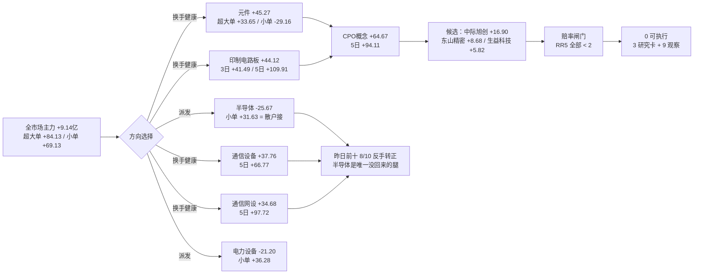

# 2026-11-27 · **资金面**

> **数据源新鲜度**: partial
> **降级状态**: false
> **置信度**: 0.77

## 一句话结论

11-26 主力从 -490.23 亿反手到 +9.14 亿，钱只回流一条链：CPO/光模块 + PCB（四条腿全部「换手健康」、5 日全正），但广度仍 31.66% 上涨、20 日主力仍 -3481.31 亿——**是修复不是反转，0 可执行，3 张研究卡全部不开仓。**

## 详细分析

### 一、市场级四档：机构在接、游资在退

11-26 全市场主力净额 **+9.14 亿**（前一日 -490.23 亿，摆动 +499.37 亿）。拆四档看结构才是关键：超大单 **+84.13 亿**、大单 **-75.00 亿**、中单 **-81.10 亿**、小单 **+69.13 亿**。这不是「全线买」，是**超大单单独承接、大单与中单在减仓、小单跟买**。配合广度（上涨 1766 : 下跌 3642，占 31.66%；中位 -0.79%；成交 13259.9 亿、缩量 666.7 亿）与指数（沪 +0.01%、深 -0.02%、创业板 +0.29%、科创50 **-1.36%**），可判定为**缩量、窄幅、结构极度分化的修复日**，不是普涨。

从 20 日账本看更冷：主力 5 日 -765.44 亿、10 日 -2679.31 亿、**20 日 -3481.31 亿，仅 8/20 日为正**。今天这 9 亿是修复的第一档，尚无任何一条腿回到存量正区间。

**大资金意图**: 超大单 +84.13 亿同时小单 +69.13 亿，说明大资金不是在收集筹码，而是在**给一个特定方向重新定价**（光通信+PCB），其余方向继续撤退。
**为什么走强**: 一日的资金反手 + 亚太 risk-on 同向 + 四品种期货贴水收窄，三件事同向发生。
**逻辑够不够硬**: 硬度中等偏上——四档与基差是独立证据面，但 20 日存量与两融 5 日 -868.76 亿仍在否定「反转」叙事。定性为「修复」，不改。

### 二、钱只去了一个地方：CPO/光模块 + PCB 链

| 板块 | 当日主力(亿) | 超大单 | 小单 | 结构 | 3日 | 5日 | 20日 | 当日涨幅 |
|---|---|---|---|---|---|---|---|---|
| 元件 | **+45.27** | +33.65 | -29.16 | **换手（健康）** | +35.44 | **+108.49** | -74.73 | +3.66% |
| 印制电路板 | **+44.12** | +32.85 | -28.01 | **换手（健康）** | +41.49 | **+109.91** | -28.58 | +4.75% |
| 通信 | +42.22 | +29.05 | -19.87 | 换手（健康） | +21.43 | +59.06 | -152.37 | +0.85% |
| 通信设备 | +37.76 | +25.18 | -15.82 | 换手（健康） | +26.24 | +66.77 | -136.92 | +0.81% |
| 通信网络设备及器件 | +34.68 | +21.73 | -14.38 | 换手（健康） | +44.68 | +97.72 | -38.88 | +1.43% |
| 电子（大类） | +16.75 | +37.78 | +7.08 | **普涨抢筹** | -127.89 | -189.03 | -372.99 | -0.02% |
| 有色金属 | +19.42 | +17.75 | -7.68 | 换手（健康） | -30.32 | -45.59 | -248.53 | +0.63% |
| 半导体 | **-25.67** | +1.39 | +31.63 | **结构性换手（宽度差）** | -141.16 | -252.29 | -115.41 | -0.72% |
| 电力设备 | -21.20 | -4.78 | +36.28 | **派发** | -67.97 | -112.35 | -305.28 | -0.77% |
| 电池 | -17.06 | -8.10 | +24.20 | 派发 | — | -60.74 | -133.62 | — |
| 医药生物 | -14.82 | -5.28 | +9.75 | 派发 | — | -67.43 | -295.28 | — |
| 数字芯片设计 | -10.99 | -3.01 | +14.68 | 派发 | — | -126.05 | -288.74 | — |

**读法（四档背离）**：元件 / PCB / 通信三兄弟全部是「主力正 + 超大单正 + 小单负」= **换手（健康）**，即大单在接小单抛出的筹码；并且 **3 日与 5 日累计全为正**（PCB 5 日 +109.91、元件 +108.49）。这是本日唯一「当日 + 3 日 + 5 日三段一致」的方向。反面对照：半导体主力 -25.67 而小单 **+31.63**（散户在接机构货）、电力设备 -21.20 且小单 +36.28（典型派发），这两类是**最危险的结构**，不因「跌幅不大」而放松。

概念端同一批票被多标签重复计价：通信技术 +79.17、5G +77.24、**CPO +64.67（超大单 +39.39 / 小单 -27.87）**、光通信模块 +47.22、数据中心 +44.45；CPO 概念 5 日 **+94.11 亿**。不要读成「五个方向同时被买」。

**大资金意图**: 机构在光模块/覆铜板/PCB 上用超大单建仓，同时把半导体（晶圆/设备）的筹码交给散户。
**为什么走强**: 昨日被砸的同一批票今天被买回（见下节追踪），不是新钱进场，是**同一批资金回头**。
**逻辑够不够硬**: 硬——四档结构 + 三段累计同向，是当日最完整的一组证据；但「20 日仍负」说明存量还没修复完。

### 三、昨日前十 5 日追踪：8/10 板块被买回，个股 6 只反手转正

板块口径（11-25 当日流入前十 → 11-26）：

| 板块 | 11-25 | 11-26 | 判定 |
|---|---|---|---|
| 电子 | -209.37 | **+16.75** | 反手转正 |
| 印制电路板 | -36.55 | **+44.12** | 反手转正 |
| 元件 | -40.30 | **+45.27** | 反手转正 |
| 消费电子零部件及组装 | -17.28 | **+7.57** | 反手转正 |
| 消费电子 | -17.41 | **+6.05** | 反手转正 |
| 通信网络设备及器件 | -7.15 | **+34.68** | 反手转正 |
| 通信设备 | -24.44 | **+37.76** | 反手转正 |
| 逆变器 | -4.01 | **+0.44** | 反手转正 |
| 半导体 | -126.22 | **-25.67** | 持续流出 |
| 国防军工 | -13.61 | **-3.62** | 持续流出 |

个股口径（14 只）：**6 只反手转正**（新易盛 -4.55→+9.60、中际旭创 -4.68→+16.90、工业富联 -6.49→+5.58、沪电 -3.22→+1.52、景旺 -0.38→+1.60、紫金 -1.62→+4.18）、**5 只延续**（天孚 10.86→2.97、百亚 3.32→2.96、胜宏 0.58→3.88、茅台 3.55→2.88、京东方 3.27→1.51）、**2 只持续流出**（中芯 -0.44→-2.82、中微 -1.10→-2.30）、**1 只反手转负**（青山纸业 +5.98→-0.49）。

**这是「昨天的抛售今天被同一批资金买回」而不是板块轮动**：铺垫在于昨日十个板块当日全部为负（无一延续），今日八个翻正。注意半导体是唯一没回来的腿——回流是**光通信+PCB 局部**，不是全科技链。

### 四、龙虎榜诱多识别：88/88 自检全等，36 条警报

口径先交代：`top_inst` 按 `(trade_date, ts_code, reason, exalter, buy, sell)` 去重后求和，1d / 3d 分列（3 日累计只累加单日榜），可转债隔离。去重后全席位净额与 `top_list.net_amount` **逐行相等 88/88、差额 0.0000 亿**。票级 1d 57 只：机构专用 **-1.90 亿**、股通 **+0.41 亿**、全席位 **+9.49 亿** —— 净买方是游资/自然人，机构在榜上是净卖。

诱多 5 类命中 36 条（**反复开板烂板 22 / 机构净卖但股价大涨 6 / 涨停但龙虎榜净卖 3 / 重挫日大额净卖 5**），典型样本：

- **北纬科技 +10.03%**：榜净卖 **-4.98 亿**、机构专用 **-1.77 亿** → 涨停但机构出货，属「涨停净卖 + 核心诱多」双命中（high）
- **华东重机 -10.01%**：榜净卖 **-5.10 亿**、机构 -1.30 亿 → 跌停净卖（high）
- **东方海洋 +9.91%**：榜净买 +1.94 亿但**机构净卖 -0.92 亿**、开板 8 次 → 散户接机构货 + 烂板（high，双命中）
- **襄阳轴承 +10.02%**：榜净买 +5.74 亿但机构 -0.38 亿 → 纯游资接力（mid）
- **盛合晶微 +18.94%**：榜净买 +3.20 亿但机构 -0.25 亿、20 日位置 86% → 高位放量（mid）

**大资金意图**: 机构在榜上是净卖方（-1.90 亿），净买全靠游资席位；因此「榜净买」不能当成机构看多。
**为什么诱多**: 涨停/大涨 + 机构净卖的组合，是借散户流动性出货的标准形态。
**逻辑够不够硬**: 硬——88/88 逐行自检说明口径干净，且机构/股通/其余三类分列，不存在「机构虚增」的历史坑。

### 五、外部与衍生品：隔夜无新增信息，记忆里的「SOX 压制」不要复用为利空

**关键日历事实**：US **2026-11-26 为感恩节休市**（yahoo 最后一根日 K = 20261125、sina gb_ 同步确认），所以「隔夜美股」最新可得收盘仍是 **11-25**。该组数字（SOX -0.65%、NVDA -3.91%、MU -4.53%、AMZN -3.12%、TSM -1.96%、GLW -1.60%，而 META +3.40%、AAPL +0.43%、DJI +0.33%）**A 股 11-26 已经消化过了**，对 11-27 开盘不构成新增变量。

这反过来说明一件更重要的事：**11-26 A 股 CPO/PCB 是在 SOX 下跌的外围压制下、由内生资金逆势买起来的**（四档「超大单买/小单卖」为证），不是美股映射。所以若 11-27 科技链冲高回落，归因应落在 A 股自身筹码（20 日主力仍 -3481.31 亿），而不要把 11-25 的旧数据当新利空。

其余外部与衍生品同向确认：亚太 11-26 台 **+2.50%**、恒 **+1.19%**、日 **+0.86%**、韩 +0.29%；股指期货四品种贴水**同步收窄**（IF -1.904%→-1.301%、IH -1.572%→-1.369%、IC -2.061%→-1.251%、IM -1.934%→-1.136%）= 对冲盘减仓。两项都与当日主力转正一致，是独立证据面。

两融则是反向约束：最新 20261125 融资余额 **21213.86 亿**、单日 **-208.14 亿**、5 日 **-868.76 亿** —— 散户杠杆仍在撤，没有回补。ETF 份额（同为 11-25）显示宽基逆势申购：沪深300ETF +62.41 亿份（+12.56%）、创业板ETF +58.66（+11.97%）、中证500ETF +42.46（+45.05%）、半导体ETF 转正 +5.80（+2.73%），证券ETF -7.73（赎回）。

## 关键证据

- 证据 1: 主力净额 -490.23 亿 → **+9.14 亿**，四档超大单 +84.13 / 大单 -75.00 / 中单 -81.10 / 小单 +69.13 · 来源 tushare moneyflow_dc（22 日 132,725 行）
- 证据 2: 元件 +45.27（超大单 +33.65 / 小单 -29.16）、PCB +44.12（+32.85 / -28.01）、通信设备 +37.76、通信网设 +34.68，**四条腿全部「换手（健康）」且 5 日分别 +108.49 / +109.91 / +66.77 / +97.72 全正** · 来源 tushare moneyflow_ind_dc（23,484 行）
- 证据 3: 昨日前十板块 **8/10 反手转正**、个股 6/14 反手转正、5 只延续、半导体是唯一没回来的腿 · 来源 R7 时间序列自建（mw_dc + ind_dc 同日轴对齐）
- 证据 4: 龙虎榜去重后 **88/88 与 top_list.net_amount 逐行相等**（差额 0.0000 亿）；机构专用 1d **-1.90 亿**、股通 +0.41 亿、全席位 +9.49 亿 · 来源 tushare top_list / top_inst（4 日 3,290 行）
- 证据 5: 诱多 36 条（烂板 22 / 核心诱多 6 / 涨停净卖 3 / 重挫净卖 5），北纬科技 +10.03% 却榜净卖 -4.98 亿（机构 -1.77 亿）· 来源 top_inst + limit_list_d
- 证据 6: 涨跌停权威口径 **U70 / D9 / 炸板 35（炸板率 33.33%）**，官方 limit_list_d 为 U65/D5/Z29，补录 5 涨停 / 4 跌停 / 6 炸板 · 来源 tushare stk_limit 逐票比对
- 证据 7: 期货四品种贴水同步收窄（IF +0.603pp、IC +0.810pp、IM +0.798pp、IH +0.203pp）= 对冲盘减仓 · 来源 tushare fut_daily + index_daily
- 证据 8: US 2026-11-26 休市，最新收盘 11-25；SOX -0.65% / NVDA -3.91% / MU -4.53%，双通道 14/14 一致 · 来源 overseas_snapshot + yahoo chart + sina gb_
- 证据 9: 两融 5 日 **-868.76 亿**（最新 11-25）= 杠杆仍在撤，与主力当日转正是两件事 · 来源 tushare margin

## 逐票思维链 · 首推研究卡：中际旭创(300308.SZ)

- **买入理由**: 当日主力 **+16.90 亿**（全市场第一），5 日 **+47.09 亿**（4/5 正），20 日 -13.90 亿已接近打平；昨日还是 -4.68 亿，今日反手力度全池最大。所属 PCB/光模块链四腿全「换手健康」，CPO 概念 5 日 +94.11 亿。20 日位置 25.2%、距 20 日高 -31% 级别 → **低位总龙**，符合「只做龙头或低位」。
- **风险点**: **止损距 -12.14% 越出 -5~-10% 硬区间**（10 日低点 10x.x，收盘已远离），一旦回踩必须按纪律离场而不是摊平；隔夜外部虽无新增信息，但 20 日主力仍负（存量未修复）；半导体小单在接盘（+31.63 亿）意味着同板块内部分化，CPO 一条腿撑不起整个科技链。
- **止损条件**: 破 10 日低点（约 -12% 位置）无条件离场；日内若出现「超大单转负 + 小单转正」的四档翻转，当日即降级为观察。
- **可验证假设**: ①若 11-27 CPO 概念当日主力继续为正且小单为负，则「换手健康」结构延续，研究卡可升级为观察池首位；②若 CPO 概念当日主力转负、小单转正，则 11-26 的 +64.67 亿被确认为单日脉冲，直接剔除；③若两融 5 日转为正（杠杆回补），则「修复」可升级为「反转」的第一档确认。

## 数据源审计

| 源 | 状态 | 抓取时间 | 记录数 | 备注 |
|---|---|---|---|---|
| tushare moneyflow_dc 22 日 | 🟢 ok | 2026-11-27 04:31 | 132,725 | 全市场四档，22 日无缺日 |
| tushare moneyflow_ind_dc 22 日 | 🟢 ok | 2026-11-27 04:31 | 23,484 | 行业 496 + 概念 531 |
| tushare daily / stk_limit 8 日 | 🟢 ok | 2026-11-27 04:31 | 5,578 / 5,658（当日） | 交易所限价逐票比对，权威 U70/D9/Z35 |
| tushare limit_list_d 8 日 | 🟡 partial | 2026-11-27 04:31 | 99（当日） | 官方漏报 ST 与部分封死跌停，已用 stk_limit 补录 |
| tushare top_list / top_inst 4 日 | 🟢 ok | 2026-11-27 04:31 | 329 / 3,290 | 去重后 88/88 自检全等 |
| tushare index_daily 8 指数 | 🟢 ok | 2026-11-27 04:31 | 8 | 沪/深/创/科创50/沪深300/中证500/中证1000/上证50 |
| tushare margin 全市场 | 🟡 stale | 2026-11-27 04:39 | 90 | 最新 20261125，T+1 未落库（gap=1） |
| tushare fund_share 7 ETF | 🟡 stale | 2026-11-27 04:39 | 7 | 份额最新 20261125（gap=1） |
| tushare fut_daily 四品种 | 🟢 ok | 2026-11-27 04:39 | 4 | IF/IH/IC/IM 基差与前一日 |
| tushare index_global | 🟢 ok | 2026-11-27 04:39 | 8 | 亚洲含 HSI/N225/KS11/TWII |
| vibe-trading（东财独立通道） | 🟢 ok | 2026-11-27 04:38 | 52 票 | 逐票 block_trades + margin_15d，null=0 |
| overseas_snapshot（数据管线） | 🟢 ok | 2026-11-26 22:30 | 12 票 | US 11-25 收盘，freshness=fresh（程序已识别休市） |
| yahoo chart + sina gb_（双通道） | 🟢 ok | 2026-11-27 04:45 | 19 | 14/14 逐票一致（差值 ≤0.35%） |

## 不确定性 / 反证

1. **「修复」可能只是一日反抽**：20 日主力仍 -3481.31 亿、仅 8/20 日为正，两融 5 日 -868.76 亿。11-25 也是「缩量普跌」、11-26 只是把跌停从 49 只收到 9 只。若 11-27 CPO/PCB 当日主力转负、小单转正，则本报告的多方结构立刻失效，必须当日降级。
2. **广度与赚钱效应仍是差的**：31.66% 上涨、中位 -0.79%、涨跌停 70:9 但最高仅 5 板（克来机电开板 3 次、封单 0.69 亿）——连板高度低且封单薄，接力链条短。按纪律「炸板率 ≥35% 砍半」今天 33.33% 未触发，但仍须谨慎：22 只烂板与 6 只核心诱多说明**打板容错率很低**。
3. **光模块内部分化**：中际旭创 +16.90 / 新易盛 +9.60 / 天孚 +2.97，热度集中在两只权重，天孚已明显衰减（昨日 +10.86 → 今日 +2.97）。若 11-27 出现「权重护盘、弹性票补跌」，则是链内退潮而非板块退潮。
4. **RR5 全部不达标是全池共同缺陷**：当日涨幅普遍 2%~13%，5 日上行空间被吃掉（RR5 0.12~1.03），这就是「0 可执行」的直接原因；研究卡不构成开仓许可，仍受 R6 hard_reject 与 D1 逐票门禁约束。
5. **美股口径**：11-26 休市，本报告的「隔夜」是 11-25 收盘。若有人在 11-27 引用「SOX -0.65% 压制今日」即为**复用旧数据当新利空**，本条已显式标注。

## 与其他 R/D/E 的关系

- 依赖: `data/raw/20261126/overseas_snapshot.json`、`data/research/20261126/R7_capital_flow_20261126.json`（昨日前十跟踪基线）、tushare 全量接口、vibe-trading MCP
- 被消费: D1（canghai-plan，取 `main_force` / `hot_money` / `limit_universe` / `timing_focus`）、R2（主线资金约束）、R5（个股画像资金腿）、R6（反证输入）、E1（盘后复盘基线）
- 本 skill **不授开仓权**：`research_candidates` 全部 `research_only=true`、`execution_eligible=false`，`execution_candidates=[]`；hard_reject 唯一来源仍是 R6

## Sub-Agent 元数据

- skill: analyze_capital_flow_v1
- artifact: data/research/20261127/R7_capital_flow_20261127.json（744,975 bytes）
- 生成耗时: 约 40 分钟（含 76 次 tushare 拉取 + 52 票 vibe 硬调用 + US 双通道）
- model: deepseek-v4.1-flash
- confidence 三因子: base_confidence **0.88** / freshness_factor **0.90** / source_agreement_factor **0.97** → 0.88×0.90×0.97 = 0.7682 → **0.77**
