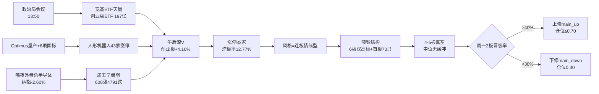

# 2026年10月26日 · 风格研判：政策底深V之后，连板情绪回来了半格

周一盘前要回答的问题只有四个：市场在为什么付钱、现在处在哪一段、谁有地位、今天做什么不做什么。本单元的全部数据取自 20261023 周五收盘，22 个同花顺风格板块与 20 只 ETF 全部在线重取、30 个共同交易日无缺格，外盘取到 20261023 美股完成日。结论先说：这是一次真实的、有政策推手的深V修复，情绪在一天之内从冰点烧到贪婪，但结构是"哑铃"——两头硬、中间空，所以仓位给半仓而不是给满仓。

## 一、🎯 市场在为什么付钱：一天之内，钱换了两个方向

周五的盘面值得逐段还原。09:30 开盘时全市场只有 608 只上涨、4791 只下跌，11:30 仍有 52 只跌停、643 只上涨，这是一副要继续崩的架势——毕竟隔夜纳指跌 2.60%、英伟达跌 4.4%、费城半导体指数跌 6.7%、Meta 十年来首次现金流转负跌 7%。转折发生在午后：13:50 中共中央政治局召开会议的消息出来，宽基 ETF 开始天量拉升，创业板 ETF 单日成交 197 亿、是上市以来第三高，沪深 300 ETF 与科创 50 ETF 也都超过 150 亿；科技权重集体拉起，指数一路走强。收盘时全市场 4526 只上涨、909 只下跌，创业板指涨 4.16%、深证成指涨 2.79%、上证指数涨 0.89% 报 3690.48，成交 19728 亿、比前一天放量 4310 亿。

情绪的三个硬指标同时翻正：涨停 82 家、跌停 6 家、炸板 12 家，炸板率 12.77%——过去四个交易日这个数字分别是 31.34%、34.94%、27.54%、41.07%，也就是说周五的封板质量是一个月里最好的一天。昨日 33 只涨停股今日全池复算，平均溢价 +3.38%、中位 +4.55%、66.7% 收红，而周四（10/22）还是 48 只跌停、炸板率 41.07% 的地狱景象。全市场 147 只涨幅超过 9.9%、572 只超过 5%、跌幅超过 9.9% 的只有 16 只，中位数 +1.56%。

但钱的去向分两层，这是本单元最想强调的一点。把 42 个标的的 30 日收益做相关矩阵，打板族（打板、打首板、打二板以上、非ST二板、非ST三板以上这五只风格板块）与大本营 36 只的平均相关系数只有 0.372，打板族内部 0.324，大本营内部 0.64——游资定价层与机构定价层接近两个独立市场。周五这两层第一次同向：游资层的高标双板簇涨 7.03%，机构层的大本营簇涨 2.21%。共振成立了，但只有一天，这就是"半格"的由来。

## 二、🌡️ 现在处在哪一段：主跌次日的修复，不是主升中段

情绪周期模型给出的裸指标是 main_up（置信 0.85）：溢价 +3.38% ≥ +3%、连板高度 6 ≥ 5、炸板率 12.77% < 25%，三条同时成立。但把 20261022 的状态 main_down（跌停 48 家，置信 0.88）接进来做状态机约束，模型把 main_down → main_up 判为非法跳级，修正为 high_chop。这个修正不是程序洁癖，而是纪律本身：主跌次日的暴力反弹，在次日承接被验证之前，只能算修复。

五日的情绪序列能把这条曲线讲清楚：

| 日期 | 涨停 | 跌停 | 炸板率 | 最高板 |
|---|--:|--:|--:|--:|
| 20261019 | 46 | 22 | 31.34% | 3 |
| 20261020 | 54 | 6 | 34.94% | 4 |
| 20261021 | 50 | 5 | 27.54% | 4 |
| 20261022 | 33 | 48 | 41.07% | 5 |
| 20261023 | 82 | 6 | 12.77% | 6 |

周四那一格是本次修复的起点：33 家涨停对 48 家跌停，炸板率 41.07%，情绪已经杀到冰点；周五 82 对 6，一天之内翻面。这种翻面在历史上通常有两种结局——要么是政策底，要么是一日游，区别只在次日有没有承接。所以本单元把阶段定在 high_chop，并给出明确的上修/下修条件，而不是先给一个漂亮的主升标签。

把窗口拉到 30 个交易日，背景并不好看：42 个标的的等权累计收益是 -6.35%，机构大本营 36 只 -11.68%，20 日 -7.48%，10 日 -7.57%。周五的 +2.21% 只把 10 日跌幅收回不到三成。所谓"连板情绪型"，在这一个月里只发生在游资层——打板族 30 日 +105.19%、非ST二板 +56.16%，其余全线亏损。风格描述的是当日，趋势描述的是位置，两句话都得说。

## 三、👑 谁有地位：两只6板、九只2板、中间什么都没有

周五收盘的连板天梯是 6 板 2 只、3 板 1 只、2 板 9 只，4 板与 5 板完全空白。把周四的天梯（当日盘前纪要的公开梯队，与 tushare 周五收盘天梯对照）调出来，断层的形状更刺眼：周四 5 连板的 2 只全部晋级到 6 板（2/2），周四 3 连板的 2 只全部断板（0/2），周四 2 连板的 5 只只有 1 只晋级到 3 板（1/5，20%）。也就是说，82 家涨停里 70 只是首板，12 只是连板——高位全活、中位全死、低位一片新芽。

这就是"哑铃"：一头是 6 板双高标，一头是 70 只首板，中间 4-5 板是真空。真空意味着高标一旦开板，下面没有 5 板、4 板、3 板的层层承接，接力盘会直接踩空。所以本单元对中位与杂毛的态度是明确的拦截：不接 6 板高标（其中一只已收交易所监管工作函，其产业链上的零部件公司也发了"6 天涨近四成、机器人业务仅占营收约 9%"的异动风险提示），不接 4-5 板真空区的伪连板，不做首板之外的"看起来像连板"的杂毛。

真正有地位的只有两类：一是两条主线的龙一龙二——具身智能（机器人概念 43 家、人形机器人 26 家且 6 天 6 板）与 AI 应用算力（人工智能 29 家、AI 应用 21 家、数据要素 16、DeepSeek 14、AIDC 13、软件开发 7）；二是周五那 70 只首板里、周一能在竞价分歧后弱转强的低位前排。其余按纪律划掉。

## 四、🧩 六簇讲的故事：一个大本营，五个孤岛

30 日窗口（20260902–20261023）的 6 簇形态很不均衡，但这恰恰是信息：

| 簇 | 成员数 | 5日 | 20日 | 30日 | 性质 |
|---|--:|--:|--:|--:|---|
| 1 高标双板 | 2 | +0.81% | +64.75% | +105.19% | 打二板以上+非ST三板以上，周五仍+7.03%，但 5 日已滞涨 |
| 5 二板中位 | 1 | -5.12% | +23.95% | +56.16% | 30 日很肥，10 日 -9.20%，接力已经连亏两周 |
| 6 银行 | 1 | -0.37% | +1.87% | +1.51% | 20 只 ETF 中唯一 30 日收正，但周五 -1.62% |
| 3 创历史新高 | 1 | -4.96% | +4.52% | -2.45% | 强势股补跌未结束 |
| 4 煤炭 | 1 | -1.68% | -4.04% | -9.19% | 周期避险失效 |
| 2 机构大本营 | 36 | -1.53% | -7.48% | -11.68% | 周五 +2.21%，30 日跌幅收回不到三成 |

一个 36 只的大簇加五个孤立点，说明 42 个标的的风险并没有真正分散：宽基与行业 ETF 高度同涨同跌，而打板族走自己的路。这不是聚类算法的失败，是当前 A 股两层定价的直接投影。孤立点也各有含义——银行是最后一个防御堡垒，周五被卖出 1.62% 是全 ETF 篮子唯一下跌，说明资金从防御端抽向进攻端；煤炭 30 日 -9.19% 说明"资源避险"这条老路这一个月完全不通；创历史新高 5 日 -4.96% 说明强势股补跌还在进行。

## 五、📊 ETF 与外盘：最深的坑反弹最猛，最稳的票被卖出

20 只 ETF 的 30 日榜单几乎是全军覆没：只有银行 +1.51%，医药 -1.06%、消费 -1.93%、房地产 -2.28% 贴近零轴，跌幅榜是有色 -20.70%、通信 -19.88%、芯片华夏 -18.09%、半导体 -17.10%、芯片 -16.32%、科创 50 -16.24%、恒生科技 -16.23%。周五完全反过来：半导体 +3.47%、科创 50 +3.27%、芯片华夏 +3.06%、芯片 +3.01%、新能源 +2.84%、中证 1000 +2.62%、中证 500 +2.59%、恒生科技 +2.53%，而银行 -1.62%、煤炭 +0.25% 垫底。涨幅榜与 30 日跌幅榜高度重合，这是空头回补加风险偏好回摆的形状，不是新资金建仓的形状。

两个盲区必须说明。第一，这 20 只 ETF 里没有机器人、软件、工业自动化 ETF，而周五最强的恰恰是机器人 ETF（+9.8%、溢价超 2%）与工业软件 ETF（+7% 以上），所以 ETF 篮子系统性低估了当天的题材温度，主线判定以同花顺风格板块与强板块榜为准。第二，宽基 ETF 的天量成交是政策资金与被动配置的混合体，不能直接读作主动看多。

外盘给的是"边际减压、趋势仍空"。20261023 美股道指 -1.23%、标普 -0.52%、纳指 -0.21%，但半导体全线收涨（AMD +1.74%、英特尔 +1.72%、台积电 +1.49%、美光 +2.46%，SK 海力士 +4.05%），恰好对应 A 股周五领涨的芯片存储方向。把窗口拉到 20 日，伤口才显出来：英特尔 -29.30%、康宁 -21.09%、美光 -18.92%、AMD -18.05%、Meta -14.51%、英伟达 -6.27%，唯特斯拉 5 日 +4.93%（Optimus 量产叙事）。亚太方面恒指 +0.69% 但 5 日 -4.03%，韩国 +0.30% 而 20 日 -20.80%，日经 -0.34%、5 日 -4.03%。离岸人民币 6.6696 平稳。

宏观是另一层压力：布伦特 116.72 美元涨 3.14%、WTI 103.27 涨 3.82%（霍尔木兹两艘超油轮触雷、特朗普称可能再来一次小规模军事行动），现货金跌破 4000 美元创三个多月新低，10 年期美债收益率一个月来首次跌破 5%，美国 10 月消费者信心终值 48、一年通胀预期 4.7% 为 5 月以来最高，美银明说避险策略维持到 11 月中旬。这组数据指向"通胀尾部风险回升 + 流动性偏紧"，既不给成长股估值背书，也不给全面风险偏好背书。外盘不阻碍周一的修复，但也给不了背书——周五的 V 是 A 股自己走出来的。

## 六、🔍 三问：周五真正被买的是什么

- **大资金意图**：周五下午进场的钱分三种。第一种是政策资金与被动配置，通过宽基 ETF 入场（创业板 ETF 197 亿为上市第三高），目标是稳住指数与融资盘，不是买某个故事；第二种是机构对具身智能的中期配置，龙虎榜上 20cm 首板那只龙头是机构专用席位净买入 2.41 亿居首、外资席位对垒（高盛、瑞银买，摩根大通、国泰海通卖），说明机构在连续大涨后仍在单向做多；第三种是游资在首板上广撒网（70 只首板、行业分布专用设备 8、软件开发 7、汽车零部件 6、IT 服务 6、通用设备 5、自动化设备 5）。对手盘是谁？是周四恐慌里割在 11:30 的那批人，和 30 日维度上还套在有色 -20.7%、通信 -19.9%、半导体 -17.1% 里的存量筹码。

- **为什么走强**：位置上是超卖（大本营 30 日 -11.68%、10 日 -7.57%，指数等权 -6.35%）；催化是硬的（政治局会议当日、人形机器人 6 项国家标准发布并定于 2027-04-01 实施、特斯拉 Optimus 已在弗里蒙特大规模产线投产、工信部披露上半年人形机器人整机超 400 款产量超 4 万台）；筹码是松的（周四 48 只跌停已经把浮筹打掉一轮，周五炸板率 12.77% 说明抛压确实轻）。三维交叉都成立，但位置这一维是"跌出来的"，不是"涨出来的"——这决定了它更像修复，而不是趋势。

- **逻辑够不够硬**：硬的成分有三个独立源共振——政策（政治局会议 + 十五五国家信息化规划 + 国常会 AI 就业议题）、产业（6 项国标 + Optimus 量产 + 工信部产量数据 + 智元 10/29 创新日）、资金（宽基 ETF 天量 + 机构龙虎榜净买 + 昨日涨停溢价 +3.38%）。软的部分同样清楚：一是外盘 20 日仍深跌、美银避险到 11 月中；二是监管同步降温（6 板高标收工作函、零部件公司异动提示）；三是中位接力已经连亏两周，2 板层 10 日 -9.20%。证伪路径也很明确——如果周一 9 只 2 板的晋级率低于 30%，或者高标竞价核按钮，那么周五的 82 家涨停就只是"政策一次性脉冲"，主线降级为一日游。

## 七、🧭 周一怎么做、不做什么

**结论：进，但只进半仓。总仓上限 55%。**

风格表在 sentiment 72 的情况下给出的公式值是 0.74（连板情绪型区间 0.60–0.80），本单元向下扣 0.19 到 0.55，理由有四条且都可复核：情绪周期是 high_chop 而不是 main_up（主跌次日禁止跳级）、4–5 板真空无缓冲、30 日大本营 -11.68% 未修复、周一是验证日而承接尚未发生。

具体到动作，五档写清楚：

- **进**：两条主线的龙一龙二，在竞价分歧、开盘 30 分钟换手确认后低吸；周五 70 只首板中，周一能在分歧后回封的低位前排（单票 ≤15%，持仓 ≤3 只）。理由是主线内的地位与赚钱效应仍在这两条线上，且昨日涨停溢价 +3.38% 说明接力盘暂时回来了。
- **不进**：6 板高标（监管工作函在身，赔率已经不对）、4–5 板真空区的任何"补涨连板"、计划外的事件线（油气/油运/军工虽然被霍尔木兹点火，但不属于当前主线梯队，按计划外不出手处理）。
- **降级到 30%**：周一 2 板晋级率 <30%，或炸板率回升 >30%，或涨停家数跌破 50——三者任一发生，说明梯队重建失败，82 家涨停退化为纯首板博弈。
- **降至 10% 以下**：高标竞价核按钮且跌停回到 20 家以上，连板族 30 日 +105% 的获利盘会集中兑现，没有中位缓冲，当日即证伪。
- **观察不动手**：宽基 ETF 能否维持万亿级成交、开盘半小时的量能是否延续周五的放量、北向与两融是否配合（本轮融资数据异常、北向缺失，这两个维度只能空着看）。

需要提醒 D1 的是：55% 是一个上限而不是目标，周五的修复只走完第一天，仓位应该跟着承接走，而不是一次打满。若竞价就出现"机器人高开 5% 以上且无换手"的一致性状，那不是买点，是减仓窗口。

## 数据源审计

| 源 | 日期 | 状态 | 备注 |
|---|---|:--:|---|
| tushare/ths_daily | 2026-10-23 | 🟢 | 22/22 风格板块 · 47 个交易日 · 30 日窗口无缺格 |
| tushare/fund_daily | 2026-10-23 | 🟢 | 20/20 ETF · 30 日窗口无缺格 |
| tushare/limit_list_d | 2026-10-23 | 🟢 | 涨停 82 / 跌停 6 / 炸板 12 · 前一日涨停池 33 只溢价复算 |
| tushare/limit_step | 2026-10-23 | 🟢 | 天梯 6 板 2 只 / 3 板 1 只 / 2 板 9 只 |
| tushare/limit_cpt_list | 2026-10-23 | 🟢 | up_nums≥8 强板块 20 个 |
| tushare/index_daily | 2026-10-23 | 🟢 | 8 大宽基 · 上证 +0.89% / 创业板 +4.16% |
| tushare/daily | 2026-10-23 | 🟢 | 全市场 5572 只 · 涨 4526 / 跌 909 |
| tushare/index_global + us_daily | 2026-10-23 | 🟢 | 5 指数 + 14 美股；SOX / HSTECH 代码返回空 |
| tushare/fx_daily | 2026-10-22 | 🟡 | 仅 USDCNH.FXCM 6.6696 · DXY 无快照 |
| tushare/margin | 2026-10-23 | 🔴 | 单日 12373 亿仅为前日一半，疑单市场口径，已弃用 |
| wechat_official_rss | 2026-10-26 | 🟢 | 100 篇 · 15 feed 中 10 个有内容 |
| wechat_cli_5groups | 2026-10-26 | 🔴 | 0 条 · 5/5 群 error（工具未初始化） |
| news_cls / news_major | 2026-10-26 | 🔴 | 0 条 · 当日抓取为空 |
| anns_window | 2026-10-26 | 🟢 | 3825 条 · 1343 家公司 |
| 商品 / 利率 / 消费者信心 | 2026-10-23 | 🟡 | 来自当日媒体报道，非结构化序列 |

主源缺失项（焦点群、北向、DXY）已计入 degraded=true，置信度 0.66。

## ⚠️ 不确定性与反证

最有力的反证是：周五的深V由政策消息与被动资金共同完成，开盘 608 只涨对 4791 只跌、创业板 ETF 上午一度跌超 3%，收盘却是上证 +0.89%、创业板 +4.16%，这种级别的日内反转本身就不是自然买盘能做出的形状。如果政策资金只护一天，周一开盘就会露出原形——所以要盯的不是涨停家数，是宽基 ETF 的成交能不能续、以及 9 只 2 板能不能长出 3 板。

第二个反证来自结构内部：打板族 30 日 +105%、5 日只剩 +0.81%，高标在滞涨；二板层 10 日 -9.20%，中位在亏钱。一个健康的连板情绪型应该是"低中高三级同时晋级"，而现在是"高位封死、中位断板、低位一堆新芽"。严格说，这更像抱团末期的最后一次扩散，而不是新一轮主升的起点。本单元给出 55% 而不是更高的仓位，正是把这个反证折进了数字里。

第三个不确定是数据：5 个焦点群全部抓取失败，周末没有任何 KOL 口径，只能靠公众号媒体（口径偏多，且同时出现监管降温信号）；融资余额当日数据异常已弃用，北向缺失，资金维度只剩龙虎榜与 ETF 成交两个观察口。这些都写在 degraded_reasons 里，没有用旧数据或推测填补。

## 🔗 与其他 R/D/E 的关系

- 依赖：`data/raw/20261026/style_snapshot.json`（22 风格板块 + 20 ETF + 外盘）、tushare 涨停/天梯/指数/全市场/强板块、`data/raw/20261026/wechat_official_rss.jsonl`、`data/raw/20261023/intraday_snapshot_*.json`（周五日内深V过程）。
- 被消费：R2（读 style / main_lines_count / position_cap 决定主线与候选数量）、R3（读 sentiment_score 72 作基准）、R6（与 R2 一致性反证）、D1（读 position_cap 0.55 作总仓上限与情绪周期 high_chop）。
- 边界：本单元不出个股、不给买卖点、不做估值与技术形态；个股与买点由 R2/R5/D1 决定。

## Sub-Agent 元数据

- skill: analyze_style_v1
- artifact: `data/research/20261026/R1_style.json`
- 辅助件: `data/research/20261026/_r1_payload.json`（量化底稿）、`_r1_extra.json`（多窗口聚类与两层相关性）
- 计算脚本: `scripts/research/r1_compute_20261026.py`、`r1_extra_20261026.py`、`r1_assemble_20261026.py`
- 生成耗时: 约 25 分钟（含 22 板块 + 20 ETF + 外盘在线重取）
- model: ark-code-latest
