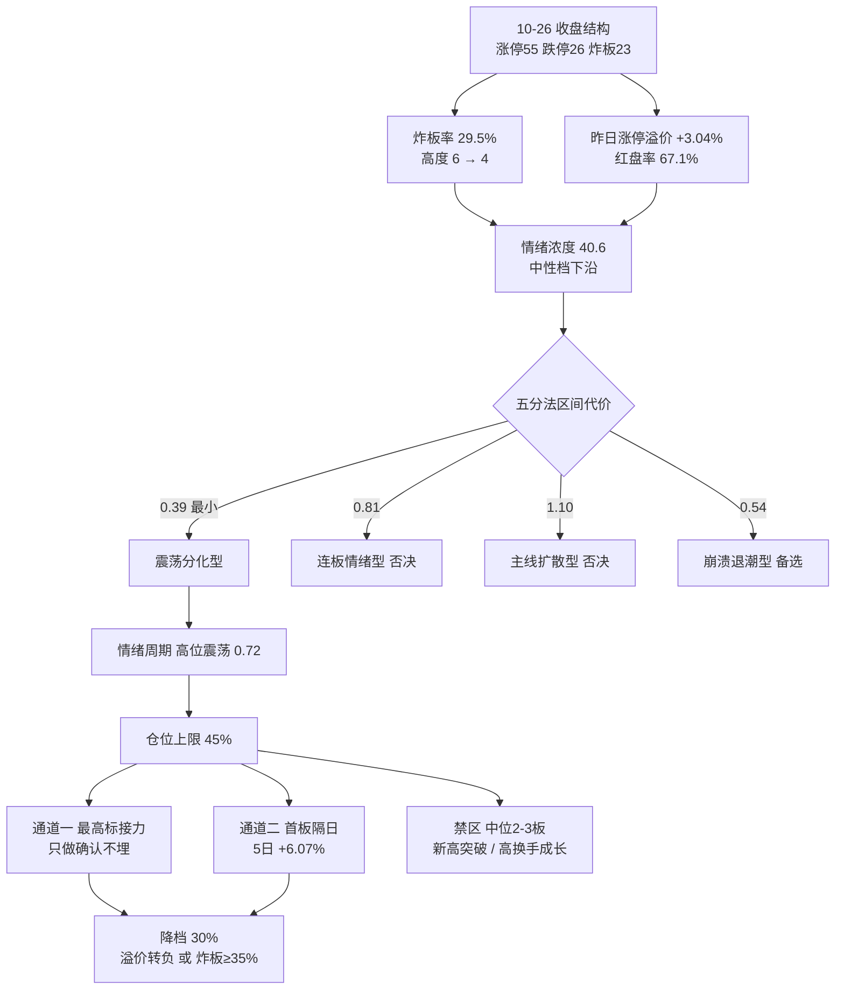

# 2026年10月27日风格研判：宽度还在，高度已废

先给结论。今天是**震荡分化型**，情绪浓度 **40.6**（中性档最下沿，离恐惧档只差 0.6 分），主线数量代理为**独主线**且这条主线正在退潮，总仓上限**45%**。这三个数字背后是一句更朴素的话：宽度还在（55 家涨停、67.1% 的昨日涨停股红盘、首板 40 家），高度已废（最高板从 6 塌到 4，4 板只剩 1 只）。市场并没有崩，它只是把钱从"能涨的东西"里抽出来，重新塞回到"已经涨过头的东西"里。

这不是一句修辞。过去 30 天，42 个样本里只有 8 个正收益，中位数 -10.64%；而同期"昨日非ST三板以上表现"这个样本涨了 **+144.33%**，与宽基等权组合的相关只有 0.129。同一个市场，同一段时间，42 个样本里 34 个在流血（81%），只有一小撮在流血的地方收钱。判断今天能不能做，要先回答"这一小撮今天还在不在收钱"，答案是**还在，但收得越来越窄**。

## 🎯 市场在为什么付钱：六簇给出的三个价位

我把用户指定的 22 个同花顺风格板块和 20 只 ETF 放在同一张收益表里，窗口取 2026-09-04 至 2026-10-26 的 30 个收益日，用 1 减 Pearson 相关作距离、Ward 法切 6 簇。这 42 个样本是**量化观测口径，不是推荐方向**，下面出现的名字只用于说明资金在什么结构里付钱。

第一簇是"高换手成长"：13 个成员，30 日 **-17.12%**，与宽基相关 **0.870**，最大回撤 -23.39%，昨天下跌 2.79%。通信 ETF -22.54%、有色 ETF -23.04%、半导体 -17.93%、科创50 -17.21%、百元股 -17.97%、昨日成交前十 -28.93%、同花顺热股 -25.45%——这批票的共同点是"你昨天在涨幅榜上最容易看见它们"。它们同时是过去一个月跌得最狠的一批，这不是巧合，是"关注度即拥挤度"的代价。

第二簇是"宽基加顺周期加事件"：19 个成员，30 日 -9.57%，与宽基相关 0.783。沪深300 -9.47%、中证500 -12.03%、中证1000 -11.33%、光伏 -11.43%、房地产、增持减持回购与业绩扭亏这类事件样本都在这一簇。它们跌得比第一簇少，相关性却差不多，意味着"买它们就是买大盘"，而大盘这 30 天在跌。

第三簇只有 5 个成员，30 日 -4.50%，与宽基相关 0.436：创历史新高、上证50、证券 ETF、医药 ETF、消费 ETF。这一簇值得单独看，因为它是"核心资产"里最抗跌的一层，而 **创历史新高这个样本 30 日 -7.70%、5 日 -7.19%**——创新高的股票在亏钱，这一条直接否掉了"新高突破"这条通道，非常关键。

第四簇是单点，银行 ETF，30 日 +1.89%，与宽基相关 **-0.351**，最大回撤只有 -3.19%，是 30 日正收益的 8 个样本里回撤最小的一个（第二名医药 ETF 是 -5.41%）。第五簇是两个成员：昨日非ST二板表现与煤炭 ETF，簇均 +32.13%，内部相关仅 0.229——配对是算法的形状而不是产业结论（二板样本 30 日 +71.27%，煤炭 ETF -7.01%，一个是全场最好、一个是负收益）。但那个二板样本 10 月 26 日涨 **+8.37%**，是全场单日最强。第六簇是两个"三板以上表现"类样本，30 日 +87.36%，与宽基相关 0.184。

把六簇按"与宽基相关度"排序，会看到一条几乎单调的倒挂：相关 0.87 的那簇亏 17%，0.78 的亏 9.6%，0.44 的亏 4.5%，0.18 的两簇赚 87% 和 32%，-0.35 的那个赚 1.9%。这就是今天的风格宪法第一条——**市场付钱给与指数无关的高度，和与指数负相关的防守，不付钱给与指数同涨同跌的宽度**。任何以"板块普涨"为理由的加仓，在过去一个月都是亏钱的。

有一组数字比簇本身更重要。"昨日非ST三板以上表现"30 日 +144.33%、10 日 +46.78%、5 日 +15.02%；但"昨日打二板以上表现"30 日只有 +30.39%，10 日 **-12.78%**、5 日 **-7.32%**。前者衡量"持有三板以上的票"，后者衡量"你在二板以上追进去打板"。两者相差 100 个百分点以上，含义只有一个：**高度的钱是"已经在里面的人"赚的，不是"今天追进去的人"赚的**。过去 10 天，凡是盘中追高打二板以上的，平均亏 12.78%。

## 📉 10月26日这一天到底发生了什么

涨停 55 家、跌停 26 家、炸板 23 家，炸板率 29.49%。这三个数放在一起读才有意义：涨停家数只从 82 降到 55（-33%），但跌停从 6 家跳到 26 家（4.3 倍），炸板率从 12.77% 抬到 29.49%（2.3 倍）。上行端只是"少了一截"，下行端是"多了一大片"。

连板天梯更直白：1 板 40 家、2 板 8 家、3 板 6 家、4 板 1 家，最高 4 板，首板占 72.7%。前一日是 1 板 70 家、2 板 9 家、3 板 1 家、6 板 2 家的**断层结构**，昨天是 1 板 40 家、2 板 8 家、3 板 6 家、4 板 1 家的**实心结构**。也就是说，昨天发生了两件事：**顶被削平了（6→4），腰部反而变厚了（3 板从 1 家变 6 家）**。这不是简单的退潮，是"高度在向 3 板这个位置收敛"。收敛的另一面是天花板降低——今天想打 5 板，得先有人把 4 板顶上 5 板，而 4 板只有 1 只。

溢价给出了唯一的好消息。10 月 23 日那 82 家涨停股，在 10 月 26 日的开盘溢价均值 **+3.04%**、中位 +2.54%，收盘溢价均值 **+2.66%**、中位 +2.38%，红盘率 67.1%，其中 15 只再封涨停。开盘溢价为正、收盘溢价略低于开盘，说明**隔夜有人愿意高开接货，但盘中承接不如开盘**——这是典型的"抢跑式开盘、兑现式收盘"。对比 10 月 22 日那批（开盘溢价 +0.29%、中位 -0.87%），昨天的溢价结构好得多，赚钱效应没有崩。

指数层面是明确的分裂：上证 **+0.19%** 收 3697.52，深成 **-1.19%**，创业板 **-1.71%**，科创50 **-2.23%**，沪深300 -0.04%，中证500 -1.49%，北证50 -2.13%。上证靠权重挺住，越往小盘、越往成长，跌得越多。广度是 2082 家上涨、2991 家下跌、中位 **-0.49%**，成交额 16087 亿，比前一日 19559 亿**缩量 17.75%**。缩量下跌加上"上证红、创业板绿"，通常不是见底信号，而是"资金在权重里避险、在小盘里撤退"的中继形态。

## 💰 资金在撤，散户在接

这条最不该被忽略。昨日主力资金**净流出 278.7 亿**（净流入率 -1.73%），其中超大单 -161.2 亿、大单 -117.5 亿；同时**小单净流入 +298.2 亿**。近 5 个交易日主力累计净流出 **1126.7 亿**。两融余额 24318 亿（截至 10 月 23 日，T+1 滞后），5 个交易日减少 **571 亿（-2.29%）**，杠杆在连续撤退。

主力卖、小单买、杠杆降，这三件事同时出现时，价格短期可以被托住（因为散户和小单在接），但结构的重心在下移。这也是我把情绪浓度压到 40.6 的主要原因之一——按涨停家数（55）和溢价（+3.04%）单看，情绪不该这么低，是资金维度把它拽下来的。

有一处数据我必须标注不可用：tushare 的 `north_money` 字段恒等于 `hgt + sgt`，量级在 2539 亿，判定为**成交额口径而非净流入**，不能用来说"北向买入还是卖出"。我宁可空着这一维，也不给一个方向错误的数字。

## 🌡️ 为什么是震荡分化型，而不是连板情绪型

按 skill 的五分法，我把当天的六个观测量代进五条风格的区间代价里，算出的代价是：震荡分化型 **0.39**、崩溃退潮型 0.54、连板情绪型 0.81、主线扩散型 1.10、防御观望型 2.02。取最小者，得震荡分化型。

需要把话说透：**这个判断是带着争议的**。涨停 55 家高于"震荡分化"表内的 20–40 区间（超了 15 家），单看这一条会倾向"主线扩散型"；但扩散的定义是"有明确梯队的主线"，而昨天行业维度上没有任何一个行业有 8 家以上涨停（最集中的汽车零部件 6 家、专用设备 6 家、通用设备 5 家），概念维度上 20 个概念里只有 1 个涨停成分过 20 家、且这个 11 日龄的老概念从 43 家砍到 23 家。宽度是分散的，不是扩散的。所以我判"分化"而不是"扩散"。

情绪浓度按五维加权算出 40.6：涨停强度 55（权重 0.25）、跌停压制 48（0.20）、连板结构 65.2（0.20）、炸板率 **0**（0.15）、资金 21.2（0.20）。炸板率这一维直接归零，因为 29.49% 的炸板率超过了公式里"4 倍扣完"的阈值——这不是我手动压低，是 29.49% 这个数本身就落在 0 分区。

情绪周期预计算的结论是**高位震荡**，置信 0.72，与五分法一致，两条路径没有打架。它的原话是"落袋为安/控制仓位，龙头不死可做低位补涨，不搏穿越"。我认同这个动作，但原因不是"高位"，而是"高位加缩量加杠杆撤退"这三件事叠在一起。

## 🎚️ 仓位上限 45%，以及降档的三个触发条件

算法是四步相加：风格基准 0.55（震荡分化型）＋ 情绪调整 0.00（40.6 落在中性档）－ 0.05（阶段=高位震荡）－ 0.05（30 日窗口样本中位 -10.64%、正收益只有 8/42，宽度不支持加仓）＝ **0.45**。

45% 不是一个可以铺开的仓位，它只够做一到两个方向的确认单。三个降档条件，任一条在竞价或盘中触发，当日立刻把上限压到 30% 以下：

一，昨日涨停股的开盘溢价**转负**（10 月 26 日是 +3.04%，若竞价整体红盘率跌破 40%），说明隔夜抢跑的人开始亏钱，接力链条的第一环断了。二，炸板率盘初就上到 **35%** 以上，说明 29.49% 不是一次性的分歧，而是退潮的起点。三，唯一那条 11 日龄的主线概念，涨停成分若继续从 23 家收缩到 **15 家以下**，意味着连"高度"这个最后的收钱机器也停了，研究观察对象需要全部重排。

## 🔍 推理三问：为什么"接力高度"是唯一还站着的结构

- **大资金意图**：过去一个月，主力在成长和宽基里持续卖出（5 日 -1126.7 亿），但指数没有崩，说明卖压被权重、宽基 ETF 与散户小单吸收了。资金没有离场，它们在**降低久期**——从"需要三个月兑现的成长故事"换成"明天就能卖掉的连板筹码"。在这种结构里，大资金不是在做多中国资产，是在做多流动性本身；对手盘正是那些按"跌了这么多该反弹了"逻辑低吸成长股的人。这就是为什么"跌得最多的"反而继续跌。
- **为什么走强**：位置上是极端的——连板高度这个维度处在 30 日 +144% 的位置（超买），而高换手成长处在 -17% 的位置（超卖）。按均值回归的逻辑，该做的是反过来；但过去 10 天做反转的人亏了 12.78%（打二板以上 10 日收益），做顺势的人赚了 46.78%（三板以上 10 日收益）。催化上没有新故事，只有**存量筹码的稀缺性**：55 家涨停里能上 4 板的只有 1 家，稀缺本身就是溢价来源。筹码上，昨日 15 只再封涨停、红盘率 67.1%，接力面还没断。
- **逻辑够不够硬**：硬的部分是"稀缺性溢价"——这个逻辑有独立证据支撑（连板样本与宽基相关 0.13、30 日 +144%、昨日再封涨停 15 只）。不硬的部分是**持续期**：这条主线的年龄已经 11 天，涨停成分一天内从 43 砍到 23（-47%），历史上这个斜率之后通常还有 1–2 个交易日的余温，然后进入补跌。最可能的证伪路径是：今天高度股冲高但封不住（炸板率上 35%），或者 4 板那唯一一只断板，那么"稀缺性"就变成了"没人接"。所以在它身上的仓位只能是确认单，不能是埋伏单。

## 🌏 外部环境：亚洲在 risk-off，A 股靠权重和政策托着

恒生指数 10 月 26 日 +0.51% 收 23211.81，但 20 日 -6.26%；韩国综合 -1.46%，20 日 **-22.06%**；日经 225 -0.80%，20 日 -6.29%。亚洲的风险偏好在系统性下降，这不是 A 股独有的问题。

美股最新只到 10 月 23 日（缺 10 月 26 日一夜）：标普 -0.52%、纳指 -0.21%、道指 -1.23%；费半数据为空，但个股口径上美光 +2.46%、迈威尔 +2.26%、AMD +1.74%、台积电 +1.49%、英特尔 +1.72%，英伟达 -0.59%、博通 -0.48%。也就是说 **10 月 23 日美股半导体是偏强的，而 A 股半导体在 10 月 26 日跌了 4.19%**。这两件事对不上，说明 A 股科技的下跌不是外部传导，是**内资自己在撤**。这个区分很重要：外盘不背这个锅，也就意味着外盘反弹救不了它。

把行业口径的资金流摊开看，撤离是单向的、集中的：10 月 26 日电子净流出 **146.2 亿**、元件 66.3 亿、印制电路板 50.9 亿、半导体 48.7 亿、通信 47.5 亿，流出前五名全是科技硬件链，且跌幅从 -1.74% 到 -6.43% 与流出方向完全一致。流入端则分散且量级小：汽车 +11.6 亿、汽车零部件 +10.2 亿、数字芯片设计 +9.9 亿、医疗服务 +7.8 亿、游戏 +7.7 亿，没有一个流入超过 12 亿（数字芯片设计是唯一"跌着被买"的，跌 2.80% 却净流入 9.9 亿，值得单独记一笔）。这是典型的"从一个方向撤出、在每个方向只放一点点"的防守姿态——**它不是风格切换，是降风险**。风格切换会有一个新方向被买爆，降风险只会让所有方向都只放一点。

消息面口径（15 源 81 篇）里，10 月 26 日同时出现三条：党的二十届五中全会在北京开始举行、央行公告构建"股市+债市"稳市机制、单周近 600 亿资金涌入宽基 ETF。这三条如果成立，解释的正是"上证红、创业板绿"的分裂——托底的钱进宽基，进攻的钱撤出成长。但它们是媒体口径、未经我独立核实，只作背景，不作仓位依据。

美元指数、原油、铜、黄金全部缺失，离岸人民币只有 10 月 25 日一个 6.668 的单点、没有涨跌。跨资产的"软着陆/降息/衰退"三档坐标建不起来，我不编。

## 🧭 传导路径与决策树

## 📋 关键证据

- **结构**：涨停 55 / 跌停 26 / 炸板 23，炸板率 29.49%；天梯 1板40 / 2板8 / 3板6 / 4板1，首板占 72.7%（tushare 涨停明细，2026-10-26）。
- **溢价**：前一日 82 家涨停股开盘溢价均值 +3.04%、中位 +2.54%；收盘溢价均值 +2.66%、中位 +2.38%；红盘率 67.1%；再封涨停 15 只（以当日封板名单为准，非涨跌幅阈值）。
- **广度**：涨 2082 / 跌 2991 / 平 144，中位 -0.49%；成交额 16087 亿，较前日 -17.75%；涨幅≥5% 177 家、跌幅≤-5% 387 家。
- **指数**：上证 +0.19%、深成 -1.19%、创业板 -1.71%、科创50 -2.23%、沪深300 -0.04%、中证500 -1.49%、北证50 -2.13%。
- **资金**：主力净流出 278.7 亿（净流入率 -1.73%），小单净流入 298.2 亿，5 日累计 -1126.7 亿；两融 24318 亿（T+1），5 日 -571 亿。
- **30 日窗口**：42 样本中位 -10.64%、正收益 8/42；连板高度类样本 +144.33%，高换手成长类 -17.12%，两者相差 161 个百分点。
- **文本**：7 群 1117 条消息里，含方向判断的长文本集中在"科技已无资金接力""反弹只有两日寿命""次日即便有中阳也应冲高回落"，分歧偏弱修复，无一致看多。

## 🧪 数据源审计

| 源 | 日期 | 状态 | 备注 |
|---|---|:--:|---|
| tushare/limit_list_d | 2026-10-26 | 🟢 | 104 条（涨停55/跌停26/炸板23）逐票明细，含首封时间与封单 |
| tushare/daily 全市场 | 2026-10-26 | 🟢 | 5570 只，广度/溢价/成交额全部现算 |
| tushare/index_daily | 2026-10-26 | 🟢 | 7 个指数 |
| tushare/ths_daily 22 风格板块 | 2026-10-26 | 🟢 | 22/22 成功，30 个收益日完整 |
| tushare/fund_daily 20 ETF | 2026-10-26 | 🟢 | 20/20 成功 |
| tushare/limit_cpt_list | 2026-10-26 | 🟢 | 20 个概念代理，含前日对比 |
| tushare/moneyflow_dc 主力资金 | 2026-10-26 | 🟢 | 超大单/大单/小单拆分 |
| tushare/margin 两融 | 2026-10-23 | 🟡 | T+1 滞后，未含 10-26 |
| tushare/moneyflow_hsgt 北向 | 2026-10-26 | 🔴 | 口径为成交额而非净流入，方向不可用，已弃用 |
| tushare/index_global + us_daily | 2026-10-23 | 🟡 | 美股缺 10-26 一夜；费半、恒生科技为空 |
| tushare/fx_daily 汇率 | 2026-10-25 | 🔴 | 仅离岸人民币单点，美元指数无数据 |
| tushare/fut_daily 商品 | — | 🔴 | skipped，原油/铜/金全缺 |
| wechat_cli 7 群（匿名） | 2026-10-26 | 🟢 | 1117 条，7/7 群可用 |
| wechat_official_rss 15 源 | 2026-10-26 | 🟢 | 81 篇，13 个源有内容 |

## ❓ 不确定性 / 反证

**一，风格判定处在边界上。** 震荡分化型代价 0.39，崩溃退潮型 0.54，只差 0.15。若把权重换成"跌停 26 家 + 缩量 17.8%"为主导，完全可以读成"退潮初期"。我选震荡分化的决定性理由只有一个：溢价 +3.04%、红盘率 67.1%、15 只再封涨停，**赚钱效应还没有崩**。如果今天竞价溢价转负，这个理由就消失了，风格要就地改判为崩溃退潮型，仓位应压到 15% 而不是 30%。

**二，簇的数量优势不等于统计意义。** 6 簇里有 3 簇只有 1–2 个成员，"与宽基相关 -0.35 的银行"这种结论在 1 个样本上没有置信度可言。另外 average linkage 在同一份数据上退化成 36+2+1+1+1+1（几乎全部样本挤进一簇），说明这 42 个样本里存在强共同因子，Ward 的 6 簇切法是"在强共同因子上强行细分"。我只是用它来排布结构，没有用它来定量预测。

**三，30 日窗口包含了 10-22 的单日塌方。** 创业板当日 -4.37%、448 家上涨 4739 家下跌、中位 -2.62%，这根阴线把"高换手成长"的 30 日收益拉低了好几个点。窗口的起点选择会影响"成长在跌"的幅度，但不会影响方向——即便只看 5 日，通信 -5.35%、有色 -4.92%、热股 -5.61%，依然是负的。

**四，主力/小单口径不等于真实机构行为。** 东财的资金流是把逐笔成交按单笔金额分类推断的，包含大宗与席位估算，"主力净流出 278.7 亿"更准确的说法是"大额单净卖出 278.7 亿"。我用它做方向上的一致性验证，不用它做幅度上的精确定价。

**五，最大的未知在外盘。** 美股缺 10 月 26 日一夜。如果那一夜美股半导体大跌，今天 A 股科技的低开会从"内资撤退"变成"内外共振"，跌速会完全不同，45% 的仓位上限在这种情形下也偏宽。这条缺口无法用任何替代数据补上，只能等竞价（09:25 之后）用溢价与炸板率做现场修正。

## 🔗 与其他 R/D/E 的关系

- **依赖**：`emotion_cycle.json`（阶段=高位震荡，0.72）、`_r7_data/`（涨停明细、全市场日线、主力资金、两融、指数）。
- **被消费**：R2 取 `style` 与 `position_cap_suggestion` 决定候选数量；R3 取 `sentiment_score` 作基准；R6 拿本单元的"高度溢价"结论做反证靶子；D1 直接把 45% 当 execution_pool 的总仓上限。

## 🧾 Sub-Agent 元数据

- skill: analyze_style_v1（v1.0）
- artifact: `data/research/20261027/R1_style.json`
- 中间底稿: `data/research/20261027/_r1_cluster.json`、`_r1_market.json`
- 可复算脚本: `scripts/research/r1_style_cluster.py`、`r1_market_structure.py`、`r1_assemble_style.py`（均接受 `--date`，无硬编码统计量）
- 生成耗时: 约 12 分钟（含 42 样本 30 日行情拉取与两轮聚类）
- model: ark-code-latest
- confidence: 0.49 = 0.70（base）× 0.70（freshness，外盘 partial）× 1.00（三路独立证据同向）
