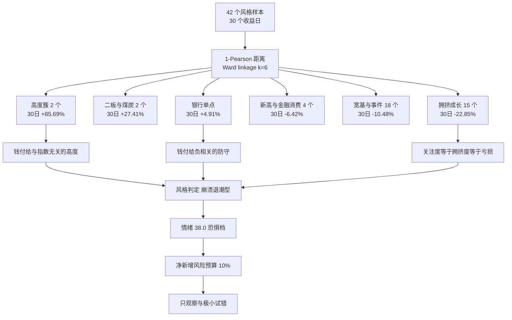

# 2026 年 10 月 28 日 · 风格研判

## 一句话结论

今日是**崩溃退潮型**，情绪浓度 **38.0**（恐惧档），代理口径下**无主线**，净新增风险预算只给 **10%**。给出这个判断的不是某一条数据，而是三条互不相干的证据同时指向同一个方向：10 月 27 日全市场 5217 只（不含北交所）里 4601 家下跌、中位 -3.02%，成交额缩到 14608 亿（-9.19%），这是缩量单边下跌而不是放量出清；涨停 41 家、炸板 28 家、炸板率 40.58%，连板天梯的 3 板整层空缺，说明开盘还有人接、盘中已经没人抬；42 个风格样本过去 30 个收益日里只有 7 个正收益、中位 -13.70%，而且收益与"和大盘有多像"呈单调倒挂。三件事放在一起，答案不是"跌一下"，是**主跌段的确认日**。今天只保留观察与极小试错，不接力、不接中位、不对跌停股做左侧。

## 详细分析

### 一、昨天的形状：单边、缩量、越靠成长越先失血

盘面是单边的，不是分化的。全市场 5217 只（不含北交所）里涨 576 家、跌 4601 家、平 40 家，中位数 -3.02%，跌超 5% 的有 925 家，涨超 5% 的只有 96 家——上涨的尾部几乎没有厚度。成交额 14608 亿，比前一交易日的 16087 亿再缩 9.19%，这意味着卖压并没有在放量中被消化，而是买盘先退了，价格在稀疏的成交里往下滑。缩量下跌与放量下跌在交易上的含义完全不同：放量下跌至少说明有人在换手承接，缩量下跌只说明愿意出价的人越来越少。

指数按"久期"排出了一条几乎完美的阶梯：上证 -1.33%、沪深300 -1.32%、深证成指 -2.50%、中证500 -3.00%、北证50 -3.35%、创业板指 -3.41%、科创50 -4.81%。越成长、越靠前、越依赖远期现金流，跌得越狠；越偏价值、越靠权重，跌得越轻。这不是"某一条线出了问题"的排序，而是**风险预算被整体抽走**的排序——当资金不是在板块之间搬家、而是在降低总敞口时，所有高 Beta 资产会同时被减仓，跌幅只由弹性决定，与基本面无关。

也正因为如此，今天的风格判断不能从"哪个板块跌得多"里找答案。跌得多只是结果，原因是分母端的贴现率预期与风险偏好同时收缩。要找答案，得看钱实际付给了什么——这是下一节聚类要解决的问题。

### 二、微观结构给出的两个相反信号

10 月 27 日的涨停结构里同时藏着乐观和悲观两套证据，它们必须在同一段里读，任何只取一半的读法都会得出错误结论。

偏乐观的一半是隔夜承接还在：涨停仍有 41 家，其中首板 29 家、占 70.73%；昨日 55 家涨停股今日开盘溢价均值 +1.58%（中位 +0.39%），收盘溢价 +1.36%（中位 +0.82%），红盘率 50.91%，其中 12 只再度封板。开盘愿意给溢价、收盘还能守住一半以上红盘，说明"昨天买涨停"这件事本身还没有变成必亏交易，低位仍有资金愿意在隔夜承担风险。

偏悲观的一半是盘中接力断了：炸板 28 家，炸板率 40.58%，跌停 22 家；连板天梯是 1 板 29 家、2 板 8 家、4 板 3 家、5 板 1 家，**3 板整层为零**。首板时间分布也不支持"盘中越走越强"：9.76% 在九点半前封上，58.54% 在十点前，73.17% 在十点半前，95.12% 在下午两点前——抢筹集中在早盘半小时，之后新增封板极少。封单质量同样偏弱，封单额/成交额的中位数只有 8.78%，开板次数中位 1 次，涨停股换手中位 8.18%。

把两半拼起来只有一句话：**开盘还有人接，盘中没人抬**。溢价是正的但收盘低于开盘，说明高开被当成兑现窗口；炸板率四成说明封板之后的第二波资金缺席；3 板空缺说明 4 板向 5 板晋级时没有腰部承接，一旦断板就是 A 字回落。这也解释了为什么今天的"能做/不能做"不能按高度划分，而要按"处在梯队的哪一端"划分——这一点在第四节用四个策略样本的收益差给出了量化证明。

资金侧的证据更直白。主力单日净流出 473.6 亿（净流入率 -3.24%），其中超大单净流出 185.1 亿，近 5 个交易日累计 -1474.0 亿；同期小单净流入 367.3 亿。两融余额 24261.8 亿（截至 2026-10-26，T+1），5 日减少 563.6 亿（-2.27%）。机构在卖、散户在接、杠杆在退——这三件事同时发生时，价格可以被小单托住一阵，但结构重心会持续下移。需要说明的是，隔夜外盘那点涨幅并没有改变这个内生过程：10 月 27 日的下跌是内资主导的缩量减仓，与外盘方向无关。

### 三、六簇：市场只为"与指数无关"和"与指数负相关"付钱

把 22 个同花顺风格板块与 20 只 ETF 放在同一张收益表里，窗口取最近 30 个收益日（2026-09-11 至 2026-10-27），用 1 减 Pearson 相关系数作距离、Ward 法切 6 簇，得到的分组比任何主观分类都更接近"钱实际怎么分布"。先给总账：42 个样本里 30 日正收益只有 7 个，中位数 -13.70%，剔除"昨日……表现"这类策略样本后中位 -15.71%；最近 5 日中位 -4.29%；最后一个交易日 3 涨 39 跌。这 42 个名字是观测口径，不是推荐方向。

六簇的形状是这样的：高度簇只有 2 个成员（"昨日打二板以上表现"与"昨日非ST三板以上表现"），30 日 +85.69%，与宽基等权组合的相关性只有 +0.12；紧随其后的是一簇 2 个成员的组合（"昨日非ST二板表现"与煤炭 ETF），30 日 +27.41%，相关性 +0.19；银行 ETF 独立成簇，30 日 +4.91%，相关性 **-0.36**，30 日最大回撤只有 -3.19%，是全样本里唯一"低回撤 + 正收益"的资产；再往下是 4 个成员（创历史新高、证券 ETF、医药 ETF、消费 ETF）30 日 -6.42%、相关 0.45；18 个成员的宽基与事件簇 -10.48%、相关 0.78；最后是 15 个成员的拥挤成长簇 -22.85%、平均回撤 -25.75%、相关 **0.86**。

按相关性从低到高排一遍，收益几乎单调递减：相关 0.12 的簇赚 85.69%，相关 0.19 的赚 27.41%，相关 -0.36 的银行赚 4.91%，相关 0.45 的亏 6.42%，相关 0.78 的亏 10.48%，相关 0.86 的亏 22.85%。**越像大盘，越亏；越不像大盘，越赚。** 这就是今天的风格宪法第一条：市场不为"普涨"付钱，只为"与指数无关的高度"和"与指数负相关的防守"付钱。反过来说，任何以"指数要修复"为前提的做多逻辑，在这个月的样本里都是逆着收益结构下注。

拥挤成长簇值得单独记住。它的 15 个成员几乎就是"每天在涨幅榜、成交榜、热股榜、北向成交榜上最容易看见的名字"：同花顺热股 30 日 -28.56%、昨日成交前十 -34.10%、深股通成交前十 -30.87%、通信 ETF -29.54%、半导体 -23.65%、科创50 -22.58%、芯片 ETF -22.79%。**关注度就是拥挤度，拥挤度就是这个月的亏损幅度。** 这不是说这些方向永远不能碰，而是说在增量资金停止的阶段，"被最多人看见"本身就是风险因子；要等拥挤度用跌幅消化完，而不是用"跌得多了"来证明便宜。

新高与金融消费那一簇里有一个否证级别的细节：创历史新高 30 日 -12.85%、10 日 -14.60%、5 日 -8.81%。**"突破新高"这条通道在 10 月是亏钱的**，这条比任何主观判断都硬——它直接否掉了"强者恒强"在本月的适用性。同一簇里的证券 ETF -8.34%、医药 ETF -1.85%、消费 ETF -2.64%，属于"抗跌但仍然在跌"，不能当成"资金转向防守"的证据；真正的防守证据在银行那个单点上，而单点不足以构成一条主线。

### 四、同一个高度，持有与追进去差一百二十个百分点

高度簇的 +85.69% 很容易被误读成"高位股很赚钱"，把它拆成四个策略样本就完全不是这回事。

"昨日非ST三板以上表现"30 日 +144.26%、10 日 +46.76%、5 日 +23.35%，10 月 27 日当天还涨 10.00%——它衡量的是**已经拿着三板以上筹码的人**这 30 天赚了多少，而且这个样本只有 28 个收益日（缺 2 天），是 4 至 5 板的小集合，路径依赖极强。"昨日打二板以上表现"30 日只有 +27.13%，10 日 **-10.43%**、5 日 -1.20%——它衡量的是**今天才追进去打二板以上的人**的收益。"昨日打首板表现"30 日 +6.82%、5 日 **+4.74%**；"昨日打板表现"（不分高度）30 日 +3.33%、5 日 +2.68%、当日 -0.80%。

四个数字放在一起，结论只有一个：**高度的钱是"在里面的人"赚的，不是"今天追进去的人"赚的**；而过去 5 天，追二板以上的平均亏 1.2%，打首板的平均还赚 4.7%。这与当日的微观结构严丝合缝——3 板空缺意味着 4 板往 5 板晋级时没有腰部接力，一旦断板就是 A 字；而低位首板仍有人愿意在隔夜给 +1.58% 的溢价。所以今天"能不能做"的分界线不在高度，而在**位置**：梯队的下端还有活口，中段和上端是断的。这也是为什么仓位即便只有 10%，它的用途也被限定在低位试错、而不是接力。

### 五、外盘只给了高开，没给承接

外盘这一格必须先说新鲜度：美股最新只到 2026-10-26，标普 +0.70%、纳指 +0.82%、道指 +0.28%，缺 10-27 一夜；那一夜半导体权重股是强的，英伟达 +2.39%、美光 +2.98%、博通 +2.33%、AMD +2.80%、台积电 +1.40%。亚太 10-27 收盘：恒生 -0.73%、韩国综合 +3.09%、日经 +1.73%。把这些放到 20 日尺度上，画面立刻变暗：标普 -0.09%、纳指 -2.43%、恒生 -5.99%、日经 -3.96%、韩国综合 -20.37%；半导体个股 20 日普遍深跌，美光 -14.26%、AMD -12.60%、英特尔 -22.03%、台积电 -6.30%、博通 -5.84%、英伟达 -5.62%。**外盘自己也是在 20 日尺度上走平到走弱的，只有隔夜一天是红的。**

更重要的是"外盘隔夜 → A 股次日"的历史相关：标普 -0.078、纳指 -0.092、恒生 -0.021、日经 -0.174、韩国 +0.029。绝对值最大 0.17，五个样本里四个是负号，这在统计上等于**无关**。所以"外盘涨、今天修复"这句话在这 30 个样本里没有支持；外盘最多提高高开的概率，不能提供承接。而 10 月 27 日的下跌是内生的：缩量 9.19%、内资主力净流出 473.6 亿，与隔夜外盘方向无关。今天的风险不是"低开"，而是"高开之后没有第二波"——这正是昨天已经演过一遍的剧本。

### 六、判定：崩溃退潮型与 38 分的情绪

风格五分法用"区间代价最小化"，每个维度越出 skill 阈值多少就罚多少，代价越低越像。算下来崩溃退潮型 0.4551 最低，主线扩散型 0.8415，连板情绪型 1.3757，震荡分化型 1.5573，防御观望型 3.2137。值得注意的是**主线扩散型只差 0.8415**：它的三个区间（涨停 30 至 50、高度 3 至 5、炸板率 15% 至 35%）今天全部落在带内，最后是被"涨家占比低于 35%"这条宽度惩罚拉开的。这说明单看涨停家数会把主跌日误判成扩散日——宽度是必要条件，不是修饰项。情绪周期预计算独立给出**主跌**（confidence 0.88，premium 1.58%、炸板率 40.58%），与风格表同向，构成双确认，不需要用阶段去覆盖风格。

情绪浓度 38.0 是五维加权的结果：涨停维度 41.0、跌停维度 56.0、连板结构 69.0、炸板率维度 **0.0**、资金维度 13.6（两融 5 日 -2.27% 折算 27.3，主力净流入率 -3.24% 折算 0.0）。它不是崩溃档的分数，原因在于涨停还有 41 家、溢价还有 +1.36%、高度还有 5 板，宽度把分数托住了；真正把分数压下去的是炸板率与资金。**"分数不低但结构最差"是本轮最典型的陷阱**——任何按"38 分还不算极端"来推断"可以接"的读法，都忽略了这 38 分是宽度给的，不是接力给的。风格回答"该不该做"，情绪回答"市场有多热"，两个问题分开答，结论才不互相污染。

### 七、10% 的准确含义

仓位上限按公式算是 0.15（崩溃退潮型基准）减 0.05（情绪落恐惧档）减 0.15（阶段主跌）减 0.05（30 日样本中位 -13.70%、正收益 7/42），等于 0.00；我给它加了 0.10 的主跌下限。理由不是"想留点仓位"，而是 0% 在语义上等于"总仓必须清空"，这是一条执行层面做不到也不该做的事——真实持仓不可能在竞价一次性出清，硬给 0 只会制造"名义遵守、实际违规"。主跌段的正确定义是"净新增风险预算归零"，而不是"存量必须瞬间消失"。

所以 0.10 的确切含义是：**今日净新增风险预算 10%，只用于在当日赚钱效应与资金确认之后出现的低位试错；这一档预算不用于接力、不用于中位补涨、不用于对跌停股做左侧。** 阶段只定温度、不定通道——具体走首板、隔日还是低吸，由 D1 依据竞价与盘中资金确认后选择，R1 不预设。存量仓位的处理不在 R1 权限内（那是 D1 与执行层的分批降仓 + T 计划），但有一条边界必须写明：**不能把"总仓上限 10%"当作一次性清仓的依据。**

### 八、三问：大资金想干什么

**高度簇（二板与三板以上，30 日 +85.69%）。**
- **大资金意图**: 不是"做高度"，是"守着已有筹码等指数止跌"。证据是 10-27 全市场 4601 家下跌、这一簇当日仍 +4.75%，且与宽基相关只有 +0.12——它不跟随大盘，说明筹码集中、没有增量资金参与定价，是存量博弈里的孤岛。
- **为什么走强**: 低位新题材持续供给，让"打首板→晋级"的通道还有活口；3 板空缺使"晋级"变成稀缺，稀缺本身抬高了头部 4 家的封板率。
- **逻辑够不够硬**: 不够硬到可以追。同一份数据里，持有口径 30 日 +144.26%、追进口径 10 日 -10.43%，收益完全来自"你已经在里面"。今天若追，赚的是运气，不是结构。

**银行单点（30 日 +4.91%，相关 -0.36）。**
- **大资金意图**: 被动与绝对收益的避险仓，加上指数护盘的功能性买盘。相关性 -0.36、30 日回撤仅 -3.19%，是全样本唯一"低回撤 + 正收益"的资产，尾盘竞价被单独点名也印证有资金在做收盘价。
- **为什么走强**: 无风险利率下行叠加权益风险预算收缩，钱从"要弹性"切到"要确定性"，这是被动配置的自然结果，不需要故事。
- **逻辑够不够硬**: 作为防守硬，作为进攻不硬。它日波动 1% 上下，没有涨停基因，能保护净值但不能提供本月收益来源；可以配防守仓，但不能读成"风格切换到银行主线"。

**拥挤成长簇（15 个，30 日 -22.85%）。**
- **大资金意图**: 撤退，而且是有序撤退。主力 5 日 -1474.0 亿、单日 -473.6 亿，超大单单日 -185.1 亿，而小单 +367.3 亿在接；这是"机构减仓、散户承接"的标准结构，不是恐慌抛售。
- **为什么走强**: 这一簇的问题是反过来的"为什么走弱"，但用同一把尺子回答——拥挤度见顶后的自然出清。这批样本的共同点是高关注、高换手、高 Beta，当增量资金停止，它们同时失去买盘与估值支撑，跌速由弹性决定，而不是由基本面恶化决定。
- **逻辑够不够硬**: "跌多了会反弹"这条逻辑本月只对了一半。10 月结构最差的三天是 10-22（跌停 48 家、炸板率 41.07%）、10-26（跌停 26 家、炸板率 29.49%）、10-27（跌停 22 家、炸板率 40.58%）；期间 10-23 确实给出过一次强反弹（涨停 82 家、炸板率 12.77%、高度 6 板），但只维持一天就再度转弱。反弹存在，反弹的延续性不存在——在外资承接与内资卖出的对峙里，价格由边际卖方决定，不由"便宜"决定。

## 关键证据

广度与成交额是同一天、同一份全市场日线算出来的：5217 只样本涨 576、跌 4601、平 40，中位 -3.02%，成交 14608 亿，较前一交易日 -9.19%，跌超 5% 的家数是涨超 5% 的 9.6 倍。涨停结构来自逐票明细并与天梯互相勾稽：涨停 41、跌停 22、炸板 28，炸板率 40.58%，天梯 1 板 29、2 板 8、4 板 3、5 板 1，3 板空缺，首板占 70.73%。隔夜承接用 55 家昨日涨停股逐票复算：开盘溢价均值 +1.58%、收盘 +1.36%、红盘率 50.91%、再封 12 只，收盘低于开盘。资金侧，主力净流出 473.6 亿（净流入率 -3.24%，超大单 -185.1 亿、小单 +367.3 亿）、5 日累计 -1474.0 亿；两融 24261.8 亿（截至 2026-10-26），5 日 -563.6 亿。30 日风格侧，42 个样本中位 -13.70%、正收益 7/42、末日 3 涨 39 跌，簇间相关性从 +0.86 到 -0.36 与 30 日收益单调倒挂。否证项是"创历史新高"30 日 -12.85%、10 日 -14.60%，突破新高通道本月不成立。文本侧，7 个群共 1128 条消息、窗口内 703 条、方向性判断 17 条，一致拒绝过夜、等待右侧，与量化结构同向。

## 数据源审计

| 源 | 状态 | 抓取日 | 记录数 | 备注 |
|---|---|---|---|---|
| 风格快照（22 板块 + 20 ETF） | 🟢 ok | 2026-10-28 | 42 | 42/42 覆盖，零方差样本 0 |
| 涨停 / 跌停 / 炸板逐票 | 🟢 ok | 2026-10-28 | 91 | 41U + 22D + 28Z，与天梯勾稽一致 |
| 全市场日线 | 🟢 ok | 2026-10-28 | 5570 | 广度与溢价同源；剔除北交所后 5217 只 |
| 指数日线 | 🟢 ok | 2026-10-28 | 7 | 上证 / 深成 / 创业板 / 科创50 / 沪深300 / 中证500 / 北证50 |
| 概念涨停代理 | 🟢 ok | 2026-10-28 | 20 | 仅作主线条数代理，非 R2 判定 |
| 主力资金 | 🟢 ok | 2026-10-28 | 6030 | 东财 DC 逐票 net_amount 加总，与 R7 同口径 |
| 两融 | 🟡 partial | 2026-10-28 | 126 | 最新 2026-10-26，T+1 滞后 |
| 外盘（指数 / 美股 / 汇率） | 🔴 stale | 2026-10-28 | 18 | 美股缺 10-27 一夜；费半与恒生科技为空；商品 skipped；汇率仅离岸人民币一条 |
| 群聊（匿名化） | 🟢 ok | 2026-10-28 | 1128 | 窗口内 703 条，方向性 17 条 |
| 公众号 RSS | 🟢 ok | 2026-10-28 | 86 | 15/15 源存活，1 源空 |
| 情绪周期预计算 | 🟢 ok | 2026-10-28 | 1 | 主跌，confidence 0.88 |

## 不确定性与我可能错在哪

**第一，六簇的形状是被 k 选择决定的，而样本本身高度同质。** 用 average linkage 切 6 簇，42 个样本会退化成一个 35 个成员的巨簇加几个单点；Ward 切出的 15/18/4/2/2/1 本质上是在"一个大簇里挑异类"。高度簇只有 2 个成员、银行只有 1 个，簇均值不是"某类资产的收益"，不能外推成可交易组合的预期回报。

**第二，高度簇的 +85.69% 有技术性来源。** 主力成员"昨日非ST三板以上表现"30 天里只有 28 个收益日，样本是 4 至 5 板的小集合，日收益波动极大，累计值包含路径依赖与停牌缺口。它描述的是极端小样本的历史成绩，不是可复制的年化收益。

**第三，情绪 38 与"崩溃退潮型"之间存在张力。** 涨停 41 家、溢价 +1.36%、红盘率 50.91% 都不支持"崩溃"这个词。我的处理是把两个问题分开：风格用阶段优先（主跌 + 炸板率 40.58%），情绪用五维加权（保留宽度贡献）。两者不强行调和——风格回答"该不该做"，情绪回答"有多热"。

**第四，外盘缺口是最大的单点不确定性。** 美股缺 10-27 一夜，如果那一夜半导体大跌，今天的高开预期要整体下修；如果大涨，也只是提高高开概率（历史相关绝对值 ≤0.17），不改变承接结构。这条无法用现有数据消除，只能标 stale。

**第五，文本侧是小样本。** 17 条方向性判断来自 7 个群，群聊天然放大情绪，且主跌中段的发言里"骂不动了/麻了"这类情绪词频会显著高于理性判断。它只作为第三证据参与一致性因子，不单独决定风格。

**第六，反向情形是存在的。** 如果今日竞价同时出现三件事——昨日涨停股开盘溢价回到 +3% 以上、盘初炸板率低于 25%、最高板不炸且 3 板出现新面孔——阶段有可能从主跌回到低位试错，净新增风险预算可以上调到 20% 至 25%。这属于竞价校准的职责，R1 不预设，也不会因为"跌深了"自动上调仓位上限。

## 与其他 R/D/E 的关系

- **依赖**: `data/raw/20261028/style_snapshot.json`（42 样本 × 30 日）、`data/research/20261028/_r1_cluster.json`（Ward k=6）、`_r1_market.json`（涨停结构 / 溢价 / 广度 / 资金）、`emotion_cycle.json`（主跌）、`overseas_snapshot.json`（外盘，stale）、`_r1_kol.json`（文本侧摘要）、R7 底稿（主力 / 两融 / 北向）。
- **被消费**: R2 取 `style` / `main_lines_count` / `position_cap_suggestion` 作为主线筛选的前置约束；R3 以 `sentiment_score` 38.0 为基准做热度共振；R6 就"崩溃退潮型 vs 全市场普跌"做一致性反证；D1 以 0.10 为今日净风险预算上限；E1 收盘后按"是否出现 3 板新面孔、炸板率是否回落"复盘本判断。

## Sub-Agent 元数据

- skill: analyze_style_v1（R1）
- artifact: `data/research/20261028/R1_style.json`
- 中间底稿: `_r1_cluster.json` / `_r1_market.json` / `_r1_kol.json`
- 方法: cluster_v1 + market_structure_v2 + llm_prose
- 窗口 / 簇数: 30 个收益日 / k=6（Ward）
- 数据归属日: 20261027（盘前）
- 置信度: 0.49（base 0.70 × freshness 0.70 × agreement 1.00，缺口来自外盘与跨资产）
- 状态: degraded（A 股主源完整，外盘 / 汇率 / 商品缺口）
