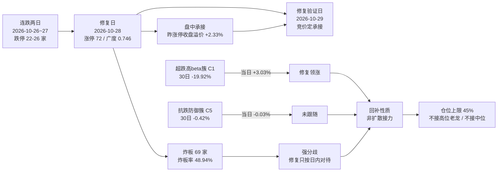

# 2026-10-29 · **风格研判**

> **数据归属**: 本单元 `trade_date=2026-10-29`（盘前），全部量化读数取自 **2026-10-28 收盘**；情绪周期位置根据 2026-10-26 至 2026-10-28 的 12 个交易日序列定位。
> **数据源新鲜度**: partial · **降级状态**: true · **置信度**: 0.392（0.70 × 0.70 × 0.80）

## 一句话结论

**震荡分化型 + 情绪 59.0（中性）+ 三主线（代理），仓位上限 45%；周期第 0 天 = 修复后第 1 个交易日，只做低位前排。**

---

## 一、情绪周期位置：第 0 天 = 修复后第 1 个交易日

`cycle_position.json` 给出的读数是 `cycle_day=0 / consecutive_down_days=0 / tier=neutral`。**这个 0 不是「继续空仓」的意思，而是「已经不在杀跌序列里」**——因为杀跌段在 2026-10-28 当天就被修复了。

| 维度 | 读数 | 含义 |
|---|---|:--|
| 上一杀跌段 | 2026-10-26 ~ 2026-10-27，**连跌 2 天**，跌停 26 → 22 家，广度 0.404 → 0.109 | 教科书式连续杀跌 |
| 修复日 | **2026-10-28**，涨停 72、广度 0.746、中位 +1.34% | 连跌两日后的第三天修复，命中 92 科比口径 |
| 今日位置 | **cycle_day=0 · tier=neutral · 修复后第 1 个交易日** | 不在杀跌段，但也不是主升 |
| 情绪温度阶段 | 高位震荡（`high_chop`，置信 0.75；炸板率 48.94% ≥ 25% 且涨停 72 ≥ 40） | 涨停多但分歧大，高位钝化 |
| 同口径历史样本 | 2026-10-15 连跌 2 天 → 2026-10-16 涨停 61/广度 0.593（修复）；2026-10-27 连跌 2 天 → 2026-10-28 涨停 72/广度 0.746（修复） | 2/2 修复，但只是同口径实例，不是概率模型 |

**今日打法（周期口径 + 温度口径叠加）**：

1. **温度收紧**：高位震荡 = 净新增风险预算收紧，存量按 T 与分批处理；待验证项是炸板率会不会继续抬升。
2. **周期定位**：非杀跌结构，按当日主线与情绪温度正常评估——**不适用「连跌两日博反弹」的低位首板打法**（那套是给 repair_window 用的），也不适用「修复窗口全放」。
3. **具体到今日**：昨日修复是「盘中修复」而非「隔夜修复」（见第二节溢价拆解），所以今日只认**竞价与上午承接**，不预设全天方向。

---

## 二、详细分析

### 2.1 结构读数：涨停 72 家、炸板 69 家，修复日带着近半分歧

2026-10-28 收盘全市场 **涨停 72 / 跌停 5 / 炸板 69 → 炸板率 48.94%**。涨停家数看是多头完胜（跌停只有 5 家，跌停压制维度满分 90），但炸板 69 家意味着**每 2 只冲板就有 1 只没封住**，这是分歧市的典型形态，不是趋势市的形态。

天梯 **1 板 64 家 / 2 板 5 家 / 3 板 2 家 / 4 板 0 家 / 5 板 1 家**，最高 5 板，首板占比 **88.9%**。**3 板整层空缺**——高度无法自然递推，任何反包只能按一次性脉冲处理，不能做第二波假设。

封板质量同样偏弱：封单比中位仅 **11.92%**、开板次数中位 **1 次**、换手中位 **5.77%**；封板时间分布是开盘 5 分钟内仅 2.78%、上午 10 点前 43.06%、上午 10 点半前 51.39%、上午收盘前 75%、下午 14 点前才 94.44%——**开盘抢封的比例很低，多数板是拖到下午才封上的**，这与 48.94% 的炸板率是同一件事的两个侧面。

### 2.2 溢价拆解：修复发生在盘中，不是隔夜

昨日 41 家涨停股今日表现：**开盘溢价均值 +0.68%、中位 0.00%**；**收盘溢价均值 +2.33%、中位 +2.03%**；红盘率 **68.3%**，再涨停 **8 只**。

这组数字的组合含义很关键：**中位开盘溢价是 0.00%，说明隔夜没人愿意给溢价**；收盘才做到 +2.03% 中位，说明**修复是日内资金一笔一笔买出来的，不是隔夜预期推动的**。对今日的直接推论是——昨日盘中拿货的资金成本集中在 +2% 附近，**今日若高开超过这个成本区，兑现压力会立刻出现**；若低开或平开，反而给了这些资金继续拿的理由。这也是今日「只认竞价与上午承接」的数据依据。

### 2.3 簇结构：超跌的高 beta 领涨、抗跌的防御簇不跟

6 簇由 42 个样本（22 个风格板块 + 20 只 ETF）的 30 个收益日、按 1−Pearson 距离 + Ward 连接聚成。结构上是一个**清晰的两级世界**：

| 簇 | 样本数 | 30 日 | 5 日 | 当日 | 簇内相关 | 与宽基相关 | 阵营 |
|:--:|:--:|---:|---:|---:|---:|---:|---|
| C6 | 1 | **+127.12%** | +29.78% | +1.46% | — | −0.037 | 极端接力（三板以上策略指数） |
| C3 | 2 | **+29.52%** | +0.81% | +0.94% | 0.272 | −0.099 | 二板接力 + 银行防御混簇 |
| C5 | 5 | −0.42% | −1.47% | −0.03% | 0.408 | 0.385 | 抗跌防御（新高/证券/医药/消费/二板以上） |
| C4 | 1 | −7.14% | −2.26% | −0.17% | — | 0.190 | 煤炭（独立周期） |
| C2 | 18 | **−9.97%** | −1.57% | **+1.23%** | 0.707 | 0.788 | 老经济宽基主力军 |
| C1 | 15 | **−19.92%** | −4.15% | **+3.03%** | 0.792 | 0.868 | 高 beta 超跌（热股/次新/百元股/科创/通信/芯片） |

**读法**：当日涨幅严格按 30 日跌幅排序——跌得最多的 C1（−19.92%）涨 +3.03%，跌得少的 C2（−9.97%）涨 +1.23%，最抗跌的 C5（−0.42%）**几乎零涨幅（−0.03%）**。这不是「强的更强」的扩散结构，而是**超跌回补结构**：钱在补跌得最惨的地方，抗跌的地方没人加。

同时，30 日只有 **7/42 个样本正收益**、中位 **−12.82%**，5 日也只有 8/42 正收益、中位 −2.63%。**一日修复没有改变 30 日的结构**。而极端接力端（三板以上策略指数 30 日 +127.12%）与宽基相关性 **−0.037**，说明高位接力是一条完全独立于指数的博弈线——它不因指数修复而变好，也不因指数下跌而变差，只由它自己的赚钱效应决定。

### 2.4 资金：单日主力净流入 +237 亿，但 5 日仍是 −1142 亿

主力资金当日净额 **+237.0 亿（净流入率 +1.46%）**，其中超大单 **+254.3 亿**、小单 **−29.9 亿**——是机构单托着走、散户在卖的形态。但近 5 日累计 **−1142.3 亿**，一天的流入只补回一个零头。

两融余额 **24098 亿（2026-10-27，T+1 滞后）**，5 日 **−705.9 亿（−2.85%）**。杠杆在退，而主力单日在进，两者方向相反——这种组合通常出现在**下跌末段的机构左侧回补**，而不是杠杆推动的主升。今日若两融继续降而指数上行，说明涨的仍是机构票，弹性票不会跟。

### 2.5 外盘：亚太很强、美股停在昨夜之前、跨资产坐标建不起来

| 市场 | 最新交易日 | 当日 | 5 日 | 20 日 | 与 A 股次日相关 |
|---|:--:|---:|---:|---:|---:|
| 标普 500 | 2026-10-27 | +0.60% | +0.13% | +0.67% | −0.046 |
| 纳指综合 | 2026-10-27 | +1.18% | +0.20% | −1.19% | −0.053 |
| 恒生指数 | 2026-10-28 | +0.23% | −2.36% | −6.28% | −0.061 |
| 韩国综合 | 2026-10-28 | **+6.63%** | +4.83% | −12.73% | +0.024 |
| 日经 225 | 2026-10-28 | +1.08% | −1.03% | −2.33% | −0.155 |

韩国市场两日累计 +9.9%（10-27 涨 3.09%、10-28 涨 6.63%）是本周最强风险偏好信号，**但它与 A 股次日相关性只有 +0.024**，传导基本无效；恒生 5 日 −2.36%、20 日 −6.28%，仍是拖累端而非拉动端。**费城半导体与恒生科技在 tushare 返回空**，美股半导体最新（10-27）：AMD +5.45%、博通 +4.00%、台积电 +2.95%、美光 +2.77%、英伟达 +0.90%。汇率只有 USDCNH **6.66485（2026-10-27）**单点且未验证，DXY 缺失，商品 skipped——**跨资产「软着陆/降息/衰退」三档坐标无法建立**，不做方向假设。

### 2.6 风格归因：五分法代价表与阶段覆盖

| 风格 | 区间代价 | 命中/越界情况 |
|---|:--:|---|
| 主线扩散型 | **0.8383（最小）** | 涨停 72 越上界（+0.44）、高度 5 命中、炸板率 48.94% 越上界（+0.40）、行业≥8 家 2 条、涨家占比 76.7% 命中 |
| 连板情绪型 | 1.6137 | 涨停 72 命中、高度 5 不足 6（+0.17）、炸板率 48.94% 远超 20% 上界（+1.45） |
| 震荡分化型 | 2.2100 | 涨停 72 越界（+0.80）、炸板率微越（+0.09）、涨家占比 76.7% 越界（+0.32）、行业≥8 家不为 0（+1.00） |
| 崩溃退潮型 | 2.7636 | 炸板率 48.94% 略低于 50% 下界（+0.02）、跌停 5 家远低于 30（+0.83）、指数为正（+1.91） |
| 防御观望型 | 4.8836 | 三项全越界 |

风格表代价最小者是**主线扩散型**，但当日阶段=高位震荡、炸板率 48.94% ≥ 25%，按 skill §2.5「阶段与风格表冲突时以阶段为准」下调为**震荡分化型**。这个覆盖是对的：涨停 72 家配 69 家炸板，本质是分歧而不是扩散。

---

## 三、结构传导图

---

## 四、推理深度三问

### 对象一 · 2026-10-28 这根修复日的性质

- **大资金意图**: 主力单日净额 +237.0 亿、超大单 +254.3 亿，同时小单 −29.9 亿、两融 5 日 −705.9 亿——**机构在买、散户与杠杆在卖**。对手盘是过去 4 天被杀跌洗出来的浮筹。机构选择在「连跌两日 + 炸板率 40%+」的位置回补，配置逻辑是位置而非题材：42 个样本 30 日中位 −12.82%、只有 7 个正收益，等于把仓位建在 30 日的低位区间。
- **为什么走强**: 位置（30 日超跌，C1 簇 −19.92%）+ 催化（外部产业侧有硬事件，且亚太风险偏好两日大幅抬升）+ 筹码（跌停家数从 26 家收敛到 5 家，抛压自然衰竭）三维交叉成立；但**筹码维度只有一天证据**，隔夜溢价中位 0.00% 说明筹码并未真正转强。
- **逻辑够不够硬**: 不够硬。三个独立源（微观结构、30 日风格簇、资金流向）同向，但**同向的是「超跌反弹」而不是「趋势反转」**：一日修复对 30 日结构零改变（正收益样本 7/42 未变），且炸板率 48.94% 反而在恶化。证伪路径很清晰——只要今日广度掉回 0.40 以下，或昨日涨停开盘溢价转负，这根修复日就降级为一日反抽。

### 对象二 · 高 beta 超跌簇（C1，15 个样本）

- **大资金意图**: 这是市场上弹性最大的资产池（热股指数、次新、百元股、科创 50、通信与芯片 ETF 全在簇内，与宽基相关 0.868），机构在低位补它等于**用最小资金量买最大指数弹性**；对手盘是 30 日里被这套资产反复伤害、正在割肉离场的散户与杠杆盘。
- **为什么走强**: 位置（30 日 −19.92%、5 日 −4.15%，是 6 簇里最深的回撤）+ 催化（外部产业硬事件，不是纯情绪）+ 筹码（簇内相关 0.792，说明是整簇同步而非个别票拉动，属系统性回补）。
- **逻辑够不够硬**: 中等偏硬但缺一环。硬在「超跌 + 整簇同步 + 机构单托底」；缺在**没有本土赚钱效应确认**——抗跌的 C5 簇当日 −0.03%，说明资金只是回补，没有外溢。如果今日 C1 继续领涨而 C5 还是不动，那就确认是**存量博弈内的位置轮动**，不能按新主线对待；只有当 C5 也开始跟涨，才说明扩散成立。

### 对象三 · 极端接力端与防御端（C6 三板以上策略指数 / C3 二板+银行）

- **大资金意图**: C6 是纯粹的游资博弈池（30 日 +127.12%、与宽基相关 −0.037），参与者只对「高度能否空间打开」负责，不对指数负责；C3 把二板接力与银行 ETF 聚到一簇（簇内相关 0.272、与宽基 −0.099），是一个**「高位接力 ↔ 防御避险」共存簇**，说明当下资金在「继续赌高」与「躲进权重」之间摇摆，没有中间态。
- **为什么走强**: C6 强在高度稀缺——当日最高只有 5 板、3 板整层空缺，但凡能上 5 板就是全场唯一，稀缺性给溢价；C3 里的防御端弱在无催化，银行 ETF 与宽基相关 **−0.375**，是全场最负，指数越修复它越钝。
- **逻辑够不够硬**: 不硬。**梯队在 3 板断档、首板占 88.9%、封板时间拖到下午**，这三个证据共同说明高位资金不敢接力，C6 的 +127% 是过去 30 日的累积战果，不是今天的边际变化。今日若出现「高度票无法晋级 + 首板数量回落」的组合，接力端会先于指数退潮。

---

## 五、情绪浓度与仓位推导

### 5.1 五维加权（score = Σw×dim / Σw）

| 维度 | 权重 | 原始读数 | 得分 | 说明 |
|---|:--:|---|:--:|---|
| 涨停强度 | 0.25 | 72 家 | **72.0** | min(100, 72) |
| 跌停压制 | 0.20 | 5 家 | **90.0** | 100 − 2×5 |
| 连板结构 | 0.20 | 高度 5、3 板空缺、首板 88.9% | **64.4** | 0.5×83.3 + 0.5×(0.5×80.0 + 0.5×11.1) |
| 炸板率 | 0.15 | 48.94% | **0.0** | 100 − 4×48.94 → 截断为 0 |
| 杠杆/主力 | 0.20 | 两融 5 日 −2.85%（21.5）、主力净流入率 +1.46%（79.2） | **50.4** | 两项均值 |

**综合 59.0 → 中性档**（40-60 区间上沿）。注意这个分数的结构：**涨停 72 和跌停 5 撑起了绝大部分（18 + 18 分），炸板率一项直接归零（0 分）**。也就是说 59 分是「家数繁荣 + 质量崩坏」的平均值，不是「温和中性」。5 维度参考法（含杠杆与外资中位）在缺 DXY/北向口径的今天无法完整复算，故只用 4+1 维本口径，差异 > 15 分的校验不适用。

### 5.2 仓位上限四步推导

| 步骤 | 调整 | 依据 |
|---|---|:--|
| 风格基准 | **0.55** | 震荡分化型 |
| 情绪调整 | **+0.00** | 59.0 落 40-60 中性档 |
| 阶段调整 | **−0.05** | 阶段 = 高位震荡，净新增风险预算收紧 |
| 宽度调整 | **−0.05** | 30 日 42 样本中位 −12.82%、正收益仅 7/42（< 1/4） |
| **合计** | **0.45** | 无主跌下限生效（非崩溃退潮型、非主跌阶段） |

**45% 是「可以做但不敢重仓」的刻度**：它高于崩溃退潮期的 15%，因为位置已在 30 日低位且昨日刚修复；它低于主升期的 65-70%，因为一日修复未改结构、炸板率仍近半。今日的加减仓唯一标准仍是未来涨跌，不是这 45% 本身——若竞价三条判据成立（广度 > 0.55、昨涨停红盘率 > 60%、板块级涨停潮 ≥ 3 个方向），D1 可上调至 0.60；若炸板率再上 45%，直接压到 0.25 以下。

---

## 六、关键证据

- **证据 1** · 涨停 72 / 跌停 5 / 炸板 69 → **炸板率 48.94%**，封单比中位 11.92%、开板次数中位 1 次、下午 14 点前累计封板 94.44% · 来源 `tushare.limit_list_d`（2026-10-28）
- **证据 2** · 天梯 1 板 64 / 2 板 5 / 3 板 2 / 5 板 1，最高 5 板且 **3 板整层空缺**、首板占 88.9% · 来源 `tushare.limit_list_d` + `limit_step`（2026-10-28）
- **证据 3** · 昨日 41 家涨停股：开盘溢价均值 +0.68%/中位 **0.00%**，收盘溢价均值 +2.33%/中位 +2.03%，红盘率 68.3%，再涨停 8 只 · 来源 `_r1_market.premium`（2026-10-28）
- **证据 4** · 广度涨 3872 / 跌 1176 / 平 169，中位 +1.35%，涨 5% 以上 649 只、跌 5% 以上 52 只，成交 **16282 亿（+11.46%）** · 来源 `tushare.daily`（2026-10-28）
- **证据 5** · 指数：上证 +0.91% / 深证成指 +2.02% / 创业板 +3.40% / 科创 50 +2.45% / 沪深 300 +0.85% / 中证 500 +1.99% / 北证 50 +1.63% · 来源 `tushare.index_daily`（2026-10-28）
- **证据 6** · 30 日窗口 42 样本中位 **−12.82%**、正收益 **7/42**、5 日正收益 8/42；末日 37 涨 / 5 跌 · 来源 `_r1_cluster.json`（2026-10-28 收盘）
- **证据 7** · 6 簇 Ward 分层：C1 高 beta 超跌 −19.92%（当日 +3.03%）→ C2 老经济 −9.97%（+1.23%）→ C5 抗跌防御 −0.42%（−0.03%），当日涨幅与 30 日跌幅严格反序 · 来源 `_r1_cluster.json`
- **证据 8** · 主力净额 +237.0 亿（净流入率 +1.46%，超大单 +254.3 亿、小单 −29.9 亿），5 日累计 −1142.3 亿；两融 24098 亿、5 日 −705.9 亿（−2.85%，T+1） · 来源 `tushare.moneyflow_dc` 逐票加总 + `tushare.margin`
- **证据 9** · 行业口径涨停 ≥8 家的仅 2 条；概念口径 ≥8 家 20 个、≥20 家 3 个，第一大概念 31 家（前日 13 家，+18）、已运行 13 个交易日 · 来源 `tushare.limit_cpt_list`（2026-10-28）
- **证据 10** · 情绪周期位置第 0 天（连跌 0 天 · neutral · 修复后第 1 个交易日），上一杀跌段 2026-10-26~27 连跌 2 天、跌停 22-26 家，2026-10-28 修复 · 来源 `data/research/20261029/cycle_position.json`
- **证据 11** · 文本侧 7 个群 186 条消息中 9 条方向性判断，共识为「不信修复、等回调」（“外围大涨两天，明天就得回调”“4 天亏 40 多个点”），与量化修复读数**方向相反** · 来源 `wechat_cli_groups`（匿名）

---

## 七、今日触发条件（if → then）

| 观测量（竞价至上午） | 阈值 | 动作 |
|---|---|:--|
| 昨日 41 家涨停股开盘溢价 | **转负** | 修复判为失败，仓位压至 ≤ 0.15，当日不做隔夜接力 |
| 全市场广度（上涨家数占比） | 维持 **> 0.60** | 修复验证成立，可按 0.60 上限执行，但只做低位前排 |
| 炸板率（盘初再计） | **再上 45%** | 视为二次分歧，仓位 ≤ 0.25，不接秒板与二次冲高 |
| 3 板及以上高度 | **仍为 0 家或 5 板断板** | 接力端退潮确认，C6 极端接力簇当日不再参与 |
| 抗跌防御簇（C5 阵营） | 由 −0.03% 转为跟涨 | 扩散成立，可上调仓位；仍不跟 → 维持存量位置轮动定性 |
| 两融（次日口径） | 继续下降而指数上行 | 只认机构票，弹性票不追 |

---

## 八、不确定性 / 反证

1. **外盘 overnight 一跳缺失**：美股停在 2026-10-27，费半与恒生科技在 tushare 返回空，商品 skipped、汇率只有 USDCNH 单点。**跨资产三档坐标无法建立**，本单元对外部风险偏好只做描述、不做方向假设。
2. **文本侧与量化侧背离**（agreement = False）：量化读「放量修复」，群体读「明天回调」。两种解释都成立：既可能是群体未参与、修复由增量资金推动（利多延续），也可能是群体提前识别了兑现压力（利空次日）。本单元不选边，只把背离本身作为降置信度因子（0.80）。
3. **一日修复 ≠ 结构反转**：30 日中位 −12.82%、正收益 7/42 没有任何改善；若今日正收益样本数不回升到 1/3 以上，任何「修复」只按日内反弹对待。
4. **3 板断档的证伪风险**：天梯在 3 板整层为零，若今日出现 3→4 板晋级成功，说明高度可以自然递推，本单元对「接力端先退潮」的判断即被证伪。
5. **主力单日与 5 日的矛盾**：+237 亿 vs 5 日 −1142 亿，单日样本不足以定性为「机构转向」，只作为位置性回补证据使用。
6. **周期定位的边界**：`cycle_day=0 / tier=neutral` 只说明「不在杀跌序列」，历史同类样本 2/2 修复但样本量极小，**不构成今日必涨的概率判断**。

---

## 九、与其他 R/D/E 的关系

- **依赖（上游）**: `data/raw/20261029/style_snapshot.json`（22 风格板块 + 20 ETF + 5 外盘指数 + 14 只美股）、`data/research/20261029/cycle_position.json`（第几天定位）、`emotion_cycle.json`（温度阶段）、`_r1_market.json`（涨停/溢价/广度/资金）、`_r1_kol.json`（文本侧摘要）、`manifest.json`（源存活）、`overseas_snapshot.json`（外盘新鲜度）
- **被消费（下游）**: R2（风格 → 主线数量与仓位基准）、R3（情绪浓度 59.0 作基准）、R6（风格与主线一致性反证）、R7（资金面交叉校验）、D1（`position_cap_suggestion=0.45` → 执行池总仓上限；`emotion_cycle_day_label` / `cycle_position.recent_run` → 通道选择）
- **本单元边界**: 不推板块、不推个股、不给买卖点、不做估值与技术形态判断；主线归属与龙头认定由 R2/R5 完成。

---

## 十、数据源审计

| 源 | 日期 | 状态 | 备注 |
|---|---|:--:|---|
| tushare/ths_daily + ths_member | 2026-10-28 | 🟢 | 22 个风格板块全覆盖，30 个收益日完整 |
| tushare/fund_daily | 2026-10-28 | 🟢 | 20 只 ETF 全覆盖 |
| tushare/limit_list_d + limit_step | 2026-10-28 | 🟢 | 涨停 72 / 跌停 5 / 炸板 69 逐票明细 + 天梯 |
| tushare/daily（全市场广度） | 2026-10-28 | 🟢 | 5217 只，涨跌分布与中位涨幅现算 |
| tushare/index_daily | 2026-10-28 | 🟢 | 7 个指数 |
| tushare/limit_cpt_list | 2026-10-28 | 🟢 | 概念 20 条代理，≥20 家 3 个 |
| tushare/moneyflow_dc（逐票加总） | 2026-10-28 | 🟢 | 主力 +237.0 亿，5 日 −1142.3 亿 |
| tushare/margin | 2026-10-27 | 🟡 | T+1 滞后，未含 2026-10-28 |
| tushare/index_global | 2026-10-27 | 🟡 | 美股 stale 一夜；费半、恒生科技返回空 |
| tushare/us_daily | 2026-10-27 | 🟡 | 14 只美股，最新 2026-10-27 |
| tushare/fx_daily | 2026-10-27 | 🟡 | 仅 USDCNH 6.66485 单点，DXY 缺，方向不可用 |
| 商品（原油/铜/金） | — | 🔴 | skipped，跨资产三档坐标无法建立 |
| wechat_cli_groups（7 群，匿名） | 2026-10-28 | 🟢 | 186 条，9 条方向性判断 |
| wechat_official_rss（17 源） | 2026-10-28 | 🟢 | 95 篇，核心 9/9 存活 |
| weflow-analytics MCP | — | 🔴 | 404 Not Found，该源已永久下线（L3 缺位，不编造） |
| 北向 north_money | 2026-10-28 | 🔴 | 恒等于 hgt+sgt 且量级 2200 亿以上，判为成交额口径，方向不可用 |

---

## 十一、Sub-Agent 元数据

- **skill**: `analyze_style_v1@1.0`
- **artifact**: `data/research/20261029/R1_style.json`（38 字段，pydantic `research_unit_v1` 校验后原子落盘）
- **中间底稿**: `_r1_cluster.json`（6 簇 + 42 样本收益矩阵）、`_r1_market.json`（市场结构）、`_r1_kol.json`（文本侧摘要）、`_work/kol.json`（群聊筛选）
- **复算脚本**: `scripts/fetch/run_style_snapshot.py --date 20261029 --lookback 75`、`scripts/research/r1_style_cluster.py --date 20261029 --window 30 --k 6`、`scripts/research/r1_market_structure.py --date 20261029`、`scripts/research/r1_assemble_style.py --date 20261029`
- **聚类方法**: 1−Pearson 相关距离 + Ward linkage，k=6（average linkage 结果保留为退化诊断：当日退化为 35+1+1+1+1+3，共同因子过大，不作正稿）
- **方法标记**: `cluster_v1+market_structure_v2+llm_prose`
- **置信度公式**: 0.70（base）× 0.70（freshness，gap_flags=us/cross_asset/margin）× 0.80（文本与量化背离）= **0.392**
