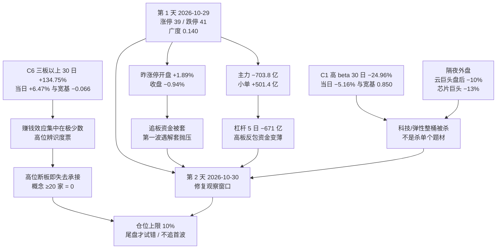

# 2026-10-30 · **风格研判**

> **数据归属**: 本单元 `trade_date=2026-10-30`（盘前），全部量化读数取自 **2026-10-29 收盘**；情绪周期位置由 2026-10-14 至 2026-10-29 的 12 个交易日序列定位。
> **数据源新鲜度**: partial · **降级状态**: true · **置信度**: 0.49（0.70 × 0.70 × 1.00）

## 一句话结论

**崩溃退潮型 + 情绪 28.6（恐惧）+ 无主线，仓位上限 10%；周期第 2 天 = 单日杀跌的次日，是修复观察窗口而不是继续空仓——不追日内第一波反弹，只等盘初继续杀跌之后的尾盘试错位。**

---

## 一、情绪周期位置：第 2 天（连跌 1 天 · single_down）

`data/research/20261030/cycle_position.json` 的读数：`cycle_day=2 / consecutive_down_days=1 / tier=single_down`，`as_of_session=20261029`。这个「第 2 天」必须翻译成可执行语义，否则 D1 会把 `single_down` 只读成「杀跌中，全天禁手」。

| 维度 | 读数 | 含义 |
|---|---|:--|
| 第 1 天 | **2026-10-29**：涨停 39 / 跌停 41 / 炸板 25，广度 0.1402，中位 −2.60% | 单日杀跌（kill=true），跌停家数首次反超涨停 |
| 第 2 天 | **2026-10-30（今日）** | 杀跌次日，方向不明，**修复窗口的观察日** |
| 周期打法（原文口径） | 单日杀跌：多为情绪释放，次日方向不明，按原节奏观察 | 不预设方向，先看承接 |
| 加速口径（92 科比） | 第二天持续杀跌 → 尾盘找买点，第三天必有修复 | 若今日**继续杀**才有买点，尾盘而非早盘 |
| 同口径历史样本 | 2026-10-15 连跌 2 天 → 10-16 涨停 61 / 广度 0.593（修复）；2026-10-27 连跌 2 天 → 10-28 涨停 72 / 广度 0.746（修复） | 2/2 修复，但样本量极小，是实例不是概率 |
| 情绪温度阶段 | 高位震荡（`high_chop`，置信 0.72；判据：昨日涨停溢价 +1.89% 为正、炸板率 39.06% < 40%） | 赚钱效应未崩，与「崩溃退潮」的风格标签并存（见 2.6） |

**今日打法（三段式，按顺序执行）**：

1. **温度口径收紧**：净新增风险预算压到下限，存量按 T 与分批处理，不因单日反弹提前放大仓位。
2. **周期口径给方向**：第 2 天不是「继续空仓」，而是「观察日 + 尾盘窗口」——**盘初若承接不济继续杀跌，尾盘允许极小额度试错低位新题材**；若开盘即大幅修复，则**不追**，因为修复的第一波在昨日 72 家涨停股开盘溢价里已经被兑现过（见 2.2）。
3. **额度口径**：试错额度 = 仓位上限 10%，且只用于低位首板/隔日，不含高位接力。

---

## 二、详细分析

### 2.1 结构读数：跌停 41 家反超涨停 39 家，是本次退潮最硬的一条证据

2026-10-29 全市场 **涨停 39 / 跌停 41 / 炸板 25 → 炸板率 39.06%**。跌停家数超过涨停家数，这在 30 日窗口里只出现在 2026-10-22（涨停 33 / 跌停 48）与 2026-10-15（36 / 26 之外的极端日）——它描述的已经不是「分歧」，而是**亏钱效应取得了对赚钱效应的压制**。

天梯 **1 板 29 家 / 2 板 6 家 / 3 板 2 家 / 4 板 2 家**，最高 **4 板**（前一日的 5 板高度被砍断一层），首板占比 **74.4%**。封板质量全面走弱：封单比中位 **11.91%**、开板次数中位 **1 次**、换手中位 **7.86%**；封板时间分布为开盘 5 分钟内 **12.82%**、10:00 前 **64.10%**、10:30 前 **84.62%**、11:30 前 **94.87%**、14:00 前才 100%——**早盘抢封意愿偏低，板是拖到临近午盘才封上的**。

指数层面：上证 **−0.82%**、深成 **−2.92%**、创业板 **−4.45%**、科创 50 **−4.27%**、沪深 300 **−1.03%**、中证 500 **−2.82%**、北证 50 **−3.88%**。**权重指数跌幅只有成长指数的四分之一**，这是典型的「指数被托着、结构在崩塌」：广度上 **涨 756 / 跌 4400 / 平 60**，中位 **−2.52%**，跌超 5% 的 **903 只**、涨超 5% 的仅 **100 只**，成交额 **15562 亿（−4.42%）**——**缩量下跌**，说明不是恐慌性抛售，而是买盘撤退。

### 2.2 溢价拆解：隔夜给了 +1.89% 的溢价，盘中全部吐回去并倒欠

昨日（2026-10-28）72 家涨停股在今日的表现：**开盘溢价均值 +1.89%、中位 +1.51%**；**收盘溢价均值 −0.94%、中位 −2.40%**；红盘率 **33.3%**，再涨停 **10 只**。

这组数字是本单元最关键的一条：**开盘是给溢价的（+1.89%），收盘是倒欠的（−0.94%），中位从 +1.51% 掉到 −2.40%**。含义非常具体——**昨日封板的资金在今日高开时获得了兑现机会，而且他们兑现了**。平均每只昨日涨停股回吐了约 2.8 个百分点（开盘到收盘）。对今日的直接推论：昨日追板的资金成本集中在高开区，**这批筹码现在是套牢盘而不是接力盘**，任何向上的第一波都会遇到他们的解套抛压。这也是「第 2 天不追第一波」的数据依据，不是纪律口号。

对照前一日（2026-10-28：开盘 +0.68%、收盘 +2.33%、红盘率 68.3%），**修复只维持了一个交易日就反转**。

### 2.3 6 簇结构：30 日的钱只留在「打板策略族」和「权重防御」两处

42 个样本（22 个同花顺风格板块 + 20 只 ETF）的 30 个收益日，按 1−Pearson 距离 + Ward 连接聚成 6 簇：

| 簇 | 样本数 | 30 日 | 5 日 | 当日 | 簇内相关 | 与宽基相关 | 阵营 |
|:--:|:--:|---:|---:|---:|---:|---:|---|
| C6 | 1 | **+134.75%** | +33.70% | **+6.47%** | — | **−0.066** | 极端高板接力（昨日非 ST 三板以上表现） |
| C4 | 2 | **+31.56%** | +5.64% | +2.38% | 0.284 | −0.134 | 二板接力 + 银行 ETF（高位博弈与避险共存） |
| C5 | 3 | **+6.73%** | +6.59% | +3.60% | 0.420 | +0.136 | 打二板以上 + 煤炭 + 消费（短周期独立线） |
| C2 | 2 | −3.24% | −1.99% | +0.38% | 0.443 | +0.456 | 创新高 + 医药 ETF（抗跌但无弹性） |
| C3 | 23 | **−12.88%** | −1.54% | −2.26% | 0.709 | +0.810 | 主体资产（行业龙头/百元股/沪股通前十/打板表现/宽基与多数行业 ETF） |
| C1 | 11 | **−24.96%** | −5.97% | **−5.16%** | 0.796 | **+0.850** | 高 beta 超跌（热股/次新/成交前十/深股通前十/高振幅/科创与芯片链） |

**读法（三层）**：

1. **30 日只有 8/42 正收益，中位 −15.67%**，剔除 4 个打板策略指数后的中位是 **−16.10%**——**打赢市场的不是板块，是策略族**。C6（三板以上）30 日 +134.75%、与宽基相关 **−0.066**，是一条与指数完全脱钩的高位博弈线。
2. **当日涨幅严格按「簇的强度」排序而非按超跌排序**：最强的 C6 +6.47%、C5 +3.60%、C4 +2.38% 继续涨，最弱的 C1 **−5.16%** 继续杀。这与 2026-10-29 上一轮（超跌簇领涨 +3.03%、抗跌簇不动）**方向相反**——**超跌回补的一日行情已经结束，重新回到「强的更强、弱的更弱」的缩圈结构**。
3. **C1 与宽基相关 0.850、簇内相关 0.796**，说明这 11 个样本是同一个 beta 桶，**杀它们是杀整片科技/高弹性资产，不是杀个别题材**；C6 与宽基相关 −0.066，说明**高位接力盘今天的钱来源不是指数资金**。

### 2.4 资金：主力单日 −704 亿、小单 +501 亿，散户在接机构的货

主力资金当日净额 **−703.8 亿（净流入率 −4.52%）**，其中超大单 **−381.6 亿**、小单 **+501.4 亿**；近 5 日累计 **−1213.9 亿**。两融余额 **24120 亿（2026-10-28，T+1）**，5 日 **−670.9 亿（−2.71%）**。

这组组合是标准的**派发结构**：机构与大单在减，小单在接。前一日（2026-10-28）是主力 +237 亿、超大单 +254 亿托起来的修复，隔日就变成 −704 亿——**说明那笔修复资金是日内交易而非建仓**。杠杆同步退潮（5 日 −671 亿），意味着**高板反包的资金基础在变薄**。

补充一条文本侧观察（公众号池，匿名）：**盘中宽基 ETF 层面有「官军」买入痕迹**，而个股层面的接力资金没有同步。翻译成结构语言就是——**指数有人管，赚钱效应没人管**，这与「上证 −0.82% vs 创业板 −4.45%」的分化完全吻合。

### 2.5 外盘：量化锚点停在 2026-10-28，而隔夜文本记录了谷歌盘后 −10%

| 市场 | 最新交易日 | 当日 | 5 日 | 20 日 | 与 A 股次日相关 |
|---|:--:|---:|---:|---:|---:|
| 标普 500 | 2026-10-28 | +0.28% | −0.17% | +1.21% | −0.029 |
| 纳指综合 | 2026-10-28 | +0.27% | −0.57% | −1.16% | −0.047 |
| 恒生指数 | 2026-10-29 | −0.59% | +0.10% | −6.38% | −0.116 |
| 韩国综合 | 2026-10-29 | −1.24% | +7.30% | −13.58% | −0.131 |
| 日经 225 | 2026-10-29 | +1.10% | +2.78% | −3.14% | −0.181 |

**缺口必须说清楚**：量化锚点里美股停在 **2026-10-28 收盘**（NVDA −1.17%、MU +5.86%、AVGO +2.77%、AMD +3.24%、TSM +0.60%），而公众号池在今日盘前已经记录了 **2026-10-29 美股盘后的负面冲击**——某云巨头财报不及预期、**盘后跌近 10%**，某芯片巨头**跌超 13%**，存储链盘后跟跌（海力士 −3%、美光 −2%、闪迪 −2.5%），光器件并购传闻下一涨一跌（收购方 −8%、标的 +10%）。宏观归因被写成一句话：**「美联储主席首次把利率约束写进 AI 估值」**——AI 不再享受利率豁免。

**这对今日的意义**：昨日创业板 −4.45%、科创 50 −4.27% 的杀跌，发生在隔夜美股**尚未**反映谷歌暴雷之前；今日开盘要面对的是**叠加了新的外盘负面**的科技链。外盘 5 日/20 日与 A 股次日相关性全为负（−0.03 至 −0.18），**传导方向不可依赖正向共振**——外盘涨不必然带动 A 股，但外盘的技术性杀跌会被用来做兑现理由。

**费城半导体与恒生科技在 tushare 返回空，DXY 缺失、商品 skipped**，跨资产「软着陆/降息/衰退」三档坐标无法建立，本单元不做方向假设。

### 2.6 风格归因：五分法代价表，无阶段覆盖

| 风格 | 区间代价 | 命中/越界情况 |
|---|:--:|---|
| **崩溃退潮型** | **0.2188（最小）** | 炸板率 39.06% 略低于 50% 下界（+0.219）、跌停 41 家命中 30–500 区间、min(上证 −0.82%, 创业板 −4.45%) 命中 −10~−1 区间 |
| 震荡分化型 | 0.4713 | 涨停 39 命中、高度 4 命中、炸板率命中，但涨家占比 **14.7%** 远低于 42% 下界（+0.471） |
| 连板情绪型 | 1.5063 | 涨停 39 不足 50（+0.22）、高度 4 不足 6（+0.33）、炸板率 39.06% 远超 20%（+0.95） |
| 主线扩散型 | 1.6971 | 涨停命中、高度命中、涨家占比 14.7% 越界（+0.78）、行业≥8 家为 0（+1.00） |
| 防御观望型 | 3.4732 | 涨停 39 远超 20（+0.95）、成交额仅 −4.42%（不知 −40%~−5% 区间内，+0.01）之外两项全越界 |

**为什么阶段没有覆盖它**：skill §2.5 的覆盖规则只在「风格=连板/扩散 且 阶段=高位震荡」时生效。今日结构侧直接给出崩溃退潮型，覆盖规则不触发。**这两者不是矛盾，而是描述不同层面**：

- **阶段 = 高位震荡** 说的是「赚钱效应还没崩」——昨日涨停开盘溢价 +1.89% 为正、C6 三板以上指数当日仍 **+6.47%**、C5/C4 全线上涨，高位接力盘还在赚钱；
- **风格 = 崩溃退潮型** 说的是「广度与跌停」——跌停 41 > 涨停 39、涨家占比 14.7%、创业板 −4.45%。

**合并读法**：这是一个**「广度崩塌 + 赚钱效应集中在极少数高位票」的缩圈退潮**，不是全面崩溃。它的风险在于——**一旦那几只高位票断板，就没有第二个赚钱效应落点可以承接**（概念口径 ≥20 家涨停为 0，第一大概念只有 11 家且仅 1 日龄）。

---

## 三、结构传导图

---

## 四、推理深度三问

### 对象一 · 2026-10-29 这根杀跌的性质

- **大资金意图**: 主力 −703.8 亿、超大单 −381.6 亿，同时小单 **+501.4 亿**——**机构在减、散户在接**。前一日刚出现的 +237 亿修复资金隔日反手 −704 亿，说明那笔钱是日内博弈而非建仓。两融 5 日 −671 亿同步退潮，杠杆在被主动降下来，这是**在指数被权重托住的同时清理弹性资产**的动作。
- **为什么走弱**: 三维同时转向——位置（30 日 C1 已 −24.96%，没有位置优势）、筹码（昨涨停开盘 +1.89% 收盘 −0.94%，隔夜溢价被全额兑现并倒欠）、催化（隔夜利率口径给 AI 估值上了约束，海外云巨头财报分化）。**筹码维度是这次的主动因**，不是位置。
- **逻辑够不够硬**: **够硬**。三条独立证据链同向：①微观（跌停 41 > 涨停 39、炸板率 39.06%、高度从 5 砍到 4）；②30 日簇（C1 −5.16%、C3 −2.26%，强簇 C6/C5 独走）；③资金（主力 −704 亿、5 日 −1214 亿、两融 −671 亿）。同向的方向是**「广度崩塌的缩圈退潮」**，不是「一日洗盘」。

### 对象二 · C6（昨日非 ST 三板以上表现）：30 日 +134.75%、与宽基相关 −0.066

- **大资金意图**: 这是纯游资博弈池，参与者只对「高度能否打开」负责，不对指数负责。与宽基相关 −0.066 意味着**它的钱不来自指数资金，也不流向指数**——它是当下市场唯一还在自我循环的赚钱效应闭环，而 C4（二板 + 银行 ETF，簇内相关 0.284、与宽基 −0.134）把它和避险端聚在一起，说明资金在「继续赌高」与「躲进权重」之间**没有中间态**。
- **为什么走强**: 稀缺性。当日最高只有 4 板、4 板只有 2 家，**能站在那里本身就是身份**；同时 C6 的 5 日 +33.70%、当日 +6.47% 是在全市场涨家占比 14.7% 的背景下取得的，意味着**它吸走了场内几乎全部的接力意愿**。
- **逻辑够不够硬**: **不硬，且是本次最脆弱的一环**。三条反证：①高度从 5 板降到 4 板，断板层级在上移；②首板占比 74.4%、封板时间拖到 10:30 之后才过半，说明**低位承接薄、高位也不敢抢封**；③概念口径 ≥20 家涨停为 **0**、第一大概念只有 11 家且 **1 日龄**，**没有任何板块级跟风盘**。C6 的 +134.75% 是 30 日的累积战果，不是今天的边际变化；**一旦这 2 只 4 板断掉，全场没有第二个承接池**。

### 对象三 · C1（高 beta 超跌，11 个样本，与宽基相关 0.850）

- **大资金意图**: 簇内相关 0.796、与宽基 0.850，说明这是一只「整桶 beta」——买它等于买指数弹性，减它等于整体降 beta。机构在这个位置减 C1，是在**用最小的折价换最快的 beta 下调**；对手盘是 30 日里被反复伤害、正在被小单 +501 亿这个数字代表的那批资金。
- **为什么走弱**: 30 日 −24.96%、5 日 −5.97%，本身就是 6 簇里最深的坑；昨日（2026-10-29 上一轮）这个桶刚做过一次超跌回补（+3.03%），**一日回补后再杀，属于二次确认而非初次错杀**。
- **逻辑够不够硬**: **中等偏硬，但缺「位置便宜」这一环**。硬在「整桶同步 + 机构降 beta + 外部催化向下」三者同向；缺在**它已经不在低位**——30 日 −24.96% 是对 30 日前的自己，但对昨日刚抄底的人，今天开盘即是浮亏。若今日 C1 低开后不能收回开盘价，则「二次杀跌」定性成立；若 C1 缩量止跌而 C6 断板，则钱在做「高位→低位」的换手，那时才是修复窗口的真正起点。

---

## 五、情绪浓度与仓位推导

### 5.1 五维加权（score = Σw×dim / Σw，权重未归一折扣，Σw = 1.00）

| 维度 | 权重 | 原始读数 | 得分 | 说明 |
|---|:--:|---|:--:|---|
| 涨停强度 | 0.25 | 39 家 | **39.0** | min(100, 39) |
| 跌停压制 | 0.20 | 41 家 | **18.0** | max(0, 100 − 2×41) |
| 连板结构 | 0.20 | 高度 4、无断档、首板 74.4% | **64.7** | 0.5×66.7 + 0.5×(0.5×100.0 + 0.5×25.6) |
| 炸板率 | 0.15 | 39.06% | **0.0** | 100 − 4×39.06 → 截断为 0 |
| 杠杆/主力 | 0.20 | 两融 5 日 −2.71%（22.9）、主力净流入率 −4.52%（0.0） | **11.5** | 两项均值 |

**综合 28.6 → 恐惧档**（20–40 区间中段）。结构上值得注意：**连板结构拿到 64.7 是全表最高分**（因为没有断档、高度还有 4 板），而**炸板率归零、主力维度 11.5** 把总分压到 28.6。这正是「缩圈退潮」的量化形态——**接力结构还在，资金与质量已经不在**。

### 5.2 仓位上限四步推导

| 步骤 | 调整 | 依据 |
|---|---|:--|
| 风格基准 | **0.15** | 崩溃退潮型 |
| 情绪调整 | **−0.10** | 28.6 落 20–30 恐惧档下沿 |
| 阶段调整 | **−0.05** | 阶段 = 高位震荡，净新增风险预算收紧 |
| 宽度调整 | **−0.05** | 30 日 42 样本中位 −15.67%、正收益仅 8/42（19% < 25%） |
| 机械合计 | −0.05 → 截断 0.00 | |
| **下限生效** | **0.10** | 崩溃退潮型下限，极小试错额度：只用于低位新题材首板/隔日，不含接力 |

**10% 是「只留一手」的刻度**，不是「必须空仓」：它保留了一条腿给「第 2 天继续杀跌 → 尾盘试错」这条周期路径。**向上放开只有一条路**：竞价校准（P1）确认赚钱效应修复——具体判据见第七节。**向下没有空间**，0.10 已是硬底。

---

## 六、关键证据

- **证据 1** · 涨停 **39** / 跌停 **41** / 炸板 **25** → 炸板率 **39.06%**；跌停家数反超涨停，30 日窗口内第二次出现 · 来源 `tushare.limit_list_d`（2026-10-29）
- **证据 2** · 天梯 **1 板 29 / 2 板 6 / 3 板 2 / 4 板 2**，最高 **4 板**（前日 5 板被砍断），首板占 **74.4%** · 来源 `tushare.limit_list_d` + `limit_step`
- **证据 3** · 昨日 **72** 家涨停股：开盘溢价均值 **+1.89%**（中位 +1.51%）→ 收盘均值 **−0.94%**（中位 −2.40%），红盘率 **33.3%**，再涨停 **10 只** · 来源 `_r1_market.premium`（2026-10-29）
- **证据 4** · 广度 涨 **756** / 跌 **4400** / 平 60，中位 **−2.52%**，涨超 5% 仅 100 只、跌超 5% 达 **903 只**，成交 **15562 亿（−4.42%）** · 来源 `tushare.daily`（5216 只）
- **证据 5** · 指数：上证 **−0.82%** / 深成 −2.92% / 创业板 **−4.45%** / 科创 50 **−4.27%** / 沪深 300 −1.03% / 中证 500 −2.82% / 北证 50 −3.88% · 来源 `tushare.index_daily`
- **证据 6** · 30 日窗口 42 样本中位 **−15.67%**（剔除打板策略族 −16.10%）、正收益 **8/42**、5 日正收益 13/42；末日 **9 涨 / 33 跌**、中位 −2.36% · 来源 `_r1_cluster.json`
- **证据 7** · 6 簇 Ward：C6 高板 +134.75%（当日 +6.47%、与宽基 −0.066）→ C4 二板+银行 +31.56%（+2.38%）→ C5 +6.73%（+3.60%）→ C2 −3.24%（+0.38%）→ C3 −12.88%（−2.26%）→ C1 −24.96%（−5.16%）；**当日涨幅与 30 日强度同向而非反序** · 来源 `_r1_cluster.json`
- **证据 8** · 主力净额 **−703.8 亿**（净流入率 −4.52%，超大单 −381.6 亿、小单 **+501.4 亿**），5 日累计 **−1213.9 亿**；两融 **24120 亿**（2026-10-28，T+1）、5 日 **−670.9 亿（−2.71%）** · 来源 `tushare.moneyflow_dc` 逐票加总 + `tushare.margin`
- **证据 9** · 行业口径涨停 ≥8 家 **0 条**（最大 4 家）；概念口径 ≥8 家 **2 个**、**≥20 家 0 个**；第一大概念 11 家且仅 **1 日龄**，前日第一名概念从 31 家掉到 8 家（−23） · 来源 `tushare.limit_cpt_list`
- **证据 10** · 情绪周期位置 **第 2 天**（连跌 1 天 · single_down · as of 2026-10-29 收盘），同口径样本 2/2 修复（10-16 涨停 61/广度 0.593；10-28 涨停 72/广度 0.746） · 来源 `data/research/20261030/cycle_position.json`
- **证据 11** · 情绪温度阶段 **高位震荡（置信 0.72）**，判据为昨日涨停溢价 +1.89% 为正且炸板率 39.06% < 40% · 来源 `data/research/20261030/emotion_cycle.json`
- **证据 12** · 外盘量化锚点停在 **2026-10-28**（标普 +0.28%、纳指 +0.27%、NVDA −1.17%、MU +5.86%），而文本侧记录 **2026-10-29 盘后**云巨头 −10%、芯片巨头 −13%、存储链跟跌 · 来源 `overseas_snapshot.json`（stale）+ 公众号池
- **证据 13** · 文本侧（公众号池 86 篇、9 条方向性判断）共识为「弱势混沌、等右侧信号」，把矛盾描述为「光模块龙头砸盘 vs 银行指数历史新高」的极端风格挤压；逆向声音为「现在不是该卖的区域，正在分段买入」「宽基 ETF 有官军买入痕迹」 · 来源 `wechat_official_rss`（账号匿名化）

---

## 七、今日触发条件（if → then）

| 观测量（竞价至上午） | 阈值 | 动作 |
|---|---|:--|
| 昨日 72 家涨停股开盘溢价 | **转正且 > +1%** 且广度 > 0.55 | 修复验证成立，仓位可由 0.10 上调至 **0.30**，仍只做低位首板/隔日 |
| 昨日 72 家涨停股开盘溢价 | **转负** 或 盘初炸板率再上 45% | 仓位 0.10 硬底不再上移，**当日不做任何新开仓**，只保留存量 T |
| 盘初全市场广度 | **继续下探 < 0.12**（复制昨日） | 进入「第 2 天继续杀跌」路径，**尾盘**才是试错窗口，早盘一律不动 |
| 4 板 2 只 | **断板且无 3 板晋级** | 高板接力端退潮确认（C6 当日不再参与），赚钱效应落点归零，全天维持 0.10 |
| 概念口径涨停 ≥20 家的板块数 | **由 0 变 1** | 出现第一个承接池，修复窗口成立的必要条件，可支持 0.30 |
| 主力资金（盘后口径） | 由 −704 亿转为 **净流入 > +100 亿** | 派发结构结束，次日才谈得上放大仓位 |

---

## 八、不确定性 / 反证

1. **外盘 overnight 一跳缺失是本单元最大的盲区**：量化锚点停在 2026-10-28（比今日少一夜），而隔夜美股盘后已发生云巨头 −10%、芯片巨头 −13% 的负面事件。**今日开盘面对的是「量化看不见、文本已知」的外部冲击**，本单元对科技链的开盘压力判断偏保守是正确的，但**幅度不可估算**（缺 SOX、缺 DXY、缺商品）。
2. **「崩溃退潮型」不等于「赚钱效应全崩」**：C6 三板以上指数当日仍 +6.47%、C5 +3.60%、C4 +2.38%，高位接力盘还在赚钱。若今日这 2 只 4 板继续晋级，本单元的风格定性就会显得过重——**风格标签描述广度与跌停，不描述高位博弈的存活率**，这一点已在 2.6 显式列出，请 D1 按「温度」而非「禁令」使用。
3. **第 2 天的历史样本只有 2 个，2/2 修复是巧合区间不是概率**：`cycle_position.json` 自己就标注了「样本是同口径历史实例，不是概率模型」。若今日继续杀跌，那是「连跌两日 → 第三日修复」路径，**不是本单元判断错误，而是周期从第 2 天进入第 3 天**。
4. **情绪浓度 28.6 里有一处结构性偏高**：连板结构维度拿到 64.7 分，因为「无断档」被算法当成连续性满分，而当日 3 板只有 2 家、4 板 2 家——**这实际上是「薄而不断」而非「厚而连续」**。若把 3 板家数作为连续性权重，得分会更低。本单元保留机械算法结果，但把这一偏置写在这里。
5. **文本侧与量化侧同向（agreement = 1.00），但同向的可能都是「后视镜」**：文本读「放血日」是对昨日收盘的描述，量化读「退潮」也是。**两者都没有预判今日**，一致率高不代表置信度高，这也是 freshness 折扣之外需要单独扣的一层（本单元已把 base 0.70 压到 0.49）。
6. **群聊源本轮 0 条**：7 群在抓取窗口内无消息，文本侧全部由公众号池承接。公众号是单向输出、有立场筛选，**不等同于群内真实讨论温度**，散户情绪的实际读数本轮缺失。
7. **概念代理口径与 R2 不同**：本单元用 `limit_cpt_list` 的 up_nums ≥20 作主线条数代理，得到「无主线」；R2 若用其他口径（产业链映射、资金流、龙头梯队）可能给出不同结论。**以 R2 为准，本单元只提供风格侧象限。**

---

## 九、与其他 R/D/E 的关系

- **依赖（上游）**: `data/raw/20261030/style_snapshot.json`（22 风格板块 + 20 ETF + 5 外盘指数 + 14 只美股）、`data/research/20261030/cycle_position.json`（第 2 天定位）、`emotion_cycle.json`（高位震荡 0.72）、`_r1_market.json`（涨停/溢价/广度/资金）、`_r1_kol.json`（文本侧摘要）、`manifest.json`（源存活）、`overseas_snapshot.json`（外盘新鲜度）
- **被消费（下游）**: R2（风格 → 主线数量与仓位基准）、R3（情绪浓度 28.6 作基准）、R6（风格与主线一致性反证：崩溃退潮型 + 无主线，任何「主线」主张都要解释概念 ≥20 家为 0 这件事）、R7（主力 −703.8 亿与 5 日 −1213.9 亿的交叉校验）、D1（`position_cap_suggestion=0.10` → 执行池总仓上限；`emotion_cycle_day_label` / `cycle_position` → 第 2 天通道选择：尾盘试错 ≠ 全天禁手）
- **本单元边界**: 不推板块、不推个股、不给买卖点、不做估值与技术形态判断。第三节簇表内的样本名（风格指数与 ETF 名称）是数据标签，不构成方向推荐；主线归属与龙头认定由 R2/R5 完成。

---

## 十、数据源审计

| 源 | 日期 | 状态 | 备注 |
|---|---|:--:|---|
| tushare/ths_daily + ths_member | 2026-10-29 | 🟢 | 22/22 风格板块全覆盖，30 个收益日完整 |
| tushare/fund_daily | 2026-10-29 | 🟢 | 20/20 ETF 全覆盖 |
| tushare/limit_list_d + limit_step | 2026-10-29 | 🟢 | 涨停 39 / 跌停 41 / 炸板 25 逐票 + 天梯 |
| tushare/daily（全市场广度） | 2026-10-29 | 🟢 | 5216 只，涨跌分布与中位涨幅现算 |
| tushare/index_daily | 2026-10-29 | 🟢 | 7 个指数 |
| tushare/limit_cpt_list | 2026-10-29 | 🟢 | 概念 20 条代理，≥20 家 0 个 |
| tushare/moneyflow_dc（逐票加总） | 2026-10-29 | 🟢 | 主力 −703.8 亿，5 日 −1213.9 亿 |
| tushare/margin | 2026-10-28 | 🟡 | T+1 滞后，未含 2026-10-29 |
| tushare/index_global | 2026-10-28 | 🟡 | 美股 stale 一夜；费半、恒生科技返回空 |
| tushare/us_daily | 2026-10-28 | 🟡 | 14 只美股，最新 2026-10-28 |
| tushare/fx_daily | 2026-10-28 | 🟡 | 仅 USDCNH 6.65894 单点，DXY 缺，方向不可用 |
| 商品（原油/铜/金） | — | 🔴 | skipped，跨资产三档坐标无法建立 |
| wechat_cli_groups（7 群，匿名） | 2026-10-30 | 🔴 | **0 条**，抓取窗口内 7 群无消息 |
| wechat_official_rss（17 源） | 2026-10-30 | 🟢 | 86 篇，核心 8/9 存活（3 源本期空） |
| weflow-analytics MCP | — | 🔴 | 404 Not Found，该源已永久下线（L3 缺位，不编造） |
| 北向 north_money | 2026-10-29 | 🔴 | 恒等于 hgt+sgt 且量级 2200 亿以上，判为成交额口径，方向不可用 |
| emotion_cycle.json | 2026-10-29 | 🟢 | 高位震荡，置信 0.72 |
| cycle_position.json | 2026-10-29 | 🟢 | 第 2 天 / 连跌 1 天 / single_down |

---

## 十一、Sub-Agent 元数据

- **skill**: `analyze_style_v1@1.0`
- **artifact**: `data/research/20261030/R1_style.json`（pydantic `research_unit_v1` 校验后原子落盘）
- **中间底稿**: `_r1_cluster.json`（6 簇 + 42 样本 30 日收益矩阵）、`_r1_market.json`（市场结构）、`_r1_kol.json`（文本侧摘要）
- **复算脚本**: `scripts/fetch/run_style_snapshot.py --date 20261030 --lookback 75`、`scripts/research/r1_style_cluster.py --date 20261030 --window 30 --k 6`、`scripts/research/r1_market_structure.py --date 20261030 --series 6`、`scripts/research/r1_assemble_style.py --date 20261030`
- **聚类方法**: 1−Pearson 相关距离 + Ward linkage，k=6（average linkage 结果保留在 `clusters_average_linkage_diagnostic` 作退化诊断，当日退化为 36+2+1+1+1+1，共同因子过大，不作正稿）
- **方法标记**: `cluster_v1+market_structure_v2+llm_prose`
- **置信度公式**: 0.70（base）× 0.70（freshness: gap_flags = us / cross_asset / margin）× 1.00（文本与量化同向）= **0.49**，`status=degraded`
