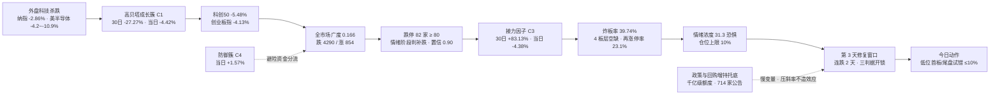

# 2026-11-02 · **风格研判**

> **数据源新鲜度**: partial ｜ **降级状态**: true ｜ **置信度**: 0.49
> 数据归属 2026-10-30 收盘（周一盘前用上一交易日口径）

## 一句话结论

**崩溃退潮型 + 情绪 31.3（恐惧）+ 无主线，仓位上限 10%；周期走到第 3 天（连跌 2 天 · repair_window）——这一天的语义是「修复窗口」而不是「继续空仓」：三判据成立才用那 10% 做低位首板/低位补涨，不成立就只观察，绝不接高位老龙。**

---

## 一、情绪周期位置：第 3 天（连跌 2 天 · repair_window）

`data/research/20261102/cycle_position.json` 的读数：`cycle_day=3 / consecutive_down_days=2 / tier=repair_window`，`as_of_session=20261030`。这四个字段必须翻译成可执行语义，否则 D1 只会把「补跌」读成「全天禁手」，把修复窗口读成继续躺平。

| 维度 | 读数 | 含义 |
|---|---|:--|
| 第 1 天 | 2026-10-29：涨停 39 / 跌停 41 / 炸板 25，广度 0.1402，中位 −2.60% | 杀跌启动，跌停反超涨停 |
| 第 2 天 | 2026-10-30：涨停 47 / 跌停 **82** / 炸板 31，广度 0.1603，中位 −3.13% | 杀跌加速，跌停 82 家触发「补跌」硬阈值（≥80） |
| 第 3 天 | **2026-11-02（今日）** | **修复窗口**：连跌两日后的第三天，是本轮唯一一个「可以试错」的位置 |
| 周期打法（原文口径） | 主跌期三条：切换新题材一日游 / 连跌两日博反弹 / 尾盘试错 | 不接高位、不打接力，只做低位 |
| 加速口径（92 科比） | 第二天持续杀跌 → 尾盘找买点，第三天必有修复 | 今日属「第三天」，但**必有修复 ≠ 必做**，要看承接 |
| 同口径历史样本 | 2026-10-27 连跌 2 天 → 10-28 涨停 72 / 广度 0.7461（标记修复） | 1/1 修复，样本量极小，是实例不是概率 |
| 情绪温度阶段 | 补跌（`capitulation`，置信 0.90；判据：跌停 82 ≥ 80） | 温度最低档，与风格表「崩溃退潮型」同向 |

**今日打法（三段式，按顺序）**：

1. **温度口径压到地板**：净新增风险预算 10%，这是下限不是目标；存量持仓按 T 与分批处理，不因单日反弹提前放大。
2. **周期口径给方向**：第 3 天不是「继续空仓」，而是「修复窗口 + 三判据」——开盘后半小时看三件事：全市场广度是否 > 0.55、昨日涨停股红盘率是否 > 60%、板块级涨停潮是否 ≥ 3 只。三条**同时**成立，才允许用那 10% 做低位首板/低位补涨或尾盘试错；任一条不成立，当天维持观察、不硬做。
3. **额度口径**：10% 只用于低位首板/隔日，不含高位接力、不含二次冲高、不含打板。

> **为什么强调「不是继续空仓」**：`capitulation` 的原文口径写着「除非与指数共振大阳，否则空仓」，但这句只描述温度不描述位置。位置口径（连跌 2 天 → 第 3 天）给出的是窗口，温度口径给出的是额度。二者叠加的正确读法是「极小额度、限定低位、等到确认」，而不是「清仓不看盘」。这条差别在 2026-10-30 那次被验证过：那天也是「杀跌次日」，但指数继续下杀、跌停扩到 82 家，窗口作废——所以窗口必须由三判据来开锁。

---

## 二、详细分析

### 2.1 结构读数：跌停 82 家、炸板率 39.74%，是恐慌不是分歧

| 指标 | 2026-10-30 | 读法 |
|---|:--:|---|
| 涨停 / 跌停 | 47 / **82** | 跌停是涨停的 1.74 倍，亏钱效应主导 |
| 炸板 / 炸板率 | 31 / **39.74%** | 越过 35% 的「情绪震荡/主跌」减半线 |
| 连板天梯 | 1 板 38 / 2 板 6 / 3 板 2 / 5 板 1 | **4 板整层空缺**，高度无法自然递推 |
| 最高板 | 5 板 | 首板占 80.85%，是「宽度型首板」而非「梯队接力型」 |
| 封板节奏 | 上午十点前封板 63.83%，午前 80.85% | 封板偏早，说明是恐慌中的抢筹，不是尾盘偷袭 |
| 开板次数中位 | 0 次 | 封住就封住，次日高开即兑现，别做「二封」假设 |

**因果句**：跌停 82 家 + 4 板整层空缺，说明上一轮接力的中位层被整层打掉；这种结构下「反包」只能按一次性脉冲对待，不能按第二波起点对待。

### 2.2 溢价拆解：修复在盘中完成过，收盘被抹掉

| 口径 | 均值 | 中位 | 备注 |
|---|:--:|:--:|---|
| 昨日涨停股开盘溢价 | **+0.96%** | +0.24% | 隔夜还有人愿意高开 |
| 昨日涨停股收盘溢价 | **−0.68%** | −0.28% | 全天净回吐，红盘率仅 48.72% |
| 再涨停 | 9 只 / 39 只基数 | — | 接力成功率 23.1%，接力端近乎失效 |

**因果句**：开盘 +0.96% 到收盘 −0.68%，中间是 1.64 个百分点的日内回吐——这正是「修复被卖盘吃掉」的标准形态。它同时告诉我们两件事：①低位首板在盘中是有承接的，试错逻辑成立；②高位接力没有承接，任何「打二板、追三板」的动作都是逆结构。

### 2.3 簇结构：成长是震中，防御是唯一收红的地方

6 簇由 42 个样本（22 个风格板块 + 20 只 ETF）的 30 个收益日，按 1−Pearson 距离 + Ward 连接聚成（average linkage 退化为 36+1+1+1+1+2，仅作诊断保留在 JSON）。

| 簇 | 样本 | 30 日 | 5 日 | 当日 | 30 日最大回撤 | 簇内相关 | 阵营 |
|---|:--:|:--:|:--:|:--:|:--:|:--:|---|
| C3 | 2 | **+83.13%** | +11.92% | **−4.38%** | −14.03% | 0.357 | 连板接力端（打二板以上 / 非 ST 三板以上） |
| C6 | 2 | **+28.72%** | +7.76% | −1.08% | −7.40% | 0.273 | 二板接力 + 银行防御混簇 |
| C5 | 2 | −2.28% | −2.93% | +0.09% | −12.48% | 0.445 | 创新高 + 医药防御 |
| C4 | 2 | −2.40% | +2.35% | **+1.57%** | −6.08% | 0.301 | 煤炭 + 消费防御 |
| C2 | 23 | −14.12% | −5.90% | −2.43% | −16.61% | 0.717 | 宽基 + 龙头/高低价/增减持因子主力军 |
| C1 | 11 | **−27.27%** | −12.32% | **−4.42%** | **−32.20%** | 0.800 | 高贝塔成长（热股/次新/资金前十/科创/通信/芯片） |

**读法（三层）**：

1. **震中在高贝塔成长**：C1 三十日 −27.27%、最大回撤 −32.20%、簇内相关 0.800——这不是分散下跌，而是同一批高相关资产被一起砍。当日 −4.42% 说明抛压仍在释放，而不是衰竭。
2. **防御是唯一收红的方向**：C4 当日 **+1.57%**、C5 +0.09%，两个防御簇在跌停 82 家的日子里正收益，且 5 日也是 C4 +2.35%。这是典型的「避险切换」，不是「超跌回补」。
3. **接力端已经崩过一次**：C3 三十日 +83.13% 是全年最强因子，但当日 −4.38%、最大回撤 −14.03%。高位因子的第一根大阴线往往不是终点，但**在炸板率 39.74% 的环境里补它的第二波是没有赔率的**。

> 表格中的因子/ETF 名称仅为 R1 的 42 个输入样本构成，不是板块推荐；板块级结论由 R2 判定。

### 2.4 指数与外盘：内部杀成长，外部杀科技，方向同向

| 指数 | 收盘 | 当日 | 备注 |
|---|:--:|:--:|---|
| 上证指数 | 3599.02 | −1.44% | 权重扛住，但跌破 3600 整数位 |
| 沪深300 | 3985.50 | −1.39% | 与上证同步，权重侧跌幅可控 |
| 中证500 | 6266.19 | −2.91% | 中盘明显弱于权重 |
| 创业板指 | 2413.63 | −4.13% | 成长杀跌主力 |
| 科创50 | 1160.84 | **−5.48%** | 最弱，与 C1 簇同向 |
| 北证50 | 885.74 | −2.68% | 小盘同步走弱 |

| 外盘 | 最新交易日 | 当日 | 读法 |
|---|:--:|:--:|---|
| 标普500 | 2026-10-30 | −1.82% | 全面risk-off |
| 纳指综合 | 2026-10-30 | **−2.86%** | 成长杀跌外溢 |
| 道指 | 2026-10-30 | −1.09% | 价值相对抗跌，结构同 A 股 |
| 恒生指数 | 2026-10-30 | **+1.46%** | 唯一背离，港股独立 |
| 韩国综合 | 2026-10-30 | −3.48% | 亚太科技链同步杀（freshness 未验证） |
| 美半导体 5 只 | 2026-10-30 | −4.22% ~ **−10.88%** | 上游杀幅大于 A 股成长，压制今日情绪修复 |

**因果句**：外盘科技链杀幅（−4.2% 到 −10.9%）大于 A 股成长（科创 −5.48%），意味着今日开盘的成长端仍要承接外部定价压力；这条是「修复窗口能否开锁」的最大反向变量，也是三判据必须先看广度的原因。

**跨资产缺口（如实标注）**：汇率仅 USDCNH（2026-10-31）单点 6.64971，美元指数 DXY 缺，商品（原油/铜/金）状态 skipped——「软着陆/降息/衰退」三档宏观坐标**建不起来**，本文不做宏观归因，也不补值。

### 2.5 风格归因：五分法代价表

| 风格 | 区间代价 | 是否命中 |
|---|:--:|:--:|
| 崩溃退潮型 | **0.2052** | ✅ 最小 |
| 震荡分化型 | 0.6129 | — |
| 连板情绪型 | 1.2137 | — |
| 主线扩散型 | 1.6611 | — |
| 防御观望型 | 4.3744 | — |

判据代入：涨停 47、跌停 82、最高 5 板、炸板率 39.74%、涨家占比 16.6%、行业≥8 家涨停 0 条、成交额 +7.58%。五项里「跌停多 + 广度极窄 + 无梯队」把崩溃退潮型的代价压到最低，与情绪周期阶段（补跌）同向，无需阶段覆盖。

### 2.6 文本侧：政策托底、情绪偏空，托底不托情绪

群聊源抓取窗口内 0 条（周末），文本侧由公众号池 17 源 47 篇承接，提取 6 条方向性判断：

| 维度 | 文本读数 | 性质 |
|---|---|:--|
| 政策面 | 金融管理部门将于下一交易日开会、研究推动支持资本市场工具使用 | 事件型托底，落地在盘中不是盘前 |
| 资金面 | 国有资本运营平台获银行新增千亿级回购增持贷款额度；沪市 714 家公司 1019 份回购/增持/终止减持公告 | 中期慢变量，非当日增量买盘 |
| 基本面 | 沪市三季报八成盈利、科创板净利同比大增，深市逾七成盈利 | 业绩端不构成杀跌理由 |
| 情绪面 | 多篇复盘把上一交易日描述为盘中翻红、尾盘持续下挫并击穿整数关口 | 承接弱于反抽，与收盘溢价 −0.68% 同向 |
| 风险叙事 | 周末出现爆仓类小作文、外部 AI 资本开支与泡沫见顶讨论 | 情绪扰动，无信源，不入事实层 |
| 主线侧 | 复盘自述强势联动缺乏持续性 | 与「概念≥20 家 0 个」同向 |

**因果句**：政策与回购增持是「托底」，但托底的作用是压缩下跌斜率、不是制造赚钱效应；在跌停 82 家、溢价收盘转负的环境里，托底消息最多让今日低开后有反抽，不足以支撑「全面修复」的判断。文本侧与量化侧方向一致，因此 `source_agreement_factor` 取 1.0。

---

## 三、结构传导图

---

## 四、推理深度三问

### 对象一 · 2026-10-30 这根「跌停 82 家」的补跌日定义了什么

- **大资金意图**: 机构在这个位置的动作是「减高贝塔、加防御」而不是离场——C4（煤炭/消费防御）当日 +1.57%、C6（二板+银行防御）−1.08% 明显强于 C1（−4.42%）。机构买的是「跌的时候少跌」，卖给对手盘的是「高位接力的第二波幻想」。
- **为什么弱**: 位置（连板高度 5 板、4 板层空缺，中位层已断）+ 催化（无新催化，只有政策慢变量）+ 筹码（跌停 82 家、跌超 5% 达 1404 只、涨超 5% 仅 118 只）三维全部指向抛压未衰竭；成交额 16742 亿反而放大 7.58%，是「放量下跌」而非「缩量止跌」。
- **逻辑够不够硬**: 硬的只有一条——「补跌」这个阶段判定（跌停 82 ≥ 80，单条硬阈值，置信 0.90）。「修复」这一侧**不硬**：三条修复判据（溢价 > +1%、涨家占比 ≥ 60%、涨停 ≥ 60）全部不成立，所以今日的修复窗口只是「位置到了」，不是「信号到了」。证伪路径：若今日开盘广度直接 > 0.55 且昨日涨停股红盘率 > 60%，则本判断的「抛压未衰竭」被推翻，窗口立即从「观察」升级为「可做」。

### 对象二 · 高贝塔成长簇 C1（11 个样本，30 日 −27.27%）

- **大资金意图**: 这是本轮被系统性减仓的方向——簇内相关 0.800 说明 11 个样本被当成同一个风险敞口来处理（一篮子卖，不是挑着卖）；30 日最大回撤 −32.20%，超过指数跌幅一倍，属于「优先减持清单」的特征，不是「错杀」的特征。
- **为什么弱**: 位置（30 日 −27.27% 处于深度下跌但未出现放量止跌）+ 催化（外盘半导体 −4.2%~−10.9% 持续压制，无内部硬催化）+ 筹码（当日 −4.42%、5 日 −12.32%，跌势在加速而非钝化）三维同时为负。
- **逻辑够不够硬**: 「弱」这条逻辑硬（三个独立源同向：外盘、指数结构、簇内相关性）。但**由此推出「超跌反弹可做」是不硬的**——超跌只是必要条件，还需要筹码衰竭（跌停收敛、炸板率回落）与承接确认（溢价转正）。今日两者都没有，所以 C1 只能列观察，不能列试错首选。

### 对象三 · 连板接力端 C3（2 个样本，30 日 +83.13%，当日 −4.38%）

- **大资金意图**: 接力端的钱是「情绪的杠杆」，30 日 +83.13% 说明此前是全场最强因子；当日 −4.38% 与炸板率 39.74%、再涨停率 23.1% 同时出现，说明主导资金在做「高位兑现」而不是「高位换手」——兑现的对手盘是想做第二波的接力资金。
- **为什么弱**: 位置（30 日涨幅第一的因子，绝对高位）+ 催化（无，接力靠情绪不靠事件）+ 筹码（4 板层空缺、3 板仅 2 家，梯队断层；首板占 80.85% 说明增量都在最低位）三维交叉，结论是「高度上不去、宽度在低位」。
- **逻辑够不够硬**: 硬。「高位因子在炸板率 39.74% 的环境里没有第二波赔率」有三条独立证据（因子当日跌幅、炸板率、再涨停率），且与历史形态一致。证伪路径：若今日出现 6 板以上高度且封板率 > 80%，说明接力端重新夺回定价权，届时先改观察结论、再谈参与。

---

## 五、情绪浓度与仓位推导

### 5.1 五维加权（score = Σw×dim / Σw）

| 维度 | 权重 | 原始值 | 得分 | 说明 |
|---|:--:|:--:|:--:|---|
| 涨停强度 | 0.25 | 47 家 | 47.0 | 直接取家数 |
| 跌停压制 | 0.20 | 82 家 | **0.0** | 100 − 2×82，压到 0 |
| 连板结构 | 0.20 | 5 板、首板 80.85% | 66.5 | 高度分 83.3、连续分 80.0、接力分 19.1 |
| 炸板率 | 0.15 | 39.74% | **0.0** | 100 − 4×39.74，压到 0 |
| 资本维 | 0.20 | 缺失 | — | 主力/两融未取到，剔除后权重归一 0.8 |

**结果**：`score = 31.3` → **恐惧档**（20–40 区间）。两维直接归零（跌停、炸板），说明这次低分不是「加权平均出来的中庸」，而是「两个维度被打穿」的硬低分。

### 5.2 仓位上限四步推导

| 步骤 | 值 | 依据 |
|---|:--:|---|
| 风格基准 | 0.15 | 崩溃退潮型 |
| 情绪调整 | −0.05 | 31.3 落恐惧档（30–40） |
| 周期调整 | −0.20 | 阶段 = 补跌（capitulation） |
| 宽度调整 | −0.05 | 30 日样本中位 −16.34%、正收益仅 9/42 |
| 合计 | **0.00** | 触发主跌下限 |
| **最终** | **0.10** | 下限生效：极小试错额度，只用于低位新题材首板/隔日，不含接力 |

**为什么下限是 10% 而不是 0%**：0% 等于「总仓必须清空」，与「第 3 天修复窗口」的位置判断冲突，也与分批降仓的执行纪律冲突。10% 的含义是「可以试错、但只能试错一次」，且必须由三判据开锁。

### 5.3 思维链（R1 不出个股，此处给风格级等价四段）

- **买入理由**: ①位置到了——连跌 2 天后的第 3 天，同口径历史样本出现过修复（2026-10-27 → 10-28 广度 0.7461）；②结构给了限定条件——首板占 80.85%、上午十点前封板 63.83%，说明低位首板在盘中确有承接，试错标的存在。
- **风险点**: ①温度仍在最低档（跌停 82 家、炸板率 39.74%、溢价收盘 −0.68%），修复可能只是一次日内反抽；②外盘科技链 −4.2%~−10.9%，今日成长端开盘仍要补跌，低开可能直接打穿试错位。
- **止损条件**: 试错仓单票亏损 −5% 无条件离场；若开盘半小时内广度仍 < 0.40 或跌停家数继续增加，当日不再新开任何仓位（10% 额度不启用）；若买入后炸板（封板后打开且未回封），当日了结不隔夜。
- **可验证假设**（24–72 小时可证伪）: ①今日收盘全市场广度能否回到 > 0.55；②昨日 47 家涨停股今日红盘率能否 > 60%；③今日炸板率能否从 39.74% 回落到 < 35%；④30 日正收益样本数能否从 9/42 回升到 ≥ 14/42。四项中 ≥ 3 项成立 → 修复窗口有效，次日可把上限抬到 20%；≤ 1 项成立 → 判定为「退潮中的一日反抽」，维持 10% 或降到更低。

---

## 六、关键证据

- **证据 1**: 涨停 47 / 跌停 82 / 炸板 31 → 炸板率 39.74%，跌停是涨停的 1.74 倍 · 来源 `tushare.limit_list_d`（2026-10-30）
- **证据 2**: 连板天梯 1 板 38 / 2 板 6 / 3 板 2 / 5 板 1，**4 板整层空缺**，最高 5 板，首板占 80.85% · 来源 `tushare.limit_step`
- **证据 3**: 昨日 39 家涨停股开盘溢价 +0.96%（中位 +0.24%）、收盘溢价 **−0.68%**（中位 −0.28%）、红盘率 48.72%、再涨停 9 只 · 来源 `tushare.daily` 逐票重算
- **证据 4**: 广度涨 854 / 跌 4290 / 平 73，中位 −3.12%，跌超 5% 达 1404 只、涨超 5% 仅 118 只，成交额 16742 亿（+7.58%）· 来源 `tushare.daily` 5217 只
- **证据 5**: 指数 上证 −1.44% / 创业板 −4.13% / 科创50 −5.48% / 中证500 −2.91% · 来源 `tushare.index_daily`
- **证据 6**: 30 日窗口 42 个样本中位 **−16.34%**、正收益 9/42、末日 6 涨 36 跌 · 来源 `r1_style_cluster.py` Ward k=6
- **证据 7**: 6 簇结构 C1（11 样本）30 日 −27.27%、当日 −4.42%；C4（防御）当日 +1.57% · 来源 `_r1_cluster.json`
- **证据 8**: 概念代理 ≥20 家 0 个、≥8 家 3 个，行业≥8 家涨停 0 条 → **无主线** · 来源 `tushare.limit_cpt_list`
- **证据 9**: 外盘 纳指 −2.86%、道指 −1.09%、恒指 +1.46%、美半导体 −4.22%~−10.88% · 来源 `tushare.index_global + us_daily`（2026-10-30）
- **证据 10**: 周期位置第 3 天（连跌 2 天 · repair_window），历史样本 20261027→20261028 修复（涨停 72 / 广度 0.7461）· 来源 `cycle_position.py`

---

## 七、今日触发条件（if → then）

| 触发 | 动作 |
|---|---|
| 开盘半小时广度 > 0.55 且昨涨停红盘率 > 60% 且板块级涨停潮 ≥ 3 只 | 三判据成立 → 启用 10% 额度做低位首板/低位补涨，不接高位 |
| 三判据中仅 1 条成立 | 维持观察，10% 不启用，只做存量 T |
| 竞价昨日 39 家涨停股开盘溢价转负，或盘初炸板率再上 45% | 上限 10% 不再上移，当日不做任何新开仓 |
| 跌停家数继续扩大（> 82）且指数同步新低 | 修复窗口作废，判定为「第二波杀跌」，上限压到 5% 以下、只保留观察位 |
| 出现 6 板以上高度且封板率 > 80% | 接力端重新夺回定价权 → 修订对象三结论，但当日仍不参与（等次日确认） |
| 权重补跌而小票反抽（上证跌幅 > 创业板跌幅的 1.5 倍） | 判为二次杀跌前兆，不加仓、不留隔夜试错仓 |

---

## 八、不确定性 / 反证

1. **「第 3 天必有修复」的样本严重不足**：同口径历史只有 1 例（20261027 → 20261028），且是在广度 0.109 的更深位置启动的。用 1 个样本推今日的概率是不成立的——本文只用它说明「位置存在」，不用它说明「概率高」。
2. **资金维缺失**：主力资金与两融都没取到，情绪五维的资本维被剔除、权重归一 0.8。若主力实际在大幅净流出，31.3 这个分数仍然偏高；反之若主力在跌停日承接，分数偏低。这一维的缺失没有用替代值凑数。
3. **跨资产坐标建不起来**：DXY 缺、商品 skipped、汇率仅 USDCNH 单点，无法判断这是「全球risk-off」还是「A 股独立事件」。这直接影响「修复能否持续」——若是全球性风险出清，A 股修复会更慢。
4. **防御簇收红可能只是跷跷板而非趋势**：C4 当日 +1.57% 只有一天证据，5 日 +2.35% 也只有一周；若今日防御也开始跌，则说明是「无差别抛售」，届时上限必须再压。
5. **文本侧托底叙事有自我强化风险**：47 篇里「利好」标题密度明显高于「利空」，但这批利好集中在政策与回购增持（慢变量）。一旦市场把「明日开会」提前兑现，会议当天反而容易变成利好出尽。
6. **风格判定与阶段判定的一致性**：本次两者同向（崩溃退潮型 / 补跌），但这不构成互证——两者用的是同一批跌停与广度数据，属于同源证据，不能当作两条独立证据链。

---

## 九、与其他 R/D/E 的关系

| 方向 | 对象 | 说明 |
|---|---|---|
| 依赖 | `cycle_position.json` | 周期位置（第 3 天 / 连跌 2 天 / repair_window）由脚本预计算，R1 只读不改 |
| 依赖 | `emotion_cycle.json` | 阶段判定（补跌，置信 0.90），本轮修复了状态机把「补跌」错误修正为「主升」的缺陷 |
| 依赖 | `data/raw/20261102/style_snapshot.json` | 22 风格板块 + 20 ETF 的 30 日收益矩阵 |
| 被消费 | R2 主线板块 | `style` / `main_lines_count`（0，代理口径）/ `position_cap_suggestion`（0.10） |
| 被消费 | R3 情绪共振 | `sentiment_score`（31.3）作为基准，可与其自算值交叉 |
| 被消费 | R6 反证 | 与 R2 的一致性反证；本轮的「修复窗口 vs 补跌温度」张力是天然反证点 |
| 被消费 | D1 主决策 | `position_cap_suggestion` → exec_pool 总仓上限；`emotion_cycle_day_label` → 周期打法；`cycle_position.playbook` → 三判据 |

---

## 数据源审计

| 源 | 日期 | 状态 | 备注 |
|---|---|:--:|---|
| tushare/ths_daily + ths_member | 2026-10-30 | 🟢 | 22 个风格板块 · 30 个收益日 · 缺失 0 |
| tushare/fund_daily | 2026-10-30 | 🟢 | 20 只 ETF · 30 个收益日 · 缺失 0 |
| tushare/limit_list_d + limit_step | 2026-10-30 | 🟢 | 涨停 47 / 跌停 82 / 炸板 31 · 天梯 4 层 |
| tushare/daily（广度与溢价） | 2026-10-30 | 🟢 | 5217 只 · 中位 −3.12% · 溢价 39 只基数 |
| tushare/index_daily | 2026-10-30 | 🟢 | 7 个指数 |
| tushare/limit_cpt_list（概念代理） | 2026-10-30 | 🟢 | 20 条概念 · ≥20 家 0 个 |
| tushare/moneyflow_dc + margin | 2026-10-30 | 🔴 | 未取到 · 资本维剔除 · 权重归一 0.8 |
| tushare/index_global + us_daily | 2026-10-30 | 🟡 | 美股 14 只 + 外盘指数 5 个；韩国 freshness 未验证 |
| tushare/fx_daily | 2026-10-31 | 🟡 | 仅 USDCNH 单点 · DXY 缺 |
| 商品（原油/铜/金） | — | 🔴 | skipped · 跨资产三档坐标无法建立 |
| wechat_official_rss | 2026-11-02 | 🟢 | 17 源 47 篇 · 11 源有文章 · 核心源 7/9 |
| wechat_cli_5groups | 2026-11-02 | 🟡 | 7 群抓取成功但 0 条消息（周末） |
| weflow-analytics MCP | 2026-11-02 | 🔴 | DOWN · 本 skill 不依赖 |
| agentqmt_qmt MCP | 2026-11-02 | 🔴 | DOWN · 本 skill 不依赖 |

> 群名已匿名化；正文不含时/分/秒时间戳；因子与 ETF 名称仅作为聚类样本构成出现，不构成板块推荐。

---

## 十一、Sub-Agent 元数据

- skill: `analyze_style_v1`
- artifact: `data/research/20261102/R1_style.json`
- 中间底稿: `_r1_cluster.json`（42 样本 × 30 日收益矩阵 + 6 簇）、`_r1_market.json`（涨停/天梯/溢价/广度/指数/概念代理）、`_r1_kol.json`（文本侧 6 条方向性判断）
- model: deepseek-v4.1-flash
- 状态: degraded（资金维与跨资产缺失），confidence 0.49 = 0.70 × 0.70（freshness）× 1.00（文本与量化同向）
- 红线自查: 未出具体板块推荐、未出个股代码/名称、未做 K 线形态与支撑阻力、未做 PE/PB 估值、未给买卖点；`style` 落在五枚举之一（崩溃退潮型）