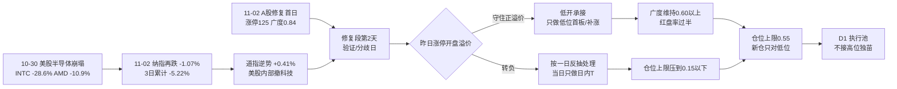

# 2026-11-03 · **风格研判**

> **数据源新鲜度**: partial · **降级状态**: true · **置信度**: 0.49
> 复算脚本：`scripts/fetch/run_style_snapshot.py --date 20261103 --lookback 75` → `scripts/research/r1_style_cluster.py --window 30 --k 6` → `scripts/research/r1_market_structure.py` → `scripts/research/r1_flows_from_r7.py` → `scripts/research/r1_assemble_style.py`

## 一句话结论

**连板情绪型（数量口径）+ 情绪浓度 68.0（贪婪）+ 三主线以上（代理口径），仓位上限 55%**：11-02 是连跌两天后的修复首日，今天走到**修复段第 2 个交易日＝验证/分歧日**——不追开盘价，只做低开承接与分歧转强，隔夜纳指三连阴（3 日 −5.22%）是今天最大的逆风，科技链高开一律按"给逃命盘抬轿"处理。

---

## 一、情绪周期位置：修复段第 2 天（验证/分歧日）

先回答"第几天"，再谈风格——阶段标签本身不能驱动决策。

| 项 | 读数 | 含义 |
|---|---|---|
| `cycle_position.cycle_day` | **0**（as of 20261102 收盘） | 20261102 是修复首日，已不在杀跌序列 |
| `consecutive_down_days` | 0 | 上一杀跌段 20261029–20261030 连跌 2 天（跌停 41 → 82 家，广度 0.140–0.160） |
| `tier` | neutral | 非杀跌结构，不适用"连跌两日博反弹" |
| **今日定位** | **修复段第 2 个交易日** | T-1 是修复首日，T 是验证日 |

**对应的打法（不是"继续空仓"，也不是"阶段确认后放大"）**：

1. **验证什么**：昨天那根阳线是不是"一日反抽"。判据是今日**昨日涨停股的开盘溢价**与**昨日涨停红盘率（66.0%）**能否守住——溢价转负或红盘率跌回五成以下，修复只按日内反弹对待，当日不做任何隔夜接力。
2. **怎么下手**：不追开盘价。低开后被承接、盘中走出来的方向才跟；高开冲高的科技链不接。开盘赌大小在修复第 2 天是全场性价比最低的动作。
3. **做什么位置**：新仓只对**低位首板 / 低位补涨**。6 板那只是独苗、5 板整层空缺，高位没有第二梯队，接力等于赌单票。
4. **额度**：仓位上限 55%（推导见第五节），比"连板情绪型"的基准 70% 低 15 个点，缺口全部来自"验证日 + 隔夜外盘"。

同口径历史样本（`cycle_position.samples`，仅供参照、不是概率模型）：20261027 连跌 2 天 → 20261028 涨停 72 / 广度 0.746（修复）；20261030 连跌 2 天 → 20261102 涨停 125 / 广度 0.840（修复）。两次修复的**第二天**都没有走出连续加速，这也是今天把"验证"放在"进攻"前面的原因。

---

## 二、详细分析

### 2.1 结构读数：125 家涨停，但梯子是"一根独苗 + 一片首板"

11-02 全市场涨停 **125** 家、跌停 **8** 家、炸板 28 家，炸板率 **18.30%**；涨 4382 / 跌 767 / 平 68，中位 **+2.04%**，成交额 **17832 亿（+6.51%）**。指数层面：上证 +1.08%、深成 +1.63%、创业板 +1.87%、科创50 **+3.11%**、沪深300 +0.79%、中证500 +2.46%、北证50 +0.58%。

但连板天梯是 **1 板 114 家 / 2 板 6 家 / 3 板 3 家 / 4 板 1 家 / 5 板 0 家 / 6 板 1 家**，首板占比 **91.2%**。这条梯子说明三件事：

- 涨停多来自**首板扩散**（普涨修复的典型形态），不是"高度打开"；
- 6 板独苗、5 板空缺，**高度无法自然递推**——想做接力的人没有第二选择，任何反包只能按一次性脉冲处理；
- 炸板率 18.30% 虽低于 20% 的连板情绪型门槛，但**只有 28 家炸板**是因为大量首板封得早，不代表分歧消失（见 2.2 的溢价）。

### 2.2 溢价拆解：修复发生在盘中，隔夜并不强

47 家前日涨停股：开盘溢价均值 **+2.72%**（中位 +2.14%），收盘溢价均值 **+2.83%**（中位 +1.53%），红盘率 **66.0%**，再涨停 **11** 只。

- 收盘溢价 > 开盘溢价，说明**日内还在往上买**，修复是盘中接力完成的，不是隔夜一致预期；
- 但中位（+1.53%）明显低于均值（+2.83%），说明**赚钱效应集中在少数票**，多数昨日涨停股只是小赚；
- 溢价 **+2.72% 未过 +3% 的门槛**，正是情绪周期判定"高位震荡"（而非"主升"）的直接依据——涨停家数创近期新高，打板赚钱效应却没有同步创新高。

### 2.3 簇结构：30 日最惨的那一簇，修复日反而最钝

30 日窗口（20260917–20261102，42 个样本：22 个同花顺风格板块 + 20 只 ETF）按 1−Pearson 相关距离 + Ward linkage 聚 6 簇：

| 簇 | n | 30日 | 5日 | 末日 | 回撤 | 与宽基相关 | 构成 |
|---|---:|:--:|:--:|:--:|:--:|:--:|---|
| C4 | 2 | **+101.87%** | +20.33% | **+9.98%** | −14.0% | 0.172 | 二板以上 / 非ST三板以上（策略指数） |
| C2 | 2 | +32.31% | +4.25% | +1.65% | −7.4% | −0.134 | 非ST二板 + 银行 ETF |
| C5 | 2 | −1.01% | −3.22% | +0.02% | −12.5% | 0.403 | 创历史新高 + 医药 ETF |
| C3 | 1 | −5.57% | +1.08% | −1.45% | −7.8% | 0.015 | 煤炭 ETF（独立周期） |
| C6 | 8 | −7.63% | −1.12% | **+2.12%** | −11.4% | 0.689 | 行业龙头/沪深300/上证50/证券/恒科/光伏/新能源/消费 |
| C1 | 27 | **−17.18%** | −6.06% | **+1.65%** | −23.8% | **0.852** | 热股/次新/百元股/新高/高振幅/沪深港通前十/高贝塔/打板（高 beta 成长） |

42 个样本 30 日中位 **−13.05%**，正收益只有 **9/42（21.4%）**；5 日中位 −4.56%；末日 37 涨 / 5 跌、中位 +2.06%。

**这组数字给出的关键判断是"修复的质地不均"**：30 日最抗跌的 C6（−7.63%）修复日涨 **+2.12%**，而 30 日跌得最狠的 C1（−17.18%）只涨 **+1.65%**。细分看更刺眼——30 日 −35.56% 的通信 ETF 只 +0.69%、−37.21% 的"昨日成交前十"只 +0.44%、−34.02% 的"深股通成交前十"只 +0.02%，而券商 ETF +4.57%、消费 ETF +2.07%、煤炭 −1.45%。

**含义**：资金没有去救跌得最惨的老主线，而是去买"没怎么跌 + 有新叙事"的方向。修复是**换方向的修复**，不是**普涨式解套**。这与"连板情绪型"的标签形成张力——数量看着热，结构上却是存量在做高低切换。

### 2.4 资金：单日 +119.5 亿，5 日仍是 −1217.6 亿

- 主力单日净额 **+119.54 亿**（净流入率 +0.67%），5 日 **−1217.57 亿**、10 日 −2343.63 亿、20 日 **−4683.28 亿**；
- 两融余额 **23431 亿**（20261030，T+1 滞后），5 日 **−886.28 亿（−3.64%）**；
- 行业口径：传媒 +55.49 亿（当日 +8.49%，净流入率 7.42%）、电子 +53.19 亿、半导体 +46.08 亿、非银 +31.61 亿；**银行 −19.49 亿（−0.84%）**、公用事业 −12.56 亿。

一天的回补对 20 日 −4683 亿的缺口来说只是 2.5%。**主力在买的两类东西性质完全不同**：传媒是题材点火（5 日仍 −2.94 亿），电子/半导体是超跌回补第一天（5 日 −368.97 / −154.02 亿）。前者是情绪，后者是抄底，都不是"趋势资金回来了"。而**银行单日流出 −19.49 亿**，是避险资金开始松动的第一根指针——如果今天银行重新走强，说明避险回流失败、修复结束。

### 2.5 外盘：纳指三连阴，道指逆势——美股内部也在撤科技

| 市场 | 最新 | 当日 | 备注 |
|---|---|:--:|---|
| 纳指综合 | 20261102 | **−1.07%** | 10-29 −1.38%、10-30 −2.86%、11-02 −1.07%，**3 日累计 −5.22%** |
| 标普500 | 20261102 | −0.51% | 3 日累计 −4.95% |
| 道琼斯 | 20261102 | **+0.41%** | 逆势收涨，资金在美股内部从科技转价值 |
| 恒生指数 | 20261102 | +0.42% | 与 A 股同步修复 |
| 韩国综合 | 20261102 | +2.24% | 亚太最强，是 11-02 A 股修复的外部助力之一 |
| 日经225 | 20261102 | −0.33% | 未跟涨 |

美股个股（**停在 20261030，11-02 时段未落库**）：英伟达 −4.22%、AMD **−10.88%**、英特尔 **−28.58%**、迈威尔 −10.05%、台积电 −5.95%、博通 −5.48%、美光 −5.30%、康宁 −4.32%。半导体是这轮外盘杀跌的震中。

**这条线对今天的意义**：A 股 11-02 的修复是在美股 10-30 暴跌之后完成的（说明 A 股当时走的是"政策 + 亚太 + ETF 托底"的独立逻辑），但**11-02 美股又跌了一夜**，纳指三连阴、道指逆势，等于把"科技链反弹"的外部条件又抽掉一次。今天科技链如果高开，是给隔夜没跑掉的筹码抬轿；低开后被承接，才是修复延续。

### 2.6 风格归因：五分法代价表

| 风格 | 区间代价 | 判据落点 |
|---|:--:|---|
| **连板情绪型** | **0.0000** | 涨停 125∈[50,400]、高度 6∈[6,12]、炸板率 18.30%∈[0,20%] **三条全中** |
| 主线扩散型 | 1.7000 | 涨停 125 远超 [30,50] 上界（超出 75 家 / 50 = 1.5） |
| 崩溃退潮型 | 3.4513 | 跌停 8 家离 [30,500] 差 22 家、炸板率离 50% 差 31.7 个点 |
| 震荡分化型 | 3.7923 | 涨停超上界 85 家 / 40、高度 6 超 [0,5] |
| 防御观望型 | 6.5053 | 涨停远超 <20、成交额 +6.51% 不满足缩量 |

风格取 **连板情绪型**，但必须标注两点张力：

1. **数量达标 ≠ 梯队达标**：首板 91.2%、5 板空缺，这个"连板情绪型"是首板扩散撑起来的，不是高度打开撑起来的；
2. **阶段优先级**：情绪周期判"高位震荡"（溢价 +2.72% < +3%、炸板率 18.30% ≥ 18%），与风格表不构成覆盖关系（覆盖规则只在炸板率 ≥25% 时触发），但**温度按阶段收紧**，仓位不上调。

---

## 三、结构传导图



---

## 四、推理深度三问

### 对象一 · 11-02 这根修复日的性质

- **大资金意图**: 买盘的主体不是主动做多的机构，而是**宽基 ETF 的托底资金**（科创50/中证1000/中证500/沪深300/创业板同时爆量，量级 400–500 亿）叠加政策端互换便利与回购增持再贷款的落地预期。这类资金的目标是"止跌"，不是"做多"——它的对手盘是隔夜想跑但没跑掉的杠杆盘与高位科技筹码。
- **为什么走强**: 位置（20 日主力 −4683 亿后的超卖区）+ 催化（监管两次会议、央行再贷款降息）+ 筹码（两融 5 日已减 886 亿，浮筹被清洗过一轮）三维同时到位。缺的是第四条：**没有产业级硬事件**，所以只能给"修复"定性，不能给"反转"定性。
- **逻辑够不够硬**: 硬的地方是**成交额 +6.51%、涨停 125 家、炸板率 18.3%** 三个独立指标同向；不硬的地方是**溢价 +2.72% 未过 3%、5 日主力仍 −1217 亿、首板占 91.2%**——赚钱效应是广度型而非高度型。证伪路径很明确：今天昨日涨停股开盘溢价转负，或红盘率跌破五成。

### 对象二 · C4 极端接力端（二板以上 / 非ST三板以上，30 日 +101.87%）

- **大资金意图**: 这是全市场唯一还在赚钱的池子——30 日 +101.87%、5 日 +20.33%、末日 +9.98%，与宽基相关只有 0.172。参与者的钱只对"高度能不能继续"负责，不对指数负责；对手盘是相信"高位会补跌"的空头与不敢接力的机构。
- **为什么走强**: 位置（6 板独苗、5 板空缺，稀缺性溢价）+ 催化（无产业催化，纯博弈）+ 筹码（三板以上样本极少，封单容易做）。它强不是因为逻辑硬，是因为**标的稀缺**。
- **逻辑够不够硬**: 不硬。这是**策略指数不是板块**，30 日 +101.87% 是逐日再平衡的复利结果，不等于任何一只票涨了一倍；6 板独苗一旦断板，这个簇没有第二根柱子接。今天对它的正确用法是**观察情绪温度**（断板与否决定分歧是否扩散），不是照抄收益。

### 对象三 · C1（−17.18%）与 C6（−7.63%）的修复力度倒挂

- **大资金意图**: 30 日跌得最狠的 C1（27 个样本，与宽基相关 0.852，通信/芯片/百元股/次新全在里面）在修复日只 +1.65%，30 日抗跌的 C6（+2.12%）反而更强。这说明**托底资金买的是指数弹性最大的工具（科创50/中证1000），不是 C1 里那些被套的个股**——ETF 买了指数，个股的抛压并没有被接走。
- **为什么走强 / 为什么弱**: C1 弱在位置（30 日 −17.18%、回撤 −23.8%，仍在下跌通道）+ 催化（隔夜半导体继续崩）+ 筹码（深股通/沪股通前十 30 日 −34%/−19%，外资筹码还在出）。C6 强在**没有套牢盘**：消费、券商、龙头的 30 日跌幅只有个位数，拉起来阻力最小。
- **逻辑够不够硬**: 这是今天最硬的一条结构判断——**修复由"低套牢盘方向"驱动，而非"超跌反弹"驱动**。可验证假设：如果今天 C1 的涨幅继续落后 C6，说明资金在换方向；如果 C1 突然放量领涨，说明是超跌补涨接力，修复级别要上调。两种情形对 D1 的含义完全不同。

---

## 五、情绪浓度与仓位推导

### 5.1 五维加权（score = Σw×dim / Σw，五维齐全，权重未归一）

| 维度 | 权重 | 计算 | 得分 |
|---|:--:|---|:--:|
| 涨停强度 | 0.25 | min(100, 125) | **100.0** |
| 跌停压制 | 0.20 | max(0, 100 − 2×8) | **84.0** |
| 连板结构 | 0.20 | 0.5×高度分(6/6=100) + 0.5×(0.5×连续分 80 + 0.5×接力分 8.8) | **72.2** |
| 炸板率 | 0.15 | max(0, 100 − 4×18.30%) | **26.8** |
| 杠杆/主力 | 0.20 | 两融 5 日 −3.64% → 13.6；主力净流入率 +0.67% → 63.3，取均值 | **38.5** |
| **合计** | 1.00 | | **68.0（贪婪）** |

**反向校验**：68.0 落在"贪婪"档，按 skill 的 5 维参考表应给 0.65–0.75 仓位。但两个维度明显拖后腿——**炸板率维只有 26.8、资金维只有 38.5**，而 100 分的涨停维是"数量"而非"质量"。这正是本节不直接采用 0.65–0.75 的原因。

### 5.2 仓位上限五步推导

```
风格基准   0.70  (连板情绪型)
情绪调整  +0.05  (68.0 落贪婪档)
阶段调整  −0.05  (high_chop：溢价未过 3%、炸板率 18.3%≥18%)
宽度调整  −0.05  (30 日样本中位 −13.05%、正收益 9/42=21.4% < 25%)
────────────────────────
小计       0.65
周期折扣  −0.05  (修复段第 2 个交易日＝验证/分歧日)
外盘折扣  −0.05  (隔夜纳指 3 日累计 −5.22% ≤ −3%)
────────────────────────
仓位上限   0.55
```

**为什么额外扣这两档**：标准的四步公式里没有"第几天"和"隔夜线"，而今天是这两个变量主导的一天——修复第 2 天是**兑现压力最大**的时点（昨日 47 家涨停股有 66% 红盘，今天这批筹码全部可卖），纳指三连阴则抽掉了科技链的外部支撑。两档各 5 个点，合计把 0.65 压到 0.55。

---

## 六、关键证据

- **涨停结构**：125 涨停 / 8 跌停 / 28 炸板，炸板率 18.30%；天梯 114-6-3-1-0-1，首板占 91.2%（`tushare.limit_list_d` 20261102）
- **溢价**：47 家前日涨停股开盘 +2.72%（中位 +2.14%）、收盘 +2.83%（中位 +1.53%）、红盘 66.0%、再涨停 11 只
- **广度**：4382 涨 / 767 跌 / 68 平，中位 +2.04%，成交 17832 亿（+6.51%）
- **指数**：上证 +1.08%、创业板 +1.87%、科创50 +3.11%、沪深300 +0.79%、中证500 +2.46%
- **资金**：主力 +119.54 亿（净流入率 +0.67%）、5 日 −1217.57 亿、20 日 −4683.28 亿；两融 23431 亿（T+1）、5 日 −886.28 亿（−3.64%）
- **30 日**：42 样本中位 −13.05%、正收益 9/42、回撤中位约 −17%；末日 37 涨 / 5 跌
- **隔夜**：纳指 −1.07%（3 日 −5.22%）、标普 −0.51%、道指 +0.41%；半导体个股停在 10-30（AMD −10.88%、INTC −28.58%）
- **文本侧**：18 篇非官媒文章、6 条方向性判断，一致认"修复 2–3 天有效"但**无一篇主张次日开盘追**；无人讨论纳指三连阴

---

## 七、今日触发条件（if → then）

| # | 观测 | 阈值 | 动作 |
|---|---|---|---|
| 1 | 昨日 47 家涨停股开盘溢价 | 中位 ≥ +1% | 修复延续，按 55% 上限正常做低位首板 |
| 2 | 同上 | 中位转负或红盘率 < 50% | 修复按一日反抽处理，上限压到 15% 以下，只做日内 T |
| 3 | 科技链（半导体/通信）开盘 | 高开 > +1.5% | 不追，等回落到平盘附近看承接；高开冲高回落即视为逃命盘 |
| 4 | 科技链 | 低开 −1%~−3% 后被拉回平盘 | 修复延续的正解，可给低位科技/新方向一档试错 |
| 5 | 银行 ETF | 由跌转涨 > +1% | 避险资金回流，风险偏好二次收缩，当日不做新开仓 |
| 6 | 炸板率（盘初 30 分钟样本） | > 45% | 分歧扩大，全部候选降 watch |
| 7 | 6 板独苗 | 断板且无 4 板顶上 | 高度坍塌，接力通道关闭，只做首板 |

---

## 八、不确定性 / 反证

1. **外盘个股缺 11-02 时段**：指数已补齐，但 AMD/英伟达等 14 只个股仍停在 10-30，无法知道 11-02 美股半导体是否二次杀跌。若昨夜半导体跌幅超 −5%，今日科技链低开幅度会更极端，"低开承接"这条假设的容错空间要下调。
2. **群聊源 0 条**：`wechat_cli_5groups.jsonl` 本轮 0 字节，文本侧全部由公众号承接（18 篇非官媒）。游资群的真实仓位与接力意愿是缺的——今天最需要的一手信息（昨天打板的人赚没赚、今天敢不敢接）恰好没有。
3. **"连板情绪型"这个标签本身有误导性**：首板 91.2%、5 板空缺，把它读成"高度打开、可以接力"是错的。R2/D1 若按标签行事，会高估接力通道的容量。
4. **68.0 的"贪婪"是数量口径**：涨停维 100 分、炸板率维只有 26.8，两者背离。若按 5 维参考表直接用 0.65–0.75 仓位，等于用"涨停多"给"打板不赚钱"背书，本节已明确不采用。
5. **修复的持续性只有 2 天样本**：`cycle_position.samples` 里两次修复都是"次日无连续加速"，样本 n=2，不能当概率用。
6. **反向情形**：如果今天低开后科技链放量拉起、C1 涨幅反超 C6，则"换方向修复"的判断被推翻，应改读为"超跌补涨接力"，修复级别上调一档——这种情况下仓位可以给到 0.65，但仍不接 6 板独苗。

---

## 九、与其他 R/D/E 的关系

- **依赖（上游）**：`data/raw/20261103/style_snapshot.json`（22 风格板块 + 20 ETF + 外盘）、`_r1_cluster.json`（Ward k=6）、`_r1_market.json`（涨停/溢价/广度/资金）、`_r1_overseas_fill.json`（隔夜美股补齐）、`_r1_kol.json`（文本侧摘要）、`cycle_position.json`（第几天）、`emotion_cycle.json`（温度阶段）、`R7_capital_flow_20261103.json`（主力/两融折算）、`manifest.json`（源存活）
- **被消费（下游）**：R2（`style` / `main_lines_count` / `position_cap_suggestion` → 主线数量与仓位基准）、R3（`sentiment_score` 68.0 作基准）、R6（风格与主线一致性反证）、R7（资金面交叉校验）、D1（`position_cap_suggestion=0.55` → 执行池总仓上限；`emotion_cycle_day_label`＝修复段第 2 天 → 通道选择；`emotion_cycle_action` → 只做低开承接、不追开盘）

---

## 十、数据源审计

| 源 | 日期 | 状态 | 备注 |
|---|---|:--:|---|
| tushare/ths_daily + ths_member | 2026-11-03 | 🟢 | 22/22 风格板块，30 个收益日完整 |
| tushare/fund_daily | 2026-11-03 | 🟢 | 20/20 ETF，30 个收益日完整 |
| tushare/limit_list_d + daily + index_daily + limit_cpt_list | 2026-11-02 | 🟢 | 5217 只广度、125 涨停逐票、7 指数、20 概念 |
| tushare/moneyflow_dc（经 R7 折算） | 2026-11-02 | 🟡 | 主力单日与 5/10/20 日序列；小单口径未取 |
| tushare/margin（经 R7 折算） | 2026-10-30 | 🟡 | T+1 滞后，三家交易所加总 23431 亿 |
| tushare/index_global（补齐） | 2026-11-02 | 🟢 | 纳指/标普/道指 11-02 收盘已补；SOX 返回空 |
| tushare/us_daily | 2026-10-30 | 🟡 | 14 只个股缺 11-02 时段 |
| tushare/fx_daily | 2026-11-01 | 🟡 | 仅 USDCNH 单点，DXY 缺 |
| 商品（原油/铜/金） | — | 🔴 | skipped，跨资产三档坐标不可建立 |
| wechat_official_rss | 2026-11-03 | 🟢 | 88 篇，其中非官媒 18 篇进入方向判断 |
| wechat_cli_groups | 2026-11-03 | 🔴 | 0 字节，抓取窗口无消息（群名已匿名） |
| weflow_snapshot | — | 🔴 | ConnectError，该源已永久下线 |
| 北向 north_money | — | 🔴 | 2026-10-28 起 retired，不计入新鲜度 |

---

## 十一、Sub-Agent 元数据

- skill: `analyze_style_v1`
- artifact: `data/research/20261103/R1_style.json`（schema `research_unit_v1`，pydantic 校验后原子落盘）
- 中间底稿: `_r1_cluster.json` / `_r1_market.json` / `_r1_kol.json` / `_r1_overseas_fill.json`
- 生成耗时: 约 40 分钟（含 22 板块 + 20 ETF + 外盘快照重抓、聚类、市场结构、R7 资金折算、隔夜美股补齐）
- model: deepseek-v4.1-flash
- status: `degraded`（外盘个股 stale / 汇率残缺 / 商品 skipped / 群聊 0 条 → freshness 0.70 × agreement 1.0 × 0.70 = 0.49）
