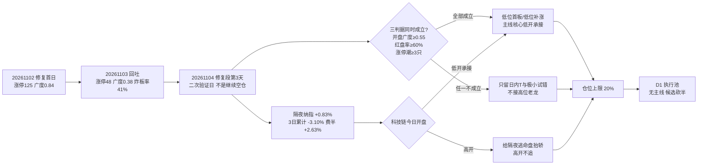

# 2026-11-04 · **风格研判**

> **数据源新鲜度**: partial · **降级状态**: true · **置信度**: 0.49
> 复算脚本：`scripts/fetch/run_style_snapshot.py --date 20261104 --lookback 75` → `scripts/research/r1_style_cluster.py --window 30 --k 6` → `scripts/research/r1_market_structure.py` → `scripts/research/r1_assemble_style.py`

## 一句话结论

**震荡分化型 + 情绪浓度 39.5（恐惧）+ 无主线，仓位上限 20%**：11-02 强修复后 T-1（11-03）回吐——涨停 125→48、广度 84.0%→39.9%、炸板率 18.3%→41.46%，但未构成杀跌日；今天走到**修复段第 3 个交易日＝修复未确认的二次验证日**（不是继续空仓）——三判据（开盘广度 ≥0.55、昨日涨停红盘率 ≥60%、板块级涨停潮 ≥3 只）全部成立才做低位首板/低位补涨与主线核心低开承接，任一不成立只保留日内 T 与极小试错，不接高位老龙、不做二波假设。

---

## 一、情绪周期位置：修复段第 3 个交易日（修复未确认的二次验证日）

先回答"第几天"，再谈风格——阶段标签本身不能驱动决策。今天必须写成**第 3 天 + 对应打法**，而不是只写 `main_down`。

| 项 | 读数 | 含义 |
|---|---|---|
| `cycle_position.cycle_day` | **0**（as of 20261103 收盘） | 已不在杀跌序列内 |
| `consecutive_down_days` | 0 | 上一杀跌段 20261029–20261030 连跌 2 天（跌停 41 → 82 家，广度 0.140–0.160） |
| `tier` | neutral | 非杀跌结构，不适用"连跌两日博反弹" |
| `emotion_cycle.phase` | main_down（confidence 0.88） | 判出亏钱扩散（跌停 17 家 / 炸板率 41.46%≥35%），但**未触发杀跌日** |
| **今日定位** | **修复段第 3 个交易日** | 修复首日 20261102 → T-1 回吐 20261103 → 今日二次验证 |

**`main_down` 在此处的含义是"修复窗口"，不是"继续空仓"**：修复首日 11-02 给出涨停 125、广度 84.0%、中位 +2.02% 的强修复；11-03 回吐至广度 39.9%、炸板率 41.46%、跌停 17 家，但三条件（炸板率>50%、跌停≥30 或涨家占比<25%、指数≤-1%）未同时成立，`session_series` 标记 `kill: false`——**分歧日不等于杀跌日**。仓位按阶段扣减（−0.15），但不把分歧日读成崩溃退潮、也不读成继续空仓。

**对应的打法（第 3 天＝修复未确认的二次验证日）**：

1. **验证什么**：11-02 那根修复阳线是不是"一日反抽"。判据是今日**开盘广度 ≥0.55**、**昨日涨停红盘率 ≥60%**（昨日收盘口径仅 50.8%）、**板块级涨停潮 ≥3 只**（当前概念 ≥20 家涨停为 0）三判据同时成立。
2. **怎么下手**：三判据成立 → 只做**低位首板 / 低位补涨**与主线核心的**低开承接**；任一不成立 → 只保留**日内 T 与极小试错**，不追开盘、不接高位老龙、不做二波假设。
3. **额度**：仓位上限 20%（推导见第五节）——比"震荡分化型"基准 55% 低 35 个点，缺口来自情绪恐惧档（−0.05）+ 阶段 main_down（−0.15）+ 30 日宽度（−0.05）+ 修复段第 3 日（−0.05）+ 隔夜纳指 3 日 −3.10%（−0.05）。

同口径历史样本（`cycle_position.samples`，仅供参照、不是概率模型）：20261027 连跌 2 天 → 20261028 涨停 72 / 广度 0.746（修复）；20261030 连跌 2 天 → 20261102 涨停 125 / 广度 0.840（修复）。两次修复的**次日**都出现回吐——这是今天把"验证"放在"进攻"前面的原因。

---

## 二、详细分析

### 2.1 结构读数：48 家涨停，但炸板率 41.46% 越过减半线

11-03 全市场涨停 **48** 家、跌停 **17** 家、炸板 **34** 家，炸板率 **41.46%**；涨 2023 / 跌 3045 / 平 148，中位 **−0.60%**，成交额 **17029 亿（−4.50%）**。指数层面：上证 **−0.82%**、深成 −1.21%、创业板 **−2.73%**、科创50 **−3.81%**、沪深300 −0.20%、中证500 −1.45%、北证50 **−4.02%**。

连板天梯是 **1 板 33 家 / 2 板 12 家 / 3 板 1 家 / 4 板 2 家**，最高 4 板，首板占比 **68.8%**，开盘 30 分钟封板 20.8%（前日口径已无同日对比）。这条梯子说明：

- 涨停数从 125 腰斩到 48，**修复没延续**；2 板 12 家说明昨日首板里有 12 只晋级，但 3 板只剩 1 只——**晋级有、高度断**；
- **炸板率 41.46% 已越过 35% 减半线**：次日高开一律按分歧兑现处理，不接秒板、不接二次冲高；
- 4 板 2 只、3 板 1 只，中位高度只有 2 板——**高度无法自然递推**，反包只按一次性脉冲处理。

### 2.2 溢价拆解：开盘有溢价，收盘被砸掉一半

125 家前日涨停股：开盘溢价均值 **+2.21%**（中位 +1.41%），收盘溢价均值 **+0.95%**（中位 +0.13%），红盘率 **50.8%**，再涨停 **15** 只。

- **收盘溢价 < 开盘溢价**：日内把溢价砸掉一半多，说明隔夜抢筹的资金在盘中兑现——**赚钱效应停留在隔日/日内，不在趋势**；
- 红盘率 50.8% 刚过半——昨日涨停股今天一半亏钱，做前排仍有人赚（+2.21% 开盘溢价），但**次日接力即转负**；
- 再涨停 15 只（12%），连板晋级率不低但高度起不来，与 2.1 的天梯读数互相印证。

### 2.3 簇结构：极端接力端继续走强，防御簇转正，高 beta 成长继续垫底

30 日窗口（20260918–20261103，42 个样本：22 个同花顺风格板块 + 20 只 ETF）按 1−Pearson 相关距离 + Ward linkage 聚 6 簇：

| 簇 | n | 30日 | 5日 | 末日 | 回撤 | 与宽基相关 | 构成 |
|---|---:|---:|---:|---:|---:|---:|---|
| C4 | 2 | **+124.71%** | +18.74% | **+3.64%** | −10.9% | 0.175 | 昨日打二板以上 / 昨日非ST三板以上（策略指数） |
| C2 | 2 | +22.00% | +3.54% | −0.21% | −9.7% | 0.130 | 昨日非ST二板 + 煤炭ETF |
| C5 | 2 | **+4.75%** | +4.24% | **+1.90%** | −3.9% | 0.188 | 医药ETF + 消费ETF |
| C3 | 1 | +2.80% | +0.46% | −0.57% | −3.2% | **−0.488** | 银行ETF（独立防御，负相关） |
| C6 | 9 | −9.75% | +0.06% | +0.51% | −14.4% | 0.719 | 创历史新高/行业龙头/沪深300/上证50/证券ETF/恒生科技/光伏ETF/新能源/有色ETF |
| C1 | 26 | **−18.70%** | −5.63% | **−2.42%** | −24.7% | **0.853** | 热股/次新/百元股/新高/高振幅/沪深港通前十/高贝塔/打板/通信/芯片/半导体/军工/房地产（高 beta 成长） |

42 个样本 30 日中位 **−12.62%**，正收益 **9/42（21.4%）**；5 日中位 −2.67%；末日 16 涨 / 26 跌、中位 −0.68%。

**这组数字给出的关键判断是"极端博弈 + 防御双头走强，中间地带全灭"**：

- C4（极端接力策略指数）30 日 **+124.71%**、末日 +3.64%——全市场唯一赚钱的池子还在加速，昨天 +101.87% → 今天 +124.71%，说明**极致打板资金依然活跃**，但它是策略指数不是板块，追它的正确用法是观察情绪温度；
- C5（医药/消费）与 C3（银行）30 日转正——**防御方向开始有资金**，银行与宽基相关 **−0.488**，是典型的避险去处；
- C1（26 个样本，高 beta 成长）30 日 **−18.70%**、末日 −2.42%，继续垫底——**成长筹码的出清没有结束**，通信/芯片/半导体 ETF 全在 C1 里，30 日仍深跌；
- 末日 16 涨 / 26 跌，中位 −0.68%——连簇层面的"末日涨"都不再普涨，赚钱效应收缩到极端策略与防御两头。

### 2.4 资金：主力单日 −574 亿，5 日 −1318 亿，两融 5 日 −3.93%

- 主力单日净额 **−574.09 亿**（净流入率 −3.35%），5 日 **−1318.05 亿**；
- 两融余额 **23308 亿**（20261102，T+1 滞后），5 日 **−953 亿（−3.93%）**。

修复只给了 11-02 一天（当日主力 +119.5 亿），11-03 立刻回吐 **−574 亿**——**主力没有连续两天站上买方**。两融 5 日 −3.93% 说明杠杆盘还在退，高度股的反包胜率继续受压。资金面与"修复未确认"的周期判断同向。

### 2.5 外盘：隔夜反抽但 3 日仍净跌——跌深反抽不是趋势修复

| 市场 | 最新 | 当日 | 备注 |
|---|---|---|:--:|---|
| 纳指综合 | 20261103 | **+0.83%** | 10-29 −1.38%、10-30 −2.86%、11-02 −1.07%、11-03 +0.83%，**3 日累计 −3.10%** |
| 标普500 | 20261103 | +0.36% | 3 日累计 −1.45% |
| 道琼斯 | 20261103 | −0.38% | 未跟涨 |
| **费城半导体** | 20261103 | **+2.63%** | 10-30 −7.20%、11-02 −3.37% 后的强反抽 |
| 恒生指数 | 20261103 | +0.57% | 亚太唯一同步转涨 |
| 韩国综合 | 20261103 | −3.59% | 转跌，30 日 −19.35% |

美股个股（**停在 20261102，11-03 时段未落库**）：英伟达 −1.26%、AMD −7.52%、美光 −5.78%、博通 −1.18%、台积电 −1.85%。半导体个股在 11-02 仍在杀。

**这条线对今天的意义**：费半 +2.63% 是 10-30（−7.20%）与 11-02（−3.37%）之后的**跌深反抽**，纳指 3 日累计仍是 **−3.10%**——隔夜外盘给了一个"科技链反抽"的窗口，但 3 日维度没有转强。若今日科技/半导体高开，按"给隔夜逃命盘抬轿"处理——**高开不追、只做低开承接**；若科技低开而低位题材接力，才是修复延续的正解。

### 2.6 风格归因：五分法代价表

| 风格 | 区间代价 | 判据落点 |
|---|:--:|---|
| **震荡分化型** | **0.2359** | 涨停 48∈[20,40] 略超上界、高度 4∈[0,5]、炸板率 41.46% 在 [15%,45%] 内、涨家占比 39.9%∈[42%,58%] 略低、行业≥8家 0 条 |
| 崩溃退潮型 | 0.6041 | 炸板率 41.46% 离 50% 差 8.5 个点、跌停 17 家离 30 差 13 家 |
| 主线扩散型 | 1.1846 | 行业≥8家 0 条 + 炸板率超 [15%,35%] 上界 |
| 连板情绪型 | 1.4463 | 涨停 48<50、高度 4<6、炸板率 41.46%>20% |
| 防御观望型 | 2.779 | 涨停 48 远超 <20、指数振幅 3.55>1.5 |

风格取 **震荡分化型**，必须标注张力：**阶段=main_down 但崩溃三条件未同时成立**（炸板率 41.46%（>50% False）、跌停 17 家 / 涨家占比 39.9%（判据 False）、上证 −0.82% / 创业板 −2.73%（≤−1% True）），按 skill §2.5 联动规则**不覆盖**风格表结论——阶段只用于降温（仓位 −0.15），不把分歧日读成崩溃退潮、也不读成继续空仓。

---

## 三、结构传导图



---

## 四、推理深度三问

### 对象一 · 修复段第 3 个交易日（修复未确认的二次验证日）

- **大资金意图**: 11-02 的买盘是宽基 ETF 托底 + 政策预期（互换便利/回购增持再贷款落地），目标是"止跌"不是"做多"；11-03 主力立刻回吐 **−574 亿**，说明托底资金没有连续加仓的意愿——它的对手盘是隔夜抢修复的短线盘与高位科技筹码，今天这批筹码全部可卖。
- **为什么弱（回吐）**: 位置（修复次日 + 昨日涨停红盘率仅 50.8%，兑现压力最大）+ 催化（无新产业级事件，题材端随机轮动、主线空窗）+ 筹码（两融 5 日 −953 亿，杠杆仍在退）三维同时压下来。炸板率 41.46% 是分歧的直接读数。
- **逻辑够不够硬**: "修复未确认"这条判断够硬——涨停 125→48、广度 0.84→0.38、炸板率 18.3%→41.46% 三个独立指标同向回吐；但**它不构成"继续空仓"的理由**，因为 session_series 标记 11-03 `kill: false`（不是杀跌日）。可验证假设非常明确：今日三判据（广度≥0.55、红盘率≥60%、涨停潮≥3 只）是否成立——成立则修复延续、按 20% 上限做低位；不成立则额度当日收回、只做日内 T。

### 对象二 · C4 极端接力端（二板以上 / 非ST三板以上，30 日 +124.71%）

- **大资金意图**: 全市场唯一还在赚钱的池子，30 日 +124.71%、末日 +3.64%，与宽基相关只有 0.175——参与者的钱只对"高度能不能继续"负责，不对指数负责；对手盘是相信"高位会补跌"的空头与不敢接力的机构。
- **为什么走强**: 位置（4 板只有 2 只、3 板 1 只，高度稀缺）+ 催化（无产业催化，纯博弈）+ 筹码（样本极少，封单容易做）。它强不是因为逻辑硬，是因为**标的稀缺**——2 板 12 家说明晋级通道仍在，但 3 板以上断层。
- **逻辑够不够硬**: 不硬。这是**策略指数不是板块**，30 日 +124.71% 是逐日再平衡的复利结果，不等于任何一只票涨了一倍；4 板 2 只一旦断板，这个簇没有第二根柱子接。今天对它的正确用法是**观察情绪温度**（断板与否决定分歧是否扩散），不是照抄收益、更不是接高位老龙。

### 对象三 · C1（−18.70%）与 C5/C3（防御转正）的极端分化

- **大资金意图**: 30 日跌得最狠的 C1（26 个样本，与宽基相关 0.853，热股/次新/百元股/通信/芯片/半导体全在里面）末日还在 −2.42%；而 C5（医药/消费，+4.75%）、C3（银行，+2.80%，与宽基相关 −0.488）转正。**资金从高 beta 成长撤向防御与极致博弈两头，中间地带没有承接**——这与"震荡分化型"的风格标签完全吻合。
- **为什么弱 / 为什么强**: C1 弱在位置（30 日 −18.70%、回撤 −24.7%，仍在下跌通道）+ 催化（隔夜半导体 3 日仍净跌）+ 筹码（沪深港通成交前十 30 日深跌，外资筹码还在出）。C5/C3 强在**没有套牢盘**：医药/消费/银行的 30 日跌幅只有个位数甚至转正，拉起来阻力最小。
- **逻辑够不够硬**: 这是今天最硬的一条结构判断——**资金在撤成长、进防御与极端博弈，而非普涨修复**。可验证假设：如果今日 C1 继续弱于 C5/C3，说明高低切换仍在进行、修复只对低位与防御有效；如果 C1 放量领涨，说明超跌补涨接力，修复级别要上调。两种情形对 D1 的含义完全不同。

---

## 五、情绪浓度与仓位推导

### 5.1 五维加权（score = Σw×dim / Σw，五维齐全，权重未归一）

| 维度 | 权重 | 计算 | 得分 |
|---|:--:|---|:--:|
| 涨停强度 | 0.25 | min(100, 48) | **48.0** |
| 跌停压制 | 0.20 | max(0, 100 − 2×17) | **66.0** |
| 连板结构 | 0.20 | 0.5×高度分(4/6=66.7) + 0.5×(0.5×连续分 100 + 0.5×接力分 31.2) | **66.1** |
| 炸板率 | 0.15 | max(0, 100 − 4×41.46%) | **0.0** |
| 杠杆/主力 | 0.20 | 两融 5 日 −3.93% → 10.7；主力净流入率 −3.35% → 0.0，取均值 | **5.3** |
| **合计** | 1.00 | | **39.5（恐惧）** |

**反向校验**：39.5 落在"恐惧"档，与 skill 5 维参考表的 0.55–0.65 仓位区间方向一致，但**炸板率维 0 分、资金维 5.3 分**拖到极低——涨停 48 的"数量"本就不高，炸板率 41.46% 直接把情绪分压进恐惧档。与情绪周期阶段（main_down 但未确认崩溃）互相印证：温度低、结构弱、未到崩溃。

### 5.2 仓位上限推导

```
风格基准   0.55  (震荡分化型)
情绪调整  −0.05  (39.5 落恐惧档)
阶段调整  −0.15  (main_down：亏钱扩散判据触发，崩溃三条件未同时成立，只降温不覆盖)
宽度调整  −0.05  (30 日样本中位 −12.62%、正收益 9/42=21.4% < 25%)
────────────────────────
小计       0.30
周期折扣  −0.05  (修复段第 3 个交易日：T-1 回吐、修复未确认)
外盘折扣  −0.05  (隔夜纳指 3 日累计 −3.10% ≤ −3%)
────────────────────────
仓位上限   0.20
```

**为什么额外扣这两档**：标准的四步公式里没有"第几天"和"隔夜线"，而今天是这两个变量主导的一天——修复段第 3 天是**二次验证失败概率最高**的时点（昨日 125 家涨停股红盘率仅 50.8%，今天这批筹码全部可卖），纳指 3 日 −3.10% 抽掉了科技链的外部支撑。主跌段下限 0.10 生效前，0.20 是"极小试错额度 + 存量 T"的口径，不是进攻仓位。

---

## 六、关键证据

- **涨停结构**：48 涨停 / 17 跌停 / 34 炸板，炸板率 41.46%；天梯 33-12-1-2，首板占 68.8%（`tushare.limit_list_d` 20261103）
- **溢价**：125 家前日涨停股开盘 +2.21%（中位 +1.41%）、收盘 +0.95%（中位 +0.13%）、红盘 50.8%、再涨停 15 只
- **广度**：2023 涨 / 3045 跌 / 148 平，中位 −0.60%，成交 17029 亿（−4.50%）
- **指数**：上证 −0.82%、创业板 −2.73%、科创50 −3.81%、沪深300 −0.20%、中证500 −1.45%、北证50 −4.02%
- **资金**：主力 −574.09 亿（净流入率 −3.35%）、5 日 −1318.05 亿；两融 23308 亿（20261102，T+1）、5 日 −953 亿（−3.93%）
- **30 日簇**：42 样本中位 −12.62%、正收益 9/42；C4 +124.71% / C5 +4.75% / C3 +2.80% / C6 −9.75% / C1 −18.70%；末日 16 涨 / 26 跌
- **隔夜**：纳指 +0.83%（3 日 −3.10%）、标普 +0.36%、道指 −0.38%、费半 +2.63%（10-30 −7.20% 后反抽）；美股个股停在 11-02（AMD −7.52%、美光 −5.78%）
- **文本侧**：15 篇非官媒文章、3 条方向性判断，一致"偏谨慎弱震荡"——承认托底买盘与企稳迹象，但否定接力，"打不过就躲、拉起来就跑"，不支持过夜接力与追高；与量化同向
- **情绪周期**：emotion_cycle 预计算 main_down（confidence 0.88），premium +0.0221、break_rate 0.4146；cycle_position 第 0 天 / 连跌 0 天 / neutral，修复段第 3 个交易日

---

## 七、今日触发条件（if → then）

| # | 观测 | 阈值 | 动作 |
|---|---|---|---|
| 1 | 昨日 125 家涨停股开盘溢价 | 中位 ≥ +1% | 修复延续，按 20% 上限做低位首板/低位补涨 |
| 2 | 同上 | 中位转负或红盘率 < 50% | 修复按一日反抽处理，额度收回，只做日内 T |
| 3 | 开盘广度（盘初 30 分钟） | ≥ 0.55 | 三判据之一成立，可给低位新题材一档试错 |
| 4 | 同上 | < 0.30 | 重新进入杀跌序列，修复按失败处理，此前给的额度当日收回 |
| 5 | 科技链（半导体/通信）开盘 | 高开 > +1.5% | 按"给隔夜逃命盘抬轿"处理，高开不追，等回落看承接 |
| 6 | 科技链 | 低开 −1%~−3% 后被拉回平盘 | 修复延续的正解，可给低位科技一档试错 |
| 7 | 炸板率（盘初 30 分钟样本） | > 45% | 分歧扩大，全部候选降 watch，不做新开仓 |
| 8 | 4 板 2 只 | 断板且无 2 板顶上 | 高度坍塌，接力通道关闭，只做首板 |
| 9 | 防御方向（银行/医药/消费） | 由跌转涨 > +1% | 避险资金回流，风险偏好二次收缩，当日不做新开仓 |

---

## 八、不确定性 / 反证

1. **外盘个股缺 11-03 时段**：指数已用 yfinance 补齐（纳指 +0.83%、费半 +2.63%），但 AMD/英伟达等 12 只个股仍停在 11-02——若昨夜半导体个股实际转涨，今日科技链高开的"抬轿"判断要下调；若个股继续杀，低开幅度会更极端。
2. **群聊源 0 条**：`wechat_cli_5groups.jsonl` 本轮 0 字节，文本侧全部由公众号承接（15 篇非官媒）。游资群的真实仓位与接力意愿是缺的——今天最需要的一手信息（昨天打板的人赚没赚、今天敢不敢接）恰好没有。
3. **"震荡分化型"标签的低仓位含义**：0.20 是"极小试错 + 存量 T"口径，不是"清仓观望"——阶段 main_down 只用于降温，三判据若成立（广度≥0.55、红盘率≥60%、涨停潮≥3）仍给低位新题材一档试错，但**不接高位老龙、不做二波假设**。
4. **39.5 的"恐惧"是数量口径**：涨停维 48、炸板率维 0、资金维 5.3，三者背离——若把"恐惧"直接读成"逆向买入窗口"（skill 参考表的 0.50–0.60），等于用"情绪低"给"结构弱 + 资金退"背书，本节已明确不采用。
5. **修复的持续性只有 2 天样本**：`cycle_position.samples` 里两次修复的次日都出现回吐，样本 n=2，不能当概率用；"修复段第 3 天大概率验证失败"是经验口径，不是统计结论。
6. **反向情形**：如果今日低开后科技链放量拉起、C1 涨幅反超 C5/C3，则"高低切换"的判断被推翻，应改读为"超跌补涨接力"，修复级别上调一档——这种情况下仓位可以给到 0.30，但仍不接 4 板独苗。

---

## 九、与其他 R/D/E 的关系

- **依赖（上游）**：`data/raw/20261104/style_snapshot.json`（22 风格板块 + 20 ETF + 外盘）、`_r1_cluster.json`（Ward k=6，30 日窗口）、`_r1_market.json`（涨停/溢价/广度/资金）、`_r1_overseas_fill.json`（隔夜美股补齐）、`_r1_kol.json`（文本侧摘要）、`cycle_position.json`（第几天）、`emotion_cycle.json`（温度阶段）、`R7_capital_flow.json`（主力/两融折算）、`manifest.json`（源存活）
- **被消费（下游）**：R2（`style` / `main_lines_count` / `position_cap_suggestion` → 主线数量与仓位基准）、R3（`sentiment_score` 39.5 作基准）、R6（风格与主线一致性反证）、R7（资金面交叉校验）、D1（`position_cap_suggestion=0.20` → 执行池总仓上限；`emotion_cycle_day_label`＝修复段第 3 个交易日 → 通道选择；`emotion_cycle_action` → 三判据成立才做低位首板，不成立只做日内 T）

---

## 十、数据源审计

| 源 | 日期 | 状态 | 备注 |
|---|---|:--:|---|
| tushare/ths_daily + ths_member | 2026-11-04 | 🟢 | 22/22 风格板块，30 个收益日完整 |
| tushare/fund_daily | 2026-11-04 | 🟢 | 20/20 ETF，30 个收益日完整 |
| tushare/limit_list_d + daily + index_daily + limit_cpt_list | 2026-11-03 | 🟢 | 5216 只广度、48 涨停逐票、7 指数、20 概念 |
| tushare/moneyflow_dc（经 R7 折算） | 2026-11-03 | 🟢 | 主力单日 −574 亿与 5 日序列 |
| tushare/margin（经 R7 折算） | 2026-11-02 | 🟡 | T+1 滞后，两融 23308 亿 |
| yfinance（隔夜美股补齐） | 2026-11-03 | 🟢 | 纳指/标普/道指/费半 11-03 收盘已补 |
| tushare/us_daily | 2026-11-02 | 🟡 | 12 只个股缺 11-03 时段 |
| tushare/fx_daily | 2026-11-02 | 🟡 | 仅 USDCNH 单点，DXY 缺 |
| 商品（原油/铜/金） | — | 🔴 | skipped，跨资产三档坐标不可建立 |
| wechat_official_rss | 2026-11-04 | 🟢 | 88 篇，其中非官媒 15 篇进入方向判断 |
| wechat_cli_groups | 2026-11-04 | 🔴 | 0 字节，抓取窗口无消息（群名已匿名） |
| weflow_snapshot | — | 🔴 | HTTPStatusError 404，该源已不可用 |
| 北向 north_money | — | 🔴 | 2026-10-28 起 retired，不计入新鲜度 |

---

## 十一、Sub-Agent 元数据

- skill: `analyze_style_v1`
- artifact: `data/research/20261104/R1_style.json`（schema `research_unit_v1`，pydantic 校验后原子落盘）
- 中间底稿: `_r1_cluster.json` / `_r1_market.json` / `_r1_kol.json` / `_r1_overseas_fill.json` / `cycle_position.json` / `emotion_cycle.json`
- 生成耗时: 约 20 分钟（22 板块 + 20 ETF + 外盘快照、聚类、市场结构、隔夜美股补齐、文本侧摘要）
- model: deepseek-v4-flash
- status: `degraded`（外盘个股 stale / 汇率残缺 / 商品 skipped / 群聊 0 条 → freshness 0.70 × agreement 1.0 × 0.70 = 0.49）
