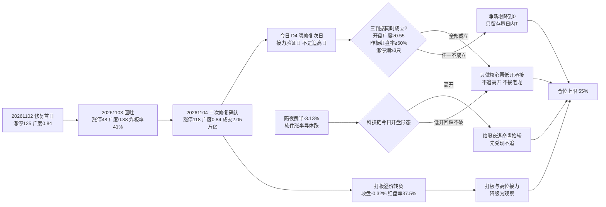

# 2026-11-05 · **风格研判**

> **数据源新鲜度**: partial（主源 tushare 全量 ok，情绪侧缺一线）
> **降级状态**: true —— 焦点群 0 条 · weflow down · 汇率/商品缺失
> **置信度**: 0.39（0.70 × 0.7 × 0.8）

## 一句话结论

**主线扩散型 + 情绪浓度 64.1（贪婪下沿）+ 三线扩散，仓位上限 55%**。今日是**修复段第 4 个交易日＝强修复次日**：昨日 118 家涨停、2.05 万亿放量、广度 83.8%，但**昨日涨停股当日收盘溢价 −0.32%、红盘率只有 37.5%**——指数级修复与打板亏钱同时成立，所以今日**不追高、只做核心承接，打板与高位接力降级为观察**。

---

## 一、情绪周期位置：修复段第 4 个交易日（强修复次日 · 接力验证日）

先回答"第几天"，再谈风格——阶段标签本身不能驱动决策。今天写的是**第 4 天 + 对应打法**，不是 `high_chop` 这种形容词。

| 项 | 读数 | 含义 |
|---|---|---|
| `cycle_position.cycle_day` | **0**（as of 20261104 收盘） | 已不在杀跌序列内，`tier=neutral` |
| `consecutive_down_days` | 0 | 上一杀跌段 20261029–20261030 连跌 2 天（跌停 41 → 82 家） |
| `emotion_cycle.phase` | **high_chop（高位震荡，confidence 0.72）** | premium 1.75% 未达 +3%、炸板率 21.85% ≥ 18% → 打板层面钝化 |
| **今日定位** | **修复段第 4 个交易日** | D1=20261102 修复首日 → D2=20261103 回吐 → D3=20261104 二次修复确认 → **今日 D4** |

**`high_chop` 与 `neutral` 在此处的含义是"修复窗口内的接力验证"，不是"继续空仓"**：`cycle_day=0` 只说明当前不处在杀跌序列里，它对仓位的唯一含义是**不套用"连跌两日博反弹"的模板**，而不是把仓位归零。真正的定位来自修复段的第几天：

| 交易日 | 涨停 | 广度 | 中位 | 成交额 | 定性 |
|---|---:|---:|---:|---:|---|
| 20261102 D1 | 125 | 84.0% | +2.02% | 17952 亿 | 修复首日（强修复） |
| 20261103 D2 | 48 | 37.8% | −0.65% | 17151 亿 | 回吐（炸板率 41.46%，但未构成杀跌日） |
| 20261104 D3 | **118** | **83.8%** | **+1.88%** | **20519 亿** | 二次修复**确认** |
| 20261105 D4 | ？ | ？ | ？ | ？ | **强修复次日 · 接力验证** |

**第 4 天的打法（四条，逐条可执行）**：

1. **验证对象换了**：D2 验的是"D1 是不是一日反抽"，D4 验的是"**D3 的修复能不能被次日接力**"。判据仍是三条：开盘广度 ≥0.55、昨日涨停红盘率 ≥60%（T-1 收盘口径只有 37.5%）、板块级涨停潮 ≥3 只。
2. **三判据成立才给净新增**，且只给 **D3 已被资金确认方向的核心票低开承接**——追高开盘、接高位老龙、做二波假设，一律不进。
3. **打板/接力降级为观察**：T-1 大阳线里昨日涨停股收盘溢价 **−0.32%**（中位 −2.34%）、红盘率 **37.5%**、再涨停 12 只。打板在这个位置是**负期望**，不是"情绪好就可以打"。
4. **任一判据不成立 → 当日净新增降到 0**，只留存量日内 T。这不是空仓，是"修复窗口里等承接点"。

同口径历史样本（`cycle_position.session_series` 内广度 >0.8 的强修复日，仅供参照、不是概率模型）：

- 20261023 涨停 82 / 广度 0.81 → 20261026 涨停 **55** / 广度 **0.40**（回吐）
- 20261102 涨停 125 / 广度 0.84 → 20261103 涨停 **48** / 广度 **0.38**（回吐）

**2/2 回吐、涨停家数腰斩**——这是今天把"承接"放在"进攻"前面的唯一理由。回吐 ≠ 新的杀跌：前两次回吐后 1–2 日内都出现过再修复（10-27 杀跌 → 10-28 修复；11-03 回吐 → 11-04 修复），所以仓位是**扣减**不是**清零**。

---

## 二、详细分析

### 2.1 结构读数：118 家涨停，但高度只有 3 板

11-04 全市场涨停 **118** 家、跌停 **9** 家、炸板 **33** 家，炸板率 **21.85%**（近 12 个交易日最低，仅高于 10-23 的 12.77%）；涨 **4667** / 跌 **779** / 平 **126**，广度 **83.76%**，中位 **+1.88%**，成交额 **20519 亿（+19.64%）**。指数：上证 **+2.16%**、深成 **+4.22%**、创业板 **+6.40%**、科创50 **+9.92%**、上证50 **+1.45%**、中证500 **+4.27%**。

连板天梯是 **3 板 7 家 / 2 板 6 家**，最高 **3 板**，首板 **105 家（89.0%）**。梯子给出的判断很清楚：

- **广度拉满、高度塌陷**：118 家涨停里 105 家是首板，最高只有 3 板 —— 这是**超跌普涨型首板潮**，不是情绪主升。主升的特征是"高度自然递推"，今天是"宽度一次打满"。
- **炸板率 21.85% 低于 35% 减半线**：单看这一项是健康读数，但它与"首板占 89%"叠加，含义是**资金愿意做首板、不愿意做接力**——赚的是当日与隔日，不赚趋势。
- 3 板那 7 家里没有一只是本轮修复的核心方向，身位集中在题材小票；**指数强 ≠ 情绪高度强**，两条线是分开的。
- 涨停的行业分布（tushare 一级行业口径，**仅作广度归因，R1 不做板块推荐，主线归属以 R2 为准**）：半导体 19、贵金属 11、汽车零部件 7、元件 7、专用设备 6、自动化设备 5、光学光电 5。

### 2.2 溢价拆解：指数大阳那天，打板的人在亏钱

48 家（11-03）涨停股在 11-04 的表现：开盘溢价均值 **+1.75%**（中位 +0.26%）、收盘溢价均值 **−0.32%**（中位 **−2.34%**）、红盘率 **37.5%**、再涨停 **12** 只。

这是今天最重要的一组数字，因为它**和指数方向相反**：

- **开盘给溢价、收盘变负**：隔夜抢筹的资金在盘中兑现，红盘率只有 37.5% —— 意味着 T-1 打板的人**三分之二在指数大涨 2%+ 的那天亏钱**；
- **中位 −2.34% 远差于均值 −0.32%**：少数票（12 只再涨停）把均值拉高，**分布是长尾右偏**，绝大多数是被埋的；
- 与 2.1 互相印证：首板 89% + 高度 3 板 + 溢价转负 = **接力层已经断裂**，今天打板/接力按负期望处理。

对照 D2（11-03）的读数——125 家前日涨停股开盘溢价 +2.21%、收盘 +0.95%、红盘率 50.8%——**红盘率从 50.8% 掉到 37.5%**，说明修复日反而更不适合打板：普涨把 T-1 的板全部"高开+回落"处理掉了。

### 2.3 簇结构：30 日窗口没有风格分化，全市场共用一个 beta

30 日窗口（**20260916–20261104**，42 个样本 = 22 个同花顺风格板块 + 20 只 ETF），1−Pearson 距离 + average linkage 聚 **6 簇**：

| 簇 | n | 30日 | 5日 | 末日 | 回撤 | 簇内相关 | 构成 |
|---|---:|---:|---:|---:|---:|---:|---|
| C2 | 2 | **+95.00%** | +8.7% | **−7.00%** | −7.0% | 0.481 | 极端接力策略指数（打二板以上 / 非ST三板以上） |
| C4 | 1 | +49.22% | +7.4% | +2.92% | −11.6% | — | 二板策略指数 |
| C3 | 1 | +6.57% | +6.6% | −1.41% | −2.4% | — | 消费类 ETF（防御） |
| C6 | 1 | +3.68% | +0.2% | −0.68% | −3.2% | — | 银行类 ETF（防御，与宽基负相关 −0.50） |
| C5 | 1 | −4.72% | +0.1% | −0.41% | −7.8% | — | 煤炭类 ETF（周期防御） |
| C1 | **36** | **−12.14%** | −1.9% | **+4.21%** | −19.6% | **0.67** | 其余全部（宽基 + 高 beta 成长 + 策略首板/打板 + 行业 ETF） |

42 个样本 30 日中位 **−9.49%**（剔除策略指数 −10.14%），**正收益只有 9/42（21.4%）**；5 日中位 −1.24%；末日 **34 涨 / 8 跌**、中位 **+3.15%**。

**这组数字的核心结论是"30 日没有轮动，只有两条腿"**：

- **一个 36 样本的巨型簇（簇内相关 0.67）**把宽基、成长、行业 ETF、绝大多数风格板块全装进去了 —— 30 日维度上它们**同涨同跌**，没有任何"风格切换"可做。所谓"风格轮动"在 30 日尺度上是伪命题，今天能做的是**位置**（谁跌透了）而不是**风格**（谁该轮到）。
- **唯一独立的两条腿**：极端接力策略指数（30 日 +37%~+153%）与防御 ETF（消费 +6.6% / 银行 +3.7% / 医药 +5.4%）。前者是"极致打板资金"的温度计，后者是"避险盘"的温度计。
- **末日两条腿同时掉头**：极端接力端 −7.00%（三板以上指数**单日 −7.0%，等于它 30 日内的最大回撤**），防御端 −0.7% ~ −1.4%；资金**一次性**从两端回到超跌成长（科创类宽基 +10.3%、半导体类 +10.0%、芯片类 +10.0%）。
- **超跌端 30 日仍在深坑**：通信类 −33.2%、成交额前十 −33.8%、深股通前十 −30.0%、热股 −25.3%、百元股 −23.9%。末日 +10% 是**从 −25% 的坑里弹起来的第一根**，不是新高。

### 2.4 外盘：软件涨、半导体跌——今日最大的反向变量

美股 20261104 收盘（sina 终值）：**道指 +3.03% / 纳指 +1.44% / 费城半导体 −3.13%**。

| 端 | 读数 | 含义 |
|---|---|---|
| 平台软件 | 微软 **+6.68%**、亚马逊 **+6.12%**、苹果 **+5.31%**、谷歌 +3.18%、Meta +1.44% | 中期选举落地后的**风格切换**（从硬件转向软件/内需） |
| 半导体 | 美光 **−7.00%**、英伟达 **−3.17%**、台积电 −2.24%、博通 −2.00%、康宁 −5.84%、英特尔 −3.77% | 硬件端**继续杀**，费半 −3.13% |
| 亚太 | 恒生指数 11-04 **+1.67%**（5 日 +3.57%）、韩国综合 5 日 −5.47% / 20 日 **−18.12%**、日经 20 日 −11.09% | 港股强、韩日弱，亚太内部也在分化 |

**这条线对今天的意义**：A 股 11-04 的半导体链涨停 19 家、半导体及元件 +10.55%、存储链 +9.24%，是**在国内政策与国家队 ETF 托举下独立走出来的**；隔夜费半 −3.13% 把这个方向推到"内部逻辑 vs 外盘定价"的对撞点上。两种处理：

- **高开** → 按"给隔夜逃命盘抬轿"处理，**不追**，让高开先兑现；
- **低开或平开回踩不破** → 才是修复延续的承接点，可以做核心票的低开承接。

### 2.5 资金：超大单 +474 亿、大单 −393 亿——被动买盘的标准指纹

R7 当日资金读数（20261104，与本节同源东财 DC 口径）：

| 口径 | 数值 | 读法 |
|---|---:|---|
| 主力净额 | **+500.28 亿**（净流入率 +2.46%） | 前日 −574.09 亿 → 单日翻转近 1075 亿，**买方接管** |
| 超大单 | **+474.06 亿** | 与 ETF 托举的公众号口径完全吻合 |
| 大单 | **−392.75 亿** | 机构/游资在**卖给超大单**，不是同向买入 |
| 小单 | −107.53 亿 | 散户也在卖 |
| 两融余额 | 22989 亿（20261103）· 5 日 **−4.60%** | 杠杆盘**没有回场** |

**这个结构必须读准**：净流入 500 亿看着很强，但拆开是**超大单单边买、大单与小单同向卖**——这是"被动/机构托举"的指纹，不是"产业资金与游资一起进攻"的指纹。差别在持续性：前者依赖买盘每天都来，后者有自我强化。两融 5 日 −4.60% 印证了杠杆资金没回来，所以**修复的资金基础是单边的**，这也是今天只给 55% 上限、且要"三判据"才放净新增的资金层理由。

对照 R7 的结论原文（"电子单日 +312 亿是高低切首日，外部 MU −7% 反对"），资金与我这里的风格判断同向：**方向对、持续性待验**。

### 2.6 风格归因：五分法代价表与一次否决

| 风格 | 代价 | 判据落点 |
|---|---:|---|
| 连板情绪型 | **0.5927** | 涨停 118 ≥50（0）、炸板率 21.85% 仅超 20%（+0.09）、**高度 3 < 6（+0.50）** |
| 崩溃退潮型 | 1.2629 | 炸板率离 50% 差 28 个点、跌停 9 家离 30 差 21 家 |
| **主线扩散型** | **1.3600** | 高度 3∈[3,5]（0）、炸板率∈[15%,35%]（0）、主线簇 up_nums≥8 共 20 条（0）、**涨停 118 超上限 50（+1.36）** |
| 震荡分化型 | 3.3941 | 涨停 118 远超 [20,40]、涨家占比 83.8% 远超 [42,58]、行业≥8 家不为 0 |
| 防御观望型 | 8.4775 | 涨停 118 远超 <20、创业板振幅 6.40% ≫1.5% |

**取「主线扩散型」，并且明确否决代价最低的「连板情绪型」**：

- 连板情绪型只赢在"涨停 ≥50"这一项，它的两项**核心要件双双不成立**——高度 3 板（要求 ≥6）、打板赚钱（T-1 涨停收盘溢价 **−0.32%**、红盘率 37.5%）。把它写成连板情绪型，等于告诉 D1"情绪主升、可以打板"，方向会错。
- 主线扩散型的唯一超界项是涨停家数（118 vs 30–50），但**结构上是同构的**：单一最大叙事簇 46 家涨停 = 全市场涨停的 **39%**，扩散层由 105 家首板构成——这就是"一条主线在横向铺开"，只是铺到了极致。
- **必须标注的张力**：`emotion_cycle=high_chop` 与"扩散型"不冲突（前者说的是打板钝化，后者说的是广度结构），但按 skill §3 联动规则**阶段优先于风格表**：高位震荡 → 仓位上限在情绪分对应区间（0.65–0.75）之下再压，见第五节。

### 2.7 推理深度三问（top 对象：今日的修复结构）

- **大资金意图**: T-1 的买盘不是产业资金，是**被动托举**——资金结构已给出指纹：超大单 **+474.06 亿**、大单 **−392.75 亿**、小单 −107.53 亿（R7 当日口径），单边买、其余全在卖；公众号口径同时记录"盘中宽基与科创类 ETF 午后持续放量半小时（科创类单只 ETF 单日涨幅 7%、半导体主题 ETF 涨幅一度 16%）、连续三天千亿量级、并明显减少对上证50 类权重 ETF 的买入（130 亿 → 30 亿）"。买方目标是**打掉科技端的流动性折价**，不是抬指数。对手盘是 30 日跌了 18–33% 的成长筹码持有人与两融平仓盘（两融 22989 亿 · 5 日 **−4.60%**，杠杆盘未回场）。
- **为什么走强**: 位置（通信/半导体/百元股 30 日 −20% ~ −33%，末日距 30 日高点仍有 25–39% 空间，属**超卖极值**）+ 催化（政策转向 + 中期选举结果落地 + ETF 被动买盘，**硬事件但不是硬业绩**）+ 筹码（T-1 涨停里 89% 是首板，说明筹码是**当日新进**、没有沉淀）。三维交叉的结论是：**这是修复，不是反转**——位置给弹性，筹码不给持续性。
- **逻辑够不够硬**: **不够硬，只够做 1–3 天**。独立源只有两个（政策/ETF 托举 + 超跌位置），缺第三个硬锚（业绩、订单、或外盘半导体同步走强）；而外盘给的恰好是反向证据（费半 −3.13%、美光 −7.00%）。**证伪路径明确且很快**：若今日 09:45 前广度回落到 0.55 以下、或昨日涨停股红盘率 <60%，则 D3 的修复被定义为"一次性 ETF 托举脉冲"，全部净新增归零。

---

## 三、结构传导图

---

## 四、今日执行框架（思维链四段）

R1 不出个股，以下四段锚点用于**当日主判断**（是否给净新增、什么条件进、什么条件撤），供 D1 直接映射到执行池。

- **买入理由**: ①**位置**——30 日窗口 42 样本中位 −9.49%、超跌端距 30 日高点仍有 25–39% 空间，修复的赔率在超跌端；②**广度**——T-1 涨停 118 家、广度 83.8%、成交 2.05 万亿（+19.64%），是近 12 个交易日最强的一次扩散，说明这不是单点异动；③**被动买盘连续性**——ETF 端连续三日千亿量级、且从权重转向科技，托举的方向明确。
- **风险点**: ①**强修复次日 2/2 回吐**（涨停 82→55、125→48），今日大概率是分歧日；②**打板负期望**——T-1 涨停收盘溢价 −0.32%、红盘率 37.5%，接力层已断；③**跨市场反向**——费半 −3.13%、美光 −7.00%，A 股半导体 T-1 已 +10.55%，高开即进入兑现博弈；④**高度缺失**——最高 3 板、首板 89%，无龙头承接，情绪易在 1–2 日内衰减。
- **止损条件**: ①**开盘 30 分钟广度 <0.55** → 当日净新增归零（不是清仓存量）；②**昨日涨停股今日红盘率 <60%** → 打板/接力类仓位当日了结，不留隔夜；③**指数跌破 T-1 阳线实体中点**（上证 3646 点、创业板 2472 点、科创50 1209 点，即 11-04 开收盘均值）→ 修复证伪，存量仓位降到半仓以下；④**半导体链高开后 30 分钟内回吐全部涨幅** → 视为抬轿完成，该方向当日不再做任何新增。
- **可验证假设**（24–72h 内可证真/证伪）: ①今日广度若 ≥0.55 且涨停 ≥80，则"修复第 4 天延续"成立，可持有到第 5 天；②若今日涨停回落到 50 以下、炸板率升破 35%，则 D3 被证伪为脉冲，第 5 天按"再回吐"处理；③若今日科技链低开高走且昨日涨停股红盘率 ≥60%，则"打板负期望"被推翻，打板类观察升级为可做——这三条都可在收盘直接读到，不需要主观判断。

---

## 五、仓位上限推导：55%

| 项 | 数值 | 说明 |
|---|---:|---|
| 基准（情绪 60–80 贪婪区间中值） | **0.70** | 情绪分 64.1 落在 60–80 档，区间 0.65–0.75 取中值 |
| 阶段扣减：高位震荡 / 打板不赚钱 | −0.05 | T-1 涨停收盘溢价为负、红盘率 37.5%，`high_chop` 的实质是打板钝化 |
| 回吐样本扣减：强修复次日 2/2 | −0.05 | 广度 >0.8 的次日同口径样本两次全部回吐、涨停腰斩 |
| 跨市场扣减：隔夜费半 −3.13% | −0.05 | A 股芯片链 T-1 +10.55%，跨市场反向，高开即博弈 |
| **仓位上限** | **0.55** | 上限 ≠ 目标仓；三判据任一不成立 → **净新增降到 0** |

情绪分双法校验：5 维加权 **61.1**（涨停 98×.25 + 跌停压制 64×.20 + 连板结构 44×.20 + 炸板 12.6×.15 + 杠杆外资 65×.20）／4 维自算 **67.0**（涨停 98×.35 + 高度 44×.25 + 炸板 12.6×.20 + 指数 95×.20），两法差 5.9 < 15，取均值 **64.1**。

**必须说明的一个读数缺陷**：5 维法里的"炸板项"给到 12.6 分（100 − 4×21.85），把 21.85% 的炸板率当成重度扣分——但 21.85% 已是近 12 个交易日最低。这一项在低炸板率环境下会系统性低估情绪温度，所以本次用 4 维法（67.0）做上修，不直接采信 61.1。

---

## 六、关键证据

- **T-1 涨停结构**：涨停 118 / 跌停 9 / 炸板 33 → 炸板率 **21.85%**；3 板 7 家、2 板 6 家，最高 **3 板**，首板 105 家（**89.0%**）
- **赚钱效应（核心矛盾）**：11-03 的 48 家涨停股在 11-04 开盘溢价 **+1.75%**（中位 +0.26%）、收盘溢价 **−0.32%**（中位 **−2.34%**）、红盘率 **37.5%**、再涨停 12 只 —— 指数涨 2.16%~9.92% 的当天，打板的人在亏钱
- **广度与量能**：涨 4667 / 跌 779 / 平 126、广度 **83.76%**、中位 +1.88%、成交 **20519 亿（+19.64%）**；涨超 5% 的个股 **1117** 只（前一日 137 只）
- **指数**：上证 +2.16% / 深成 +4.22% / 创业板 +6.40% / 科创50 +9.92% / 上证50 +1.45% / 中证500 +4.27%
- **30 日窗（20260916–20261104）**：42 样本中位 **−9.49%**、正收益 **9/42（21.4%）**；末日 34 涨 / 8 跌、中位 +3.15%
- **6 簇**：[(C1,36), (C2,2), (C3,1), (C4,1), (C5,1), (C6,1)]，最大簇 within_corr **0.67** → 30 日无风格分化，全市场单一 beta
- **末日两端掉头**：极端接力策略指数 **−7.00%**（等于其 30 日最大回撤）、消费类 −1.41%、银行类 −0.68%；超跌端科创类 +10.3%、半导体类 +10.0%
- **强修复日次日样本 2/2 回吐**：20261023（涨停 82/广度 0.81）→ 20261026（55/0.40）；20261102（125/0.84）→ 20261103（48/0.38）
- **资金结构**：主力净额 **+500.28 亿**（净流入率 +2.46%，前日 −574.09 亿）；超大单 **+474.06 亿** ／ 大单 **−392.75 亿** ／ 小单 −107.53 亿；两融 22989 亿（20261103，5 日 **−4.60%**）——单边被动买、杠杆未回场
- **隔夜美股（20261104 收盘）**：道指 +3.03% / 纳指 +1.44% / **费半 −3.13%**；微软 +6.68%、亚马逊 +6.12%、苹果 +5.31% ／ 美光 −7.00%、英伟达 −3.17%、台积电 −2.24%
- **亚太**：恒生指数 11-04 +1.67%（5 日 +3.57%）；韩国综合 5 日 −5.47%（20 日 −18.12%）；日经 20 日 −11.09%
- **情绪周期预计算**：high_chop（confidence 0.72），premium 1.75%、ladder 3、break_rate 21.85%
- **周期位置**：neutral / 连跌 0 天 / cycle_day 0（as of 20261104 收盘，cycle_position.py）——只表示不在杀跌序列，不构成继续空仓的理由
- **概念簇代理**：limit_cpt_list 20 条、up_nums≥15 共 20 条，最大单簇 46 家涨停（占全市场涨停 39%）
- **公众号口径（8 篇非官媒方向性文本）**：主流判断是"**企稳 ≠ 连续反弹**"——企稳带来题材赚钱效应，连续反弹才带权重反弹；且本次是超跌成长的**第二次**崩溃式下跌，简单套用第一次（8 月初）的连续反弹模板，接力条件不足
- **群聊口径**：焦点群窗口内 **0 条**，游资一线情绪缺交叉验证 → `confidence` 下调至 0.39

---

## 七、数据源审计

| 源 | 日期 | 状态 | 备注 |
|---|---|:--:|---|
| tushare/ths_daily + ths_member | 2026-11-04 | 🟢 | 22 个风格板块，75 日回溯，K 线 + 成分股 |
| tushare/fund_daily | 2026-11-04 | 🟢 | 20 只宽基/行业 ETF |
| tushare/limit_list_d | 2026-11-04 | 🟢 | 160 条（118 涨停 / 9 跌停 / 33 炸板） |
| tushare/limit_step | 2026-11-04 | 🟢 | 13 条（3 板 7 / 2 板 6） |
| tushare/limit_cpt_list | 2026-11-04 | 🟢 | 20 条概念簇 |
| tushare/index_daily | 2026-11-04 | 🟢 | 6 个指数，20261020 起 |
| tushare/daily + trade_cal | 2026-11-04 | 🟢 | 5572 只，30 日窗 20260916–20261104 |
| tushare/moneyflow_dc（经 R7 折算） | 2026-11-04 | 🟢 | 主力 +500.28 亿 · 超大单 +474.06 亿 · 两融 T+1（20261103，22989 亿） |
| sina/gb_realtime（美股终值） | 2026-11-04 | 🟢 | 17 个标的，收盘终值 |
| tushare/index_global + us_daily | 2026-11-03 | 🟡 | 美股个股滞后 1 日；费半、恒生科技空返回，已由 sina 补齐 |
| tushare/fx_daily | — | 🔴 | USDCNH / DXY 空返回，汇率坐标缺失 |
| 商品（原油/铜/金） | — | 🔴 | skipped，宏观三档坐标无法建立 |
| wechat_official_rss | 2026-11-04 | 🟢 | 85 篇 · 17 源（非官媒 8 篇进入方向判断） |
| wechat_cli_groups | 2026-11-04 | 🔴 | 0 条 · 焦点群窗口内无消息（群名已匿名） |
| weflow/MCP | 2026-11-05 | 🔴 | HTTP 404 · down |
| cycle_position.py | 2026-11-04 | 🟢 | 12 个会话读数 |
| emotion_cycle.py | 2026-11-04 | 🟢 | premium / ladder / break_rate 齐全 |

**降级结论**：主源（tushare 全量 + 公众号 + 外盘终值）ok，**情绪侧缺一线（焦点群 0 条 + weflow down）**、跨资产宏观坐标缺两项 → `status=degraded`、`input_freshness=partial`。

---

## 八、不确定性 / 反证

**我可能错在哪里（三条，按概率排序）**：

1. **把"ETF 托举"误当成"情绪修复"**。T-1 的 118 家涨停里 89% 是首板、高度只有 3 板、打板溢价为负——如果今日 ETF 买盘一撤，这个结构无法自持。**反证信号**：今日若开盘半小时成交额同比缩量 20% 以上且广度 <0.55，则"修复"应改写为"托举脉冲"。
2. **低估了趋势反转的可能性**。我用"30 日中位 −9.49%、仅 9/42 正收益"论证这是深跌结构内的反弹。若今日科技链在费半 −3.13% 的背景下仍然低开高走、昨日涨停股红盘率 ≥60%，说明 A 股已经**脱离外盘定价**，那今天的 3 次扣减（共 −0.15）就是过度保守，仓位该给到 0.70。
3. **风格标签的张力**。机械代价表的最优解是"连板情绪型"（0.59 < 1.36），我以"高度 3 板 + 打板负期望"两项核心要件不成立否决了它。若今日出现 4 板以上连板龙头且打板溢价转正，这个否决会被判错——但那属于**当日盘中新增证据**，不该在盘前预支。

**结构性盲区**：焦点群 0 条 = 没有一线游资口径；汇率与商品缺失 = 无法判断"美元/人民币/金价"这条宏观腿（而 T-1 涨停里贵金属占 11 家，这条腿其实不小）。这两项应作为今日盘中/盘后的补证重点，也是 `confidence` 只有 0.39 的直接原因。

---

## 九、与其他 R/D/E 的关系

- **依赖**: `data/raw/20261105/manifest.json`（global_severity=2）· `data/raw/20261105/style_snapshot.json`（22 板块 + 20 ETF + 外盘）· `data/research/20261105/_r1_cluster.json`（30 日窗 6 簇）· `data/research/20261105/_work/market_20261104.json`（涨停/天梯/指数/概念簇）· `data/research/20261105/_work/premium_20261104.json`（打板溢价）· `data/research/20261105/cycle_position.json`（第几天）· `data/research/20261105/emotion_cycle.json`（阶段）· `data/research/20261105/R7_capital_flow.json`（主力/超大单/两融，资金交叉）· `data/raw/20261105/wechat_official_20.jsonl`（85 篇）
- **被消费**: R2（`style` / `main_lines_count` / `position_cap_suggestion`）· R3（`sentiment_score` 基准 64.1）· R6（与 R2 一致性反证）· D1（`position_cap_suggestion=0.55` → exec_pool 总仓上限，且受"三判据不成立则净新增归零"约束）· E1（复盘校验第 4 天打法与三条可验证假设）

---

## Sub-Agent 元数据

- skill: analyze_style_v1
- artifact: data/research/20261105/R1_style.json
- 生成耗时: 约 31 分钟（快照抓取 42 秒 · 聚类 3 秒 · 底稿 4 次）
- model: deepseek-v4.1-flash
- 时间错位声明: 本文件 `trade_date=20261105`，**全部量价数据为 T-1（20261104）收盘口径**，外盘为 20261104 美股收盘；`data_from_trade_date: 20261104` 属盘前常规口径，非 R7 式 staleness 错位
- 口径边界: 22 个同花顺风格板块是**风格/状态指数**（非行业板块），30 日窗聚类若被读成"板块轮动结论"会失真——它的正确用法是"温度计"
