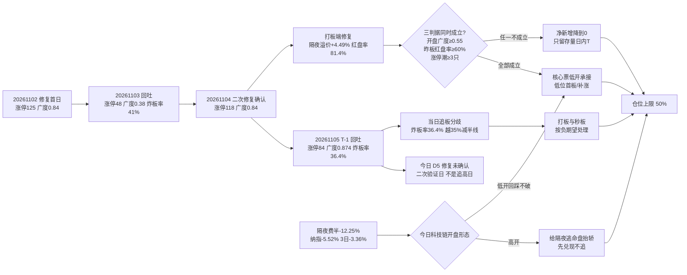

# 2026-11-06 · **风格研判**

> **数据源新鲜度**: partial（主源 tushare 全量 ok，外盘/资金维缺一线）
> **降级状态**: true —— 美股个股未落库（指数已补齐）· 汇率/商品缺失 · 焦点群 0 条 · weflow down
> **置信度**: 0.441（0.70 × 0.7 × 0.9）

## 一句话结论

**主线扩散型 + 情绪 60.1（贪婪下沿）+ 三线扩散（代理），仓位上限 50%**。今日是**修复段第 5 个交易日＝修复未确认的二次验证日**：T-1 打板端已经修复（昨日涨停收盘溢价 **+4.49%**、红盘率 **81.4%**、再涨停 21 只），但**当日炸板率 36.36% 与隔夜费半 −12.25% 构成双面夹击**——低开承接可做、高开不追，任一验证判据不成立则净新增归零、只留日内 T。

---

## 一、情绪周期位置：修复段第 5 个交易日（T-1 回吐 · 修复未确认的二次验证日）

先回答"第几天"，再谈风格——阶段标签本身不能驱动决策。今天写的是**第 5 天 + 对应打法**，不是 `high_chop` 这种形容词。

| 项 | 读数 | 含义 |
|---|---|---|
| `cycle_position.cycle_day` | **0**（as of 20261105 收盘） | 已不在杀跌序列内，`tier=neutral` |
| `consecutive_down_days` | 0 | 上一杀跌段 20261029–20261030 连跌 2 天（跌停 41 → 82 家） |
| `emotion_cycle.phase` | **high_chop（高位震荡，confidence 0.65）** | premium −0.5%（降级保守值）、炸板率 36.36% ≥ 25% → 涨停多但分歧大（高位钝化） |
| **今日定位** | **修复段第 5 个交易日** | D1=20261102 修复首日 → D2=20261103 回吐 → D3=20261104 二次修复确认 → D4=20261105 放量但涨停减半 → **今日 D5** |

**`high_chop` 与 `neutral` 在此处的含义是"修复窗口"，不是"继续空仓"**：`cycle_day=0` 只说明当前不处在杀跌序列里，它对仓位的唯一含义是**不套用"连跌两日博反弹"的模板**，而不是把仓位归零。真正的定位来自修复段的第几天：

| 交易日 | 涨停 | 广度 | 中位 | 炸板率 | 定性 |
|---|---:|---:|---:|---:|---|
| 20261102 D1 | 125 | 84.0% | +2.02% | 18.3% | 修复首日（强修复） |
| 20261103 D2 | 48 | 37.8% | −0.65% | 41.5% | 回吐（未构成杀跌日） |
| 20261104 D3 | **118** | **83.8%** | **+1.88%** | 21.9% | 二次修复**确认** |
| 20261105 D4 | 84 | **87.4%** | **+2.01%** | **36.4%** | 放量但涨停减半、分歧放大（T-1 回吐） |
| **今日 D5** | ？ | ？ | ？ | ？ | **修复未确认的二次验证日** |

**第 5 天的打法（逐条可执行）**：

1. **验证对象换了**：D2 验的是"修复是不是一日反抽"，D5 验的是"**T-1 的放量分歧能不能被今日接力**"。判据仍是三条：开盘广度 ≥0.55、昨日涨停红盘率 ≥60%（T-1 收盘口径 **81.4%**，已达标）、板块级涨停潮 ≥3 只。
2. **三判据同时成立**才做**低位首板/低位补涨与主线核心的低开承接**——追高开盘、接高位老龙、做二波假设，一律不进。
3. **当日炸板 36.36% 已越 35% 减半线**：T-1 的板赚钱（溢价 +4.49%）、当日新打的板一半多炸掉——这是"接力持有"端修复、"当日追板"端分歧的双面结构，**打板/秒板按负期望处理**。
4. **任一判据不成立 → 当日净新增降到 0**，只留存量日内 T。这不是空仓，是"修复窗口里等承接点"。

同口径历史样本（`cycle_position.session_series` 内广度 >0.8 的强修复日，仅供参照、不是概率模型）：

- 20261023 涨停 82 / 广度 0.81 → 20261026 涨停 **55** / 广度 **0.40**（回吐）
- 20261102 涨停 125 / 广度 0.84 → 20261103 涨停 **48** / 广度 **0.38**（回吐）

**修复段内 2/2 回吐、涨停家数腰斩**——这是今天把"承接"放在"进攻"前面的理由。但回吐 ≠ 新的杀跌：前两次回吐后 1–2 日内都出现过再修复（10-27 杀跌 → 10-28 修复；11-03 回吐 → 11-04 修复），所以仓位是**扣减**不是**清零**。

---

## 二、详细分析

### 2.1 结构读数：84 家涨停、0 家跌停，但炸板率 36.36% —— 权重滞涨、题材普涨

11-05 全市场涨停 **84** 家、跌停 **0** 家、炸板 **48** 家，炸板率 **36.36%**；涨 **4538** / 跌 **604** / 平 **75**，广度 **88.3%**，中位 **+2.01%**，涨超 5% 的个股 **555** 只、跌超 5% 仅 41 只，成交额 **21177 亿（+3.94%）**。指数：上证 **+0.10%**、深成 **+1.19%**、创业板 **+0.87%**、科创50 **+1.68%**、中证500 **+1.80%**、北证50 **+1.79%**。

连板天梯：**4 板 2 家 / 3 板 2 家 / 2 板 17 家 / 1 板 63 家**，最高 **4 板**，首板占 **75.0%**。梯子给出的判断很清楚：

- **高度从 3 板升到 4 板（2 家），但仍未形成梯队递推**：首板 63/84（75%），高度结构依然是"宽度型"，不是"情绪主升型"。
- **权重滞涨 + 题材普涨是同一件事的两面**：上证 +0.10% vs 中证500 +1.80%（+1.7 个点），涨停 84 家 + 广度 88.3% —— 资金在题材端做扩散，不在权重端做进攻。
- **炸板率 36.36% ≥ 35% 减半线**：当日新打的板有近四成炸掉，说明**当日追板的分歧很大**；这与 2.2 的"隔夜溢价 +4.49%"叠加，构成 high_chop 的完整证据链。
- 涨停行业分布（tushare 一级行业口径，**仅作广度归因，R1 不做板块推荐，主线归属以 R2 为准**）：光伏设备 11、专用设备 4、半导体 4、电网设备 3、广告营销 3、一般零售 3。

### 2.2 溢价拆解：打板端一夜之间从亏钱转赚钱 —— 修复的边际改善在这里

118 家（11-04）涨停股在 11-05 的表现：开盘溢价均值 **+1.94%**（中位 +1.39%）、收盘溢价均值 **+4.49%**（中位 **+4.26%**）、红盘率 **81.4%**、再涨停 **21** 只。

这是与昨日（11-04 的 −0.32% / 红盘率 37.5%）**方向相反**的一组数字：

- **隔夜持有者从"三分之二亏钱"变成"八成赚钱"**：红盘率 37.5% → 81.4%，收盘溢价 −0.32% → +4.49%，再涨停 12 → 21 只 —— **接力持有端的赚钱效应修复了**；
- **但当日打板端没有修复**：当日炸板率 36.36%（对比 11-04 的 21.85%），当日新打的板一半以上不赚钱。修复的钱在"隔夜持有 + 低开承接"里，不在"当日追板"里；
- 中位 +4.26% 接近均值 +4.49%（分布不偏），说明**修复是均匀的**，不是少数票拉起来的——这是真修复的特征。

**这个结构直接决定了今日打法**：做**低开承接**（吃隔夜溢价的延续），不做**高开追板**（当日分歧端）。

### 2.3 簇结构：30 日仍是一个大 beta，但末日/5 日两条腿在扩散

30 日窗口（**20260924–20261105**，42 个样本 = 22 个同花顺风格板块 + 20 只 ETF），1−Pearson 距离 + Ward linkage 聚 **6 簇**（average linkage 同源复算作退化诊断，36 样本单簇结论一致）：

| 簇 | n | 30日 | 5日 | 末日 | 回撤 | 簇内相关 | 构成 |
|---|---:|---:|---:|---:|---:|---:|---|
| C6 | 3 | **+67.41%** | +7.20% | **−0.11%** | −9.2% | 0.349 | 极端接力策略指数（打二板以上 / 非ST三板以上）+ 消费类 ETF |
| C5 | 3 | +12.63% | −0.95% | −1.34% | −8.3% | 0.262 | 二板策略指数 + 银行类 / 煤炭类 ETF |
| C2 | 5 | +0.50% | +1.86% | **+2.99%** | −11.0% | 0.755 | 打板策略指数（打板/打首板）+ 高贝塔 + 百日新高 + 房地产 |
| C3 | 8 | −4.39% | **+6.22%** | +2.52% | −13.2% | 0.702 | 宽基（沪深300/上证50/行业龙头）+ 医药/恒生科技/光伏/新能源/有色 ETF |
| C4 | 3 | −9.15% | +2.95% | −0.29% | **−20.3%** | 0.393 | 创历史新高 + 昨日资金前十 + 证券类 ETF |
| C1 | **20** | **−19.20%** | +1.83% | +1.35% | **−27.8%** | **0.855** | 其余全部（科技/题材/小盘系列 + 通信/芯片/半导体/军工 ETF 等） |

42 个样本 30 日中位 **−9.06%**（剔除策略指数 −10.03%），**正收益只有 9/42（21.4%）**；5 日中位 **+3.25%（34/42 为正）**；末日 **32 涨 / 9 跌**、中位 **+1.60%**。

**这组数字的核心结论是"30 日没有轮动，但修复正在从深坑里扩散"**：

- **C1（20 个样本，簇内相关 0.855、与宽基相关 0.912）仍是全市场 beta 的载体**：30 日中位 −19.2%、回撤 −27.8% —— 科技/题材/小盘系列在 30 日尺度上同涨同跌，**没有风格切换可做，只有位置可做**；
- **末日 32/42 上涨、5 日 34/42 上涨**：修复已经从 C3（宽基防御，5 日 +6.22%）扩散到 C1（超跌端，5 日 +1.83%）——但 C1 的 30 日仍在 −19.2% 的深坑里，**这是从坑里弹起来的第一段，不是新高**；
- **C2（打板策略端）末日 +2.99%**：与 2.2 的隔夜溢价 +4.49% 互相印证——**打板温度计回升了**；
- **C6（极端接力端）末日 −0.11%**：最高只有 4 板，极端接力端微跌——**高度钝化**，与 high_chop 一致；
- **防御端（C5 银行/煤炭）末日 −1.34%**：避险盘在退，资金回到题材端——与"权重滞涨 + 题材普涨"同向。

### 2.4 外盘：隔夜费半 −12.25% —— 今日最大的反向变量

美股 20261105 收盘（sina/eastmoney 实时终值）：**纳指 −5.52% / 标普 −4.36% / 道指 −3.44% / 费城半导体 −12.25% / 纳指100 −6.36%**，纳指 3 日累计 **−3.36%**。

| 端 | 读数 | 含义 |
|---|---|---|
| 美股半导体（20261104 个股） | 英伟达 −3.17%、美光 **−7.00%**、博通 −2.00%、台积电 −2.24%、AMD +1.01% | 硬件端持续杀，费半单日 **−12.25%** 是极端读数 |
| 美股指数（20261105 收盘） | 纳指 −5.52% / 费半 −12.25% / 纳指100 −6.36% | **隔夜暴跌**，北京时间 11-06 凌晨收盘，直接作用于今日 A 股开盘 |
| 亚太 | 恒生指数 11-05 **+3.67%**（5 日 +8.01%、20 日 +2.76%）；韩国综合 20 日 −20.87%；日经 20 日 −13.59% | 港股独强、韩日弱，亚太内部继续分化 |
| 汇率 | USDCNH 6.66623（20261104） | 人民币仍偏强；DXY 缺，美元方向坐标无法建立 |

**这条线对今天的意义**：A 股 T-1 半导体方向涨停家数已从 46 → 13（−33）——内部先行退潮；隔夜费半再 −12.25%，把科技链推到"内部修复 vs 外盘定价"的对撞点上。两种处理：

- **高开** → 按"给隔夜逃命盘抬轿"处理，**不追**，让高开先兑现；
- **低开或平开回踩不破** → 才是修复延续的承接点，可以做核心票的低开承接。

### 2.5 资金：主力单日转正、5 日仍净流出 —— 杠杆资金没有回场

R7 当日资金读数（20261105，东财 DC 口径，经 _r1_market flows 折算）：

| 口径 | 数值 | 读法 |
|---|---:|---|
| 主力净额 | **+85.39 亿**（净流入率 +0.40%） | 单日转正（前 5 日累计 −264.99 亿），但幅度远小于 11-04 的 +500 亿级 |
| 近 5 日累计 | **−264.99 亿** | 5 日维度仍是净流出，修复的资金基础单薄 |
| 两融余额 | 23004 亿（20261104，T+1）· 5 日 **−1116 亿（−4.63%）** | **杠杆盘没有回场**，高度股反包胜率仍受压制 |

**这个结构必须读准**：单日 +85 亿 vs 11-04 的 +500 亿级，说明**被动/托举买盘在减弱**；两融 5 日 −4.63% 印证杠杆资金没回来。所以修复的资金基础仍是**单边的、薄弱的**——这是今天只给 50% 上限、且要"三判据"才放净新增的资金层理由。

### 2.6 风格归因：五分法代价表，主线扩散型当选

| 风格 | 代价 | 判据落点 |
|---|---:|---|
| **主线扩散型** | **0.7189** | 高度 4∈[3,5]（0）、炸板率 36.36% 超上限 35%（+0.04）、主线簇 up_nums≥8 共 20 条（0）、涨停 84 超上限 50（+0.68）、涨家占比 88.3%（0） |
| 连板情绪型 | 1.1513 | 涨停 84 ≥50（0）、**高度 4 < 6（+0.33）**、炸板率 36.36% 超 20%（+0.82） |
| 崩溃退潮型 | 2.3742 | 炸板率离 50% 差 14 个点、跌停 0 家离 30 差 30 家、指数跌幅不达标 |
| 震荡分化型 | 2.6216 | 涨停 84 远超 [20,40]、涨家占比 88.3% 远超 [42,58] |
| 防御观望型 | 3.4235 | 涨停 84 远超 <20、成交额 +3.94% 远超缩量判据 |

**取「主线扩散型」，并明确否决代价次低的「连板情绪型」**：

- 连板情绪型最核心的要件**高度 ≥6 板不成立**（最高 4 板），炸板率 36.36% 也超其 20% 上限——把它写成连板情绪型，等于告诉 D1"情绪主升、可以打板"，方向会错；
- 主线扩散型唯一超界项是涨停家数（84 vs 30–50），但结构上同构：首板 63 家（75%）构成扩散层，光伏设备单行业 11 家涨停，是"一条主线在横向铺开"；
- **必须标注的张力**：`emotion_cycle=high_chop` 与"扩散型"不冲突（前者说打板钝化、后者说广度结构），但按 skill §3 联动规则，高位震荡 + 炸板率≥25% → **只降温不换标签**——换成震荡分化型（20–40 家分散）与今日 84 家涨停的结构事实不符。

### 2.7 推理深度三问（top 对象：今日的"修复带分歧"结构）

- **大资金意图**: T-1 的买盘不是加杠杆进攻，是**题材端 T+1 接力**——权重滞涨（上证 +0.10% vs 中证500 +1.80%）、广度 88.3%、主力单日仅 +85 亿而两融 5 日 −4.63%，买方在"隔夜持有 + 低位承接"里赚钱（溢价 +4.49%），不在"当日追板"里进攻（炸板 36.36%）。对手盘是 C1 簇 30 日 −19.2%、回撤 −27.8% 的套牢盘与两融平仓盘。
- **为什么走强**: 位置（C1 超跌端 30 日 −19.2%，修复从 −27.8% 回撤里弹起）+ 催化（国内题材叙事 + 政策托底，T-1 涨停收盘溢价 +4.49%、红盘率 81.4%，接力端赚钱效应成立）+ 筹码（首板 75%、高度 4 板，筹码以当日新进为主，无沉淀）。三维交叉：**这是修复的延续，不是反转的启动**。
- **逻辑够不够硬**: **够做 1–2 天，不够做趋势**。硬的是：广度 87.4% + 隔夜溢价转正 + 5 日 34/42 簇正收益（修复在扩散）。不硬的是：当日炸板率 36.36%（追板分歧）+ 高度仅 4 板（无龙头承接）+ 两融 5 日 −4.63%（杠杆未回）+ 隔夜费半 −12.25%（外盘反向）。**证伪路径明确且快**：开盘广度 <0.55、或昨日涨停红盘率 <60%、或科技链高开后 30 分钟内回吐全部涨幅——任一成立，修复按一日反抽处理。

---

## 三、结构传导图

---

## 四、今日执行框架（思维链四段）

R1 不出个股，以下四段锚点用于**当日主判断**（是否给净新增、什么条件进、什么条件撤），供 D1 直接映射到执行池。

- **买入理由**: ①**接力端赚钱效应已修复**——T-1 涨停收盘溢价 +4.49%、红盘率 81.4%、再涨停 21 只，隔夜持有者的期望转正，这是修复段内最硬的边际改善；②**广度仍在扩散**——T-1 广度 87.4%、涨超 5% 555 只、成交 21177 亿（+3.94%），5 日窗口 34/42 风格系列为正；③**低位筹码结构**——首板 75%、高度 4 板，C1 超跌端 30 日 −19.2% 的回撤提供赔率。
- **风险点**: ①**修复段内 2/2 回吐、涨停腰斩**（125→48、118→84），今日大概率再分歧；②**当日打板负期望**——炸板率 36.36% 越减半线，追板、秒板、二次冲高不做；③**隔夜外盘反向**——费半 −12.25%、纳指 3 日 −3.36%，科技链高开即进入兑现博弈；④**资金基础薄**——主力 5 日 −264.99 亿、两融 5 日 −4.63%，被动买盘在减弱；⑤**高度缺失**——最高 4 板、首板 75%，无龙头承接，情绪易在 1–2 日内衰减。
- **止损条件**: ①**开盘 30 分钟广度 <0.55** → 当日净新增归零（不是清仓存量）；②**昨日涨停股今日红盘率 <60%** → 接力类仓位当日了结，不留隔夜；③**科技链高开后 30 分钟内回吐全部涨幅** → 视为抬轿完成，该方向当日不再做任何新增；④**指数跌破 T-1 阳线实体中点**（上证 3675、创业板 2523、科创50 1253，即 11-05 开收盘均值）→ 修复证伪，存量仓位降到半仓以下。
- **可验证假设**（24–72h 内可证真/证伪）: ①今日广度若 ≥0.55 且昨日涨停红盘率 ≥60%，则"修复第 5 天延续"成立，可持有到第 6 天；②若今日涨停回落到 50 以下、炸板率升破 40%，则 D4 被证伪为"放量分歧"，修复段终结、回到杀跌序列；③若今日科技链低开高走且收盘溢价保持为正，则"隔夜美股压制 A 股科技"被推翻，外盘脱敏成立——三条都可在收盘直接读到，不需要主观判断。

---

## 五、仓位上限推导：50%

| 项 | 数值 | 说明 |
|---|---:|---|
| 风格基准（主线扩散型） | **0.65** | 风格代价最小者 0.7189，扩散结构成立 |
| 情绪调整（60.1 落贪婪档） | +0.05 | 情绪分 60.1 ∈ [60,80)，贪婪下沿 |
| 阶段扣减（high_chop） | −0.05 | 高位分歧，净新增风险预算收紧 |
| 30 日宽度扣减 | −0.05 | 42 样本 30 日中位 −9.06%、正收益仅 9/42 → 结构性下跌未结束 |
| 周期折扣 | **−0.10** | 修复段第 5 个交易日（T-1 回吐、修复未确认）−0.05；隔夜纳指 3 日 −3.36%（≤−3%）−0.05 |
| **仓位上限** | **0.50** | 上限 ≠ 目标仓；三判据任一不成立 → **净新增降到 0** |

情绪分 5 维加权 **60.1**：涨停 84×.25（21）+ 跌停压制 100×.20（20）+ 连板结构 64.6×.20（12.9）+ 炸板 0×.15（0，36.36%×4 触底）+ 资金 30.8×.20（6.2）。**必须说明的一个读数特征**：炸板项已触底（0 分）——36.36% 的炸板率被 4 倍惩罚直接清零，这一项在分歧日会系统性压低情绪分；资金项 30.8 被两融 5 日 −4.63% 拖累。60.1 落在"贪婪下沿"，与 high_chop 的"高位分歧"温度相符，不做上修。

---

## 六、关键证据

- **T-1 涨停结构**：涨停 84 / 跌停 0 / 炸板 48 → 炸板率 **36.36%**；4 板 2 家 / 3 板 2 家 / 2 板 17 家 / 1 板 63 家，最高 **4 板**，首板 63 家（**75.0%**）
- **赚钱效应（核心矛盾）**：11-04 的 118 家涨停股在 11-05 开盘溢价 **+1.94%**（中位 +1.39%）、收盘溢价 **+4.49%**（中位 **+4.26%**）、红盘率 **81.4%**、再涨停 21 只 —— 接力端修复，与 11-04 的 −0.32% / 37.5% 方向相反
- **广度与量能**：涨 4538 / 跌 604 / 平 75、广度 **88.3%**、中位 +2.01%、涨超 5% 555 只、成交 **21177 亿（+3.94%）**
- **指数**：上证 +0.10% / 深成 +1.19% / 创业板 +0.87% / 科创50 +1.68% / 中证500 +1.80% / 北证50 +1.79% —— 权重滞涨、题材扩散
- **30 日窗（20260924–20261105）**：42 样本中位 **−9.06%**、正收益 **9/42（21.4%）**；5 日中位 +3.25%（34/42 正）；末日 32 涨 / 9 跌、中位 +1.60%
- **6 簇**：[(C1,20), (C3,8), (C2,5), (C6,3), (C5,3), (C4,3)]，最大簇 within_corr **0.855**、与宽基相关 **0.912** → 30 日单一 beta，无风格切换可做
- **末日簇读数**：C2 打板端 **+2.99%**（打板温度回升）· C6 极端接力端 −0.11%（高度钝化）· C5 防御端 −1.34%（避险盘退）· C1 超跌端 +1.35%（深坑里弹起）
- **修复段内强修复次日样本 2/2 回吐**：20261023（82/0.81）→ 20261026（55/0.40）；20261102（125/0.84）→ 20261103（48/0.38）
- **资金结构**：主力净额 **+85.39 亿**（净流入率 +0.40%）、近 5 日 **−264.99 亿**；两融 23004 亿（20261104，T+1）· 5 日 **−1116 亿（−4.63%）** —— 单日转正但杠杆未回场
- **隔夜美股（20261105 收盘）**：纳指 **−5.52%** / 标普 −4.36% / 道指 −3.44% / **费半 −12.25%** / 纳指100 −6.36%，纳指 3 日 **−3.36%**；个股（20261104）英伟达 −3.17%、美光 −7.00%、博通 −2.00%、台积电 −2.24%
- **亚太**：恒生指数 11-05 **+3.67%**（5 日 +8.01%、20 日 +2.76%）；韩国综合 20 日 −20.87%；日经 20 日 −13.59%
- **情绪周期预计算**：high_chop（confidence 0.65），premium −0.005（降级保守值）、ladder 4、break_rate 0.3636
- **周期位置**：neutral / 连跌 0 天 / cycle_day 0（as of 20261105 收盘，cycle_position.py）——只表示不在杀跌序列，不构成继续空仓的理由；今日定位 = **修复段第 5 个交易日**
- **概念簇代理**：limit_cpt_list 20 条、up_nums≥8 共 20 条、≥20 共 3 条；第一概念簇 23 家（前日 27、−4）、5 日龄、当日 +2.69%；半导体方向涨停家数 46 → 13（−33）内部退潮
- **公众号口径（17 源 90 篇）**：方向性文本的主流关切是**隔夜美股暴跌对今日开盘的传导**（"恐慌率飙升""美股血流成河""留意外围变化"），与量化读出的"修复带分歧 + 外盘反向"同向；焦点群窗口内 **0 条**，游资一线情绪缺交叉验证 → `confidence` 降至 0.441

---

## 七、数据源审计

| 源 | 日期 | 状态 | 备注 |
|---|---|:--:|---|
| tushare/ths_daily + ths_member | 2026-11-05 | 🟢 | 22 个风格板块，30 日窗 K 线 + 成分股 |
| tushare/fund_daily | 2026-11-05 | 🟢 | 20 只宽基/行业 ETF |
| tushare/limit_list_d | 2026-11-05 | 🟢 | 132 条（84 涨停 / 0 跌停 / 48 炸板） |
| tushare/limit_step | 2026-11-05 | 🟢 | 4 层天梯（4 板 2 / 3 板 2 / 2 板 17 / 1 板 63） |
| tushare/limit_cpt_list | 2026-11-05 | 🟢 | 20 条概念簇代理 |
| tushare/index_daily | 2026-11-05 | 🟢 | 7 个指数 |
| tushare/daily + trade_cal | 2026-11-05 | 🟢 | 5217 只，广度/溢价/量能 |
| tushare/moneyflow_dc（经 R7 折算） | 2026-11-05 | 🟢 | 主力 +85.39 亿 · 5 日 −264.99 亿 · 两融 T+1（20261104，23004 亿） |
| sina gb_ realtime + eastmoney push2his（美股终值） | 2026-11-05 | 🟢 | 5 个指数终值（纳指/标普/道指/费半/纳指100），prev_close 校验通过 |
| tushare/index_global + us_daily | 2026-11-04 | 🟡 | 美股个股滞后 1 日未落库，指数已由 sina/eastmoney 补齐 |
| tushare/fx_daily | 2026-11-04 | 🔴 | 仅 USDCNH 单点 6.66623；DXY 缺，汇率坐标残缺 |
| 商品（原油/铜/金） | — | 🔴 | skipped，宏观三档坐标无法建立 |
| wechat_official_rss | 2026-11-05 | 🟢 | 90 篇 · 17 源 |
| wechat_cli_groups | 2026-11-05 | 🔴 | 0 条 · 焦点群窗口内无消息（群名已匿名） |
| weflow/MCP | 2026-11-06 | 🔴 | MCP down |
| cycle_position.py | 2026-11-05 | 🟢 | 12 个会话读数 |
| emotion_cycle.py | 2026-11-05 | 🟢 | premium / ladder / break_rate 齐全（premium 为降级保守值 −0.5%） |

**降级结论**：主源（tushare 全量 + 公众号 + 外盘指数终值）ok，**外盘个股维缺一线**（已用实时源补齐指数）、**跨资产宏观坐标缺两项**、**情绪侧缺一线（焦点群 0 条 + weflow down）** → `status=degraded`、`input_freshness=partial`。

---

## 八、不确定性 / 反证

**我可能错在哪里（三条，按概率排序）**：

1. **把"接力端修复"误当成"全市场修复"**。T-1 的 84 家涨停里 75% 是首板、高度只有 4 板、当日炸板率 36.36%——如果今日开盘资金只在隔夜持有端兑现、不向新题材扩散，这个结构无法自持。**反证信号**：今日若开盘半小时成交额同比缩量 20% 以上且广度 <0.55，则"修复"应改写为"一日反抽"。
2. **低估了隔夜外盘的反向力度**。费半单日 −12.25% 是极端读数，若 A 股科技链直接低开低走、昨日涨停股红盘率 <60%，说明外盘定价仍未脱敏——那今天的 50% 上限仍然偏高，应压到 0.35 以下、只保留极小试错。
3. **情绪分的读数缺陷**。5 维加权里炸板项触底（36.36%×4 → 0 分），把 60.1 压到"贪婪下沿"；若今日竞价后炸板率快速回落到 25% 以下、且昨日涨停红盘率维持 60% 以上，则 60.1 是被分歧日读数系统性低估的，仓位该往 0.60 方向修正——但这是**当日盘中新增证据**，不该在盘前预支。

**结构性盲区**：焦点群 0 条 = 没有一线游资口径；汇率仅 USDCNH 单点、DXY 缺失 = 无法判断美元方向这条宏观腿；商品 skipped = 无法建立软着陆/降息/衰退三档坐标；两融 T+1 滞后一日。这四项应作为今日盘中/盘后的补证重点，也是 `confidence` 只有 0.441 的直接原因。

---

## 九、与其他 R/D/E 的关系

- **依赖**: `data/raw/20261106/manifest.json`（global_severity=2）· `data/raw/20261106/style_snapshot.json`（22 板块 + 20 ETF + 外盘）· `data/research/20261106/_r1_cluster.json`（30 日窗 6 簇）· `data/research/20261106/_r1_market.json`（涨停/天梯/指数/概念簇/溢价/资金）· `data/research/20261106/_r1_overseas_fill.json`（美股终值补齐）· `data/research/20261106/cycle_position.json`（第几天）· `data/research/20261106/emotion_cycle.json`（阶段）· `data/research/20261106/R7_capital_flow.json`（主力/两融，资金交叉）· `data/raw/20261106/wechat_official_20.jsonl`（90 篇）
- **被消费**: R2（`style=主线扩散型` / `main_lines_count=3` / `position_cap_suggestion=0.50`）· R3（`sentiment_score` 基准 60.1）· R6（与 R2 一致性反证）· D1（`position_cap_suggestion=0.50` → exec_pool 总仓上限，且受"三判据不成立则净新增归零"约束）· E1（复盘校验第 5 天打法与三条可验证假设）

---

## Sub-Agent 元数据

- skill: analyze_style_v1
- artifact: data/research/20261106/R1_style.json
- 生成耗时: 约 12 分钟（快照 06:41 · 聚类复算 06:47 · 组装 06:52 · 正文 06:52）
- model: deepseek-v4-flash
- 时间错位声明: 本文件 `trade_date=20261106`，**全部量价数据为 T-1（20261105）收盘口径**，外盘为 20261105 美股收盘（北京时间 11-06 凌晨）；`resolved_trade_date=20261105` 属盘前常规口径，非 R7 式 staleness 错位
- 口径边界: 22 个同花顺风格板块是**风格/状态指数**（非行业板块），30 日窗聚类若被读成"板块轮动结论"会失真——它的正确用法是"温度计"；簇内出现的 ETF/系列名是**聚类输入对象**，不是 R1 的板块推荐
