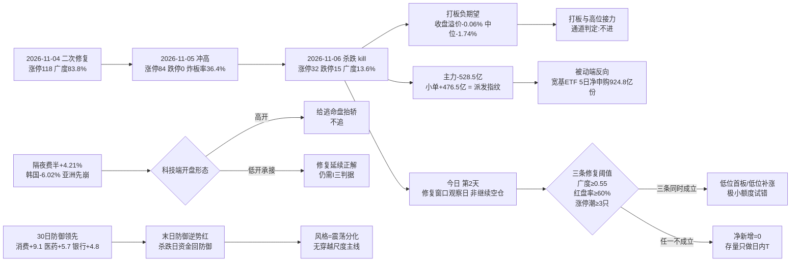

# 2026-11-09 · **风格研判**

> **数据源新鲜度**: partial（主源 tushare 全量 ok，外盘与跨资产缺一线）
> **降级状态**: false —— 群聊 0 条已由公众号 40 篇承接，A 股主源无一缺失
> **置信度**: 0.525（0.70 × 0.75 × 1.00）

## 一句话结论

**震荡分化型 + 情绪浓度 38.7（恐惧档）+ 无主线（代理口径 0 条），仓位上限 35%**。今日是**第 2 天（连跌 1 天 · `single_down`）＝单日杀跌的次日、修复窗口观察日**，不是继续空仓的起点：T-1 涨停 32 / 跌停 15 / 广度 13.6% / 中位 −1.85%，三条修复阈值（溢价 >+1%、涨家占比 ≥60%、涨停 ≥60）**一条都没到**，所以今天只做**观察 + 极小额度低位试错**，高位接力与打板一律**不进**。

---

## 一、情绪周期位置：第 2 天（单日杀跌次日 · 修复窗口观察日）

先回答「第几天」，再谈风格——阶段标签本身不驱动决策，**第几天 + 对应打法**才能。

| 项 | 读数 | 含义 |
|---|---|---|
| `cycle_position.cycle_day` | **2**（as of 2026-11-06 收盘） | 今日＝杀跌序列第 2 天 |
| `consecutive_down_days` | **1** | 只有 2026-11-06 一个杀跌日（`kill=true`），前一日 2026-11-05 是 84 家涨停 / 0 跌停的冲高日 |
| `tier` | `single_down` | 单日杀跌 → 多为情绪释放，次日方向不明 |
| `emotion_cycle.phase` | `high_chop`（高位震荡 · confidence 0.65） | 炸板率 30.43% ≥ 25% 且溢价 −0.50% 未达 +3% → 打板层面已钝化 |
| **今日定位** | **第 2 天 ＝ 修复窗口观察日** | 与 `main_down` 的读法相反：**这里不是「继续空仓」，而是「等承接」** |

**第 2 天的打法（四条，逐条可执行）**：

1. **开盘方向不明，先看承接、不做预测**：09:25 竞价若昨日 84 家涨停股（收盘口径溢价 −0.06%、红盘率 35.7%）**继续负溢价**，说明释放未完成，全天净新增维持 0，只留存量 T。
2. **盘初若继续杀跌，等尾盘试错，不追日内首波反弹**：单日杀跌次日的首波反弹多为回抽，尾盘承接才是真信号（92 科比「第二天持续杀跌 → 尾盘找买点，第三天必有修复」）。
3. **修复三条阈值成立才给净新增**：开盘广度 ≥0.55、昨日涨停红盘率 ≥60%、板块级涨停潮 ≥3 只 — **三条同时成立**才放额度，缺一条即维持观察。
4. **只做低位、不接高位**：高位老龙在 `high_chop` 段接力是负期望（T-1 打板收盘溢价 −0.06%、中位 −1.74%），今日只允许低位首板 / 低位补涨类型的极小试错。

**必须写清的口径保留**：`cycle_position.samples` 里两条历史实例（2026-10-27、2026-10-30）都是**连跌 2 天**后的修复，而今天只连跌 1 天 —— **样本不同口径，不能直接当概率用**。它们的价值只有一个：说明「连跌后 1–2 日内出现过广度 >0.74 的修复」，不构成今日必然修复的证据。

| 交易日 | 涨停 | 跌停 | 炸板率 | 广度 | 中位 | 定性 |
|---|---:|---:|---:|---:|---:|---|
| 2026-11-02 | 125 | 8 | 18.30% | 84.0% | +2.02% | 修复首日 |
| 2026-11-03 | 48 | 17 | 41.46% | 37.9% | −0.65% | 回吐 |
| 2026-11-04 | 118 | 9 | 21.85% | 83.8% | +1.88% | 二次修复确认 |
| 2026-11-05 | 84 | **0** | 36.36% | 87.4% | +2.02% | 冲高（涨停缩量、炸板率抬升） |
| 2026-11-06 | **32** | **15** | 30.43% | **13.6%** | −1.85% | **杀跌（kill）** |
| 2026-11-09 | ？ | ？ | ？ | ？ | ？ | **第 2 天 · 修复窗口观察** |

---

## 二、详细分析

### 2.1 结构读数：涨停腰斩、跌停翻倍、成交额缩两成

2026-11-06 全市场涨停 **32** 家（前日 84，**腰斩**）、跌停 **15** 家（前日 0）、炸板 **14** 家，炸板率 **30.43%**；涨 **716** / 跌 **4431** / 平 **71**，广度仅 **13.6%**，中位 **−1.85%**，成交额 **16576 亿（−21.73%）**。

连板天梯：**1 板 21 家 / 2 板 4 家 / 3 板 3 家 / 4 板 2 家 / 5 板 2 家**，最高 **5 板**、**0 层空缺**，首板占比 **65.6%**。

- 高度没有塌：5 板 2 家、4 板 2 家，梯子是**连续的**，说明高位还有活口 —— 这是「震荡分化」而不是「崩溃退潮」的关键结构差异。
- 但**接力层极薄**：2 板只有 4 家、3 板 3 家，中间层几乎空掉，任何一次反包都缺接力盘支撑。
- 首封时间累计：09:30 前 12.5%、10:00 前 53.1%、11:30 前 81.3% —— **早盘集中封板、午后几乎无新增**，是承接力不足的标准形态。

指数：上证 **−1.10%** / 深成 **−2.57%** / 创业板 **−3.96%** / 科创50 **−2.60%** / 沪深300 **−1.44%** / 中证500 **−2.13%** / 北证50 **−2.37%**。权重与小票同跌、成长端跌幅最大。

**崩溃三判据核验（三项须同时成立）**：炸板率 >50% → **否（30.43%）**；跌停 ≥30 家或涨家占比 <25% → 涨家占比 13.9% 成立、但跌停仅 15 家；指数 ≤−1% → 成立。**三项未同时成立 → 不判崩溃退潮型**，这是今天仍给 35% 而非 10% 的结构依据。

### 2.2 溢价拆解：涨停股次日是**负期望**

T-1 的 84 家涨停股在 2026-11-06 的表现：

| 口径 | 均值 | 中位 | 含义 |
|---|---:|---:|---|
| 开盘溢价 | −0.37% | −1.19% | 集合竞价直接给负 |
| 收盘溢价 | **−0.06%** | **−1.74%** | 全天只剩均值接近 0，中位深负 → 少数强势掩盖多数亏损 |
| 红盘率 | **35.71%** | — | 只有三分之一红盘 |
| 再涨停 | **11 只 / 84** | — | 13.1% 的接力成功率 |

**均值 −0.06% 而 中位 −1.74% 的裂口**说明分布是右偏的：少数票（11 只再涨停）拉高了均值，**大多数追板者是亏的**。这就是今天把「打板/接力」整条通道判为**不进**的量化理由 —— 不是情绪差，是**数学期望为负**。

### 2.3 30 日 6 簇：不是一个 beta，是三条腿

窗口 **2026-09-18 → 2026-11-06**（30 个收益日，42 个样本 = 22 风格板块 + 20 ETF），1−Pearson 距离 + Ward linkage，k=6：

| 簇 | n | 30日 | 5日 | 末日 | 回撤 | 簇内相关 | 与宽基相关 | 构成 |
|---|---:|---:|---:|---:|---:|---:|---:|---|
| C5 | 3 | **+65.91%** | +13.72% | +1.05% | −9.2% | 0.313 | −0.061 | 极端接力策略指数（打二板以上 +44.5% / 非ST三板以上 +144.1%）+ 消费 ETF +9.1% |
| C6 | 3 | **+11.62%** | −0.32% | +0.07% | −8.4% | 0.265 | −0.123 | 非ST二板策略 +37.1% + 银行 ETF +4.8% + 煤炭 ETF −7.1% |
| C2 | 5 | −0.46% | +2.88% | −0.96% | −11.0% | 0.755 | 0.614 | 百日新高 −10.8%、高贝塔 +2.8%、昨日打板 +3.7%、昨日打首板 +5.7%、房地产 −3.6% |
| C3 | 8 | −5.32% | +5.76% | −1.65% | −13.1% | 0.712 | 0.774 | 行业龙头 −2.0%、沪深300 −9.0%、上证50 −1.9%、医药 +5.7%、恒生科技 −5.9%、光伏 −5.7%、新能源 −8.6%、有色 −15.2% |
| C4 | 3 | −10.50% | +1.42% | −1.77% | −20.8% | 0.405 | 0.485 | 创历史新高 −13.1%、昨日资金前十 −15.3%、证券 ETF −3.1% |
| C1 | **20** | **−21.29%** | +2.95% | **−3.17%** | −27.9% | **0.859** | **0.916** | 热股 −27.4%、近端次新 −14.4%、百元股 −28.0%、成交前十 −40.6%、沪深股通前十 −21%~−36%、科创50 −21.8%、通信 −41.0%、芯片 −21.8%~−25.3%、半导体 −22.6%、军工 −10.6%、中证500/1000 −13.6% |

42 个样本 30 日中位 **−10.67%**、正收益 **9/42（21.4%）**；**但 5 日中位转正 +4.11%**；末日（11-06）**3 涨 / 39 跌**、中位 **−2.23%**。

**这组数字的读法**：

- **C1 是一个 20 样本、簇内相关 0.859、与宽基相关 0.916 的高 beta 巨簇**（成长 + 高弹性 + 成交额/资金榜单类风格板块全在里面），30 日 −21.29% —— **它不是「一个风格」，是「同一批筹码的重仓方向」**。谁在这批里换赛道，等于没换。
- **C5 / C6 是策略指数腿**，30 日 +12%~+66%：极端接力策略（三板以上 +144%、打二板以上 +44.5%）在此窗口内是**唯一持续赚钱的通道**，但这批指数的高收益来自少数极端票，末日 C5 里三板以上指数单日 **−7.00%**（回撤打满），说明**该通道已到兑现端**，不是接力端。
- **C3 是「防御 + 龙头」腿**：簇内相关 0.712、与宽基 0.774，30 日 −5.32% —— 医药 +5.7%、上证50 −1.9%、行业龙头 −2.0% 撑住均值，光伏/新能源/有色拖累。
- **防御三件套（消费 +9.09% / 医药 +5.65% / 银行 +4.78%）全部落在 C5/C6/C3 的**正**收益侧**，且末日逆势翻红（消费 +0.14%、银行 +0.69%）—— **杀跌日资金回头买防御**，这是今天最硬的一条结构证据。

### 2.4 30 日 vs 5 日方向背离：这是「震荡分化」的来源

| 维度 | 强的一端 | 读数 | 解释 |
|---|---|---|---|
| **30 日（2026-09-18 → 11-06）** | 防御 / 策略 | 消费 +9.1%、医药 +5.7%、银行 +4.8%；极端接力 +44% ~ +144% | 两个月里资金在**避险 + 极端博弈**两端 |
| **5 日（10-30 → 11-06）** | 超跌成长 | 光伏 +11.8%、新能源 +9.8%、恒生科技 +9.0%、科创50 +8.0%、半导体 +7.6% | 一周里资金在**超跌反弹端** |
| **末日（11-06）** | 防御 | 消费 +0.14%、银行 +0.69% 逆势红；C1 高 beta −3.17% | 杀跌当日**切回防御** |

三个时间尺度指向三个不同方向 —— 这正是「震荡分化型」的定义：**没有一条能穿越尺度的主线**。任何把 5 日反弹当「风格切换完成」的读法，都会被 30 日中位 −10.67% 和末日 −3.17% 的高 beta 簇证伪。

### 2.5 外盘：费半 +4.21% 与韩国 −6.02% 同一天，别只读一半

| 资产 | 2026-11-06 | 5 日 | 20 日 | 读法 |
|---|---:|---:|---:|---|
| 纳指 | **+1.09%** | −3.37% | **−10.18%** | 3 日累计 **−3.11%**：反弹只收回前一日跌幅约三分之一 |
| 标普500 | +0.31% | −2.68% | −5.56% | 弱反弹 |
| 道指 | −0.46% | — | — | 分化 |
| 费城半导体 | **+4.21%** | — | — | 半导体单端反抽最猛 |
| 恒生指数 | −1.27% | +5.10% | +2.93% | 亚太里唯一 20 日为正 |
| 韩国综合 | **−6.02%** | **−11.71%** | **−23.64%** | 亚洲科技代理崩了 |
| 日经225 | — | −11.17% | −17.99% | 同步弱 |

个股（2026-11-06）：AMD **+11.04%**、台积电 **+6.33%**、美光 **+5.12%**、英伟达 **+2.78%**、博通 +0.74%。

**关键时序**：韩国 11-06 的 −6.02% 发生在**美股 11-06 反弹之前**（亚洲收盘在先），所以「亚洲崩 → 美股反抽」是同一轮跌深反弹的先后脚，**不是两件事**。对今日的意义只有一句：**高开是给隔夜逃命盘抬轿，不追；低开承接才是修复的正解**。

### 2.6 资金：主力 −528.5 亿、小单 +476.5 亿 —— 散户接机构

| 口径（2026-11-06，东财 DC，与 R7 同源） | 数值 | 读法 |
|---|---:|---|
| 主力净额 | **−528.5 亿**（净流入率 −3.19%） | 11-04 +507.6 / 11-05 +90.2 两日回补，一日吐回 |
| 超大单 | **−233.4 亿** | 机构端在减 |
| 大单 | **−295.1 亿** | 游资/中户在减 |
| 中单 | +38.6 亿 | 中性 |
| 小单 | **+476.5 亿** | **散户在接** |
| 主力 5 日累计 | −385.3 亿 | 5 日净流出 |
| 两融余额（2026-11-05，T+1） | 22785 亿 · 5 日 **−782 亿（−3.32%）** | 杠杆在退 |

**结构读法**：主力单边卖、小单单边买 —— 这是**派发**的指纹，不是洗盘。派发与洗盘的差别在次日：派发日之后**小单继续买而价格继续跌**，洗盘日之后主力回来。所以今日第一条观察量不是指数，而是**小单是否还在接、主力是否回流**。

同时 R7 记录的被动端是反向的：300ETF 5 日净申购 **320.6 亿**（份额 +20.0%）、500ETF +199.3 亿（+43.7%）、科创50ETF +234.1 亿（+19.6%）、创业板ETF +182.8 亿（+19.4%）。**被动资金在抄底宽基，主动资金在撤** —— 两条腿相反，这也是「震荡」而非「单边」的资金证据。

### 2.7 风格归因：五分法代价表

| 风格 | 代价 | 判据落点 |
|---|---:|---|
| **震荡分化型** | **0.4843** ✅ | 涨停 32 ∈ [20,40]（0）、涨家占比 13.9%、最高 5 板无龙头梯队、炸板率 30.43% |
| 崩溃退潮型 | 0.8914 | 炸板率 30.43% 距 50% 差 20 个点、跌停 15 家距 30 差 15 家 |
| 连板情绪型 | 1.0482 | 涨停 32 < 50（+0.9）、炸板率 30.43% > 20%（+0.14）、高度 5 < 6 |
| 主线扩散型 | 1.6025 | 涨停 32 ∈ [30,50]、但主线簇 up_nums ≥20 为 **0 条** |
| 防御观望型 | 2.9740 | 涨停 32 ≥ 20、指数跌幅远超「缩量走平」 |

**取「震荡分化型」，不取「崩溃退潮型」的理由必须写死**：崩溃型要求炸板率 >50% **且**（跌停 ≥30 或涨家 <25%）**且** 指数 ≤−1%，今日只满足第三项。把今天写成崩溃退潮型，等于告诉 D1「全天禁手」，而实际结构是**高度未塌（5 板 2 家）+ 防御端逆势红** —— 方向会错。

**与情绪周期的联动**：`emotion_cycle=high_chop` 与「震荡分化型」**一致**，无需阶段覆盖；但按「阶段优先」原则，仓位在风格基准 0.55 之上**再压**，见第五节。

### 2.8 推理深度三问（top 对象：今日的「修复窗口」结构）

- **大资金意图**: 主动端在**减仓兑现**（主力 −528.5 亿、超大单 −233.4 亿、5 日 −385.3 亿），被动端在**抄底宽基**（300/500/科创50/创业板 ETF 5 日合计净申购 924.8 亿份量级）。对手盘是**接盘的散户型小单**（+476.5 亿）与两融退潮的杠杆盘（5 日 −3.32%）。所以主力现在的意图**不是「做多某个方向」，而是「把 11-04/11-05 两天回补的仓位在反抽里交出去」** —— 这也解释了为什么 11-06 跌幅集中在高 beta 端而不是权重端。
- **为什么走强**（本日为反面：为什么弱）: 位置（C1 高 beta 簇 30 日 −21.3%、通信 −41%，仍距 30 日高点 −24% ~ −43%，属**深坑但未止跌**）+ 催化（周末政策暖意是**预期级**，不是硬政策落地；外盘费半 +4.21% 是反抽非趋势）+ 筹码（首板占 65.6%、2 板仅 4 家，接力层空，筹码**当日新进、无沉淀**）。三维交叉结论：**位置给弹性、催化和筹码都不给持续性**。
- **逻辑够不够硬**: **不够硬，只够观察 1–2 天**。独立源只有「政策暖意 + 被动资金抄底」两条，第三条硬锚（主力回流 / 溢价转正 / 广度回升）**全部缺失且当前为负**。证伪路径很明确：**今日 10:00 前若广度 <0.55 且昨日涨停红盘率 <60%，则「第 2 天修复」被证伪，全天净新增归零、只留存量 T**；反之若三条同时成立，才在低位端给极小试错额度。

---

## 三、结构传导图

---

## 四、今日执行框架（思维链四段）

R1 不出个股与买卖点，此处的「对象」是**今日唯一可执行的观察位**：低位端极小试错（若三条阈值成立）。

- **买入理由**：① 位置锚 —— C1 高 beta 簇 30 日 −21.3%、末日再 −3.17%，深度回撤后第 2 天出现承接的概率结构上高于第 5 天；② 周期锚 —— `cycle_day=2` 的语义是「等承接」而非「清仓」，尾盘承接点是本轮打法里唯一被规则允许的入场时点。
- **风险点**：① 短期 —— 主力 5 日 −385.3 亿、两融 5 日 −3.32%，派发若继续，任何低位承接都是接刀；② 中期 —— 30 日样本中位 −10.67%、正收益仅 9/42，「修复」在过去一个月里只有 21.4% 的样本成立。
- **止损条件**：以 **当日开盘广度** 为条件式止损 —— 若 10:00 前广度 <0.55，则**当日不做任何净新增**（等于区间止损）；已成交的试错位，破当日分时均价且 15 分钟内不收复即出，**不留过夜幻想**。
- **可验证假设**（24–72h 内可证真/证伪）：**H1** 今日收盘涨停 ≥60 家 且 广度 ≥0.55 → 「第 2 天修复」成立；**H2** 昨日 84 家涨停股今日红盘率 ≥60% → 接力层恢复；**H3** 主力净额转正（≥+100 亿）→ 派发结束。三条中 **≥2 条成立**才把明日的额度从「极小」升到「常规」。

---

## 五、仓位上限推导：35%

| 步骤 | 调整 | 数值 | 依据 |
|---|---|---:|---|
| 风格基准 | — | 0.55 | 震荡分化型 |
| 情绪档 | **−0.05** | 0.50 | 情绪 38.7 落**恐惧**档（0–40） |
| 周期阶段 | **−0.05** | 0.45 | `high_chop` 高位分歧，净新增预算收紧 |
| 30 日宽度 | **−0.05** | 0.40 | 中位 −10.67%、正收益仅 9/42 |
| 隔夜外盘 | **−0.05** | **0.35** | 纳指 3 日累计 −3.11%（≤−3%）触发周期折扣 |
| **合计** | | **0.35** | 未触发主跌/退潮下限（0.10），故无需下限托底 |

**35% 不是「可以买三成半」**，而是**净新增风险预算的上限**：其中实际可用额度还需过「三条修复阈值」，未成立时**净新增 = 0**，35% 只覆盖存量调仓与日内 T。

---

## 六、关键证据

- 🟢 涨停 **32** / 跌停 **15** / 炸板 **14** → 炸板率 **30.43%**（`tushare.limit_list_d` 2026-11-06）
- 🟢 天梯 1板21 / 2板4 / 3板3 / 4板2 / 5板2，最高 **5 板**、0 层空缺、首板占 **65.6%**
- 🟢 昨日 84 家涨停股：开盘溢价均值 −0.37%（中位 −1.19%）、收盘均值 **−0.06%**（中位 **−1.74%**）、红盘率 **35.71%**、再涨停 **11** 只
- 🟢 广度 涨 **716** / 跌 **4431** / 平 71，中位 **−1.85%**，成交额 **16576 亿（−21.73%）**
- 🟢 指数 上证 −1.10% / 创业板 −3.96% / 科创50 −2.60% / 沪深300 −1.44% / 中证500 −2.13%
- 🟢 主力净额 **−528.5 亿**（净流入率 −3.19%）、超大单 −233.4 亿、小单 **+476.5 亿**、5 日 −385.3 亿
- 🟡 两融 22785 亿（2026-11-05，T+1）、5 日 **−782 亿（−3.32%）**
- 🟢 30 日窗（09-18 → 11-06）：42 样本中位 **−10.67%**、正收益 **9/42**、末日 **3 涨 / 39 跌**
- 🟢 6 簇：C1（n=20）30 日 −21.29%、簇内相关 0.859；C5/C6 策略腿 +65.91% / +11.62%；C3 防御+龙头 −5.32%
- 🟢 隔夜美股（2026-11-06）：纳指 +1.09% / 费半 +4.21% / 道指 −0.46%，纳指 3 日 **−3.11%**；韩国 **−6.02%**、20 日 −23.64%
- 🟢 情绪周期：`cycle_day=2`、连跌 1 天、`single_down`、阶段 `high_chop`（0.65）
- 🟢 概念代理（非 R2 判定）：行业 ≥8 家涨停 **0 条**；概念 ≥8 家 **3 个**（10 / 9 / 9 家）、≥20 家 **0 个**；第一概念 10 家、4 日龄、当日 −1.79%
- 🟡 文本侧：公众号 40 篇中 **4 篇**有方向性判断，一致落在「反弹后半程、高位缩圈抱团、中位最难」，与量化**部分同向**

---

## 七、数据源审计

| 源 | 日期 | 状态 | 备注 |
|---|---|:--:|---|
| tushare/ths_daily + ths_member | 2026-11-06 | 🟢 | 22 条风格板块 · 50 个交易日 K 线 |
| tushare/fund_daily | 2026-11-06 | 🟢 | 20 条 ETF · 50 个交易日 K 线 |
| r1_style_cluster.py | 2026-11-09 | 🟢 | 42 样本 · 30 日窗 · 6 簇 · 缺失样本 0 |
| tushare/limit_list_d + limit_step | 2026-11-06 | 🟢 | 涨停 32 / 跌停 15 / 炸板 14 逐票 |
| tushare/index_daily | 2026-11-06 | 🟢 | 7 个指数 |
| tushare/limit_cpt_list | 2026-11-06 | 🟢 | 概念代理 21 条 |
| tushare/daily（全市场广度） | 2026-11-06 | 🟢 | 5218 只 |
| R7_capital_flow（东财 DC 主力/两融） | 2026-11-06 | 🟢 | 主力净额 −528.5 亿 · 两融 22785 亿 · 20 日序列 |
| sina gb_ + eastmoney push2his（外盘补齐） | 2026-11-06 | 🟢 | 5 个指数 + 15 只半导体股 |
| tushare/index_global + us_daily | 2026-11-06 | 🟡 | SOX / 恒生科技空返回，已由 sina 补齐 |
| tushare/fx_daily | 2026-11-05 | 🔴 | USDCNH / DXY 空返回，仅保留单点 USDCNH 6.6643 |
| 商品（原油/铜/金） | — | 🔴 | `commodities=skipped`，跨资产三档坐标无法建立 |
| wechat_official_rss（17 源） | 2026-11-09 | 🟢 | 40 篇 · 4 篇有方向性判断 |
| wechat_cli_groups（7 焦点群，匿名） | 2026-11-09 | 🔴 | 0 字节 · 抓取窗口内无消息 |
| cycle_position.py / emotion_cycle.py | 2026-11-06 | 🟢 | 12 个交易日序列 · 同口径样本 2 条 |

---

## 八、不确定性 / 反证

1. **样本口径不严**：`cycle_position.samples` 两条历史都是「连跌 2 天 → 修复」，今日只连跌 1 天。**不能把它当概率表**，我把它们仅用于说明「连跌后 1–2 天出现过广度 >0.74 的修复」，未据此上调仓位。
2. **情绪分「恐惧档」与「无主线」存在张力**：情绪 38.7 属于「恐惧」（历史区间对应 0.55–0.65 仓位），但结构上无主线、打板负期望 —— 所以最终 cap 在 35%，低于恐惧档区间下限，这是**主动往下压**，不是算错。
3. **我可能高估了防御端**：消费 +9.09% / 银行 +4.78% 的领先是**30 日累计**，5 日维度消费只 +4.73%、银行 −1.79%（已转弱）。若今日防御端也补跌，则「震荡」框架失效，应直接按退潮处理（炸板率再上 45% 即触发）。
4. **外盘被我压低处理，可能过度悲观**：费半 +4.21%、AMD +11.04% 是当日强反抽，若今日科技端低开高走且广度 >0.55，则「跌深反抽」的判断要改写成「趋势修复起点」—— 我在执行框架里已经把这条写成 H1/H3 可验证假设，而不是排除它。
5. **群聊源空缺**：7 个焦点群 0 条消息，文本侧只有公众号 4 篇的方向性判断，**游资情绪的真实温度这一维是缺的**，因此 agreement factor 只取 1.00（未加分），confidence 也未上调。

---

## 九、与其他 R/D/E 的关系

- **依赖**：`data/raw/20261109/style_snapshot.json`（22 板块 + 20 ETF）、`data/research/20261109/_r1_cluster.json`、`_r1_market.json`、`cycle_position.json`、`emotion_cycle.json`、`R7_capital_flow_20261109.json`、`_r1_overseas_fill.json`、`_r1_kol.json`
- **被消费**：
  - **R2 主线**：`style=震荡分化型`、`main_lines_count=0`（无主线代理）→ R2 不得在无主线前提下授予开仓资格
  - **R3 情绪**：`sentiment_score=38.7` 作基准（可自算覆核）
  - **R6 反证**：对 R2 主线数量与 R1「无主线」的一致性做反证；R1 的 38.7 分与 R3 若差 >15 分需在 R3 侧说明
  - **D1 预案**：`position_cap_suggestion=0.35` → exec_pool 总仓上限；`emotion_cycle_action` 提供「第 2 天 + 打法」唯一入口
- **边界**：R1 不推板块、不推个股、不给买卖点；本文出现的簇构成仅为**统计口径描述**，不构成任何板块或 ETF 的交易建议。

---

## Sub-Agent 元数据

- skill: `analyze_style_v1@1.0`
- artifact: `data/research/20261109/R1_style.json`
- 生成耗时: 管线产物 06:41–06:47 完成；本次会话复用已落盘结果做契约校验与人读交付
- model: deepseek-v4-flash
- 校验: pydantic `research_unit_v1` 通过；`style` 落 5 枚举之一；`sentiment_score` 5 维加权（capital 维已补齐，权重归一 1.00）