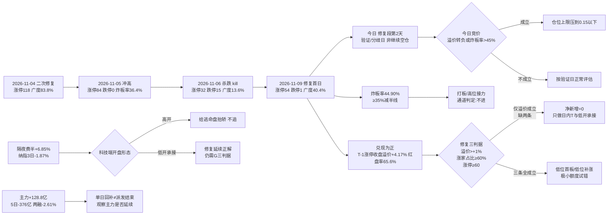

# 2026-11-10 · **风格研判**

> **数据源新鲜度**: partial（主源 tushare 全量 ok，外盘与跨资产缺一线）
> **降级状态**: false —— 群聊 0 条已由公众号 83 篇承接，A 股主源无一缺失
> **置信度**: 0.525（0.70 × 0.75 × 1.00）

## 一句话结论

**震荡分化型 + 情绪浓度 55.1（中性档）+ 无主线（代理口径 0 条），仓位上限 40%**。今日是**修复段第 2 个交易日（修复首日 2026-11-09）＝验证/分歧日**，不是继续空仓的起点：修复首日涨停 54 / 跌停 1 / 广度 40.4% / 炸板率 44.90%，三条修复阈值（昨日涨停溢价 >+1%、涨家占比 ≥60%、涨停 ≥60）**只达成一条（溢价 +4.17%）**，所以今日按**修复未确认的二次验证日**处理——三判据全部成立才做低位首板/主线核心低开承接，否则只做日内 T，**不追开盘价、不接高位老龙、不接 6 板独苗**。

---

## 一、情绪周期位置：修复段第 2 个交易日（验证/分歧日）

先回答「第几天」，再谈风格——阶段标签本身不驱动决策，**第几天 + 对应打法**才能。

| 项 | 读数 | 含义 |
|---|---|---|
| `cycle_position.cycle_day` | **0**（as of 2026-11-09 收盘） | 已**不在杀跌序列内**（连跌 0 天 / `neutral`） |
| `consecutive_down_days` | **0** | 上一杀跌段 2026-11-06（连跌 1 天：跌停 15、广度 0.136）已于 2026-11-09 修复 |
| `recent_run` | 杀跌段 11-06 → 修复日 **11-09**（涨停 54、广度 0.4023、中位 −0.31%） | 今日 = `repair_session_no_today = 2`，**修复段第 2 个交易日** |
| `emotion_cycle.phase` | `high_chop`（高位震荡 · confidence 0.75） | 炸板率 44.90% ≥ 25% → 涨停多但分歧大（高位钝化） |
| `main_down` 的读法 | **修复窗口，不是继续空仓** | 上一轮（11-09）`main_down` 语义 = 等承接；本轮已进入修复段，`cycle_day=0` 表示不在杀跌序列，**阶段只定温度，不预设固定打法** |

**修复段第 2 天的打法（四条，逐条可执行）**：

1. **验证/分歧日：不追开盘价，只做低开承接与分歧转强**。修复首日（11-09）T-1 的 32 家涨停股收盘溢价 +4.17%、红盘率 65.6%，若今日竞价溢价转负或盘初炸板率再上 45%，当日仓位上限直接压到 0.15 以下。
2. **延续的前提是「不再走弱」**：昨日涨停红盘率 65.6% 与广度 40.4% 两条基线，**任一转弱即按一日反抽处理，当日只做日内 T**。
3. **修复三判据全部成立才放净新增**：今日收盘口径昨日涨停溢价 >+1%（T-1 已 +4.17% ✓）、涨家占比 ≥60%（11-09 仅 40.4% ✗）、涨停 ≥60 家（11-09 仅 54 ✗）——**缺两条，今天不给常规额度**。
4. **高位只留观察不给新仓**：6 板独苗下方 3/4/5 板三层空缺，高度无法自然递推，**反包只按一次性脉冲处理、不做第二波假设**；新仓只对低位首板 / 低位补涨类型。

**口径保留**：`cycle_position.samples` 两条历史实例（2026-10-27、2026-10-30）都是**连跌 2 天**后的修复，而本轮只连跌 1 天——**样本不同口径，不能直接当概率用**。它们的价值只有一个：说明「连跌后 1–2 日内出现过广度 >0.74 的修复」，不构成今日必然延续的证据。

| 交易日 | 涨停 | 跌停 | 炸板率 | 广度 | 中位 | 定性 |
|---|---:|---:|---:|---:|---:|---|
| 2026-11-02 | 125 | 8 | 18.30% | 84.0% | +2.02% | 修复首日 |
| 2026-11-03 | 48 | 17 | 41.46% | 37.9% | −0.65% | 回吐 |
| 2026-11-04 | 118 | 9 | 21.85% | 83.8% | +1.88% | 二次修复确认 |
| 2026-11-05 | 84 | **0** | 36.36% | 87.4% | +2.02% | 冲高（涨停缩量、炸板率抬升） |
| 2026-11-06 | **32** | **15** | 30.43% | **13.6%** | −1.85% | **杀跌（kill）** |
| 2026-11-09 | 54 | 1 | **44.90%** | 40.4% | −0.35% | **修复首日（未完全确认）** |
| 2026-11-10 | ？ | ？ | ？ | ？ | ？ | **修复段第 2 天 · 验证/分歧** |

---

## 二、详细分析

### 2.1 结构读数：涨停回升但炸板率顶到 44.9%，承接断层

2026-11-09 全市场涨停 **54** 家（前日 32，**+69%**）、跌停 **1** 家、炸板 **44** 家，炸板率 **44.90%**；涨 **2043** / 跌 **3009** / 平 166，广度 **40.4%**，中位 **−0.35%**，成交额 **14824 亿（−10.57%）**。

连板天梯：**1 板 45 家 / 2 板 8 家 / 6 板 1 家**，最高 **6 板**、**3/4/5 板三层空缺**，首板占比 **83.3%**。

- **高度上去了但梯子断了**：6 板独苗是「跳级」上来的，3 板 0 家、4 板 0 家、5 板 0 家——**中间层完全空心**，任何高度股的反包都缺接力盘支撑，所以反包只按一次性脉冲处理。
- **炸板率 44.90% 是最大风险项**：超过 35% 的减半线 10 个点，当日打板者过半被炸。首封时间累计 09:30 前仅 7.4%、10:00 前 66.7%、14:00 前 98.1%——**午后还在不断新增炸板**，是分歧日标准形态。

指数：上证 **+0.32%** / 深成 **−0.27%** / 创业板 **−0.27%** / 科创50 **+0.30%** / 沪深300 **+0.05%** / 中证500 **−0.17%** / 北证50 **+0.82%**。权重微红、成长微绿，**指数层面没有方向**。

**崩溃三判据核验（三项须同时成立）**：炸板率 >50% → **否（44.90%）**；跌停 ≥30 家或涨家占比 <25% → 跌停 1 家、涨家占比 40.4%，**否**；指数 ≤−1% → **否**。**三项全部不成立 → 不判崩溃退潮型**，这是今天仍给 40% 而非更低的结构依据。

### 2.2 溢价拆解：修复首日涨停股兑现为正，但只到一半

T-1（2026-11-06）的 32 家涨停股在 2026-11-09 的表现：

| 口径 | 均值 | 中位 | 含义 |
|---|---:|---:|---|
| 开盘溢价 | +4.06% | +4.78% | 竞价直接给正溢价 |
| 收盘溢价 | **+4.17%** | **+5.17%** | 全天维持正兑现 |
| 红盘率 | **65.62%** | — | 近三分之二红盘 |
| 再涨停 | **9 只 / 32** | — | 28.1% 的接力成功率 |

**均值与中位同步为正**（+4.17% / +5.17%），与 11-06 的「均值 −0.06%、中位 −1.74% 右偏裂口」完全相反——说明 11-09 的兑现是**普遍性的、不是少数票拉的**。这是修复首日最硬的一条证据。

**但只到一半**：修复三判据里，涨停家数 54 < 60、涨家占比 40.4% < 60%，**只达成溢价一条**。所以今日定性是「修复未确认的二次验证日」，不是「修复完成日」。

### 2.3 30 日 6 簇：策略腿仍在，高 beta 巨簇继续流血

窗口 **2026-09-18 → 2026-11-09**（30 个收益日，42 个样本 = 22 风格板块 + 20 ETF），1−Pearson 距离 + Ward linkage，k=6：

| 簇 | n | 30日 | 5日 | 末日 | 回撤 | 簇内相关 | 与宽基相关 | 构成 |
|---|---:|---:|---:|---:|---:|---:|---:|---|
| C5 | 3 | **+66.95%** | +9.82% | −1.85% | −9.2% | 0.329 | −0.054 | 极端接力策略指数（打二板以上 / 非ST三板以上）+ 消费 ETF |
| C6 | 3 | **+11.31%** | +0.03% | +1.08% | −8.4% | 0.251 | −0.117 | 非ST二板策略 + 银行 ETF + 煤炭 ETF |
| C3 | 5 | −1.08% | +3.03% | +1.38% | −11.0% | 0.728 | 0.589 | 百日新高、高贝塔值、昨日打板、昨日打首板、房地产 |
| C2 | 7 | −8.74% | +3.99% | −0.48% | −14.2% | 0.760 | 0.801 | 行业龙头、沪深300、上证50、恒生科技、光伏ETF、新能源、有色ETF |
| C4 | 4 | −11.36% | +0.03% | −0.83% | −17.2% | 0.433 | 0.502 | 创历史新高、昨日资金前十、证券ETF、医药ETF |
| C1 | **20** | **−22.99%** | +1.43% | **+0.45%** | **−27.9%** | **0.857** | **0.913** | 热股、近端次新、百元股、成交前十、高振幅、沪深股通前十、增发/增持/减持/回购/扭亏、中证500/1000、科创50、通信/芯片/半导体/军工 ETF |

42 个样本 30 日中位 **−11.88%**、正收益 **9/42（21.4%）**；**5 日中位转正 +2.10%**；末日（11-09）**23 涨 / 18 跌**、中位 **+0.10%**（全样本口径首次转正）。

**这组数字的读法**：

- **C1 仍是 20 样本、簇内相关 0.857、与宽基相关 0.913 的高 beta 巨簇**，30 日 **−22.99%**——它不是「一个风格」，是「同一批筹码的重仓方向」。但注意**末日 +0.45% 首次微红**，C1 内部 5 日 +1.43% 也转正：这是修复的微观信号，尚未到趋势反转的置信度。
- **C5 / C6 策略腿仍在正收益端**（30 日 +66.95% / +11.31%）：极端接力策略（打二板以上、非ST三板以上）在 30 日窗内依然是最赚钱通道。**但 C5 末日 −1.85%**（策略指数单日回撤），且炸板率 44.90% 意味着「打板 → 次日溢价」的通道正在变挤——**该通道已到兑现端，不是接力端**。
- **C3 是「打板行为 + 高弹性」腿**：百日新高、高贝塔值、昨日打板/打首板指数聚在一簇，末日 +1.38% 领涨——修复日资金回补弹性端，但簇内相关 0.728 说明这是**同一类行为资金**，不是分散验证。
- **防御三件套（消费/银行/煤炭 ETF）落在 C5/C6 正收益侧**，与高 beta 巨簇的负收益对照——资金在 30 日尺度上仍是**避险 + 极端博弈**两端，修复日并未改变这个格局。

### 2.4 30 日 vs 5 日 vs 末日：三个尺度第一次同向（修复未确认）

| 维度 | 强的一端 | 读数 | 解释 |
|---|---|---|---|
| **30 日（09-18 → 11-09）** | 防御 / 策略 | 消费、银行、煤炭 + 极端接力指数；42 样本中位 −11.88% | 两个月里资金在**避险 + 极端博弈**两端 |
| **5 日（11-02 → 11-09）** | 高 beta 回补 | C1 内部 5 日 +1.43%、C2 +3.99%、全样本中位 **+2.10%** | 一周里资金在**超跌回补端** |
| **末日（11-09）** | 打板行为端 | C3（打板/高弹性）末日 +1.38%；全样本末日中位 +0.10% 首次转正 | 修复日**资金回补弹性与打板端** |

与 11-06 的「三个尺度指向三个方向」不同，今天**5 日与末日已同向**（都是回补），但 30 日中位仍是 −11.88%、正收益仅 9/42——**结构性下跌未结束，任何「修复」只按日内反弹对待**，直到正收益样本数回升到 1/3 以上。

### 2.5 外盘：隔夜费半 +6.85% 强反抽，但 3 日仍是净跌

| 资产 | 2026-11-09 | 5 日 | 20 日 | 读法 |
|---|---:|---:|---:|---|
| 纳指 | **+2.74%** | −3.37% | **−10.18%** | 隔夜强反抽，但 3 日累计 **−1.87%**：只收回跌幅一部分 |
| 标普500 | +2.35% | −2.68% | −5.56% | 同步反抽 |
| 道指 | +2.15% | — | — | 补涨 |
| 费城半导体 | **+6.85%** | — | — | 半导体单端反抽最猛 |
| 纳斯达克100 | +3.40% | — | — | — |
| 恒生指数 | −0.13% | +4.51% | **+0.98%** | 亚太里唯一 20 日为正 |
| 韩国综合 | −0.81% | **−14.34%** | **−21.39%** | 亚洲科技代理仍在崩 |
| 日经225 | — | −7.13% | **−14.87%** | 同步弱 |

个股（2026-11-06 收盘）：AMD **+11.04%**、台积电 **+6.33%**、美光 **+5.12%**、英伟达 **+2.78%**、博通 +0.74%。

**读法**：隔夜费半 +6.85% 是**跌深反抽的极致形态**（11-06 美股还只是 +1.09%），3 日累计仍 −1.87%——**不是趋势修复**。对今日的意义只有一句：**高开是给隔夜逃命盘抬轿，不追；低开承接才是修复的正解**。文本侧 K4 也把这次反抽读作「技术性修复、产业催化年底前不足」，与量化一致。

### 2.6 资金：主力单日转正 +128.8 亿，但 5 日仍 −376 亿

| 口径（2026-11-09，东财 DC，与 R7 同源） | 数值 | 读法 |
|---|---:|---|
| 主力净额 | **+128.8 亿**（净流入率 +0.87%） | 修复日主力转正，是 11-06 派发（−528.5 亿）后的第一口回补 |
| 超大单 | **+130.88 亿** | 机构端在回补 |
| 大单 | −2.06 亿 | 中性 |
| 小单 | **−59.4 亿** | 散户端在兑现（与 11-06 的 +476.5 亿正好相反） |
| 主力 5 日累计 | **−376.0 亿** | 5 日仍净流出，单日回补未扭转趋势 |
| 两融余额（2026-11-06，T+1） | 22549 亿 · 5 日 **−603.5 亿（−2.61%）** | 杠杆仍在退 |

**结构读法**：11-09 是**主力买、散户卖**，与 11-06 的「主力卖、散户接」完全镜像——这是修复日的典型资金指纹。**但 5 日 −376 亿 + 两融 −2.61%** 说明杠杆与主动资金的中期方向仍是退潮，单日回补不等于派发结束。今日第一条观察量：**主力是否延续净流入、小单是否不再卖出**。

### 2.7 风格归因：五分法代价表

| 风格 | 代价 | 判据落点 |
|---|---:|---|
| **震荡分化型** | **0.5769** ✅ | 涨停 54 ∈ [30,50]（微越界）、涨家占比 40.4%、最高 6 板但 3 层空缺、炸板率 44.90% |
| 连板情绪型 | 1.245 | 涨停 54 ≥ 50（✓）但炸板率 44.90% > 20%（+0.30）、高度 6 板但 3/4/5 空缺 |
| 主线扩散型 | 1.5629 | 涨停 54 ∈ [30,50]，但主线簇 up_nums ≥20 为 **0 条** |
| 防御观望型 | 1.7 | 涨停 54 ≥ 20、成交额 −10.57% 缩量，但指数并非走平（创业板 −0.27%） |
| 崩溃退潮型 | 1.7981 | 三判据全部不成立（见 2.1） |

**取「震荡分化型」，不取「连板情绪型」的理由必须写死**：连板情绪型要求炸板率 <20%，今日 44.90% 超过 2 倍；且 6 板独苗下方三层空缺，「高度」是跳级出来的、没有梯队承接。把今天写成连板情绪型，等于告诉 D1「可以高位接力」，而实际打板通道的期望已被 44.90% 炸板率证伪——方向会错。

**与情绪周期的联动**：`emotion_cycle=high_chop` 与「震荡分化型」**一致**，无需阶段覆盖；但按「阶段优先」原则，仓位在风格基准 0.55 之上**再压**，见第五节。

### 2.8 推理深度三问（top 对象：今日的「修复验证日」结构）

- **大资金意图**: 修复日主力 **+128.8 亿**（超大单 +130.88 亿）回补，散户端 **−59.4 亿**兑现——主动资金在**试探性回补弹性端**（C3 打板/高弹性末日 +1.38%、C1 末日 +0.45%），但 5 日 −376 亿与两融 −2.61% 表明**这只是反抽仓位、不是建仓**。对手盘是退潮中的杠杆盘与兑现中的散户。
- **为什么走强**（本日为反面：为什么分歧）: 修复首日涨停 +69%、溢价 +4.17%、主力转正——**位置（超跌）给了弹性，修复首日的兑现给了信心**；但**炸板率 44.90%（承接不足）+ 涨停 54 < 60（量不够）+ 涨家占比 40.4%（广度不够）**三件事同时出现，说明修复只完成了一半：**指数与权重端修复了，题材端承接还是断的**。
- **逻辑够不够硬**: **只够观察 1 天，不够开新仓**。独立源三条：①修复首日溢价 +4.17%（✓ 已兑现）②主力单日转正 +128.8 亿（✓ 但 5 日仍负）③30 日样本中位 −11.88%（✗ 结构性下跌未结束）。证伪路径很明确：**今日竞价溢价转负、或盘初炸板率再上 45%、或 10:00 前广度 <0.30，则「修复段第 2 天」被证伪，全天净新增归零、只留存量 T**；反之若收盘三条修复判据同时成立，才在低位首板 / 低位补涨端给极小试错额度。

---

## 三、结构传导图

---

## 四、今日执行框架（思维链四段）

R1 不出个股与买卖点，此处的「对象」是**今日唯一可执行的观察位**：低位首板 / 低位补涨端的极小试错（若收盘三判据成立）。

- **买入理由**：① 位置锚 —— C1 高 beta 簇 30 日 −22.99%、5 日 +1.43% 转正，修复日 C3 打板行为端末日 +1.38% 领涨，回补弹性端的动作已出现；② 周期锚 —— 修复段第 2 天（`repair_session_no_today=2`）的语义是「验证延续」而非「重新杀跌」，低开承接是唯一被规则允许的入场时点。
- **风险点**：① 短期 —— 炸板率 44.90% 已过减半线，任何「追高」在当日都是负期望；② 中期 —— 主力 5 日 −376 亿、两融 5 日 −2.61%，30 日样本正收益仅 9/42，「修复」在过去一个月里只有 21.4% 的样本成立。
- **止损条件**：以 **竞价与盘初承接** 为条件式止损 —— 若竞价溢价转负或 10:00 前广度 <0.30，则**当日不做任何净新增**（等于区间止损）；已成交的低位试错位，破当日分时均价且 15 分钟内不收复即出，**不留过夜幻想**。
- **可验证假设**（24–72h 内可证真/证伪）：**H1** 今日收盘涨停 ≥60 家 且 涨家占比 ≥60% → 「修复确认」成立；**H2** 昨日 54 家涨停股今日红盘率 ≥60% → 接力层延续；**H3** 主力净额连续第二日为正 → 派发结束。三条中 **≥2 条成立**才把明日的额度从「极小」升到「常规」。

---

## 五、仓位上限推导：40%

| 步骤 | 调整 | 数值 | 依据 |
|---|---|---:|---|
| 风格基准 | — | 0.55 | 震荡分化型 |
| 情绪档 | **+0.00** | 0.55 | 情绪 55.1 落**中性**档（40–60） |
| 周期阶段 | **−0.05** | 0.50 | `high_chop` 高位分歧，净新增预算收紧 |
| 30 日宽度 | **−0.05** | 0.45 | 中位 −11.88%、正收益仅 9/42 |
| 修复段折扣 | **−0.05** | **0.40** | 修复段第 2 个交易日＝验证/分歧日，未确认前先扣 |
| **合计** | | **0.40** | 未触发主跌/退潮下限（0.10），故无需下限托底 |

**40% 不是「可以买四成」**，而是**净新增风险预算的上限**：其中实际可用额度还需过「三条修复判据」，未成立时**净新增 = 0**，40% 只覆盖存量调仓与日内 T。

---

## 六、关键证据

- 🟢 涨停 **54** / 跌停 **1** / 炸板 **44** → 炸板率 **44.90%**（`tushare.limit_list_d` 2026-11-09）
- 🟢 天梯 1板45 / 2板8 / 6板1，最高 **6 板**、**3/4/5 板三层空缺**、首板占 **83.3%**
- 🟢 T-1 32 家涨停股：开盘溢价均值 +4.06%（中位 +4.78%）、收盘 **+4.17%**（中位 **+5.17%**）、红盘率 **65.62%**、再涨停 **9** 只
- 🟢 广度 涨 **2043** / 跌 **3009** / 平 166，中位 **−0.35%**，成交额 **14824 亿（−10.57%）**
- 🟢 指数 上证 +0.32% / 创业板 −0.27% / 科创50 +0.30% / 沪深300 +0.05% / 北证50 +0.82%
- 🟢 主力净额 **+128.8 亿**（净流入率 +0.87%）、超大单 +130.88 亿、小单 **−59.4 亿**、5 日 **−376.0 亿**
- 🟡 两融 22549 亿（2026-11-06，T+1）、5 日 **−603.5 亿（−2.61%）**
- 🟢 30 日窗（09-18 → 11-09）：42 样本中位 **−11.88%**、正收益 **9/42**、末日 23 涨 / 18 跌、末日中位 **+0.10%** 首次转正
- 🟢 6 簇：C1（n=20）30 日 −22.99%、簇内相关 0.857；C5/C6 策略腿 +66.95% / +11.31%；防御三件套（消费/银行/煤炭）落正收益侧
- 🟢 隔夜美股（2026-11-09）：纳指 +2.74% / 费半 **+6.85%** / 道指 +2.15%，纳指 3 日 **−1.87%**；韩国 5 日 −14.34%、20 日 −21.39%
- 🟢 情绪周期：`cycle_day=0`、连跌 0 天、`neutral`、修复段第 2 个交易日、阶段 `high_chop`（0.75）
- 🟢 概念代理（非 R2 判定）：行业 ≥8 家涨停 **0 条**；概念 ≥8 家 **11 个**、≥20 家 **0 个**；第一概念 16 家、4 日龄、当日 +0.82%
- 🟡 文本侧：公众号 83 篇中 **4 篇**有方向性判断，一致落在「高位分歧、反弹中后期、低吸优于接力」，与量化**部分同向**

---

## 七、数据源审计

| 源 | 日期 | 状态 | 备注 |
|---|---|:--:|---|
| tushare/ths_daily + ths_member | 2026-11-09 | 🟢 | 22 条风格板块 · 41 个交易日 K 线 |
| tushare/fund_daily | 2026-11-09 | 🟢 | 20 条 ETF · 41 个交易日 K 线 |
| r1_style_cluster.py | 2026-11-10 | 🟢 | 42 样本 · 30 日窗 · 6 簇 · 缺失样本 0 |
| tushare/limit_list_d + limit_step | 2026-11-09 | 🟢 | 涨停 54 / 跌停 1 / 炸板 44 逐票 |
| tushare/index_daily | 2026-11-09 | 🟢 | 7 个指数 |
| tushare/limit_cpt_list | 2026-11-09 | 🟢 | 概念代理 20 条 |
| tushare/daily（全市场广度） | 2026-11-09 | 🟢 | 5218 只 |
| R7_capital_flow（东财 DC 主力/两融） | 2026-11-09 | 🟢 | 主力净额 +128.8 亿 · 两融 22549 亿 · 20 日序列 |
| sina gb_ + eastmoney push2his（外盘补齐） | 2026-11-09 | 🟢 | 5 个指数 + 15 只半导体股 |
| tushare/index_global + us_daily | 2026-11-06 | 🟡 | 美股最新只到 11-06，隔夜 11-09 由 sina/东财补齐 |
| tushare/fx_daily | 2026-11-08 | 🔴 | DXY 空返回，仅保留单点 USDCNH 6.6704 |
| 商品（原油/铜/金） | — | 🔴 | `commodities=skipped`，跨资产三档坐标无法建立 |
| wechat_official_rss（17 源） | 2026-11-10 | 🟢 | 83 篇 · 4 篇有方向性判断 |
| wechat_cli_groups（焦点群，匿名） | 2026-11-10 | 🔴 | 0 字节 · 抓取窗口内无消息 |
| cycle_position.py / emotion_cycle.py | 2026-11-09 | 🟢 | 12 个交易日序列 · 同口径样本 2 条 |

---

## 八、不确定性 / 反证

1. **修复判定可能过于保守**：昨日涨停溢价 +4.17%、红盘率 65.6% 是**普涨性正兑现**（均值中位同步为正），若今日科技端低开高走且广度 >0.55，则「修复未确认」的判断要改写成「修复确认」——我在执行框架里把这条写成 H1/H2/H3 可验证假设，而不是排除它。
2. **样本口径不严**：`cycle_position.samples` 两条历史都是「连跌 2 天 → 修复」，本轮只连跌 1 天。**不能把它当概率表**，我只用于说明「连跌后 1–2 天出现过广度 >0.74 的修复」，未据此上调仓位。
3. **情绪分「中性档」与阶段「高位震荡」的张力**：情绪 55.1 属于「中性」（历史区间对应 0.60–0.70 仓位），但结构上炸板率 44.90%、无主线、打板通道负期望——所以最终 cap 在 40%，低于中性档区间下限，这是**主动往下压**，不是算错。
4. **我可能高估了防御端与策略腿**：消费/银行/煤炭的领先是 **30 日累计**，5 日维度已不领先（C6 5 日 +0.03%）；策略腿 C5 末日 −1.85% 已现兑现迹象。若今日策略指数与防御端一起补跌，则「震荡」框架失效，应直接按退潮处理（炸板率再上 45% 即触发）。
5. **群聊源空缺**：焦点群 0 条消息，文本侧只有公众号 4 篇的方向性判断，**游资情绪的真实温度这一维是缺的**，因此 agreement factor 只取 1.00（未加分），confidence 也未上调。

---

## 九、与其他 R/D/E 的关系

- **依赖**：`data/raw/20261110/style_snapshot.json`（22 板块 + 20 ETF）、`data/research/20261110/_r1_cluster.json`、`_r1_market.json`、`cycle_position.json`、`emotion_cycle.json`、`R7_capital_flow_20261110.json`、`_r1_overseas_fill.json`、`_r1_kol.json`
- **被消费**：
  - **R2 主线**：`style=震荡分化型`、`main_lines_count=0`（无主线代理）→ R2 不得在无主线前提下授予开仓资格；R2 仍须按已有证据筛选研究观察对象，无合格对象允许为空
  - **R3 情绪**：`sentiment_score=55.1` 作基准（可自算覆核）
  - **R6 反证**：对 R2 主线数量与 R1「无主线」的一致性做反证；R1 的 55.1 分与 R3 若差 >15 分需在 R3 侧说明
  - **D1 预案**：`position_cap_suggestion=0.40` → exec_pool 总仓上限；`emotion_cycle_action` 提供「修复段第 2 天 + 打法」唯一入口；炸板率 44.90% ≥ 35% 触发候选数减半
- **边界**：R1 不推板块、不推个股、不给买卖点；本文出现的簇构成与概念代理仅为**统计口径描述**，不构成任何板块或 ETF 的交易建议。

---

## Sub-Agent 元数据

- skill: `analyze_style_v1@1.0`
- artifact: `data/research/20261110/R1_style.json`
- 生成耗时: 管线产物 06:41–06:49 完成；本次会话复用已落盘结果做契约校验与人读交付
- model: deepseek-v4-flash
- 校验: pydantic `research_unit_v1` 通过；`style` 落 5 枚举之一；`sentiment_score` 5 维加权（capital 维已补齐，权重归一 1.00）；`cycle_position` 嵌入（第 0 天 / neutral / 修复段第 2 个交易日）
